# Java基础知识汇总
---


# Java基础面试题合集

# 如何优雅的避免空指针异常

空指针异常是导致java程序运行中断最常见的原因，相信每个程序猿都碰见过，也就是NullPointException，我们通常简称为NPE，本文告诉大家如何优雅避免NPE。

## 1.数据准备

```java
package npe;

/**
 * @author 百里
 */
public class User {
    private String name;
    private int age;
    private Address address;

    public String getName() {
        return name;
    }

    public void setName(String name) {
        this.name = name;
    }

    public int getAge() {
        return age;
    }

    public void setAge(int age) {
        this.age = age;
    }

    public Address getAddress() {
        return address;
    }

    public void setAddress(Address address) {
        this.address = address;
    }

    public User(){

    }

    public User(String name, int age, Address address) {
        this.name = name;
        this.age = age;
        this.address = address;
    }

    @Override
    public String toString() {
        return "User{" +
                "name='" + name + '\'' +
                ", age=" + age +
                ", address=" + address +
                '}';
    }
}
```

```java
package npe;

/**
 * @author 百里
 */
public class Address {
    private String street;
    private String city;
    private String country;

    public Address(){

    }

    public Address(String street, String city, String country) {
        this.street = street;
        this.city = city;
        this.country = country;
    }

    // getters and setters
    public String getStreet() {
        return street;
    }

    public void setStreet(String street) {
        this.street = street;
    }

    public String getCity() {
        return city;
    }

    public void setCity(String city) {
        this.city = city;
    }

    public String getCountry() {
        return country;
    }

    public void setCountry(String country) {
        this.country = country;
    }

    @Override
    public String toString() {
        return "Address{" +
                "street='" + street + '\'' +
                ", city='" + city + '\'' +
                ", country='" + country + '\'' +
                '}';
    }
}
```

UML类关系图：\
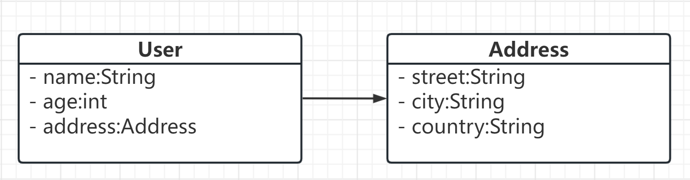

## 2.实战：获取用户所在的城市

### 2.1.直接获取；容易出现空指针异常。

```java
/**
 * 获取人员所在的城市
 * @author 百里
 */
public class BaiLiNpeDemo {
    public static void main(String[] args) {
        Address myAddress = new Address();
        User myUser = new User("John Doe", 35, myAddress);
        String city = myUser.getAddress().getCity().trim();
        System.out.println(city);
    }
}
```

### 2.2.使用if-else判断；避免了出现空指针的问题，但是代码结构层次嵌套多，不美观

```java
/**
 * 使用if进行判断
 * @author 百里
 */
public class BaiLiSimpleNpeDemo {
    public static void main(String[] args) {
        Address myAddress = new Address();
        User myUser = new User("John Doe", 35, myAddress);
        if (myUser != null) {
            Address address = myUser.getAddress();
            if (address != null) {
                String city = address.getCity();
                if (city != null  && !"".equals(city)) {
                    System.out.println("使用if判断字符串：" + "一键三连");
                }
            }
        }
    }
}
```

### 2.3.使用工具类美化一下if判断代码

```java
/**
 * 使用工具类
 * @author 百里
 */
public class BaiLiUtilsNpeDemo {
    public static void main(String[] args) {
        Address myAddress = new Address("123 Main St", " Austin ", "CA");
        User myUser = new User("John Doe", 35, myAddress);
        //针对对象与字符串
        if (!ObjectUtils.isEmpty(myUser)) {
            Address address = myUser.getAddress();
            if (!ObjectUtils.isEmpty(address)) {
                String city = address.getCity();
                if (!StringUtils.isEmpty(city)) {
                    System.out.println("使用StringUtils工具类判断字符串：" + "一键三连");
                }
            }
        }
    	//针对数组使用工具类
        ArrayList users = new ArrayList<>();
        users.add(myUser);
        if (!CollectionUtils.isEmpty(users)) {
            System.out.println("使用CollectionUtils工具类判断数组对象：" + "一键三连");
        }
    }
}
```

### 2.4.使用Optional解决了层次多的问题也避免了空指针的问题，当我们配合使用orElse时，会先执行orElse方法，然后执行逻辑代码，不管是否出现了空指针。

```java
/**
 * 使用Optional
 * @author 百里
 */
public class BaiLiOptionalNpeDemo {
    public static void main(String[] args) {
        Address myAddress = new Address();
        User myUser = new User("John Doe", 35, myAddress);
        System.out.println("使用Optional判断 + orElse:" +
                Optional.ofNullable(myUser)
                .map(User::getAddress)
                .map(Address::getCity)
                .map(String::trim)
                .orElse(getDefaultCity())
        );
    }
    //初始化城市
    public static String getDefaultCity() {
        System.out.println("初始化默认城市");
        return null;
    }
}
```

### 2.5.使用断言处理接口入参，检查假设和前置条件是否满足，以及检查空值情况，提前捕获空指针异常并进行处理

```java
import org.springframework.util.Assert;

/**
 * 接口参数校验
 * @author 百里
 */
public class BaiLiAssertNpeDemo {
    public static void main(String[] args) {
        Address myAddress = new Address("123 Main St", " Austin ", "CA");
        User user = new User("John Doe", 35, myAddress);
        getUserCity(user);
        getUserCity(null);
    }

    public static void getUserCity(User user){
        Assert.notNull(user,"user is null");
        Address address = user.getAddress();
        Assert.notNull(address,"address is null");
        String city = address.getCity();
        System.out.println(city);
    }
}
```

### 2.6.使用@Nullable注解，标识变量或方法参数和返回值是否可以为 null，以便在编译期或开发工具中提示可能的 NullPointerException 风险

```java
/**
 * 使用注解 @Nullable
 * @author 百里
 */
public class BaiLiNonNullDemo {
    public static void printString(@Nullable String str) {
        System.out.println(str.toString());
    }

    @Nullable
    public static String getString() {
        return null;
    }

    public static void main(String[] args) {
        String str = null;
        printString(str);
        getString().toString();

        User user = new User();
        user.getAddress().getCity();
    }
}
```

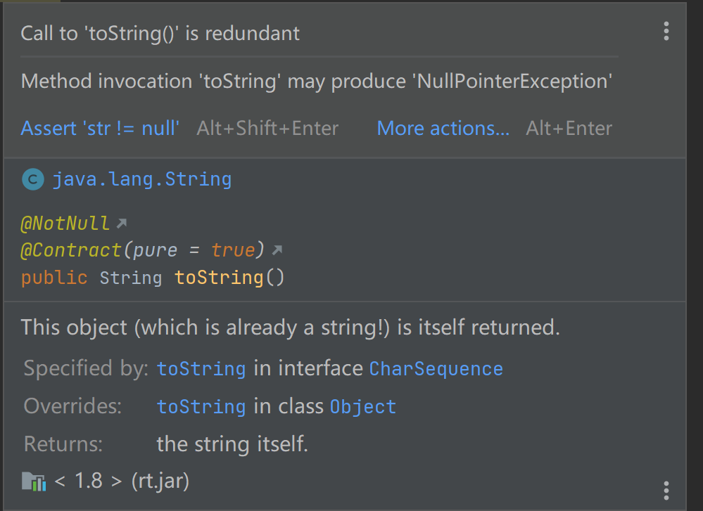

### 2.7.额外补充

JDK17优化了空指针异常信息(Helpful NullPointerExceptions)\
通过精确描述哪个变量为空来提高JVM生成的空指针异常信息的可用性。\
即，以前的空指针异常信息不会告诉你具体是哪个对象为null，当运行的语句是对一个嵌套结构的对象做连续的方法调用(如"a.getb().getc().xxx()")时，就需要进一步分析或调试才能判断出谁是null。而该特性加入以后则直接在异常信息中说明值为null的对象是哪个。

```java
/**
 * @author 百里
 */
public class BaiLiNpeDemo {
    public static void main(String[] args) {
        Address myAddress = new Address("123 Main St", null, "CA");
        User myUser = new User("John Doe", 35, myAddress);
        System.out.println(myUser.getAddress().getCity().trim());
    }
}
```

执行结果：

```java
Exception in thread "main" java.lang.NullPointerException: Cannot invoke "String.trim()" because the return value of "npe.Address.getCity()" is null
	at npe.BaiLiNpeDemo.main(BaiLiNpeDemo.java:16)
```

# 什么是 CopyOnWriteArrayList

## 1.Copy-On-Write 是什么？

Copy-On-Write它是一种在计算机科学中常见的优化技术，主要应用于需要频繁读取但很少修改的数据结构上。\
简单的说就是在计算机中就是当你想要对一块内存进行修改时，我们不在原有内存块中进行写操作，而是将内存拷贝一份，在新的内存中进行写操作，写完之后呢，就将指向原来内存指针指向新的内存，原来的内存就可以被回收掉了！\
既然是一种优化策略，我们看一段代码：

```java
import java.util.ArrayList;
import java.util.Arrays;
import java.util.Iterator;
import java.util.List;

/**
* @author 百里
*/
public class BaiLiIteratorTest {
    private static List list = new ArrayList<>();

    public static void main(String[] args) {
        list.add("1");
        list.add("2");
        list.add("3");
        Iterator iter = list.iterator();
        while (iter.hasNext()) {
            System.err.println(iter.next());
        }
        System.err.println(Arrays.toString(list.toArray()));
    }
}
```

上面的Demo在单线程下执行时没什么毛病，但是在多线程的环境中，就可能出异常，为什么呢？\
因为多线程迭代时如果有其他线程对这个集合list进行增减元素，会抛出java.util.ConcurrentModificationException的异常。\
我们以增加元素为例子，运行下面这Demo：

```java
import java.util.ArrayList;
import java.util.Iterator;
import java.util.List;
import java.util.concurrent.ExecutorService;
import java.util.concurrent.Executors;

/**
 * 并发迭代器问题示例代码
 * @author 百里
 */
public class BaiLiConcurrentIteratorTest {
    // 创建一个ArrayList对象
    private static List list = new ArrayList<>();

    public static void main(String[] args) throws InterruptedException {
        // 给ArrayList添加三个元素："1"、"2"和"3"
        list.add("1");
        list.add("2");
        list.add("3");

        // 开启线程池，提交10个线程用于在list尾部添加5个元素"121"
        ExecutorService service = Executors.newFixedThreadPool(10);
        for (int i = 0; i  {
                for (int j = 0; j  iter = list.iterator();
        for (int i = 0; i  {
                while (iter.hasNext()) {
                    System.err.println(iter.next());
                    try {
                        Thread.sleep(10);
                    } catch (InterruptedException e) {
                        e.printStackTrace();
                    }
                }
            });
        }
        service.shutdown();
    }
}
```

**这里暴露的问题是什么呢？**

* 多线程场景下迭代器遍历集合的读取操作和其他线程对集合进行写入操作会导致出现并发修改异常

解决方案：

* CopyOnWriteArrayList避免了多线程操作List线程不安全的问题

## 2.CopyOnWriteArrayList介绍

从JDK1.5开始Java并发包里提供了两个使用CopyOnWrite机制实现的并发容器，它们是CopyOnWriteArrayList和CopyOnWriteArraySet。CopyOnWrite容器非常有用，可以在非常多的并发场景中使用到。\
**CopyOnWriteArrayList原理：**\
在写操作(add、remove等)时，不直接对原数据进行修改，而是先将原数据复制一份，然后在新复制的数据上执行写操作，最后将原数据引用指向新数据。这样做的好处是读操作(get、iterator等)可以不加锁，因为读取的数据始终是不变的。\
接下来我们就看下源码怎么实现的。

## 3.CopyOnWriteArrayList简单源码解读

add()方法源码：

```java
/**
* Appends the specified element to the end of this list.
*
* @param e element to be appended to this list
* @return {@code true} (as specified by {@link Collection#add})
*/
public boolean add(E e) {
    final ReentrantLock lock = this.lock;//重入锁
	lock.lock();//加锁啦
    try {
        Object[] elements = getArray();
        int len = elements.length;
        Object[] newElements = Arrays.copyOf(elements, len + 1);//拷贝新数组
        newElements[len] = e;
        setArray(newElements);//将引用指向新数组  1
        return true;
    } finally {
        lock.unlock();//解锁啦
    }
}
```

可以看到，CopyOnWriteArrayList中的写操作都需要先获取锁，然后再将当前的元素数组复制一份，并在新复制的元素数组上执行写操作，最后将数组引用指向新数组。

```java
@SuppressWarnings("unchecked")
public E next() {
    if (! hasNext()) //是否存在下一个元素
        throw new NoSuchElementException(); //没有下一个元素，则会抛出NoSuchElementException异常
    //snapshot是一个类成员变量，它是在创建迭代器时通过复制集合内容而获得的一个数组。
    //cursor是另一个类成员变量，初始值为0，并在每次调用next()时自增1，表示当前返回元素的位置。
    return (E) snapshot[cursor++];
}
```

而读操作不需要加锁，直接返回当前的元素数组即可。\
这种写时复制的机制保证了读操作的线程安全性，但是会牺牲一些写操作的性能，因为每次修改都需要复制一份数组。因此，适合读远多于写的场合。\
所以我们将多线程Demo中的ArrayList改为CopyOnWriteArrayList，执行就不会报错啦！

```java
import java.util.Iterator;
import java.util.concurrent.CopyOnWriteArrayList;
import java.util.concurrent.ExecutorService;
import java.util.concurrent.Executors;

/**
* 并发迭代器问题示例代码
* @author 百里
*/
public class BaiLiConcurrentIteratorTest {
    // 创建一个ArrayList对象
    private static CopyOnWriteArrayList list = new CopyOnWriteArrayList<>();

    public static void main(String[] args) throws InterruptedException {
        // 给ArrayList添加三个元素："1"、"2"和"3"
        list.add("1");
        list.add("2");
        list.add("3");

        // 开启线程池，提交10个线程用于在list尾部添加5个元素"121"
        ExecutorService service = Executors.newFixedThreadPool(10);
        for (int i = 0; i  {
                for (int j = 0; j  iter = list.iterator();
        for (int i = 0; i  {
                while (iter.hasNext()) {
                    System.err.println(iter.next());
                    try {
                        Thread.sleep(10);
                    } catch (InterruptedException e) {
                        e.printStackTrace();
                    }
                }
            });
        }
        service.shutdown();
    }
}
```

## 4.CopyOnWriteArrayList优缺点

优点：

1. \*\*线程安全。\*\*CopyOnWriteArrayList是线程安全的，由于写操作对原数据进行复制，因此写操作不会影响读操作，读操作可以不加锁，降低了并发冲突的概率。
2. \*\*不会抛出ConcurrentModificationException异常。\*\*由于读操作遍历的是不变的数组副本，因此不会抛出ConcurrentModificationException异常。

缺点：

1. \*\*写操作性能较低。\*\*由于每一次写操作都需要将元素复制一份，因此写操作的性能较低。
2. \*\*内存占用增加。\*\*由于每次写操作都需要创建一个新的数组副本，因此内存占用会增加，特别是当集合中有大量数据时，内存占用较高。
3. \*\*数据一致性问题。\*\*由于读操作遍历的是不变的数组副本，因此在对数组执行写操作期间，读操作可能读取到旧的数组数据，这就涉及到数据一致性问题。

## 5.CopyOnWriteArrayList使用场景

* 读多写少。为什么？因为写的时候会复制新集合
* 集合不大。为什么？因为写的时候会复制新集合
* 实时性要求不高。为什么，因为有可能会读取到旧的集合数据

# List操作的一些常见问题

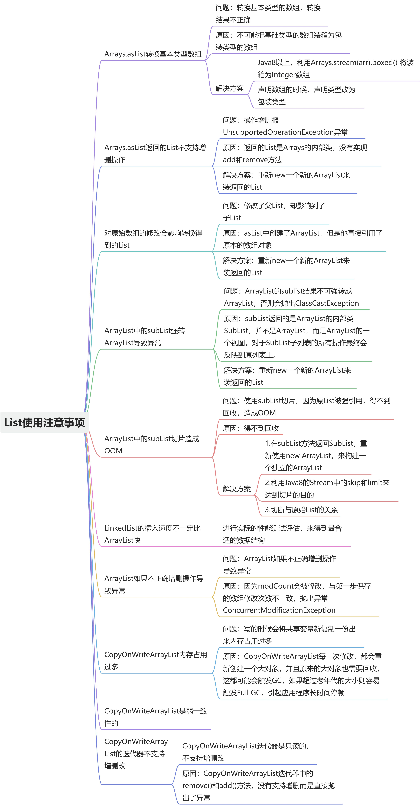

## 阿里巴巴开发手册强制规约：

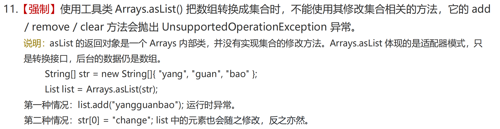\
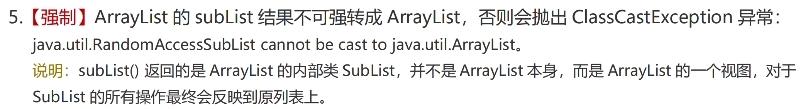\
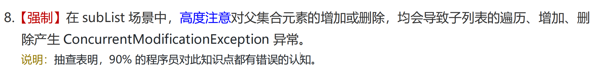

## 1. Arrays.asList转换基本类型数组

在实际的业务开发中，我们通常会进行数组转List的操作，通常我们会使用Arrays.asList来进行转换，但是在转换基本类型的数组的时候，却出现转换的结果和我们想象的不一致。

```java
import java.util.Arrays;
import java.util.List;

/**
 * Arrays.asList数组常见问题
 * @author 百里
 */
public class BaiLiTestDemo {
    public static void main(String[] args) {
        int[] arr = {1, 2, 3};
        List list = Arrays.asList(arr);
        System.out.println("list.size：" + list.size());
        for (int i = 0; i (a);
}
```

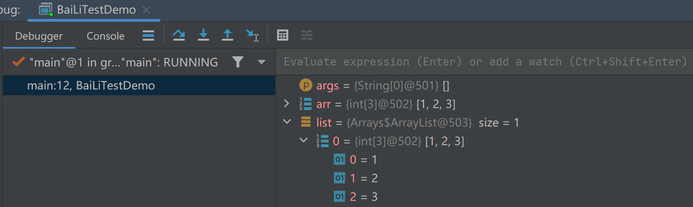\
那我们该如何解决呢？只需要在声明数组的时候，声明类型改为包装类型。

```java
import java.util.Arrays;
import java.util.List;

/**
 * Arrays.asList数组常见问题
 * @author 百里
 */
public class BaiLiTestDemo {
    public static void main(String[] args) {
        Integer[] arr = {1, 2, 3};
        List list = Arrays.asList(arr);
        System.out.println("list.size：" + list.size());//size = 3
        for (int i = 0; i (Arrays.asList(arr));
        arr[0] = 10;
        for (int i = 0; i  names = new ArrayList() {{
            add("one");
            add("two");
            add("three");
        }};
        ArrayList strings = (ArrayList) names.subList(0, 1);
        System.out.println(strings);
    }
}
```

```java
Exception in thread "main" java.lang.ClassCastException: java.util.ArrayList$SubList cannot be cast to java.util.ArrayList
	at BaiLiArrayListDemo.main(BaiLiArrayListDemo.java:15)
```

同样的，我们看下sublist的实现：\
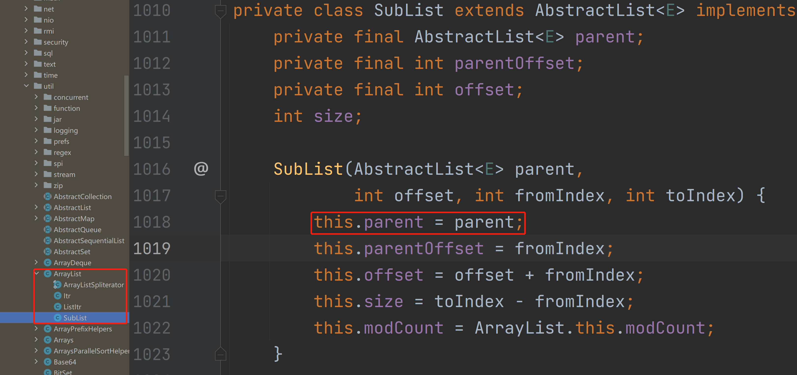\
可以看到SubList()实际上没有创建一个新的List，而是直接引用了原来的List，指定了元素的范围。并且返回的是一个内部类实现的SubList对象，该对象只是原始ArrayList的一个引用，而不是一个全新的ArrayList，因此无法直接将其强制转换为ArrayList类型。\
由于是引用的原List，因此也会存在asList的问题，也就是针对subList进行增减数据，会影响原List的值。

```java
import java.util.ArrayList;
import java.util.List;

/**
 * ArrayList.subList常见问题
 * @author 百里
 */
public class BaiLiArrayListDemo {
    public static void main(String[] args) {
        List names = new ArrayList() {{
            add("one");
            add("two");
            add("three");
        }};
        List  strings = names.subList(0, 1);
        strings.add(0,"four");
        System.out.println(strings);//[four, one]
        System.out.println(names);//[four, one, two, three]
    }
}
```

需要注意修改原List-names的值会出导致strings的遍历、增加、删除产生ConcurrentModificationException异常。

```java
import java.util.ArrayList;
import java.util.List;

/**
 * ArrayList.subList常见问题
 * @author 百里
 */
public class BaiLiArrayListDemo {
    public static void main(String[] args) {
        List names = new ArrayList() {{
            add("one");
            add("two");
            add("three");
        }};
        List strings = names.subList(0, 1);
        names.add("four");
        System.out.println(strings);
        System.out.println(names);
    }
}
```

```java
Exception in thread "main" java.util.ConcurrentModificationException
	at java.util.ArrayList$SubList.checkForComodification(ArrayList.java:1231)
	at java.util.ArrayList$SubList.listIterator(ArrayList.java:1091)
	at java.util.AbstractList.listIterator(AbstractList.java:299)
	at java.util.ArrayList$SubList.iterator(ArrayList.java:1087)
	at java.util.AbstractCollection.toString(AbstractCollection.java:454)
	at java.lang.String.valueOf(String.java:2994)
	at java.io.PrintStream.println(PrintStream.java:821)
	at BaiLiArrayListDemo.main(BaiLiArrayListDemo.java:17)
```

上面问题的解决方案跟asList同样，直接new一个新的ArrayList装Arrays.subList返回数据就可以了。

```java
import java.util.ArrayList;
import java.util.List;

/**
 * ArrayList.subList常见问题
 * @author 百里
 */
public class BaiLiArrayListDemo {
    public static void main(String[] args) {
        List names = new ArrayList() {{
            add("one");
            add("two");
            add("three");
        }};
        List strings = new ArrayList<>(names.subList(0, 1));
        strings.add("four");
        System.out.println(strings);//[one, four]
        System.out.println(names);//[one, two, three]
    }
}
```

## 5. ArrayList中的subList切片造成OOM

subList所产生的List，其实是对原来List对象的引用，这个产生的List只是原来List对象的视图，也就是说虽然值切片获取了一小段数据，但是原来的List对象却得不到回收，如果这个原来的对象很大，就会出现OOM的情况。我们将VM参数调小：-Xms20m -Xmx40m

```java
import java.util.ArrayList;
import java.util.List;
import java.util.stream.Collectors;
import java.util.stream.IntStream;

/**
 * ArrayList.subList常见问题
 * @author 百里
 */
public class BaiLiArrayListDemo {
    public static void main(String[] args) {
        List data = new ArrayList<>();
        IntStream.range(0, 1000).forEach(i ->{
            List collect =
                    IntStream.range(0, 100000).boxed().
                            collect(Collectors.toList());
            data.add(collect.subList(0, 1));
        });
    }
}
```

出现OOM的原因：原数组无法被回收，会一直在内存中。\
解决方案：new一个新的ArrayList接收subList返回。

## 6.Copy-On-Write 是什么？

Copy-On-Write它是一种在计算机科学中常见的优化技术，主要应用于需要频繁读取但很少修改的数据结构上。\
简单的说就是在计算机中就是当你想要对一块内存进行修改时，我们不在原有内存块中进行写操作，而是将内存拷贝一份，在新的内存中进行写操作，写完之后呢，就将指向原来内存指针指向新的内存，原来的内存就可以被回收掉了！\
既然是一种优化策略，我们看一段代码：

```java
import java.util.ArrayList;
import java.util.Arrays;
import java.util.Iterator;
import java.util.List;

/**
* @author 百里
*/
public class BaiLiIteratorTest {
    private static List list = new ArrayList<>();

    public static void main(String[] args) {
        list.add("1");
        list.add("2");
        list.add("3");
        Iterator iter = list.iterator();
        while (iter.hasNext()) {
            System.err.println(iter.next());
        }
        System.err.println(Arrays.toString(list.toArray()));
    }
}
```

上面的Demo在单线程下执行时没什么毛病，但是在多线程的环境中，就可能出异常，为什么呢？\
因为多线程迭代时如果有其他线程对这个集合list进行增减元素，会抛出java.util.ConcurrentModificationException的异常。\
我们以增加元素为例子，运行下面这Demo：

```java
import java.util.ArrayList;
import java.util.Iterator;
import java.util.List;
import java.util.concurrent.ExecutorService;
import java.util.concurrent.Executors;

/**
 * 并发迭代器问题示例代码
 * @author 百里
 */
public class BaiLiConcurrentIteratorTest {
    // 创建一个ArrayList对象
    private static List list = new ArrayList<>();

    public static void main(String[] args) throws InterruptedException {
        // 给ArrayList添加三个元素："1"、"2"和"3"
        list.add("1");
        list.add("2");
        list.add("3");

        // 开启线程池，提交10个线程用于在list尾部添加5个元素"121"
        ExecutorService service = Executors.newFixedThreadPool(10);
        for (int i = 0; i  {
                for (int j = 0; j  iter = list.iterator();
        for (int i = 0; i  {
                while (iter.hasNext()) {
                    System.err.println(iter.next());
                    try {
                        Thread.sleep(10);
                    } catch (InterruptedException e) {
                        e.printStackTrace();
                    }
                }
            });
        }
        service.shutdown();
    }
}
```

**这里暴露的问题是什么呢？**

* 多线程场景下迭代器遍历集合的读取操作和其他线程对集合进行写入操作会导致出现并发修改异常

解决方案：

* CopyOnWriteArrayList避免了多线程操作List线程不安全的问题

## 7.CopyOnWriteArrayList介绍

从JDK1.5开始Java并发包里提供了两个使用CopyOnWrite机制实现的并发容器，它们是CopyOnWriteArrayList和CopyOnWriteArraySet。CopyOnWrite容器非常有用，可以在非常多的并发场景中使用到。\
**CopyOnWriteArrayList原理：**\
在写操作(add、remove等)时，不直接对原数据进行修改，而是先将原数据复制一份，然后在新复制的数据上执行写操作，最后将原数据引用指向新数据。这样做的好处是读操作(get、iterator等)可以不加锁，因为读取的数据始终是不变的。\
接下来我们就看下源码怎么实现的。

## 8.CopyOnWriteArrayList简单源码解读

add()方法源码：

```java
/**
* Appends the specified element to the end of this list.
*
* @param e element to be appended to this list
* @return {@code true} (as specified by {@link Collection#add})
*/
public boolean add(E e) {
    final ReentrantLock lock = this.lock;//重入锁
	lock.lock();//加锁啦
    try {
        Object[] elements = getArray();
        int len = elements.length;
        Object[] newElements = Arrays.copyOf(elements, len + 1);//拷贝新数组
        newElements[len] = e;
        setArray(newElements);//将引用指向新数组  1
        return true;
    } finally {
        lock.unlock();//解锁啦
    }
}
```

可以看到，CopyOnWriteArrayList中的写操作都需要先获取锁，然后再将当前的元素数组复制一份，并在新复制的元素数组上执行写操作，最后将数组引用指向新数组。

```java
@SuppressWarnings("unchecked")
public E next() {
    if (! hasNext()) //是否存在下一个元素
        throw new NoSuchElementException(); //没有下一个元素，则会抛出NoSuchElementException异常
    //snapshot是一个类成员变量，它是在创建迭代器时通过复制集合内容而获得的一个数组。
    //cursor是另一个类成员变量，初始值为0，并在每次调用next()时自增1，表示当前返回元素的位置。
    return (E) snapshot[cursor++];
}
```

而读操作不需要加锁，直接返回当前的元素数组即可。\
这种写时复制的机制保证了读操作的线程安全性，但是会牺牲一些写操作的性能，因为每次修改都需要复制一份数组。因此，适合读远多于写的场合。\
所以我们将多线程Demo中的ArrayList改为CopyOnWriteArrayList，执行就不会报错啦！

```java
import java.util.Iterator;
import java.util.concurrent.CopyOnWriteArrayList;
import java.util.concurrent.ExecutorService;
import java.util.concurrent.Executors;

/**
* 并发迭代器问题示例代码
* @author 百里
*/
public class BaiLiConcurrentIteratorTest {
    // 创建一个ArrayList对象
    private static CopyOnWriteArrayList list = new CopyOnWriteArrayList<>();

    public static void main(String[] args) throws InterruptedException {
        // 给ArrayList添加三个元素："1"、"2"和"3"
        list.add("1");
        list.add("2");
        list.add("3");

        // 开启线程池，提交10个线程用于在list尾部添加5个元素"121"
        ExecutorService service = Executors.newFixedThreadPool(10);
        for (int i = 0; i  {
                for (int j = 0; j  iter = list.iterator();
        for (int i = 0; i  {
                while (iter.hasNext()) {
                    System.err.println(iter.next());
                    try {
                        Thread.sleep(10);
                    } catch (InterruptedException e) {
                        e.printStackTrace();
                    }
                }
            });
        }
        service.shutdown();
    }
}
```

## 9.CopyOnWriteArrayList优缺点

优点：

1. \*\*线程安全。\*\*CopyOnWriteArrayList是线程安全的，由于写操作对原数据进行复制，因此写操作不会影响读操作，读操作可以不加锁，降低了并发冲突的概率。
2. \*\*不会抛出ConcurrentModificationException异常。\*\*由于读操作遍历的是不变的数组副本，因此不会抛出ConcurrentModificationException异常。

缺点：

1. \*\*写操作性能较低。\*\*由于每一次写操作都需要将元素复制一份，因此写操作的性能较低。
2. \*\*内存占用增加。\*\*由于每次写操作都需要创建一个新的数组副本，因此内存占用会增加，特别是当集合中有大量数据时，内存占用较高。
3. \*\*数据一致性问题。\*\*由于读操作遍历的是不变的数组副本，因此在对数组执行写操作期间，读操作可能读取到旧的数组数据，这就涉及到数据一致性问题。

## 10.CopyOnWriteArrayList使用场景

* 读多写少。为什么？因为写的时候会复制新集合
* 集合不大。为什么？因为写的时候会复制新集合
* 实时性要求不高。为什么，因为有可能会读取到旧的集合数据

# 如何优雅的删除HashMap元素

## 图灵学院-百里

## 1.数据准备

```java
public Map initMap = new HashMap() {{
    put("user1", "刘零");
    put("user2", "郑一");
    put("user3", "吴二");
    put("user4", "张三");
    put("user5", "李四");
    put("user6", "王五");
    put("user7", "钱六");
    put("user8", "孙七");
}};
```

## 2.删除方式

### 2.1.使用增强 for 循环删除

```java
/**
 * 使用 for 循环删除
 */
public void remove1() {
    Set> entries = new CopyOnWriteArraySet<>(initMap.entrySet());
    for (Map.Entry entry : entries) {
        if ("王五".equals(entry.getValue())) {
            initMap.remove(entry.getKey());
        }
    }
    System.out.println(initMap);
}
```

输出结果：\
`{user1=刘零, user2=郑一, user7=钱六, user8=孙七, user5=李四, user3=吴二, user4=张三}`\
通过HashMap的entrySet方法获取元素集合，然后再进行循环遍历，判断value值是否为需要删除的元素，再移除对应的Key。\
需要注意增强的 for 循环底层使用的迭代器 Iterator，而 HashMap 是 fail-fast 原则的错误机制，所以遍历时删除元素会出现 java.util.ConcurrentModificationException 并发修改异常。我们可以使用CopyOnWriteArraySet封装一层避免出现并发修改异常。

* fail-fast:为了将错误或异常情况尽早暴露出来，避免潜在的问题在后续代码中蔓延，提高系统的稳定性和可靠性。

### 2.2.使用 forEach 循环删除

```java
/**
 * 使用 forEach 循环删除
 */
public void remove2() {
    ConcurrentHashMap map = new ConcurrentHashMap<>(initMap);
    map.forEach((k, v) -> {
        if ("王五".equals(v)) {
            map.remove(k);
        }
    });
    System.out.println(map);
}
```

输出结果：\
`{user1=刘零, user2=郑一, user7=钱六, user8=孙七, user5=李四, user3=吴二, user4=张三}`\
通过HashMap的forEach方法循环删除目标元素，同样的使用了ConcurrentHashMap封装避免出现并发修改异常。

### 2.3.使用 Iterator 迭代器删除

```java
/**
 * 使用 Iterator 迭代器删除
 */
@Test
public void remove3() {
    ConcurrentHashMap resultMap = new ConcurrentHashMap<>();
    Iterator> iterator
            = new ConcurrentHashMap<>(initMap).entrySet().iterator();
    while (iterator.hasNext()) {
        Map.Entry entry = iterator.next();
        if ("王五".equals(entry.getValue())) {
            iterator.remove();
        }else {
            resultMap.put(entry.getKey(),entry.getValue());
        }
    }
    System.out.println(resultMap);
}
```

输出结果：\
`{user1=刘零, user2=郑一, user7=钱六, user8=孙七, user5=李四, user3=吴二, user4=张三}`\
通过Iterator迭代删除元素不会出现并发修改异常，但由于HashMap是线程不安全的，这时如果多个线程同时修改HashMap数据也会出现并发修改异常 ，日常使用可以先用ConcurrentHashMap封装。

### 2.4.使用 removeIf 删除（推荐使用）

```java
/**
 * 使用 removeIf 删除
 */
public void remove4() {
    initMap.entrySet().removeIf(entry -> "王五".equals(entry.getValue()));
    System.out.println(initMap);
}
```

输出结果：\
`{user1=刘零, user2=郑一, user7=钱六, user8=孙七, user5=李四, user3=吴二, user4=张三}`\
通过entrySet获取元素然后使用removeIf方法删除目标数据；而removeIf的底层是通过Iterator迭代器实现的。所以也存在第三种方法同样的问题。

```java
default boolean removeIf(Predicate filter) {
    Objects.requireNonNull(filter);
    boolean removed = false;
    final Iterator each = iterator();
    while (each.hasNext()) {
        if (filter.test(each.next())) {
            each.remove();
            removed = true;
        }
    }
    return removed;
}
```

### 2.5.使用 Stream 删除（推荐使用）

```java
/**
 * 使用 Stream 删除
 */
public void remove5() {
    Map map = initMap.entrySet().stream()
            .filter(entry -> !"王五".equals(entry.getValue()))
            .collect(Collectors.toMap(Map.Entry::getKey, Map.Entry::getValue));
    System.out.println(map);
}
```

输出结果：\
`{user1=刘零, user2=郑一, user7=钱六, user8=孙七, user5=李四, user3=吴二, user4=张三}`\
通过Stream 的 filter 方法进行过滤，然后生成一个新的map。这种方式“一行代码“就能够实现删除的动作，并且没有并发问题。

# 使用BigDecimal 一定需要注意的几个坑

## BigDecimal概述

BigDecimal 是 Java 中的一个类，用于精确表示和操作任意精度的十进制数。它提供了高精度的数值计算，并且可以避免浮点数计算中常见的精度丢失问题。\
它提供了大量的方法来支持基本的数学运算，如加法、减法、乘法、除法等。它还支持比较操作和取整操作，可以设置小数位数、舍入模式等。此外，BigDecimal 还提供了一些其他功能，如转换为科学计数法、格式化输出、判断是否是整数等。\
适用场景：需要处理精确计算或防止浮点数计算精度丢失的场景。

## BigDecimal常见陷阱

### 1.使用BigDecimal的构造函数传入浮点数

其实这个问题我们在使用Float、Double等浮点类型进行计算时，也会经常遇到，比如说下面这个代码

```java
@Test
public void bigDecimalDemo1() {
    float float1 = 1;
    float float2 = 0.9f;
    System.out.println(float1 - float2);
}
```

输出结果是多少呢？0.1？不是，输出结果是0.100000024。因为 0.9 无法被精确表示为有限位数的二进制小数。在转换为二进制时可能会产生近似值。因此，在进行减法运算时，实际上是对近似值进行计算，而不是对准确的 0.9 进行计算。这导致了精度丢失，最终的计算结果也是一个近似值。因此，输出结果不是准确的 0.1，而是一个近似值。\
小伙伴肯定能想到使用BigDecimal来避免这个问题，这时候第一个需要避免的陷阱就来了。看以下代码：

```java
@Test
public void bigDecimalDemo2(){
    BigDecimal bigDecimal1 = new BigDecimal(0.01);
    BigDecimal bigDecimal2 = BigDecimal.valueOf(0.01);
    System.out.println("bigDecimal1 = " + bigDecimal1);
    System.out.println("bigDecimal2 = " + bigDecimal2);
}
```

输出结果如下：

:::tips
bigDecimal1 = 0.01000000000000000020816681711721685132943093776702880859375\
bigDecimal2 = 0.01

:::

观察输出结果我们可以知道，使用BigDecimal时同样会有精度的问题。所以我们在创建BigDecimal对象时，有初始值使用BigDecimal.valueOf()的方式，可以避免出现精度问题。

#### 为什么会出现差异？

在使用new BigDecimal()实际上是将 0.01 转换为二进制近似值，并将其存储为 BigDecimal 对象。因此，结果中存在微小的误差，即输出结果为0.01000000000000000020816681711721685132943093776702880859375。\
而BigDecimal.valueOf()不同，其内部是先将double转为String，因此不存在精度问题。

```java
public static BigDecimal valueOf(double val) {
    // Reminder: a zero double returns '0.0', so we cannot fastpath
    // to use the constant ZERO.  This might be important enough to
    // justify a factory approach, a cache, or a few private
    // constants, later.
    return new BigDecimal(Double.toString(val));
}
```

TIPS：

:::tips

1. 使用整数或长整数作为参数构造：
   * BigDecimal(int val)：使用一个 int 类型的整数值创建 BigDecimal。
   * BigDecimal(long val)：使用一个 long 类型的整数值创建 BigDecimal。

2. 使用字符串作为参数构造：
   * BigDecimal(String val)：使用一个字符串表示的数值创建 BigDecimal。该字符串可以包含整数部分、小数部分和指数部分。

3. 使用双精度浮点数作为参数构造：
   * BigDecimal(double val)：使用一个 double 类型的浮点数值创建 BigDecimal。注意，由于浮点数精度可能丢失，建议使用字符串或其他方法构造 BigDecimal，以避免精度损失问题。

4. 使用基于 BigInteger 的构造方法：
   * BigDecimal(BigInteger val)：使用一个 BigInteger 对象来创建 BigDecimal。

:::

### 2.使用equals()方法进行数值比较

日常项目我们是如何进行BigDecimal数值比较呢？使用equals方法还是compareTo方法？如果使用的是equals方法，那就需要注意啦。看一下示例：

```java
@Test
public void bigDecimalDemo3(){
    BigDecimal bigDecimal1 = new BigDecimal("0.01");
    BigDecimal bigDecimal2 = new BigDecimal("0.010");
    System.out.println(bigDecimal1.equals(bigDecimal2));
    System.out.println(bigDecimal1.compareTo(bigDecimal2));
}
```

输出结果如下：

:::tips
false\
0

:::

观察结果可以知道使用equals比较结果是不相等的；compareTo的结果为0代表两个数相等；

* compareTo实现了Comparable接口，比较的是值的大小，返回的值为-1-小于，0-等于，1-大于。

#### 为什么equals返回的是false？

```java
public boolean equals(Object x) {
    if (!(x instanceof BigDecimal))
        return false;
    BigDecimal xDec = (BigDecimal) x;
    if (x == this)
        return true;
    if (scale != xDec.scale)
        return false;
    long s = this.intCompact;
    long xs = xDec.intCompact;
    if (s != INFLATED) {
        if (xs == INFLATED)
            xs = compactValFor(xDec.intVal);
        return xs == s;
    } else if (xs != INFLATED)
        return xs == compactValFor(this.intVal);

    return this.inflated().equals(xDec.inflated());
}
```

我们观察equals的实现逻辑可以知道，BigDecimal重写了equals方法，重写后的关键代码：

:::tips
if (scale != xDec.scale)\
       return false;

:::

也就是会比较两个数值的精度，精度不同返回false。

### 3.使用不正确的舍入模式

使用BigDecimal进行运算时，一定要正确的使用舍入模式，避免舍入误差引起的问题，并且有时候出现结果是无限小数，程序会抛出异常，比如说：

```java
@Test
public void bigDecimalDemo4(){
    BigDecimal bigDecimal1 = new BigDecimal("1.00");
    BigDecimal bigDecimal2 = new BigDecimal("3.00");
    BigDecimal bigDecimal3 = bigDecimal1.divide(bigDecimal2);
    System.out.println(bigDecimal3);
}
```

输出结果如下：

:::tips
java.lang.ArithmeticException: Non-terminating decimal expansion; no exact representable decimal result.

:::

简单的来说，如果在除法运算过程中，其结果是一个无限小数，而操作的结果预期是一个精确的数字，那么将会抛出ArithmeticException异常。\
此时，我们只要正确指定结果精度即可：

```java
@Test
public void bigDecimalDemo4(){
    BigDecimal bigDecimal1 = new BigDecimal("1.00");
    BigDecimal bigDecimal2 = new BigDecimal("3.00");
    BigDecimal bigDecimal3 = bigDecimal1.divide(bigDecimal2, 2, RoundingMode.HALF_UP);
    System.out.println(bigDecimal3);
}
```

输出结果如下：

:::tips
0.33

:::

#### TIPS：

:::tips

* RoundingMode.UP：向远离零的方向舍入
* RoundingMode.DOWN：向靠近零的方向舍入
* RoundingMode.CEILING：向正无穷方向舍入
* RoundingMode.FLOOR：向负无穷方向舍入
* RoundingMode.HALF\_UP：四舍五入，如果舍弃部分大于等于 0.5
* RoundingMode.HALF\_DOWN：四舍五入，如果舍弃部分大于 0.5
* RoundingMode.HALF\_EVEN：银行家舍入法，遵循 IEEE 754 标准

:::

## 总结：

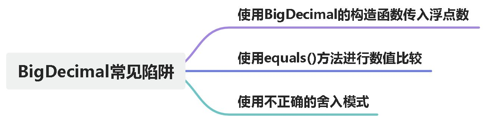

* 尽量使用字符串而非浮点类型来构造 BigDecimal 对象，以避免浮点数转换精度问题。
* 如果无法避免使用浮点类型，则可使用 BigDecimal.valueOf 方法来构造初始化值，以确保精确表示。
* 比较两个 BigDecimal 值的大小时，使用 compareTo 方法。如果需要严格限制精度的比较，可以考虑使用 equals 方法。
* 在进行 BigDecimal 运算前，明确指定精度和舍入模式。使用 setScale 方法设置精度，使用 setRoundingMode 方法设置舍入模式。

# 鱼和熊掌不可兼得之CAP定理

## 什么是 CAP 定理？

CAP 定理是一个分布式系统设计的基本原则。它指出，在一个分布式系统中，无法同时满足一致性（Consistency）、可用性（Availability）和分区容错性（Partition tolerance）三个特性。

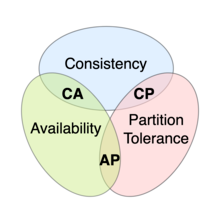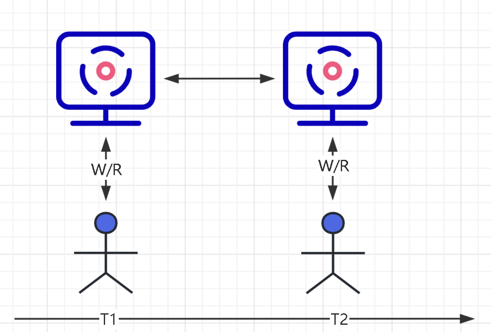

一致性 C：每次请求都会获取最新的数据或错误。

* 在网络分区期间，系统会保持对于客户端的读操作要么返回最新的数据，要么返回错误。

可用性 A：每个请求都会得到响应，但不能保证其中包含最新写入。

* 无论何时，任何客户端的请求都应该能够得到有效的响应数据，而不会出现响应错误。即使在网络分区期间，系统也会确保对客户端的请求进行响应。不管数据是否为最新。

分区容错性 P：节点之间的网络出现问题之后，系统仍在继续运行。

* 由于网络不可靠，当消息丢失或延迟到达时，系统仍会继续提供服务而不会挂掉。分区容忍性意味着系统会继续运行，并努力恢复网络分区后的一致性。

### CAP 为什么不能兼得？

这是因为在网络分区发生时，为了保证系统的可用性和分区容忍性，系统必须允许分区内的节点继续提供服务。而为了保证一致性，所有节点之间需要相互协调和同步，以确保数据的一致性。然而，在网络分区发生时，由于消息传递的延迟、丢失等问题，无法保证所有节点之间的即时一致性。

所以，当发生网络分区时，分布式系统必须在可用性和一致性之间做出折衷选择。具体来说，系统可以选择在网络分区期间放弃一致性，以保证可用性和分区容忍性，这是常见的解决方案。或者系统可以放弃可用性，在网络分区期间停止对外提供服务，等待分区恢复后再提供一致性的数据。

## AP、CP 如何理解？

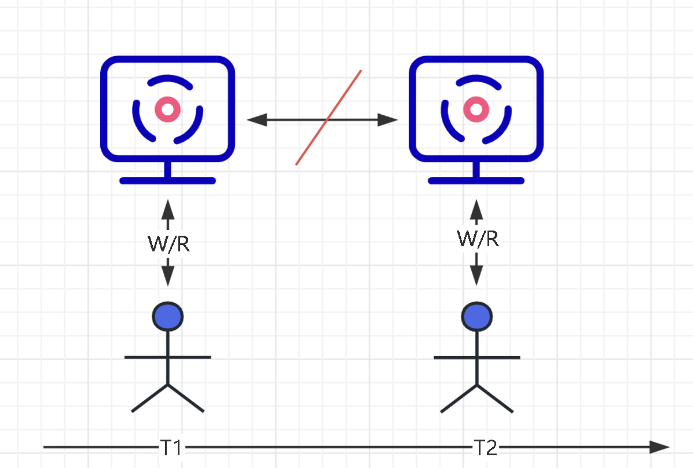

AP（可用性与分区容忍性）：系统能够在网络故障或部分节点失效的情况下继续可用。它侧重于保证系统的稳定性和用户的访问体验。

* 想象你正在使用一个社交媒体应用，这个应用具有AP属性。即使网络断开或某些服务器出现问题，你仍然可以浏览和发布动态，与朋友互动，尽管可能会遇到一些延迟或数据同步的问题。重点是，你可以随时使用该应用程序，即使在网络不稳定的情况下也能够完成基本操作。

CP(一致性与分区容忍性)：系统保证所有节点上的数据一致性，即使在网络分区时也能保持数据的一致性。它侧重于保持数据的准确性和一致性。

* 举个例子，假设你正在使用一个在线购物应用，这个应用具有CP属性。当你下订单时，系统会确保将订单信息同步到所有节点，以确保数据的一致性。如果发生网络分区，系统可能会暂停交易，直到网络恢复正常，并确保所有节点上的订单数据是一致的。这样可以避免出现因网络问题而导致订单丢失或重复的情况。

## 额外补充

在分布式系统正常运行时，即不存在网络分区或故障的情况下，的确可以同时满足一致性和可用性，这是因为节点之间可以直接通信来保持数据的一致性，并且系统可以一直对外提供服务。这样的场景下，CAP理论并不适用，因为没有发生需要做出选择的情况。

只有当网络分区或故障发生时，才需要在C和A之间进行权衡选择。在网络分区发生时，为了保证可用性和分区容忍性，系统可能需要放弃一致性，例如采用最终一致性模型。反之，如果一致性是更为重要的需求，系统可以牺牲可用性，在网络分区期间停止对外服务，等待分区恢复后再提供一致性数据。

# 为什么说BigDecimal适合数值计算

使用什么类型来进行数值计算？这个问题在程序员群体中一直都是一个争论激烈的问题，

**Int Long Double Float String BigDecimal**

如果还能再多几个类型的话，我估计也会有人安排上，究其原因我想大部分都是历史问题。

如果现在让你从 0 ->1 开始设计一个新的系统，相信大家应该大概也许都会优先考虑使用 BigDecimal 进行运算吧，别告诉我你还会用 String，当然如果是只交付不售后的那种，当我没说。让我来设计的肯定是优先考虑 BigDeCimal 运算了。原因的话我们接下来就一起看看 BigDecimal 的设计就明白了。

## 变量介绍

首先来看一下BigDecimal的类声明以及几个属性：

```java
public class BigDecimal extends Number implements Comparable {
    /**
     * 一个包含整数部分的 BigInteger 对象。
     * 某个整数值本身很大，超出基本数据类型的表示范围
     * 带小数的值转为整数后值很大，超出基本数据类型的表示范围
     */
    private final BigInteger intVal;
    /**
     * 小数点右侧的位数。
     * 它表示了小数的精度，即小数点后的位数。
     */
    private final int scale;
    /**
     * 数值的精度。
     * 它指的是 BigDecimal 数值的总位数，包括整数和小数部分。
     */
    private transient int precision;
    /**
     * 缓存的字符串表示。
     * 当 BigDecimal 被转换为字符串时，会将其缓存起来，以提高性能。
     */
    private transient String stringCache;
    // 扩大成long型数值后的值
    private final transient long intCompact;
}
```

## 从例子入手

通过debug来发现源码中的奥秘是了解类运行机制很好的方式。 请看下面的testBigDecimal方法：

```java
@Test
public void calBigDecimal(){
    BigDecimal bigDecimal1 = BigDecimal.valueOf(3.1415);
    BigDecimal bigDecimal2 = new BigDecimal("0.0001");
    BigDecimal bigDecimal = bigDecimal1.add(bigDecimal2);
    System.out.println(bigDecimal);
}
```

在 sout 断点，查看debug信息可以发现上述提到的几个属性被赋了值：

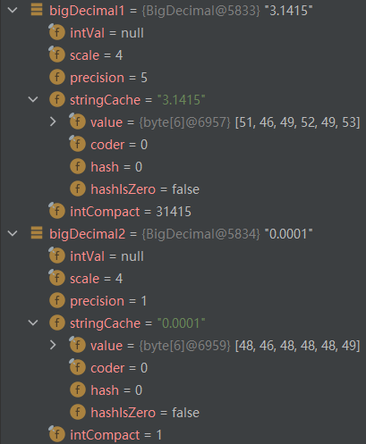

接下来进到add方法里面，看看它是怎么计算的：

```java
/**
 * 返回 BigDecimal 一个 其值为 (this + augend)，其小数位数为 max(this.scale(), augend.scale())。
 * 参数：augend – 要添加到此 BigDecimal的值。
 * 返回：this + augend
 */
public BigDecimal add(BigDecimal augend) {
    // 如果当前 BigDecimal 使用紧凑表示（intCompact != INFLATED）
    if (this.intCompact != INFLATED) {
        // 如果 augend 也使用紧凑表示（intCompact != INFLATED）
        if ((augend.intCompact != INFLATED)) {
            // 调用 add 方法执行加法，并返回结果
            return add(this.intCompact, this.scale, augend.intCompact, augend.scale);
        } else {
            // 如果 augend 使用大整数表示（intCompact == INFLATED）
            // 调用 add 方法执行加法，并返回结果
            return add(this.intCompact, this.scale, augend.intVal, augend.scale);
        }
    } else {
        // 如果当前 BigDecimal 使用大整数表示（intCompact == INFLATED）
        if ((augend.intCompact != INFLATED)) {
            // 如果 augend 使用紧凑表示（intCompact != INFLATED）
            // 调用 add 方法执行加法，并返回结果
            return add(augend.intCompact, augend.scale, this.intVal, this.scale);
        } else {
            // 如果 augend 使用大整数表示（intCompact == INFLATED）
            // 调用 add 方法执行加法，并返回结果
            return add(this.intVal, this.scale, augend.intVal, augend.scale);
        }
    }
}
```

根据传入的值，我们可以知道是进入第 12 行的add方法：

```java
/**
 * 使用紧凑表示执行两个长整型数值的加法，并返回结果。
 *
 * @param xs 第一个长整型数值
 * @param scale1 第一个数值的小数位数
 * @param ys 第二个长整型数值
 * @param scale2 第二个数值的小数位数
 * @return 加法结果的 BigDecimal 对象
 */
private static BigDecimal add(final long xs, int scale1, final long ys, int scale2) {
    // 计算两个数值的小数位数之差
    long sdiff = (long) scale1 - scale2;
    // 如果小数位数相等
    if (sdiff == 0) {
        // 直接调用 add 方法执行加法，并返回结果
        return add(xs, ys, scale1);
    // 如果第一个数的小数位数较多
    } else if (sdiff = 0) ?
                new BigDecimal(bigsum, INFLATED, scale2, 0) :
                valueOf(bigsum, scale2, 0);
        }
    // 如果第二个数的小数位数较多
    } else {
        // 检查并调整第二个数的小数位数
        int raise = checkScale(ys, sdiff);
        // 将第二个数按 10 的 raise 次方进行缩放
        long scaledY = longMultiplyPowerTen(ys, raise);
        // 如果缩放后的数值不为 INFLATED（紧凑表示）
        if (scaledY != INFLATED) {
            // 调用 add 方法执行加法，并返回结果
            return add(xs, scaledY, scale1);
        // 如果缩放后的数值为 INFLATED（大整数表示）
        } else {
            // 将第二个数按 10 的 raise 次方进行缩放，并与第一个数相加得到 BigInteger 对象
            BigInteger bigsum = bigMultiplyPowerTen(ys, raise).add(xs);
            // 根据数值的正负情况，创建新的 BigDecimal 对象并返回
            return ((xs ^ ys) >= 0) ?
                new BigDecimal(bigsum, INFLATED, scale1, 0) :
                valueOf(bigsum, scale1, 0);
        }
    }
}
```

这个例子中，该方法传入的参数分别是：xs=31415，scale1=4，ys=1，scale2=4 该方法首先计算scale1 - scale2，根据差值走不同的计算逻辑，这里求出来是 0，所以进入第一个 if 处理逻辑：

```java
/**
 * 使用紧凑表示执行两个长整型数值的加法，并返回结果。
 *
 * @param xs 第一个长整型数值
 * @param ys 第二个长整型数值
 * @param scale 结果的小数位数
 * @return 加法结果的 BigDecimal 对象
 */
private static BigDecimal add(long xs, long ys, int scale) {
    // 执行两个长整型数值的加法
    long sum = add(xs, ys);
    // 如果加法结果不为 INFLATED（紧凑表示）
    if (sum != INFLATED)
        // 将加法结果转换为 BigDecimal 对象，并指定小数位数
        return BigDecimal.valueOf(sum, scale);
    // 如果加法结果为 INFLATED（大整数表示）
    // 将两个长整型数值转换为 BigInteger 对象，并执行加法操作
    BigInteger bigSum = BigInteger.valueOf(xs).add(BigInteger.valueOf(ys));
    // 创建并返回一个新的 BigDecimal 对象，指定数值和小数位数
    return new BigDecimal(bigSum, scale);
}
```

这个方法很简单，就是计算和，然后返回BigDecimal对象

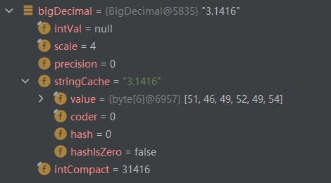

## 结论

其实到这里相信大家都知道 Bigdecimal 是如何保证精度的了，其实就是很多小伙伴正在使用的，将对应的数值进行放大，逻辑上将数值的单位进行缩放。而现在这个过程由 Bigdecimal 进行处理了，我们只需要调用相应的方法即可。

至于其他类型，我这边不使用就不跟大家讨论了，还在使用的看观们，快说出你们还在使用的原因，让大家一起开开眼。

```java
/**
 * 不可变的、任意精度的有符号十进制数。BigDecimal 由任意精度的整数非标度值 和 32 位的整数标度 (scale) 组成。
 * 如果为零或正数，则标度是小数点后的位数。如果为负数，则将该数的非标度值乘以 10 的负 scale 次幂。
 * 因此，BigDecimal 表示的数值是 (unscaledValue × 10的-scale次幂)。
 * BigDecimal 类提供以下操作：算术、标度操作、舍入、比较、哈希算法和格式转换。
 * toString() 方法提供 BigDecimal 的规范表示形式。
 * BigDecimal 类使用户能完全控制舍入行为。如果未指定舍入模式，并且无法表示准确结果，则抛出一个异常；
 * 否则，通过向该操作提供适当的 MathContext 对象，可以对已选择的精度和舍入模式执行计算。
 * 在任何情况下，可以为舍入控制提供八种舍入模式。使用此类（例如，ROUND_HALF_UP）中的整数字段来表示舍入模式已过时；
 * 应改为使用 RoundingMode enum（例如，RoundingMode.HALF_UP）的枚举值。
 * 当为 MathContext 对象提供 0 的精度设置（例如，MathContext.UNLIMITED）时，算术运算是准确的，
 * 它们是不采用任何 MathContext 对象的算术方法。（这是第 5 版之前的版本支持的唯一行为。）为了计算准确结果，
 * 不使用附带 0 精度设置的 MathContext 对象的舍入模式设置，因此与该对象无关。在除法中，准确的商可能是一个无限长的十进制扩展；
 * 例如，1 除以 3 所得的商。如果商具有无穷的十进制扩展，但是指定了该操作返回准确结果，则抛出 ArithmeticException。
 * 否则，像其他操作那样，返回除法运算的准确结果。
 * 当精度设置不为 0 时，BigDecimal 算法的规则完全符合 ANSI X3.274-1996 和 ANSI X3.274-1996/AM 1-2000（ 7.4 节）中定义的算法的可选操作模式。
 * 与上述标准不同，BigDecimal 包括多种舍入模式，它们对于版本 5 以前的 BigDecimal 版本中的除法是强制性的。
 * 这些 ANSI 标准和 BigDecimal 规范之间的任何冲突都按照有利于 BigDecimal 的方式进行解决。
 * 由于同一数值可以有不同的表示形式（具有不同的标度），因此运算和舍入的规则必须同时指定数值结果和结果表示形式中所用的标度。
 * 一般情况下，当准确结果（在除法中，可能有无限多位）比返回的数值具有更多位数时，舍入模式和精度设置确定操作如何返回具有有限位数的结果。
 *  首先，MathContext 的 precision 设置指定要返回的总位数；这确定了结果的精度。
 *  位数计数从准确结果的最左边的非零数字开始。舍入模式确定丢弃的尾部位数如何影响返回的结果。
 *  对于所有算术运算符，运算的执行方式是，首先计算准确的中间结果，然后，使用选择的舍入模式将其舍入为精度设置（如有必要）指定的位数。
 *  如果不返回准确结果，则将丢弃准确结果的某些数位。当舍入增加了返回结果的大小时，前导数字“9”的进位传播可能会创建新的数位。
 *  例如，将值 999.9 舍入为三位数字，则在数值上等于一千，表示为 100×101。在这种情况下，新的 "1" 是返回结果的前导数位。
 *  除了逻辑的准确结果外，每种算术运算都有一个表示结果的首选标度。下表列出了每个运算的首选标度。 算术运算结果的首选标度  运算 结果的首选标度
 *  	加 max(addend.scale(), augend.scale())
 *  	减 max(minuend.scale(), subtrahend.scale())
 *  	乘 multiplier.scale() + multiplicand.scale()
 *  	除 dividend.scale() - divisor.scale()
 *  这些标度是返回准确算术结果的方法使用的标度；准确相除可能必须使用较大的标度除外，因为准确的结果可能有较多的位数。例如，1/32 得到 0.03125。
 *  舍入之前，逻辑的准确中间结果的标度是该运算的首选标度。如果用 precision 位数无法表示准确的数值结果，则舍入会选择要返回的一组数字，
 *  并将该结果的标度从中间结果的标度减小到可以表示实际返回的 precision 位数的最小标度。
 *  如果准确结果可以使用最多 precision 个数字表示，则返回具有最接近首选标度的标度的结果表示形式。
 *  尤其是，通过移除结尾零并减少标度，可以用少于 precision 个数字来表示准确的可表示的商。例如，使用 floor 舍入模式将结果舍入为三个数字，
 *  	19/100 = 0.19 // integer=19, scale=2
 *  但是
 *  	21/110 = 0.190 // integer=190, scale=3
 *  注意，对于加、减和乘，标度的缩减量将等于丢弃的准确结果的数字位置数。如果舍入导致进位传播创建一个新的高位，则当未创建新的数位时，会丢弃该结果的附加数字。
 *  其他方法可能与舍入语义稍微不同。例如，使用指定的算法的 pow 方法得到的结果可能偶尔不同于舍入得到的算术结果，如最后一位有多个单位（ulp）。
 *  可以通过两种类型的操作来处理 BigDecimal 的标度：标度/舍入操作和小数点移动操作。标度/舍入操作（setScale 和 round）返回 BigDecimal，
 *  其值近似地（或精确地）等于操作数的值，但是其标度或精度是指定的值；即：它们会增加或减少对其值具有最小影响的存储数的精度。
 *  小数点移动操作（movePointLeft 和 movePointRight）返回从操作数创建的 BigDecimal，创建的方法是按指定方向将小数点移动一个指定距离。
 *  为了简洁明了起见，整个 BigDecimal 方法的描述中都使用了伪代码。伪代码表达式 (i + j) 是
 *  “其值为 BigDecimal i 加 BigDecimal j 的 BigDecimal”的简写。
 *  伪代码表达式 (i == j) 是“当且仅当 BigDecimal i 表示与 BigDecimal j 相同的值时，则为 true”的简写。
 *  可以类似地解释其他伪代码表达式。方括号用于表示特定的 BigInteger 和定义 BigDecimal 值的标度对；
 *  例如，[19, 2] 表示 BigDecimal 在数值上等于 0.19，标度是 2。
 *  注：如果 BigDecimal 对象用作 SortedMap 中的键或 SortedSet 中的元素，则应特别小心，
 *  因为 BigDecimal 的自然排序与 equals 方法不一致。
 */
public class BigDecimal extends Number implements Comparable {
	/*
     * 继承Number类提供将表示的数值转换为 byte、double、float、int、long 和 short 的方法。
     * 实现Comparable接口，获取到compareTo方法。
     */
	// BigDecimal的未scale的值,BigInteger是一个任意长度的整数（整数非标度值）
    private volatile BigInteger intVal;

	// BigDecimal的标度（小数点），输入数除以10的scale次幂（32 位的整数标度）
    private int scale; // 注意:这可能有任何值，因此计算必须长时间进行
	// BigDecimal的精度（精度是非标度值的数字个数。）
    private transient int precision;

	// toString后缓存
    private transient String stringCache;
    // 标记值为intCompact表示有效数字信息只能从intVal中获得。
    static final long INFLATED = Long.MIN_VALUE;
	// 若BigDecimal的绝对值小于Long.MAX_VALUE,放在这个变量中
    private transient long intCompact;
    /*
     * 所有18位基数的10个字符串组成一个长字符串;
     * 不是所有的19位字符串都可以
     */
    private static final int MAX_COMPACT_DIGITS = 18;

    private static final int MAX_BIGINT_BITS = 62;
    // 序列化
    private static final long serialVersionUID = 6108874887143696463L;

    private static final ThreadLocal
        threadLocalStringBuilderHelper = new ThreadLocal() {
        @Override
        protected StringBuilderHelper initialValue() {
            return new StringBuilderHelper();
        }
    };

  //缓存0 ~ 10
    private static final BigDecimal zeroThroughTen[] = {
        new BigDecimal(BigInteger.ZERO,         0,  0, 1),
        new BigDecimal(BigInteger.ONE,          1,  0, 1),
        new BigDecimal(BigInteger.valueOf(2),   2,  0, 1),
        new BigDecimal(BigInteger.valueOf(3),   3,  0, 1),
        new BigDecimal(BigInteger.valueOf(4),   4,  0, 1),
        new BigDecimal(BigInteger.valueOf(5),   5,  0, 1),
        new BigDecimal(BigInteger.valueOf(6),   6,  0, 1),
        new BigDecimal(BigInteger.valueOf(7),   7,  0, 1),
        new BigDecimal(BigInteger.valueOf(8),   8,  0, 1),
        new BigDecimal(BigInteger.valueOf(9),   9,  0, 1),
        new BigDecimal(BigInteger.TEN,          10, 0, 2),
    };

  //缓存0 ~ 0E-15
    private static final BigDecimal[] ZERO_SCALED_BY = {
        zeroThroughTen[0],
        new BigDecimal(BigInteger.ZERO, 0, 1, 1),
        new BigDecimal(BigInteger.ZERO, 0, 2, 1),
        new BigDecimal(BigInteger.ZERO, 0, 3, 1),
        new BigDecimal(BigInteger.ZERO, 0, 4, 1),
        new BigDecimal(BigInteger.ZERO, 0, 5, 1),
        new BigDecimal(BigInteger.ZERO, 0, 6, 1),
        new BigDecimal(BigInteger.ZERO, 0, 7, 1),
        new BigDecimal(BigInteger.ZERO, 0, 8, 1),
        new BigDecimal(BigInteger.ZERO, 0, 9, 1),
        new BigDecimal(BigInteger.ZERO, 0, 10, 1),
        new BigDecimal(BigInteger.ZERO, 0, 11, 1),
        new BigDecimal(BigInteger.ZERO, 0, 12, 1),
        new BigDecimal(BigInteger.ZERO, 0, 13, 1),
        new BigDecimal(BigInteger.ZERO, 0, 14, 1),
        new BigDecimal(BigInteger.ZERO, 0, 15, 1),
    };
    // Long的一半。MIN_VALUE & Long.MAX_VALUE。
    private static final long HALF_LONG_MAX_VALUE = Long.MAX_VALUE / 2;
    private static final long HALF_LONG_MIN_VALUE = Long.MIN_VALUE / 2;

    // 常量
    // 值为 0，标度为 0。
    public static final BigDecimal ZERO =
        zeroThroughTen[0];

    // 值为 1，标度为 0。
    public static final BigDecimal ONE =
        zeroThroughTen[1];

    // 值为 10，标度为 0。
    public static final BigDecimal TEN =
        zeroThroughTen[10];

    // 构造器
    /**
     * 受信任的包私有构造函数。可信仅仅意味着如果val是INFLATED，intVal不可能为空，如果intVal为空，val不可能是INFLATED。
     * @param intVal	BigInteger的数值
     * @param val	long的数值
     * @param scale	标度
     * @param prec	精度
     */
    BigDecimal(BigInteger intVal, long val, int scale, int prec) {
        this.scale = scale;
        this.precision = prec;
        this.intCompact = val;
        this.intVal = intVal;
    }

    /**
     * 将 BigDecimal 的字符数组表示形式转换为 BigDecimal，接受与 BigDecimal(String) 构造方法相同的字符序列，同时允许指定子数组。
     * 注意，如果字符数组中已经提供字符的序列，则使用此构造方法要比将 char 数组转换为字符串并使用 BigDecimal(String) 构造方法更快。
     * @param in	作为源字符的 char 数组
     * @param offset	要检查的数组中的第一个字符
     * @param len	要考虑的字符数
     */
    public BigDecimal(char[] in, int offset, int len) {
        // 防止长度过大。
        if (offset+len > in.length || offset  0; offset++, len--) {
                c = in[offset];
                // 有数字，确定c（Unicode 代码点）是否为数字
                if ((c >= '0' && c  10 && Character.digit(c, 10) == 0) {
                    offset++;
                    c = in[offset];
                    len--;
                }
                if (len > 10) // 太多非零 exponent 数字
                    throw new NumberFormatException();
                // c 现在是 exponent的第一个数字
                for (;; len--) {
                    int v;
                    if (c >= '0' && c  Integer.MAX_VALUE ||
                    adjustedScale  0) // 精度大于0
            roundThis(mc);  // 根据MathContext设置将这个BigDecimal四舍五入
    }

    /**
     * 将 BigDecimal 的字符数组表示形式转换为 BigDecimal，接受与 BigDecimal(String) 构造方法相同的字符序列。
     * 注意，如果字符序列已经可以作为一个字符数组使用，则使用此构造方法要比将 char 数组转换为字符串并使用 BigDecimal(String) 构造方法更快。
     * @param in	作为源字符的 char 数组
     */
    public BigDecimal(char[] in) {
        this(in, 0, in.length);
    }

    /**
     * 将 BigDecimal 的字符数组表示形式转换为 BigDecimal，接受与 BigDecimal(String) 构造方法相同的字符序列（根据上下文设置进行舍入）。
     * 注意，如果字符序列已经可以作为一个字符数组使用，则使用此构造方法要比将 char 数组转换为字符串并使用 BigDecimal(String) 构造方法更快。
     * @param in	作为源字符的 char 数组
     * @param mc	要使用的上下文
     */
    public BigDecimal(char[] in, MathContext mc) {
        this(in, 0, in.length, mc);
    }

    /**
     * 将 BigDecimal 的字符串表示形式转换为 BigDecimal。字符串表示形式由可选符号 '+' ('\u002B') 或 '-' ('\u002D') 组成，
     * 后跟零或多个十进制数字（“整数”）的序列，可以选择后跟一个小数，也可以选择后跟一个指数。
     * 该小数由小数点以及后跟的零或更多十进制数字组成。字符串必须至少包含整数或小数部分中的一个数字。由符号、整数和小数部分组成的数字称为有效位数。
     * 指数由字符 'e'（'\u0065') 或 'E' ('\u0045') 以及后跟的一个或多个十进制数字组成。
     * 指数的值必须位于 Integer.MAX_VALUE (Integer.MIN_VALUE+1) 和 Integer.MAX_VALUE（包括）之间。
     *
     * 注：对于不是 float、double NaN 和 ±Infinity 的值，此构造方法与 Float.toString(float) 和 Double.toString(double) 返回的值兼容。
     * 这通常是将 float 或 double 转换为 BigDecimal 的首选方法，因为它不会遇到 BigDecimal(double) 构造方法的不可预知问题。
     * @param val	BigDecimal 的字符串表示形式
     */
    public BigDecimal(String val) {
        this(val.toCharArray(), 0, val.length());
    }

    /**
     * 将 BigDecimal 的字符串表示形式转换为 BigDecimal，接受与 BigDecimal(String) 构造方法相同的字符串（按照上下文设置进行舍入）。
     * @param val	BigDecimal 的字符串表示形式。
     * @param mc	要使用的上下文。
     */
    public BigDecimal(String val, MathContext mc) {
        this(val.toCharArray(), 0, val.length());
        if (mc.precision > 0)// 精度大于0
            roundThis(mc);// 根据MathContext设置将这个BigDecimal四舍五入
    }

    /**
     * 将 double 转换为 BigDecimal，后者是 double 的二进制浮点值准确的十进制表示形式。返回的 BigDecimal 的标度是使 (10的scale次幂 × val) 为整数的最小值。
     * 注：
     * 1、此构造方法的结果有一定的不可预知性。有人可能认为在 Java 中写入 new BigDecimal(0.1) 所创建的 BigDecimal 正好等于 0.1（非标度值 1，其标度为 1），
     * 但是它实际上等于 0.1000000000000000055511151231257827021181583404541015625。
     * 这是因为 0.1 无法准确地表示为 double（或者说对于该情况，不能表示为任何有限长度的二进制小数）。这样，传入 到构造方法的值不会正好等于 0.1（虽然表面上等于该值）。
     * 2、另一方面，String 构造方法是完全可预知的：写入 new BigDecimal("0.1") 将创建一个 BigDecimal，它正好 等于预期的 0.1。因此，比较而言，通常建议优先使用 String 构造方法。
     * 3、当 double 必须用作 BigDecimal 的源时，请注意，此构造方法提供了一个准确转换；它不提供与以下操作相同的结果：
     * 先使用 Double.toString(double) 方法，然后使用 BigDecimal(String) 构造方法，将 double 转换为 String。要获取该结果，请使用 static valueOf(double) 方法。
     * @param val	要转换为 BigDecimal 的 double 值
     */
    public BigDecimal(double val) {
        if (Double.isInfinite(val) || Double.isNaN(val)) // 如果 val 为无穷大或 NaN
            throw new NumberFormatException("Infinite or NaN");
        // 将double转化为符号、exponent和significand
        /*
         * 根据 IEEE 754 浮点双精度格式 ("double format") 位布局，返回val的表示形式。
         * 第 63 位（掩码 0x8000000000000000L 选定的位）表示浮点数的符号。
         * 第 62-52 位（掩码 0x7ff0000000000000L 选定的位）表示指数。
         * 第 51-0 位（掩码 0x000fffffffffffffL 选定的位）表示浮点数的有效数字（有时也称为尾数）。
         */
        long valBits = Double.doubleToLongBits(val);
        int sign = ((valBits >> 63)==0 ? 1 : -1);// 右移63位为符号，判断是0还是1
        int exponent = (int) ((valBits >> 52) & 0x7ffL);// 右移52位指数
        long significand = (exponent==0 ? (valBits & ((1L>= 1;
            exponent++;
        }
        // 计算intVal和scale
        long s = sign * significand;
        BigInteger b;
        if (exponent  0) {// 指数大于0
        	// 2 的exponent次幂乘以s
            b = BigInteger.valueOf(2).pow(exponent).multiply(s);
        } else {
            b = BigInteger.valueOf(s);// 获取s的 BigInteger值
        }
        intCompact = compactValFor(b);// 获取val（BigInteger）的compact值。
        intVal = (intCompact != INFLATED) ? null : b;
    }

    /**
     * 将 double 转换为 BigDecimal（根据上下文设置进行舍入）。BigDecimal 的标度是使 (10的scale次幂 × val) 为整数的最小值。
     * 此构造方法的结果有一定的不可预知性，通常不建议使用它，请参见 BigDecimal(double) 构造方法下面的注释。
     * @param val	要转换为 BigDecimal 的 double 值
     * @param mc	要使用的上下文
     */
    public BigDecimal(double val, MathContext mc) {
        this(val);
        if (mc.precision > 0)// 精度大于0
            roundThis(mc);// 根据MathContext设置将这个BigDecimal四舍五入
    }

    /**
     * 将 BigInteger 转换为 BigDecimal。BigDecimal 的标度是零
     * @param val	要转换为 BigDecimal 的 BigInteger 值
     */
    public BigDecimal(BigInteger val) {
        intCompact = compactValFor(val);// 获取val（BigInteger）的compact值。
        intVal = (intCompact != INFLATED) ? null : val;
    }
    /**
     * 将 BigInteger 转换为 BigDecimal（根据上下文设置进行舍入）。BigDecimal 的标度为零。
     * @param val	要转换为 BigDecimal 的 BigInteger 值。
     * @param mc	要使用的上下文。
     */
    public BigDecimal(BigInteger val, MathContext mc) {
        this(val);
        if (mc.precision > 0)// 精度大于0
            roundThis(mc);// 根据MathContext设置将这个BigDecimal四舍五入
    }
    /**
     * 将 BigInteger 非标度值和 int 标度转换为 BigDecimal。BigDecimal 的值为 (unscaledVal × 10的-scale幂)。
     * @param unscaledVal	BigDecimal 的非标度值
     * @param scale	BigDecimal 的标度
     */
    public BigDecimal(BigInteger unscaledVal, int scale) {
        // 现在允许负标度
        this(unscaledVal);
        this.scale = scale;
    }

    /**
     * 将 BigInteger 非标度值和 int 标度转换为 BigDecimal（根据上下文设置进行舍入）。
     * BigDecimal 的值为 (unscaledVal × 10-scale)，它是根据 precision 和舍入模式设置进行舍入的。
     * @param unscaledVal	BigDecimal 的非标度值
     * @param scale	BigDecimal 的标度
     * @param mc	要使用的上下文
     */
    public BigDecimal(BigInteger unscaledVal, int scale, MathContext mc) {
        this(unscaledVal);
        this.scale = scale;
        if (mc.precision > 0) // 精度大于0
            roundThis(mc);// 根据MathContext设置将这个BigDecimal四舍五入
    }

    /**
     * 将 int 转换为 BigDecimal。BigDecimal 的标度为零
     * @param val 要转换为 BigDecimal 的 int 值
     */
    public BigDecimal(int val) {
        intCompact = val;
    }

    /**
     * 将 int 转换为 BigDecimal（根据上下文设置进行舍入）。在进行任何舍入之前，BigDecimal 的标度为零
     * @param val	要转换为 BigDecimal 的 int 值
     * @param mc	要使用的上下文
     */
    public BigDecimal(int val, MathContext mc) {
        intCompact = val;
        if (mc.precision > 0)
            roundThis(mc);// 根据MathContext设置将这个BigDecimal四舍五入
    }

    /**
     * 将 long 转换为 BigDecimal。BigDecimal 的标度为零。
     * @param val	要转换为 BigDecimal 的 long 值
     */
    public BigDecimal(long val) {
        this.intCompact = val;
        this.intVal = (val == INFLATED) ? BigInteger.valueOf(val) : null;
    }

    /**
     * 将 long 转换为 BigDecimal（根据上下文设置进行舍入）。在进行任何舍入之前，BigDecimal 的标度为零。
     * @param val	要转换为 BigDecimal 的 long 值
     * @param mc	要使用的上下文。
     */
    public BigDecimal(long val, MathContext mc) {
        this(val);
        if (mc.precision > 0)
            roundThis(mc);// 根据MathContext设置将这个BigDecimal四舍五入
    }

    // 静态工厂方法

    /**
     * 将 long 非标度值和 int 标度转换为 BigDecimal。提供的此“静态工厂方法”优先于 (long, int) 构造方法，因为前者允许重用经常使用的 BigDecimal 值。
     * @param unscaledVal	BigDecimal 的非标度值
     * @param scale	BigDecimal 的标度
     * @return	其值为 (unscaledVal × 10的-scale次幂) 的 BigDecimal
     */
    public static BigDecimal valueOf(long unscaledVal, int scale) {
        if (scale == 0)// 标度为0，将 long 值转换为具有零标度的 BigDecimal。
            return valueOf(unscaledVal);
        else if (unscaledVal == 0) {
            if (scale > 0 && scale = 0 && val = 0L)//判断有无溢出
                return BigDecimal.valueOf(sum, rscale);//返回使用BigDecimal的静态工厂方法得到的BigDecimal实例
        }
        if (fst == null)
            fst = BigInteger.valueOf(xs);//BigInteger的静态工厂方法
        if (snd == null)
            snd = BigInteger.valueOf(ys);//BigInteger的静态工厂方法
        BigInteger sum = fst.add(snd);
        // 返回通过其他构造方法得到的BigDecimal对象
        return (fst.signum == snd.signum) ?
            new BigDecimal(sum, INFLATED, rscale, 0) :
            new BigDecimal(sum, rscale);
    }
    /**
     * 返回其值为 (this + augend) 的 BigDecimal（根据上下文设置进行舍入）。
     * 如果任一数字为零，并且精度设置为非零，则其他数字（必要时进行舍入）可以作为结果。
     * @param augend	将添加到此 BigDecimal 中的值
     * @param mc	要使用的上下文
     * @return	this + augend，必要时进行舍入
     */
    public BigDecimal add(BigDecimal augend, MathContext mc) {
        if (mc.precision == 0)
            return add(augend);
        BigDecimal lhs = this;

        // 如果值紧凑，可以优化
        // 如果当前对象的intVal为空，分配适当的BigInteger给intVal字段，
        this.inflate();
        // 如果augend的intVal为空，分配适当的BigInteger给intVal字段，
        augend.inflate();
        // 如果任意一个数字都是0，则使用另一个数字(如果需要的话)进行四舍五入和缩放。
        {
            boolean lhsIsZero = lhs.signum() == 0;// 判断lhs 的值是否为0
            boolean augendIsZero = augend.signum() == 0;// 判断augend的值是否为0

            if (lhsIsZero || augendIsZero) {
            	// 获取lhs.scale()和augend.scale()中较大的一个
                int preferredScale = Math.max(lhs.scale(), augend.scale());
                BigDecimal result;

                if (lhsIsZero && augendIsZero) // 都为0
                    return new BigDecimal(BigInteger.ZERO, 0, preferredScale, 0);
                // 判断当前对象的值是否为0，根据mc设置返回一个augend或者lhs四舍五入的BigDecimal对象
                result = lhsIsZero ? doRound(augend, mc) : doRound(lhs, mc);

                if (result.scale() == preferredScale) // 判断结果标度是否为最大
                    return result;
                else if (result.scale() > preferredScale) {// 结果标度大于最大
                    BigDecimal scaledResult =
                        new BigDecimal(result.intVal, result.intCompact,
                                       result.scale, 0);
                    // 从当前BigDecimal对象中删除不重要的后置零，直到不能删除更多的零为止。
                    scaledResult.stripZerosToMatchScale(preferredScale);
                    return scaledResult;
                } else { // result.scale = scaleDiff)// 精度差大于等于标度差
                        return result.setScale(preferredScale); // 可以达到目标规模
                    else
                        return result.setScale(result.scale() + precisionDiff);
                }
            }
        }

        long padding = (long)lhs.scale - augend.scale;
        if (padding != 0) {        // 标度不同; 需要对齐
        	// 返回一个长度为2的数组，其条目的和等于lhs和augend参数的整数和。
            BigDecimal arg[] = preAlign(lhs, augend, padding, mc);
            // 匹配arg[0]和arg[1]的scales，以校准它们的最小有效数字
            matchScale(arg);
            lhs    = arg[0];
            augend = arg[1];
        }

        BigDecimal d = new BigDecimal(lhs.inflate().add(augend.inflate()),
                                      lhs.scale);
        // 根据mc设置返回一个d的四舍五入的BigDecimal对象
        return doRound(d, mc);
    }

    /**
     * 返回一个长度为2的数组，其条目的和等于lhs和augend参数的整数和。
     *
     * 如果数字的位置参数有足够的差距,值较小的可以浓缩成一个“粘滞位”,如果最终结果的精度不包括小数量级操作数的高阶数，则最终结果将以相同的方式进行四舍五入。
     *
     * 注意，虽然严格来说这是一种优化，但它的实际应用范围更广。
     *
     * 这对应于固定精度浮点加法器中的预移位操作;这个方法由于MathContext所决定的结果的可变精度而变得复杂。
     * 更细致的操作可以实现较小幅度操作数上的“右偏移”，从而即使部分重叠的有效数也可以减少较小操作数的位数。
     * @param lhs	当前 BigDecimal 中的值
     * @param augend	将添加到此 BigDecimal 中的值
     * @param padding lhs.scale- padding.scale
     * @param mc	要使用的上下文
     * @return
     */
    private BigDecimal[] preAlign(BigDecimal lhs, BigDecimal augend,
                                  long padding, MathContext mc) {
        assert padding != 0;
        BigDecimal big;
        BigDecimal small;

        if (padding  - 1000)或任何一个借位的减法取消(例如，100 - 1.2 = > 98.8)
		 */
        long estResultUlpScale = (long)big.scale - big.precision() + mc.precision;

        /*
         * big的低位是big.scale()。这是真的，不管大的规模是正的还是负的。
         * 小的高阶位是small.scale - (small.precision() - 1)。
         */
        long smallHighDigitPos = (long)small.scale - small.precision() + 1;
        if (smallHighDigitPos > big.scale + 2 &&         // 大小不相交
            smallHighDigitPos > estResultUlpScale + 2) { // small 不可见
			small = BigDecimal
            small = BigDecimal.valueOf(small.signum(),
                                       this.checkScale(Math.max(big.scale, estResultUlpScale) + 3));
        }

		// 因为加法是对称的，所以在返回的操作数中保持输入顺序并不重要
        BigDecimal[] result = {big, small};
        return result;
    }

	/**
	 * 返回一个 BigDecimal，其值为 (this - subtrahend)，其标度为 max(this.scale(), subtrahend.scale())。
	 * @param subtrahend	从此 BigDecimal 减去的值
	 * @return	this - subtrahend
	 */
    public BigDecimal subtract(BigDecimal subtrahend) {
    	// 获取当前对象，其值为 (-subtrahend)，其标度为 subtrahend.scale()。
        return add(subtrahend.negate());
    }

    /**
     * 返回其值为 (this - subtrahend) 的 BigDecimal（根据上下文设置进行舍入）。
     * 如果 subtrahend 为零，则将其（必要时进行舍入）作为结果。如果为零，则该结果是 subtrahend.negate(mc)。
     * @param subtrahend	从此 BigDecimal 减去的值
     * @param mc	要使用的上下文
     * @return	this - subtrahend，必要时进行舍入
     */
    public BigDecimal subtract(BigDecimal subtrahend, MathContext mc) {
    	// 获取当前对象，其值为 (-subtrahend)，其标度为 subtrahend.scale()。
        BigDecimal nsubtrahend = subtrahend.negate();
        if (mc.precision == 0)
            return add(nsubtrahend);
        // 在add()中共享特殊的四舍五入
        return add(nsubtrahend, mc);
    }

    /**
     * 返回一个 BigDecimal，其值为 (this × multiplicand)，其标度为 (this.scale() + multiplicand.scale())。
     * @param multiplicand	乘以此 BigDecimal 的值
     * @return	this * multiplicand
     */
    public BigDecimal multiply(BigDecimal multiplicand) {
        long x = this.intCompact;
        long y = multiplicand.intCompact;
        // 验证(long)scale + multiplicand.scale为int，并返回(long)scale + multiplicand.scale值
        int productScale = checkScale((long)scale + multiplicand.scale);
        // 可以做一个更聪明的检查，将INFLATED的检查合并到溢出计算中。
        if (x != INFLATED && y != INFLATED) {
            /*
             * 如果product不是溢出值，则继续使用compact表示。如果x或y中的任何一个是INFLATED，product也应该被视为溢出。
             * 在使用“Hacker's Delight”第2-12节中建议的溢出测试之前，我们使用精确信息进行快速检查，
             * 以确定是否会发生溢出，因为大多数cpu上的分区开销很大。
             */
            long product = x * y;
            long prec = this.precision() + multiplicand.precision();
            if (prec  ROUND_UNNECESSARY)
        	// 如果 roundingMode 不表示一个有效的舍入模式
            throw new IllegalArgumentException("Invalid rounding mode");
        /*
         * 重新缩放被除数或除数(可“放大”以产生正确缩放的商的任何一种)。
         * 注意检测超出范围的标度
         */
        BigDecimal dividend = this;
     // 验证(long)scale + divisor.scale为int，并判断(long)scale + divisor.scale值 > this.scale
        if (checkScale((long)scale + divisor.scale) > this.scale)
            dividend = this.setScale(scale + divisor.scale, ROUND_UNNECESSARY);
        else// 获取一个BigDecimal，其标度为指定值。
            divisor = divisor.setScale(checkScale((long)this.scale - scale),
                                       ROUND_UNNECESSARY);
        // 内部除法计算
        return divideAndRound(dividend.intCompact, dividend.intVal,
                              divisor.intCompact, divisor.intVal,
                              scale, roundingMode, scale);
    }

    /**
     * 内部用于除法运算。
     * 被除数和除数以long格式和BigInteger格式传递。
     * 返回的BigDecimal对象是其标度设置为传入的标度的商。如果余数不为零，则根据在roundingMode中传递的值进行四舍五入。
     * 此外，如果余数为0，并且最后一个参数preferredScale不等于scale，则会删除结果的尾随零以匹配preferredScale。
     * @param ldividend	被除数的intCompact
     * @param bdividend	被除数的intVal
     * @param ldivisor	除数的intCompact
     * @param bdivisor	除数的intVal
     * @param scale	要返回的 BigDecimal 商的标度
     * @param roundingMode	要应用的舍入模式
     * @param preferredScale	要返回的 BigDecimal 商的标度
     * @return	返回的BigDecimal对象是其标度设置为传入的标度的商
     */
    private static BigDecimal divideAndRound(long ldividend, BigInteger bdividend,
                                             long ldivisor,  BigInteger bdivisor,
                                             int scale, int roundingMode,
                                             int preferredScale) {
        boolean isRemainderZero;       // 记录余数是否为零
        int qsign;                     // ldividend和ldivisor符号相同为1，否则为-1
        long q = 0, r = 0;             // 存储商 & 余数 用long类型
        MutableBigInteger mq = null;   // 存储商
        MutableBigInteger mr = null;   // 存储余数
        MutableBigInteger mdivisor = null;
        boolean isLongDivision = (ldividend != INFLATED && ldivisor != INFLATED);
        if (isLongDivision) {// 商和余数处理
            q = ldividend / ldivisor; // 获取商
            if (roundingMode == ROUND_DOWN && scale == preferredScale)
                return new BigDecimal(null, q, scale, 0);
            r = ldividend % ldivisor; // 获取余数
            isRemainderZero = (r == 0);
            qsign = ((ldividend  0);
            } else if (roundingMode == ROUND_FLOOR) {   // 接近负无穷大的舍入模式 Towards -infinity
                increment = (qsign  HALF_LONG_MAX_VALUE) {
                        cmpFracHalf = 1;    // 2 * r 不能符合 long
                    } else {
						// 判断2 * r和ldivisor的绝对值的大小
                        cmpFracHalf = longCompareMagnitude(2 * r, ldivisor);
                    }
                } else {
                    cmpFracHalf = mr.compareHalf(mdivisor);// 将其与mdivisor的一半进行比较。
                }
                if (cmpFracHalf  0)  // 更接近低位
                    increment = true;
                else if (roundingMode == ROUND_HALF_UP)// 舍入远离零的舍入模式
                    increment = true;
                else if (roundingMode == ROUND_HALF_DOWN)// 接近零的舍入模式
                    increment = false;
                else  // roundingMode == ROUND_HALF_EVEN, true iff商是奇数
                    increment = isLongDivision ? (q & 1L) != 0L : mq.isOdd();
            }
        }
		/*
		 * 最终的res处理
		 */
        BigDecimal res;
        if (isLongDivision)
            res = new BigDecimal(null, (increment ? q + qsign : q), scale, 0);
        else {
            if (increment)
                mq.add(MutableBigInteger.ONE);
			// 将mq转换为具有qsign和scale的BigDecimal对象。
            res = mq.toBigDecimal(qsign, scale);
        }
        if (isRemainderZero && preferredScale != scale)
			// 从当前BigDecimal对象中删除不重要的后置零，直到不能删除更多的零为止。
            res.stripZerosToMatchScale(preferredScale);
        return res;
    }
	/**
	 * 返回一个 BigDecimal，其值为 (this / divisor)，其标度为指定标度。
	 * 如果必须执行舍入，以生成具有指定标度的结果，则应用指定的舍入模式。
	 * 相对于此遗留方法，应优先使用新的 divide(BigDecimal, int, RoundingMode) 方法。
	 * @param divisor	此 BigDecimal 要除以的值
	 * @param scale	要返回的 BigDecimal 商的标度
	 * @param roundingMode	要应用的舍入模式
	 * @return	this / divisor
	 */
    public BigDecimal divide(BigDecimal divisor, int scale, RoundingMode roundingMode) {
        return divide(divisor, scale, roundingMode.oldMode);
    }

    /**
     * 返回一个 BigDecimal，其值为 (this / divisor)，其标度为 this.scale()。
     * 如果必须执行舍入，以生成具有给定标度的结果，则应用指定的舍入模式。
     * 相对于此遗留方法，应优先使用新的 divide(BigDecimal, RoundingMode) 方法。
     * @param divisor	此 BigDecimal 要除以的值。
     * @param roundingMode	 要应用的舍入模式
     * @return	this / divisor
     */
    public BigDecimal divide(BigDecimal divisor, int roundingMode) {
            return this.divide(divisor, scale, roundingMode);
    }

    /**
     * 返回一个 BigDecimal，其值为 (this / divisor)，其标度为 this.scale()。
     * 如果必须执行舍入，以生成具有给定标度的结果，则应用指定的舍入模式。
     * @param divisor	此 BigDecimal 要除以的值
     * @param roundingMode	要应用的舍入模式
     * @return	this / divisor
     */
    public BigDecimal divide(BigDecimal divisor, RoundingMode roundingMode) {
        return this.divide(divisor, scale, roundingMode.oldMode);
    }

    /**
     * 返回一个 BigDecimal，其值为 (this / divisor)，其首选标度为 (this.scale() - divisor.scale())；
     * 如果无法表示准确的商值（因为它有无穷的十进制扩展），则抛出 ArithmeticException。
     * @param divisor	此 BigDecimal 要相除的值
     * @return	this / divisor
     */
    public BigDecimal divide(BigDecimal divisor) {
        /*
         * 先处理零情况。
         */
        if (divisor.signum() == 0) {   // x/0
            if (this.signum() == 0)    // 0/0
                throw new ArithmeticException("Division undefined");  // NaN
            throw new ArithmeticException("Division by zero");
        }

        // 计算优先 scale
        // (long)this.scale - divisor.scale强转为int类型，判断是否等于int类型后的值，若果是，返回int类型后的值，否则小于0，返回integer最小值，否则最大值
        int preferredScale = saturateLong((long)this.scale - divisor.scale);
        if (this.signum() == 0)        // 0/y
            return (preferredScale >= 0 &&
                    preferredScale  quotientScale)
            	// 返回 BigDecimal，其标度为preferredScale，其非标度值通过此 BigDecimal 的非标度值乘以或除以十的适当次幂来确定，以维护其总值
                return quotient.setScale(preferredScale, ROUND_UNNECESSARY);

            return quotient;
        }
    }

    /**
     * 返回其值为 (this / divisor) 的 BigDecimal（根据上下文设置进行舍入）。
     * @param divisor	此 BigDecimal 要除以的值
     * @param mc	要使用的上下文
     * @return	this / divisor，必要时进行舍入
     */
    public BigDecimal divide(BigDecimal divisor, MathContext mc) {
        int mcp = mc.precision;
        if (mcp == 0)
        	// 返回一个 BigDecimal，其值为 (this / divisor)，其首选标度为 (this.scale() - divisor.scale())；
            return divide(divisor);

        BigDecimal dividend = this;
        long preferredScale = (long)dividend.scale - divisor.scale;
        /*
         * 现在计算答案。我们使用现有的divide-and-round method，但是当这轮进行缩放时，我们必须对这里的值进行标准化以达到预期的结果。
         * 对于x/y，我们首先处理y=0和x=0，然后对x和y进行标准化，得到具有以下约束条件的x'和y':
         * 	(a) 0.1  0) // 满足约束(b)
            yscale = divisor.scale -= 1;            // [that is, divisor *= 10]

        /*
         * 为了确定除法是否产生准确的结果，我们避免调用上述divide method。'除法'保存返回的BigDecimal对象，该对象的比例将设置为'scl'。
         */
        BigDecimal quotient;
        int scl = checkScale(preferredScale + yscale - xscale + mcp);
        if (checkScale((long)mcp + yscale) > xscale)
        	// 获取一个BigDecimal，其标度为指定值。
            dividend = dividend.setScale(mcp + yscale, ROUND_UNNECESSARY);
        else
            divisor = divisor.setScale(checkScale((long)xscale - mcp),
                                       ROUND_UNNECESSARY);
        // 调用内部除法运算
        quotient = divideAndRound(dividend.intCompact, dividend.intVal,
                                  divisor.intCompact, divisor.intVal,
                                  scl, mc.roundingMode.oldMode,
                                  checkScale(preferredScale));
        // 在这里，仅影响1000000000的情况。
        quotient = doRound(quotient, mc);

        return quotient;
    }

    /**
     * 返回 BigDecimal，其值为向下舍入所得商值 (this / divisor) 的整数部分。该结果的首选标度为 (this.scale() - divisor.scale())。
     * @param divisor	此 BigDecimal 要除以的值
     * @return	this / divisor 的整数部分
     */
    public BigDecimal divideToIntegralValue(BigDecimal divisor) {
        // 计算优先 scale
    	// (long)this.scale - divisor.scale强转为int类型，判断是否等于int类型后的值，若果是，返回int类型后的值，否则小于0，返回integer最小值，否则最大值
        int preferredScale = saturateLong((long)this.scale - divisor.scale);
        if (this.compareMagnitude(divisor)  0) {
        	// 获取一个BigDecimal，其标度为指定值。
            quotient = quotient.setScale(0, RoundingMode.DOWN);
         // 从当前BigDecimal对象中删除不重要的后置零，直到不能删除更多的零为止。
            quotient.stripZerosToMatchScale(preferredScale);
        }

        if (quotient.scale = 0) {
            	// 如果 mc.precision > 0，并且该结果需要的精度大于 mc.precision。
                throw new ArithmeticException("Division impossible");
            }
        } else if (result.scale() > 0) {
            /*
             * 商的整数部分将适合于precision数字;重新计算商的scale 0，以避免双舍入，然后尝试调整，如果需要。
             */
            result = result.setScale(0, RoundingMode.DOWN);
        }
        // else result.scale() == 0;

        int precisionDiff;
        if ((preferredScale > result.scale()) &&
            (precisionDiff = mc.precision - result.precision()) > 0) {
            return result.setScale(result.scale() +
                                   Math.min(precisionDiff, preferredScale - result.scale) );
        } else {
        	// 从当前BigDecimal对象中删除不重要的后置零，直到不能删除更多的零为止。
            result.stripZerosToMatchScale(preferredScale);
            return result;
        }
    }

    /**
     * 返回其值为 (this % divisor) 的 BigDecimal。
     * 余数由 this.subtract(this.divideToIntegralValue(divisor).multiply(divisor)) 给出。注意，这不是模操作（结果可以为负）。
     * @param divisor	此 BigDecimal 要除以的值
     * @return	this % divisor
     */
    public BigDecimal remainder(BigDecimal divisor) {
        BigDecimal divrem[] = this.divideAndRemainder(divisor);
        return divrem[1];
    }

    /**
     * 返回其值为 (this % divisor) 的 BigDecimal（根据上下文设置进行舍入）。
     * MathContext 设置会影响用于计算余数的隐式除法。余数计算本身要进行准确的定义。
     * 因此，余数包含的数字个数可能多于 mc.getPrecision()。
     *  余数由 this.subtract(this.divideToIntegralValue(divisor, mc).multiply(divisor)) 给出。注意，这不是模操作（结果可以为负）。
     * @param divisor	此 BigDecimal 要相除的值
     * @param mc	要使用的上下文
     * @return	this % divisor，必要时进行舍入
     */
    public BigDecimal remainder(BigDecimal divisor, MathContext mc) {
        BigDecimal divrem[] = this.divideAndRemainder(divisor, mc);
        return divrem[1];
    }

    /**
     * 返回由两个元素组成的 BigDecimal 数组，该数组包含 divideToIntegralValue 的结果，后跟对两个操作数计算所得到的 remainder。
     * 注意，如果同时需要整数商和余数，则此方法比分别使用 divideToIntegralValue 和 remainder 方法更快速，因为相除仅需执行一次。
     * @param divisor	此 BigDecimal 要相除的值和计算的余数
     * @return	由两个元素组成的 BigDecimal 数组：商值（divideToIntegralValue 的结果）是初始元素，余数是最终元素
     */
    public BigDecimal[] divideAndRemainder(BigDecimal divisor) {
        // 我们用恒等式x = i * y + r来确定r
        BigDecimal[] result = new BigDecimal[2];
        // 返回 BigDecimal，其值为向下舍入所得商值 (this / divisor) 的整数部分。该结果的首选标度为 (this.scale() - divisor.scale())。
        result[0] = this.divideToIntegralValue(divisor);
        // 返回一个 BigDecimal，其值为 (this - result[0].multiply(divisor))，其标度为 max(this.scale(), result[0].multiply(divisor).scale())。
        result[1] = this.subtract(result[0].multiply(divisor));
        return result;
    }

    /**
     * 返回由两个元素组成的 BigDecimal 数组，该数组包含 divideToIntegralValue 的结果，后跟根据上下文设置对两个操作数进行舍入计算所得到的 remainder 的结果。
     * 注意，如果同时需要整数商和余数，则此方法比分别使用 divideToIntegralValue 和 remainder 方法更快速，因为相除仅需执行一次。
     * @param divisor	此 BigDecimal 要相除的值和计算的余数
     * @param mc	要使用的上下文
     * @return	由两个元素组成的 BigDecimal 数组：商值（divideToIntegralValue 的结果）是初始元素，余数是最终元素
     */
    public BigDecimal[] divideAndRemainder(BigDecimal divisor, MathContext mc) {
        if (mc.precision == 0)// 返回由两个元素组成的 BigDecimal 数组，
            return divideAndRemainder(divisor);

        BigDecimal[] result = new BigDecimal[2];
        BigDecimal lhs = this;
        // 返回 BigDecimal，其值为 (this / divisor) 的整数部分。
        result[0] = lhs.divideToIntegralValue(divisor, mc);
        // 返回一个 BigDecimal，其值为 (this - result[0].multiply(divisor))，其标度为 max(this.scale(), result[0].multiply(divisor).scale())。
        result[1] = lhs.subtract(result[0].multiply(divisor));
        return result;
    }

    /**
     * 返回其值为 (this的n次幂) 的 BigDecimal，准确计算该幂，使其具有无限精度。
     * 参数 n 必须在 0 到 999999999（包括）之间。ZERO.pow(0) 返回 ONE。 注意，未来版本可能会扩展此方法允许的指数范围。
     * @param n	此 BigDecimal 的幂
     * @return	this的n次幂
     */
    public BigDecimal pow(int n) {
        if (n  999999999)// 如果 n 超出范围
            throw new ArithmeticException("Invalid operation");
        // 如果结果为溢流/欠流，则无需计算pow(n)。不要试图支持“超常”的数字。
        int newScale = checkScale((long)scale * n);
        // 如果当前对象的intVal为空，分配适当的BigInteger给intVal字段，
        this.inflate();
        return new BigDecimal(intVal.pow(n), newScale);
    }

    /**
     * 返回其值为 (thisn) 的 BigDecimal。当前实现使用的是 ANSI 标准 X3.274-1996 中定义的核心算法（根据上下文设置进行舍入）。
     * 一般情况下，返回的数值在具有选择精度的精确数值的两个 ulp 中。注意，未来版本可以使用不同的算法，以减少允许的错误范围，并增加允许的指数范围。
     * X3.274-1996 算法为：
     * 	如果出现以下情况，则抛出 ArithmeticException 异常
     * 		abs(n) > 999999999
     * 		mc.precision == 0 且 n  0 且 n 大于 mc.precision
     * 	如果 n 为零，则返回 ONE（即使 this 为零），否则
     * 		如果 n 为正数，则通过重复的平方技术将此结果计算到一个累加器中。每个附带累加器的乘法都使用与 mc 中相同的数学上下文设置，
     * 	        增加到 mc.precision + elength + 1 的精度除外，其中 elength 表示 n 中的十进制数字的个数。
     * 		如果 n 为负数，则将 n 视为正数计算其结果；然后使用上面指定的工作精度，用一除以此值。
     * 		然后将正数或负数的最终值舍入为目标精度。
     * @param n	此 BigDecimal 的幂。
     * @param mc	要使用的上下文。
     * @return	使用 ANSI 标准 X3.274-1996 算法的 this的n次幂
     */
    public BigDecimal pow(int n, MathContext mc) {
        if (mc.precision == 0)
            return pow(n);
        if (n  999999999)// 如果 n 超出范围
            throw new ArithmeticException("Invalid operation");
        if (n == 0)// 如果 n 为零，则返回 ONE（即使 this 为零）
            return ONE;                      // x**0 == 1 in X3.274
        this.inflate();// 如果当前对象的intVal为空，分配适当的BigInteger给intVal字段
        BigDecimal lhs = this;
        MathContext workmc = mc;          // 设置working
        int mag = Math.abs(n);                // 返回n的绝对值
        if (mc.precision > 0) {

            int elength = longDigitLength(mag); // 以数字表示的mag的绝对值的长度
            if (elength > mc.precision)        // X3.274规则
                throw new ArithmeticException("Invalid operation");
            // 构造一个新的 MathContext，它具有指定的精度（mc.precision + elength + 1）和舍入模式（mc.roundingMode）。
            workmc = new MathContext(mc.precision + elength + 1,
                                      mc.roundingMode);
        }
        // 准备进行power计算…
        BigDecimal acc = ONE;           // accumulator
        boolean seenbit = false;        // 当我们看到1-bit的时候
        for (int i=1;;i++) {            // 对于每个bit [忽略上面bit]
            mag += mag;                 // 左进位 1 bit
            if (mag 0]
            acc=ONE.divide(acc, workmc);
        // 四舍五入到最后的精度和零
        // 根据mc设置返回一个acc的四舍五入的BigDecimal对象
        return doRound(acc, mc);
    }

    /**
     * 返回 BigDecimal，其值为此 BigDecimal 的绝对值，其标度为 this.scale()。
     * @return	abs(this)
     */
    public BigDecimal abs() {
    	// 判断当前的值是否小于0，小于0，返回相反数，否则返回当前值
        return (signum() = 0.5，则舍入行为与 ROUND_UP 相同；否则舍入行为与 ROUND_DOWN 相同。
     * 注意，这是我们大多数人在小学时就学过的舍入模式。
     */
    public final static int ROUND_HALF_UP =      4;

    /*
     * 向“最接近的”数字舍入，如果与两个相邻数字的距离相等，则为上舍入的舍入模式。
     * 如果舍弃部分 > 0.5，则舍入行为与 ROUND_UP 相同；否则舍入行为与 ROUND_DOWN 相同。
     */
    public final static int ROUND_HALF_DOWN =    5;

    /*
     * 向“最接近的”数字舍入，如果与两个相邻数字的距离相等，则向相邻的偶数舍入。
     * 如果舍弃部分左边的数字为奇数，则舍入行为与 ROUND_HALF_UP 相同；
     * 如果为偶数，则舍入行为与 ROUND_HALF_DOWN 相同。
     * 注意，在重复进行一系列计算时，此舍入模式可以将累加错误减到最小。
     */
    public final static int ROUND_HALF_EVEN =    6;

    /*
     * 断言请求的操作具有精确的结果，因此不需要舍入。
     * 如果对获得精确结果的操作指定此舍入模式，则抛出 ArithmeticException。
     */
    public final static int ROUND_UNNECESSARY =  7;

    //扩展/舍入操作

    /**
     * 返回根据 MathContext 设置进行舍入后的 BigDecimal。如果精度设置为 0，则不进行任何舍入操作。
     * 此方法的效果与 plus(MathContext) 方法的效果相同。
     * @param mc	要使用的上下文
     * @return	根据 MathContext 设置舍入后的 BigDecimal
     */
    public BigDecimal round(MathContext mc) {
        return plus(mc);
    }

    /**
     * 返回 BigDecimal，其标度为指定值，其非标度值通过此 BigDecimal 的非标度值乘以或除以十的适当次幂来确定，以维护其总值。
     * 如果该操作减少标度，则非标度值必须被除（而不是乘），并且该值可以更改；在这种情况下，将指定的舍入模式应用到除法中。
     * @param newScale	要返回的 BigDecimal 值的标度
     * @param roundingMode	要应用的舍入模式
     * @return	一个 BigDecimal，其标度为指定值，其非标度值可以通过此 BigDecimal 的非标度值乘以或除以十的适当次幂来确定，以维护其总值。
     */
    public BigDecimal setScale(int newScale, RoundingMode roundingMode) {
        return setScale(newScale, roundingMode.oldMode);
    }

    /**
     * 返回一个 BigDecimal，其标度为指定值，其非标度值通过此 BigDecimal 的非标度值乘以或除以十的适当次幂来确定，以维护其总值。
     * 如果该操作减少标度，则非标度值必须被除（而不是乘），并且该值可以更改；在这种情况下，将指定的舍入模式应用到除法中。
     * 注意，由于 BigDecimal 对象是不可变的，此方法的调用不会 导致初始对象被修改，这与使用名为 setX 变异字段 X 方法的常规约定相反。
     * 相反，setScale 返回具有适当标度的对象；返回的对象不一定是新分配的。
     * 相对于此遗留方法，应优先使用新的 setScale(int, RoundingMode) 方法。
     * @param newScale	要返回的 BigDecimal 值的标度
     * @param roundingMode	要应用的舍入模式
     * @return
     */
    public BigDecimal setScale(int newScale, int roundingMode) {
    	// 如果 roundingMode 不表示一个有效的舍入模式
        if (roundingMode  ROUND_UNNECESSARY)
            throw new IllegalArgumentException("Invalid rounding mode");

        int oldScale = this.scale;
        if (newScale == oldScale)        // 简单的情况，标度一致
            return this;
        if (this.signum() == 0)            // 0可以有任何scale
        	// 将 0和 newScale转换为 BigDecimal。
            return BigDecimal.valueOf(0, newScale);

        long rs = this.intCompact;
        if (newScale > oldScale) {// 新标度大于旧标度
            int raise = checkScale((long)newScale - oldScale);
            BigInteger rb = null;
            // 计算rs * 10 ^ raise;
            if (rs == INFLATED ||
                (rs = longMultiplyPowerTen(rs, raise)) == INFLATED)
                rb = bigMultiplyPowerTen(raise);// 计算this * 10 ^ raise
            return new BigDecimal(rb, rs, newScale,
                                  (precision > 0) ? precision + raise : 0);
        } else {
            // newScale , >=, !=,  0)，其中  是六个比较运算符之一。
     * @param val	将此 BigDecimal 与之比较的 BigDecimal。
     * @return 当此 BigDecimal 在数字上小于、等于或大于 val 时，返回 -1、0 或 1。
     */        less than, equal to, or greater than {@code val}.
    public int compareTo(BigDecimal val) {
        // 等比例（scale）和无膨胀的情况的快速路径。
        if (scale == val.scale) {
            long xs = intCompact;
            long ys = val.intCompact;
            if (xs != INFLATED && ys != INFLATED)
                return xs != ys ? ((xs > ys) ? 1 : -1) : 0;
        }
        int xsign = this.signum();// 返回正负号
        int ysign = val.signum();
        if (xsign != ysign)
            return (xsign > ysign) ? 1 : -1;
        if (xsign == 0)
            return 0;
        int cmp = compareMagnitude(val);// 调用内置compareTo()方法
        return (xsign > 0) ? cmp : -cmp;
    }

	/**
	 * 忽略符号的compareTo版本
	 * @param val	将此 BigDecimal 与之比较的 BigDecimal。
	 * @return
	 */
    private int compareMagnitude(BigDecimal val) {
        // 匹配scales，避免不必要的膨胀
        long ys = val.intCompact;
        long xs = this.intCompact;
        if (xs == 0)
            return (ys == 0) ? 0 : -1;
        if (ys == 0)
            return 1;

        int sdiff = this.scale - val.scale;// 标度之差
        if (sdiff != 0) {// 标度不相同处理
            // Avoid matching scales if the (adjusted) exponents differ
        	// 如果(调整后的)指数（exponents ）不同，避免匹配标度（scales）
            int xae = this.precision() - this.scale;   // [-1]
            int yae = val.precision() - val.scale;     // [-1]
            if (xae  yae)
                return 1;
            BigInteger rb = null;
            if (sdiff  0
            	// 计算ys * 10 ^ sdiff == INFLATED
                if ( (ys == INFLATED ||
                      (ys = longMultiplyPowerTen(ys, sdiff)) == INFLATED) &&
                     xs == INFLATED) {
                	// 计算this* 10 ^ sdiff
                    rb = val.bigMultiplyPowerTen(sdiff);
                    return this.intVal.compareMagnitude(rb);
                }
            }
        }
        if (xs != INFLATED)// 标度相同处理
        	// 判断xs和ys的绝对值的大小
            return (ys != INFLATED) ? longCompareMagnitude(xs, ys) : -1;
        else if (ys != INFLATED)
            return 1;
        else // 将this.intVal的大小数组与指定的val.intVal的大小数组进行比较。
            return this.intVal.compareMagnitude(val.intVal);
    }
    /**
     * 比较此 BigDecimal 与指定的 Object 的相等性。
     * 与 compareTo 不同，仅当两个 BigDecimal 对象的值和标度都相等时，
     * 此方法才认为它们相等（因此通过此方法进行比较时，2.0 不等于 2.00）。
     * 覆盖：类 Object 中的 equals
     * @param x	将与此 BigDecimal 进行比较的 Object
     * @return	当且仅当指定的 Object 为 BigDecimal，并且其值和标度都等于此 BigDecimal 的值和标度时，返回 true。
     */
    @Override
    public boolean equals(Object x) {
        if (!(x instanceof BigDecimal))
            return false;
        BigDecimal xDec = (BigDecimal) x;
        if (x == this)
            return true;
        if (scale != xDec.scale)
            return false;
        long s = this.intCompact;
        long xs = xDec.intCompact;
        if (s != INFLATED) {
            if (xs == INFLATED)// 返回给定的xDec.intVal的compact 值，如果太大，则返回INFLATED。
                xs = compactValFor(xDec.intVal);
            return xs == s;
        } else if (xs != INFLATED)// 返回给定的this.intVal的compact 值，如果太大，则返回INFLATED。
            return xs == compactValFor(this.intVal);

        return this.inflate().equals(xDec.inflate());
    }
    /**
     * 返回此 BigDecimal 和 val 的最小值。
     * @param val	要计算最小值的值
     * @return	其值为 BigDecimal 和 val 中较小值的 BigDecimal。根据 compareTo 方法的定义，如果它们相等，则返回 this。
     */
    public BigDecimal min(BigDecimal val) {
        return (compareTo(val) = 0 ? this : val);
    }

    // 哈希函数

    /**
     * 返回此 BigDecimal 的哈希码。
     * 注意，数值上相等但标度不同的两个 BigDecimal 对象（如，2.0 和 2.00）通常没有 相同的哈希码。
     * 覆盖：类 Object 中的 hashCode
     * @return	此 BigDecimal 的哈希码
     */
    @Override
    public int hashCode() {
        if (intCompact != INFLATED) {
            long val2 = (intCompact >> 32)) * 31  +
                              (val2 & LONG_MASK));
            return 31*((intCompact  0) { /* 小数点在intVal内部，例如111.1111*/
            buf = new StringBuilder(intString);
            buf.insert(insertionPoint, '.');
            if (signum  19) // [对于负标度也是一样]
            throw new java.lang.ArithmeticException("Overflow");// 如果 this 具有非零小数部分，或者不适合用 long 表示。
        // Fastpath 0和= 19) // 需要仔细检查
            LongOverflow.check(num);
        return num.inflate().longValue();
    }
    /**
     * Long值越界问题检查
     */
    private static class LongOverflow {
        /** BigInteger = Long.MIN_VALUE。 */
        private static final BigInteger LONGMIN = BigInteger.valueOf(Long.MIN_VALUE);

        /** BigInteger = Long.MAX_VALUE。 */
        private static final BigInteger LONGMAX = BigInteger.valueOf(Long.MAX_VALUE);
        /**
         * 检查num.intVal的数值范围
         * @param num
         */
        public static void check(BigDecimal num) {
        	// 如果num的intVal为空，分配适当的BigInteger给intVal字段，
            num.inflate();
            if ((num.intVal.compareTo(LONGMIN)  0))
                throw new java.lang.ArithmeticException("Overflow");
        }
    }

    /**
     * 将此 BigDecimal 转换为 int。
     * 此转换类似于 Java Language Specification 中定义的从 double 到 short 的基本收缩转换：
     * 将丢弃此 BigDecimal 的所有小数部分，并且如果生成的 "BigInteger" 太大而不适合用 int 表示，则仅返回 32 位低位字节。
     * 注意，此转换会丢失关于此 BigDecimal 值的总大小和精度的信息，并返回带有相反符号的结果。
     * @return	转换为 int 的此 BigDecimal
     */
    public int intValue() {
        return  (intCompact != INFLATED && scale == 0) ?
            (int)intCompact :
            toBigInteger().intValue();
    }
	/**
	 * 将此 BigDecimal 转换为 int，以检查丢失的信息。
	 * 如果此 BigDecimal 具有非零小数部分，或者超出 int 结果的可能范围，则抛出 ArithmeticException。
	 * @return	转换为 int 的此 BigDecimal
	 */
    public int intValueExact() {
       long num;
       num = this.longValueExact();     // 将检查小数部分
       if ((int)num != num)
           throw new java.lang.ArithmeticException("Overflow");
       return (int)num;
    }

    /**
     * 将此 BigDecimal 转换为 short，以检查丢失的信息。
     * 如果此 BigDecimal 具有非零小数部分，或者超出 short 结果的可能范围，则抛出 ArithmeticException。
     * @return	转换为 short 的此 BigDecimal。
     */
    public short shortValueExact() {
       long num;
       num = this.longValueExact();     // 将检查小数部分
       if ((short)num != num)
           throw new java.lang.ArithmeticException("Overflow");
       return (short)num;
    }

    /**
     * 将此 BigDecimal 转换为 byte，以检查丢失的信息。
     * 如果此 BigDecimal 具有非零小数部分，或者超出 byte 结果的可能范围，则抛出 ArithmeticException。
     * @return	转换为 byte 的此 BigDecimal。
     */
    public byte byteValueExact() {
       long num;
       num = this.longValueExact();     // 将检查小数部分
       if ((byte)num != num)
           throw new java.lang.ArithmeticException("Overflow");
       return (byte)num;
    }

    /**
     * 将此 BigDecimal 转换为 float。
     * 此转换类似于 Java Language Specification 中定义的从 double 到 float 的基本收缩转换：
     * 如此 BigDecimal 的值太大而不能表示为 float，
     * 则将其适当地转换为 Float.NEGATIVE_INFINITY 或 Float.POSITIVE_INFINITY。
     * 注意，即使在返回值为有限值的情况下，此转换也可能丢失关于 BigDecimal 值精度的信息。
     * @return	
     */
    public float floatValue(){
        if (scale == 0 && intCompact != INFLATED)
                return (float)intCompact;
        // 效率有点低，但肯定能工作。
        return Float.parseFloat(this.toString());
    }

    /**
     * 将此 BigDecimal 转换为 double。
     * 此转换类似于 Java Language Specification 中定义的从 double 到 float 的 基本收缩转换：
     * 如果此 BigDecimal 的数量太大而不能表示为 double，则将其适当地转换为 Double.NEGATIVE_INFINITY 或 Double.POSITIVE_INFINITY。
     * 注意，即使在返回值为有限值的情况下，此转换也可能丢失关于 BigDecimal 值精度的信息。
     * @return	类 Number 中的 doubleValue
     */
    public double doubleValue(){
        if (scale == 0 && intCompact != INFLATED)
            return (double)intCompact;
        // 效率有点低，但肯定能工作。
        return Double.parseDouble(this.toString());
    }

    /**
     * 返回此 BigDecimal 的 ulp（最后一位的单位）的大小。
     * 非零 BigDecimal 值的 ulp 是此值与下一个具有相同位数的较大 BigDecimal 值之间的正距离。
     * 零值的 ulp 在数值上等于具有 this 标度的 1。
     * 使用与 this 相同的标度存储该结果，这样，零和非零值的结果等于 [1, this.scale()]。
     * @return	this 的 ulp 的大小
     */
    public BigDecimal ulp() {
        return BigDecimal.valueOf(1, this.scale());
    }

    /**
     * 为BigDecimal对象构建字符串表示形式的私有类。
     * StringBuilderHelper是作为线程本地变量构造的，因此它是线程安全的。
     * StringBuilder字段充当缓冲区来保存BigDecimal的临时表示。
     * 如果其intCompact字段没有INFLATED，cmpCharArray将保存BigDecimal的压缩表示的所有字符(如果是负数，则“-”符号除外)。
     * 它由对toString()及其在特定线程中的变体的所有调用共享。
     */
    static class StringBuilderHelper {
        final StringBuilder sb;    // BigDecimal字符串的占位符
        final char[] cmpCharArray; // 用于放置intCompact的字符数组

        StringBuilderHelper() {
            sb = new StringBuilder();
            // 所有非负的long都可以放入19个字符数组中。
            cmpCharArray = new char[19];
        }

        /**
         * 访问器
         * @return
         */
        StringBuilder getStringBuilder() {
            sb.setLength(0);// 设置sb的长度为0
            return sb;
        }
        /**
         * 获取cmpCharArray[]
         * @return
         */
        char[] getCompactCharArray() {
            return cmpCharArray;
        }

        /**
         * 将intCompact的字符放置到cmpCharArray中，并将偏移量返回到表示开始的数组中。
         *
         * @param intCompact 放入cmpCharArray数量。
         * @return 到表示开始的数组的偏移量。
         * 注意:intCompact必须大于或等于零。
         */
        int putIntCompact(long intCompact) {
            assert intCompact >= 0;

            long q;
            int r;
            // 因为我们是从最低有效位开始的，所以charPos指向cmpCharArray中的最后一个字符。
            int charPos = cmpCharArray.length;

            // 迭代，直到商符合int
            while (intCompact > Integer.MAX_VALUE) {
                q = intCompact / 100;
                r = (int)(intCompact - q * 100);
                intCompact = q;
                cmpCharArray[--charPos] = DIGIT_ONES[r];
                cmpCharArray[--charPos] = DIGIT_TENS[r];
            }

            // 当i2 >= 100时
            int q2;
            int i2 = (int)intCompact;
            while (i2 >= 100) {
                q2 = i2 / 100;
                r  = i2 - q2 * 100;
                i2 = q2;
                cmpCharArray[--charPos] = DIGIT_ONES[r];
                cmpCharArray[--charPos] = DIGIT_TENS[r];
            }

            cmpCharArray[--charPos] = DIGIT_ONES[i2];
            if (i2 >= 10)// 当i2 >= 10时
                cmpCharArray[--charPos] = DIGIT_TENS[i2];

            return charPos;
        }

        final static char[] DIGIT_TENS = {
            '0', '0', '0', '0', '0', '0', '0', '0', '0', '0',
            '1', '1', '1', '1', '1', '1', '1', '1', '1', '1',
            '2', '2', '2', '2', '2', '2', '2', '2', '2', '2',
            '3', '3', '3', '3', '3', '3', '3', '3', '3', '3',
            '4', '4', '4', '4', '4', '4', '4', '4', '4', '4',
            '5', '5', '5', '5', '5', '5', '5', '5', '5', '5',
            '6', '6', '6', '6', '6', '6', '6', '6', '6', '6',
            '7', '7', '7', '7', '7', '7', '7', '7', '7', '7',
            '8', '8', '8', '8', '8', '8', '8', '8', '8', '8',
            '9', '9', '9', '9', '9', '9', '9', '9', '9', '9',
        };

        final static char[] DIGIT_ONES = {
            '0', '1', '2', '3', '4', '5', '6', '7', '8', '9',
            '0', '1', '2', '3', '4', '5', '6', '7', '8', '9',
            '0', '1', '2', '3', '4', '5', '6', '7', '8', '9',
            '0', '1', '2', '3', '4', '5', '6', '7', '8', '9',
            '0', '1', '2', '3', '4', '5', '6', '7', '8', '9',
            '0', '1', '2', '3', '4', '5', '6', '7', '8', '9',
            '0', '1', '2', '3', '4', '5', '6', '7', '8', '9',
            '0', '1', '2', '3', '4', '5', '6', '7', '8', '9',
            '0', '1', '2', '3', '4', '5', '6', '7', '8', '9',
            '0', '1', '2', '3', '4', '5', '6', '7', '8', '9',
        };
    }

    /**
     * 将这个BigDecimal转化为char[]数组。
     * @param sci	true：用于科学计数法;false：用于工程计数法
     * @return	具有以下BigDecimal的规范字符串表示形式的字符串
     */
    private String layoutChars(boolean sci) {
        if (scale == 0)                      // 零刻度无关紧要
            return (intCompact != INFLATED) ?
                Long.toString(intCompact):
                intVal.toString();
        // 获取此线程局部变量的当前线程副本中的值。
        StringBuilderHelper sbHelper = threadLocalStringBuilderHelper.get();
        char[] coeff;
        int offset;  // offset是coeff数组的起始索引
        // 求绝对值的意义
        if (intCompact != INFLATED) {
            // 将intCompact的绝对值的字符放置到sbHelper.cmpCharArray中，并将偏移量返回到表示开始的数组中。
            offset = sbHelper.putIntCompact(Math.abs(intCompact));
            coeff  = sbHelper.getCompactCharArray();// 获取 sbHelper.cmpCharArray[]
        } else {
            offset = 0;
            coeff  = intVal.abs().toString().toCharArray();
        }

        /*
         * 构造一个缓冲区，为所有情况提供足够的容量。如果需要E表示法，长度为:如果是负，则+ 1；
         * 如果需要点，则+1，表示“E+”，则+2，+ 10为调整指数（exponent）。
         * 如果是负的，可以是+1，加上前导“0.00000”
         */
        StringBuilder buf = sbHelper.getStringBuilder();
        if (signum() = 0) && (adjusted >= -6)) { // 普通的数字
            int pad = scale - coeffLen;         // 填充0的计数
            if (pad >= 0) {                     // 0.xxx form
                buf.append('0');
                buf.append('.');
                for (; pad>0; pad--) {
                    buf.append('0');
                }
                buf.append(coeff, offset, coeffLen);
            } else {                         // xx.xx form
                buf.append(coeff, offset, -pad);
                buf.append('.');
                buf.append(coeff, -pad + offset, scale);
            }
        } else { // 需要E符号
            if (sci) {                       // 科学计数法
                buf.append(coeff[offset]);   // 首位字符
                if (coeffLen > 1) {          // 更多信息
                    buf.append('.');
                    buf.append(coeff, offset + 1, coeffLen - 1);
                }
            } else {                         // 工程计数法
                int sig = (int)(adjusted % 3);
                if (sig = coeffLen) {   // 都是整数
                    buf.append(coeff, offset, coeffLen);
                    // 可能还需要一些零
                    for (int i = sig - coeffLen; i > 0; i--)
                        buf.append('0');
                } else {                     // xx.xxE form
                    buf.append(coeff, offset, sig);
                    buf.append('.');
                    buf.append(coeff, offset + sig, coeffLen - sig);
                }
            }
            if (adjusted != 0) {             // [sci不可以是0]
                buf.append('E');
                if (adjusted > 0)            // 正的力符号
                    buf.append('+');
                buf.append(adjusted);
            }
        }
        return buf.toString();
    }
    /**
     * 以BigInteger的形式返回10的n次方。
     * @param n	返回的10的幂(>=0)
     * @return	一个值为(10的n次方)的BigInteger值
     */
    private static BigInteger bigTenToThe(int n) {
        if (n  = 0)
     * @return	一个值为(10的n次幂)的BigDecimal，同时将BIG_TEN_POWERS_TABLE数组扩展到大于n的大小。
     */
    private static BigInteger expandBigIntegerTenPowers(int n) {
        synchronized(BigDecimal.class) {
            BigInteger[] pows = BIG_TEN_POWERS_TABLE;
            int curLen = pows.length;
            // 下面的比较和上面的同步语句是为了防止多个线程展开同一个数组。
            if (curLen >> 32);
        if (y == 0) { n -= 32; y = (int)x; }
        if (y >>> 16 == 0) { n -= 16; y >> 24 == 0) { n -=  8; y >> 28 == 0) { n -=  4; y >> 30 == 0) { n -=  2; y >> 31) + n) * 1233) >>> 12;
        long[] tab = LONG_TEN_POWERS_TABLE;
        // 如果r >=长度，必须有最长可能的数字
        return (r >= tab.length || x >> 31);
        // 满足约束(10的r次方) = 0 && scale > preferredScale
        while ( intVal.compareMagnitude(BigInteger.TEN) >= 0 &&
                scale > preferredScale) {
            if (intVal.testBit(0))// 计算 ((intVal & (1 0)          // 已知调整精度（precision）
              precision--;
        }
        if (intVal != null)
            intCompact = compactValFor(intVal);// 获取intVal的compact值。
        return this;
    }
    /**
     * 检查下溢或下溢的标度（scale）。
     * 如果这个BigDecimal是非零的，则在标度（scale）超出范围时抛出异常。
     * 如果这是零，就把标度（scale）缩小到右边的极值（the extreme value），如果这个标度（scale）超出范围的话。
     * @param val	新标度（scale）
     * @return	验证标度为int。
     */
    private int checkScale(long val) {
        int asInt = (int)val;
        if (asInt != val) {
            asInt = val>Integer.MAX_VALUE ? Integer.MAX_VALUE : Integer.MIN_VALUE;
            BigInteger b;
            if (intCompact != 0 &&
                ((b = intVal) == null || b.signum() != 0))// 新的标度（scale）超出范围，则出现ArithmeticException(溢出或下溢)。
                throw new ArithmeticException(asInt>0 ? "Underflow":"Overflow");
        }
        return asInt;
    }
    /**
     * 圆的一个操作数;仅当数字>0时使用。不改变this;如果需要舍入，则创建并返回一个新的BigDecimal。
     * @param mc	要使用的上下文
     * @return
     */
    private BigDecimal roundOp(MathContext mc) {
        BigDecimal rounded = doRound(this, mc);// 根据mc设置返回一个this的四舍五入的BigDecimal对象
        return rounded;
    }

    /**
     * 根据MathContext设置将这个BigDecimal四舍五入;仅在精度（precision ）> 0时使用。
     * @param mc
     */
    private void roundThis(MathContext mc) {
    	// 根据mc设置返回一个this的四舍五入的BigDecimal对象
        BigDecimal rounded = doRound(this, mc);
        if (rounded == this)                 //不是圆的
            return;
        this.intVal     = rounded.intVal;
        this.intCompact = rounded.intCompact;
        this.scale      = rounded.scale;
        this.precision  = rounded.precision;
    }

    /**
     * 返回一个BigDecimal，根据MathContext设置四舍五入;
     * 仅当mc.precision > 0时使用。不改变this;
     * 如果需要舍入，则创建并返回一个新的BigDecimal。
     * @param d	
     * @param mc	要使用的上下文
     * @return	根据MathContext设置四舍五入的BigDecimal。可以返回这个，如果不需要四舍五入。
     */
    private static BigDecimal doRound(BigDecimal d, MathContext mc) {
        int mcp = mc.precision;
        int drop;
        // 这可能(很少)迭代999=>1000的情况
        while ((drop = d.precision() - mcp) > 0) {
            int newScale = d.checkScale((long)d.scale - drop);
            int mode = mc.roundingMode.oldMode;
            if (drop  2 || (len == 2 && d y:1
     */
    private static int longCompareMagnitude(long x, long y) {
        if (x  0 && precision != bigDigitLength(intVal)) {
                print("audit", this);
                throw new AssertionError("precision mismatch");
            }
        } else {
            if (intVal != null) {
                long val = intVal.longValue();
                if (val != intCompact) {
                    print("audit", this);
                    throw new AssertionError("Inconsistent state, intCompact=" +
                                             intCompact + "\t intVal=" + val);
                }
            }
            // 检查精度（precision）
            if (precision > 0 && precision != longDigitLength(intCompact)) {
                print("audit", this);
                throw new AssertionError("precision mismatch");
            }
        }
        return this;
    }
}
```

BigDecimal在计算时，实际会把数值扩大10的n次倍，变成一个long型整数进行计算，整数计算时自然可以实现精度不丢失。同时结合精度scale，实现最终结果的计算。

# String能存储多少个字符

1. 首先String的length方法返回是int。所以理论上长度一定不会超过int的最大值。
2. 编译器源码如下，限制了字符串长度**大于等于**65535就会编译不通过

```java
private void checkStringConstant(DiagnosticPosition var1, Object var2) {
    if (this.nerrs == 0 && var2 != null && var2 instanceof String &&   ((String)var2).length() >= 65535) {
        this.log.error(var1, "limit.string", new Object[0]);
        ++this.nerrs;
    }
}
```

Java中的字符常量都是使用UTF8编码的，UTF8编码使用1~4个字节来表示具体的Unicode字符。所以有的字符占用一个字节，而我们平时所用的大部分中文都需要3个字节来存储。

```java
//造数据
public void test01(){
    int i = 65535;
    String s01 = "";
    while (i-- > 0) {
        s01 += "D";
    }
    System.out.println(s01.length());
    System.out.println(s01);
}

//65534个字母，编译通过
String s01 = "DD..D";

//21845个中文”百“,编译通过
String s02 = "百百...百";

//一个英文字母d加上21845个中文”百“，编译失败
String s03 = "d百百...百";
```

* 对于s01，一个字母d的UTF8编码占用一个字节，65534字母占用65534个字节，长度是65534，字符串长度和字符串常量存储都没超过限制，所以可以编译通过。
* 对于s02，一个中文占用3个字节，21845个正好占用65535个字节，而且字符串长度是21845，字符串长度和字符串常量存储也都没超过限制，所以可以编译通过。
* 对于s03，一个英文字母d加上21845个中文”百“占用65536个字节，超过了字符串常量存储最大限制，编译失败。

3. JVM规范对常量池有所限制。量池中的每一种数据项都有自己的类型。Java中的UTF-8编码的Unicode字符串在常量池中以CONSTANT\_Utf8类型表示。CONSTANT\_Utf8的数据结构如下：

```java
CONSTANT_Utf8_info {
    u1 tag;
    u2 length;
    u1 bytes[length];
}
```

我们重点关注下长度为 length 的那个bytes数组，这个数组就是真正存储常量数据的地方，而 length 就是数组可以存储的最大字节数。length 的类型是u2，u2是无符号的16位整数，因此理论上允许的的最大长度是2^16-1=65535。所以上面byte数组的最大长度可以是65535

4. 运行时限制

String 运行时的限制主要体现在 String 的构造函数上。下面是 String 的一个构造函数：

```java
public String(char value[], int offset, int count) {
    ...
}
```

上面的count值就是字符串的最大长度。在Java中，int的最大长度是2^31-1。所以在运行时，String 的最大长度是2^31-1。

但是这个也是理论上的长度，实际的长度还要看你JVM的内存。我们来看下，最大的字符串会占用多大的内存。

```java
// 在JDK 9之前，Java的String对象使用UTF-16编码，以char数组存储字符，每个char占用2个字节。
// 即使在JDK 9及以后，如果字符串包含非LATIN1字符，如中文字符，则仍使用UTF-16编码。
// 最坏情况下继续使用utf-16编码
(2^31-1)*2/1024/1024/1024 = 4GB
```

所以在最坏的情况下，一个最大的字符串要占用 4GB的内存。如果你的虚拟机不能分配这么多内存的话，会直接报错的。

# JDK9为何要将String的底层实现由char\[]改成了byte\[]

如果你不是 Java8 的钉子户，你应该早就发现了：String 类的源码已经由 `char[]` 优化为了 `byte[]` 来存储字符串内容，为什么要这样做呢？

开门见山地说，从 `char[]` 到 `byte[]`，最主要的目的是**为了节省字符串占用的内存**。内存占用减少带来的另外一个好处，就是 GC 次数也会减少。

## `byte[]` 为什么就能节省内存空间呢？

众所周知，char 类型的数据在 JVM 中是占用两个字节的，并且使用的是 UTF-16 编码，其值范围在 '\u0000'（0）和 '\uffff'（65,535）（包含）之间。

也就是说，使用 `char[]` 来表示 String 就导致了即使 String 中的字符只用一个字节就能表示，也得占用两个字节。

而实际开发中，单字节的字符使用频率仍然要高于双字节的。

当然了，仅仅将 `char[]` 优化为 `byte[]` 是不够的，还要配合 Latin-1 的编码方式，该编码方式是用单个字节来表示字符的，这样就比 UTF-8 编码节省了更多的空间。

换句话说，对于：

```java
String name = "baili";
```

这样的，使用 Latin-1 编码，占用 5 个字节就够了。

但对于：

```java
String name = "百里";
```

这种，木的办法，只能使用 UTF16 来编码。因为这两个字符超出了 Latin-1 的范围。在 Java 中，这两个字符会占用 **4 个字节**（每个字符 2 字节）。

针对 JDK 9 的 String 源码里，为了区别编码方式，追加了一个 coder 字段来区分。

```java
/**
 * The identifier of the encoding used to encode the bytes in
 * {@code value}. The supported values in this implementation are
 *
 * LATIN1
 * UTF16
 *
 * @implNote This field is trusted by the VM, and is a subject to
 * constant folding if String instance is constant. Overwriting this
 * field after construction will cause problems.
 */
private final byte coder;
```

Java 会根据字符串的内容自动设置为相应的编码，要么 Latin-1 要么 UTF16。

也就是说，从 `char[]` 到 `byte[]`，**中文是两个字节，纯英文是一个字节，在此之前呢，中文是两个字节，英文也是两个字节**。

## 为什么用UTF-16而不用UTF-8呢？

在 UTF-8 中，0-127 号的字符用 1 个字节来表示，使用和 ASCII 相同的编码。只有 128 号及以上的字符才用 2 个、3 个或者 4 个字节来表示。

* 如果只有一个字节，那么最高的比特位为 0；
* 如果有多个字节，那么第一个字节从最高位开始，连续有几个比特位的值为 1，就使用几个字节编码，剩下的字节均以 10 开头。

具体的表现形式为：

* 0xxxxxxx：一个字节；
* 110xxxxx 10xxxxxx：两个字节编码形式（开始两个 1）；- 1110xxxx 10xxxxxx 10xxxxxx：三字节编码形式（开始三个 1）；
* 11110xxx 10xxxxxx 10xxxxxx 10xxxxxx：四字节编码形式（开始四个 1）。

也就是说，UTF-8 是变长的，那对于 String 这种有随机访问方法的类来说，就很不方便。所谓的随机访问，就是charAt、subString这种方法，随便指定一个数字，String要能给出结果。如果字符串中的每个字符占用的内存是不定长的，那么进行随机访问的时候，就需要从头开始数每个字符的长度，才能找到你想要的字符。

那有小伙伴可能会问，UTF-16也是变长的呢？一个字符还可能占用 4 个字节呢？

的确，UTF-16 使用 2 个或者 4 个字节来存储字符。

* 对于 Unicode 编号范围在 0 ~ FFFF 之间的字符，UTF-16 使用两个字节存储。
* 对于 Unicode 编号范围在 10000 ~ 10FFFF 之间的字符，UTF-16 使用四个字节存储，具体来说就是：将字符编号的所有比特位分成两部分，较高的一些比特位用一个值介于 D800~~DBFF 之间的双字节存储，较低的一些比特位（剩下的比特位）用一个值介于 DC00~~DFFF 之间的双字节存储。

但是在 Java 中，一个字符（char）就是 2 个字节，占 4 个字节的字符，在 Java 里也是用两个 char 来存储的，而String的各种操作，都是以Java的字符（char）为单位的，charAt是取得第几个char，subString取的也是第几个到第几个char组成的子串，甚至length返回的都是char的个数。

所以UTF-16在Java的世界里，就可以视为一个定长的编码。

# 有限内存如何实现读取超限数据并统计数字重复次数，并获取最大的重复数

在有限内存的前提下，想要实现读取超限数据并完成统计功能的方案有很多。

比如说：**分块读取使用 Map 来进行统计**，但这种情况只能处理理想情况，文件的数据都是均匀分布，不存在大量唯一值数据；

而如果说文件的数据高度稀疏，大量唯一值，这样就会导致 Map 爆内存出现 OOM;

针对这种场景可以进一步优化，**将文件分块读取，再将读取的数据 hash 到不同的文件中**，然后在完成对应的统计。

当然除了这种处理方案还比如采用 **MMAP 映射不进行分片**，逐个处理，但这种也**可能会出现统计 Map 爆内存 OOM**

还比如采用一些**算法来进行处理**等等。

那有没有一种“标准答案”？

给大家提供一种实现思路：动态滑动窗口

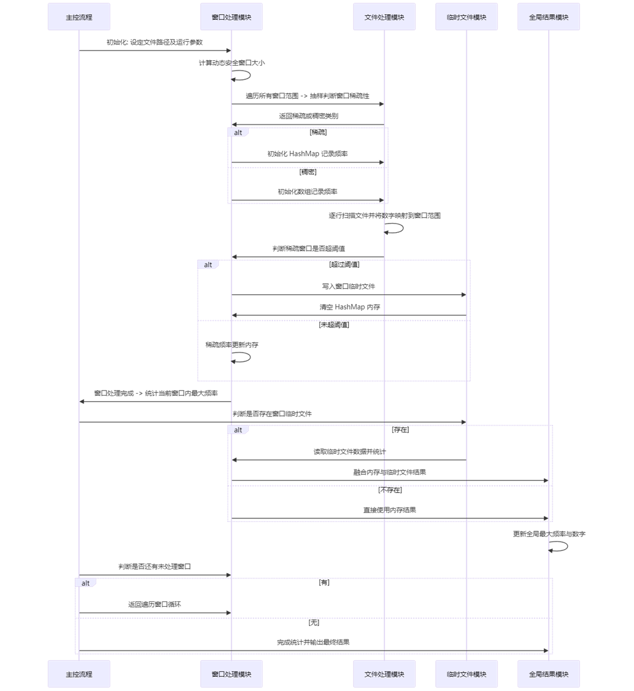

```java
package com.baili.springboot3.utools;

import java.io.*;
import java.util.*;

public class OptimizedFrequencyCounter {
    private static final long MAX_NUMBER = 1_000_000_000; // 数字最大值
    private static final int MEMORY_LIMIT_MB = 100;       // 内存限制，单位MB
    private static final int INT_SIZE_BYTES = 4;          // 每个 int 占用字节数
    private static final int HASHMAP_THRESHOLD = 5_000_000; // 稀疏窗口 HashMap 的最大大小

    public static void main(String[] args) throws IOException {
        String filePath = "large_data.txt"; // 输入文件路径

        // 动态计算窗口大小
        int windowSize = calculateWindowSize(MEMORY_LIMIT_MB, MAX_NUMBER, INT_SIZE_BYTES);

        long globalMaxNumber = -1;           // 全局最大值
        int globalMaxFrequency = -1;        // 全局最大频率

        // 遍历整个处理范围，按窗口分段处理
        for (long windowStart = 0; windowStart  sparseFrequency = null; // 稀疏模式用 HashMap
            int[] denseFrequency = null;              // 密集模式用数组

            if (isSparse) {
                sparseFrequency = new HashMap<>();
            } else {
                denseFrequency = new int[(int) (windowEnd - windowStart)];
            }

            // 逐行扫描文件并填充窗口数据
            try (BufferedReader reader = new BufferedReader(new FileReader(filePath))) {
                String line;
                while ((line = reader.readLine()) != null) {
                    long number = Long.parseLong(line.trim());
                    if (number >= windowStart && number  HASHMAP_THRESHOLD) {
                                dumpToDisk(sparseFrequency, windowStart, windowEnd);
                                sparseFrequency.clear();
                            }
                        } else {
                            denseFrequency[(int) (number - windowStart)]++;
                        }
                    }
                }
            }

            // 统计当前窗口的最大频率及数字
            long[] localMax = processWindowMaxFrequency(sparseFrequency, denseFrequency, windowStart, windowEnd);

            // 更新全局最大值和频率
            if (localMax[1] > globalMaxFrequency) {
                globalMaxFrequency = (int) localMax[1];
                globalMaxNumber = localMax[0];
            }
        }

        // 打印最终统计结果
        System.out.println("出现次数最多的数字是: " + globalMaxNumber);
        System.out.println("出现次数: " + globalMaxFrequency);
    }

    /**
     * 动态计算窗口大小，保证每个窗口不会超出内存限制
     */
    private static int calculateWindowSize(int memoryLimitMB, long maxNumber, int intSizeBytes) {
        int maxWindowSize = (memoryLimitMB * 1024 * 1024) / intSizeBytes; // 每MB支持的窗口大小
        return (int) Math.max(1, Math.min(maxWindowSize, maxNumber)); // 确保窗口大小为正且在范围内
    }

    /**
     * 抽样判断窗口是否稀疏
     */
    private static boolean isSparseWindow(long windowStart, long windowEnd, String filePath) throws IOException {
        int sampleSize = 1000; // 设定采样大小
        int matchCount = 0;    // 落在该窗口范围内的数字计数

        try (BufferedReader reader = new BufferedReader(new FileReader(filePath))) {
            String line;
            int sampleCount = 0;
            while ((line = reader.readLine()) != null && sampleCount = windowStart && number  windowData, long windowStart, long windowEnd) throws IOException {
        String fileName = "window_" + windowStart + "_" + windowEnd + ".tmp";

        try (BufferedWriter writer = new BufferedWriter(new FileWriter(fileName, true))) { // 追加写入模式
            for (Map.Entry entry : windowData.entrySet()) {
                writer.write(entry.getKey() + "," + entry.getValue() + "\n");
            }
        }
        windowData.clear(); // 清空 HashMap
    }

    /**
     * 统计窗口的最大频率，包含内存和临时文件中的值
     */
    private static long[] processWindowMaxFrequency(Map sparseFrequency, int[] denseFrequency,
                                                     long windowStart, long windowEnd) throws IOException {
        long windowMaxNumber = -1; // 窗口出现次数最多的数字
        int windowMaxFrequency = -1; // 窗口最大频率

        // 密集模式最大值
        if (denseFrequency != null) {
            for (int i = 0; i  windowMaxFrequency) {
                    windowMaxFrequency = denseFrequency[i];
                    windowMaxNumber = windowStart + i;
                }
            }
        }

        // 稀疏模式最大值
        if (sparseFrequency != null) {
            for (Map.Entry entry : sparseFrequency.entrySet()) {
                if (entry.getValue() > windowMaxFrequency) {
                    windowMaxFrequency = entry.getValue();
                    windowMaxNumber = entry.getKey();
                }
            }
        }

        // 合并临时文件中的频率数据
        String fileName = "window_" + windowStart + "_" + windowEnd + ".tmp";
        File tempFile = new File(fileName);
        if (tempFile.exists()) {
            try (BufferedReader reader = new BufferedReader(new FileReader(tempFile))) {
                String line;
                while ((line = reader.readLine()) != null) {
                    String[] parts = line.split(",");
                    long number = Long.parseLong(parts[0]);
                    int frequency = Integer.parseInt(parts[1]);
                    if (frequency > windowMaxFrequency) {
                        windowMaxFrequency = frequency;
                        windowMaxNumber = number;
                    }
                }
            }
            // 删除临时文件
            tempFile.delete();
        }

        return new long[]{windowMaxNumber, windowMaxFrequency};
    }
}
```


# 2025最新突击学员面经

## 一、Object对象方法有哪些？（高御科技）

非常常规的问题，打开IDEA直接瞧一眼

* getClass() - 获取运行是的Class对象，属于反射的内一套，获取运行是的一些数据。
* hashCode() - 返回对象的hash值。目的是为了更好的支持哈希表，比如基于Java中的HashMap使用
* equals() - 比较两个对象是否相等，默认 ==
* clone() - 创建对象的副本。深拷贝和浅拷贝的内容
  * 默认是浅拷贝，将当前对象复制一份，其中的基本数据类型直接复用值，引用数据类型是复用地址值。
  * 深拷贝，将当前对象复制一份，其中的基本数据类型直接复用值，引用数据类型会重新的创建一个，不会复制之前的地址。 深拷贝要自己编写克隆内部的引用类型对象。
* toString - 返回一个以字符串形式表示当前对象的信息。
* wait - 当某个线程持有当前对象锁时，可以执行对象锁.wait，将持有对象锁的线程挂起等待。
* notify - 当某个线程持有当前对象锁时，可以执行对象锁.notify，唤醒之前基于wait挂起的一个线程。
* notifyAll - 当某个线程持有当前对象锁时，可以执行对象锁.notifyAll方法，唤醒之前所有基于wait挂起的线程。
* finalize - 当触发垃圾回收时，如果当前对象无法基于可达性分析定位到，就会被垃圾回收器回收掉，在回收之前，如果这个对象重写了finalize，那就会触发finalize方法执行。可以执行一些其他的清理工作。（Finalize在JVM中，他不保证一定执行，他用的守护线程）

## 二、创建对象的方式？（高御科技）

首先，这个问题意义不大，更多的跟前面的Object类似，是一个引导向的问题。

* new 关键字。
* Construct，利用Construct的newInstance去构建对象。**（引导Spring~）**
* 反序列化方式：
  * 流反序列化。
  * JSON字符串反序列化等等……
* clone，克隆也是ok的。
* 工厂模式去构建对象。**（引导Spring~）**

## 三、为啥要有clone？(深/浅拷贝)（高御科技）

Java中提供的clone方法主要是允许将一个对象进行copy，做到快速的复制一个对象。

而不需要new一个空对象，然后自己慢慢导入数据，开发效率太低。

这可以减少内存分配和垃圾回收的压力，尤其是在创建大量对象时。

默认的 clone 方法实现是浅拷贝。如果需要深拷贝，必须重写 clone 方法，并在其中实现深拷贝的逻辑。

如果再问clone，基本就是聊聊深拷贝，和浅拷贝。

* 默认是浅拷贝，将当前对象复制一份，其中的基本数据类型直接复用值，引用数据类型是复用地址值。
* 深拷贝，将当前对象复制一份，其中的基本数据类型直接复用值，引用数据类型会重新的创建一个，不会复制之前的地址。 深拷贝要自己编写克隆内部的引用类型对象。

## 四、构造器是否可以被重写？（弘玑）

这个问题明显就是在问方法重载和方法重写的问题。

构造器是不可以重写的，每个类的构造方法都是当前类名。

但是构造器是可以重载的。你写的内些有参，我无参不都是方法重载么~~

* 重写（Overrides）：是指子类提供父类中声明的方法的具体实现。也可以覆盖父类中提供好的实现内容。 **要求是：方法声明都完全一致，除了访问修饰符不能更低。**
* 重载：是指一个类中，定义多个名字相同的方法，但是方法的参数不一样，与返回结果无关。

## 五、跳出循环？如何在内层循环跳出外层循环？（上海天正）

很基础的问题：

* continue：结束当次循环，继续下次循环。
* break：结束循环。

在内层跳出外层，专业点就加锚点，加标签，其实就是起个名字。

咱们可以break或者continue的时候，指定要你要跳出的名字。就可以了，如下。

```java
public static void main(String[] args) {
    outter: for(;;){
        inner: for(;;){
            break outter;
        }
    }
    xxx: if(true){
        //111
        //222
        break xxx;
    }
    yyy: while(true){
        break yyy;
    }
}
```

## 六、什么是泛型，怎么使用？（鸿盛天极）

比如List集合啥的，都定义了一个泛型，咱们可以在new的时候，将泛型具体化。

Java中的泛型就是一种规避类型错误的一种安全机制。

ClassCastException

当你在声明一个集合并且指定泛型的类型后，你存储的数据类型就会有限制了，存储的不允许的类型，在编译时期就会直接报错了。

* 类型的安全，前面可以看出来。
* 减少强制类型转换的操作

***

后面一半会衍生出来 **泛型擦除** 的问题。

泛型擦出去是编译器在编译是的一种机制，你编写的Java代码变为class文件后，他就没有泛型这个东西了，底层都是最顶级的Object。所以泛型只是在编写时加上，其次底层运行时，压根就没泛型这个东西。

就比如List运行后，他就是List。

***

**泛型擦除有什么影响嘛？**

反射的时候，获取一些实例的时候，需要手动强转一下，满不爽的。。。

## 七、Java类的加载顺序？（老虎证券）

我在听录音听到这个问题的时候我懵了。

这个问题问的很奇怪，具体想聊的估计只有两个

* **类加载过程**
  * 加载： 先找到字节码文件（.class文件），加载到JVM内存中的方法区里。 然后在内存中的体现就是一个Class对象。
  * 验证： 验证加载到内存里的.class文件是否被篡改过，确认没有安全问题，以及符合JVM规范。
  * 准备： 为类中的一些变量分配内存空间，并且设置一下默认值。
  * 解析： 将常量池内的符号引用转为直接引用。
    * 符号引用：符号引用是一种泛指，com/mashibing/A-findAll()void
    * 直接引用：直接指向的内库的具体位置，直接就是内存偏移量。后面调用会更快。
  * 初始化：对所有静态变量复制，执行静态代码块，初始化好父类~~
  * 前面走完，到这，这个.class就可以在Java程序中使用了，new一个对象，类名.静态方法都可以了
* **双亲委派**
  * 他其实就是加载这个过程的细节，需要先掌握一下Java中默认的三种类加载器
    * BootstrapClassLoader：负责加载jdk/jre/lib/rt.jar
    * ExtensionClassLoader：负责加载jdk/jre/lib/ext目录下的jar文件
    * ApplicationClassLoader：负责加载classpath目录下的各种class文件。 所谓的classpath，其实就是编译后的classes目录。
    * 其实还有一个自定义的，你自己去继承ClassLoader，重新他的方法，指定你要加载的位置。
  * 双亲委派的过程。当需要用到某个class文件时，撇掉自定义类加载器，他会按照这个方式去加载
    * 先调度AppClassLoader，先查看AppClassLoader加载过么？没加载过，往上问。
    * 问到ExtClassLoader，先查看ExtClassLoader加载过么？没加载过，网上问。
    * 最终问到BootstrapClassLoader，先查看BootstrapClassLoader加载过么？没加载过，尝试加载！如果rt.jar里没有这个.class文件可以加载，往下分配。
    * 分配到ExtClassLoader，他去尝试在ext目录下去加载，如果也没加载到，往下分配。
    * 最终分配到AppClassLoader，他尝试去classpath目录下找这个.class文件加载。
    * 如果没找到，也没加载到，抛一个异常，ClassNotFoundException。
  * 双亲委派解决了什么问题，搞的这么麻烦？？
    * 防止类的重复加载……
    * 防止你破坏JDK的结构……
      * 比如现在我要加载一个java.lang.String这个类！

## 八、两个List的交集元素？（闪送）

首先，Java中就提供了一个API，让咱们可以直接使用的。

提供的方式叫retainAll方法。

可以直接 list1.retainAll(list2)，他会将list1中的数据，只保留list1和list2的交集结果。

他内部**采用的机制是双指针**。

* 指针A：初始在0位置，如果有交集元素，赋值，然后向后移动一个位置
* 指针B：每次都会往后移动一个位置指向一个元素，同时利用contains判断元素是否存在，存在，在指针A的位置赋值，然后指针A移动，指针B也移动。如果不存在交集情况，A不动，B动。

***

如果不让用Java中提供的API，那就**自己搞**个Hash表，比如HashMap似的东西，利用计数器的方式去解决这个问题。

遍历list1，在哈希表里存储key = 值，value = 1。

遍历list2，直接哈希表里去get，如果拿到的是1，证明存在，是交集数据，存到一个临时的集合中。

临时的集合，放着所有交集的数据。

O(m + n)

## 九、解释什么是面向对象编程（OOP），并讨论Java中封装、继承和多态的实现方式及其应用场景（百度AI）

这个问题，没有什么标准的答案，一般就是根据自己的技术储备和你项目中实际涉及到的点去聊。

其实面向对象的思想底层还是面向过程，只不过把一些复杂的操作封装成类，方便咱们操作。

就比如你们的项目中实际涉及到了什么事情，这个事情本质的行为逻辑市面上已经有很多成熟的方案。

比如我们的短信平台里，需要和运营商去交互，运行商对外提供了一套CMPP（中国移动）的协议，咱们需要根据他的协议去完成一套实现。但是市面上有很多开源框架都对接了CMPP2.0，还是CMPP3.0，我不需要自己再去造一套轮子，我可以拿过来稍微改一改直接应用到项目中。

当然，想要将一些封装好的工具，经过一些润色，从而更贴近咱们本身的业务方向，其实这个事情还是要究其底层的实现过程。

***

**封装：** 封装其实非常常见，比如映射数据库表的ORM的实体类，或者是响应给前端数据时，封装一个VO，或者传输对象数据时，也会涉及到DTO之类的内容，这些都是封装的具体体现。而这些类内部都是将 **属性进行私有化** ，不允许直接修改，但是会对外提供 **set、get的公共方法** 去操作，而在方法中就可以直接很多限制，来 **保证数据的安全** 。

**继承：** 这个更好办， **继承就是站在巨人的肩膀上** ，可以直接继承一个功能强大的类，直接使用他提供的各种功能。 这个强大的类，可以是前人种树留下来的，也可以是后续基于多个类似的类，向上抽取出来的一个公共的类。比如JUC包下的AQS，提供了响应的state属性，同步队列以及单向链表来给JUC包下的其他并发工具类来继承。。。。

**多态：** 多态在平时写代码的时候，用的非常之频繁，同一个动作，可以有多种实现，代码最直观的体现，就是使用 **父类接口指向子类的实现** 。 比如Controller注入Service，都是声明Service接口，然后基于Spring注入一个实现类。 比如CacheService，是一个提供缓存的功能接口，可以给CacheService提供多种实现，比如MemcacheServiceImpl，比如RedisServiceImpl，再比如CoffeineServiceImpl，提供多种缓存策略的实现，可以基于不同的注入方式，使用不同的缓存实现。

## 十、数组和链表区别（国人通）

这个问题，约等于问了ArrayList和LinkedList的区别

数组和链表核心的区别就三个东西：

* 查询效率
  * 数组：可以通过索引直接访问数组上任意位置的元素，时间复杂度直接O1，效率嘎嘎快。
  * 链表：只能顺序访问，要么从头开始找，要么从尾巴开始找到目标元素，时间复杂度On。
* 增删效率：
  * 数组：在数组中间插入或者删除元素，会导致需要移动其他元素，这个本身就是一个比较耗时的操作。
  * 链表：插入和删除操作，只需要更改相邻的两个节点的指针就可以了，其他元素不需要动。
* 内存使用
  * 数组： 数组申请时，需要一片连续的内存空间，而且要提前指定好长度。或多或少可能会浪费一些空间，而且预计的大小不够，扩容还需要再构建一波新的数组。特别是如果你的JVM中有内存碎片的问题，在申请一个比较长的数组时，可能时间导致执行GC甚至是OOM。
  * 链表：不需要提前申请很大一片内存空间，但是链表的每个节点需要额外的存储空间来保存指针。链表他不需要扩容。

***

* 如果你需要快速的随机访问元素，并且可以大致预估出需要的数据个数，那么数组更合适。
* 如果你的业务是频繁的增删数据，很明显，链表更合适。

线程池 -- 阻塞队列 -- ArrayBlockingQueue， LinkedBlockingQueue，明显链表好，可以望这拐。

## 十一、讨论Java集合框架的主要接口（如List、Set、Map）的特点，举例说明在什么场景下使用它们（美团地图、众安保险）

这种问题，就是会是应该的，不会就回家等通知。。

List：

* 特点：List是有序集合（存取有序），允许元素重复，并且可以存储null值。
* 适用场景：
  * 当你需要维护元素的插入顺序时，比如实现一个队列可以上List
  * 当你需要遍历整个元素时，可以采用List
* 扩展：List下有ArrayList，LinkedList，聊数组和链表的问题…………还有一个Vector，这哥们线程安全的，但是用的synchronized，效率不好…………

Set：

* 特点：Set不允许存储重复的元素，也不能保证元素的顺序（存取有序，除了LinkedHashSet），能存储Null，但是只能存一个
* 适用场景
  * 当你需要保证元素的唯一性时，比如用户手机号，用户的ID。
  * 当你需要做去重操作时，Set是一个很好的工具。
* 扩展：Set本质是基于HashMap的key去实现的。基于哈希表做到的去重效果。但是HashMap线程不安全。。。。。。。

Map：

* Map建议就直接点一嘴，他是双列集合。有key-value结构。底层就是哈希表，结构是数组 + 链表实现的，在JDK1.8之后，优化了一波红黑树来提升HashMap的查询效率。。。。

## 十二、HashSet底层怎么实现的？（高御科技）Map和Set区别（江苏探路者国际物流）LinkedHashSet是怎么保证存储有序的（图灵教育）

**HashSet底层怎么实现的？**

这还用问么，前面说了，HashSet底层就是HashMap的key。

**Map和Set区别？**

没有所谓的区别，Set是基于Map的key实现的。

**LinkedHashSet是怎么保证存储有序的？**

你也可以理解为LinkedHashMap是怎么保证存取有序的。。所以他还是基于哈希表去存的。而哈希表有个特点，必然是基于key的hash运算跟数组做一些操作，得到要存储的索引位置，顺序必然是随机的，但是LinkedHashSet就是有序的，怎么保证的？

其实没啥难的，就是对HashMap里的Node又包装了一层，搞了个before和after，来记录存取顺序

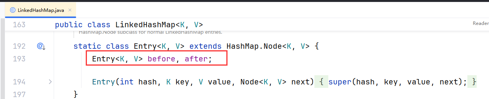**当插入重复元素时，内部流程怎么走的？**

将之前Node的value做了个替换。。

## 十三、JDK8的新特性（众安保险，美团地图等等）

给方向

**interface的新特性：（不需要说太细，点一嘴，他没啥扩展的。）**

* default关键字：可以规避接口中必须要重写的这点，一些不必要的方法，不常用的方法，可以来个default给予默认的实现。
* static关键字：可以在接口中提供直接访问的方法，给予接口名.方法，去调用。

**时间类新特性：**

* 支持时区，ZonedDateTime类，允许你方便的处理不同时区的信息。不需要三方依赖库。
* 线程安全性，他一旦创建是不可变的，线程安全，可以在并发环境中用！
* 更丰富的API，之前Date需要配置Calender去做一些时间处理，而现在，java.time包下的时间类，API嘎嘎丰富。
* 但是注意一点，在使用time包下的时间时，注意指定好序列化JSON的序列化格式。。。。。

**lanbda，Stream**

* lambda

```plain
一个语法糖，让代码看着更舒服，比如匿名内部类，不需要再去new 接口，重新抽象方法了。
提高一些可读性，看着更舒服，并且利用它支持函数式编程和stream
```

* Stream

```plain
链式调用，舒服的一批，还提供了各种丰富的中间操作，map，filter等等，然后可以可以上一个collect结束整个流操作。
而且操作结果时，过滤，映射，规约，排序，匹配等等，嘎嘎好用。
但是需要一定的学习成本。
```

hashMap的红黑树问题。。

## 十四、使用Stream流的坑及解决方案（美团地图）

Stream最出名，最大的坑，就是他的parallel，并行流。

用了并行流，将相当于上了线程池，做并行操作，你会天真的以为，性能提升了。

首先parallel这个东西的核心问题，就是他默认所有的parallel都会用ForkJoinPool的线程池，默认的线程数是CPU内核 - 1（我记得是）。每个parallel任务都用他，如果自己没有主动的根据业务去设置一个参数合理的线程池的话，反而不会提升性能，会让处理速度变低。。。。。

比如你把大量的IO密集的操作用parallel并行流去玩，结果线程个数没有达到IO密集的要求，前几个任务还好，后几个任务就需要等待前面的任务完成，才有线程用，反而会让多个请求变成了一个串行处理的套路。甚至不如不用。。。

解决方案，就是必须自己设置一个合理的线程池，建议，及其建议，上ThreadPoolExecutor

***

把数据转成Map，因为获取的数据有重复，导致的错误（不算坑，完全因为不熟悉导致的）

在将List数据转成Map，方便基于get去查询数据时，如果转换时，List中数据作为key的如果有重复，会导致转换时出现错误。

其实不算是坑，就是单纯的stream不是所有API都熟练！！！

## 十五、JDK1.8的数据结构的优化（美团地图）

问到这个，就是在HashMap。。。

HashMap在JDK1.8的时候，织入了红黑树结构来提升HashMap的查询效率。。。

聊到这，还得在说一点，比如什么时候转红黑树？ 不啥不用别的树？？

**数组 >= 64，链表 > 8（链表插入第9个元素时）**

在treeifyBin转红黑树的逻辑中，会先判断数组长度是否达到64，没达到会先扩容数组。

因为红黑树的目的是为了提升查询的性能，如果数组长度太短，导致出现了红黑树，那反而会导致写入的性能和查询的性能都收到影响。在数组长度太短时，会优先考虑扩容，而不是转红黑树。

链表大于8怎么来的，源码写的，数据添加到链表下后，会判断binCount是否达到了插入第9个元素的时候。

**链表长度为啥是大于8。不是10，不是7，不是6？？凭啥。**

泊松分布，基于泊松分布，得出，在链表长度为9的时候，概率贼低。

但是也不是说非9不可，其实降一降，或者升一升也没啥毛病，概率依然很低，、

所以核心就是源码就这么写的。。。（不建议在面试的时候说。）

## 十六:为什么 ArrayList 的 elementData 加上 transient 修饰？（京东）

**transient**** **用来修饰类的成员变量，表示该成员变量在序列化时不会被持久化存储。也就是说，当对象被序列化时，transient 修饰的字段会被忽略，不会写入到序列化的字节流中。

所以这里是确保**ArrayList反序列化时不会被破坏里面的elementData**(不丢失原先的元素) . 进入ArrayList源码可见

ArrayList 实现了 Serializable 接口，这意味着 ArrayList 支持序列化。

transient 的作用是说不希望 elementData 数组被 序列化，可以自定义序列化过程，重写了 **writeObject** 和**readObject**方法。每次序列化时，先调用 defaultWriteObject() 方法 序列化 ArrayList 中的非 transient 元素，然后遍历 elementData，只序列化已存入的元素，这样既加快了序列化的速度，又减小了序列化之后的文件大小，如果不加transient修饰序列化会保存整个数组，包括未使用部分，浪费内存且减低效率。

追问：

## 十七：单列模式是否会被序列化反序列化破坏？（京东）

类似面试题：spring IOC容器用的什么存储对象？

ConcurrentHashMap如何做到不被**序列化反序列化**破坏单列？是否被**反射**破坏？

**简答**：推荐枚举型单列不会被序列化和反序列化破坏且不会被反射破坏。原因在于

ObjectInputStrean类会调用readObject来读取对象。对于枚举类型readObject会调用readEnum，根据名称和类型找到已存在的枚举常量：Enum.valueOf()所以不会被序列化和反序列化破坏。并且通过反射newInstance()来创建一个枚举实例时，会抛IllegalArgumentException异常并提示并指出 "Cannot reflectively create enum objects"。其他单列实现需要加上readResolve()方法，反序列化时会检查有没有这个方法，如果有可以调用这个方法返回对象。

**前置基础：**

产生原因：对象序列化再反序列化时，会生成一个新的对象，从而破坏单例：

```java
public static void normalSingletonDeserializeProblem() throws IOException, ClassNotFoundException {
    StaticInnerclassSingleton o1 = StaticInnerclassSingleton.getInstance();
    //通过writeObject将对象序列化到文件
    ObjectOutputStream oos = new ObjectOutputStream(new FileOutputStream("tempFile"));
    oos.writeObject(o1);

    //读取文件，反序列化
    File file = new File("tempFile");
    ObjectInputStream ois = new ObjectInputStream(new FileInputStream(file));
    StaticInnerclassSingleton newInstance = (StaticInnerclassSingleton) ois.readObject();

    System.out.println(o1);
    System.out.println(newInstance);
    System.out.println(StaticInnerclassSingleton.getInstance());
}
```

运行结果：

```plain
//反序列化之后，生成了一个新的对象，单例被破坏
design.Singleton.StaticInnerclassSingleton@63947c6b
design.Singleton.StaticInnerclassSingleton@34a245ab
design.Singleton.StaticInnerclassSingleton@63947c6b
Process finished with exit code 0
```

**单列\*\*\*\*模式**：（创造型）

1饿汉式： （类初始化就生成对象），可以是 1-1 静态成员变量 也可以是 1-2 静态代码块

2懒汉式：2-1 方法锁

2-2 双重检查锁 2-3 java内部类

3注册式：3-1 容器 3-2 枚举(**推荐**) 属于懒汉式

**推荐枚举型不会被反射破坏的原因**在于对象被反序列化时，ObjectInputStrean类会调用readObject来读取对象。对于枚举类型readObject会调用readEnum，根据名称和类型找到已存在的枚举常量：Enum.valueOf()所以不会被破坏。

并且枚举型单列还不会被反射破坏。通过**反射**newInstance()来创建一个枚举实例时

```java
public static void enumReflection() throws NoSuchMethodException, IllegalAccessException, InvocationTargetException, InstantiationException {
    Constructor c = EnumSingleton.class.getDeclaredConstructor(String.class, int.class);
    c.setAccessible(true);
    EnumSingleton o1 = (EnumSingleton) c.newInstance();
    EnumSingleton o2 = EnumSingleton.getInstance();
    System.out.println(o1);
    System.out.println(o2);

}
```

会抛IllegalArgumentException异常并提示并指出 "Cannot reflectively create enum objects"

```plain
Exception in thread "main" java.lang.IllegalArgumentException: Cannot reflectively create enum objects
    at java.lang.reflect.Constructor.newInstance(Constructor.java:417)
    at design.Singleton.Reflection.enumReflection(Reflection.java:22)
    at design.Singleton.Reflection.main(Reflection.java:30)
Process finished with exit code 1
```

源码可见：

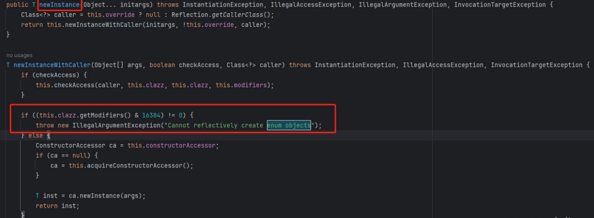

其他实现单例方式在反序列化后，要确保唯一实列，需要定义**readResolve**方法

```java
class NoProblemSingleton implements Serializable {
    private NoProblemSingleton() {}

    public static NoProblemSingleton getInstance() {
        return InnerHolder.INSTANCE;
    }

    private static class InnerHolder {
        private static final NoProblemSingleton INSTANCE = new NoProblemSingleton();
    }

    //实现readResolve方法可以解决反序列化攻击，反序列化时会检查有没有这个方法，如果有可以调用这个方法返回对象
    private Object readResolve() {
        return InnerHolder.INSTANCE;
    }
}
```

运行结果：

```plain
design.Singleton.NoProblemSingleton@63947c6b
design.Singleton.NoProblemSingleton@63947c6b
design.Singleton.NoProblemSingleton@63947c6b
true
Process finished with exit code 0
```

既然重写就能避免破坏为何推荐枚举呢？

原因在于：调用readResolve方法并最终用readResolve方法返回的对象替换反序列化出来的对象。不过替换是发生在反序列化之后的，也就是说反序列化的对象还是生成了，只不过无法被访问只能等待GC回收。

但是容器式单例（**ConcurrentHashMap**）虽然implements 了Serializable接口，但我没看到类里面有定义readResolve方法，它是怎么防止反序列化的破坏的？

通过关键字transient 或者 实现Serializable+定义readObject控制反序列化逻辑。

在内存中map存放这个对象，就算序列到本地，反序列也是找到map中拿到原来的。

具体逻辑如下：

序列化：把内存中 对象的状态转换成字节码 ， 再把字节码通过IO输出流写到磁盘上，持久化

反序列化：将持久化的字节码内容，通过IO输入流读取到内存中来，转换成Java对象

是通过重组字节码来生成对象。 可测试 构造函数是否打印多次。

```java
/**
 * @Auth:TianMing
 * @Description： TODO
 */
public class SeriableSingleton  implements Serializable {
    //序列化就是说把内存中的状态通过转换成字节码的形式
    //从而转换一个 IO 流，写入到其他地方(可以是磁盘、网络 IO)
    //内存中状态给永久保存下来了

    //反序列化
    //将已经持久化的字节码内容，转换为 IO 流
    //通过 IO 流的读取，进而将读取的内容转换为 Java 对象
    //在转换过程中会重新创建对象 new
    public final static SeriableSingleton INSTANCE = new SeriableSingleton();
    private SeriableSingleton(){}
    public static SeriableSingleton getInstance(){
        return INSTANCE;
    }
    //    //针对反序列化破话单例的问题
    //    private Object readResolve(){
    //        return INSTANCE;
    //    }

    public static void main(String[] args) {
        //序列化 反序列化  在内存中map存放这个对象，就算序列到本地，反序列也是从map中拿到原来的。
        SeriableSingleton s1 = null;
        SeriableSingleton s2 = SeriableSingleton.getInstance();
        FileOutputStream fos = null;
        try {
            //序列化
            fos = new FileOutputStream("SeriableSingleton.obj");
            ObjectOutputStream oos = new ObjectOutputStream(fos);
            oos.writeObject(s2);
            oos.flush();
            oos.close();
            //反序列化
            FileInputStream fis = new FileInputStream("SeriableSingleton.obj");
            ObjectInputStream ois = new ObjectInputStream(fis);
            s1 = (SeriableSingleton)ois.readObject();
            ois.close();
            System.out.println(s1);
            System.out.println(s2);
            System.out.println(s1 == s2);
        }catch (Exception e ){
            e.printStackTrace();
        }
    }
}
```

跟进源码 readObject（）， 进入 V v = s.readObject()

```java
s1 = (SeriableSingleton)ois.readObject();
//入 调用
Object obj = this.readObject0(false);
//中判断监测
return checkResolve(readOrdinaryObject(unshared));
//进入：
readOrdinaryObject()
//可见985行判断 是否有
desc.hasReadResolveMethod())
// 有则会调用 你的
invokeReadResolve(Object obj) 方法
//   可以进入看看怎么调的  里面通过反射机制 调用此方法
return readResolveMethod.invoke(obj, (Object[]) null);
//   最后返回这个对象 ，就不会去重写创建了。

//有的话就会去调用  newInstance方法
//码 看 readOrdinaryObject()  方法
//在判断之前 的  obj = new Instance() 方法去创建。
```

**更多细节翻看面试突击宝典，或留言**


# JDK8提升代码优雅技巧

# Lambda小课堂：巧用“Function”让代码优雅起来~
在开发过程中经常会使用if...else...进行判断抛出异常、分支处理等操作。这些if...else...充斥在代码中严重影响了代码代码的美观，这时我们可以利用Java 8的Function接口来消灭if...else...

```java
if (...){
    throw new RuntimeException("出现异常了")；
}

if (...){
    doSomething();
} else {
    doOther();
}
```

## Function 函数式接口
使用注解@FunctionalInterface标识，并且只包含一个抽象方法的接口是函数式接口。函数式接口主要分为Supplier供给型函数、Consumer消费型函数、Runnable无参无返回型函数和Function有参有返回型函数。

Function可以看作转换型函数

### Supplier供给型函数
Supplier的表现形式为不接受参数、只返回数据

```java
/**
 * Represents a supplier of results.
 *
 * There is no requirement that a new or distinct result be returned each
 * time the supplier is invoked.
 *
 * This is a functional interface
 * whose functional method is {@link #get()}.
 *
 * @param  the type of results supplied by this supplier
 *
 * @since 1.8
 */
@FunctionalInterface
public interface Supplier {

    /**
     * Gets a result.
     *
     * @return a result
     */
    T get();
}

```

### Function函数
表现形式为接收一个参数，并返回一个值。Supplier、Consumer和Runnable可以看作Function的一种特殊表现形式

```java
/**
 * Represents a function that accepts one argument and produces a result.
 *
 * This is a functional interface
 * whose functional method is {@link #apply(Object)}.
 *
 * @param  the type of the input to the function
 * @param  the type of the result of the function
 *
 * @since 1.8
 */
@FunctionalInterface
public interface Function {

    /**
     * Applies this function to the given argument.
     *
     * @param t the function argument
     * @return the function result
     */
    R apply(T t);

    /**
     * Returns a composed function that first applies the {@code before}
     * function to its input, and then applies this function to the result.
     * If evaluation of either function throws an exception, it is relayed to
     * the caller of the composed function.
     *
     * @param  the type of input to the {@code before} function, and to the
     *           composed function
     * @param before the function to apply before this function is applied
     * @return a composed function that first applies the {@code before}
     * function and then applies this function
     * @throws NullPointerException if before is null
     *
     * @see #andThen(Function)
     */
    default  Function compose(Function before) {
        Objects.requireNonNull(before);
        return (V v) -> apply(before.apply(v));
    }

    /**
     * Returns a composed function that first applies this function to
     * its input, and then applies the {@code after} function to the result.
     * If evaluation of either function throws an exception, it is relayed to
     * the caller of the composed function.
     *
     * @param  the type of output of the {@code after} function, and of the
     *           composed function
     * @param after the function to apply after this function is applied
     * @return a composed function that first applies this function and then
     * applies the {@code after} function
     * @throws NullPointerException if after is null
     *
     * @see #compose(Function)
     */
    default  Function andThen(Function after) {
        Objects.requireNonNull(after);
        return (T t) -> after.apply(apply(t));
    }

    /**
     * Returns a function that always returns its input argument.
     *
     * @param  the type of the input and output objects to the function
     * @return a function that always returns its input argument
     */
    static  Function identity() {
        return t -> t;
    }
}
```

### Consumer消费型函数
Consumer消费型函数和Supplier刚好相反。Consumer接收一个参数，没有返回值

```java
/**
 * 表示接受单个输入参数但不返回任何结果的操作。
 * 与大多数其他功能接口不同， Consumer 它预计会通过副作用进行操作。
 * 这是一个功能接口，其 功能 方法是 accept(Object)
 */
@FunctionalInterface
public interface Consumer {

    /**
     * 对给定参数执行此操作。
     * 形参: t – 输入参数
     */
    void accept(T t);

    /**
     * 返回一个组合，该组合 Consumer 按顺序执行此操作，后跟 after 操作。
     * 如果执行任一操作引发异常，则会将其中继到组合操作的调用方。
     * 如果执行此操作引发异常，则不会执行该 after 操作。
     * 形参: after – 此操作后要执行的操作
     * 返回值: 按 Consumer 顺序执行此操作后跟 after 操作的组合
     * 抛出: NullPointerException – 如果 after 为空
     */
    default Consumer andThen(Consumer after) {
        Objects.requireNonNull(after);
        return (T t) -> { accept(t); after.accept(t); };
    }
}
```

### Runnable无参无返回型函数
Runnable的表现形式为即没有参数也没有返回值

```java
@FunctionalInterface
public interface Runnable {
    /**
     * When an object implementing interface Runnable is used
     * to create a thread, starting the thread causes the object's
     * run method to be called in that separately executing
     * thread.
     *
     * The general contract of the method run is that it may
     * take any action whatsoever.
     *
     * @see     java.lang.Thread#run()
     */
    public abstract void run();
}
```

## 使用小技巧
### 处理抛出异常的if
1. 定义函数 定义一个抛出异常的形式的函数式接口, 这个接口只有参数没有返回值是个消费型接口

```java
/**
 * 抛异常接口
 **/
@FunctionalInterface
public interface ThrowExceptionFunction {

    /**
     * 抛出异常信息
     *
     * @param message 异常信息
     * @return void
     **/
    void throwMessage(String message);
}
```

2. 编写判断方法 创建工具类VUtils并创建一个isTure方法，方法的返回值为刚才定义的函数式接口-ThrowExceptionFunction。ThrowExceptionFunction的接口实现逻辑为当参数b为true时抛出异常

```java
/**
 *  如果参数为true抛出异常
 *
 * @param b
 * @return com.example.demo.func.ThrowExceptionFunction
 **/
public static ThrowExceptionFunction isTure(boolean b){

    return (errorMessage) -> {
        if (b){
            throw new RuntimeException(errorMessage);
        }
    };
}
```

3. 使用方式 调用工具类参数参数后，调用函数式接口的throwMessage方法传入异常信息。 当出入的参数为false时正常执行

```java
// 报错
BeimingUtil.isTure(true).isthrowMessage("哎呀，一不小心就报错啦");
// 不报错
BeimingUtil.isTure(false).isthrowMessage("哎呀，一不小心就报错啦");
```

### 处理if分支操作
1. 定义函数式接口 创建一个名为BranchHandle的函数式接口，接口的参数为两个Runnable接口。这两个两个Runnable接口分别代表了为true或false时要进行的操作

```java
/**
 * 分支处理接口
 **/
@FunctionalInterface
public interface BranchHandle {

    /**
     * 分支操作
     *
     * @param trueHandle 为true时要进行的操作
     * @param falseHandle 为false时要进行的操作
     * @return void
     **/
    void trueOrFalseHandle(Runnable trueHandle, Runnable falseHandle);

}
```

2. 编写判断方法 创建一个名为isTureOrFalse的方法，方法的返回值为刚才定义的函数式接口-BranchHandle。

```java
/**
 * 参数为true或false时，分别进行不同的操作
 **/
public static BranchHandle isTureOrFalse(boolean b){

    return (trueHandle, falseHandle) -> {
        if (b){
            trueHandle.run();
        } else {
            falseHandle.run();
        }
    };
}
```

3. 效果

```java
// 参数为true时，执行trueHandle
BeimingUtil.isTureOrFalse(true)
        	.trueorFalseHandle ( trueHandle: O -> {
					System.out.printin("true，没毛病”)；
			},falseHandle: () -> {
					System.out.println("有毛病");
			}
```

### 如果存在值执行消费操作，否则执行基于空的操作
1. 定义函数 创建一个名为PresentOrElseHandler的函数式接口，接口的参数一个为Consumer接口。一个为Runnable,分别代表值不为空时执行消费操作和值为空时执行的其他操作

```java
/**
 * 空值与非空值分支处理
 */
public interface PresentOrElseHandler {

    /**
     * 值不为空时执行消费操作
     * 值为空时执行其他的操作
     *
     * @param action 值不为空时，执行的消费操作
     * @param emptyAction 值为空时，执行的操作
     * @return void
     **/
   void presentOrElseHandle(Consumer action, Runnable emptyAction);

}
```

2. 编写判断方法 创建一个名为isBlankOrNoBlank的方法，方法的返回值为刚才定义的函数式接口-PresentOrElseHandler。

```java
/**
 * 参数为true或false时，分别进行不同的操作
 *
 * @param b
 * @return com.example.demo.func.BranchHandle
 **/
public static PresentOrElseHandler isBlankOrNoBlank(String str){

    return (consumer, runnable) -> {
        if (str == null || str.length() == 0){
            runnable.run();
        } else {
            consumer.accept(str);
        }
    };
}
```

3. 使用方式 调用工具类参数参数后，调用函数式接口的presentOrElseHandle方法传入一个Consumer和Runnable

## 结尾
Function函数式接口是java 8非常重要的特性，利用好Function函数可以极大的简化代码。

# 怎么理解Java里面的双冒号“::”
## “::”是什么含义
在Java中，双冒号"::"是方法引用（Method Reference）的语法。方法引用是一种简化Lambda表达式的语法结构，使代码更加简洁易读。并且在使用方法引用时，会根据上下文推断参数类型，因此特别适用于直接引用已有方法的情况。

## “::”用法
方法引用的一般形式是：

```java
ClassName::methodName
```

其中，ClassName 是包含静态方法 methodName 的类名。根据引用的方法类型，有不同的情况：

### 静态方法引用
假设我们有一个自定义的工具类MathUtil，其中包含一个静态方法square，用于计算一个整数的平方。现在我们想要计算一个整数列表中所有元素的平方和。

```java
import java.util.Arrays;
import java.util.List;

public class MathUtil {
    public static int square(int num) {
        return num * num;
    }

    public static void main(String[] args) {
        List numbers = Arrays.asList(1, 2, 3, 4, 5);
        int sum = numbers.stream()
        .mapToInt(MathUtil::square)
        .sum();
        System.out.println(sum); // 输出55
    }
}
```

在上述代码中，我们通过使用静态方法引用MathUtil::square，将square方法传递给mapToInt方法，以便对列表中的每个元素进行平方运算。

### 实例方法引用
假设我们有一个字符串列表，我们想要按照字符串长度进行排序。我们可以使用Lambda表达式编写比较器，也可以使用实例方法引用简化代码。

```java
import java.util.Arrays;
import java.util.List;

public class StringSorter {
    public static void main(String[] args) {
        List words = Arrays.asList("apple", "orange", "banana", "pear");
        words.sort((a, b) -> a.compareTo(b)); // 使用Lambda表达式
        System.out.println(words); // [apple, banana, orange, pear]

        // 使用实例方法引用
        words.sort(String::compareTo);
        System.out.println(words); // [apple, banana, orange, pear]
    }
}
```

在上述代码中，我们首先使用Lambda表达式编写了一个比较器(a, b) -> a.compareTo(b)来进行字符串比较。然后，我们使用实例方法引用String::compareTo来简化比较器的写法。

### 对象方法引用
假设我们有一个自定义的Person类，其中包含姓名和年龄属性。我们想要根据Person对象的年龄进行排序。

```java
import java.util.Arrays;
import java.util.Comparator;
import java.util.List;

public class PersonSorter {
    public static void main(String[] args) {
        List people = Arrays.asList(
            new Person("Alice", 22),
            new Person("Bob", 32),
            new Person("Charlie", 20),
            new Person("David", 26)
        );

        // 使用Lambda表达式编写比较器
        people.sort((p1, p2) -> p1.getAge() - p2.getAge());
        System.out.println(people);

        // 使用对象方法引用
        people.sort(Person::compareByAge);
        System.out.println(people);
    }
}

static class Person {
    private String name;
    private int age;

    public Person(String name, int age) {
        this.name = name;
        this.age = age;
    }

    public int getAge() {
        return age;
    }

    @Override
    public String toString() {
        return name + " (" + age + ")";
    }

    public static int compareByAge(Person p1, Person p2) {
        return p1.getAge() - p2.getAge();
    }
}
```

在上述代码中，我们首先使用Lambda表达式编写了一个比较器(p1, p2) -> p1.getAge() - p2.getAge()来根据年龄进行排序。然后，我们使用对象方法引用Person::compareByAge来简化比较器的写法。

### 构造方法引用
假设我们需要创建一个空的ArrayList，可以使用构造方法引用来实现。

```java
import java.util.ArrayList;
import java.util.List;
import java.util.function.Supplier;

public class ArrayListCreator {
    public static void main(String[] args) {
        Supplier> supplier = ArrayList::new;
        List list = supplier.get();
        System.out.println(list instanceof ArrayList); // 输出true
    }
}
```

# 提升编码效率的15种 Stream API
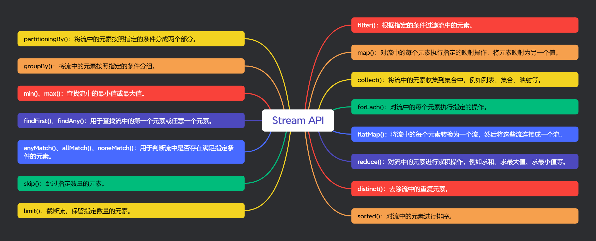

本文给大家收集了工作常用的 15 种 Java Stream API，可用于进行各种数据处理和操作。具体如下：

## collect()：将流中的元素收集到集合中，例如列表、集合、映射等。
## filter()：根据指定的条件过滤流中的元素。
```java
List names = Arrays.asList("Alice", "Bob", "Charlie", "David");

// 筛选出以字母"A"开头的字符串，并将符合条件的字符串收集到一个新的列表中
List filteredNames = names.stream()
                            .filter(name -> name.startsWith("A"))
                            .collect(Collectors.toList());

System.out.println(filteredNames); // Output: [Alice]
```

## map()：对流中的每个元素执行指定的映射操作，将元素映射为另一个值。
```java
List names = Arrays.asList("Alice", "Bob", "Charlie", "David");

// 将给定字符串列表中每个字符串的长度提取出来，并将这些长度存储到一个新的整数列表中
List nameLengths = names.stream()
                            .map(String::length)
                            .collect(Collectors.toList());

System.out.println(nameLengths); // Output: [5, 3, 7, 5]
```

## forEach()：对流中的每个元素执行指定的操作。
```java
List names = Arrays.asList("Alice", "Bob", "Charlie", "David");

// 将每个字符串转换为大写形式并收集到新的列表中
List upperCaseNames = new ArrayList<>();

names.forEach(name -> upperCaseNames.add(name.toUpperCase()));

// 输出新的列表
System.out.println(upperCaseNames); // 输出：[ALICE, BOB, CHARLIE, DAVID]
```

## flatMap()：将流中的每个元素转换为一个流，然后将这些流连接成一个流。
```java
List> numbers = Arrays.asList(
    Arrays.asList(1, 2, 3),
    Arrays.asList(4, 5, 6),
    Arrays.asList(7, 8, 9)
);

// 使用 flatMap 方法将多个整数列表合并为一个扁平的列表
List flattenedList = numbers.stream()
                                     .flatMap(List::stream)
                                     .collect(Collectors.toList());

System.out.println(flattenedList); // Output: [1, 2, 3, 4, 5, 6, 7, 8, 9]
```

## reduce()：对流中的元素进行累积操作，例如求和、求最大值、求最小值等。
```java
List numbers = Arrays.asList(1, 2, 3, 4, 5);

// 使用流的 reduce 方法计算列表中所有元素的和
int sum = numbers.stream()
                 .reduce(0, Integer::sum);

System.out.println(sum); // Output: 15
```

## distinct()：去除流中的重复元素。
```java
List numbers = Arrays.asList(1, 2, 3, 2, 4, 3, 5);

List distinctNumbers = numbers.stream()
                                      .distinct()
                                      .collect(Collectors.toList());

System.out.println(distinctNumbers); // Output: [1, 2, 3, 4, 5]
```

## sorted()：对流中的元素进行排序。
```java
List numbers = Arrays.asList(3, 1, 4, 1, 5, 9, 2, 6, 5);

List sortedNumbers = numbers.stream()
                                    .sorted()
                                    .collect(Collectors.toList());

System.out.println(sortedNumbers); // Output: [1, 1, 2, 3, 4, 5, 5, 6, 9]
```

## limit()：截断流，保留指定数量的元素。
```java
List numbers = Arrays.asList(1, 2, 3, 4, 5, 6, 7, 8, 9, 10);

// 筛选出大于5的元素，然后限制只获取前3个符合条件的元素
List limitedNumbers = numbers.stream()
                                      .filter(num -> num > 5)
                                      .limit(3)
                                      .collect(Collectors.toList());

System.out.println(limitedNumbers); // Output: [6, 7, 8]
```

## skip()：跳过指定数量的元素。
```java
List numbers = Arrays.asList(1, 2, 3, 4, 5);

// 跳过前两个元素
List skippedNumbers = numbers.stream()
                                     .skip(2)
                                     .collect(Collectors.toList());

System.out.println(skippedNumbers); // Output: [3, 4, 5]
```

## anyMatch()、allMatch()、noneMatch()：用于判断流中是否存在满足指定条件的元素。
```java
List numbers = Arrays.asList(1, 2, 3, 4, 5);

// 使用 anyMatch 方法判断列表中是否有任意一个元素大于3
boolean anyMatch = numbers.stream().anyMatch(n -> n > 3);

// 使用 allMatch 方法判断列表中所有元素是否都大于0
boolean allMatch = numbers.stream().allMatch(n -> n > 0);

// 使用 noneMatch 方法判断列表中是否没有元素小于0
boolean noneMatch = numbers.stream().noneMatch(n -> n  numbers = Arrays.asList(1, 2, 3, 4, 5);

// 使用 findFirst 方法查找第一个元素
Optional first = numbers.stream().findFirst();

// 使用 findAny 方法查找任意一个元素
Optional any = numbers.stream().findAny();

System.out.println("First: " + first.orElse(null)); // Output: 1
System.out.println("Any: " + any.orElse(null)); // Output: 1 or any other element
```

## min()、max()：查找流中的最小值或最大值。
```java
List numbers = Arrays.asList(3, 1, 4, 1, 5);

// 使用 min 方法找到最小值
Optional min = numbers.stream().min(Integer::compareTo);

// 使用 max 方法找到最大值
Optional max = numbers.stream().max(Integer::compareTo);

System.out.println("Min: " + min.orElse(null)); // Output: 1
System.out.println("Max: " + max.orElse(null)); // Output: 5
```

## groupBy()：将流中的元素按照指定的条件分组。
```java
List names = Arrays.asList("Alice", "Bob", "Charlie", "David");

// 使用流进行分组，按照名字的首字母进行分组
Map> groupedNames
        = names.stream()
               .collect(Collectors.groupingBy(name -> name.charAt(0)));

System.out.println(groupedNames); // Output: {A=[Alice], B=[Bob], C=[Charlie], D=[David]}
```

## partitioningBy()：将流中的元素按照指定的条件分成两个部分。
```java
List names = Arrays.asList("Alice", "Bob", "Charlie", "David");

// 使用流进行分区，根据名字长度是否大于3进行分区
Map> partitionedNames
        = names.stream()
               .collect(Collectors.partitioningBy(name -> name.length() > 3));

System.out.println(partitionedNames); // Output: {false=[Bob], true=[Alice, Charlie, David]}
```

## IDEA 小技巧
使用 idea 编码时，如果不知道输入什么，请使用 ctrl + shift + 空格

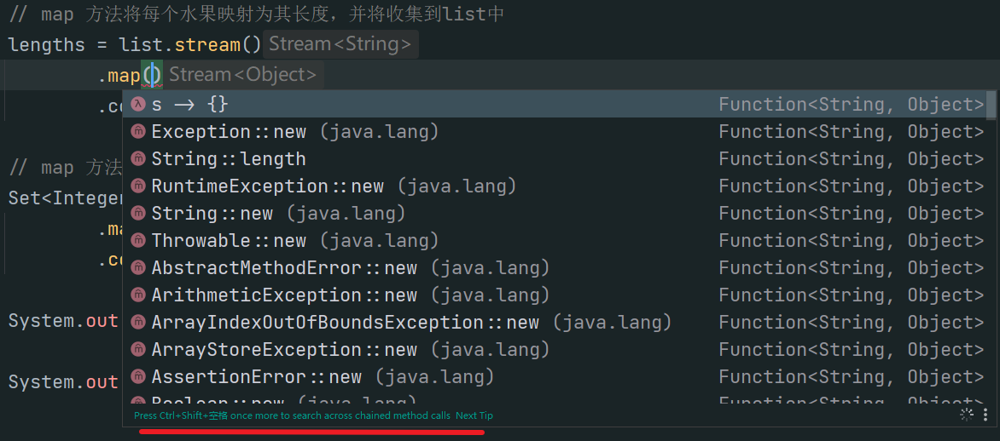

## 完整测试代码
```java
package com.baili.springboot3;

import com.baili.springboot3.entity.Transaction;
import org.junit.jupiter.api.Test;
import org.springframework.boot.test.context.SpringBootTest;

import java.util.*;
import java.util.stream.Collectors;

@SpringBootTest
public class StreamApiTest {

    @Test
    void forEachDemo() {
        List list = new ArrayList<>(Arrays.asList("apple", "banana", "orange"));

        // 使用传统的 for 循环遍历列表并输出每个元素
        for (String string : list) {
            System.out.println(string);
        }

        // 移除符合条件的元素
        list.removeIf(s -> s.equals("apple"));

        // 使用流的 forEach 方法遍历列表并输出每个元素
        list.forEach(System.out::println);

        list.forEach(s -> {
            // TODO
        });
    }

    @Test
    void mapDemo() {
        List list = Arrays.asList("apple", "banana", "orange");
        List lengths = new ArrayList<>();

        // 使用传统的 for 循环遍历列表，并将每个水果的长度添加到list中
        for (String string : list) {
            lengths.add(string.length());
        }

        // map 方法将每个水果映射为其长度，并将收集到list中
        lengths = list.stream()
                .map(String::length)
                .collect(Collectors.toList());

        // map 方法将每个水果映射为其长度，并将收集到set中
        Set collect = list.stream()
                .map(String::length)
                .collect(Collectors.toSet());

        System.out.println(lengths);

        System.out.println(collect);
    }

    @Test
    void flatMapDemo() {
        List> numbers = Arrays.asList(
                Arrays.asList(1, 2, 3),
                Arrays.asList(4, 5, 6),
                Arrays.asList(7, 8, 9)
        );

        // flatMap 将所有元素转换为单独的流，然后连接成一个流
        List flattenedList = numbers.stream()
                .flatMap(List::stream)
                .collect(Collectors.toList());

        System.out.println(flattenedList); // [1, 2, 3, 4, 5, 6, 7, 8, 9]
    }

    @Test
    void reduceDemo() {
        List transactions = new ArrayList<>();
        transactions.add(new Transaction(100.0));
        transactions.add(new Transaction(200.0));
        transactions.add(new Transaction(300.0));

        // reduce 计算金额总和
        double totalAmount = transactions.stream()
                .mapToDouble(Transaction::getAmount)
                .reduce(0.0, Double::sum);

        System.out.println("总金额为: " + totalAmount);
    }

    @Test
    void synthesizeDemo() {
        List strings = Arrays.asList("apple", "banana", "orange", "apple", "banana", "grape");

        // 使用流进行操作
        List result = strings.stream()
                .filter(string -> string.length() > 5)  // 过滤出长度大于5的水果
                .distinct()  // 去除重复的水果
                .sorted()  // 按字母顺序排序
                .skip(1)  //跳过一个元素
                .limit(2)  // 取前两个水果
                .collect(Collectors.toList());  // 收集结果为列表

        System.out.println(result); // 输出：[orange]
    }

    @Test
    void matchDemo() {
        List numbers = Arrays.asList(1, 2, 3, 4, 5);

        // 使用 anyMatch 方法判断列表中是否有任意一个元素大于3
        boolean anyMatch = numbers.stream().anyMatch(n -> n > 3);

        // 使用 allMatch 方法判断列表中所有元素是否都大于0
        boolean allMatch = numbers.stream().allMatch(n -> n > 0);

        // 使用 noneMatch 方法判断列表中是否没有元素小于0
        boolean noneMatch = numbers.stream().noneMatch(n -> n  numbers = Arrays.asList(1, 2, 3, 4, 5);

        // 使用 findFirst 方法查找第一个元素
        Optional first = numbers.stream().findFirst();

        // 使用 findAny 方法查找任意一个元素
        Optional any = numbers.stream().findAny();

        // 使用 min 方法找到最小值
        Optional min = numbers.stream().min(Integer::compareTo);

        // 使用 max 方法找到最大值
        Optional max = numbers.stream().max(Integer::compareTo);

        System.out.println("First: " + first.orElse(null)); // 1
        System.out.println("Any: " + any.orElse(null)); // 1 or any other element
        System.out.println("Min: " + min.orElse(null)); // 1
        System.out.println("Max: " + max.orElse(null)); // 5
    }

    @Test
    void groupByDemo() {
        List names = Arrays.asList("Alice", "Bob", "Charlie", "David", "Adam", "Bella", "Christopher", "Daniel");

        // 使用流进行分组，按照名字的首字母进行分组
        Map> groupedNames = names.stream()
                .collect(Collectors.groupingBy(name -> name.charAt(0)));

        System.out.println(groupedNames); // {A=[Alice, Adam], B=[Bob, Bella], C=[Charlie, Christopher], D=[David, Daniel]}
    }

    @Test
    void partitioningByDemo() {
        List names = Arrays.asList("Alice", "Bob", "Charlie", "David");

        // 使用流进行分区，根据名字长度是否大于3进行分区
        Map> partitionedNames = names.stream()
                .collect(Collectors.partitioningBy(name -> name.length() > 3));

        System.out.println(partitionedNames); // {false=[Bob], true=[Alice, Charlie, David]}
    }
}
```

# 提高生产力：这10个Lambda表达式必须掌握
## 使用Lambda表达式进行集合遍历
❌ 未使用Lambda表达式：

```java
List list = Arrays.asList("apple", "banana", "orange");
for (String fruit : list) {
    System.out.println(fruit);
}
```

✅ 使用Lambda表达式：

```java
List list = Arrays.asList("apple", "banana", "orange");
list.forEach(fruit -> System.out.println(fruit));
```

## 使用Lambda表达式进行排序
❌  未使用Lambda表达式：

```java
List list = Arrays.asList("apple", "banana", "orange");
Collections.sort(list, new Comparator() {
    public int compare(String s1, String s2) {
        return s1.compareTo(s2);
    }
});
```

✅ 使用Lambda表达式：

```java
List list = Arrays.asList("apple", "banana", "orange");
Collections.sort(list, (s1, s2) -> s1.compareTo(s2));
```

## 使用Lambda表达式进行过滤
❌  未使用Lambda表达式：

```java
List list = Arrays.asList("apple", "banana", "orange");
List filteredList = new ArrayList();
for (String fruit : list) {
    if (fruit.startsWith("a")) {
        filteredList.add(fruit);
    }
}
```

✅ 使用Lambda表达式：

```java
List list = Arrays.asList("apple", "banana", "orange");
List filteredList = list.stream().filter(fruit -> fruit.startsWith("a"))
								.collect(Collectors.toList());
```

## 使用Lambda表达式进行映射
❌  未使用Lambda表达式：

```java
List list = Arrays.asList("apple", "banana", "orange");
List lengths = new ArrayList();
for (String fruit : list) {
    lengths.add(fruit.length());
}
```

✅ 使用Lambda表达式：

```java
List list = Arrays.asList("apple", "banana", "orange");
List lengths = list.stream()
                	.map(fruit -> fruit.length())
                	.collect(Collectors.toList());
```

## 使用Lambda表达式进行归约
❌  未使用Lambda表达式：

```java
List list = Arrays.asList(1, 2, 3, 4, 5);
int sum = 0;
for (int i : list) {
	sum += i;
}
```

✅ 使用Lambda表达式：

```java
List list = Arrays.asList(1, 2, 3, 4, 5);
int sum = list.stream().reduce(0, (a, b) -> a + b);
```

## 使用Lambda表达式进行分组
❌  未使用Lambda表达式：

```java
List list = Arrays.asList("apple", "banana", "orange");
Map grouped = new HashMap();
for (String fruit : list) {
    int length = fruit.length();
    if (!grouped.containsKey(length)) {
        grouped.put(length, new ArrayList());
    }
    grouped.get(length).add(fruit);
}
```

✅ 使用Lambda表达式：

```java
List list = Arrays.asList("apple", "banana", "orange");
Map grouped = list.stream()
				.collect(Collectors.groupingBy(fruit -> fruit.length()));
```

## 使用Lambda表达式进行函数式接口的实现
❌  未使用Lambda表达式：

```java
public interface MyInterface {
    public void doSomething(String input);
}

MyInterface myObject = new MyInterface() {
	public void doSomething(String input) {
		System.out.println(input);
	}
};

myObject.doSomething("Hello World");

```

✅ 使用Lambda表达式：

```java
MyInterface myObject = input -> System.out.println(input);
myObject.doSomething("Hello World");
```

## 使用Lambda表达式进行线程的创建
❌  未使用Lambda表达式：

```java
Thread thread = new Thread(new Runnable() {
    public void run() {
    	System.out.println("Thread is running.");
    }
});
thread.start();
```

✅ 使用Lambda表达式：

```java
Thread thread = new Thread(() -> System.out.println("Thread is running."));
thread.start();
```

## 使用Lambda表达式进行Optional的操作
❌  未使用Lambda表达式：

```java
String str = "Hello World";
if (str != null) {
	System.out.println(str.toUpperCase());
}
```

✅ 使用Lambda表达式：

```java
Optional str = Optional.ofNullable("Hello World");
str.map(String::toUpperCase)
	.ifPresent(System.out::println);
```

## 使用Lambda表达式进行Stream的流水线操作
❌  未使用Lambda表达式：

```java
List list = Arrays.asList("apple", "banana", "orange");
List filteredList = new ArrayList();
for (String fruit : list) {
    if (fruit.startsWith("a")) {
        filteredList.add(fruit.toUpperCase());
    }
}
Collections.sort(filteredList);
```

✅ 使用Lambda表达式：

```java
List list = Arrays.asList("apple", "banana", "orange");
List filteredList = list.stream().filter(fruit -> fruit.startsWith("a"))
								.map(String::toUpperCase)
								.sorted()
								.collect(Collectors.toList());
```


# 说说你对泛型的理解

## 简答：

泛型是Java中的一个特性，它允许我们在定义类、接口或方法时使用类型参数，以实现代码的通用性和安全性。泛型的目的是在编译时进行类型检查，并提供编译期间的类型安全。

泛型的理解包括以下几个方面：

\*\*首先，\*\*泛型提供了代码重用和通用性。通过使用泛型，我们可以编写可重用的代码，可以在不同的数据类型上执行相同的操作。这样，我们可以避免重复编写类似的代码，提高了开发效率。

\*\*其次，\*\*泛型强调类型安全。编译器可以在编译时进行类型检查，阻止不符合类型约束的操作。这样可以避免在运行时出现类型错误的可能，增加了程序的稳定性和可靠性。

\*\*另外，\*\*使用泛型可以避免大量的类型转换和强制类型转换操作。在使用泛型集合类时，不需要进行强制类型转换，可以直接获取正确的数据类型，提高了代码的可读性和维护性。

\*\*此外，\*\*泛型还可以在编译时进行类型检查，提前发现潜在的类型错误。这种类型检查是在编译时进行的，避免了一些常见的运行时类型异常，减少了错误的可能性。

\*\*最后，\*\*泛型可以增加代码的可读性和可维护性。通过使用泛型，我们可以明确指定数据类型，并在代码中表达清晰，使得其他开发人员更容易理解代码的意图和功能。

应粉丝要求，还得上点强度。

## 一、泛型概述

### 什么是泛型？为什么要使用泛型？

泛型，即“参数化类型”。一提到参数，最熟悉的就是定义方法时有形参列表，普通方法的形参列表中，每个形参的数据类型是确定的，而变量是一个参数。在调用普通方法时需要传入对应形参数据类型的变量（实参），若传入的实参与形参定义的数据类型不匹配，则会报错

那参数化类型是什么？以方法的定义为例，在方法定义时，将方法签名中的形参的数据类型也设置为参数（也可称之为类型参数），在调用该方法时再从外部传入一个具体的数据类型和变量。

泛型的本质是为了将类型参数化， 也就是说在泛型使用过程中，数据类型被设置为一个参数，在使用时再从外部传入一个数据类型；而一旦传入了具体的数据类型后，传入变量（实参）的数据类型如果不匹配，编译器就会直接报错。这种参数化类型可以用在类、接口和方法中，分别被称为泛型类、泛型接口、泛型方法。

### 2. 泛型使用场景

在 ArrayList 集合中，可以放入所有类型的对象，假设现在需要一个只存储了 String 类型对象的 ArrayList 集合。

```java
/**
 * @Auth:TianMing
 * @Description： 基本应用
 */
public class demo1 {
    public static void main(String[] args) {
        ArrayList list=new ArrayList<>();
        list.add("a");
        list.add("b");
        list.add("c");
        for(String s:list){
            System.out.println(s);
        }
    }
}
//上面代码没有任何问题，在遍历 ArrayList 集合时，只需将 Object 对象进行向下转型成 String 类型即可得到 String 类型对象。
// 但如果在添加 String 对象时，不小心添加了一个 Integer 对象，会发生什么？看下面代码：
public static void main(String[] args) {
    ArrayList list = new ArrayList();
    list.add("aaa");
    list.add("bbb");
    list.add("ccc");
    list.add(666);
    for (int i = 0; i  list = new ArrayList();
    list.add("aaa");
    list.add("bbb");
    list.add("ccc");
    //list.add(666);// 在编译阶段，编译器会报错
    for (int i = 0; i  是一个泛型，其限制了 ArrayList 集合中存放对象的数据类型只能是 String，当添加一个非 String 对象时，编译器会直接报错。这样，我们便解决了上面产生的 ClassCastException 异常的问题（这样体现了泛型的类型安全检测机制）。

###

3.总结

#### 泛型的好处

简单总结出泛型的几点好处

（1）统一数据类型，对于后续业务层中取出数据有很强的统一规范性，方便对数据的管理；

（2）把运行时期的问题提前到了编译期，避免了强转类型转换可能出现的异常，降低了程序出错的概率；\
泛型的出现就是为了统一集合当中数据类型的

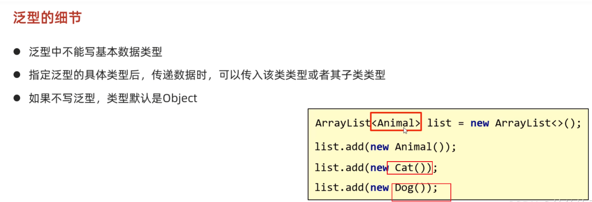

## 泛型高级篇

泛型的使用方法非常多，这里来简单说一下泛型类的使用；泛型类，就是把泛型定义在类上。

### 二、泛型类

泛型类的使用场景：当一个类中，某个变量的数据不确定时，就可以定义带有泛型的类。

我们平常所用的ArrayList类，就是一个泛型类，我们看如下源码

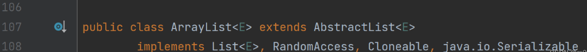

ArrayList 源码上显示，在ArrayList类的后面，便是 泛型，定义了这样的泛型，就可以让使用者在创建ArrayList对象时自主定义要存放的数据类型。

这里的 E 可以理解成变量，它不是用来记录数据的，而是记录数据的类型的。可以写成很多字母，T，V，K都可以，通常这些字母都是英文单词的首字母，V表示 value，K表示 key，E表示   element，T表示 type；如果你想，自己练习的时候写成ABCDEFG都可以，但建议养成好习惯，用专业名词的首字母，便于理解。

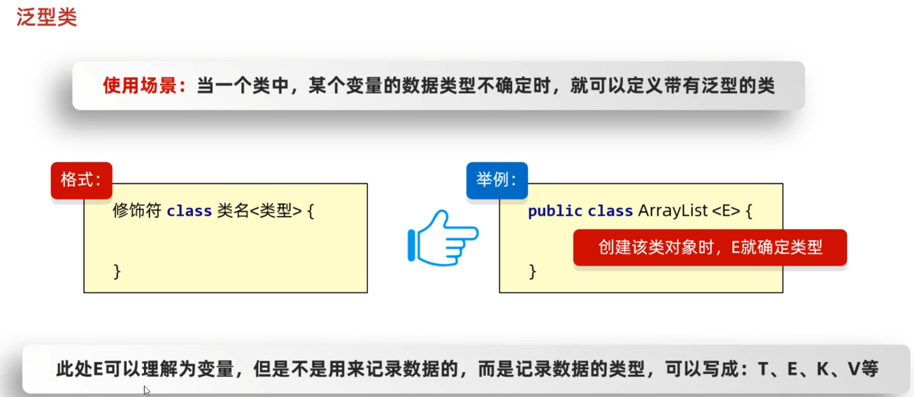

尖括号 <> 中的 泛型标识被称作是类型参数，用于指代任何数据类型。

泛型标识是任意设置的（如果你想可以设置为 Hello都行），Java 常见的泛型标识以及其代表含义如下：

T ：代表一般的任何类。\
E ：代表 Element 元素的意思，或者 Exception 异常的意思。\
K ：代表 Key 的意思。\
V ：代表 Value 的意思，通常与 K 一起配合使用。\
S ：代表 Subtype 的意思，文章后面部分会讲解示意。

自己实现集合

代码如下：

```java

/**
 * @Auth:TianMing
 * @Description：  自定义泛型类
 */
public class MyArrayList {
    // 给出该数组的默认长度为10
    Object[] obj = new Object[10];

    // 定义一个指针,默认为0
    int size;

    // 写一个泛型类中添加元素的方法
    public boolean add(T t){
        // size默认为0，刚好指向数组的第一个位置，添加元素，将要添加的元素t赋值给到obj数组的第一个位置
        obj[size] = t;
        // size指针加一，指向下一个位置，下次元素添加到size指向的位置
        size++;
        // 添加完成并size加一之后，操作完成，返回成功true
        return true;
    }

    // 写一个泛型类中取出元素的方法,index索引可以取出指定位置的元素
    public T get(int index){
        // 取出元素后，强转为我们泛型所指定的类型
        return (T)obj[index];
    }
}
```

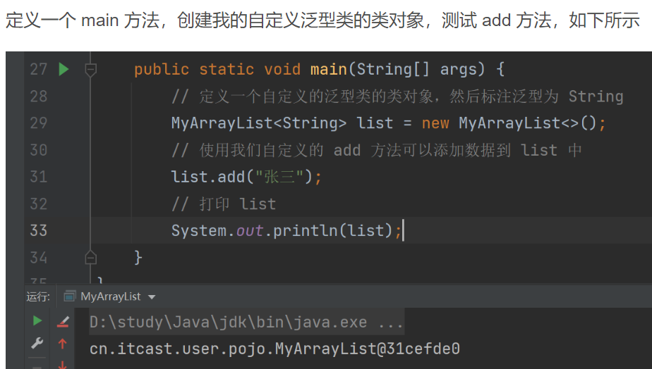

这里打印出来的是 list 的内存地址，说明我们自定义的 泛型类没有问题。

其实 ArrayList 底层源码就是这样写的，这里我只是简单的写了两个方法，有兴趣的可以把删除方法和修改方法也写出来，动手测试一下。

### 三、泛型方法

我们什么时候会用到泛型方法呢？

通常情况下，当一个方法的形参不确定的情况下，我们会使用到泛型方法。

泛型方法其实与泛型类有着紧密的联系，通过上面我写的自定义泛型类不难看出，在泛型类中，所有方法都可以使用类上定义的泛型。

但是，泛型方法却可以脱离泛型类单独存在，泛型方法上定义的泛型只有本方法上可以使用，其他方法不可用。

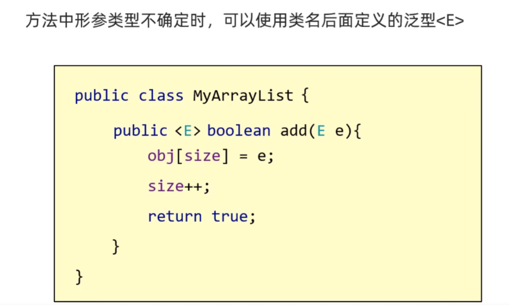

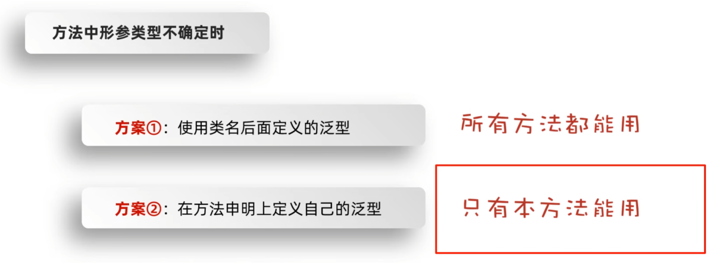

格式

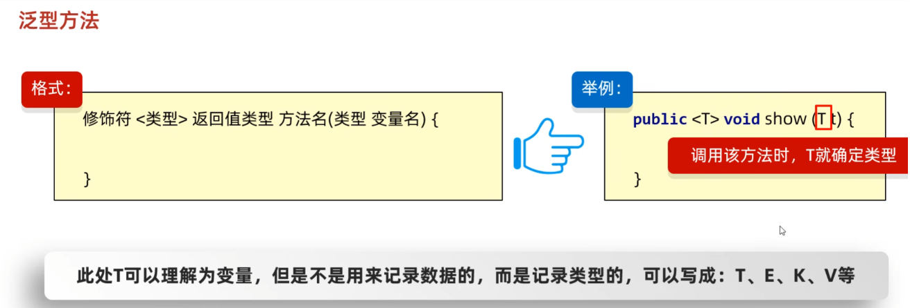


```java
package tuling.edu;
import java.util.ArrayList;
import java.util.Arrays;
import java.util.List;
/**
 * @Auth:TianMing
 * @Description：  集合工具类
 */
public class ListUtil {
    private ListUtil() {
    }
    /*
参数一：集合
参数二： 最后要添加的元素
 */
    public static  void addAll(ArrayList list, E e1, E e2) {
        list.add(e1);
        list.add(e2);
    }
}

package fangxing;
import java.util.ArrayList;
public class demo4 {
    public static void main(String[] args) {
        ArrayListlist=new ArrayList<>();
        ListUtil.addAll(list,"zhangsan","lisi");
        System.out.println(list);//[zhangsan, lisi]
    }
}
```

添加很多元素

```java
public static  void addAll(ArrayList list, E ...e1) {
        for (E e : e1) {
          list.add(e);
        }
}
```

### 四、泛型接口

泛型接口与泛型方法相似，当我们的接口中，参数类型不确定的时候，就可以使用泛型。

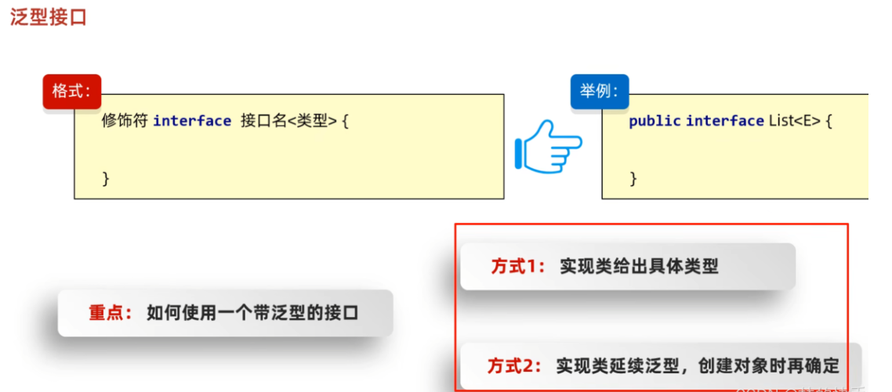

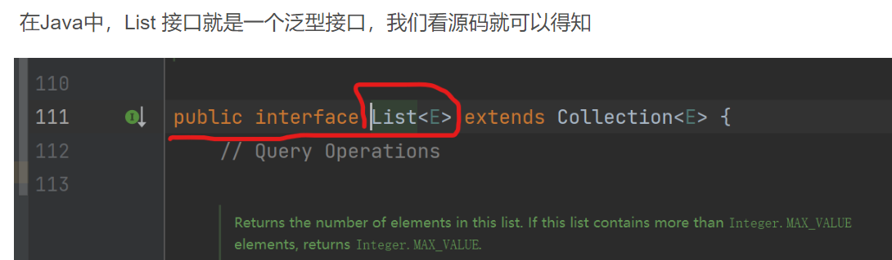

泛型接口的格式虽然简单，但这不是我们要学习的重点。

我们的重点是：如何使用一个带有泛型的接口？

通常情况下，我们有两种方式

方式一：实现类给出具体的类型。

方式二：实现类延续泛型，在创建对象时再指定泛型类型。

相比于方式一，方式二的扩展性更强。

Java中 List 的实现类 ArrayList 就是采用的第二种方式，延续泛型，我们看源码即可得知

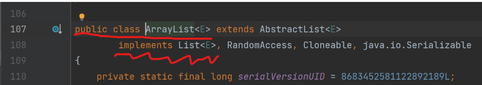

别的不用看，只看我画红线的部分，ArrayList 实现了list接口，但后面还是泛型，延续了泛型，是方式二。

那么我再给各位演示一下方式一，如下我自己定义的一个泛型接口

```java

/**
 * @Auth:TianMing
 * @Description：  定义一个泛型接口
 */
public interface MyList {

    // 定义一个方法做简单测试
    public boolean add(E e);
}

//再定义一个类实现该接口，

// 定义MyArrayList类实现MyList接口,并在实现时就指定泛型类型
public class MyArrayList implements MyList {

    // 定义一个长度为十的默认数组
    Object[] object = new Object[10];

    // 定义一个size作为指针
    int size;

    @Override
    public boolean add(String s) {
        /**
         * size初始化为零，刚好指向数组的第一个位置，添加第一个元素时，我们默认将元素添加到数组的第一个位置
         */
        object[size] = s;
        // size则合理可以作为指针，当添加第一个元素之后，size++，向后移动一位，下一次就会添加到第二个元素的位置，循环往复
        size++;
        return true;
    }
}
```

可以看到，在实现类中重写add方法，方法的参数就已经确定，就是我们在实现它时指定的String类型。

然后我们写一个main方法测试是否成功

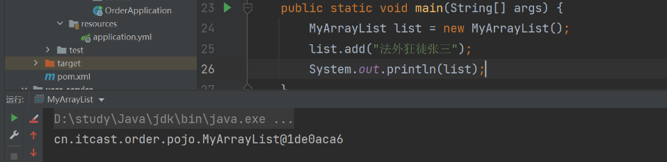

创建对象，添加元素，打印结果，运行发现成功

但这里是一个内存地址，因为我这里只是简单的定义了一个接口，在Java中ArrayList的源码上千行，里面定义了很多方法，我这里只做简单测试验证一下方式一是如何完成的，很多东西都没有写，大家明白即可。

### 五、类型擦除

#### 什么是类型擦除

编译器编译带类型说明的集合时会去掉类型信息

泛型的本质是将数据类型参数化，它通过擦除的方式来实现，即编译器会在编译期间擦除代码中的所有泛型语法并相应的做出一些类型转换动作。

换而言之，泛型信息只存在于代码编译阶段，在代码编译结束后，与泛型相关的信息会被擦除掉，专业术语叫做类型擦除。也就是说，成功编译过后的 class 文件中不包含任何泛型信息，泛型信息不会进入到运行时阶段。

其实Java中的泛型本质是伪泛型

当把集合定义为string类型的时候,当数据添加在集合当中的时候,仅仅在门口检查了一下数据是否符合String类型,  如果是String类型,就添加成功,当添加成功以后,集合还是会把这些数据当做Object类型处理,当往外获取的时候,集合在把他强转String类型

当**代码编译到class文件的时候,泛型就消失,叫泛型的擦除**

看一个例子，假如我们给 ArrayList 集合传入两种不同的数据类型，并比较它们的类信息。

```java

/**
 * @Auth:TianMing
 * @Description： 泛型擦除
 */
public class GenericType {
    public static void main(String[] args) {
        ArrayList arrayString = new ArrayList();
        ArrayList arrayInteger = new ArrayList();
        System.out.println(arrayString.getClass() == arrayInteger.getClass());// true
    }
}
```

在这个例子中，我们定义了两个 ArrayList 集合，不过一个是 ArrayList，只能存储字符串。一个是 ArrayList，只能存储整型对象。我们通过 arrayString 对象和 arrayInteger 对象的 getClass() 方法获取它们的类信息并比较，发现结果为true。

明明我们在 <> 中传入了两种不同的数据类型，那为什么它们的类信息还是相同呢？ 这是因为，在编译期间，所有的泛型信息都会被擦除， ArrayList 和 ArrayList类型，**在编译后都会变成ArrayList类型**。

**那么是不是所有的类型参数被擦除后都以 Object 类进行替换呢**？

答案是否定的，大部分情况下，类型参数 T 被擦除后都会以 Object 类进行替换；而有一种情况则不是，那就是**使用到了 extends 和 super 语法的有界类型参数**（上界（T extends Something）或下界（T super Something）)

#### 类型擦除的原理

假如我们定义了一个 ArrayList 泛型集合，若向该集合中插入 String 类型的对象，不需要运行程序，编译器就会直接报错。这里可能有小伙伴就产生了疑问：

不是说泛型信息在编译的时候就会被擦除掉吗？那既然泛型信息被擦除了，如何保证我们在集合中只添加指定的数据类型的对象呢？

换而言之，我们虽然定义了 ArrayList 泛型集合，但其泛型信息最终被擦除后就变成了 ArrayList 集合，那为什么不允许向其中插入 String 对象呢？

Java 是如何解决这个问题的？

其实在创建一个泛型类的对象时， Java 编译器是先检查代码中传入  的数据类型，并记录下来，然后再对代码进行编译，编译的同时进行类型擦除；如果需要对被擦除了泛型信息的对象进行操作，编译器会自动将对象进行类型转换。

可以把泛型的类型安全检查机制和类型擦除想象成演唱会的验票机制：以 ArrayList 泛型集合为例。

当我们在创建一个 ArrayList 泛型集合的时候，ArrayList 可以看作是演唱会场馆，而就是场馆的验票系统，Integer 是验票系统设置的门票类型；\
当验票系统设置好为后，只有持有 Integer 门票的人才可以通过验票系统，进入演唱会场馆（集合）中；若是未持有 Integer 门票的人想进场，则验票系统会发出警告（编译器报错）。\
在通过验票系统时，门票会被收掉（类型擦除），但场馆后台（JVM）会记录下观众信息（泛型信息）。\
进场后的观众变成了没有门票的普通人（原始数据类型）。但是，在需要查看观众的信息时（操作对象），场馆后台可以找到记录的观众信息（编译器会自动将对象进行类型转换）。

举例如下：

```java

/**
 * @Auth:TianMing
 * @Description：  擦除原理
 */
public class GenericType {
    public static void main(String[] args) {

        ArrayList arrayInteger = new ArrayList();
        // 设置验票系统
        arrayInteger.add(111);
        // 观众进场，验票系统验票，门票会被收走（类型擦除）
        Integer n = arrayInteger.get(0);
        // 获取观众信息，编译器会进行强制类型转换
        System.out.println(n);
    }
}
```

擦除 ArrayList 的泛型信息后，get() 方法的返回值将返回 Object 类型，但编译器会自动插入 Integer 的强制类型转换。也就是说，编译器把 get() 方法调用翻译为两条字节码指令：

对原始方法 get() 的调用，返回的是 Object 类型；\
将返回的 Object 类型强制转换为 Integer 类型；

代码如下：

```java
Integer n = arrayInteger.get(0);// 这条代码底层如下：

//（1）get() 方法的返回值返回的是 Object 类型
Object object = arrayInteger.get(0);
//（2）编译器自动插入 Integer 的强制类型转换
Integer n = (Integer) object;
```

#### 类型擦除小结

1.泛型信息（包括泛型类、接口、方法）只在代码编译阶段存在，在代码成功编译后，其内的所有泛型信息都会被擦除，并且类型参数 T 会被统一替换为其原始类型（默认是 Object 类，若有 extends 或者 super 则另外分析）；

2.在泛型信息被擦除后，若还需要使用到对象相关的泛型信息，编译器底层会自动进行类型转换（从原始类型转换为未擦除前的数据类型）。

### 六、泛型通配符

1. 泛型的继承\
   泛型不具备继承性,但是数据具备继承性\
   此时,泛型里面写的什么类型,那么就传递什么类型的数据

泛型不具备继承性举例

```java
package tuling.edu;

import java.util.ArrayList;

/**
 * @Auth:TianMing
 * @Description： 泛型通配符
 */
public class demo5 {
    public static void main(String[] args) {
        /*
        泛型不具备继承性,但是数据具备继承性
         */
        ArrayList list1=new ArrayList<>();
        ArrayList list2=new ArrayList<>();
        ArrayList list3=new ArrayList<>();
        //调用method方法
        method(list1);
        //method(list2);//编译错误
//method(list3);//编译错误
    }
    /*
    此时,泛型里面写的什么类型,那么就传递什么类型的数据
     */
    public static  void method(ArrayList list){
    }
}
class Ye{
}
class Fu extends Ye{
}
class Zi extends Fu{
}
```

数据具备继承性

//数据具备继承性

```
    list1.add(new Ye());//添加爷爷的对象等

    list1.add(new Fu());

    list1.add(new Zi());
```

定义一个方法，形参是一个集合，但是集合中的数据类型不确定。

应用场景：

* ```
   1.如果我们在定义类、方法、接口的时候，如果类型不确定，就可以定义泛型类、泛型方法、泛型接口。
  ```

* ```
   2.如果类型不确定，但是能知道以后只能传递某个继承体系中的，就可以泛型的通配符
  ```

* 泛型的通配符：

* ```
   关键点：可以限定类型的范围。
  ```

测试类

```java
package lx;
import java.util.ArrayList;
/**
 * @Auth:TianMing
 * @Description： 泛型测试
 */
public class demo1 {
    /*
          需求：
              定义一个继承结构：
                                  动物
                       |                           |
                       猫                          狗
                    |      |                    |      |
                 波斯猫   狸花猫                泰迪   哈士奇
               属性：名字，年龄
               行为：吃东西
                     波斯猫方法体打印：一只叫做XXX的，X岁的波斯猫，正在吃小饼干
                     狸花猫方法体打印：一只叫做XXX的，X岁的狸花猫，正在吃鱼
                     泰迪方法体打印：一只叫做XXX的，X岁的泰迪，正在吃骨头，边吃边蹭
                     哈士奇方法体打印：一只叫做XXX的，X岁的哈士奇，正在吃骨头，边吃边拆家
          测试类中定义一个方法用于饲养动物
              public static void keepPet(ArrayList list){
                  //遍历集合，调用动物的eat方法
              }
          要求1：该方法能养所有品种的猫，但是不能养狗
          要求2：该方法能养所有品种的狗，但是不能养猫
          要求3：该方法能养所有的动物，但是不能传递其他类型
       */
    public static void main(String[] args) {
        HuskyDog h = new HuskyDog("哈士奇", 1);
        LihuaCat l = new LihuaCat("狸花猫", 2);
        PersianCat p = new PersianCat("波斯猫", 3);
        TeddyDog t = new TeddyDog("泰迪", 4);
        ArrayList list1 = new ArrayList<>();         ArrayList list2 = new ArrayList<>();
        // 向列表中添加一些猫的实例
        list1.add(l);
        list2.add(p);
        //调用方法
        keepPet1(list1);
        keepPet1(list2);
        System.out.println("-------------------------------------------");
        ArrayList list3 = new ArrayList<>();
        ArrayList list4 = new ArrayList<>();
        // 向列表中添加一些狗的实例
        list3.add(h);
        list4.add(t);
        //调用方法
        keepPet2(list3);
        keepPet2(list4);
        System.out.println("-------------------------------------------");
        list1.add(l);
        list2.add(p);
        list3.add(h);
        list4.add(t);
        keepPet3(list1);
        keepPet3(list2);
        keepPet3(list3);
        keepPet3(list4);
    }
    /*
此时我们就可以使用泛型的通配符：
  ?也表示不确定的类型
  他可以进行类型的限定
  ? extends E: 表示可以传递E或者E所有的子类类型
 ? super E:表示可以传递E或者E所有的父类类型
 */
    //  要求1：该方法能养所有品种的猫，但是不能养狗
    public static void keepPet1(ArrayList list) {
        //遍历集合，调用动物的eat方法
        for (Cat cat : list) {
            cat.eat();
        }
    }
    //  要求2：该方法能养所有品种的狗，但是不能养猫
    public static void keepPet2(ArrayList list) {
        //遍历集合，调用动物的eat方法
        for (Dog dog : list) {
            dog.eat();
        }
    }
    //  要求3：该方法能养所有的动物，但是不能传递其他类型
    public static void keepPet3(ArrayList list) {
        //遍历集合，调用动物的eat方法
        for (Animal animal : list) {
            animal.eat();
        }
    }
}
```

Animal类

```java
package lx;
public abstract class Animal {
    private String name;
    private int age;
    public Animal() {
    }

    public Animal(String name, int age) {
        this.name = name;
        this.age = age;
    }

    /**
 * 获取
 * @return name
 */
    public String getName() {
        return name;
    }

    /**
 * 设置
 * @param name
 */
    public void setName(String name) {
        this.name = name;
    }

    /**
 * 获取
 * @return age
 */
    public int getAge() {
        return age;
    }

    /**
 * 设置
 * @param age
 */
    public void setAge(int age) {
        this.age = age;
    }

    public String toString() {
        return "Animal{name = " + name + ", age = " + age + "}";
    }
    public abstract  void eat();
}
```

cat类型

```java
package lx;
public abstract class Cat extends Animal{
    public Cat() {
    }

    public Cat(String name, int age) {
        super(name, age);
    }
}
```

Dog类

```java
package lx;
public abstract class Dog extends Animal{
    public Dog() {
    }
    public Dog(String name, int age) {
        super(name, age);
    }
}
```

哈士奇类

```java
package lx;
public class HuskyDog extends Dog{
    @Override
    public void eat() {
        System.out.println("一只叫做"+getName()+"的，"+getAge()+"岁的哈士奇，正在吃骨头，边吃边拆家");
    }

    public HuskyDog() {
    }

    public HuskyDog(String name, int age) {
        super(name, age);
    }
}
```

狸花猫类

```java
package lx;
public class LihuaCat extends Cat {
    @Override
    public void eat() {
        System.out.println("一只叫做" + getName() + "的，" + getAge() + "岁的狸花猫，正在吃鱼");
    }
    public LihuaCat() {
    }

    public LihuaCat(String name, int age) {
        super(name, age);
    }
}
```

波斯猫类

```java
package lx;
public class PersianCat extends Cat{
    @Override
    public void eat() {
        System.out.println("一只叫做"+getName()+"的，"+getAge()+"岁的波斯猫，正在吃小饼干");
    }
    public PersianCat() {
    }

    public PersianCat(String name, int age) {
        super(name, age);
    }
}
```

泰迪猫类

```java
package lx;
public class TeddyDog extends Dog{
    @Override
    public void eat() {
        System.out.println("一只叫做"+getName()+"的，"+getAge()+"岁泰迪，正在吃骨头，边吃边蹭");
    }
    public TeddyDog() {
    }

    public TeddyDog(String name, int age) {
        super(name, age);
    }
}
```


# 谈谈你对反射的理解

反射是 Java 中一个非常强大的特性，它允许程序在运行时检查和操作类、接口、字段和方法。反射在面试中经常被问到，因为它涉及到 Java 的核心机制，并且在很多框架中都有广泛的应用。以下是一些常见的面试问题和答案，帮助你深入理解反射。当然这个部分也加入了点有强度的追问。

### 1. **什么是反射？**

反射是一种允许程序在运行时检查和操作类、接口、字段和方法的机制。通过反射，可以动态地获取类的信息、创建对象、调用方法、访问字段等。

### 2. **反射的主要用途是什么？**

反射的主要用途包括：

* **动态加载类**：在运行时加载类，而不需要在编译时知道类的具体名称。
* **访问私有成员**：反射可以访问私有字段和方法，这在某些情况下非常有用。
* **实现框架**：很多框架（如 Spring、Hibernate）都广泛使用反射来实现动态功能。
* **测试**：反射可以用于测试私有方法。

### 3. **反射的优缺点是什么？**

#### 优点：

* **灵活性**：反射允许在运行时动态地操作类和对象，提供了极大的灵活性。
* **动态性**：可以在运行时加载和操作类，而不需要在编译时知道类的具体信息。

#### 缺点：

* **性能开销**：反射操作通常比直接操作慢，因为它需要进行大量的类型检查和安全验证。
* **安全性问题**：反射可以破坏封装性，访问私有字段和方法，这可能会导致安全问题。
* **复杂性**：反射代码通常比较复杂，难以维护。

### 4. **如何使用反射获取类的信息？**

通过 Class 类可以获取类的信息。以下是一个示例：

```java
import java.lang.reflect.Method;
/**
 * @Auth:TianMing
 * @Description： 基本应用
 */
public class ReflectionExample {
    public static void main(String[] args) {
        try {
            // 获取类的 Class 对象
            Class clazz = Class.forName("java.util.ArrayList");

            // 获取类名
            System.out.println("类名: " + clazz.getName());

            // 获取所有公共方法
            Method[] methods = clazz.getMethods();
            System.out.println("公共方法:");
            for (Method method : methods) {
                System.out.println(method.getName());
            }

            // 获取所有声明的方法（包括私有方法）
            Method[] declaredMethods = clazz.getDeclaredMethods();
            System.out.println("声明的方法:");
            for (Method method : declaredMethods) {
                System.out.println(method.getName());
            }
        } catch (ClassNotFoundException e) {
            e.printStackTrace();
        }
    }
}
```

### 5. **如何使用反射创建对象？**

可以通过 Class 对象的 newInstance() 方法或 Constructor 类来创建对象：

```java
import java.lang.reflect.Constructor;
/**
 * @Auth:TianMing
 * @Description： 创建对象
 */
public class ReflectionExample {
    public static void main(String[] args) {
        try {
            // 获取类的 Class 对象
            Class clazz = Class.forName("java.util.ArrayList");

            // 使用 newInstance() 创建对象
            Object obj1 = clazz.newInstance();
            System.out.println("使用 newInstance() 创建的对象: " + obj1);

            // 使用 Constructor 创建对象
            Constructor constructor = clazz.getConstructor();
            Object obj2 = constructor.newInstance();
            System.out.println("使用 Constructor 创建的对象: " + obj2);
        } catch (Exception e) {
            e.printStackTrace();
        }
    }
}
```

### 6. **如何使用反射调用方法？**

可以通过 Method 类来调用方法：

```java
import java.lang.reflect.Method;
/**
 * @Auth:TianMing
 * @Description： 方法调用
 */
public class ReflectionExample {
    public static void main(String[] args) {
        try {
            // 获取类的 Class 对象
            Class clazz = Class.forName("java.util.ArrayList");

            // 创建对象
            Object obj = clazz.newInstance();

            // 获取 add 方法
            Method addMethod = clazz.getMethod("add", Object.class);

            // 调用 add 方法
            boolean result = (boolean) addMethod.invoke(obj, "Hello, Reflection!");
            System.out.println("add 方法返回值: " + result);

            // 获取 size 方法
            Method sizeMethod = clazz.getMethod("size");
            int size = (int) sizeMethod.invoke(obj);
            System.out.println("size 方法返回值: " + size);
        } catch (Exception e) {
            e.printStackTrace();
        }
    }
}
```

### 7. **如何使用反射访问私有字段？**

可以通过 Field 类来访问私有字段：  注意使用 elementDataField.setAccessible(true);打破封装

```java
import java.lang.reflect.Field;
/**
 * @Auth:TianMing
 * @Description： 访问私有字段
 */
public class ReflectionExample {
    public static void main(String[] args) {
        try {
            // 获取类的 Class 对象
            Class clazz = Class.forName("java.util.ArrayList");

            // 创建对象
            Object obj = clazz.newInstance();

            // 获取私有字段（例如，ArrayList 的 elementData 字段）
            Field elementDataField = clazz.getDeclaredField("elementData");

            // 设置可访问（打破封装）
            elementDataField.setAccessible(true);

            // 获取字段值
            Object elementData = elementDataField.get(obj);
            System.out.println("elementData 字段值: " + elementData);

            // 设置字段值
            elementDataField.set(obj, new Object[10]);
            System.out.println("修改后的 elementData 字段值: " + elementDataField.get(obj));
        } catch (Exception e) {
            e.printStackTrace();
        }
    }
}
```

### 8. **反射和注解的关系是什么？**

注解（Annotations）可以为反射提供元数据。通过反射，可以读取类、方法或字段上的注解信息。例如：

```java
import java.lang.annotation.Annotation;
import java.lang.reflect.Method;
/**
 * @Auth:TianMing
 * @Description： 访问注解
 */
public class ReflectionExample {
    public static void main(String[] args) {
        try {
            // 获取类的 Class 对象
            Class clazz = Class.forName("com.example.MyClass");

            // 获取所有方法
            Method[] methods = clazz.getMethods();

            // 检查每个方法上的注解
            for (Method method : methods) {
                Annotation[] annotations = method.getAnnotations();
                for (Annotation annotation : annotations) {
                    System.out.println("方法 " + method.getName() + " 上的注解: " + annotation);
                }
            }
        } catch (Exception e) {
            e.printStackTrace();
        }
    }
}
```

### 9. **反射的性能问题如何解决？**

反射操作通常比直接操作慢，因为它需要进行大量的类型检查和安全验证。以下是一些优化建议：

* **减少反射的使用**：尽量避免在性能敏感的代码中使用反射。
* **缓存反射数据**：如果需要多次使用反射，可以缓存 Class、Method 等对象。
* **使用动态代理**：在某些情况下，动态代理可以替代反射，提高性能。

### 10. **反射的安全性问题如何解决？**

反射可以破坏封装性，访问私有字段和方法，这可能会导致安全问题。以下是一些解决方法：

* **1，限制反射的使用**：尽量避免使用反射访问私有成员。
* **2，使用安全检查**：在使用反射时，进行必要的安全检查。
* **3，使用访问控制**：在某些情况下，可以使用 AccessController 来限制反射的访问权限。

实例1：通过接口暴露功能，而不是直接使用反射

```java
/**
 * @Auth:TianMing
 * @Description： 示例：通过接口暴露功能，而不是直接使用反射
 *  依赖注入框架（如 Spring）来管理对象的创建和依赖关系，而不是直接使用反射。
 */
public interface Service {
    void execute();
}

public class ServiceImpl implements Service {
    @Override
    public void execute() {
        // 实现逻辑
    }
}

// 使用接口调用，而不是反射
Service service = new ServiceImpl();
service.execute();
```

实例2：在反射调用之前，检查调用者的权限。通过 SecurityManager 或 AccessController 来限制反射的访问权限

```java
import java.lang.reflect.AccessibleObject;
import java.lang.reflect.Field;
import java.security.AccessControlContext;
import java.security.AccessController;
import java.security.Permission;
import java.security.Permissions;
import java.security.Policy;
import java.security.Principal;
import java.security.ProtectionDomain;
/**
 * @Auth:TianMing
 * @Description： 权限检查：在反射调用之前，检查调用者的权限
  */
public class SecureReflectionExample {
    private static final String SECRET = "superSecretValue";

    public static void main(String[] args) {
        try {
            // 创建一个限制权限的 AccessControlContext
            Permissions perms = new Permissions();
            perms.add(new RuntimePermission("accessDeclaredMembers"));
            AccessControlContext acc = new AccessControlContext(new ProtectionDomain[]{new ProtectionDomain(null, perms)});

            // 使用 AccessController 进行权限检查
            AccessController.doPrivileged((java.security.PrivilegedExceptionAction) () -> {
                Field field = SecureReflectionExample.class.getDeclaredField("SECRET");
                AccessibleObject.setAccessible(new AccessibleObject[]{field}, true);
                System.out.println("Secret value: " + field.get(null));
                return null;
            }, acc);
        } catch (Exception e) {
            e.printStackTrace();
        }
    }
}
```

实例3：通过 SecurityManager 或 Policy 文件限制反射的访问权限

```java
import java.lang.reflect.Field;
import java.security.Permission;
/**
 * @Auth:TianMing
 * @Description： 通过 SecurityManager 或 Policy 文件限制反射的访问权限
  */
public class SecurityManagerExample {
    private static final String SECRET = "superSecretValue";

    public static void main(String[] args) {
        // 启用 SecurityManager
        System.setSecurityManager(new SecurityManager() {
            @Override
            public void checkPermission(Permission perm) {
                if (perm.getName().equals("accessDeclaredMembers")) {
                    throw new SecurityException("Access denied");
                }
            }
        });

        try {
            //通过权限检查，禁止未授权的代码访问私有字段或方法
            Field field = SecurityManagerExample.class.getDeclaredField("SECRET");
            field.setAccessible(true);
            System.out.println("Secret value: " + field.get(null));
        } catch (Exception e) {
            System.out.println("Security exception: " + e.getMessage());
        }
    }
}
```

**建议**

* **代码审查**：定期审查代码，确保没有滥用反射。
* **使用安全的库**：选择经过安全审计的库，避免使用不安全的反射工具。
* **最小化权限**：确保应用程序运行在最小权限的环境中，避免授予不必要的权限。

### 11. 能否举例说明反射在Spring框架中的应用？

#### 1. 依赖注入（Dependency Injection, DI）

Spring 的依赖注入功能依赖于反射来动态地创建对象并设置属性值。

#### 示例：

假设我们有一个 UserService 类，它依赖于 UserRepository：

```java
public class UserService {
    private UserRepository userRepository;

    public UserService(UserRepository userRepository) {
        this.userRepository = userRepository;
    }

    // 其他方法
}
```

在 Spring 中，通过反射可以动态地创建 UserService 的实例，并将 UserRepository 注入到 UserService 中：

```java
// 假设这是 Spring 容器的一部分
public class SpringContainer {
    public  T createBean(Class clazz) throws Exception {
        // 使用反射创建对象
        Constructor constructor = clazz.getDeclaredConstructor(UserRepository.class);
        T bean = (T) constructor.newInstance(new UserRepository());

        return bean;
    }

    public static void main(String[] args) {
        SpringContainer container = new SpringContainer();
        try {
            UserService userService = container.createBean(UserService.class);
            // 使用 userService
        } catch (Exception e) {
            e.printStackTrace();
        }
    }
}
```

#### 2. 控制反转（Inversion of Control, IoC）

Spring 的 IoC 容器使用反射来管理 Bean 的生命周期，包括创建、初始化和销毁。

#### 示例：

```java
@Configuration
public class AppConfig {
    @Bean
    public UserService userService() {
        return new UserService(userRepository());
    }

    @Bean
    public UserRepository userRepository() {
        return new UserRepository();
    }
}
```

在 Spring 中，@Bean 注解的配置类会被解析，通过反射调用方法来创建 Bean。

#### 3. AOP（面向切面编程）

Spring 的 AOP 功能也依赖于反射来动态地代理方法，实现方法的拦截和增强。

#### 示例：

```java
@Aspect
@Component
public class LoggingAspect {
    @Before("execution(* com.example.service.*.*(..))")
    public void logBefore(JoinPoint joinPoint) {
        System.out.println("Before method: " + joinPoint.getSignature().getName());
    }
}
```

在 Spring 中，AOP 使用反射来获取方法的签名，并在方法执行前后插入逻辑。

#### 4. 动态代理

Spring 使用反射来创建动态代理，从而实现 AOP 和事务管理。

#### 示例：

```java
public class ProxyFactory {
    public static Object createProxy(Object target, InvocationHandler handler) {
        return Proxy.newProxyInstance(
            target.getClass().getClassLoader(),
            target.getClass().getInterfaces(),
            handler
        );
    }
}
```

在 Spring 中，事务管理器会使用反射来代理方法，从而在方法执行前后添加事务逻辑。

#### 5. 反射在 Spring 中的具体应用

#### 5.1 **通过反射创建对象**

Spring 使用反射来创建 Bean：

```java
public class BeanFactory {
    public  T createBean(Class clazz) throws Exception {
        Constructor constructor = clazz.getDeclaredConstructor();
        return (T) constructor.newInstance();
    }
}
```

#### 5.2 **通过反射设置属性**

Spring 使用反射来设置 Bean 的属性：

```java
public class BeanFactory {
    public  void setProperty(T bean, String propertyName, Object value) throws Exception {
        Field field = bean.getClass().getDeclaredField(propertyName);
        field.setAccessible(true);
        field.set(bean, value);
    }
}
```

#### 5.3 **通过反射调用方法**

Spring 使用反射来调用初始化和销毁方法：

```java
public class BeanFactory {
    public  void invokeInitMethod(T bean, String methodName) throws Exception {
        Method method = bean.getClass().getDeclaredMethod(methodName);
        method.setAccessible(true);
        method.invoke(bean);
    }
}
```

#### 6. 反射的性能优化

Spring 在使用反射时会进行一些优化，以减少性能开销：

* **缓存反射数据**：Spring 会缓存 Class、Method 和 Field 对象，避免重复获取。
* **使用 CGLIB 或 Javassist**：在某些情况下，Spring 会使用字节码生成库（如 CGLIB 或 Javassist）来代替反射，提高性能。

### 总结

反射是 Java 中一个非常强大的特性，但也需要谨慎使用。在面试中，理解反射的基本概念、使用场景、优缺点以及安全性和性能问题是关键。希望这些内容能帮助你在面试中自信地回答反射相关的问题！如果还有其他疑问，可以继续提问。


# 谈谈你对Java序列化的理解

### 1. 什么是序列化和反序列化？

* **序列化**：将 Java 对象转换为字节流（如保存到文件或通过网络传输）。
* **反序列化**：将字节流还原为 Java 对象。

序列化的核心是让对象能够在非 Java 环境（如文件、数据库、网络）中存储或传输。

**Java的序列化是指将Java对象转换为字节流的过程，可以将这些字节流保存到文件中或通过网络传输。反序列化则是指将字节流恢复成对象的过程。**

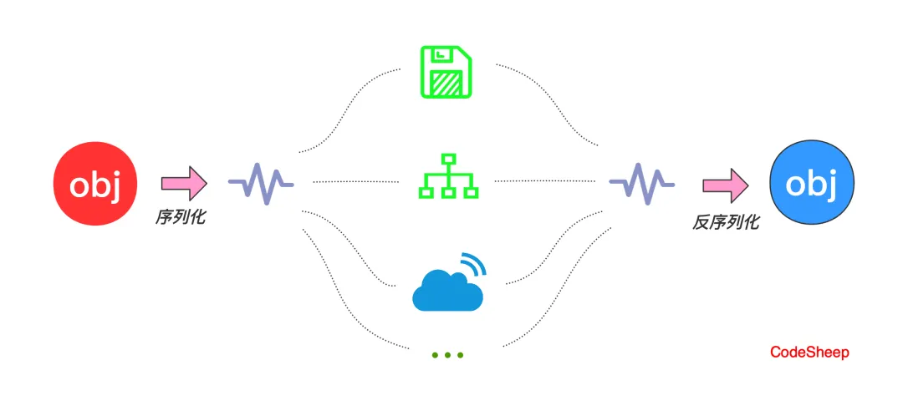

序列化的主要目的是**实现对象的持久化存储和传输**，让对象可以在不同的计算机或不同的时间点被重建和使用。通过序列化，可以将对象的状态以字节的形式保存下来，并且在需要的时候进行恢复，从而实现了对象的跨平台传输和持久化存储。

在Java中，要使一个类可序列化，需要满足以下条件：

1. 实现java.io.Serializable接口，该接口是一个标记接口，没有任何方法。
2. 所有的非静态、非瞬态的字段都可以被序列化。

使用Java的序列化机制，可以通过ObjectOutputStream将对象转换为字节流并写入文件或网络流中。反之，通过ObjectInputStream可以从字节流中读取数据并还原为对象。

需要注意的是，在进行序列化和反序列化时，对象的类和字段的定义必须保持一致，否则可能会导致序列化版本不匹配或字段丢失的问题。

应粉丝要求，补充更多追问

面试官通常会从以下几个方面 继续追问：

1. 序列化和反序列化的基本概念。
2. 序列化和反序列化的应用场景。
3. 序列化和反序列化需要注意的细节（如 transient、serialVersionUID 等）。
4. 序列化和反序列化的安全性问题。
5. 序列化和反序列化的性能优化。

### 2. **如何实现序列化和反序列化？**

Java 提供了 Serializable 接口，用于标记需要序列化的类。

#### 示例代码：

```java
/**
 * @Auth:TianMing
 * @Description： 基本应用
 */
import java.io.*;

public class SerializationExample implements Serializable {
    private static final long serialVersionUID = 1L; // 序列化版本号
    private String name;
    private transient int age; // transient 关键字表示该字段不参与序列化

    // 构造方法、getter 和 setter 略

    public static void main(String[] args) {
        SerializationExample obj = new SerializationExample();
        obj.setName("张三");
        obj.setAge(25);

        // 序列化
        try (ObjectOutputStream oos = new ObjectOutputStream(new FileOutputStream("object.ser"))) {
            oos.writeObject(obj);
            System.out.println("对象已序列化");
        } catch (IOException e) {
            e.printStackTrace();
        }

        // 反序列化
        try (ObjectInputStream ois = new ObjectInputStream(new FileInputStream("object.ser"))) {
            SerializationExample newObj = (SerializationExample) ois.readObject();
            System.out.println("对象已反序列化: " + newObj.getName());
            // 注意：transient 字段会被还原为默认值（这里是 0）
            System.out.println("年龄: " + newObj.getAge());
        } catch (IOException | ClassNotFoundException e) {
            e.printStackTrace();
        }
    }
}
```

序列化底层原理：ObjectStreamClass类中可以看到writeObjectMethod属性，值来自对象**writeObject**方法

反序列化底层原理：ObjectStreamClass类中可以看到readObjectMethod属性，值来自对象**readObject**方法

自行编写readObject()函数，用于对象的反序列化构造，从而提供约束性。可以自定义反序列化对象的校验信息

### 3. **序列化和反序列化的注意事项**

#### 3.1 transient 关键字

* transient 修饰的字段不会被序列化。
* 反序列化时，transient 字段会被还原为默认值（如 int 为 0，String 为 null）。

#### 3.2 serialVersionUID

* serialVersionUID 是序列化版本号，用于标识类的版本。
* 如果类的结构发生变化（如新增字段或修改字段类型），serialVersionUID 不匹配会导致反序列化失败。
* 最好显式声明 serialVersionUID，否则编译器会自动生成一个，但容易导致版本不一致。

#### 3.3 静态字段

* 静态字段不会被序列化，因为它们属于类而不是对象。

### 4. **序列化和反序列化的安全性问题**

序列化和反序列化存在安全风险，尤其是反序列化时：

* 反序列化恶意数据可能导致代码执行或数据泄露。
* 面试官可能会问你如何避免这些问题。

#### 解决方法：

1. **自定义 ****readObject**** 和 ****writeObject**** 方法**：
   * 在类中覆盖 readObject 和 writeObject 方法，验证数据的合法性。
2.

```java
/**
 * @Auth:TianMing
 * @Description： 安全性
 */
private void readObject(ObjectInputStream ois) throws IOException, ClassNotFoundException {
    ois.defaultReadObject();
    // 验证数据
    if (name == null) {
        throw new InvalidObjectException("name 不能为空");
    }
}
```

3. **使用安全的序列化框架**：
   * 避免使用 Java 默认的序列化机制，改用更安全的框架（如 Protobuf、Kryo）。
4. **避免敏感数据参与序列化**：
   * 使用 transient 修饰敏感字段，确保它们不被序列化。

### 5. **序列化和反序列化的性能优化**

Java 的默认序列化机制效率较低，可以通过以下方式优化：

1. **使用 ****Externalizable**** 接口**：
   * Externalizable 是 Serializable 的子接口，允许自定义序列化逻辑。
   * 通过实现 writeExternal 和 readExternal 方法，可以减少序列化数据的大小。
2. **使用高效的序列化库**：
   * **Protobuf**：Google 开发的高效序列化框架，支持跨语言。
   * **Kryo**：轻量级、高性能的序列化框架。
   * **FST**：快速、紧凑的序列化库。

### 6. **面试常见问题**

#### 问题 1：为什么需要序列化？

* 答案：序列化可以将对象转换为字节流，方便存储或传输。例如，将对象保存到文件、通过网络发送对象、在分布式系统中传递对象。

#### 问题 2：transient 和 static 字段为什么不参与序列化？

* 答案：transient 表示字段不参与序列化，static 字段属于类而不是对象，因此也不参与序列化。

#### 问题 3：serialVersionUID 的作用是什么？

* 答案：serialVersionUID 用于标识类的版本。如果类的结构发生变化，serialVersionUID 不匹配会导致反序列化失败。

#### 问题 4：如何提高序列化的性能？

* 答案：可以使用 Externalizable 接口自定义序列化逻辑，或者使用高效的序列化库（如 Protobuf、Kryo）。

#### 问题 5：序列化和反序列化有哪些安全问题？

* 答案：反序列化恶意数据可能导致代码执行或数据泄露。
* 如何防止反序列化破坏单例模式的对象呢？ 可以通过重写 **readObject** 方法 或者 **readResolve** 方法、使用安全的序列化框架、避免敏感数据参与序列化来解决。

#### 问题 6：追问又来了，上面的readObject和 readResolve方法有啥区别呢？

* **readObject**** 方法**：适合用来阻止反序列化或验证对象状态。
* **readResolve()**** 方法**：适合用来确保反序列化后返回的是单例的唯一实例。

两种方法的区别

* **readObject**** 方法**：
  * 是 ObjectInputStream 的方法，用于自定义反序列化逻辑。
  * 适合用来验证对象的状态或直接阻止反序列化。
* **readResolve()**** 方法**：
  * 是一个特殊的钩子方法，用于在反序列化完成后返回一个对象。
  * 适合用来确保返回的是单例的唯一实例。

### 7. **总结**

* **序列化**：将对象转换为字节流。
* **反序列化**：将字节流还原为对象。
* **注意事项**：transient、serialVersionUID、静态字段。
* **安全性**：避免反序列化恶意数据，使用安全的序列化框架。
* **性能优化**：使用 Externalizable 或高效的序列化库。

掌握这些知识点后，你可以在面试中自信地回答序列化和反序列化相关的问题！如果还有其他疑问，可以继续提问。

### 附问题6代码：

#### 示例 1：重写 readObject 方法

```java
import java.io.*;
/**
 * @Auth:TianMing
 * @Description： readObject
 */
public class Singleton implements Serializable {
    private static final long serialVersionUID = 1L;
    private static final Singleton INSTANCE = new Singleton();

    // 私有构造方法，防止外部实例化
    private Singleton() {
        // 防止反射破坏单例
        if (INSTANCE != null) {
            throw new IllegalStateException("Already instantiated");
        }
    }

    // 提供获取实例的方法
    public static Singleton getInstance() {
        return INSTANCE;
    }

    // 重写 readObject 方法，阻止反序列化
    private void readObject(ObjectInputStream ois) throws IOException, ClassNotFoundException {
        throw new IOException("Singleton cannot be deserialized");
    }

    public static void main(String[] args) {
        Singleton instance1 = Singleton.getInstance();

        // 尝试序列化和反序列化
        try (ObjectOutputStream oos = new ObjectOutputStream(new FileOutputStream("singleton.ser"))) {
            oos.writeObject(instance1);
        } catch (IOException e) {
            e.printStackTrace();
        }

        try (ObjectInputStream ois = new ObjectInputStream(new FileInputStream("singleton.ser"))) {
            Singleton instance2 = (Singleton) ois.readObject();
            System.out.println(instance1 == instance2); // false，因为 readObject 抛出了异常
        } catch (IOException | ClassNotFoundException e) {
            e.printStackTrace();
        }
    }
}
```

#### 示例 2：使用 readResolve() 方法

```java
import java.io.*;
/**
 * @Auth:TianMing
 * @Description： readResolve
 */
public class Singleton implements Serializable {
    private static final long serialVersionUID = 1L;
    private static final Singleton INSTANCE = new Singleton();

    // 私有构造方法，防止外部实例化
    private Singleton() {
        // 防止反射破坏单例
        if (INSTANCE != null) {
            throw new IllegalStateException("Already instantiated");
        }
    }

    // 提供获取实例的方法
    public static Singleton getInstance() {
        return INSTANCE;
    }

    // 使用 readResolve 方法，确保返回的是单例的唯一实例
    private Object readResolve() {
        return INSTANCE;
    }

    public static void main(String[] args) {
        Singleton instance1 = Singleton.getInstance();

        // 尝试序列化和反序列化
        try (ObjectOutputStream oos = new ObjectOutputStream(new FileOutputStream("singleton.ser"))) {
            oos.writeObject(instance1);
        } catch (IOException e) {
            e.printStackTrace();
        }

        try (ObjectInputStream ois = new ObjectInputStream(new FileInputStream("singleton.ser"))) {
            Singleton instance2 = (Singleton) ois.readObject();
            System.out.println(instance1 == instance2); // true，因为 readResolve 返回了 INSTANCE
        } catch (IOException | ClassNotFoundException e) {
            e.printStackTrace();
        }
    }
}
```


# 面试官：==和equals的区别？答“地址和内容”的，出门右转！

## \*\*

写在开头\*\* 一位 **1 年经验** 的兄弟找我复盘，说面试挂得有点“冤”，心态崩了。 面试官刚开始为了缓解气氛，**暖场**问了一个入门级的**送分题**：“Java 里 == 和 equals 有什么区别？”

这哥们心想这还不简单，自信满满地背诵：“== 比较地址，equals 比较内容。”

没想到面试官听完，笑着连问了三个问题：

1. **“****Integer a = 1000****，****Integer b = 1000****，用 ****==**** 比较结果是什么？如果是 ****127**** 呢？这个范围能改吗？”**
2. **“****double d1 = 0.0****，****double d2 = -0.0****，它们二进制位一样吗？****==**** 结果又是啥？”**
3. **“重写 ****equals**** 必须重写 ****hashCode**** 吗？如果不重写，HashMap 取数据时第一步会发生什么？”**

他瞬间懵了，支支吾吾答不上来，**原本的暖场题直接变成了“送命题”**。

其实，这道题看似简单，实则是考你对 **JVM 内存模型**、**IEEE 754 标准** 和 **JDK 源码** 的理解深度。只背八股文，连源码都没翻过，面试官一挖你就倒。

今天Fox带你彻底拆解这道**“最熟悉的陌生题”**，最后给你一套无懈可击的面试模板。

# **一、 为什么“==比地址”的说法不严谨？**

很多老教材喜欢教一句口诀：“基本类型比值，引用类型比地址”。 **这句话没错，但它只看到了表象，没看到 JVM 的底层真相。** 如果你只记住了这就去面试，遇到“浮点数”或者“装箱拆箱”的题，照样会挂。

**在 JVM 的眼里，根本没有“值”和“地址”的区别，它只认“二进制”。**

我们知道，Java 的变量都存在 **栈（Stack）** 里：

* **基本类型（int a = 10）：** 栈里直接存的是 **10 的二进制**。
* **引用类型（Object o = new Object()）：** 栈里存的是 **堆中对象的内存地址（如 0x5F3）的二进制**。

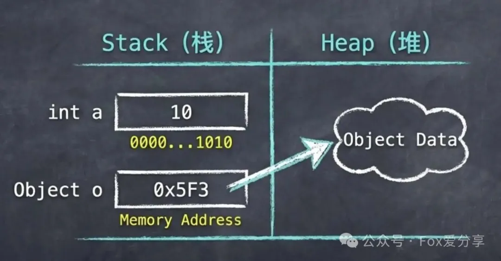

**==**** 操作符的本质**，就是比较这该死的槽位里的二进制位是否完全一样！

让我们看一眼字节码，写一段简单的代码：

```plain
int a = 100;
int b = 100;
Object obj1 = new Object();
Object obj2 = obj1;
```

通过 **javap -c 反编译**，你会发现 JVM 处理 == 时用了不同的指令：

* 比较 int 时，用的是 **if\_icmpeq**（比较整数栈顶值）。
* 比较 Object 时，用的是 **if\_acmpeq**（比较引用地址）。

**结论：** == 根本不关心对象里存了什么。 它只关心：你栈里存的那串数字（无论是值还是地址），是不是一模一样。

**这里有个极端的反例（加分项）：**

如果你能答出 **浮点数（float/double）** 的特殊性，面试官绝对会对你刮目相看：

* NaN（Not a Number）：虽然它的二进制位和自己一样，但 Double.NaN == Double.NaN 结果是 **false**。
* 0.0 和 -0.0：在内存里符号位不同（二进制不一样），但 0.0 == -0.0 结果是 **true**。

**结论：** 除了浮点数这种奇葩，== 永远是在比“栈帧局部变量表中 Slot 的二进制位同一性”。

# **二、 equals 的原罪：它默认就是“==”**

很多同学以为 equals 天生就是用来比内容的。 **大错特错！** 让我们扒开 JDK 的祖宗类 java.lang.Object 的源码看看：

```plain
// JDK 源码：Object.java
public boolean equals(Object obj) {
    return (this == obj);
}
```

看到没有？**在 Object 类里，equals 就是 ****==****！** 如果你定义了一个 User 类，却没有重写 equals 方法，那你写 user1.equals(user2)，和写 user1 == user2 没有任何区别，比的还是地址。

# **三、 核心进阶：源码里的两个“大坑”**

面试官最喜欢问的“坑”，通常藏在 String 和 Integer 的源码里。

## **坑位 1：String 的“双标”与 intern()**

String 是个叛徒，它重写了 equals，变成了比较字符数组的内容。 我们看 String 的源码（JDK 8）：

```plain
public boolean equals(Object anObject) {
    // 1. 先判断地址，如果是同一个对象，直接返回 true（性能优化）
    if (this == anObject) {
        return true;
    }
    // 2. 如果是 String 类型，再逐个字符比较内容
    if (anObject instanceof String) {
        ... // 循环比较 char[] 数组
    }
    return false;
}
```

但这里有个经典面试题：

```plain
String s1 = "Fox";
String s2 = new String("Fox");

System.out.println(s1 == s2); // false
System.out.println(s1 == s2.intern()); // true
```

**深度解析：**

* s1 指向 **字符串常量池（String Pool）**。
* s2 指向 **堆内存**（因为用了 new）。
* **intern()****的作用：** 这是一个 native 方法，它会尝试把堆里的字符串“塞回”常量池。如果池子里有了，就返回池里的地址。所以 s2.intern() 返回的地址和 s1 是一样的！

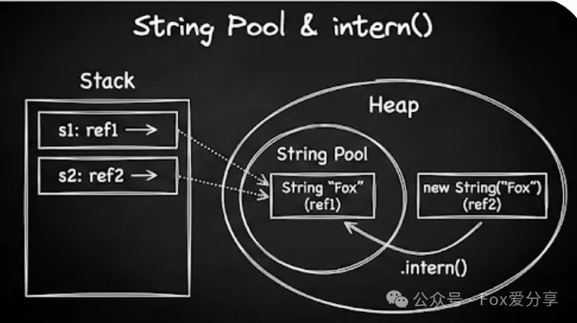

## **坑位 2：Integer 的 128 陷阱与 JVM 调优**

回到开头面试官的问题：

```plain
Integer a = 127, b = 127;
System.out.println(a == b); // true

Integer c = 128, d = 128;
System.out.println(c == d); // false
```

为什么 127 行，128 就不行？ 这涉及到了 Java 的 **自动装箱（Auto-boxing）机制**。当你写 Integer a = 127 时，编译器自动转成了 Integer.valueOf(127)。

让我们钻进 Integer.java 源码：

```plain
public static Integer valueOf(int i) {
    // IntegerCache.low = -128
    // IntegerCache.high = 127 (默认)
    if (i >= IntegerCache.low && i IntegerCache）。

* **127** 命中缓存，大家拿到的都是缓存池里同一个对象的引用。
* **128** 超出缓存，每次都 new 一个新对象。

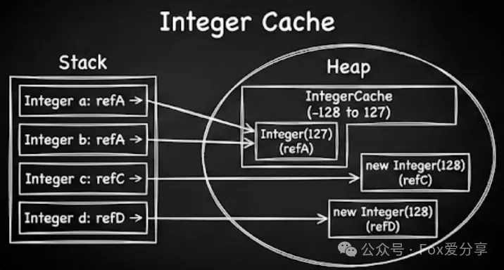

**大神加分项：**

面试官问：“128 就一定不相等吗？”

你可以淡定地回答：“不一定。这个上限 127 是可以通过 JVM 参数 -XX:AutoBoxCacheMax= 来修改的。如果我看某个应用全是 200 左右的 ID 操作，我完全可以把缓存调大来优化 GC。” **这一句说出来，面试官就知道你是读过源码且懂调优的。**

# **四、 最后的“必杀技”：HashCode 的契约**

如果面试官问：“**我重写了 equals，但不重写 hashCode 会怎样？**”

**答：会导致 HashMap/HashSet 丢数据。**

**原理拆解：** HashMap 在 get(key) 的时候，是有“两道门禁”的：

1. **第一道门禁（Hash）：** 先算 key 的 hashCode()。如果哈希值不一样，HashMap 直接判定“找不到”，连 equals 都懒得调。
2. **第二道门禁（Equals）：** 只有哈希值一样（Hash冲突）且桶里有数据时，才会调用 equals 进行最终确认。

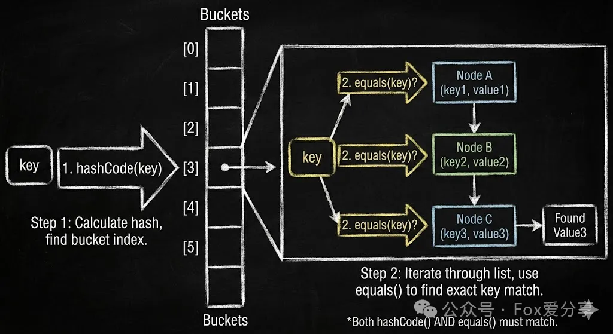

如果你重写了 equals 让两个对象“逻辑相等”，却没重写 hashCode： HashMap 第一步算出来的哈希值就不同，直接返回 null。 这就是经典的 **内存泄漏** 或 **逻辑诡异** bug。

# **五、 面试标准答案模板（直接背诵）**

下次被问到这个问题，请按这个逻辑输出，秒杀全场：

“== 和 equals 的区别主要体现在 **底层原理** 和 **设计契约** 上：

1. **==**** 的本质：**
   * 它是 CPU 指令级的操作符。对于基本类型，它比较**栈中的值**（注意浮点数 IEEE 754 的 NaN 和 -0.0 特例）；对于引用类型，它比较**堆内存地址**。
2. **equals**** 的本质：**
   * 它是 Object 类的方法。默认实现就是 ==。
   * 但像 String、Integer 等类重写了它，将其定义为**逻辑相等**（比较内部 value）。
3. **避坑与调优：**
   * 使用 == 比较 Integer 时要注意 **-128 到 127 的缓存池**，这个范围甚至可以通过 -XX:AutoBoxCacheMax 调整。
   * **核心契约：** 重写 equals **必须** 重写 hashCode。这是为了配合 HashMap 等散列集合的高效查询，否则会导致哈希定位失败，引发 Bug。”

## **写在最后**

技术面试考的从来不是死记硬背，而是你对 **底层原理的敬畏**。 能提到 intern()、AutoBoxCacheMax 和 NaN 这些细节，说明你不是在背题，而是在**玩技术**。

**觉得有收获的兄弟，点个“在看”，这就是对我最大的支持！**


# HashMap底层原理常见面试题

### 1、HashMap 的底层数据结构
在 **JDK 1.7 **中 HashMap 是以**「数组加链表」**的形式组成的，**JDK 1.8** 之后新增了**「红黑树」**的组成结构，**「当链表长度大于 8 并且 hash 桶的容量大于 64 时，链表结构会转换成红黑树结构」**。所以，它的组成结构如下图所示：

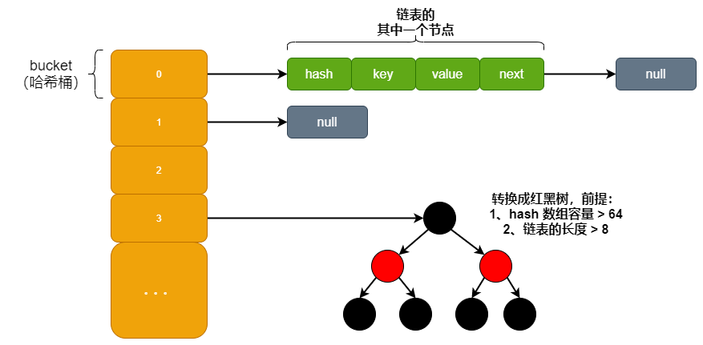

底层数据结构

HashMap 中数组的每一个元素又称为哈希桶，也就是 key-value 这样的实例。在 **Java7** 中叫 Entry，**Java8** 中叫 Node。

因为它本身所有的位置都为 null，在 put 插入的时候会根据 key 的 hash 去计算一个 index 值。比如，我 put （"徐庶"，666），在 HashMap 中插入 "徐庶" 这个元素，通过 hash 算法算出 index 位置是 3。这时的结构如下所示，还是个数组。

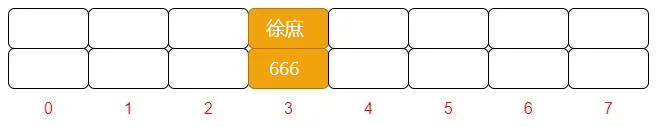

初次 put

以上没 hash 冲突时，若发生 hash 冲突就得引入链表啦。假设我再次 put （"元直"，666），在 HashMap 中插入 "元直" 这个元素，通过 hash 算法算出 index 位置也是 3。这时的结构如下所示：形成了链表。

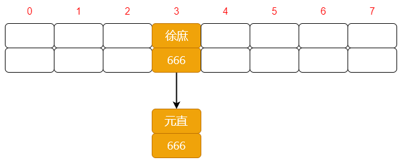

再次 put，发生 hash 冲突

它的源码如下所示：**「可以看出每个哈希桶中包含了四个字段：hash、key、value、next，其中 next 表示链表的下一个节点」**。

```java
static class Node  implements Map.Entry  {
    final int hash;
    final K key;
    V value;
    Node  next;

    ...
}
```

:::danger
**❝**

JDK 1.8 之所以添加红黑树是因为一旦链表过长，会严重影响 HashMap 的性能，而红黑树具有快速增删改查的特点，这样就可以有效的解决链表过长时操作比较慢的问题。

❞

:::

### 2、HashMap 的重要方法
PS：以下源码分析全部基于 JDK1.8 版本。

#### 查询（get 方法）
源码如下：

```java
public V get(Object key) {
Node  e;
// 对 key 进行哈希操作
return (e = getNode(hash(key), key)) == null ? null : e.value;
}

final Node  getNode(int hash, Object key) {
    Node  [] tab;
    Node  first, e;
    int n;
    K k;
    // 非空判断
    if ((tab = table) != null && (n = tab.length) > 0 &&
        (first = tab[(n - 1) & hash]) != null) {
        // 判断第一个元素是否是要查询的元素
        // always check first node
        if (first.hash == hash &&
            ((k = first.key) == key || (key != null && key.equals(k))))
            return first;
        // 下一个节点非空判断
        if ((e = first.next) != null) {
            // 如果第一节点是树结构，则使用 getTreeNode 直接获取相应的数据
            if (first instanceof TreeNode)
                return ((TreeNode  ) first).getTreeNode(hash, key);
            do { // 非树结构，循环节点判断
                // hash 相等并且 key 相同，则返回此节点
                if (e.hash == hash &&
                    ((k = e.key) == key || (key != null && key.equals(k))))
                    return e;
            } while ((e = e.next) != null);
        }
    }
    return null;
}
```

代码注释已经很详细，强调一点：当哈希冲突时我们不仅需要判断 hash 值，还需要通过判断 key 值是否相等，才能确认此元素是不是我们想要的元素。

#### 新增（put 方法）
源码如下：

```java
public V put(K key, V value) {
    // 对 key 进行哈希操作
    return putVal(hash(key), key, value, false, true);
}

final V putVal(int hash, K key, V value, boolean onlyIfAbsent,
               boolean evict) {
    Node  [] tab;
    Node  p;
    int n, i;
    // 哈希表为空则创建表
    if ((tab = table) == null || (n = tab.length) == 0)
        n = (tab = resize()).length;
    // 根据 key 的哈希值计算出要插入的数组索引 i
    if ((p = tab[i = (n - 1) & hash]) == null)
        // 如果 table[i] 等于 null，则直接插入
        tab[i] = newNode(hash, key, value, null);
    else {
        Node  e;
        K k;
        // 如果 key 已经存在了，直接覆盖 value
        if (p.hash == hash &&
            ((k = p.key) == key || (key != null && key.equals(k))))
            e = p;
            // 如果 key 不存在，判断是否为红黑树
        else if (p instanceof TreeNode)
            // 红黑树直接插入键值对
            e = ((TreeNode  ) p).putTreeVal(this, tab, hash, key, value);
        else {
            // 为链表结构，循环准备插入
            for (int binCount = 0;; ++binCount) {
                // 下一个元素为空时
                if ((e = p.next) == null) {
                    p.next = newNode(hash, key, value, null);
                    // 转换为红黑树进行处理
                    if (binCount >= TREEIFY_THRESHOLD - 1) // -1 for 1st
                        treeifyBin(tab, hash);
                    break;
                }
                //  key 已经存在直接覆盖 value
                if (e.hash == hash &&
                    ((k = e.key) == key || (key != null && key.equals(k))))
                    break;
                p = e;
            }
        }
        // existing mapping for key
        if (e != null) {
            V oldValue = e.value;
            if (!onlyIfAbsent || oldValue == null)
                e.value = value;
            afterNodeAccess(e);
            return oldValue;
        }
    }
    ++modCount;
    // 超过最大容量，扩容
    if (++size > threshold)
        resize();
    afterNodeInsertion(evict);
    return null;
}
```

注释已经很详细了。但新增的方法比较复杂，画个流程图方便方便各位理解：

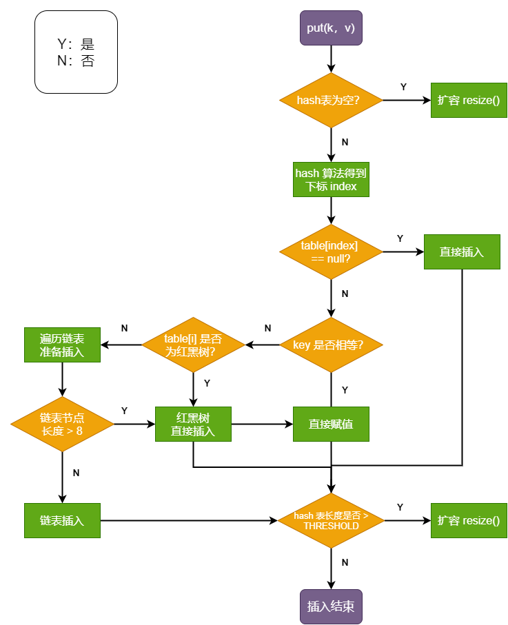

put 流程

#### 扩容（resize 方法）
源码如下：

```plain
final Node  [] resize() {
    // 扩容前的数组
    Node  [] oldTab = table;
    // 扩容前的数组的大小和阈值
    int oldCap = (oldTab == null) ? 0 : oldTab.length;
    int oldThr = threshold;
    // 预定义新数组的大小和阈值
    int newCap, newThr = 0;
    if (oldCap > 0) {
        // 超过最大值就不再扩容了
        if (oldCap >= MAXIMUM_CAPACITY) {
            threshold = Integer.MAX_VALUE;
            return oldTab;
        }
        // 扩大容量为当前容量的两倍，但不能超过 MAXIMUM_CAPACITY
        else if ((newCap = oldCap = DEFAULT_INITIAL_CAPACITY)
            newThr = oldThr  0) // initial capacity was placed in threshold
        newCap = oldThr;
    else { // zero initial threshold signifies using defaults
        // 如果初始化的值为 0，则使用默认的初始化容量
        newCap = DEFAULT_INITIAL_CAPACITY;
        newThr = (int)(DEFAULT_LOAD_FACTOR * DEFAULT_INITIAL_CAPACITY);
    }
    // 如果新的容量等于 0
    if (newThr == 0) {
        float ft = (float) newCap * loadFactor;
        newThr = (newCap  [] newTab = (Node  []) new Node[newCap];
    // 开始扩容，将新的容量赋值给 table
    table = newTab;
    // 原数据不为空，将原数据复制到新 table 中
    if (oldTab != null) {
        // 根据容量循环数组，复制非空元素到新 table
        for (int j = 0; j  e;
            if ((e = oldTab[j]) != null) {
                oldTab[j] = null;
                // 如果链表只有一个，则进行直接赋值
                if (e.next == null)
                    newTab[e.hash & (newCap - 1)] = e;
                else if (e instanceof TreeNode)
                    // 红黑树相关的操作
                    ((TreeNode  ) e).split(this, newTab, j, oldCap);
                else { // preserve order
                    // 链表复制，JDK 1.8 扩容优化部分
                    // 如果节点不为空，且为单链表，则将原数组中单链表元素进行拆分
                    Node  loHead = null, loTail = null;//保存在原有索引的链表
                    Node  hiHead = null, hiTail = null;//保存在新索引的链表
                    Node  next;
                    do {
                        next = e.next;
                        // 哈希值和原数组长度进行 & 操作，为 0 则在原数组的索引位置
                        if ((e.hash & oldCap) == 0) {
                            if (loTail == null)
                                loHead = e;
                            else
                                loTail.next = e;
                            loTail = e;
                        }
                        // 原索引 + oldCap
                        else {
                            if (hiTail == null)
                                hiHead = e;
                            else
                                hiTail.next = e;
                            hiTail = e;
                        }
                    } while ((e = next) != null);
                    // 将原索引放到哈希桶中
                    if (loTail != null) {
                        loTail.next = null;
                        newTab[j] = loHead;
                    }
                    // 将原索引 + oldCap 放到哈希桶中
                    if (hiTail != null) {
                        hiTail.next = null;
                        newTab[j + oldCap] = hiHead;
                    }
                }
            }
        }
    }
    return newTab;
}
```

从以上源码可以看出，扩容主要分两步：

+ 扩容：创建一个新的 Entry 空数组，长度是原数组的 2 倍。
+ 位运算：原来的元素哈希值和原数组长度进行 & 运算。

JDK 1.8 在扩容时并没有像 JDK 1.7 那样，重新计算每个元素的哈希值，而是通过高位运算（e.hash & oldCap）来确定元素是否需要移动，假设 key1 的信息如下：

+ key1.hash = 10；二进制：0000 1010
+ oldCap = 16；二进制：0001 0000

**「使用 e.hash & oldCap 得到的结果，高一位为 0，当结果为 0 时表示元素在扩容时位置不会发生任何变化」**，而假设 key 2 信息如下：

+ key2.hash = 17；二进制：0001 0001
+ oldCap = 16；二进制：0001 0000

**「这时候得到的结果，高一位为 1，当结果为 1 时，表示元素在扩容时位置发生了变化，新的下标位置等于原下标位置 + 原数组长度」**，如下图所示：key2、kry4 虚线为移动的位置。

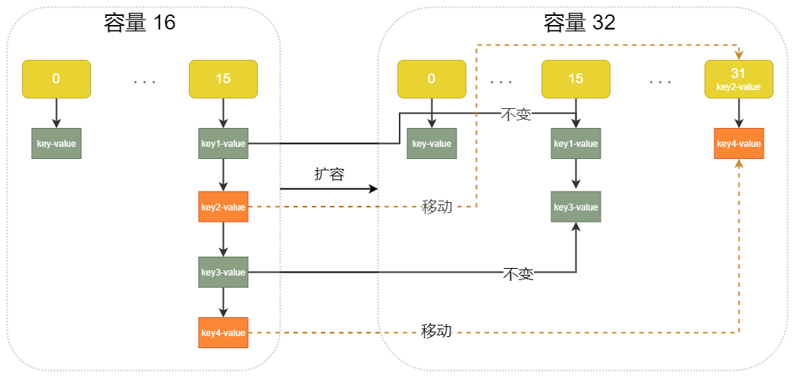

扩容

### 3、HashMap 有哪些属性？
如下，看代码注释，写的很清楚了。

```java
// HashMap 初始化长度
static final int DEFAULT_INITIAL_CAPACITY = 1  树。这时理应也还是树化，但是树化需要时间，为了这点效率牺牲时间是不划算的。

### 6、什么是加载因子？加载因子为什么是  0.75 ？
前面说了扩容机制。那什么时候扩容呢？这就取决于原数组长度和加载因子两个因素了。

:::danger
加载因子也叫扩容因子或负载因子，用来判断什么时候进行扩容的，假如加载因子是 0.5，HashMap 的初始化容量是 16，那么当 HashMap 中有 16*0.5=8 个元素时，HashMap 就会进行扩容。

:::

那加载因子为什么是 0.75 而不是 0.5 或者 1.0 呢？这其实是出于容量和性能之间平衡的结果：

+ 上面说到，为了提升扩容效率，HashMap 的容量（capacity）有一个固定的要求，那就是一定是 2 的幂。所以，如果负载因子是 3/4 的话，那么和 capacity 的乘积结果就可以是一个整数
+ 当加载因子设置较大时，扩容门槛提高，扩容发生频率低，占用的空间小，但此时发生 Hash 冲突的几率就会提升，因此需要更复杂的数据结构来存储元素，这样对元素的操作时间就会增加，运行效率也会降低；
+ 当加载因子设置较小时，扩容门槛降低，会占用更多的空间，此时元素的存储就比较稀疏，发生哈希冲突的可能性就比较小，因此操作性能会比较高。

**「所以综合了以上情况就取了一个 0.5 到 1.0 的平均数 0.75 作为加载因子」**。

### 7、HashMap 是线程安全的么？
不是，因为 get 和 put 方法都没有上锁。**「多线程操作无法保证：此刻 put 的值，片刻后 get 还是相同的值，会造成线程安全问题」**。

还有个 HashTable 是线程安全的，但是加锁的粒度太大。并发度很低，最多同时允许一个线程访问，性能不高。一般我们使用 currentHashMap。

### 8、为什么重写 equals 方法的时，需要重写 hashCode 方法呢？

:::danger
Java 中，所有的对象都是继承于 Object 类。Ojbect 类中有两个方法 equals、hashCode，这两个方法都是用来比较两个对象是否相等的。

:::

先来看看 equals 方法：

```java
public boolean equals(Object obj) {
return (this == obj);
}
```

在未重写 equals 方法，他其实就是 == 。有以下两个特点：

+ 对于值对象，== 比较的是两个对象的值
+ 对于引用对象，== 比较的是两个对象的地址

看回 put 方法的源码：**「HashMap 是通过 key 的 hashcode 去寻找地址 index 的。如果 index 一样就会形成链表」**，也即是 "徐庶" 和 "元直" 是有可能在同一个位置上。

前面的 get 方法说过：**「当哈希冲突时我们不仅需要判断 hash 值，还需要通过判断 key 值是否相等，才能确认此元素是不是我们想要的元素」**。我们去 get 首先是找到 hash 值一样的，那怎么知道你想要的是那个对象呢？**「没错，就是利用 equals 方法」**，如果重写 hashCode 方法，不写 equals 方法，当发生 hash 冲突，hashcode 一样时，就不知道取哪个对象了。

### 9、HashMap 死循环分析
以下代码基于 JDK1.7 分析。这个问题，主要是 JDK1.7 的链表头插法造成的。假设 HashMap 默认大小为 2，原本 HashMap 中没有一个元素。使用三个线程：t1、t2、t3 添加元素 key1，key2，key3。我在扩容之前打了个断点，让三个线程都停在这里。源码如下：

```plain
void transfer(Entry[] newTable, boolean rehash) {
    int newCapacity = newTable.length;
    for (Entry  e: table) {
        while (null != e) {
            Entry  next = e.next; // 此处加断点
            if (rehash) {
                e.hash = null == e.key ? 0 : hash(e.key);
            }
            int i = indexFor(e.hash, newCapacity);
            e.next = newTable[i];
            newTable[i] = e;
            e = next;
        }
    }
}
```

假设 3 个元素 hash 冲突，放到同一个链表上。其中 key1→key2→key3 这样的顺序。没毛病，一切很正常。

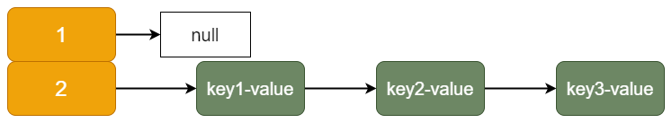

尾插法

此时放开断点，HashMap 扩容。就有可能变成这样：原来是 key1→key2→key3。很不幸扩容之后，key1 和 key2 还是在同一个位置，这时形成链表，如果 key2 比 key1 后面插入，根据头插法。此时就变成 key2→key1

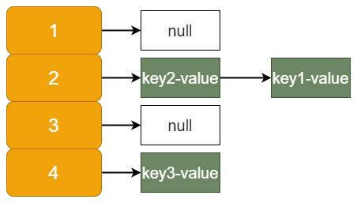

链表反转

最终 3 个线程都调整完毕，就会出现下图所示的死循环：这个时候 get (key1) 就会出现 Infinite Loop 异常。

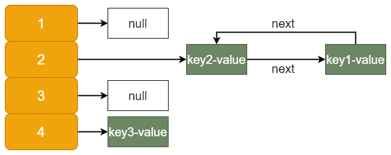

循环引用

当然发生死循环的原因是 JDK 1.7 链表插入方式为首部倒序插入，这种方式在扩容时会改变链表节点之间的顺序。**「这个问题在 JDK 1.8 得到了改善，变成了尾部正序插入」**，在扩容时会保持链表元素原本的顺序，就不会出现链表成环的问题。

### 10、总结
HashMap 是 Java 基础中的重点。可以说无论是在工作中还是面试中都很常用，小伙伴们必须做到熟练运用、信手拈来才算是过关的。本篇文章基本说到了 HashMap 的所有重点，因为篇幅原因红黑树没有展开说，在我们架构课中会详细讲解。另外，如果发现本文有啥错误，欢迎友善指正。


# 阿里一面：说一说Java、Spring、Dubbo三者SPI机制的原理和区别

## 什么是SPI

SPI全称为Service Provider Interface，是一种动态替换发现的机制，一种解耦非常优秀的思想，SPI可以很灵活的让接口和实现分离，让api提供者只提供接口，第三方来实现，然后可以使用配置文件的方式来实现替换或者扩展，在框架中比较常见，提高框架的可扩展性。

简单来说SPI是一种非常优秀的设计思想，它的核心就是解耦、方便扩展。

## Java SPI机制--ServiceLoader

ServiceLoader是Java提供的一种简单的SPI机制的实现，Java的SPI实现约定了以下两件事：

* 文件必须放在`META-INF/services/`目录底下
* 文件名必须为接口的全限定名，内容为接口实现的全限定名

这样就能够通过ServiceLoader加载到文件中接口的实现。

#### 来个demo

第一步，需要一个接口以及他的实现类

```plain
public interface LoadBalance {
}

public class RandomLoadBalance implements LoadBalance{
}
```

第二步，在`META-INF/services/`目录创建一个文件名LoadBalance全限定名的文件，文件内容为RandomLoadBalance的全限定名

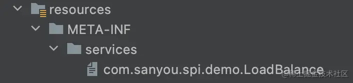

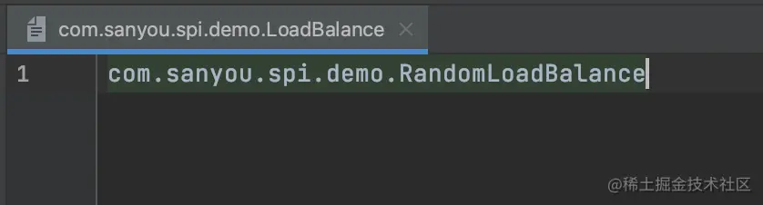

测试类：

```plain
public class ServiceLoaderDemo {

    public static void main(String[] args) {
        ServiceLoader loadBalanceServiceLoader = ServiceLoader.load(LoadBalance.class);
        Iterator iterator = loadBalanceServiceLoader.iterator();
        while (iterator.hasNext()) {
            LoadBalance loadBalance = iterator.next();
            System.out.println("获取到负载均衡策略:" + loadBalance);
        }
    }

}
```

测试结果：

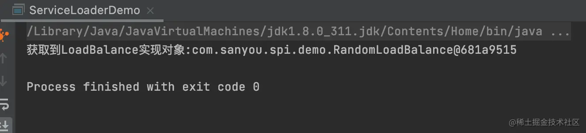

此时就成功获取到了实现。

在实际的框架设计中，上面这段测试代码其实是框架作者写到框架内部的，而对于框架的使用者来说，要想自定义LoadBalance实现，嵌入到框架，仅仅只需要写接口的实现和spi文件即可。

#### 实现原理

如下是ServiceLoader中一段核心代码

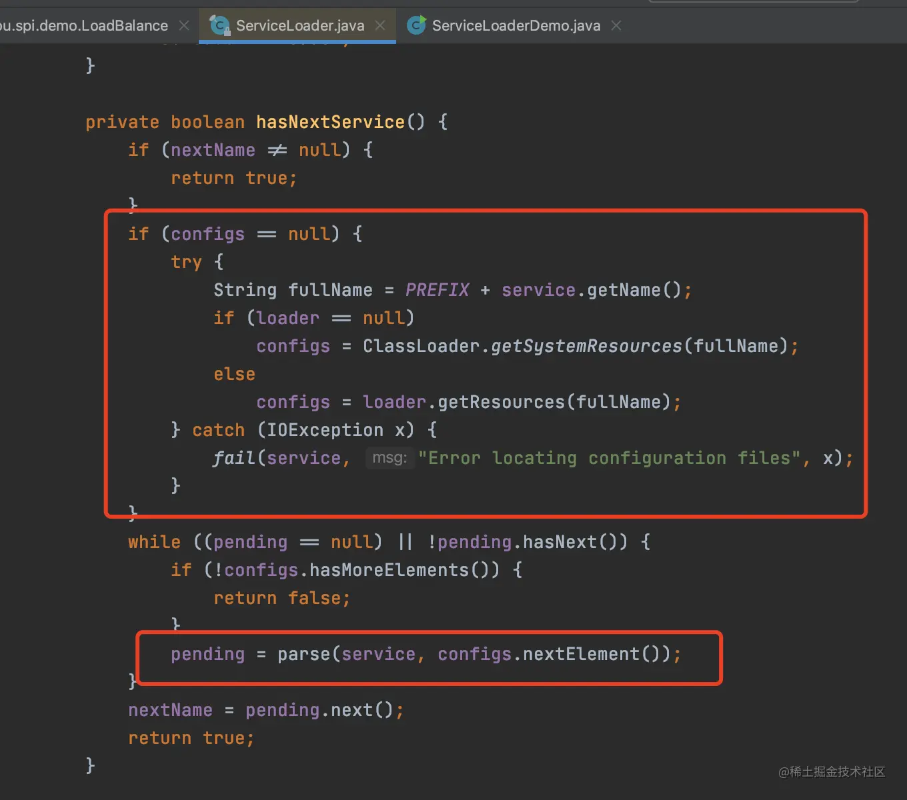

首先获取一个fullName，其实就是`META-INF/services/接口的全限定名`

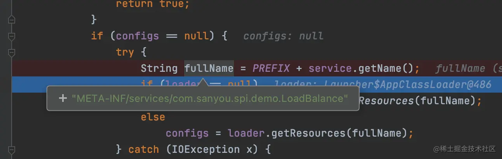

然后通过ClassLoader获取到资源，其实就是接口的全限定名文件对应的资源，然后交给`parse`方法解析资源

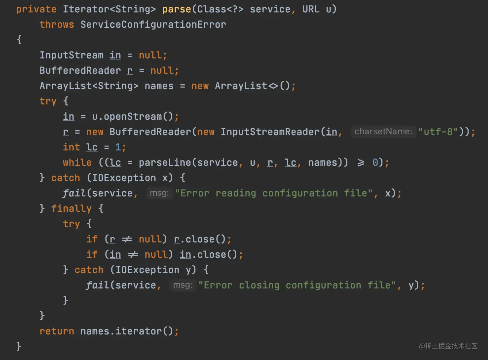

`parse`方法其实就是通过IO流读取文件的内容，这样就可以获取到接口的实现的全限定名

再后面其实就是通过反射实例化对象，这里就不展示了。

所以其实不难发现ServiceLoader实现原理比较简单，总结起来就是通过IO流读取`META-INF/services/接口的全限定名`文件的内容，然后反射实例化对象。

#### 优缺点

由于Java的SPI机制实现的比较简单，所以他也有一些缺点。

第一点就是浪费资源，虽然例子中只有一个实现类，但是实际情况下可能会有很多实现类，而Java的SPI会一股脑全进行实例化，但是这些实现了不一定都用得着，所以就会白白浪费资源。

第二点就是无法对区分具体的实现，也就是这么多实现类，到底该用哪个实现呢？如果要判断具体使用哪个，只能依靠接口本身的设计，比如接口可以设计为一个策略接口，又或者接口可以设计带有优先级的，但是不论怎样设计，框架作者都得写代码进行判断。

所以总得来说就是ServiceLoader无法做到按需加载或者按需获取某个具体的实现。

#### 使用场景

虽然说ServiceLoader可能有些缺点，但是还是有使用场景的，比如说：

* 不需要选择具体的实现，每个被加载的实现都需要被用到
* 虽然需要选择具体的实现，但是可以通过对接口的设计来解决

## Spring SPI机制--SpringFactoriesLoader

Spring我们都不陌生，他也提供了一种SPI的实现SpringFactoriesLoader。

Spring的SPI机制的约定如下：

* 配置文件必须在`META-INF/`目录下，文件名必须为spring.factories
* 文件内容为键值对，一个键可以有多个值，只需要用逗号分割就行，同时键值都需要是类的全限定名，键和值可以没有任何类与类之间的关系，当然也可以有实现的关系。

所以也可以看出，Spring的SPI机制跟Java的不论是文件名还是内容约定都不一样。

#### 来个demo

在`META-INF/`目录下创建spring.factories文件，LoadBalance为键，RandomLoadBalance为值


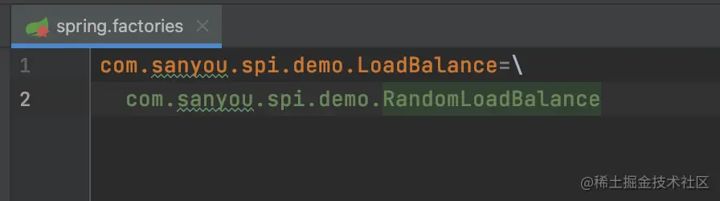

测试：

```plain
public class SpringFactoriesLoaderDemo {

    public static void main(String[] args) {
        List loadBalances = SpringFactoriesLoader.loadFactories(LoadBalance.class, MyEnableAutoConfiguration.class.getClassLoader());
        for (LoadBalance loadBalance : loadBalances) {
            System.out.println("获取到LoadBalance对象:" + loadBalance);
        }
    }

}
```

运行结果：


成功获取到了实现对象。

#### 核心原理

如下是SpringFactoriesLoader中一段核心代码


其实从这可以看出，跟Java实现的差不多，只不过读的是`META-INF/`目录下spring.factories文件内容，然后解析出来键值对。

#### 使用场景

Spring的SPI机制在内部使用的非常多，尤其在SpringBoot中大量使用，SpringBoot启动过程中很多扩展点都是通过SPI机制来实现的，这里我举两个例子

##### 1、自动装配

在SpringBoot3.0之前的版本，自动装配是通过SpringFactoriesLoader来加载的。


但是SpringBoot3.0之后不再使用SpringFactoriesLoader，而是Spring重新从`META-INF/spring/`目录下的`org.springframework.boot.autoconfigure.AutoConfiguration.imports`文件中读取了。


至于如何读取的，其实猜也能猜到就跟上面SPI机制读取的方式大概差不多，就是文件路径和名称不一样。

##### 2、PropertySourceLoader的加载

PropertySourceLoader是用来解析application配置文件的，它是一个接口


SpringBoot默认提供了 PropertiesPropertySourceLoader 和 YamlPropertySourceLoader两个实现，就是对应properties和yaml文件格式的解析。

SpringBoot在加载PropertySourceLoader时就用了SPI机制


#### 与Java SPI机制对比

首先Spring的SPI机制对Java的SPI机制对进行了一些简化，Java的SPI每个接口都需要对应的文件，而Spring的SPI机制只需要一个spring.factories文件。

其次是内容，Java的SPI机制文件内容必须为接口的实现类，而Spring的SPI并不要求键值对必须有什么关系，更加灵活。

第三点就是Spring的SPI机制提供了获取类限定名的方法`loadFactoryNames`，而Java的SPI机制是没有的。通过这个方法获取到类限定名之后就可以将这些类注入到Spring容器中，用Spring容器加载这些Bean，而不仅仅是通过反射。

但是Spring的SPI也同样没有实现获取指定某个指定实现类的功能，所以要想能够找到具体的某个实现类，还得依靠具体接口的设计。

所以不知道你有没有发现，PropertySourceLoader它其实就是一个策略接口，注释也有说，所以当你的配置文件是properties格式的时候，他可以找到解析properties格式的PropertiesPropertySourceLoader对象来解析配置文件。

## Dubbo SPI机制--ExtensionLoader

ExtensionLoader是dubbo的SPI机制的实现类。每一个接口都会有一个自己的ExtensionLoader实例对象，这点跟Java的SPI机制是一样的。

同样地，Dubbo的SPI机制也做了以下几点约定：

* 接口必须要加@SPI注解
* 配置文件可以放在`META-INF/services/`、`META-INF/dubbo/internal/ `、`META-INF/dubbo/` 、`META-INF/dubbo/external/`这四个目录底下，文件名也是接口的全限定名
* 内容为键值对，键为短名称（可以理解为spring中Bean的名称），值为实现类的全限定名

#### 先来个demo

首先在LoadBalance接口上@SPI注解

```plain
@SPI
public interface LoadBalance {

}
```

然后，修改一下Java的SPI机制测试时配置文件内容，改为键值对，因为Dubbo的SPI机制也可以从`META-INF/services/`目录下读取文件，所以这里就没重写文件

```plain
random=com.sanyou.spi.demo.RandomLoadBalance
```

测试类：

```plain
public class ExtensionLoaderDemo {

    public static void main(String[] args) {
        ExtensionLoader extensionLoader = ExtensionLoader.getExtensionLoader(LoadBalance.class);
        LoadBalance loadBalance = extensionLoader.getExtension("random");
        System.out.println("获取到random键对应的实现类对象：" + loadBalance);
    }

}
```

通过ExtensionLoader的`getExtension`方法，传入短名称，这样就可以精确地找到短名称对的实现类。

所以从这可以看出Dubbo的SPI机制解决了前面提到的无法获取指定实现类的问题。

测试结果：


dubbo的SPI机制除了解决了无法获取指定实现类的问题，还提供了很多额外的功能，这些功能在dubbo内部用的非常多，接下来就来详细讲讲。

#### dubbo核心机制

##### 1、自适应机制

自适应，自适应扩展类的含义是说，基于参数，在运行时动态选择到具体的目标类，然后执行。

每个接口有且只能有一个自适应类，通过ExtensionLoader的`getAdaptiveExtension`方法就可以获取到这个类的对象，这个对象可以根据运行时具体的参数找到目标实现类对象，然后调用目标对象的方法。

举个例子，假设上面的LoadBalance有个自适应对象，那么获取到这个自适应对象之后，如果在运行期间传入了`random`这个key，那么这个自适应对象就会找到`random`这个key对应的实现类，调用那个实现类的方法，如果动态传入了其它的key，就路由到其它的实现类。

自适应类有两种方式产生，第一种就是自己指定，在接口的实现类上加@Adaptive注解，那么这个这个实现类就是自适应实现类。

```plain
@Adaptive
public class RandomLoadBalance implements LoadBalance{
}
```

除了自己代码指定，还有一种就是dubbo会根据一些条件帮你动态生成一个自适应类，生成过程比较复杂，这里就不展开了。

自适应机制在Dubbo中用的非常多，而且很多都是自动生成的，如果你不知道Dubbo的自适应机制，你在读源码的时候可能都不知道为什么代码可以走到那里。。

##### 2、IOC和AOP

一提到IOC和AOP，立马想到的都是Spring，但是IOC和AOP并不是Spring特有的概念，Dubbo也实现IOC和AOP的功能，但是是一个轻量级的。

**2.1、依赖注入**

Dubbo依赖注入是通过setter注入的方式，注入的对象默认就是上面提到的自适应的对象，在Spring环境下可以注入Spring Bean。

```plain
public class RoundRobinLoadBalance implements LoadBalance {

    private LoadBalance loadBalance;

    public void setLoadBalance(LoadBalance loadBalance) {
        this.loadBalance = loadBalance;
    }

}
```

如上代码，RoundRobinLoadBalance中有一个setLoadBalance方法，参数LoadBalance，在创建RoundRobinLoadBalance的时候，在非Spring环境底下，Dubbo就会找到LoadBalance自适应对象然后通过反射注入。

这种方式在Dubbo中也很常见，比如如下的一个场景


RegistryProtocol中会注入一个Protocol，其实这个注入的Protocol就是一个自适应对象。

**2.2、接口回调**

Dubbo也提供了一些类似于Spring的一些接口的回调功能，比如说，如果你的类实现了Lifecycle接口，那么创建或者销毁的时候就会回调以下几个方法


在dubbo3.x的某个版本之后，dubbo提供了更多接口回调，比如说ExtensionPostProcessor、ExtensionAccessorAware，命名跟Spring的非常相似，作用也差不多。

**2.3、自动包装**

自动包装其实就是aop的功能实现，对目标对象进行代理，并且这个aop功能在默认情况下就是开启的。

在Dubbo中SPI接口的实现中，有一种特殊的类，被称为Wrapper类，这个类的作用就是来实现AOP的。

判断Wrapper类的唯一标准就是这个类中必须要有这么一个构造参数，这个构造方法的参数只有一个，并且参数类型就是接口的类型，如下代码：

```plain
public class RoundRobinLoadBalance implements LoadBalance {

    private final LoadBalance loadBalance;

    public RoundRobinLoadBalance(LoadBalance loadBalance) {
        this.loadBalance = loadBalance;
    }

}
```

此时RoundRobinLoadBalance就是一个Wrapper类。

当通过`random`获取RandomLoadBalance目标对象时，那么默认情况下就会对RandomLoadBalance进行包装，真正获取到的其实是RoundRobinLoadBalance对象，RoundRobinLoadBalance内部引用的对象是RandomLoadBalance。

***测试一下***

在配置文件中加入

```plain
roundrobin=com.sanyou.spi.demo.RoundRobinLoadBalance
```

测试结果


从结果可以看出，虽然指定了`random`，但是实际获取到的是RoundRobinLoadBalance，而RoundRobinLoadBalance内部引用了RandomLoadBalance。

如果有很多的包装类，那么就会形成一个责任链条，一个套一个。

所以dubbo的aop跟spring的aop实现是不一样的，spring的aop底层是基于动态代理来的，而dubbo的aop其实算是静态代理，dubbo会帮你自动组装这个代理，形成一条责任链。

到这其实我们已经知道，dubbo的spi接口的实现类已经有两种类型了：

* 自适应类
* Wrapper类

除了这两种类型，其实还有一种，叫做默认类，就是`@SPI`注解的值对应的实现类，比如

```plain
@SPI("random")
public interface LoadBalance {

}
```

此时`random`这个key对应的实现类就是默认实现，通过`getDefaultExtension`这个方法就可以获取到默认实现对象。

#### 3、自动激活

所谓的自动激活，就是根据你的入参，动态地选择一批实现类返回给你。

自动激活的实现类上需要加上`Activate`注解，这里就又学习了一种实现类的分类。

```plain
@Activate
public interface RandomLoadBalance {

}
```

此时RandomLoadBalance就属于可以被自动激活的类。

获取自动激活类的方法是`getActivateExtension`，所以根据这个方法的入参，可以动态选择一批实现类。

自动激活这个机制在Dubbo一个核心的使用场景就是Filter过滤器链中。

Filter是dubbo中的一个扩展点，可以在请求发起前或者是响应获取之后就行拦截，作用有点像Spring MVC中的HandlerInterceptor。


Filter的一些实现类

如上Filter有很多实现，所以为了能够区分Filter的实现是作用于provider的还是consumer端，所以就可以用自动激活的机制来根据入参来动态选择一批Filter实现。

比如说ConsumerContextFilter这个Filter就作用于Consumer端。


ConsumerContextFilter

## 总结

通过以上分析可以看出，实现SPI机制的核心原理就是通过IO流读取指定文件的内容，然后解析，最后加入一些自己的特性。

最后总的来说，Java的SPI实现的比较简单，并没有什么其它功能；Spring得益于自身的ioc和aop的功能，所以也没有实现太复杂的SPI机制，仅仅是对Java做了一点简化和优化；但是dubbo的SPI机制为了满足自身框架的使用要求，实现的功能就比较多，不仅将ioc和aop的功能集成到SPI机制中，还提供注入自适应和自动激活等功能。

> 来自: [阿里一面：说一说Java、Spring、Dubbo三者SPI机制的原理和区别](https://juejin.cn/post/7210601680554246202?searchId=202411171559346D261F10324872C548CE#heading-1)


# 程序员必懂的权限模型：RBAC

随着软件系统的复杂性和规模的不断增长，权限管理成为了一个至关重要的问题。

在大型多人协作的系统中，如何有效地管理不同用户的访问权限，确保系统的安全性和稳定性，是每一个开发者都需要面对的挑战。为了解决这一问题，业界提出了一种被广泛应用的权限管理模型——基于角色的访问控制（Role-Based Access Control，简称RBAC）。

# RBAC 模型定义
说起 RBAC 权限模型，我们先看下在“维基”上的定义：


RBAC 其实是一种分析模型，主要分为：**基本模型 RBAC0**、**角色分层模型 RBAC1**、**角色限制模型 RBAC2** 和 **统一模型 RBAC3**。

RBAC 权限模型是基于角色的权限控制。模型中有几个关键的术语：

+ 用户：系统接口及访问的操作者
+ 权限：能够访问某接口或者做某操作的授权资格
+ 角色：具有一类相同操作权限的用户的总称

## RBAC0
RBAC0 是 RBAC 权限模型的核心思想，RBAC1、RBAC2、RBAC3 都是在 RBAC0 上进行扩展的。

RBAC0 是由四部分构成：**用户**、**角色**、**会话**、**许可**。

+ 用户和角色的含义很简单，通过字面意思即可明白，
+ **会话：**指用户被赋予角色的过程，称之为会话或者是说激活角色；
+ **许可：** 就是角色拥有的权限（操作和和被控制的对象），简单的说就是用户可使用的功能或者可查看的数据。

用户与角色是多对多的关系，用户与会话是一对一的关系，会话与角色是一对多的关系，角色与许可是多对多的关系。


## RBAC1
RBAC1 是在 RBAC0 权限模型的基础上，在角色中加入了**继承的概念**，添加了继承的概念后，角色就有了上下级或者等级关系。


举例：集团权责清单下包含的角色有：系统管理员、总部权责管理员、区域权责管理员、普通用户，当管理方式向下兼容时，就可以采用 RBAC1 的继承关系来实现权限的设置。

上层角色拥有下层的所有角色的权限，且上层角色可拥有额外的权限


## RBAC2
RBAC2 是在 RBAC0 权限模型的基础上，在用户和角色以及会话和角色之间分别加入了**约束的概念**（职责分离），职责分离指的是同一个人不能拥有两种特定的权限（例如财务部的纳入和支出，或者运动员和裁判员等等）。

用户和角色的约束有以下几种形式:

+ **互斥角色**：同一个用户在两个互斥角色中**只能选择一个**（也会存在一个用户拥有多个角色情况，但是需要通过切换用户角色来实现对不同业务操作）
+ **基数约束**：一个用户拥有的角色是有限的，一个角色拥有的许可也是有限的
+ **先决条件约束**：用户想要获得高级角色，首先必须拥有低级角色

会话和角色之间的约束，可以动态的约束用户拥有的角色，例如一个用户可以拥有两个角色，但是运行时只能激活一个角色。


## RBAC3
RBAC3 是 RBAC1 与 RBAC2 的合集，所以 RBAC3 包含**继承和约束**。


# 为什么要引用 RBAC 权限模型？
RBAC 中具有角色的概念，如果没有角色这个概念，那么在系统中，每个用户都需要单独设置权限，而系统中所涉及到的功能权限和数据权限都非常多，每个用户都单独设置权限对于维护权限的管理员来说无疑是一件繁琐且工作量巨大的任务。

而引入角色这个概念后，我们只需要给系统设置不同的角色，给角色赋予权限，再将用户与角色关联，这样用户所关联的角色就直接拥有了该角色下的所有权限。

例如：用户 1~用户 8 分别拥有以下权限，不同用户具有相同权限的我用不同的颜色做了区分，如下图：


在没有引入 RBAC 权限模型的情况下，用户与权限的关系图可采用下图展示，每个用户分别设置对应的权限，即便是具有相同权限的用户也需要多次设置权限。


引入 RBAC 权限模型及引入了角色的概念，根据上面表格的统计，用户 1、用户 3、用户 5、用户 8 拥有的权限相同，用户 2、用户 6、用户 7 拥有相同的权限，用户 4 是独立的权限，所以我们这里可以根据数据统计，以及实际的需求情况，可以建立三个不同的角色，角色 A、角色 B、角色 C，三个角色分别对应三组用户不同的权限，如下图所示：


对应的上面的案例表格我们就可以调整为含有角色列的数据表，这样便可以清楚的知道每个用户所对应的角色及权限。


通过引用 RBAC 权限模型后，对于系统中大量的用户的权限设置可以更好的建立管理，角色的引入让具有相同权限的用户可以统一关联到相同的角色中，这样只需要在系统中设置一次角色的权限，后续的用户便可以直接关联这些角色，这样就省去了重复设置权限的过程，对于大型平台的应用上，用户的数量成千上万，这样就可避免在设置权限这项工作上浪费大量的时间。

# 引入用户组的概念
我们依旧拿上面表格案例举例，虽然前面我们应用的 RBAC 权限模型的概念，但是对于大量用户拥有相同权限的用户，我们同样的也需要对每个用户设置对应的角色，如果一个部门上万人，那么我们就需要给这个部门上万人分别设置角色，而这上万其实是具有相同的权限的，如果直接采用基础的 RBAC 权限模型的话，那么面对这样的情况，无疑也是具有一个庞大的重复的工作量，并且也不利于后期用户变更的维护管理，那么针对相同用户具有相同的权限的情况，我们便可以引入用户组的概念。

什么是用户组呢？用户组：把具有相同角色的用户进行分类。

上面我们的数据表格案例中的用户 1、用户 3、用户 5、用户 8 具有相同的角色 A，用户 2、用户 6、用户 7 也拥有相同的角色 B，那么我们就可以将这些具有相同角色的用户建立用户组的关系，拿上面的案例，我们分别对相同角色的用户建立组关系，如下：

+ 用户 1、用户 3、用户 5、用户 8 → 建立用户组1
+ 用户 2、用户 6、用户 7 → 建立用户组2

因为用户 4 只有一个用户，所以直接还是单独建立用户与角色的关系，不需要建立用户组，尽管只有一个用户也是可以建立用户组的关系，这样有利于后期其他用户与用于 4 具有相同的角色时，就可以直接将其他用户添加到这个用户组下即可，根据业务的实际情况而选择适合的方案即可。

通过案例表格的变化我们就可以直观的看出权限设置变得清晰简洁了，通过第用户组赋予角色，可以减少大量的重复的工作，我们常见的企业组织、部门下经常会出现不同用户具有相同角色的情况，所以采用用户组的方式，便可以很好的解决这个问题，给具有相同权限的用户建立用户组，将用户组关联到对应的角色下，此用户组就拥有了此角色下的所有权限，而用户是属于用户组的，所以用户组下的所有用户也就同样的拥有了此角色下的所有权限。一个用户可以属于多个用户组，一个用户组也可以包括多个用户，所以用户与用户组是多对多的关系。

# 引入权限组的概念
权限组与用户组的原理差不多，是将一些相对固定的功能或者权限建立组的关系，然后再给此权限组赋予角色，目前我所接触的 后端项目中使用权限组的概念的比较少，可简单的看一下关系图


# 功能权限和数据权限
后端系统中一般产品的权限由页面、操作和数据构成。页面与操作相互关联，必须拥有页面权限，才能分配该页面下对应的操作权限，数据可被增删改查。所以将权限管理分为功能权限管理和数据权限管理。

功能权限管理：指的是用户可看到哪些模块，能操作哪些按钮，因为企业中的用户拥有不同的角色，拥有的职责也是不同的。

数据权限管理：指的是用户可看到哪些模块的哪些数据。

例如：一个系统中包含多个权责清单（清单 1、清单 2、清单 3），系统管理员能对整个系统操作维护，也就可以对系统中的所有清单进行操作（增、删、改、查）；假如分配给总部权责管理员的是清单 1，那么他将只能对清单 1 进行操作（增、改、查）；普通用户也许只有查看数据的权限，没有数据维操作的权限（查），这里的操作是系统中所有可点击的按钮权限操作，列举的增删改查只是最常见的几种操作而已。


# 实践
RBAC 权限模型对实际业务需求进行设计分析：

1. 不同的区域管理员的权限各不相同（说明会存在不同的用户具有不同的权限，那么我们就可以采用角色对其进行规范）
2. 有大量的用户具有相同的权限（例如组织、部门等）（说明存在相同权限的用户，那么我们就可以采用用户组的概念）
3. 上级管理员拥有下级人员的所有权限（说明存在继承关系）
4. 不同用户所看到的数据和能编辑的数据不同，一些机密性的数据只允许部分人员看或者编辑（说明存在约束）
5. 会存在临时性的用户（说明需要支持新建新角色）
6. 同一用户会存在多个角色（多角色求合集或者切换用户角色）

# 补充
主流的权限模型主要分为以下五种：

+ **ACL 模型**：访问控制列表
+ **DAC 模型**：自主访问控制
+ **MAC 模型**：强制访问控制
+ **ABAC 模型**：基于属性的访问控制
+ **RBAC 模型**：基于角色的权限访问控制

## ACL 模型：访问控制列表
**Access Control List**，ACL 是最早的、最基本的一种访问控制机制，是基于客体进行控制的模型，在其他模型中也有 ACL 的身影。为了解决相同权限的用户挨个配置的问题，后来也采用了用户组的方式。

**原理**：每一个客体都有一个列表，列表中记录的是哪些主体可以对这个客体做哪些行为，非常简单。

**例如**：当用户 A 要对一篇文章进行编辑时，ACL 会先检查一下文章编辑功能的控制列表中有没有用户 A，有就可以编辑，无则不能编辑。再例如：不同等级的会员在产品中可使用的功能范围不同。

**缺点**：当主体的数量较多时，配置和维护工作就会成本大、易出错。

## DAC 模型：自主访问控制
Discretionary Access Control，DAC 是 ACL 的一种拓展。

**原理**：在 ACL 模型的基础上，允许主体可以将自己拥有的权限自主地授予其他主体，所以权限可以任意传递。

**例如**：常见于文件系统，LINUX，UNIX、WindowsNT 版本的操作系统都提供 DAC 的支持。

**缺点**：对权限控制比较分散，例如无法简单地将一组文件设置统一的权限开放给指定的一群用户。主体的权限太大，无意间就可能泄露信息。

## MAC 模型：强制访问控制
**Mandatory Access Control**，MAC 模型中主要的是双向验证机制。常见于机密机构或者其他等级观念强烈的行业，如军用和市政安全领域的软件。

**原理**：主体有一个权限标识，客体也有一个权限标识，而主体能否对该客体进行操作取决于双方的权限标识的关系。

**例如**：将军分为上将>中将>少将，军事文件保密等级分为绝密>机密>秘密，规定不同军衔仅能访问不同保密等级的文件，如少将只能访问秘密文件；当某一账号访问某一文件时，系统会验证账号的军衔，也验证文件的保密等级，当军衔和保密等级相对应时才可以访问。

**缺点**：控制太严格，实现工作量大，缺乏灵活性。

## ABAC 模型：基于属性的访问控制
**Attribute-Based Access Control**，能很好地解决 RBAC 的缺点，在新增资源时容易维护。

**原理**：通过动态计算一个或一组属性是否满足某种机制来授权，是一种很灵活的权限模型，可以按需实现不同颗粒度的权限控制。

属性通常有四类：

1. 主体属性，如用户年龄、性别等；
2. 客体属性，如一篇文章等；
3. 环境属性，即空间限制、时间限制、频度限制；
4. 操作属性，即行为类型，如读写、只读等。

**例如**：早上 9:00，11:00 期间 A、B 两个部门一起以考生的身份考试，下午 14:00，17:00 期间 A、B 两个部门相互阅卷。

**缺点**：规则复杂，不易看出主体与客体之间的关系，实现非常难，现在应用得很少。


# Java五种文件拷贝方式

在 Java 中，文件拷贝主要有以下几种方式，不同场景下效率差异显著。以下从**实现方式**、**效率对比**和**适用场景**三方面详细解析：

***

# 一、文件拷贝的 5 种实现方式

### 1. 传统字节流拷贝（FileInputStream + FileOutputStream）

```java
public static void main(String[] args) throws IOException {
    try (InputStream is = new FileInputStream("source.txt");
         OutputStream os = new FileOutputStream("target.txt")) {
        byte[] buffer = new byte[1024];
        int length;
        while ((length = is.read(buffer)) > 0) {
            os.write(buffer, 0, length);
        }
    }
}
```

* **特点**：基础方法，直接逐字节或缓冲区读写。
* **效率**：最低（适合小文件）。

***

### 2. 缓冲流优化拷贝（BufferedInputStream + BufferedOutputStream）

```java
public static void main(String[] args) throws IOException {
    try (BufferedInputStream bis = new BufferedInputStream(new FileInputStream("source.txt"));
         BufferedOutputStream bos = new BufferedOutputStream(new FileOutputStream("target.txt"))) {
        byte[] buffer = new byte[8192]; // 缓冲区越大，性能越好（通常 8KB~64KB）
        int len;
        while ((len = bis.read(buffer)) != -1) {
            bos.write(buffer, 0, len);
        }
    }
}
```

* **特点**：通过缓冲区减少 I/O 次数。
* **效率**：比传统字节流提升 2~5 倍。

***

### 3. NIO Files.copy 方法（Java 7+）

```java
public static void main(String[] args) throws IOException {
    Path source = Paths.get("source.txt");
    Path target = Paths.get("target.txt");
    Files.copy(source, target, StandardCopyOption.REPLACE_EXISTING);
}
```

* **特点**：单行代码完成拷贝，底层自动优化。
* **效率**：接近最高效（适合大多数场景）。

***

### 4. NIO FileChannel 通道拷贝

```java
public static void main(String[] args) throws IOException {
    try (FileChannel sourceChannel = new FileInputStream("source.txt").getChannel();
         FileChannel targetChannel = new FileOutputStream("target.txt").getChannel()) {
        sourceChannel.transferTo(0, sourceChannel.size(), targetChannel);
    }
}
```

* **特点**：利用通道（Channel）直接传输数据。
* **效率**：大文件性能最佳（利用零拷贝技术）。

***

### 5. 内存映射文件拷贝（MappedByteBuffer）

```java
public static void main(String[] args) throws IOException {
    try (RandomAccessFile sourceFile = new RandomAccessFile("source.txt", "r");
         RandomAccessFile targetFile = new RandomAccessFile("target.txt", "rw")) {
        FileChannel sourceChannel = sourceFile.getChannel();
        MappedByteBuffer buffer = sourceChannel.map(FileChannel.MapMode.READ_ONLY, 0, sourceChannel.size());
        targetFile.getChannel().write(buffer);
    }
}
```

* **特点**：将文件映射到内存直接操作。
* **效率**：适合超大文件（但实现复杂，需谨慎处理内存）。

***

# 二、效率对比（1GB 文件测试）

| **方法** | **耗时（毫秒）** | **适用场景** |
| :---: | :---: | :---: |
| 传统字节流 | 4500~5000 | 小文件（Files.copy | 800~1000 | 简单代码 + 快速开发 |
| FileChannel.transfer | 600~800 | 大文件（>100MB） |
| 内存映射文件 | 500~700 | 超大文件（>1GB） |

***

# 三、如何选择最高效方式？

1. **小文件（Files.copy，代码简洁且性能足够。
2. **大文件（100MB~1GB）**\ 优先选择 FileChannel.transferTo()，利用零拷贝减少内核态与用户态数据复制。
3. **超大文件（>1GB）**\ 用内存映射文件（MappedByteBuffer），但需注意：
   * 避免频繁映射/释放内存（开销大）。
   * 处理内存溢出风险（OutOfMemoryError）。
4. **通用场景**\ Files.copy 或缓冲流，平衡代码可读性与性能。

***

# 四、终极建议

* **优先使用\*\*\*\* ****Files.copy**：Java 7+ 自带优化，简单高效。
* **大文件必用\*\*\*\* ****FileChannel**：性能碾压传统流。
* **避免手动逐字节读写**：除非处理特殊格式（如加密流）。


# 缓存淘汰机制LRU和LFU的区别，电商场景下用哪个？

在高并发、高访问量的电商平台中，缓存是提升性能和保障用户体验的关键。然而，受限于物理内存，缓存空间总是有限，因此必须采用合适的淘汰（替换）策略，保证最有价值的数据能长时间驻留缓存。

本文将对比两种主流的缓存淘汰算法：

LRU（最近最少使用）与 LFU（最不经常使用），并结合Java代码实现，最后分析电商场景下如何选择。

***

## 1. LRU与LFU的基本原理

### LRU（最近最少使用）

**思路**：优先淘汰最近一段时间最久未被访问的数据。\ **实现**：常用哈希表 + 双向链表；每当访问或新增数据，即把该数据节点移到链表头部。淘汰时直接移除链表尾部。\ **优点**：实现简单，适应访问热点快速变化的场景。


**流程讲解**：

* 当我们连续插入A、B、C、…Z的时候，此时内存已经插满了
* 那么当我们再插入一个6，那么此时会**将内存存放时间最久的数据A淘汰掉。**
* 当我们从外部读取数据C的时候，此时C就会提到头部，这时候C就是最晚淘汰的了。

### LFU（最不经常使用）

**思路**：优先淘汰一段时间内访问次数（频率）最低的数据。\ **实现**：需要维护每个数据节点的访问频率，多用哈希表加“频率链表”组合。淘汰最低频率中的最旧节点。\ **优点**：能更好保留长期高频次访问的数据，适合长期热门但访问分布分散的场景。


**流程讲解**：

* 如果A没有出现过，那么就会放在双向链表的最后，依次类推，就会是Z、Y。。C、B、A的顺序放到频率为1的链表中。
* 当我们新插入 A，B，C 那么A，B，C就会到频率为2的链表中
* 如果再次插入A，B那么A，B会在频率为3中。C依旧在2中
* 如果**此时已经满了** ，新插入一个的话，我们会**把最后一个D移除**，并插入 6

***

## 2. 实现方式和复杂性

| | **LRU** | **LFU** |
| --- | --- | --- |
| 原理 | 淘汰最久未被访问的数据 | 淘汰访问次数最少的数据 |
| 复杂度 | O(1) | O(1) (合理实现时) |
| 优点 | 实现简单，时间开销小 | 保护长期高频数据，减少冷数据回流 |
| 缺点 | 容易“误杀”最近高频数据 | 实现较复杂，突发热点响应慢 |

***

## 3. 电商场景下如何选择？

电商常见的数据访问模式：

* **秒杀、大促、首页推荐**：短时间部分商品或页面极度火爆，热点变换快。
* **长尾商品、个性化推荐**：部分数据长期有较低频率访问。

**选择建议：**

* **若面向热点突变频繁场景（如秒杀、活动页）——优先选择LRU。** 因为持续被访问的热点商品会留在缓存前端，发生访问突变时能快速适应变化，防止缓存穿透。
* **若需保护“常青”商品或内容库（如个性化、长期售卖页面）——可考虑LFU。** 能留住虽然访问不集中的长期高频数据，防止被LRU“误杀”。

实际项目中常采用分区或多级缓存，针对不同业务分别设计缓存策略（如：活动页LRU，推荐页LFU）。

***

## 4. 结论

* **LRU和LFU的根本区别**：一个重“新近性”、一个重“访问频率”。
* **电商访问模式以热点突变为主，推荐优先使用LRU缓存机制**。
* **综合业务需求时，可以混合使用LRU/LFU，或采用2Q、LRU-K等改进型算法**，结合流量特征和数据重要性灵活选型。

***

## 5. Java代码实现

### LRU缓存（基于双向链表+哈希表）

```java
import java.util.HashMap;
import java.util.Map;

public class LRUCache {
    private final int capacity;
    private final Map> map;
    private final Node head, tail;

    static class Node {
        K key;
        V value;
        Node prev, next;

        Node() {}
        Node(K key, V value) {
            this.key = key;
            this.value = value;
        }
    }

    public LRUCache(int capacity) {
        this.capacity = capacity;
        this.map = new HashMap<>();
        head = new Node<>();
        tail = new Node<>();
        head.next = tail;
        tail.prev = head;
    }

    public V get(K key) {
        Node node = map.get(key);
        if (node == null) return null;
        moveToHead(node);
        return node.value;
    }

    public void put(K key, V value) {
        Node node = map.get(key);
        if (node == null) {
            node = new Node<>(key, value);
            map.put(key, node);
            addToHead(node);
            if (map.size() > capacity) {
                Node removed = removeTail();
                map.remove(removed.key);
            }
        } else {
            node.value = value;
            moveToHead(node);
        }
    }

    // 双向链表操作
    private void addToHead(Node node) {
        node.prev = head;
        node.next = head.next;
        head.next.prev = node;
        head.next = node;
    }
    private void removeNode(Node node) {
        node.prev.next = node.next;
        node.next.prev = node.prev;
    }
    private void moveToHead(Node node) {
        removeNode(node);
        addToHead(node);
    }
    private Node removeTail() {
        Node node = tail.prev;
        removeNode(node);
        return node;
    }
}
```

***

### LFU缓存（基于HashMap和频率链表）

```java
import java.util.*;

public class LFUCache {
    private final int capacity;
    private int minFreq;
    private final Map> nodeMap;
    private final Map>> freqMap;

    static class Node {
        K key;
        V value;
        int freq;
        Node(K key, V value) {
            this.key = key;
            this.value = value;
            this.freq = 1;
        }
    }

    public LFUCache(int capacity) {
        this.capacity = capacity;
        this.minFreq = 0;
        this.nodeMap = new HashMap<>();
        this.freqMap = new HashMap<>();
    }

    public V get(K key) {
        Node node = nodeMap.get(key);
        if (node == null) return null;
        increaseFreq(node);
        return node.value;
    }

    public void put(K key, V value) {
        if (capacity == 0) return;
        if (nodeMap.containsKey(key)) {
            Node node = nodeMap.get(key);
            node.value = value;
            increaseFreq(node);
        } else {
            if (nodeMap.size() == capacity) {
                // 淘汰最低频率且最早的数据
                LinkedHashSet> set = freqMap.get(minFreq);
                Node toRemove = set.iterator().next();
                set.remove(toRemove);
                nodeMap.remove(toRemove.key);
            }
            Node newNode = new Node<>(key, value);
            nodeMap.put(key, newNode);
            freqMap.computeIfAbsent(1, k -> new LinkedHashSet<>()).add(newNode);
            minFreq = 1;
        }
    }

    private void increaseFreq(Node node) {
        int freq = node.freq;
        LinkedHashSet> set = freqMap.get(freq);
        set.remove(node);
        if (freq == minFreq && set.isEmpty()) {
            minFreq++;
        }
        node.freq++;
        freqMap.computeIfAbsent(node.freq, k -> new LinkedHashSet<>()).add(node);
    }
}
```

***

### 使用示例

```java
public class CacheTest {
    public static void main(String[] args) {
        // 测试LRU缓存
        LRUCache lruCache = new LRUCache<>(2);
        lruCache.put(1, "A");
        lruCache.put(2, "B");
        System.out.println(lruCache.get(1)); // 输出: A
        lruCache.put(3, "C");
        System.out.println(lruCache.get(2)); // 输出: null (2被淘汰)

        // 测试LFU缓存
        LFUCache lfuCache = new LFUCache<>(2);
        lfuCache.put(1, "A");
        lfuCache.put(2, "B");
        System.out.println(lfuCache.get(1)); // 输出: A
        lfuCache.put(3, "C");
        System.out.println(lfuCache.get(2)); // 输出: null (2被淘汰，因1频率高)
    }
}
```

##


# 说说你对内部类的理解

### 1. **什么是内部类？**

内部类是Java中一种特殊的类，它定义在其他类或方法中，并且可以访问外部类的成员，包括私有成员。定义在一个类内部的类。它允许类之间共享代码和数据，同时可以提高代码的模块化和封装性。

内部类的主要作用是实现更加灵活和封装的设计。需要注意的是，过度使用内部类会增加代码的复杂性，降低可读性和可维护性。因此，在使用内部类时要考虑其是否真正有必要，并且仔细进行设计和命名。

内部类是 Java 中一个非常重要的特性，它允许在一个类的内部定义另一个类。内部类在实际开发中有很多应用场景，比如事件处理、封装和模块化设计等。以下是一些常见的面试问题和答案，帮助你深入理解内部类。

#### 示例：

```java
public class OuterClass {
    private int outerField = 10;

    // 成员内部类
    class InnerClass {
        public void display() {
            System.out.println("Outer field: " + outerField);
        }
    }

    public static void main(String[] args) {
        OuterClass outer = new OuterClass();
        OuterClass.InnerClass inner = outer.new InnerClass();
        inner.display();
    }
}
```

### 2. **内部类的类型有哪些？**

内部类分为如下几种:

1. \*\*成员内部类：\*\*定义在一个类的内部，并且不是静态的。成员内部类可以访问外部类的所有成员，包括私有成员。在创建内部类对象时，需要先创建外部类对象，然后通过外部类对象来创建内部类对象。
2. \*\*静态内部类：\*\*定义在一个类的内部，使用 static 关键字修饰的内部类。与成员内部类不同，静态内部类不能访问外部类的非静态成员，但可以访问外部类的静态成员。在创建静态内部类对象时，不需要先创建外部类对象，可以直接通过类名来创建。
3. \*\*局部内部类：\*\*定义在一个方法或作用域块中的类，它的作用域被限定在方法或作用域块中。局部内部类可以访问外部方法或作用域块中的 final 变量和参数。
4. \*\*匿名内部类：\*\*没有定义名称的内部类，通常用于创建实现某个接口或继承某个类的对象。匿名内部类会在定义时立即创建对象，因此通常用于简单的情况，而不用于复杂的类结构。

### 3. **成员内部类**

成员内部类是定义在类内部的类，可以直接访问外部类的成员变量和方法。

#### 示例：

```java
/**
 * @Auth:TianMing
 * @Description： 基本应用
 */
public class OuterClass {
    private int outerField = 10;

    class InnerClass {
        public void display() {
            System.out.println("Outer field: " + outerField);
        }
    }

    public static void main(String[] args) {
        OuterClass outer = new OuterClass();
        OuterClass.InnerClass inner = outer.new InnerClass();
        inner.display();
    }
}
```

### 4. **局部内部类**

局部内部类定义在方法或构造函数中，只能在定义它的作用域内使用。

#### 示例：

```java
/**
 * @Auth:TianMing
 * @Description： 基本应用
 */
public class OuterClass {
    public void createInnerClass() {
        class LocalInnerClass {
            public void display() {
                System.out.println("Local Inner Class");
            }
        }

        LocalInnerClass localInner = new LocalInnerClass();
        localInner.display();
    }

    public static void main(String[] args) {
        OuterClass outer = new OuterClass();
        outer.createInnerClass();
    }
}
```

### 5. **匿名内部类**

匿名内部类没有类名，通常用于实现接口或继承类。它常用于简化代码，特别是在事件处理中。

#### 示例：

```java

import java.util.function.Consumer;
/**
 * @Auth:TianMing
 * @Description： 基本应用
 */
public class AnonymousInnerClassExample {
    public static void main(String[] args) {
        Consumer consumer = new Consumer() {
            @Override
            public void accept(String s) {
                System.out.println("Consumed: " + s);
            }
        };

        consumer.accept("Hello, Anonymous Inner Class!");
    }
}
```

### 6. **静态内部类**

静态内部类使用 static 关键字修饰，它不能访问外部类的非静态成员变量和方法。

#### 示例：

```java
/**
 * @Auth:TianMing
 * @Description： 基本应用
 */
public class OuterClass {
    private static int staticField = 20;

    static class StaticInnerClass {
        public void display() {
            System.out.println("Static field: " + staticField);
        }
    }

    public static void main(String[] args) {
        OuterClass.StaticInnerClass staticInner = new OuterClass.StaticInnerClass();
        staticInner.display();
    }
}
```

### 7. **内部类的作用是什么？**

内部类的主要作用包括：

* **封装**：内部类可以访问外部类的成员变量和方法，从而实现更紧密的封装。
* **模块化**：内部类可以将相关代码组织在一起，提高代码的模块化。
* **事件处理**：内部类常用于 GUI 编程中的事件处理。
* **简化代码**：匿名内部类可以简化代码，特别是在实现接口时。

### 8. **内部类的优缺点是什么？**

#### 优点：

* **封装性**：内部类可以访问外部类的私有成员。
* **模块化**：内部类可以将相关代码组织在一起。
* **代码简化**：匿名内部类可以简化代码。

#### 缺点：

* **复杂性**：内部类的生命周期与外部类相关联，可能会导致内存泄漏。
* **性能开销**：内部类会增加内存占用，因为每个内部类实例都包含对外部类实例的引用。

### 9. **内部类的生命周期**

内部类的生命周期与外部类的实例相关联。非静态内部类的实例必须依附于外部类的实例，而静态内部类的实例可以独立存在。

#### 示例：

```java
/**
 * @Auth:TianMing
 * @Description： 基本应用
 */
public class OuterClass {
    class InnerClass {
        // 非静态内部类必须依附于外部类的实例
    }

    static class StaticInnerClass {
        // 静态内部类可以独立存在
    }
}
```

### 10. **内部类在实际开发中的应用**

内部类在实际开发中非常常用，尤其是在以下场景：

* **事件处理**：在 GUI 编程中，内部类常用于事件监听器的实现。
* **封装**：内部类可以封装相关代码，提高代码的模块化。
* **简化代码**：匿名内部类可以简化代码，特别是在实现接口时。

#### 示例（事件处理）：

```java
import javax.swing.*;
import java.awt.event.ActionEvent;
import java.awt.event.ActionListener;
/**
 * @Auth:TianMing
 * @Description： 基本应用
 */
public class GUIExample {
    public static void main(String[] args) {
        JFrame frame = new JFrame("Button Example");
        JButton button = new JButton("Click Me");

        // 使用匿名内部类实现事件监听器
        button.addActionListener(new ActionListener() {
            @Override
            public void actionPerformed(ActionEvent e) {
                System.out.println("Button clicked!");
            }
        });

        frame.add(button);
        frame.setSize(300, 200);
        frame.setDefaultCloseOperation(JFrame.EXIT_ON_CLOSE);
        frame.setVisible(true);
    }
}
```

### 总结

内部类是 Java 中一个非常强大的特性，它允许在类内部定义另一个类，从而实现更紧密的封装和模块化设计。在面试中，理解内部类的基本概念、类型、优缺点以及应用场景是非常重要的。


# 说说你对lambda表达式的理解

### 1. **什么是 Lambda 表达式？**

Lambda表达式是Java 8引入的一种简洁的语法形式，用于表示匿名函数。它可以作为参数传递给方法或函数接口，并且可以在需要函数式编程特性的地方使用。

Lambda表达式的语法类似于(参数列表) -> 表达式或代码块。参数列表描述了输入参数，可以省略类型，甚至括号。箭头符号将参数列表与表达式或代码块分隔开来。

**Lambda表达式具有以下特点：**

1. \*\*简洁：\*\*相较于传统的匿名内部类，Lambda表达式更加简洁，能用更少的代码实现相同功能。
2. \*\*函数式编程：\*\*支持函数作为一等公民进行传递和操作。
3. \*\*闭包：\*\*可以访问周围的变量和参数。
4. \*\*方法引用：\*\*可以通过引用已存在的方法进一步简化。

**Lambda表达式的应用场景包括：**

* \*\*集合操作：\*\*对集合元素进行筛选、映射、排序等操作，使代码简洁和可读。
* \*\*并行编程：\*\*利用Lambda表达式简化并发编程的复杂性。
* \*\*事件驱动模型：\*\*作为回调函数响应用户输入或系统事件。

需要注意，Lambda表达式仅适用于函数式接口（只有一个抽象方法的接口），可直接实现该接口的实例，避免编写传统匿名内部类。Lambda表达式在Java编程中提供了更为灵活和简洁的语法，促进了函数式编程的应用。

Lambda 表达式是 Java 8 引入的一个重要特性，它允许以更简洁的方式编写匿名类和函数式接口的实现。Lambda 表达式的核心思想是将代码块作为方法参数传递，从而简化代码并提高可读性。以下是一些常见的面试问题和答案，帮助你深入理解 Lambda 表达式。

Lambda 表达式是一种匿名函数，可以用来表示一个函数式接口的实现。它允许将代码块作为方法参数传递，从而简化代码。

#### 示例：

```java
// 使用匿名类
/**
 * @Auth:TianMing
 * @Description： 基本应用
 */
new Thread(new Runnable() {
    @Override
    public void run() {
        System.out.println("Hello, Anonymous Class!");
    }
}).start();

// 使用 Lambda 表达式
new Thread(() -> System.out.println("Hello, Lambda!")).start();
```

### 2. **Lambda 表达式的语法是什么？**

Lambda 表达式的语法包括三部分：

* **参数列表**：可以显式或隐式指定参数类型。
* **箭头符号**：->，表示参数和函数体之间的分隔符。
* **函数体**：可以是一个表达式或代码块。

#### 示例：

```java
// 参数类型显式指定
(int a, int b) -> a + b;

// 参数类型隐式推断
(a, b) -> a + b;

// 单个参数时可以省略括号
x -> x * x;

// 函数体为代码块
(x, y) -> {
    int result = x + y;
    return result;
};
```

### 3. **Lambda 表达式和函数式接口的关系是什么？**

Lambda 表达式必须与函数式接口结合使用。函数式接口是一个只包含一个抽象方法的接口，可以用 @FunctionalInterface 注解标记。

#### 示例：

```java
@FunctionalInterface
interface Calculator {
    int calculate(int a, int b);
}
/**
 * @Auth:TianMing
 * @Description： 和函数式接口的关系
 */
public class LambdaExample {
    public static void main(String[] args) {
        Calculator add = (a, b) -> a + b;
        System.out.println("Addition: " + add.calculate(5, 3)); // 8

        Calculator multiply = (a, b) -> a * b;
        System.out.println("Multiplication: " + multiply.calculate(5, 3)); // 15
    }
}
```

### 4. **Lambda 表达式的作用是什么？**

Lambda 表达式的主要作用是简化代码，提高代码的可读性和可维护性。它特别适合用于以下场景：

* **事件处理**：简化事件监听器的实现。
* **Stream API**：简化集合操作。
* **函数式编程**：支持函数式编程风格。

#### 示例（Stream API）：

```java
/**
 * @Auth:TianMing
 * @Description： 作用
 */
List names = Arrays.asList("Alice", "Bob", "Charlie", "David");

// 使用 Lambda 表达式过滤和打印名字
names.stream()
    .filter(name -> name.length() > 4)
    .forEach(System.out::println);
```

### 5. **Lambda 表达式如何捕获变量？**

Lambda 表达式可以捕获外部变量，但这些变量必须是 **有效最终变量（Effectively Final）**，即它们的值在 Lambda 表达式中不能被修改。

#### 示例：

```java
/**
 * @Auth:TianMing
 * @Description： 捕获变量
 */
public class LambdaExample {
    public static void main(String[] args) {
        int factor = 2;
        Function multiply = x -> x * factor;
        System.out.println(multiply.apply(5)); // 10

        // 如果 factor 被修改，会导致编译错误
        // factor = 3;
    }
}
```

### 6. **Lambda 表达式的性能如何？**

Lambda 表达式在运行时通过动态代理实现，性能开销较小。它通常比匿名类更高效，因为 Lambda 表达式会编译为方法而不是类。

### 7. **Lambda 表达式有哪些限制？**

* **单方法接口**：Lambda 表达式只能用于实现一个抽象方法的接口。
* **捕获变量**：只能捕获有效最终变量。
* **可读性**：如果逻辑复杂，Lambda 表达式可能会降低代码的可读性。

### 8. **Lambda 表达式在实际开发中的应用**

Lambda 表达式在实际开发中非常常用，尤其是在以下场景：

* **Stream API**：简化集合操作。
* **事件处理**：简化事件监听器的实现。
* **函数式接口**：实现自定义的函数式接口。

#### 示例（事件处理）：

```java
JButton button = new JButton("Click Me");
button.addActionListener(event -> System.out.println("Button clicked!"));
```

### 总结

Lambda 表达式是 Java 8 的重要特性，它通过简化匿名类的实现，使得代码更简洁、更易读。在面试中，理解 Lambda 表达式的语法、函数式接口的关系以及应用场景是非常重要的。希望这些内容能帮助你在面试中自信地回答 Lambda 表达式相关的问题！如果还有其他疑问，可以继续提问。


# 过滤器和拦截器有什么区别？

过滤器（Filter）和拦截器（Interceptor）都是用于解决项目中与请求处理、响应管理和业务逻辑控制相关问题的工具，但它们之间存在明显的区别。接下来，我们将详细探讨这两者的不同之处。

# 实现过滤器和拦截器
首先，我们先来看一下二者在 Spring Boot 项目中的具体实现，这对后续理解二者的区别有很大的帮助。

## 1.实现过滤器
过滤器可以使用 Servlet 3.0 提供的 @WebFilter 注解，配置过滤的 URL 规则，然后再实现 Filter 接口，重写接口中的 doFilter 方法，具体实现代码如下：

```java
import jakarta.servlet.*;
import jakarta.servlet.annotation.WebFilter;

import java.io.IOException;

@WebFilter(urlPatterns = "/*")
public class TestFilter implements Filter {
    @Override
    public void init(FilterConfig filterConfig) throws ServletException {
        System.out.println("执行过滤器 init() 方法。");
    }

    @Override
    public void doFilter(ServletRequest servletRequest,
                         ServletResponse servletResponse,
                         FilterChain filterChain) throws IOException, ServletException {
        System.out.println("开始执行过滤器 doFilter() 方法。");
        // 请求放行
        filterChain.doFilter(servletRequest, servletResponse);
        System.out.println("结束执行过滤器 doFilter() 方法。");
    }

    @Override
    public void destroy() {
        System.out.println("执行过滤器 destroy() 方法。");
    }
}
```

其中：

+  **void init(FilterConfig filterConfig)：**容器启动（初始化 Filter）时会被调用，整个程序运行期只会被调用一次。用于实现 Filter 对象的初始化。
+  **void doFilter(ServletRequest request, ServletResponse response,FilterChain chain)：**具体的过滤功能实现代码，通过此方法对请求进行过滤处理，**其中 FilterChain 参数是用来调用下一个过滤器或执行下一个流程**。
+ ** void destroy()：**用于 Filter 销毁前完成相关资源的回收工作。 b) 实现拦截器 拦截器的实现分为两步，第一步，创建一个普通的拦截器，实现 HandlerInterceptor 接口，并重写接口中的相关方法；第二步，将上一步创建的拦截器加入到 Spring Boot 的配置文件中。

## 2.实现拦截器
实现 HandlerInterceptor 接口并重写 preHandle/postHandle/afterCompletion 方法，具体实现代码如下：

```java
import jakarta.servlet.http.HttpServletRequest;
import jakarta.servlet.http.HttpServletResponse;
import org.springframework.stereotype.Component;
import org.springframework.web.servlet.HandlerInterceptor;
import org.springframework.web.servlet.ModelAndView;

@Component
public class TestInterceptor implements HandlerInterceptor {
    @Override
    public boolean preHandle(HttpServletRequest request, HttpServletResponse response, Object handler) throws Exception {
        System.out.println("执行拦截器 preHandle() 方法。");
        return true;
    }

    @Override
    public void postHandle(HttpServletRequest request, HttpServletResponse response, Object handler, ModelAndView modelAndView) throws Exception {
        System.out.println("执行拦截器 postHandle() 方法。");
    }

    @Override
    public void afterCompletion(HttpServletRequest request, HttpServletResponse response, Object handler, Exception ex) throws Exception {
        System.out.println("执行拦截器 afterCompletion() 方法。");
    }
}
```

其中：

+ **boolean preHandle(HttpServletRequest request, HttpServletResponse response, Object handle)：**在请求方法执行前被调用，也就是调用目标方法之前被调用。比如我们在操作数据之前先要验证用户的登录信息，就可以在此方法中实现，如果验证成功则返回 true，继续执行数据操作业务；否则就返回 false，后续操作数据的业务就不会被执行了。
+ **void postHandle(HttpServletRequest request, HttpServletResponse response, Object handle, ModelAndView modelAndView)：**调用请求方法之后执行，但它会在 DispatcherServlet 进行渲染视图之前被执行。
+ **void afterCompletion(HttpServletRequest request, HttpServletResponse response, Object handle, Exception ex)：**会在整个请求结束之后再执行，也就是在 DispatcherServlet 渲染了对应的视图之后再执行。

最后，我们再将上面的拦截器注入到项目配置文件中，并设置相应拦截规则，具体实现代码如下：

```java
import org.springframework.beans.factory.annotation.Autowired;
import org.springframework.context.annotation.Configuration;
import org.springframework.web.servlet.config.annotation.InterceptorRegistry;
import org.springframework.web.servlet.config.annotation.WebMvcConfigurer;

@Configuration
public class InterceptorConfig implements WebMvcConfigurer {

    // 注入拦截器
    @Autowired
    private TestInterceptor testInterceptor;

    @Override
    public void addInterceptors(InterceptorRegistry registry) {
        registry.addInterceptor(testInterceptor) // 添加拦截器
                .addPathPatterns("/**"); // 拦截所有地址
    }
}
```

了解了二者的使用之后，接下来我们来看二者的区别。

# 过滤器 VS 拦截器
**过滤器和拦截器的区别主要体现在以下 5 点：**

1. **来源不同；**
2. **触发时机不同；**
3. **实现不同；**
4. **支持的项目类型不同；**
5. **使用的场景不同。**

## 1.来源不同
过滤器来自于 Servlet，而拦截器来自于 Spring 框架，从上面代码中我们也可以看出，过滤器在实现时导入的是 Servlet 相关的包，如下图所示：


而拦截器在实现时，导入的是 Spring 相关的包，如下图所示：


## 2.触发时机不同
**请求的执行顺序是：请求进入容器 > 进入过滤器 > 进入 Servlet > 进入拦截器 > 执行控制器（Controller）**，如下图所示：


所以过滤器和拦截器的执行时机也是不同的，**过滤器会先执行，然后才会执行拦截器，最后才会进入真正的要调用的方法**。

## 3.实现不同
**过滤器是基于方法回调实现的**，我们在上面实现过滤器的时候就会发现，当我们要执行下一个过滤器或下一个流程时，需要调用 FilterChain 对象的 doFilter 方法进行回调执行，如下图所示：


而**拦截器是基于动态代理（底层是反射）实现的**，它的实现如下图所示：


代理调用的效果如下图所示：


## 4.支持的项目类型不同
过滤器是 Servlet 规范中定义的，所以**过滤器要依赖 Servlet 容器，它只能用在 Web 项目中**；而**拦截器是 Spring 中的一个组件，因此拦截器既可以用在 Web 项目中，同时还可以用在 Application 或 Swing 程序中**。

## 5.使用的场景不同
因为拦截器更接近业务系统，所以**拦截器主要用来实现项目中的业务判断的**，比如：登录判断、权限判断、日志记录等业务。 而**过滤器通常是用来实现通用功能过滤的**，比如：敏感词过滤、字符集编码设置、响应数据压缩等功能。

# 总结


+ 拦截器是基于java反射机制的，而过滤器是基于函数回调。
+ 拦截器不依赖于Servlet容器，而过滤器依赖于servlet容器。
+ 拦截器只能对action请求起作用，而过滤器可以对几乎所以的请求起作用。
+ 拦截器可以访问action上下文，值栈里的对象，而过滤器不能。
+ 在Action的生命周期周，拦截器可以被多次调用，而过滤器只能在容器初始化的时候被调用一次。


# Java中止线程的三种方式

停止一个线程通常意味着在线程处理任务完成之前停掉正在做的操作，也就是放弃当前的操作。

在 Java 中有以下 3 种方法可以中止正在运行的线程：

1. 使用退出标志，使线程正常退出，也就是当 run() 方法完成后线程中止。
2. 使用 stop() 方法强行中止线程，但是不推荐使用这个方法，该方法已被弃用。
3. 使用 interrupt 方法中断线程。

## 1. 使用标志位中止线程（推荐）

在 run() 方法执行完毕后，该线程就中止了。但是在某些特殊的情况下，run() 方法会被一直执行；比如在服务端程序中可能会使用 `while(true) { ... }` 这样的循环结构来不断的接收来自客户端的请求。此时就可以用修改标志位的方式来结束 run() 方法。

```java
public class ExitFlagTests {
    // volatile修饰符用来保证其它线程读取的总是该变量的最新的值
    private volatile boolean exitFlag = false; // 退出标志

    public void run() {
        while (!exitFlag) {
            // 执行线程的任务
            System.out.println("Thread is running...");
            try {
                Thread.sleep(1000); // 模拟一些工作
            } catch (InterruptedException e) {
                // 处理中断（如果需要）
                Thread.currentThread().interrupt(); // 重新设置中断状态
            }
        }
        System.out.println("Thread is stopping...");
    }

    public void stop() {
        exitFlag = true; // 设置退出标志为true
    }

    public static void main(String[] args) throws InterruptedException {
        ExitFlagTests exit = new ExitFlagTests();
        Thread thread = new Thread(exit::run);
        thread.start();

        // 让线程运行一段时间
        Thread.sleep(5000);

        // 请求线程停止
        exit.stop();
    }
}
```

## 2. 使用 stop() 中止线程（不推荐）

Thread.stop()方法可以强行中止线程的执行。然而，这种方法是不安全的，因为它不保证线程资源的正确释放和清理，可能导致数据不一致和资源泄露等问题，因此已被官方弃用。

```java
public class StopMethodTests extends Thread {
    public void run() {
        while (true) {
            System.out.println("Thread is running...");
            try {
                Thread.sleep(1000);
            } catch (InterruptedException e) {
                Thread.currentThread().interrupt();
            }
        }
    }

    public static void main(String[] args) throws InterruptedException {
        StopMethodTests thread = new StopMethodTests();
        thread.start();

        // 让线程运行一段时间
        Thread.sleep(5000);

        // 强行中止线程（不推荐）
        thread.stop();
    }
}

```

通过查看 JDK 的 API，我们会看到 java.lang.Thread 类型提供了一系列的方法如 start()、stop()、resume()、suspend()、destory()等方法来管理线程。但是除了 start() 之外，其它几个方法都被声名为已过时（deprecated）。

虽然 stop() 方法确实可以停止一个正在运行的线程，但是这个方法是不安全的，而且该方法已被弃用，最好不要使用它。\
JDK 文档中还引入用一篇文章来解释了弃用这些方法的原因：[《Why are Thread.stop, Thread.suspend and Thread.resume Deprecated?》](https://docs.oracle.com/javase/1.5.0/docs/guide/misc/threadPrimitiveDeprecation.html)

为什么弃用stop：

1. 调用 stop() 方法会立刻停止 run() 方法中剩余的全部工作，包括在 catch 或 finally 语句中的，并抛出ThreadDeath异常(通常情况下此异常不需要显示的捕获)，因此可能会导致一些清理性的工作的得不到完成，如文件，数据库等的关闭。
2. 调用 stop() 方法会立即释放该线程所持有的所有的锁，导致数据得不到同步，出现数据不一致的问题。

## 3. 使用 interrupt() 中断线程

现在我们知道了使用 stop() 方式停止线程是非常不安全的方式，那么我们应该使用什么方法来停止线程呢？答案就是使用 interrupt() 方法来**中断线程**。

需要明确的一点的是：interrupt() 方法并不像在 for 循环语句中使用 break 语句那样干脆，马上就停止循环。调用 interrupt() 方法仅仅是在当前线程中打一个停止的标记，并不是真的停止线程。

也就是说，线程中断并不会立即中止线程，而是通知目标线程，有人希望你中止。至于目标线程收到通知后会如何处理，则完全由目标线程自行决定。这一点很重要，如果中断后，线程立即无条件退出，那么我们又会遇到 stop() 方法的老问题。

事实上，如果一个线程不能被 interrupt，那么 stop 方法也不会起作用。

我们来看一个使用 interrupt() 的例子：

```java
public class InterruptTests extends Thread{
    public static void main(String[] args) {
        try {
            InterruptTests t = new InterruptTests();
            // 启动线程
            t.start();

            Thread.sleep(200);

            // 中断线程 t
            t.interrupt();
        } catch (InterruptedException e) {
            e.printStackTrace();
        }
    }

    @Override
    public void run() {
        super.run();
        // 循环打印 i 的值，从 0 到 200000
        for(int i = 0; i  list = Lists.newArrayList();
    while (true) {
        list.add(new OOMTests());
    }
}
```

这里创建了一个list集合，在一个死循环中不停往里面添加对象。

执行结果：


出现了java.lang.OutOfMemoryError: Java heap space的堆内存溢出。

很多时候，excel一次导出大量的数据，获取在程序中一次性查询的数据太多，都可能会出现这种OOM问题。

我们在日常工作中一定要避免这种情况。

## 栈内存OOM

有时候，我们的业务系统创建了太多的线程，可能会导致栈内存OOM。

出现堆内存OOM问题的异常信息如下：

```java
java.lang.OutOfMemoryError: unable to create new native thread
```

给大家举个例子：

```java
public class StackOOMTest {
    public static void main(String[] args) {
        while (true) {
            new Thread().start();
        }
    }
}
```

使用一个死循环不停创建线程，导致系统产生了大量的线程。

如果实际工作中，出现这个问题，一般是由于创建的线程太多，或者设置的单个线程占用内存空间太大导致的。

> 建议在日常工作中，多用线程池，少自己创建线程，防止出现这个OOM。

## 栈内存溢出

我们在业务代码中可能会经常写一些`递归`调用，如果递归的深度超过了JVM允许的最大深度，可能会出现栈内存溢出问题。

出现栈内存溢出问题的异常信息如下：

```java
java.lang.StackOverflowError
```

例如：

```java
@Test
public void test03() {
    recursiveMethod();
}

public static void recursiveMethod() {
    // 递归调用自身
    recursiveMethod();
}
```

执行结果：


出现了java.lang.StackOverflowError栈溢出的错误。

> 我们在写递归代码时，一定要考虑递归深度。即使是使用parentId一层层往上找的逻辑，也最好加一个参数控制递归深度。防止因为数据问题导致无限递归的情况，比如：id和parentId的值相等。

## 直接内存OOM

`直接内存`不是虚拟机运行时数据区的一部分，也不是《Java虚拟机规范》中定义的内存区域。

它来源于`NIO`，通过存在堆中的`DirectByteBuffer`操作Native内存，是属于`堆外内存`，可以直接向系统申请的内存空间。

出现直接内存OOM问题时异常信息如下：

```java
java.lang.OutOfMemoryError: Direct buffer memory
```

例如下面这样的：

```java
private static final int BUFFER = 1024 * 1024 * 20;

@Test
public void test04() {
    ArrayList list = new ArrayList<>();
    int count = 0;
    try {
        while (true) {
            ByteBuffer byteBuffer = ByteBuffer.allocateDirect(BUFFER);
            list.add(byteBuffer);
            count++;
            try {
                Thread.sleep(100);
            } catch (InterruptedException e) {
                e.printStackTrace();
            }
        }
    } finally {
        System.out.println(count);
    }
}
```

会看到报出来java.lang.OutOfMemoryError: Direct buffer memory直接内存空间不足的异常。

## GC OOM

`GC OOM`是由于JVM在GC时，对象过多，导致内存溢出，建议调整GC的策略。

出现GC OOM问题时异常信息如下：

```java
java.lang.OutOfMemoryError: GC overhead limit exceeded
```

为了方便测试，我先将idea中的最大和最小堆大小都设置成10M：

例如下面这个例子：

```java
public class GCOverheadOOM {
    public static void main(String[] args) {
        ExecutorService executor = Executors.newFixedThreadPool(5);
        for (int i = 0; i  {
                try {
                    Thread.sleep(10000);
                } catch (InterruptedException e) {
                }
            });
        }
    }
}
```

出现这个问题是由于JVM在GC的时候，对象太多，就会报这个错误。

我们需要改变GC的策略。

在老代80%时就是开始GC，并且将-XX:SurvivorRatio（-XX:SurvivorRatio=8）和-XX:NewRatio（-XX:NewRatio=4）设置的更合理。

## 元空间OOM

`JDK8`之后使用`Metaspace`来代替`永久代`，Metaspace是方法区在`HotSpot`中的实现。

Metaspace不在虚拟机内存中，而是使用本地内存也就是在JDK8中的`ClassMetadata`，被存储在叫做Metaspace的native memory。

出现元空间OOM问题时异常信息如下：

```java
java.lang.OutOfMemoryError: Metaspace
```

为了方便测试，我修改一下idea中的JVM参数，增加下面的配置：

```java
-XX:MetaspaceSize=10m -XX:MaxMetaspaceSize=10m
```

指定了元空间和最大元空间都是10M。

接下来，看看下面这个例子：

```java
public class MetaspaceOOMTest {
    static class OOM {
    }

    public static void main(String[] args) {
        int i = 0;
        try {
            while (true) {
                i++;
                Enhancer enhancer = new Enhancer();
                enhancer.setSuperclass(OOM.class);
                enhancer.setUseCache(false);
                enhancer.setCallback(new MethodInterceptor() {
                    @Override
                    public Object intercept(Object o, Method method, Object[] objects, MethodProxy methodProxy) throws Throwable {
                        return methodProxy.invokeSuper(o, args);
                    }
                });
                enhancer.create();
            }
        } catch (Throwable e) {
            e.printStackTrace();
        }
    }
}
```

程序最后会报java.lang.OutOfMemoryError: Metaspace的元空间OOM。

这个问题一般是由于加载到内存中的类太多，或者类的体积太大导致的。


# 如何判断一个对象是否可以被回收

# 对象存活判断
在堆里存放着几乎所有的Java对象实例，在GC执行垃圾回收之前，首先**需要区分出内存中哪些是存活对象，哪些是已经死亡的对象**。

只有被标记为己经死亡的对象，GC才会在执行垃圾回收时，释放掉其所占用的内存空间，因此这个过程我们可以称为垃圾标记阶段

那么在JVM中究竟是如何标记一个死亡对象呢？简单来说，当一个对象已经不再被任何的存活对象继续引用时，就可以宣判为已经死亡

判断对象存活一般有两种方式：**引用计数算法**和**可达性分析算法**。

# 引用计数法
+ 引用计数算法（ReferenceCounting）比较简单，对每个对象保存一个整型的引用计数器属性。用于记录对象被引用的情况
+ 对于一个对象A，只要有任何一个对象引用了A，则A的引用计数器就加1；当引用失效时，引用计数器就减1。只要对象A的引用计数器的值为0，即表示对象A不可能再被使用，可进行回收

优点：

实现简单，垃圾对象便于辨识：判定效率高，回收没有延退性

缺点：

1. 它需要单独的字段存储计数器，这样的做法增加了存储空间的开销
2. 每次赋值都需要更新计数器，伴随着加法和减法操作，这增加了时间开销
3. 引用计数器有一个严重的问题，即无法处理循环引用的情况。这是一条致命缺陷，导致在Java的垃圾回收器中没有使用这类算法。


# 可达性分析算法
## 概述
相对于引用计数算法而言，可达性分析算法不仅同样具备实现简单和执行高效等特点，更重要的是该算法可以有效地**解决在引用计数算法中循环引用的问题，防止内存泄漏的发生，**这里的可达性分析就是Java、c#选择的。这种类型的垃圾收集通常也叫作追踪性垃圾收集

## 基本思路
1. 可达性分析算法是以根对象集合（GCRoots就是一组必须活跃的引用）为起始点，按照从上至下的方式搜索被根对象集合所连接的目标对象是否可达
2. 使用可达性分析算法后，内存中的存活对象都会被根对象集合直接或间接连接着，搜索所走过的路径称为引用链
3. 如果目标对象没有任何引用链相连，则是不可达的，就意味着该对象己经死亡，可以标记为垃圾对象
4. 在可达性分析算法中，只有能够被根对象集合直接或者问接连接的对象才是存活对象

## GC Roots
**在Java 语言中，GC Roots 包括以下几类元素：**

+ **虚拟机栈中引用的对象，比如：各个线程被调用方法中使用到的参数、局部变量等**
+ **本地方法栈内JNI（通常说的本地方法）引用的对象**
+ **方法区中类静态属性引用的对象，比如：Java类的引用类型静态变量**
+ **方法区中常量引用的对象，比如：字符串常量池（StringTable）里的引用**
+ 所有被同步锁synchronized持有的对象
+ Java虚拟机内部的引用，基本数据类型对应的class对象，一些常驻的异常对象（如： NullPointerException、OutofMemoryError），系统类加载器
+ 反映java虚拟机内部情况的JMXBean、JVMTI中注册的回调、本地代码缓存等
+ 除了这些固定的GCRoots集合以外，根据用户所选用的垃圾收集器以及当前回收的内存区域不同，还可以有**其他对象“临时性”地加入，共同构成完 整GC Roots集合。比如：分代收集和局部回收（PartialGC）**
    - 如果只针对了java堆中的某一块区域进行垃圾回收（比如：典型的只针对新生代），必须考虑到内存区域是虚拟机自己的实现细节，更不是孤立封闭的，这个区域的对象完全有可能被其他区域的对象所引用，这时候就需要一并将关联的区域对象也加入GCRoots集合中去考虑，才能保证可达性分析的准确性。


小技巧：

由于Root采用栈方式存放变量和指针，所以如果一个指针，它保存了堆内存里面的对象，但是自己又不存放在堆内存里面，那它就是一个Root

**注意**

1. 如果要使用可达性分析算法来判断内存是否可回收，那么分析工作必须在一个能保障一致性的快照中进行。这点不满足的话分析结果的准确性就无法保证
2. 这点也是导致GC进行时必须Stop The World的一个重要原因，即使是号称（几乎）不会发生停顿的CMS收集器中，枚举根节点时也是必须要停顿的。


# 金额到底用Long还是Bigdecimal

金额到底用Long还是Bigdecimal， 一直是一个有争议的话题：


我来说说我的观点， 大家也可以评论区说说你的观点：

 首先float和double肯定是排除的，因为它们内部使用科学计数法，转换二进制的时候有可能出现无限小数位的问题


那么大家就会选择Long和BigDecimal， Long类型在存储时(比如保留2位小数点)x100,  取出来/100。

其实本质都是一样的，都是避免使用浮点数进行表达，只是Long属于隐式设定小数点，BigDecimal属于显示设定小数点。

那么这2种到底怎么选择呢？

我的建议是： 在代码层面用**BigDecimal ，**数据库层面可视情况定

 首先long性能更好：

+ 整数类型（如 **long**）通常在计算机硬件上的性能更好，因为它们的操作可以在硬件层面上更有效地执行。
+ **BigDecimal**  需要额外的空间和计算开销。

 

阿里的java开发手册是推荐用分存储的，希望大家都能用Long存储分，照顾一下彼此的开发体验。
“8.【强制】任何货币金额，均以最小货币单位且为整型类型进行存储。”

但是对于一些金融系统要求小数点位数要求比较多， 比如精确后六位，  如果每次存x1000000   那long类型的内存开销也荡然无存了也会降低可读性即易用性，   不如用Decimal。

所以数据库在需求阶段能确定小数点位数可以用long， 如果位数不确定，或者要求太精准可以用DECIMAL


# 讲讲你对ThreadLocal的理解

ThreadLocal是Java中的一个类，用于在多线程环境下实现线程局部变量存储。它提供了一种让每个线程都拥有独立变量副本的机制，从而避免了多线程之间相互干扰和竞争的问题。

在多线程编程中，共享变量的访问往往需要考虑线程安全性和数据隔离问题。ThreadLocal通过为每个线程创建独立的变量副本来解决这些问题。每个线程可以独立地对自己的变量副本进行操作，而不会影响其他线程的副本。

ThreadLocal的核心思想是以"线程"为作用域，在每个线程内部维护一个变量副本。它使用Thread对象作为Key，在内部的数据结构中查找对应的变量副本。当通过ThreadLocal的get()方法获取变量时，实际上是根据当前线程获取其对应的变量副本；当通过set()方法设置变量时，实际上是将该值与当前线程关联，并存储在内部的数据结构中。

使用ThreadLocal时需要注意以下几点：

1. **内存泄漏：**在使用完ThreadLocal后，应及时调用remove()方法清理与当前线程相关的变量副本，避免长时间持有引用导致内存泄漏。
2. **线程安全性：**ThreadLocal本身并不解决多线程并发访问共享变量的问题，需要额外的同步机制来保证线程安全性。
3. **数据隔离：**ThreadLocal适用于多线程环境下需要保持变量独立性的场景，可以避免使用传统的同步方式对共享变量进行操作，提高并发性能。

ThreadLocal常见的应用场景包括线程池、Web开发中的请求上下文信息管理、数据库连接管理和日志记录等。通过合理使用ThreadLocal，可以简化多线程编程，并提高程序的性能和可维护性。


# String，Stringbuffer，StringBuilder的区别

三者均是Java中用来处理字符串的类，它们之间的主要区别如下：

1. **可变性：**
    - String是不可变的类，一旦创建就不能被修改。每次对String进行操作时，都会创建一个新的String对象。
    - StringBuffer和StringBuilder是可变的类，可以动态修改字符串内容。
2. **线程安全性：**
    - String是线程安全的，因为它是不可变的。多个线程可以同时访问同一个String对象而无需担心数据的修改问题。
    - StringBuffer是线程安全的，它的方法使用了synchronized关键字进行同步，保证在多线程环境下的安全性。
    - StringBuilder是非线程安全的，不使用synchronized关键字，所以在多线程环境下使用时需要手动进行同步控制。
3. **性能：**
    - 由于String是不可变的，每次对String进行操作都会创建一个新的String对象，频繁的字符串拼接会导致大量的对象创建和内存消耗。
    - StringBuffer是可变的，对字符串的修改是在原有对象上进行，不会创建新的对象，因此在频繁的字符串拼接场景下比String更高效。
    - StringBuilder与StringBuffer类似，但不保证线程安全性，因此在单线程环境下性能更高。

综上，如果在单线程环境下进行字符串操作，且不需要频繁修改字符串，推荐使用String；如果在多线程环境下进行字符串操作，或者需要频繁修改字符串，优先考虑使用StringBuffer；如果在单线程环境下进行频繁的字符串拼接和修改，推荐使用StringBuilder以获取更好的性能。


# Java中变量和常量有什么区别

在Java中，变量和常量是两个不同的概念，它们有以下 几点 区别：

1. **可变性：**
    - 变量是可以被修改的，其值可以在程序的执行过程中改变。
    - 常量是不可被修改的，其值在定义后不能再被改变。
2. **声明与赋值：**
    - 变量需要先声明，并可以在声明后进行赋值。声明时需要指定变量的类型
    - 常量在定义时需要使用final关键字进行修饰
3. **内存空间：**
    - 变量在内存中占用一块存储空间，可以改变这个存储空间中的值。
    - 常量通常会被编译器在编译时直接替换为对应的值，所以在内存中不会为常量分配额外的存储空间，而是直接使用常量的值。
4. **使用场景：**
    - 变量用于存储会发生变化的数据，例如计数器、临时结果等，在程序的执行过程中可以根据需要改变其值。
    - 常量用于表示不可变的数据，例如数学常数、配置项等，在程序中通常希望保持其固定的值，避免误操作导致值的变化。

总结来说，变量是可变的并且需要先声明后赋值，而常量是不可变的并且需要在定义时进行初始化赋值。变量占用内存空间且值可以改变，而常量通常会被编译器直接替换为对应的值，不占用额外的内存空间。变量用于存储会发生变化的数据，常量用于表示不可变的数据。


# Java中的异常处理机制是怎样的

**异常是在程序执行过程中可能出现的错误或意外情况。它们通常表示了程序无法正常处理的情况，如除零错误、空指针引用、文件不存在等。**

Java中的异常处理机制通过使用try-catch-finally语句块来捕获和处理异常。具体的处理过程如下：

1. 使用try块包裹可能会抛出异常的代码块。一旦在try块中发生了异常，程序的控制流会立即跳转到与之对应的catch块。
2. 在catch块中，可以指定捕获特定类型的异常，并提供相应的处理逻辑。如果发生了指定类型的异常，程序会跳转到相应的catch块进行处理。一个try块可以有多个catch块，分别处理不同类型的异常。
3. 如果某个catch块成功处理了异常，程序将继续执行catch块之后的代码。
4. 在catch块中，可以通过throw语句重新抛出异常，将异常交给上一级的调用者处理。
5. 可以使用finally块来定义无论是否发生异常都需要执行的代码。**finally块中的代码始终会被执行**，无论异常是否被捕获。

通过合理使用异常处理机制，可以使程序更具健壮性和容错性。在处理异常时，应根据具体情况选择是恢复正常执行、报告错误给用户，还是终止程序运行。同时，应避免过度捕获异常和不处理异常导致的问题，以及使用异常替代正常程序流程控制的做法。


# 讲讲你对CountDownLatch的理解

CountDownLatch是Java中用于多线程协作的辅助类，它可以让一个或多个线程等待其他线程完成某个任务后再继续执行。

CountDownLatch通过一个计数器来实现，计数器的初始值可以设置为等待的线程数量。每个线程在完成任务后都会调用countDown()方法来减少计数器的值。当计数器的值减至0时，等待在CountDownLatch上的线程就会被唤醒，可以继续执行后续的操作。

CountDownLatch的主要作用是协调多个线程的执行顺序，使得某个线程（或多个线程）必须等待其他线程完成后才能继续执行。它常用于以下场景：

1. 主线程等待多个子线程完成任务：主线程可以使用await()方法等待所有子线程完成，然后进行结果的汇总或其他操作。
2. 多个线程等待外部事件的发生：多个线程可以同时等待某个共同的事件发生，比如等待某个资源准备就绪或者等待某个信号的触发。
3. 控制并发任务的同时开始：在某些并发场景中，需要等待所有线程都准备就绪后才能同时开始执行任务，CountDownLatch提供了一种便捷的方式来实现这一需求。

需要注意的是，CountDownLatch的计数器是不能被重置的，也就是说它是一次性的。一旦计数器减至0，它将无法再次使用。如果需要多次使用可重置的计数器，则可以考虑使用CyclicBarrier。


# 抽象类和接口有什么区别

抽象类和接口是Java中的两种机制，用于实现类之间的继承和多态性。它们有以下几点区别：

+ **定义和设计：**抽象类是使用abstract关键字定义的类，可以包含抽象方法和非抽象方法，可以有实例变量和构造方法；接口通过interface关键字定义，只能包含抽象方法、默认方法和静态方法，不包含实例变量或构造方法。
+ **继承关系：**一个类只能继承自一个抽象类，但可以实现多个接口。继承抽象类体现的是"is-a"关系，而实现接口体现的是"can-do"关系。
+ **构造方法**：抽象类可以有构造方法，子类可以通过super()调用父类的构造方法；接口没有构造方法。
+ **默认实现：**抽象类可以包含非抽象方法，子类可以直接使用；接口可以包含默认方法，提供通用实现，子类可以选择重写或者使用默认实现。
+ **设计目的：**抽象类的设计目的是提供类的继承机制，实现代码复用，适用于拥有相似行为和属性的类；接口的设计目的是定义一组规范或契约，实现类遵循特定的行为和功能，适用于不同类之间的解耦和多态性实现。

总之，抽象类和接口是实现继承和多态性的两种机制。抽象类和接口的设计目的、定义和使用方法等方面都有所区别，需要根据实际情况选择合适的方式进行设计和使用。


# 重载和重写的区别

在Java中，重载和重写是两个不同的概念，它们都用于实现多态性，但是具体的实现方式和作用不同。

1. **重载：**
    - 重载是指在同一个类中，可以有多个方法名相同但参数类型、参数个数或参数顺序不同的方法。
    - 重载方法的返回类型可以相同也可以不同，但不足以区分重载方法。
    - 重载的作用是增加方法的灵活性和可读性，让同一个方法名可以对不同情况进行处理。
2. **重写：**
    - 重写是指在子类中，可以对父类的方法进行重写。
    - 重写方法必须与被重写方法拥有相同的方法名、返回值类型和参数列表，但是可以更改访问修饰符、抛出的异常类型和方法体等。
    - 重写的作用是实现多态性，通过父类引用调用子类对象的方法，实现对同一方法名的不同实现。

**区别：**

+ 重载是指在同一个类中对相同方法名的多次定义，而重写是指在继承关系中对父类方法的重新定义。
+ 重载的方法签名（方法名、参数类型、个数和顺序）必须不同，而重写的方法签名必须相同。
+ 重载的目的是提供更加灵活的方法调用方式，重写的目的是实现多态性。

总之，重载和重写都是Java中多态性的体现，但是它们的实现方式和作用有所不同，需要根据具体的需求进行选择。


# Comparator与Comparable有什么区别

Comparator和Comparable都是Java中用于对象排序的接口，它们之间有一些关键的区别。

**Comparable接口是在对象自身的类中实现的**，它定义了对象的自然排序方式。一个类实现了Comparable接口后，可以使用compareTo方法来比较当前对象和其他对象的大小关系。这个接口只能在对象自身的类中实现，不需要额外的比较器。

**Comparator接口是一个独立的比较器**，它可以用于对不同类的对象进行排序。Comparator接口允许在对象类之外创建一个单独的比较器类或匿名类，并使用它来定义对象的排序规则。比较器通过实现compare方法来比较两个对象的大小关系。

因此，主要区别如下：

+ Comparable接口是在对象自身的类中实现，定义了对象的自然排序方式。
+ Comparator接口是一个单独的比较器，定义了用于排序的规则，可以用于不同类的对象排序。
+ Comparable是内部排序，对象的类必须实现Comparable接口才能进行排序。
+ Comparator是外部排序，可以独立定义排序规则，并与任何类的对象一起使用。

在使用时，如果需要对对象的默认排序进行操作，可以实现Comparable接口。如果需要对不同类的对象进行排序，或者需要定义多种不同的排序规则，可以使用Comparator接口。


# synchronized的实现原理

**synchronized是Java语言中最基本的线程同步机制，它通过互斥锁来控制线程对共享变量的访问。**

具体实现原理如下：

1. synchronized的实现基础是对象内部的锁（也称为监视器锁或管程），每个锁关联着一个对象实例。
2. 当synchronized作用于某个对象时，它就会尝试获取这个对象的锁，如果锁没有被其他线程占用，则当前线程获取到锁，并可以执行同步代码块；如果锁已经被其他线程占用，那么当前线程就会阻塞在同步块之外，直到获取到锁才能进入同步块。
3. synchronized还支持作用于类上，此时它锁住的是整个类，而不是类的某个实例。在这种情况下，由于只有一个锁存在，所以所有使用该类的线程都需要等待锁的释放。
4. 在JVM内部，每个Java对象都有头信息，其中包含了对象的一些元信息和状态标志。synchronized通过修改头信息的状态标志来实现锁的获取和释放。
5. synchronized还支持可重入性，即在同一个线程中可以多次获取同一个锁，这样可以避免死锁问题。
6. Java虚拟机会通过锁升级的方式来提升synchronized的效率，比如偏向锁、轻量级锁和重量级锁等机制，使得在竞争不激烈的情况下，synchronized的性能可以达到与非同步代码相当的水平。


# 如何实现线程的同步

线程的同步是为了保证多个线程按照特定的顺序、协调地访问共享资源，避免数据不一致和竞争条件等问题。

在Java中，常见的线程同步方式有以下几种：

1. **使用synchronized关键字：**通过在方法或代码块前加上synchronized关键字，确保同一时间只有一个线程可以执行标记为同步的代码。这样可以避免多个线程同时访问共享资源造成的数据不一致问题。
2. **使用ReentrantLock类：**它是一个可重入锁，通过调用lock()和unlock()方法获取和释放锁。与synchronized不同，ReentrantLock提供了更灵活的同步控制，例如可实现公平性和试锁等待时间。
3. **使用wait()、notify()和notifyAll()方法：**这些方法是Object类的方法，允许线程间进行协作和通信。通过调用wait()方法使线程进入等待状态，然后其他线程可以通过notify()或notifyAll()方法唤醒等待的线程。
4. **使用CountDownLatch和CyclicBarrier：**它们是并发工具类，用于线程之间的同步和等待。CountDownLatch可用于等待一组线程完成操作，而CyclicBarrier用于等待一组线程互相达到屏障位置。

选择适合的同步方式会根据具体需求和场景而定。在使用任何同步机制时，需要注意避免死锁和性能问题，合理设计同步范围和粒度。


# ArrayList和LinkedList有什么区别

ArrayList和LinkedList是Java集合框架中List接口的两个常见实现类，它们在底层实现和性能特点上有以下几点区别：

1. **底层数据结构：**ArrayList使用数组来存储元素，而LinkedList使用双向链表来存储元素。
2. **随机访问性能：**ArrayList支持高效的随机访问（根据索引获取元素），因为它可以通过下标计算元素在数组中的位置。而LinkedList在随机访问方面性能较差，获取元素需要从头或尾部开始遍历链表找到对应位置。
3. **插入和删除性能：**ArrayList在尾部添加或删除元素的性能较好，因为它不涉及数组的移动。而在中间插入或删除元素时，ArrayList涉及到元素的移动，性能相对较低。LinkedList在任意位置进行插入和删除操作的性能较好，因为只需要调整链表中的指针即可。
4. **内存占用：**ArrayList在每个元素都需要存储一个引用和一个额外的数组空间，因此内存占用比较高。而LinkedList由于需要存储前后节点的引用，相对于ArrayList占用的内存更多。

综上所述，如果需要频繁进行随机访问操作或在尾部进行插入和删除操作，可以选择ArrayList。如果需要频繁进行中间位置的插入和删除操作，或者对内存占用有一定限制，可以选择LinkedList。


# Java中的集合框架有哪些核心接口

Java中的集合框架提供了一组接口和类，用于存储和操作数据集合。其中一些核心接口包括：

1. **Collection接口：**是集合框架中最通用的接口，用于表示一组对象。它是List、Set和Queue接口的父接口，定义了对集合进行基本操作的方法。
2. **List接口：**表示一个有序的、可重复的集合。List接口的实现类可以根据元素的插入顺序访问和操作集合中的元素。常见的List接口的实现类有ArrayList、LinkedList和Vector。
3. **Set接口：**表示一个无序的、不可重复的集合。Set接口的实现类不能包含重复的元素。常见的Set接口的实现类有HashSet、TreeSet和LinkedHashSet。
4. **Queue接口：**表示一个先进先出的集合。Queue接口的实现类通常用于实现队列数据结构。常见的Queue接口的实现类有LinkedList和PriorityQueue。
5. **Map接口：**表示一个键值对的映射集合。Map接口中的每个元素由一个键和一个值组成，并且每个键只能在Map中出现一次。常见的Map接口的实现类有HashMap、TreeMap和LinkedHashMap。

以上是Java集合框架中一些核心接口的介绍。这些接口提供了不同类型和功能的集合，可以根据需求选择合适的接口和实现类来存储和操作数据。


# 两个对象hashCode（）相同，则equals（）否也一定为true？

**不一定。**

根据Java的规范，如果两个对象的hashCode()返回值相同，那么它们可能相等，但并不保证一定相等。在某些情况下，两个不同的对象可能会产生相同的哈希码，这就是所谓的哈希冲突。因此，在判断两个对象是否相等时，还需要使用equals()方法进行进一步比较。

equals()方法用于比较两个对象的内容是否相等，而hashCode()方法用于获取对象的哈希码。根据Java规范，如果两个对象相等（通过equals()方法比较），它们的哈希码必须相等。但是对于哈希码相等的对象，它们的相等性仍然需要通过equals()方法进行详细比较确认。

为了确保正确的相等性判断，通常需要同时重写equals()和hashCode()方法。在重写equals()方法时，需要定义满足等价关系的比较规则，包括自反性、对称性、传递性和一致性。同时，重写hashCode()方法时，需要保证如果两个对象相等，则它们的哈希码必须相等，以避免哈希冲突。

**总结：**

两个对象的hashCode()方法返回相同的值，并不能保证它们的equals()方法一定返回true，因此在比较对象的相等性时，需要同时使用equals()方法和hashCode()方法。


# for-each与常规for循环的效率区别

在Java中，for-each循环（也称为增强型for循环）和常规for循环有一些差异，包括它们在执行效率上的区别。下面是它们之间的一些比较：

1. **执行效率：**在大多数情况下，常规for循环的执行效率比for-each循环高。这是因为for-each循环需要额外的步骤来获取集合或数组中的元素，而常规for循环可以直接通过索引访问元素，避免了额外的开销。
2. **可变性：**常规for循环具有更大的灵活性，可以在循环过程中修改计数器，从而控制循环的行为。而for-each循环是只读的，不能在循环过程中修改集合或数组的元素。
3. **代码简洁性：**for-each循环通常比常规for循环更加简洁易读，尤其在遍历集合或数组时。使用for-each循环可以减少迭代器或索引变量的声明和管理，使代码更加清晰。

尽管常规for循环在执行效率上可能更高，但在大多数实际情况下，两者之间的性能差异不会对程序性能产生显著影响。因此，根据具体的使用场景和代码可读性的需求，可以选择使用for-each循环或常规for循环。在只需要遍历集合或数组而不修改其中元素的情况下，for-each循环是一个方便且简洁的选择。


# 设计模式是如何分类的

根据应用目标，设计模式可以分为**创建型**、**结构型**和**行为型**。

+ **创建型模式**是关于对象创建过程的总结，包括单例、工厂、抽象工厂、建造者和原型模式。
+ **结构型模式**是针对软件设计结构的总结，包括桥接、适配器、装饰者、代理、组合、外观和享元模式。
+ **行为型模式**是从类或对象之间交互、职责划分等角度总结的模式，包括策略、解释器、命令、观察者、迭代器、模板方法和访问者模式。

这些模式各自解决特定问题，并在软件开发中得到广泛应用。比如单例模式确保一个类只有一个实例，适配器模式将一个类的接口转换为客户端所期望的另一个接口。装饰者模式动态地给对象添加额外的职责，命令模式将请求封装成一个对象，从而使得可以用不同的请求对客户进行参数化。观察者模式定义了对象之间的一对多依赖关系，当一个对象改变状态时，其依赖者会收到通知并自动更新。

这些设计模式各自具有明确的应用场景和优缺点，在软件开发中的应用可以提高代码的可维护性和复用性，同时也可以减少出错的可能性并提高软件开发效率。


# Java支持多继承么，为什么

**Java不直接支持多继承，即一个类不能同时继承多个父类。**这是由设计上的考虑和语言特性决定的。

Java中选择了单继承的设计，主要出于以下几个原因：

1. **继承的复杂性：**多继承会引入菱形继承等复杂性问题。当一个类同时继承自多个父类时，可能会出现命名冲突、方法重复实现等问题，导致代码难以理解和维护。
2. **接口的存在：**Java提供了接口（Interface）的概念来解决多继承的问题。接口允许一个类实现多个接口，从而达到类似多继承的效果。接口与类的分离可以降低代码的耦合度，并且使得类的设计更加灵活和可扩展。
3. **单一职责原则：**Java鼓励使用组合而非继承的方式，遵循设计原则中的单一职责原则。通过将功能划分为独立的类，然后在需要时进行组合，可以实现更灵活、可复用的代码结构，提高代码的可维护性。

尽管Java不支持直接的多继承，**但可以使用接口或抽象类等方式来模拟部分多继承的功能。**接口提供了一种更灵活、更安全的多继承方式，允许类实现多个接口并获得各个接口的方法声明，同时避免了多继承的复杂性问题。


# 说说你对设计模式的理解

设计模式是一套**经过验证的**、**被广泛应用**于软件开发中的**解决特定问题**的**重复利用的方案集合**。它们是在软件开发领域诸多经验的基础上总结出来的，是具有普适性、可重用性和可扩展性的解决方案。

设计模式通过抽象、封装、继承、多态等特性帮助我们设计出高质量、易扩展、易重构的代码，遵循面向对象的设计原则，如单一职责、开闭原则、依赖倒置、里氏替换等，从而提高代码的可维护性、可测试性和可读性。

设计模式的优点在于它们已经被广泛验证，可以避免一些常见的软件开发问题，同时也提供了一种标准化的方案来解决这些问题。使用设计模式可以提高代码的复用性，减少代码的重复编写，增加代码的灵活性和可扩展性。设计模式还能降低项目的风险，提高系统的稳定性。

不过，设计模式不是万能的，对于简单的问题，可能会使代码变得过于复杂，甚至导致反效果。

在使用设计模式时，需要根据具体的问题需求和实际情况来选择合适的模式，避免滥用模式，并保持代码的简洁、清晰和可读性。


# 什么是守护线程？与普通线程的区别

守护线程是在程序运行时在后台提供一种支持性的线程。与普通线程相比，守护线程有以下几个区别：

1. **终止条件：**当所有用户线程结束时，守护线程会自动停止。换句话说，守护线程不会阻止程序的终止，即使它们还没有执行完任务。
2. **生命周期：**守护线程的生命周期与主线程或其他用户线程无关。当所有的非守护线程都结束时，JVM 将会退出并停止守护线程的执行。
3. **线程优先级：**守护线程的优先级默认与普通线程一样。优先级较高的守护线程也不能够保证在其他线程之前执行。
4. **资源回收：**守护线程通常被用于执行一些后台任务，例如垃圾回收、日志记录、定时任务等。当只剩下守护线程时，JVM 会自动退出并且不会等待守护线程执行完毕。

需要注意的是，守护线程与普通线程在编写代码时没有太大的区别。可以通过将线程的setDaemon(true)方法设置为 true，将普通线程转换为守护线程。

总结起来，守护线程在程序运行过程中提供了一种支持性的服务，会在所有的用户线程结束时自动停止。


# 谈谈自定义注解的场景及实现

自定义注解是Java语言的一个强大特性，可以为代码添加元数据信息，提供额外配置或标记。它适用于多种场景。

1. **配置和扩展框架：**通过自定义注解，可以为框架提供配置参数或进行扩展。例如，Spring框架中的@Autowired注解用于自动装配依赖项，@RequestMapping注解用于映射请求到控制器方法。
2. **运行时检查：**自定义注解可在运行时对代码进行检查，并进行相应处理。例如，JUnit框架的@Test注解标记测试方法，在运行测试时会自动识别并执行这些方法。
3. **规范约束：**自定义注解用于规范代码风格和约束。例如，Java代码规范检查工具Checkstyle可使用自定义注解标记违规行为。

实现自定义注解的步骤如下：

1. 使用@interface关键字定义注解。
2. 可在注解中定义属性，并指定默认值。
3. 根据需求，可添加元注解来控制注解的使用方式。
4. 在代码中使用自定义注解。
5. 使用反射机制解析注解信息。

通过合理运用自定义注解，可提高代码的可读性、可维护性和可扩展性。


# synchronized锁优化

synchronized还有一种重要的优化方式，即锁的优化技术。在Java 6及以上版本中，JVM引入了偏向锁、轻量级锁和重量级锁的概念来提高锁的性能。这些优化方式的原理如下：

+ **偏向锁：**偏向锁是指当一个线程获取到锁之后，会在对象头中记录下该线程的标识，下次再进入同步块时，无需进行额外的加锁操作，从而提高性能。
+ **轻量级锁：**当多个线程对同一个锁进行争夺时，JVM会使用轻量级锁来避免传统的重量级锁带来的性能消耗。它采用自旋的方式，即不放弃CPU的执行时间，尝试快速获取锁，避免线程阻塞和上下文切换的开销。
+ **重量级锁：**当多个线程对同一个锁进行强烈争夺时，JVM会升级为重量级锁，此时线程会进入阻塞状态，等待锁的释放。这种方式适用于竞争激烈的情况，但会带来较大的性能开销。

锁优化技术是为了提高synchronized的并发性能，根据锁的竞争程度和持有时间的长短选择相应的锁状态，使得多个线程能够更高效地共享资源。


# Strings与newString有什么区别

Java中字符串可以通过两种方式创建：**使用字符串字面量直接赋值给变量**或**使用关键字new创建一个新的String对象**。它们之间有以下区别：

**首先，**使用字符串字面量赋值给变量时，Java会使用字符串常量池来管理字符串对象，可以提高性能和节省内存。而使用new String创建的字符串对象则在堆内存中独立分配内存空间，每次调用都会创建一个新的对象，因此内存消耗更大。

**其次，**使用字符串字面量赋值给变量的字符串是不可变的，即不能改变其内容。而使用new String创建的字符串对象是可变的，可以通过调用方法或者使用赋值运算符修改其内容。

**最后，**使用字符串字面量赋值给变量的字符串比较时，如果多个变量引用相同的字符串字面量，则它们实际上引用的是同一个对象，因此比较它们的引用时将返回true。而使用new String创建的字符串对象，即使内容相同，它们也是不同的对象，因此比较它们的引用时将返回false。


# ThreadLocal有哪些应用场景

ThreadLocal是Java中的一个类，它提供了一种在多线程环境下实现线程局部变量存储的机制。

它的应用场景包括**线程池**、**Web开发中的请求上下文信息管理**、**数据库连接管理和日志记录**等等。

**在线程池中，**可以使用ThreadLocal为每个线程维护独立的上下文信息，避免线程间互相干扰。

**在Web开发中，**可以使用ThreadLocal存储当前请求的上下文信息，避免参数传递的复杂性。

**在数据库连接管理中，**ThreadLocal可以为每个线程保持独立的数据库连接，提高并发性能。

**在日志记录中，**ThreadLocal可以将日志记录与当前线程关联起来，方便追踪和排查问题。

**此外，**ThreadLocal还可以用于在线程之间传递全局的上下文信息。

在使用ThreadLocal时需要注意内存泄漏问题和线程安全性，及时清理不再需要的变量副本，并采取适当的同步措施保证线程安全。通过合理使用ThreadLocal，可以简化多线程编程，提高程序的性能和可维护性。


# int和Integer的区别

int和Integer之间的区别主要在以下几个方面：

1. **数据类型：**int是Java的基本数据类型，而Integer是int的包装类，属于引用类型。
2. **可空性：**int是基本数据类型，它不能为null。而Integer是一个对象，可以为null。
3. **自动装箱与拆箱：**int可以直接赋值给Integer，这个过程称为自动装箱；而Integer也可以直接赋值给int，这个过程称为自动拆箱。
4. **性能和内存开销：**由于int是基本数据类型，它的值直接存储在栈内存中，占用的空间较小且访问速度快。而Integer是对象，它的值存储在堆内存中，占用的空间相对较大，并且访问速度较慢。因此，频繁使用的整数推荐使用int，不需要使用对象特性时可以避免使用Integer。

总的来说，int是基本数据类型，适用于简单的整数运算和存储，没有对象的特性和可空性。而Integer是int的包装类，可以作为对象使用，具有更多的方法和一些方便的功能，如转换、比较等，但相对会带来一些性能和内存开销。


# 抽象工厂和工厂方法模式的区别

抽象工厂模式和工厂方法模式是两种创建型设计模式，都关注对象的创建，但有一些区别。

+ **抽象工厂模式**提供一个接口，用于创建一系列相关或相互依赖的对象，而无需指定具体的类。它适用于需要一次性创建多个相关对象，以形成一个产品族。抽象工厂模式通常由抽象工厂、具体工厂、抽象产品和具体产品组成。通过切换具体工厂实现类，可以改变整个产品族。
+ **工厂方法模式**将对象的创建延迟到子类中进行。它定义一个用于创建对象的抽象方法，由子类决定具体实例化哪个类。工厂方法模式适用于需要根据不同条件动态地创建不同类型的对象。它通常由抽象工厂、具体工厂、抽象产品和具体产品组成。通过切换具体工厂子类，可以改变单个产品。

总的来说，抽象工厂模式更关注一系列相关对象的创建，用于创建产品族；工厂方法模式更关注单个对象的创建，用于根据不同条件创建不同类型的对象。


# 反射中，Class.forName和ClassLoader的区别

Class.forName和ClassLoader是Java反射中用于加载类的两种不同方式。

**Class.forName是一个静态方法**，通过提供类的完全限定名，在运行时加载类。此方法还会执行类的静态初始化块。如果类名不存在或无法访问，将抛出ClassNotFoundException异常。

**ClassLoader是一个抽象类，用于加载类的工具**。每个Java类都有关联的ClassLoader对象，负责将类文件加载到Java虚拟机中。ClassLoader可以动态加载类，从不同来源加载类文件，如本地文件系统、网络等。

两者区别如下：

+ Class.forName方法由java.lang.Class类调用，负责根据类名加载类，并执行静态初始化。
+ ClassLoader是抽象类，提供了更灵活的类加载机制，可以自定义类加载过程，从不同来源加载类文件。

一般情况下，推荐使用**ClassLoader**来加载和使用类，因为它更灵活，并避免执行静态初始化的副作用。**Class.forName**主要用于特定场景，如加载数据库驱动程序。


# HashMap和Hashtable有什么区别

HashMap和Hashtable都是Java集合框架中Map接口的实现类，它们有以下几个区别：

1. **线程安全性：**Hashtable是线程安全的，而HashMap是非线程安全的。Hashtable通过在每个方法前加上synchronized关键字来保证线程安全性，而HashMap则没有实现这种机制。
2. **null值：**Hashtable不允许键或值为null，否则会抛出NullPointerException异常。而HashMap可以存储key和value为null的元素。
3. **继承和接口实现：**Hashtable继承自Dictionary类，而HashMap则继承自AbstractMap类并实现了Map接口。
4. **初始容量和扩容机制：**Hashtable在创建时必须指定容量大小，且默认大小为11。而HashMap可以在创建时不指定容量大小，系统会自动分配初始容量，并采用2倍扩容机制。
5. **迭代器**：迭代器 Iterator 对 Hashtable 是安全的，而 Iterator 对 HashMap 不是安全的，因为迭代器被设计为工作于一个快照上，如果在迭代过程中其他线程修改了 HashMap，则会抛出并发修改异常。


# String类能被继承吗，为什么

在Java中，String类是被**final关键字修饰**的，即**不可继承**。final关键字表示一个类不允许被其他类继承，也就是说，String类不能被任何其他类继承。

这是因为String类具有**不可变性和安全性**，这些特性可以防止一些潜在的问题，如字符串池中的**重用和安全性漏洞**。

如果String类能被继承，子类有可能修改原字符串的值，这将破坏字符串对象的不可变性。此外，String类的方法和变量都被设计成private、final和static的，这说明它们不能被重写或隐藏。如果String类可以被继承，这些设计决策将被打破，可能产生更多的问题。

因此，尽管我们不能从String类派生出新的子类，但我们可以使用String类提供的方法来操作和处理字符串。例如，我们可以使用String类的concat()方法连接两个字符串，或使用indexOf()方法查找子串在字符串中的位置等。String类已经包含了大量的方法，可以满足大多数字符串操作的需求。


# 静态内部类与非静态内部类有什么区别

在Java中，静态内部类和非静态内部类都是一种嵌套在其他类中的内部类。它们之间有以下几点区别：

1. **实例化方式：**静态内部类可以直接通过外部类名来实例化，而非静态内部类必须要通过外部类的实例来实例化。
2. **对外部类的引用：**静态内部类不持有对外部类实例的引用，而非静态内部类则会持有对外部类实例的引用。这意味着在静态内部类中不能直接访问外部类的非静态成员（方法或字段），而非静态内部类可以。
3. **生命周期：**静态内部类的生命周期与外部类相互独立，即使外部类实例被销毁，静态内部类仍然存在。非静态内部类的生命周期与外部类实例绑定，只有在外部类实例存在时才能创建非静态内部类的实例。
4. **访问权限：**静态内部类对外部类的访问权限与其他类一样，根据访问修饰符而定。非静态内部类可以访问外部类的所有成员，包括私有成员。


# char型变量能存贮一个中文汉字吗

在Java中，char类型是用来表示单个字符的数据类型，它**采用Unicode编码**，可以存储各种字符，包括中文汉字。

由于Unicode编码使用16位来表示一个字符，char类型占用2个字节的内存空间。而中文汉字通常使用UTF-8编码，一个中文字符占用3个字节的存储空间。因此，将一个中文汉字直接赋值给char类型的变量可能会出现问题，因为无法完整地表示一个中文字符。

如果要在char类型中表示一个中文汉字，可以使用Unicode转义序列。\u后面跟着表示字符的四位十六进制值，通过转义序列可以正确地表示一个中文汉字。例如，字符 '中' 的Unicode编码为'\u4e2d'，我们可以使用char类型变量去存储这个中文汉字：char ch = '\u4e2d';。

需要注意的是，对于一个完整的中文字符，建议使用更适合的数据类型，如String类型来存储。 char类型主要用于表示单个字符，而不是用于存储复杂字符集合。


# equals与==区别

**在Java中，"=="是一个比较操作符，用于比较两个变量的值是否相等。而"equals()"是Object类中定义的方法，用于比较两个对象是否相等。**

**具体区别如下：**

1. "=="用于比较基本数据类型和引用类型变量的地址值是否相等。对于基本数据类型，比较的是它们的实际值；对于引用类型，比较的是它们所引用的对象的地址值。
2. "equals()"方法用于比较两个对象的内容是否相等。默认情况下，它与"=="的作用相同，比较的是对象的地址值。但是，可以根据具体的类重写该方法，以实现自定义的比较逻辑。

**需要注意以下几点：**

+ 对于基本数据类型，使用"=="进行比较更加直接和高效。
+ 对于引用类型，使用"equals()"进行比较更加准确和灵活，但需要注意重写"equals()"方法，以满足自定义的比较需求。

总结起来，"=="比较的是变量的值或引用的地址值，而"equals()"比较的是对象的内容。


# Java创建对象有几种方式

在Java中，有以下几种常见的方式来创建对象：

1. **使用new关键字：**这是最常见的创建对象的方式。通过调用类的构造函数，使用new关键字可以在内存中分配一个新的对象。
2. **使用反射：**Java的反射机制允许在运行时动态地创建对象。通过获取类的Class对象，并调用其构造函数，可以实现对象的创建。
3. **使用newInstance()方法：**某些类提供了newInstance()方法来创建对象，这种方式只适用于具有默认无参构造函数的类。
4. **使用clone()方法：**如果类实现了Cloneable接口，就可以使用clone()方法创建对象的副本。
5. **使用对象的反序列化：**通过将对象序列化到一个字节流中，然后再进行反序列化，可以创建对象的副本。

其中，使用new关键字是最常见和推荐的创建对象的方式。其他方式通常在特定场景下使用，如需要动态创建对象或创建对象的副本等情况。


# 2个不相等的对象有可能具有相同hashCode吗

**有可能**

**两个不相等的对象有可能具有相同的哈希码。**哈希码是由对象的哈希函数生成的一个整数值，用于支持快速查找和比较对象。

然而，由于哈希码的范围通常比对象的数量小得多，因此不同的对象可能会产生相同的哈希码。这种情况被称为哈希冲突。

哈希算法设计的目标是将不同的输入均匀分布在哈希码空间中，但无法避免完全消除冲突。因此，当发生哈希冲突时，哈希算法会使用特定的策略（例如链表或树结构）来处理这些冲突，以确保不同的对象可以存储在同一个哈希桶中。

综上所述，虽然不同的对象可能具有相同的哈希码，但哈希码仅用于初步判断对象是否可能相等，最终的相等性检查还需要通过 equals() 方法进行。因此，在重写 equals() 方法时，也应该相应地重写 hashCode() 方法，以尽量减少哈希冲突的发生。


# 构造器是否可被重写

**构造器在Java中是一种特殊的方法，用于创建和初始化对象。**与其他普通方法不同，构造器的名称必须与类名一致，并且没有返回类型。

**在Java中，构造器不能被直接重写。**子类无法定义与父类相同名称和参数的构造器。这是因为构造器是用于创建对象并初始化其状态的特殊方法，它与类的实例化密切相关。如果允许子类重写构造器，那么可能会导致对象的创建和初始化过程出现混乱，破坏了类的结构和设计原则。

然而，**子类可以通过调用父类的构造器来完成对继承的父类的初始化操作。**在子类的构造器中可以使用关键字super来调用父类的构造器，并传递相应的参数。这样可以确保父类的构造器得到正确地执行，从而完成对父类属性的初始化。

总结起来，构造器本身不能被重写，但子类可以通过调用父类的构造器来实现对父类的初始化操作。


# 日期格式化用yyyy还是YYYY

一个工作6年的小伙伴日期时间格式化还在写大写YYYY，  你是真的没踩过雷啊！

如果你现在还在用大写YYYY格式化日期，那赶紧换成小写yyyy。

有什么区别？  踩过雷的我来告诉你！通常情况下可能没问题，但是**在跨年的时候**大概率就会有问题了。

你可以尝试把“2024-12-31 23:59:59”通过大写Y和小写Y进行格式化， 会发现大写Y的日期2024年变成了2025年，为什么会这样呢？

原因很简单， 大写的YYYY表示一个基于周的年份。它是根据周计算的年份，而小写的yyyy是基于日历的年份。

所以通常情况下，你就发现不了什么问题，但在**跨年的第一周或最后一周**可能会有差异。

这就是一个隐性雷了，赶紧去项目里面封装一个公共的日期处理类规范起来吧， 要不然下次来个小白又写大写Y了。


# Java中的基本数据类型有哪些？它们的大小是多少？

在Java中，基本数据类型有以下几种：

1. **整数类型：**
    - byte：1字节，在内存中范围为-128到127
    - short：2字节，在内存中范围为-32768到32767
    - int：4字节，在内存中范围为约-21亿到21亿
    - long：8字节，在内存中范围为约-922亿亿到922亿亿
2. **浮点数类型：**
    - float：4字节，在内存中约范围为±3.40282347E+38F（有效位数为6-7位）
    - double：8字节，在内存中约范围为±1.79769313486231570E+308（有效位数为15位）
3. **字符类型：**
    - char：2字节，在内存中范围为0到65535，表示一个Unicode字符
4. **布尔类型：**
    - boolean：1位，在内存中只能表示true或false

上述大小是Java语言规范中定义的标准大小，表示它们在内存中占用的字节数。请注意，不同的编译器和平台可能会略有差异，但通常情况下这些标准大小是适用的。


# 有哪些常见的运行时异常

运行时异常是在 Java 程序运行过程中才会出现的异常，通常情况下不需要进行 try-catch 处理。以下是 5 个常见的运行时异常：

1. **空指针异常**：当应用程序尝试使用 null 对象时抛出。
2. **数组越界异常**：当应用程序尝试访问数组元素的时候，数组下标超出了数组的范围。
3. **类转换异常**：当应用程序尝试将一个对象强制转换为不是其实例的子类时抛出。
4. **非法参数异**）：当应用程序传递了一个无效或不合法的参数时抛出。
5. **非法状态异常**：当应用程序调用了一个不合适的方法或处于不正确的状态时抛出。

这些异常是在程序运行过程中出现的，并且多数情况下是由于编程错误造成的。因此，在编写 Java 程序时，应该避免出现这些异常。如果必须出现，也应该在代码设计时加以处理，避免对应用程序的正常运行造成影响。


# 讲讲你对CyclicBarrier的理解

CyclicBarrier是Java中的一个多线程协作工具，它可以让多个线程在一个屏障点等待，并在所有线程都到达后一起继续执行。与CountDownLatch不同，CyclicBarrier可以重复使用，并且可以指定屏障点后执行的额外动作。

CyclicBarrier的主要特点有三个。

+ **首先，**它可以重复使用，这意味着当所有线程都到达屏障点后，屏障会自动重置，可以用来处理多次需要等待的任务。
+ **其次，**CyclicBarrier可以协调多个线程同时开始执行，这在分阶段任务和并发游戏等场景中非常有用。
+ **最后，**CyclicBarrier还提供了可选的动作，在所有线程到达屏障点时执行，可以实现额外的逻辑。

需要注意的是，在创建CyclicBarrier时需要指定参与线程的数量。一旦所有参与线程都到达屏障点后，CyclicBarrier解除阻塞，所有线程可以继续执行后续操作。


# 说说你对懒汉模式和饿汉模式的理解

懒汉模式和饿汉模式都是单例模式的实现方式，用于确保一个类只有一个实例存在。

+ **懒汉模式：**在首次使用时才进行对象的初始化，延迟加载实例。它可以避免不必要的资源消耗，但在多线程环境下需要考虑线程安全和同步开销。
+ **饿汉模式：**在类加载时就进行对象的初始化，无论是否需要。它通过类加载机制保证线程安全性，而且获取实例的性能开销较小。但它没有延迟加载的特性，可能浪费一些资源。

选择懒汉模式还是饿汉模式取决于具体需求。如果需要延迟加载且对性能要求不高，可以选择懒汉模式。如果要通过类加载机制保证线程安全且对象创建成本较低，可以选择饿汉模式。也可以结合两种模式的优点，使用双重检查锁、静态内部类等方式实现单例模式，提高线程安全性和性能。


# notify()和notifyAll()有什么区别

在Java中，notify()和notifyAll()都属于Object类的方法，用于实现线程间的通信。

**notify()方法**用于唤醒在当前对象上等待的单个线程。如果有多个线程同时在某个对象上等待（通过调用该对象的wait()方法），则只会唤醒其中一个线程，并使其从等待状态变为可运行状态。具体是哪个线程被唤醒是不确定的，取决于线程调度器的实现。

**notifyAll()方法**用于唤醒在当前对象上等待的所有线程。如果有多个线程在某个对象上等待，调用notifyAll()方法后，所有等待的线程都会被唤醒并竞争该对象的锁。其中一个线程获得锁后继续执行，其他线程则继续等待。

需要注意的是，notify()和notifyAll()方法只能在同步代码块或同步方法内部调用，并且必须拥有与该对象关联的锁。否则会抛出IllegalMonitorStateException异常。


# 如何实现对象克隆

在Java中，实现对象的克隆有两种方式: 浅拷贝和深拷贝。

1. **浅拷贝：**通过创建一个新对象，并将原对象的非静态字段值复制给新对象实现。新对象和原对象共享引用数据。在Java中，可以使用clone()方法实现浅拷贝。要实现一个类的克隆操作，需要满足以下条件：
    - 实现Cloneable接口。
    - 重写Object类的clone()方法，声明为public访问权限。
    - 在clone()方法中调用super.clone()，并处理引用类型字段。
2. **深拷贝：**通过创建一个新对象，并将原对象的所有字段值复制给新对象，包括引用类型数据。新对象和原对象拥有独立的引用数据。实现深拷贝有以下方式：
    - 使用序列化和反序列化实现深拷贝，要求对象及其引用类型字段实现Serializable接口。
    - 自定义拷贝方法，递归拷贝引用类型字段。

