# Kafka知识汇总
---


# Kafka面试题集合

## Kafka入门

### 什么是消息队列与Kafka简介

消息队列（Message Queue，简称MQ），指保存消息的一个容器，本质是个队列。

消息（Message）是指在应用之间传送的数据，消息可以非常简单，比如只包含文本字符串，也可以更复杂，可能包含嵌入对象。

消息队列（Message Queue）是一种应用间的通信方式，消息发送后可以立即返回，有消息系统来确保信息的可靠专递，消息发布者只管把消息发布到MQ中而不管谁来取，消息使用者只管从MQ中取消息而不管谁发布的，这样发布者和使用者都不用知道对方的存在。


* Producer：消息生产者，负责产生和发送消息到 Broker；
* Broker：消息处理中心。负责消息存储、确认、重试等，一般其中会包含多个 queue；
* Consumer：消息消费者，负责从 Broker 中获取消息，并进行相应处理；

#### 为什么需要消息队列？

1、屏蔽异构平台的细节：发送方、接收方系统之间不需要了解双方，只需认识消息。

2、异步：消息堆积能力；发送方接收方不需同时在线，发送方接收方不需同时扩容（削峰）。

3、解耦：防止引入过多的API给系统的稳定性带来风险；调用方使用不当会给被调用方系统造成压力，被调用方处理不当会降低调用方系统的响应能力。

4、复用：一次发送多次消费。

5、可靠：一次保证消息的传递。如果发送消息时接收者不可用，消息队列会保留消息，直到成功地传递它。

6、提供路由：发送者无需与接收者建立连接，双方通过消息队列保证消息能够从发送者路由到接收者，甚至对于本来网络不易互通的两个服务，也可以提供消息路由。

#### 消息队列有什么优点和缺点？

1. 核心优点
   1. 解耦
   2. 异步
   3. 削峰
2. 缺点
   1. 系统可用性降低：系统引入的外部依赖越多，越容易挂掉。
   2. 系统复杂度提高了
   3. 一致性问题：消息传递给多个系统，部分执行成功，部分执行失败，容易导致数据不一致

#### Kafka简介

Kafka是一个分布式流处理系统，流处理系统使它可以像消息队列一样publish或者subscribe消息，分布式提供了容错性，并发处理消息的机制。

### Kafka的优势和特点

* **高吞吐量**：单机每秒处理几十上百万的消息量。即使存储了许多TB的消息，它也保持稳定的性能。
* **高性能**：单节点支持上千个客户端，并保证零停机和零数据丢失，异步化处理机制
* **持久化：**将消息持久化到磁盘。通过将数据持久化到硬盘以及replica(follower节点)防止数据丢失。
* **零拷贝**：减少了很多的拷贝技术，以及可以总体减少阻塞事件，提高吞吐量。
* **可靠性 ：**Kafka是分布式，分区，复制和容错的。
* Kafka的特点 ：
  * **顺序读，顺序写**
  * **利用Linux的页缓存**
  * **分布式系统，易于向外扩展。所有的Producer、Broker和Consumer都会有多个，均为分布式的。无需停机即可扩展机器。多个Producer、Consumer可能是不同的应用。**
  * **客户端状态维护:消息被处理的状态是在Consumer端维护，而不是由server端维护。当失败时能自动平衡。**
  * **支持online（在线）和offline（离线）的场景。**
  * **支持多种客户端语言。Kafka支持Java、.NET、PHP、Python等多种语言。**

### Kafka与传统消息队列的对比


各种对比之后，有如下建议：

* ActiveMQ，没经过大规模吞吐量场景的验证，社区也不是很活跃，所以不推荐；
* RabbitMQ，虽然erlang 语言阻止了大量的 Java 工程师去深入研究和掌控它，对公司而言，几乎处于不可控的状态，但是毕竟是开源的，比较稳定的支持，活跃度也高，推荐中小型公司使用；推荐
* RocketMQ，阿里出品，Java语言编写，经过了阿里多年双十一大促的考验，性能和稳定性得到了充分的严重。目前在业界被广泛应用在订单，交易，充值，流计算，消息推送，日志流式处理，binlog分发等场景；强烈推荐
* Kafka，如果是大数据领域的实时计算、日志采集等场景，用 Kafka 是业内标准的，绝对没问题，社区活跃度很高，绝对不会黄，何况几乎是全世界这个领域的事实性规范。

### Kafka的架构设计


kafka运行在集群上，集群包含一个或多个服务器。kafka把消息存在topic中，每一条消息包含键值（key），值（value）和时间戳（timestamp）。

kafka有以下一些基本概念：

**Producer\*\*\*\* **- 消息生产者，就是向kafka broker发消息的客户端。

**Consumer\*\*\*\* **- 消息消费者，是消息的使用方，负责消费Kafka服务器上的消息。

**Topic\*\*\*\* **- 主题，由用户定义并配置在Kafka服务器，用于建立Producer和Consumer之间的订阅关系。生产者发送消息到指定的Topic下，消息者从这个Topic下消费消息。

**Partition** - 消息分区，一个topic可以分为多个 partition，每个partition是一个有序的队列。partition中的每条消息都会被分配一个有序的id（offset）。

**Broker\*\*\*\* **- 一台kafka服务器就是一个broker。一个集群由多个broker组成。一个broker可以容纳多个topic。

**Consumer Group** - 消费者分组，用于归组同类消费者。每个consumer属于一个特定的consumer group，多个消费者可以共同消息一个Topic下的消息，每个消费者消费其中的部分消息，这些消费者就组成了一个分组，拥有同一个分组名称，通常也被称为消费者集群。

**Offset **- 消息在partition中的偏移量。每一条消息在partition都有唯一的偏移量，消息者可以指定偏移量来指定要消费的消息。

### 基本概念：

#### 消息和批次

**消息** ，Kafka里的数据单元，也就是我们一般消息中间件里的消息的概念（可以比作数据库中一条记录）。消息由字节数组组成。消息还可以包含键（可选元数据，也是字节数组），主要用于对消息选取分区。

作为一个高效的消息系统，为了提高效率，消息可以被分批写入Kafka。**批次**就是一组消息，这些消息属于同一个主题和分区。如果只传递单个消息，会导致大量的网络开销，把消息分成批次传输可以减少这开销。但是，这个需要权衡（时间延迟和吞吐量之间），批次里包含的消息越多，单位时间内处理的消息就越多，单个消息的传输时间就越长（吞吐量高延时也高）。如果进行压缩，可以提升数据的传输和存储能力，但需要更多的计算处理。

对于Kafka来说，消息是晦涩难懂的字节数组，一般我们使用序列化和反序列化技术，格式常用的有JSON和XML，还有Avro（Hadoop开发的一款序列化框架），具体怎么使用依据自身的业务来定。

#### 主题和分区

Kafka里的消息用**主题**进行分类（主题好比数据库中的表），主题下有可以被分为若干个 **分区（分表技术）** 。分区本质上是个提交日志文件，有新消息，这个消息就会以追加的方式写入分区（写文件的形式），然后用先入先出的顺序读取。


但是因为主题会有多个分区，所以在整个主题的范围内，是无法保证消息的顺序的，单个分区则可以保证。

Kafka通过分区来实现数据冗余和伸缩性，因为分区可以分布在不同的服务器上，那就是说一个主题可以跨越多个服务器（这是Kafka高性能的一个原因，多台服务器的磁盘读写性能比单台更高）。

前面我们说Kafka可以看成一个流平台，很多时候，我们会把一个主题的数据看成一个流，不管有多少个分区。

#### 生产者和消费者、偏移量、消费者群组

就是一般消息中间件里生产者和消费者的概念。一些其他的高级客户端API，像数据管道API和流式处理的Kafka Stream，都是使用了最基本的生产者和消费者作为内部组件，然后提供了高级功能。

生产者默认情况下把消息均衡分布到主题的所有分区上，如果需要指定分区，则需要使用消息里的消息键和分区器。

消费者订阅主题，一个或者多个，并且按照消息的生成顺序读取。消费者通过检查所谓的偏移量来区分消息是否读取过。偏移量是一种元数据，一个不断递增的整数值，创建消息的时候，Kafka会把他加入消息。在一个主题中一个分区里，每个消息的偏移量是唯一的。每个分区最后读取的消息偏移量会保存到Zookeeper或者Kafka上，这样分区的消费者关闭或者重启，读取状态都不会丢失。

多个消费者可以构成一个消费者群组。怎么构成？共同读取一个主题的消费者们，就形成了一个群组。群组可以保证每个分区只被一个消费者使用。


**消费者和分区之间的这种映射关系叫做消费者对分区的所有权关系，很明显，一个分区只有一个消费者，而一个消费者可以有多个分区。\*\*\*\*Kafka 区别于其他 MQ 之一**

（吃饭的故事：一桌一个分区，多桌多个分区，生产者不断生产消息(消费)，消费者就是买单的人，消费者群组就是一群买单的人），一个分区只能被消费者群组中的一个消费者消费（不能重复消费），如果有一个消费者挂掉了，另外的消费者接上）

#### Broker和集群

一个独立的Kafka服务器叫Broker。

broker的主要工作是，接收生产者的消息，设置偏移量，提交消息到磁盘保存；为消费者提供服务，响应请求，返回消息。在合适的硬件上，单个broker可以处理上千个分区和每秒百万级的消息量。（要达到这个目的需要做操作系统调优和JVM调优）

多个broker可以组成一个集群。每个集群中broker会选举出一个集群控制器。控制器会进行管理，包括将分区分配给broker和监控broker。

集群里，一个分区从属于一个broker，这个broker被称为首领。但是分区可以被分配给多个broker，这个时候会发生分区复制。

集群中Kafka内部一般使用管道技术进行高效的复制。


分区复制带来的好处是，提供了消息冗余。一旦首领broker失效，其他broker可以接管领导权。当然相关的消费者和生产者都要重新连接到新的首领上。（详细过程可见下面的选举部分）

#### 保留消息

在一定期限内保留消息是Kafka的一个重要特性，Kafka broker默认的保留策略是：要么保留一段时间（7天），要么保留一定大小（比如1个G）。到了限制，旧消息过期并删除。但是每个主题可以根据业务需求配置自己的保留策略（开发时要注意，Kafka不像Mysql之类的永久存储）。

### 工作流程


* producer先从zookeeper的 "/brokers/.../state"节点找到该partition的leader
* producer将消息发送给该leader
* leader将消息写入本地log
* followers从leader pull消息
* 写入本地log后向leader发送ACK
* leader收到所有ISR中的replication的ACK后，增加HW（high watermark，最后commit 的offset）并向producer发送ACK

#### [tips](https://www.yuque.com/tianming-aroh0/sagnbd)

* Kafka 中消息是以topic 进行分类的，生产者生产消息，消费者消费消息，都是面向topic的。
* topic 是逻辑上的概念，而partition 是物理上的概念，每个partition 对应一个log 文件，该log 文件中存储的就是producer 生产的数据。Producer 生产的数据会被不断追加到该log 文件末端，且每条数据都有自己的offset。消费者组中的每个消费者，都会实时记录自己消费到了哪个offset，以便出错恢复时，从上次的位置继续消费。

### Kafka的数据模型与消息存储机制

#### 消息存储结构

Kafka 有 Topic 和 Partition 两个概念，一个 Topic 可以有多个 Partition。在实际存储的时候，Topic + Partition 对应一个文件夹，这个文件夹对应的是这个 Partition 的数据。

在 Kafka 的数据文件目录下，一个 Partition 对应一个唯一的文件夹。如果有 4 个 Topic，每个 Topic 有 5 个 Partition，那么一共会有 4 \* 5 = 20 个文件夹。而在 文件夹下，Kafka 消息是采用 Segment File 的存储方式进行存储的。

Segment File 的大概意思是：将大文件拆分成小文件来存储，这样一个大文件就变成了一段一段（Segment 段）。这样的好处是 IO 加载速度快，不会有很长的 IO 加载时间。Kafka 的消息存储就采用了这种方式。


如上图所示，在一个文件夹下的数据会根据 Kafka 的配置拆分成多个小文件。拆分规则可以根据文件大小拆分，也可以根据消息条数拆分，这个是 Kafka 的一个配置，这里不细说。

在 Kafka 的数据文件夹下，分为两种类型的文件：索引文件（Index File）和数据文件（Data File）。索引文件存的是消息的索引信息，帮助快速定位到某条消息。数据文件存储的是具体的消息内容。

#### 索引文件

索引文件的命名统一为数字格式，其名称表示 Kafka 消息的偏移量。我们假设索引文件的数字为 N，那么就代表该索引文件存储的第一条 Kafka 消息的偏移量为 N + 1，而上个文件存储的最后一条 Kafka 消息的偏移量为 N（因为 Kafka 是顺序存储的）。例如下图的 368769.index 索引文件，其表示文件存储的第一条 Kafka 消息的偏移量为 368770。而 368769 表示的是 0000.index 这个索引文件的最后一条消息。所以 368769.index 索引文件，其存储的 Kafka 消息偏移量范围为 368769-737337。


索引文件存储的是简单地索引数据，其格式为：「N,Position」。其中 N 表示索引文件里的第几条消息，而 Position 则表示该条消息在数据文件（Log File）中的物理偏移地址。例如下图中的「3,497」表示：索引文件里的第 3 条消息（即 offset 368772 的消息，368772 = 368769+3），其在数据文件中的物理偏移地址为 497。


其他的以此类推，例如：「8,1686」表示 offset 为 368777 的 Kafka 消息，其在数据文件中的物理偏移地址为 1686。

#### 数据文件

数据文件的命名格式与索引文件的命名格式完全一样，这里就不再赘述了。

通过上面索引文件的分析，我们已经可以根据 offset 快速定位到某个数据文件了。那接着我们怎么读取到这条消息的内容呢？要读取到这条消息的内容，我们需要搞清楚数据文件的存储格式。

数据文件就是所有消息的一个列表，而每条消息都有一个固定的格式，如下图所示。


从上图可以看到 Kafka 消息的物理结构，其包含了 Kafka 消息的 offset 信息、Kafka 消息的大小信息、版本号等等。有了这些信息之后，我们就可以正确地读取到 Kafka 消息的实际内容。

### Kafka文件存储优势

**Kafka运行时很少有大量读磁盘的操作，主要是定期批量写磁盘操作，因此操作磁盘很高效**。这跟Kafka文件存储中读写message的设计是息息相关的。Kafka中读写message有如下特点:

#### 写message

* 消息从java堆转入page cache(即物理内存)。
* 由异步线程刷盘,消息从page cache刷入磁盘。

#### 读message

* 消息直接从page cache转入socket发送出去。
* 当从page cache没有找到相应数据时，此时会产生磁盘IO，从磁 盘Load消息到page cache,然后直接从socket发出去

#### Kafka高效文件存储设计特点

* Kafka把topic中一个parition大文件分成多个小文件段，通过多个小文件段，就容易定期清除或删除已经消费完文件，减少磁盘占用。
* 通过索引信息可以快速定位message和确定response的最大大小。
* 通过index元数据全部映射到memory，可以避免segment file的IO磁盘操作。
* 通过索引文件稀疏存储，可以大幅降低index文件元数据占用空间大小。

### Kafka 副本同步机制

为保证producer发送的数据，能可靠到指定topic，topic的每个的partition收到 producer发送的数据后，都需要向producer发送 ack（acknowledgement确认收到），如果 producer收到 ack，就会进行下一轮的发送。


#### ACKS 机制

在 Kafka 中，消息的 ACK（Acknowledgment，确认）机制与生产者的 **acks** 配置有关。**acks** 配置表示生产者在接收到消息后等待副本同步确认的方式，具体取值有：

* **acks=0：**
  * 意义：生产者在成功将消息发送给 Kafka 服务端后不等待任何确认。
  * 结果：生产者无法知道消息是否成功到达 Kafka 服务器，可能会导致消息的丢失。这种配置下，生产者不会收到任何 ACK。
* **acks=1：**
  * 意义：生产者在成功将消息发送给 Kafka 服务端后，等待该分区的首领节点（leader）确认。
  * 结果：生产者会收到分区首领节点的 ACK。这意味着只要分区首领节点成功接收到消息，生产者就会得到确认，而不需要等待其他副本。
* **acks=all 或 acks=-1：**
  * 意义：生产者在成功将消息发送给 Kafka 服务端后，等待所有分区副本确认。
  * 结果：生产者会等待分区的所有副本都成功接收到消息并确认。这是最安全的配置，因为只有当所有副本都确认接收到消息后，才认为消息被成功提交。

#### 生产者重试机制：

Kafka 生产者在发送消息后，如果设置了等待服务器的确认（通过 **acks** 参数配置），会等待一定时间来收到来自服务器的确认（ack）。这个等待时间由 **timeout.ms** 参数控制，默认是 **10000** 毫秒（10秒）。

如果在等待时间内没有收到服务器的确认，生产者可以选择重试发送或者处理发送失败的逻辑。这取决于生产者的配置。通常，生产者会根据配置的重试次数和重试间隔来进行重试，以确保消息最终被成功发送。

在 Kafka 的生产者配置中，你可以找到以下与重试相关的配置项：

* **retries**: 定义了生产者在发送消息时的最大重试次数。
* **retry.backoff.ms**: 定义了两次重试之间的等待时间间隔。

#### ISR 机制：

Kafka根据**副本同步**的情况，分成了3个**集合**：

* AR（Assigned Replicas）：包括ISR和OSR
* ISR（In-sync Replicas）：和leader副本保持同步的副本集合，可以被认为是可靠的数据
* OSR（Out-Sync Replicas）：和Leader副本同步失效的副本集合

当 kafka 副本同步机制是所有follower都同步成功才返回 ack 给生产者时，如果有一个follower，因为某种故障，迟迟不能与leader 进行同步，那leader 就要一直等下去，直到它完成同步，才能发送ack。这个问题怎么解决呢？

Leader维护了一个动态的in-sync replica set (ISR-同步副本列表)，意为和leader保持同步的follower集合。根据follower发来的FETCH请求中的fetch offset判断ISR中的follower完成数据同步是否成功。如果follower长时间未向leader同步数据，则该follower将被踢出ISR，该时间阈值由replica.lag.time.max.ms参数设定。Leader发生故障之后，就会从ISR中选举新的leader。

* ISR(In-Sync Replicas )：与leader保持同步的follower集合
* AR(Assigned Replicas)：分区的所有副本
  * ISR是由leader维护，follower从leader同步数据有一些延迟（包括延迟时间replica.lag.time.max.ms和延迟条数replica.lag.max.messages两个维度, 当前最新的版本0.10.x中只支持replica.lag.time.max.ms这个维度），任意一个超过阈值都会把follower剔除出ISR， 存入OSR(Outof-Sync Replicas)列表，新加入的follower也会先存放在OSR中。
  * AR=ISR+OSR。

#### ISR的伸缩

Kafka在启动的时候会开启两个与ISR相关的定时任务，名称分别为“isr-expiration"和”isr-change-propagation".。isr-expiration任务会周期性的检测每个分区是否需要缩减其ISR集合。这个周期和“**replica.lag.time.max.ms**”(延迟时间)参数有关。大小是这个参数一半。默认值为5000ms，当检测到ISR中有是失效的副本的时候，就会缩减ISR集合。如果某个分区的ISR集合发生变更， 则会将变更后的数据记录到ZooKerper对应/brokers/topics//partition//state节点中。

### Kafka选举机制

在kafka集群中有2个种leader，一种是broker的leader即controller leader，还有一种就是partition的leader。

#### 【Controller leader】

当broker启动的时候，都会创建KafkaController对象，但是集群中只能有一个leader对外提供服务，这些每个节点上的KafkaController会在指定的zookeeper路径下创建临时节点，只有第一个成功创建的节点的KafkaController才可以成为leader，其余的都是follower。当leader故障后，所有的follower会收到通知，再次竞争在该路径下创建节点从而选举新的leader

#### 【Partition leader】

由controller leader执行

* 从Zookeeper中读取当前分区的所有ISR(in-sync replicas)集合
* 调用配置的分区选择算法选择分区的leader

#### kafka中的 zookeeper 起到什么作用

zookeeper 是一个分布式的协调组件，早期版本的kafka用zk做meta信息存储，consumer的消费状态，group的管理以及 offset的值。考虑到zk本身的一些因素以及整个架构较大概率存在单点问题，新版本中逐渐弱化了zookeeper的作用

新的consumer使用了kafka内部的group coordination协议，也减少了对zookeeper的依赖， 但是broker依然依赖于ZK，zookeeper 在kafka中还用来选举controller 和 检测broker是否存活等等。

**可以不用zookeeper么？**

2.8.0版本以前需借助Zookeeper完成选举投票，后续版本kafka自身已集成该功能。

#### 选举示意图：

LEO 表示 Log End Offset 下一条等待写入的消息的offset（最新的Offset+1。每一个消息都有一个offset ，offset实际也是topic默认50个）

HW 表示 Hign Watermark ISR中最小的LED（因为数据可能没有完全保持同步，所以Consumer最多只能消费到HW之前的位置，比如这里消费到offset5的消息，也就是说其他副本没有同步过去的消息，是不能被消费的）

follower故障

follower发生故障后会被临时踢出ISR，待该follower恢复后，follower会读取本地磁盘记录的上次的HW，并将log文件高于HW的部分截取掉，从HW开始向leader进行同步。

等该follower的LEO大于等于该Partition的HW，即follower追上leader之后，就可以重新加入ISR了。


#### 选举过程：

故障检测：当 Leader Broker 发生故障或不可用时，Zookeeper 会检测到该变化，并通知相关的 Broker。

选举触发：Zookeeper 会触发 Leader 选举过程，选择一个新的 Leader Broker。

选举算法：Kafka 使用一种基于 Zookeeper 的选举算法（如 Zab 协议）来选择新的 Leader Broker。

### Kafka 副本数据一致性

#### 尽管采用 acks = all 但是也会出现 不一致的场景，例如：

:::tips
假设 leader 接受了 producer 传来的数据为 8 条，ISR 中三台 follower（broker0,broker1,broker2）开始同步数据，由于网络传输，另外两台 follower 同步数据的速率不同。当 broker1 同步了 4 条数据，broker2 已经同步了 6 条数据，此时，leader-broker0 突然挂掉，从 ISR 中选取了 broker1 作为主节点，此时 leader-broker1 同步了 4 条，broker2 同步 6，就会造成 leader 和 followe r之间数据不一致问题。

:::


* **HW** （High Watermark）俗称高水位，它标识了一个特定的消息偏移量（offset），消费者只能拉取到这个offset之前的消息，对于同一个副本对象而言，其 HW 值不会大于 LEO 值。小于等于 HW 值的所有消息都被认为是“已备份”的（replicated） 。**所有分区副本中消息偏移量最小值。**
* **LEO**（Log End Offset），即日志末端位移(log end offset)，记录了该副本底层日志(log)中下一条消息的位移值。**注意是下一条消息！也就是说**，如果 LEO =8，那么表示该副本保存了 8 条消息，位移值范围是\[0, 7]。LEO 的大小相当于当前日志分区中最后一条消息的 offset 值加1，分区 ISR 集合中的每个副本都会维护自身的 LEO，而 **ISR 集合中最小的 LEO 即为分区的 HW**，**对消费者而言只能消费 HW 之前的消息**。

#### 针对不同的产生原因，解决方案不同：

* 当服务出现故障时：如果是 Follower 发生故障，这不会影响消息写入，只不过是少了一个备份而已。处理 相对简单一点。Kafka 会做如下处理：  
  * 将故障的 Follower 节点临时踢出 ISR 集合。而其他 Leader 和 Follower 继续正常接收消息。
  * 出现故障的 Follower 节点恢复后，不会立即加入 ISR 集合。该 Follower 节点会读取本地记录的上一次的 HW，将自己的日志中高于 HW 的部分信息全部删除掉，然后从 HW 开始，向 Leader 进行消息同步。
  * 等到该 Follower 的 LEO 大于等于整个 Partiton 的 HW 后，就重新加入到 ISR 集合中。这也就是说这个 Follower 的消息进度追上了 Leader。
* 如果是 Leader 节点出现故障，Kafka 为了保证消息的一致性，处理就会相对复杂一点。


```
- Leader 发生故障，会从 ISR 中进行选举，将一个原本是 Follower 的 Partition提升为新的 Leader。这时， 消息有可能没有完成同步，所以新的 Leader 的LEO 会低于之前 Leader 的 LEO。
- Kafka 中的消息都只能以 Leader 中的备份为准。其他 Follower 会将各自的Log 文件中高于 HW 的部分全部 清理掉，然后从新的 Leader 中同步数据。
- 旧的 Leader 恢复后，将作为 Follower 节点，进行数据恢复。
```

### 怎么确保消息顺序性？

稍后完善。。。。

### 如何确保消息不丢失

此问题在RabbitMQ中已详细解答，这里实则类似也就是三端都需确保。

#### Producer 端

发送数据有 ACK 机制

* **acks =0：**由于发送后就自认为发送成功，这时如果发生网络抖动， Producer 端并不会校验 ACK 自然也就丢了，且无法重试。
* **acks = 1：**消息发送 Leader Parition 接收成功就表示发送成功，这时只要 Leader Partition 不 Crash 掉，就可以保证 Leader Partition 不丢数据，但是如果 Leader Partition 异常 Crash 掉了， Follower Partition 还未同步完数据且没有 ACK，这时就会丢数据。
* **acks = -1 或者 all：**消息发送需要等待 ISR 中 Leader Partition 和 所有的 Follower Partition 都确认收到消息才算发送成功, 可靠性最高。当然万一有副本出问题，这就只能干等了，可以配合 **min.insync.replicas:**设置必须确认的最小同步副本数

#### KafkaBroker

**集群**接收到数据后会将数据进行持久化存储到磁盘，为了提高吞吐量和性能，采用的是「**异步批量刷盘的策略**」，也就是说按照一定的消息量和间隔时间进行刷盘。首先会将数据存储到 「**PageCache**」 中，至于什么时候将 Cache 中的数据刷盘是由「**操作系统**」根据自己的策略决定或者调用 fsync 命令进行强制刷盘，如果此时 Broker 宕机 Crash 掉，且选举了一个落后 Leader Partition 很多的 Follower Partition 成为新的 Leader Partition，那么落后的消息数据就会丢失。所以只有配合生产者acks=-1除了leader落盘还有

#### Comsumer端

* 手动提交位移：关闭自动提交位移（enable.auto.commit=false），改为手动提交offset。只有在消息成功处理后才提交位移，确保消息不会因消费者故障而丢失。
* 位移重置策略：通过auto.offset.reset=earliest，确保消费者在重新启动时从最早未消费的消息开始消费，避免消息丢失。
* 消费者组机制：通过消费者组实现消息的负载均衡，确保消息能够被均匀分配给消费者，避免某些消费者过载导致的消息丢失。

提交offset方式有commitSync()和commitAsync()两种方法

附代码：同步提交

```java
import org.apache.kafka.clients.consumer.Consumer;
import org.apache.kafka.clients.consumer.ConsumerConfig;
import org.apache.kafka.clients.consumer.ConsumerRecords;
import org.apache.kafka.clients.consumer.KafkaConsumer;
import java.util.Collections;
import java.util.Properties;

public class KafkaConsumerExample {
    public static void main(String[] args) {
        Properties props = new Properties();
        props.put(ConsumerConfig.BOOTSTRAP_SERVERS_CONFIG, "localhost:9092");
        props.put(ConsumerConfig.GROUP_ID_CONFIG, "TianMing-group");
        props.put(ConsumerConfig.ENABLE_AUTO_COMMIT_CONFIG, "false");
        props.put(ConsumerConfig.KEY_DESERIALIZER_CLASS_CONFIG, "org.apache.kafka.common.serialization.StringDeserializer");
        props.put(ConsumerConfig.VALUE_DESERIALIZER_CLASS_CONFIG, "org.apache.kafka.common.serialization.StringDeserializer");

        KafkaConsumer consumer = new KafkaConsumer<>(props);
        consumer.subscribe(Collections.singletonList("TianMing-topic"));

        try {
            while (true) {
                ConsumerRecords records = consumer.poll(1000);
                for (ConsumerRecord record : records) {
                    // 处理消息
                    System.out.println("Received message: " + record.value());
                    // 模拟消息处理
                    processMessage(record);
                }
                // 提交偏移量
                consumer.commitSync();
            }
            //为确保可靠性，如果提交失败，可以直接重试或记录后续处理。
        } catch (Exception e) {
            e.printStackTrace();
        } finally {
            consumer.close();
        }
    }

    private static void processMessage(ConsumerRecord record) {
        // 模拟消息处理逻辑
        System.out.println("Processing message: " + record.value());
    }
}
```

附代码：异步提交

```java
import org.apache.kafka.clients.consumer.Consumer;
import org.apache.kafka.clients.consumer.ConsumerConfig;
import org.apache.kafka.clients.consumer.ConsumerRecords;
import org.apache.kafka.clients.consumer.KafkaConsumer;
import org.apache.kafka.clients.consumer.OffsetAndMetadata;
import org.apache.kafka.clients.consumer.OffsetCommitCallback;
import java.util.Collections;
import java.util.Map;
import java.util.Properties;

public class KafkaConsumerAsyncExample {
    public static void main(String[] args) {
        Properties props = new Properties();
        props.put(ConsumerConfig.BOOTSTRAP_SERVERS_CONFIG, "localhost:9092");
        props.put(ConsumerConfig.GROUP_ID_CONFIG, "TianMing-group");
        props.put(ConsumerConfig.ENABLE_AUTO_COMMIT_CONFIG, "false");
        props.put(ConsumerConfig.KEY_DESERIALIZER_CLASS_CONFIG, "org.apache.kafka.common.serialization.StringDeserializer");
        props.put(ConsumerConfig.VALUE_DESERIALIZER_CLASS_CONFIG, "org.apache.kafka.common.serialization.StringDeserializer");

        KafkaConsumer consumer = new KafkaConsumer<>(props);
        consumer.subscribe(Collections.singletonList("TianMing-topic"));

        try {
            while (true) {
                ConsumerRecords records = consumer.poll(1000);
                for (ConsumerRecord record : records) {
                    // 处理消息
                    System.out.println("Received message: " + record.value());
                    // 模拟消息处理
                    processMessage(record);
                }
                // 异步提交偏移量
                consumer.commitAsync(new OffsetCommitCallback() {
                    @Override
                    public void onComplete(Map offsets, Exception exception) {
                        if (exception != null) {
                            System.err.println("Commit failed for offsets: " + offsets);
                            exception.printStackTrace();
                            // 处理提交失败的情况
                        } else {
                            System.out.println("Offsets committed successfully: " + offsets);
                        }
                    }
                });
            }
            //为确保可靠性，如果提交失败，可以在回调中重试提交。
        } catch (Exception e) {
            e.printStackTrace();
        } finally {
            consumer.close();
        }
    }

    private static void processMessage(ConsumerRecord record) {
        // 模拟消息处理逻辑
        System.out.println("Processing message: " + record.value());
    }
}
```

当然如何确保不重复消费，这里就不累赘了，可参看链接：[RabbitMQ中的处理](https://www.yuque.com/tulingzhouyu/db22bv/gmmoedg89h3z6576#GWIbr)。

### 生产者消息发送流程

整体推拉流程梳理：


深入浅出之前 先思考下

物流快递 如何发送？：

 1.先预处理快递件，（拦截器）

2.判断车队是否正常，（Producer的初始化）

3.各地区网点派发，（分区器）

4.快递封装打包 （key value 序列化）

5.称重 （序列化大小）

6.分拣员按地址分拣（RecordAccumulator 把消息加入 Batch中）

7.集装箱装机 第一次 和 下一个集装箱满时再来一个 （tryAppend 判断是否为空 ）

#### 源码解读：

如果直接从初始化的 KafkaProducer 进入 send 即可推送消息 除了网络通信， 没啥可看

所以我们回顾springboot 自动装配

有一个 spring-boot-autoconfigure 的包 里面的META-INF里的 spring.factories 引入很多的组件。

当有一个KafkaAutoConfiguration条件装配 有KafkaTemplate类 才会去加入相关依赖

```java
//条件装配
@ConditionalOnClass({KafkaTemplate.class})
@EnableConfigurationProperties({KafkaProperties.class})
@Import({KafkaAnnotationDrivenConfiguration.class, KafkaStreamsAnnotationDrivenConfiguration.class})
public class KafkaAutoConfiguration {
    //自动装配 注入模板即可
    @Autowired
    private KafkaTemplate kafkaTemplate;
    @RequestMapping(value = "/get", method = GET)
    @ResponseBody
    public String get(@RequestParam("msg") String value) {
        kafkaTemplate.send("tianmingtest","1",value); //发送消息
        return "success";
    }
```

然后 发送到 tianmingtest 这个topic上面 ，当然 我们可以去看下配置发送到哪些机器上面。

我这里配置的三台 集群上面

我们回过头看 KafkaAutoConfiguration 关于配置的properties

```java
@EnableConfigurationProperties({KafkaProperties.class})
点进去可见  以 spring.kafka开头的  自动会提示
@ConfigurationProperties(
    prefix = "spring.kafka"
)
    进入KafkaProperties的 Producer可见生产者 （或者Consumer消费者的详细配置）
// 比如后面要聊到的一个重点 是否消息发送完毕 的确认机制
private String acks; //分区中成功写入消息的副本数量 0生产端发送立即返回 1副本成功写入无序等待同步其他副本 all需要等leader副本成功并同步其他副本成功写入
private DataSize batchSize;//多少条消息发送一次默认16K
private List bootstrapServers;
private DataSize bufferMemory; // 客户端缓冲区大小默认32M，满了也会触发消息发送
private String clientId;
private String compressionType;//是否对消息进行压缩默认none ，压缩提升吞吐量但会牺牲CPU 有gzip ,snappy lz4 zstd 比例递增
private Class keySerializer = StringSerializer.class;
private Class valueSerializer = StringSerializer.class;
private Integer retries;// 生产端消息发送失败时的重试次数 默认0
private String transactionIdPrefix;
private final Map properties = new HashMap();

```

接下来send 发送的方法：

kafkaTemplate.send("tianmingtest",value);

```java

return this.doSend(producerRecord);

  rotected ListenableFuture> doSend(ProducerRecord producerRecord) {
    //先判断是否事务性的 默认false
     if (this.transactional) {
        Assert.state(this.inTransaction(), "No transaction is in process; possible solutions: run the template operation within the scope of a template.executeInTransaction() operation, start a transaction with @Transactional before invoking the template method, run in a transaction started by a listener container when consuming a record");
    }
    //拿到Producer 发送者  进入可见是放到一个 ThreadLocal 里面的如果没有肯定是会去创建 Alt+回退到这里
    Producer producer = this.getTheProducer();

//拿到Producer生产者
private Producer getTheProducer() {
    if (this.transactional) {
        Producer producer = (Producer)this.producers.get();
        if (producer != null) {
            return producer;
        } else {
            KafkaResourceHolder holder = ProducerFactoryUtils.getTransactionalResourceHolder(this.producerFactory, this.transactionIdPrefix, this.closeTimeout);
            return holder.getProducer();
        }
    } else {
        //创建Producer 的方法
        return this.producerFactory.createProducer(this.transactionIdPrefix);
    }
}

//定位到 createProducer的实现 ，可以看到这是一个工厂 DefaultKafkaProducerFactory
public Producer createProducer(@Nullable String txIdPrefixArg) {
    else {
        //这个时候它肯定为空
        if (this.producer == null) {
            synchronized(this) {
                if (this.producer == null) {
                    //进入此CloseSafeProducer 可见他会有一个 delegate /ˈdelɪɡət/ 的委派 那么这个委派是去干嘛呢 这里可见是 创建一个KafkaProducer
                    //有了这个kafkaProducer之后我们回到前面的 发送方法
                    this.producer = new DefaultKafkaProducerFactory.CloseSafeProducer(this.createKafkaProducer());
                }
            }
        }
```

Producer的send方法可见有三个实现  (首先是CloseSafeProducer 是 DefaultKafkaProducerFactory的)

而这个工厂刚才看过是通过 委派 创建了KafkaProducer 来发送的


可见第一个 里面实际上用的也是delegate 来发送的 return this.delegate.send(record, callback);

所以我们 重点关注刚才 的KafkaProducer 的send方法 。 这里的代码跟我们的mybatis的二级缓存 相似

```java
public Future send(ProducerRecord record, Callback callback) {
    //send前先经过拦截器定制化消息的拦截链(
//1.0 引入 发送前的定制化需求。   比如分类统计  修改消息 异常监测 数据加密 字段过滤等 可多个拦截链
//可实现ProducerInterceptor 接口 重写onSend方法定制化消息)
    ProducerRecord interceptedRecord = this.interceptors.onSend(record);
    //接下来进入 真正的发送方法
    return this.doSend(interceptedRecord, callback);
}

private Future doSend(ProducerRecord record, Callback callback) {
    TopicPartition tp = null;
    try {
        this.throwIfProducerClosed();
        //1.首先确保该主题topic对应的元数据metadata可用
        KafkaProducer.ClusterAndWaitTime clusterAndWaitTime= this.waitOnMetadata(record.topic(), record.partition(), this.maxBlockTimeMs);
        //2.计算剩余等待时间
        long remainingWaitMs = Math.max(0L, this.maxBlockTimeMs - clusterAndWaitTime.waitedOnMetadataMs);
        Cluster cluster = clusterAndWaitTime.cluster;
        //3.得到序列化 key:serializedKey  。根据record中topic ，key 利用 valueSerializer得到
        byte[] serializedKey=this.keySerializer.serialize(record.topic(), record.headers(), record.key());
        //4.得到序列化 value:serializedValue   。    根据record中topic ，value 利用 valueSerializer得到
        byte[] serializedValue = this.valueSerializer.serialize(record.topic(), record.headers(), record.value());
        //5.调用partition方法 获得分区号 这个分区可传入也可auto
        int partition = this.partition(record, serializedKey, serializedValue, cluster);
        //6.根据record中的topic和partition构造TopicPartition实例tp
        TopicPartition  tp = new TopicPartition(record.topic(), partition);
        this.setReadOnly(record.headers());
        Header[] headers = record.headers().toArray();
        //7.计算序列化后的 key value及offset size所占大小
        int serializedSize = AbstractRecords.estimateSizeInBytesUpperBound(this.apiVersions.maxUsableProduceMagic(), this.compressionType, serializedKey, serializedValue, headers);
        //8.确保记录大小是否有效
        this.ensureValidRecordSize(serializedSize);
        long timestamp = record.timestamp() == null ? this.time.milliseconds() : record.timestamp();
        this.log.trace("Sending record {} with callback {} to topic {} partition {}", new Object[]{record, callback, record.topic(), partition});
        Callback interceptCallback = new KafkaProducer.InterceptorCallback(callback, this.interceptors, tp);
        if (this.transactionManager != null && this.transactionManager.isTransactional()) {
            this.transactionManager.maybeAddPartitionToTransaction(tp);
        }
        //9.调用append方法添加记录，获得记录添加结果
        RecordAppendResult result = this.accumulator.append(tp, timestamp, serializedKey, serializedValue, headers, interceptCallback, remainingWaitMs);
        //10.根据结果状态判断是否需要 wakeup
        if (result.batchIsFull || result.newBatchCreated) {
            this.log.trace("Waking up the sender since topic {} partition {} is either full or getting a new batch", record.topic(), partition);
            this.sender.wakeup();
        }
        //11.返回
        return result.future;
    } catch

```

归纳总结关键 步骤 ：

确保可用，序列化key value 放到哪个分区

这里有个面试题 怎么找到topic里面的分区的 呢？

对应源码

```java
private int partition(ProducerRecord record, byte[] serializedKey, byte[] serializedValue, Cluster cluster) {
    Integer partition = record.partition();
    //如果没指定 进入.partion 可见三个实现
    return partition != null ? partition : this.partitioner.partition(record.topic(), record.key(), serializedKey, record.value(), serializedValue, cluster);
}
 //默认DefaultPartitioner

```

1.如果指定了partition分区，就它

2.如果没有指定 三个实现类 实现Partitioner接口，有一个是我自己写的

实际上我们自己也可以写这个实现接口 重写configure 方法来实现自己的分区逻辑(自定义分区器)


```java
/**
 * 自定义kafka分区主要解决用户分区数据倾斜问题 提高并发效率（假设 3 分区）
 * @param topic 消息队列名
 * @param key 用户传入key
 * @param keyBytes key字节数组
 * @param value 用户传入value
 * @param valueBytes value字节数据
 * @param cluster 当前kafka节点数
 * @return 如果3个节点数 返回 0 1 2 如果5个 返回 0 1 2 3 4 5
 当同一个key的消息会被分配到同一个partition中。消息在同一个partition处理的顺序是FIFO，这就保证了消息的顺序性
 */
public int partition(String topic, Object key, byte[] keyBytes, Object value, byte[] valueBytes, Cluster cluster) {
    // 得到 topic 的 partitions 信息
    List partitions = cluster.partitionsForTopic(topic);
    //获取分区总个数
    int numPartitions = partitions.size();
    //如果指定的key数组不为空
    if (keyBytes == null) {
        int nextValue = this.nextValue(topic);
        List availablePartitions = cluster.availablePartitionsForTopic(topic);
        //可用分区不为空
        if (availablePartitions.size() > 0) {
            //将消息分配给下一个分区 通过murmur /ˈmɜːrmər/ 的hash算法计算分区分配
            int part = Utils.toPositive(nextValue) % availablePartitions.size();
            return ((PartitionInfo)availablePartitions.get(part)).partition();
            //可用分区为空
        } else {
            //如果指定了key ，对key做hash 分配到指定的分区
            return Utils.toPositive(nextValue) % numPartitions;
        }
    } else {
        //设置了key 则直接给key取模计算分区
        return Utils.toPositive(Utils.murmur2(keyBytes)) % numPartitions;
    }

}
```

然后在properties配置 partitioner.class 即可

注意：自定义分区应用于分布式项目 需要将分区类打包放到lib包 Conusumer通过partition.assignment.strategy=指定

我们回到默认的 DefaultPartitioner.partition方法 看看它是如何发送的。

回顾下这几个参数

```java
@param topic 消息队列名
@param key 用户传入key
@param keyBytes key字节数组
@param value 用户传入value
@param valueBytes value字节数据
@param cluster 当前kafka节点数
public int partition(String topic, Object key, byte[] keyBytes, Object value, byte[] valueBytes, Cluster cluster) {
    //获取主题下面的分区
    List partitions = cluster.partitionsForTopic(topic);
    int numPartitions = partitions.size();
    //没有指定key的情况
    if (keyBytes == null) {
        int nextValue = this.nextValue(topic);
        //获取可用分区
        List availablePartitions = cluster.availablePartitionsForTopic(topic);
        //如果分区够多，会轮循发送到不同分区
         if (availablePartitions.size() > 0) {
            //用nextvalue（下一条+1）
            int part = Utils.toPositive(nextValue) % availablePartitions.size();
            return ((PartitionInfo)availablePartitions.get(part)).partition();
        } else {
            return Utils.toPositive(nextValue) % numPartitions;
        }
        //key不为空
    } else {
        //根据key取模
        return Utils.toPositive(Utils.murmur2(keyBytes)) % numPartitions;
    }
}
```

因为连续问就来了：如果设置了key 会怎么去发送？

所以我们第三步得记下：如果key为空会根据给的key取模也就是指定到某个分区 ，不为空的话会拿到可用分区去轮循到不同的分区

那么消息究竟归谁去发送的呢？

KafkaProducer构造函数 可见

```java
KafkaProducer(Map configs, Serializer keySerializer, Serializer valueSerializer, ProducerMetadata metadata, KafkaClient kafkaClient, ProducerInterceptors interceptors, Time time) {
    ProducerConfig config = new ProducerConfig(ProducerConfig.addSerializerToConfig(configs, keySerializer, valueSerializer));
    //可见前面判断参数  最后catch异常中间 开启 Sender线程 发送消息
    this.errors = this.metrics.sensor("errors");
     // 关键点在这个  Sender线程
        this.sender = this.newSender(logContext, kafkaClient, this.metadata);
        String ioThreadName = "kafka-producer-network-thread | " + clientId;
        this.ioThread = new KafkaThread(ioThreadName, this.sender, true);
        this.ioThread.start();
        config.logUnused();
        AppInfoParser.registerAppInfo("kafka.producer", clientId, this.metrics, time.milliseconds());
        this.log.debug("Kafka producer started");

       //再往里面就是 Sender线程  的run 方法 调用的 runOnce方法  最后
       //将需要发送的消息发送给client的待发数据中  （进入可见 判断哪些topic partition 可发 批次）
        long pollTimeout = this.sendProducerData(currentTimeMs);
        //真正NIO发送 Poll 网络模型发送数据
        this.client.poll(pollTimeout, currentTimeMs);

```

最终 交由 NetworkClient 的 poll方法发送 此处就是网络 IO模型了 。 Selector 。。。。这里就不做深入了。（有需求，可参看网络模型）

基本流程里面到这里就基本结束了

kafka消息拦截链 应用场景。

分类统计 修改消息 异常监测 数据加密 字段过滤等 可多个拦截链

真正发送数据的方法  ？如何自定义选择分区？

```java
9.回到KafkaProducer.doSend的 append方法
        RecordAppendResult result = this.accumulator.append(tp, timestamp, serializedKey, serializedValue, headers, interceptCallback, remainingWaitMs);

// 1进入RecordAccumulatorde append方法
 public RecordAccumulator.RecordAppendResult append(TopicPartition tp, long timestamp, byte[] key, byte[] value, Header[] headers, Callback callback, long maxTimeToBlock) throws InterruptedException {
    this.appendsInProgress.incrementAndGet();
    ByteBuffer buffer = null;
    if (headers == null) {
        headers = Record.EMPTY_HEADERS;
    }

    RecordAccumulator.RecordAppendResult var19;
    try {
        //2 根据主题与分区号获取相对应的双端队列
        Deque dq = this.getOrCreateDeque(tp);
        // 锁定上一步返回的ArrayDeque
        synchronized(dq) {
            if (this.closed) {
                throw new KafkaException("Producer closed while send in progress");
            }
            //3 尝试拼接消息 并返回RecordAppendResult
            RecordAccumulator.RecordAppendResult appendResult = this.tryAppend(timestamp, key, value, headers, callback, dq);
            if (appendResult != null) {
                RecordAccumulator.RecordAppendResult var14 = appendResult;
                return var14;
            }
        }

     。。。。
}

```

最终的 tryAppend 方法很多判断拼接

```java

private RecordAccumulator.RecordAppendResult tryAppend(long timestamp, byte[] key, byte[] value, Header[] headers, Callback callback, Deque deque) {
    //ProducerBatch.peekLast 从ArrayDeque双端队列中取最后一个 ProducerBatch
    ProducerBatch last = (ProducerBatch)deque.peekLast();
    //是否为空
    if (last != null) {
        //尝试拼接写入当前批次
        FutureRecordMetadata future = last.tryAppend(timestamp, key, value, headers, callback, this.time.milliseconds());
        // 写入结果是否为空
         if (future != null) {
            return new RecordAccumulator.RecordAppendResult(future, deque.size() > 1 || last.isFull(), false);
        }
        //关闭
        last.closeForRecordAppends();
    }
    return null;
}

```

同步代码块中尝试去做一次追加操作tryAppend(),如果成功就直接返回追加的结果对象。tryAppend方法中逻辑是：

a）如果dq中有ProducerBatch则往新一个batch中追加

```
a.1）追加不成功，说明最新的batch空间不足，返回null。需要外层逻辑创建新的batch

a.2）追加成功，返回RecordAppendResult
```

b）dq中无producerBatch，返回null，代表没有能追加成功。

第一个到达此方法的线程肯定是返回了null，因为还没有消息累积进来，也不存在ProducerBatch对象。

如果tryAppend返回null，说明没能直接在现有的batch上追加成功（也可能还没有batch），此时需要初始化新的ProducerBatch

#### 总结一下：

1、RecordAccumulator使用ProducerBatch缓存消息。每个主题分区拥有一个ProducerBatch的队列。

2、当ProducerBatch队列的队尾batch不能再容纳新消息时，对其进行封箱操作，同时新建ProducerBatch放入队尾来存放新消息。

3、ProducerBatch对消息追加的操作都是通过MemoryRecordsBuilder进行的。消息最终被追加到MemoryRecordsBuilder中的DataOutputStream appendStream中

最后再给你们**上个图**吧。（图太大，[看更多](https://www.yuque.com/tianming-aroh0/sagnbd)？）


既然已经深入源码解读了 发送消息流程，当然少不了对应的消费流程了。

### 消费者消费消息流程

同样的我们也先深入浅出滴思考下

物流快递 如何收件？：

1.监听物流中心 （处理登记处ListenerContainer和实例化Listener）

2.分发各个快递员 （将ListenerConsumer添加到Executor线程池）

3.开始按批次取件 （启动线程run方法pollAndInvoke拉取消息）

4.送货上门 （返回InvokeIfHaveRecords(recods)）

#### 源码解读

如果直接从初始化的 KafkaConsumer 进入 poll 即可拉取消息 除了网络通信， 没啥可看

所以 首先我们应该已经知道消费者 comsumer 会在一个 group 里面，然后消费一个topic

怎么指定的呢 @KafkaListener(topics = "tianmingtest",groupId = "testgroup")

```java
/**
 * 消费者
 */
@Component
public class ConsumerListener {
    //指定订阅的 topic 以及归属的group
    @KafkaListener(topics = "tianmingtest",groupId = "testgroup")
    public void onMessage(String msg){
        System.out.println("----收到消息：" + msg + "----");
    }
}
```

那我们一个注解 如何 起效果的呢 ？ 入口类从这里开始

KafkaListenerAnnotationBeanPostProcessor

实现了 BeanPostProcessor 接口（讲Spring的时候还有印象没 ？ Bean生命周期 初始化Bean前后的回调的两个方法），

主要开始流程在 postProcessAfterInitialization 后置处理器中：对象实例化之后调用

 （初始化回调之前的方法before先不用管）

```java
public Object postProcessAfterInitialization(Object bean, String beanName) throws BeansException {
        if (!this.nonAnnotatedClasses.contains(bean.getClass())) {
        Class targetClass = AopUtils.getTargetClass(bean);
        //是否有类添加KafkaListener注解
        Collection  classLevelListeners =  this.findListenerAnnotations(targetClass);
        boolean hasClassLevelListeners = classLevelListeners.size() > 0;
        List multiMethods = new ArrayList();
        //是否有方法添加 KafkaListener 注解，并与方法建立隐射关系
        Map> annotatedMethods = MethodIntrospector.selectMethods(targetClass, (methodx) -> {
            Set listenerMethods = this.findListenerAnnotations(methodx);
            return !listenerMethods.isEmpty() ? listenerMethods : null;
        });
        //如果KafkaListener在类级别上
        if (hasClassLevelListeners) {
            //去找 KafkaHandler的方法注解 （如果类上被 KafkaListener修饰，那么类方法必须要使用 KafkaHandle配合实现）
            Set methodsWithHandler = MethodIntrospector.selectMethods(targetClass, (methodx) -> {
                return AnnotationUtils.findAnnotation(methodx, KafkaHandler.class) != null;
            });
            multiMethods.addAll(methodsWithHandler);

        } else {
            Iterator var13 = annotatedMethods.entrySet().iterator();

            // 遍历annotatedMethods  根据隐射关系执行 processKaListener
            while(true) {
                if (!var13.hasNext()) {
                    this.logger.debug(() -> {
                        return annotatedMethods.size() + " @KafkaListener methods processed on bean '" + beanName + "': " + annotatedMethods;
                    });
                    break;
                }
                 Entry> entry = (Entry)var13.next();
                    Method method = (Method)entry.getKey();
                    Iterator var11 = ((Set)entry.getValue()).iterator();

                    while(var11.hasNext()) {
                        KafkaListener listener = (KafkaListener)var11.next();
                        // 注解在方法上的逻辑
                        this.processKafkaListener(listener, method, bean, beanName);
                    }
                }
            }
                // 处理类级别的 ClassLevelListeners 和 multiMethods隐射关系
                  if (hasClassLevelListeners) {
                    this.processMultiMethodListeners(classLevelListeners, multiMethods, bean, beanName);
                }
            }

            return bean;

```

进入 processKafListener 方法 可见 设置 endpoint 信息 和 this.processListener方法 进入可见 registerEndpoint 方法 。

进入 registerEndpoint 方法可见 startImmediately /ɪˈmiːdiətli/ 默认false 所以 将信息add 到 ListendpointDescriptors List集合中

那真正创建 这些Listner的逻辑 在哪里呢？

真正创建MessageListenerContainer的地方是在KafkaListenerEndpointRegistry中，因为 最初的

KafkaListenerAnnotationBeanPostProcessor类的 单列实例化 之后 调用的方法afterSingletonsInstantiated 最后

this.registrar.afterPropertiesSet(); 里面 调用

的 registerAllEndpoints()

最终调用到了KafkaListenerEndpointRegistrar的 registerListenerContainer

此方法

```java
public void registerListenerContainer(KafkaListenerEndpoint endpoint, KafkaListenerContainerFactory factory, boolean startImmediately) {
    Assert.notNull(endpoint, "Endpoint must not be null");
    Assert.notNull(factory, "Factory must not be null");
    String id = endpoint.getId();
    Assert.hasText(id, "Endpoint id must not be empty");
    synchronized(this.listenerContainers) {
        Assert.state(!this.listenerContainers.containsKey(id), "Another endpoint is already registered with id '" + id + "'");
        //创建 MessageListenerContainer 实例
        MessageListenerContainer container = this.createListenerContainer(endpoint, factory);
        this.listenerContainers.put(id, container);
        ConfigurableApplicationContext appContext = this.applicationContext;
        String groupName = endpoint.getGroup();
        if (StringUtils.hasText(groupName) && appContext != null) {
            Object containerGroup;
            ContainerGroup group;
            if (appContext.containsBean(groupName)) {
                containerGroup = (List)appContext.getBean(groupName, List.class);
                group = (ContainerGroup)appContext.getBean(groupName + ".group", ContainerGroup.class);
            } else {
                containerGroup = new ArrayList();
                appContext.getBeanFactory().registerSingleton(groupName, containerGroup);
                group = new ContainerGroup(groupName);
                appContext.getBeanFactory().registerSingleton(groupName + ".group", group);
            }
            // 加入分组
            ((List)containerGroup).add(container);
            group.addContainers(new MessageListenerContainer[]{container});
        }
        // 默认false  所以启动时 暂时不会执行start方法，会先交给 SmartLifecycle 接口处理
        // 这里KafkaListenerEndpointRegistry类实现了此接口，会在项目所有bean加载和初始化完毕之后执行start方法
        if (startImmediately) {
            this.startIfNecessary(container);
        }

    }
}
```

进入 this.startIfNecessay 实际用的参数的start方法 再进入 方法参数 MessageListenerContainer 接口的实现类 AbstractMessageListenerContainer 的 start 方法

发现是一个abstract的 doStart 方法 ，说明实现是交给它的子类去实现

我们来到 它的子类 KafkaMessageListenerContainer 的 doStart 方法

```java
protected void doStart() {
    if (!this.isRunning()) {
        if (this.clientIdSuffix == null) {
            this.checkTopics();
        }

        ContainerProperties containerProperties = this.getContainerProperties();
        this.checkAckMode(containerProperties);
        Object messageListener = containerProperties.getMessageListener();
        AsyncListenableTaskExecutor consumerExecutor = containerProperties.getConsumerTaskExecutor();
        if (consumerExecutor == null) {
            consumerExecutor = new SimpleAsyncTaskExecutor((this.getBeanName() == null ? "" : this.getBeanName()) + "-C-");
            containerProperties.setConsumerTaskExecutor((AsyncListenableTaskExecutor)consumerExecutor);
        }

        GenericMessageListener listener = (GenericMessageListener)messageListener;
        ListenerType listenerType = this.determineListenerType(listener);
        // 实例化一个listenerConsumer.
        // 进入这个属性 listenerConsumer可见实现了 SchedulingAwareRunnable 说明是个线程 肯定 runabler接口 run方法 这个我们一会进去瞧瞧
        this.listenerConsumer = new KafkaMessageListenerContainer.ListenerConsumer(listener, listenerType);
        this.setRunning(true);
        this.startLatch = new CountDownLatch(1);
        //将 listenerConsumer 添加到线程池 Executor
        this.listenerConsumerFuture = ((AsyncListenableTaskExecutor)consumerExecutor).submitListenable(this.listenerConsumer);
        try {
            if (!this.startLatch.await(containerProperties.getConsumerStartTimeout().toMillis(), TimeUnit.MILLISECONDS)) {
                this.logger.error("Consumer thread failed to start - does the configured task executor have enough threads to support all containers and concurrency?");
                 this.publishConsumerFailedToStart();
            }
        } catch (InterruptedException var7) {
            Thread.currentThread().interrupt();
        }

    }
}

```

接下来 应该知道要到哪里了吧 。 肯定是 run方法啊 。 来到 listenerConsumer 的run方法

这个里面我们能 最终看到 **消费端获取消息采用的 poll方式 ，一次性拿多条数据**

```java
public void run() {
    ListenerUtils.setLogOnlyMetadata(this.containerProperties.isOnlyLogRecordMetadata());
    KafkaMessageListenerContainer.this.publishConsumerStartingEvent();
    this.consumerThread = Thread.currentThread();
    this.setupSeeks();
    KafkaUtils.setConsumerGroupId(this.consumerGroupId);
    this.count = 0;
    this.last = System.currentTimeMillis();
    this.initAssignedPartitions();
    KafkaMessageListenerContainer.this.publishConsumerStartedEvent();
    Object exitThrowable = null;
    //循环调用
    while(KafkaMessageListenerContainer.this.isRunning()) {
        try {
            // poll 拉取数据  ， 消费端获取消息采用的 poll方式 ，一次性拿多条数据
            // 进入 可见封装成 ConsumerRecords 消息对象
            this.pollAndInvoke();
        } catch (NoOffsetForPartitionException var12) {
     ....
            this.logger.error(var16, "Stopping container due to an Error");
            this.wrapUp(var16);
            throw var16;
        } catch (Exception var17) {
            this.handleConsumerException(var17);
        } finally {
            this.clearThreadState();
        }
    }

    this.wrapUp((Throwable)exitThrowable);
}
```

进入 pollAdnInvoke 方法 最后 invokeIfHaveRecords > invokeListener(records) > 判断是否批量消费 invokeBatchListener / invokeRecordListener

可以配置参数：concurrency 控制listener 的线程数量 ，并发开关可以通过batchListener = true 开启 配合\*\*max\_poll\_records\_config\*\*\*\*=50\*\* 多少条一次poll返回 也可以配置间隔时间tnterval.ms 间隔多久poll一次 最多多少条

```java
# 如果有 两个方法标记 @KafkaListener 会启动 2 * 3 个Consuumer线程 ，6个Listener线程
#spring.kafka.listener.concurrency=3
```


默认 doInvokeWithRecords 方法

是否开启事务模板 invokeRecordListenerInTx 和 doInvokeWithRecords

默认 > doInvokeRecordListener > invokeOnMessage > doInvokeOnMessage

四种type 类型的listener . 提供不同的接口处理

1。 Simple 不考虑提交偏移量和consumer对象 ；

2。Acknowledgine 需要手动提交时 而不是自动提交或者 spring-kafka自己实现提交方式时，需要如下接口中acknowledment 的 acknowlegge()方法提交偏移量

3.consumer\_aware 类似SpringIOC的 ApplicationContextAware功能，如果消费消息时，需要用consumer对象，则使用这个类型

4.ACKNOWLEDGING\_CONSUMER\_AWARE，同时支持ACKNOWLEDGING和CONSUMER\_AWARE两种类型

这些类型由 接口GenericMessageListener接口具体哪个实现类来决定

最终   > onMessage 返回消息

#### 总结一下：

1.入口KafkaListenerAnnotationBeanPostProcessor，实现了 BeanPostProcessor等接口，所以Bean加载完后会进入postProcessAfterInitialization方法

2.找到有@KafkaListener注解的类或者方法，并且将注解的信息封装成MethodKafkaListenerEndpoint 进入processListener中registerEndpoint方法，将数据封装到 KafkaListenerEndpointDescriptor，并且添加到List

3.KafkaListenerAnnotationBeanPostProcessor 实现了SmartInitializingSingleton，在当所有单例 bean 都初始化完成以后，会调 用afterSingletonsInstantiated方法

4.在afterSingletonsInstantiated方法中调用 registerListenerContainer方法，将消费者信息封装到 listenerContainers中

5.KafkaListenerEndpointRegistry类实现了SmartLifecycle接口，所以会容器启动调用start方法 8.进入AbstractMessageListenerContainer的start方法 发现静态方法交给子类实现

6.进入KafkaMessageListenerContainer的doStart方法

7.实例化一个listenerConsumer，listenerConsumer实现了SchedulingAwareRunnable。SchedulingAwareRunnable继承了runnable，并将listenerConsumer添加至线程池

8.进入listenerConsumer的run方法，循环调用this.pollAndInvoke();

9.pollAndInvoke中调用this.doPoll()；获取信息

最后再给你们**上个图**吧。（图太大，[看关键部分](https://www.yuque.com/tianming-aroh0/sagnbd)先）


理论上解下来要深入的应该是上图中的epoll了。但实际上具备上述源码已经能吊打面试官了，后续就不解读了。

有这一块诉求和能力的给你**开个门**吧：

Sender.run() > 注册到一个Selector Selector.send() 注册channel 相当于MainReactor

实际IO操作 channel.finishConnect()

 然后多个处理线程 KafkaChannel.setSend()  相当于多个SubReactor

实际IO操作 SocketChannel channel = serverSoceketChannel.accept();

真正处理的 TransportLayer.addInterestOps() 最后 SelectionKey.interestOps();

进入nioInterestOps(key.interestOps() | SelectionKey.OP\_Read或Write) 相当于 Work线程

实际IO操作在Channel.write / read

实际底层 发送的是包装Channel的 NetworkSend

### 谁告诉你解决 Kafka 消息积压增加消费者数就可以了？

在 Kafka 的日常使用和运维过程中，消息积压几乎是每个开发者都可能遇到的问题。网上流行的一条“金句”是：**消息积压了？赶紧加消费者啊！**

可惜，现实往往没那么简单 —— **只靠增加消费者实例，很多情况下并不能解决积压问题，甚至可能浪费资源。**

本文带你理清 Kafka 消费原理，搞明白“增加消费者数”到底有没有用，什么时候有用，什么时候没用，以及真正有效的解决 Kafka 消息积压的方法。

***

#### 一、Kafka 消费并发的本质


Kafka 的并发消费能力，决定于两个核心指标：

* **分区数（Partition 数量）**：Kafka 主题下的分区数决定了并行消费的上限。
* **消费者实例数（Consumer Instance 数量）**：同一个消费组下，真正“在工作”的实例不能超过分区数。

**并发度 = min(分区数, 消费者实例数)**

***

#### 二、为什么只加消费者没用？

举个例子：

* 你的 topic 有 5 个分区
* 消费组里原本有 3 个实例，发现消费不过来了
* 你一下子加到 10 个消费者实例

你以为消费就能提速了，但事实上只有 5 个消费者在真正消费，其它 5 个处于“闲着，领不到分区”的状态，看着队列干着急……

**原因很简单：每个分区同一时间只能被一个组内消费者消费，分区是并发的上限。**

***

#### 三、盲目加实例，代价是什么？

* **浪费计算资源**：无谓的实例占用机器、内存，增加管理复杂度
* **业务无改善**：积压依然看着堆在 broker 上，不动如山
* **还有可能“抖动”**：消费者组频繁重平衡，反而影响稳定性

***

#### 四、什么情况下加消费者有效？

* **你的消费者数远小于分区数**：此时提升实例，可以提升并发
* **分区数>实例数**：比如有 20 分区，只有 5 个消费者，多加几个效果立竿见影

***

#### 五、想解决积压，正确姿势是什么？

1. **诊断瓶颈**
   * 是消费者慢？业务处理慢？还是分区数就不够？
2. **优化消费逻辑**
   * 去掉慢 SQL、大文件操作、同步调用，能异步别同步，能批量别单条
3. **检查分区数**
   * 分区太少限制并发，可以考虑增加分区（注意分区扩容带来的乱序等问题）
4. **合理扩展消费者**
   * 在分区数支撑前提下，加消费者才有用
5. **监控和预警**
   * 持续关注 Lag 指标，及时发现和响应

***

#### 六、总结

Kafka 积压不是简单“加人就能扛”的搬砖活。

**请牢记：**

**“Kafka 消费能力的天花板由分区数决定，盲目的增加消费者并不能突破物理并发的上限。”**

碰到消息积压，别急着加人头，先搞懂原理，再下药，别做无用功！


# Kafka消费者分区策略

Kafka 的分区分配策略是决定消费者如何获取分区、如何应对 Rebalance 的关键因素。理解这些策略对于构建高效、稳定的消费系统至关重要。

---

## 1) "分区分配策略的核心概念"
### 1.1 "什么是分区分配策略？"
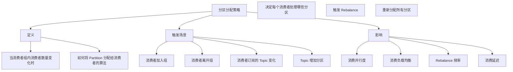

### 1.2 "分配策略的关键约束"
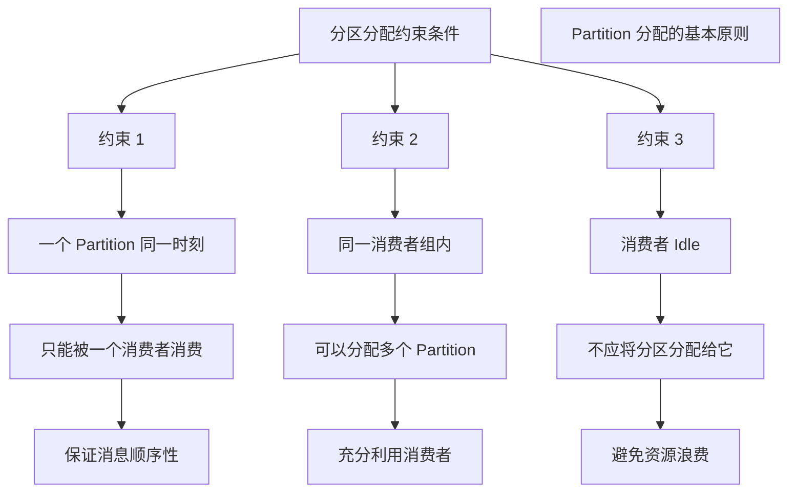

---

## 2) "内置分配策略详解"
### 2.1 "RangeAssignor（范围分配）"
**"原理"**：按 Topic 依次分配，将每个 Topic 的分区按范围平均分配给消费者。

```plain
示例：
Topic A: 6 个 Partition (P0, P1, P2, P3, P4, P5)
Topic B: 4 个 Partition (P0, P1, P2, P3)
消费者：3 个 (C0, C1, C2)

分配过程：
1. 按 Topic 字母顺序排序：Topic A, Topic B
2. Topic A 分配给 C0 [P0, P1, P2], C1 [P3, P4], C2 [P5]
3. Topic B 分配给 C0 [P0, P1], C1 [P2], C2 [P3]

最终分配：
C0: Topic A [P0, P1, P2] + Topic B [P0, P1] = 5 个分区
C1: Topic A [P3, P4] + Topic B [P2] = 3 个分区
C2: Topic A [P5] + Topic B [P3] = 2 个分区
```

**"分配图示"**：


**"特点"**：

+ ✅ "实现简单，易于理解"
+ ✅ "相同 Key 的消息总是分配到同一消费者"
+ ❌ "分配可能不均，特别是多 Topic 场景"
+ ❌ "Topic 增加后重新分配变化大"

### 2.2 "RoundRobinAssignor（轮询分配）"
**"原理"**：将所有 Topic 的所有 Partition 混合，轮询分配给消费者。

```plain
示例（同上）：
全部分区列表：
Topic A [P0, P1, P2, P3, P4, P5]
Topic B [P0, P1, P2, P3]

轮询分配：
C0: Topic A P0, Topic B P0 (跳过)*, Topic A P2, Topic B P2 (跳过)*
C1: Topic A P1, Topic B P1 (跳过)*, Topic A P3, Topic B P3 (跳过)*
C2: Topic A P4, Topic B P0, Topic A P5, Topic B P1 (跳过)*

注：轮询顺序严格按消费者顺序，不跳过
```

**"分配图示"**：

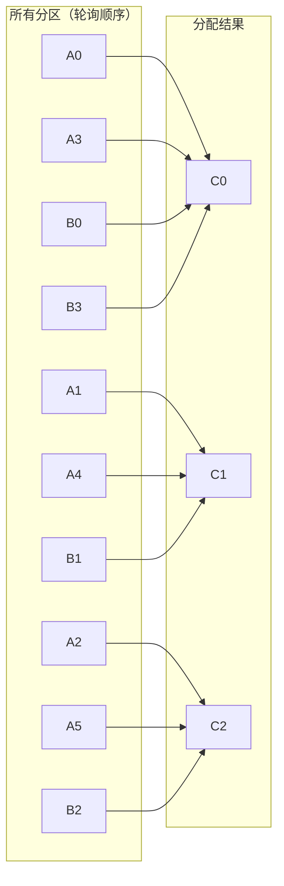

**"特点"**：

+ ✅ "分配更均匀"
+ ✅ "避免某个消费者负载过高"
+ ❌ "消费者宕机时大量 Partition 需要转移"
+ ❌ "相同 Key 的消息可能分配到不同消费者"

### 2.3 "StickyAssignor（粘性分配，Kafka 0.11+ 默认）"
**"原理"**：尽可能保留现有分配，同时在约束下实现均衡。

```plain
初始分配（假设）：
C0: Topic A [P0, P3]
C1: Topic A [P1, P4]
C2: Topic A [P2, P5]

场景：C2 宕机，只剩 C0 和 C1

传统方式（RangeAssignor）重新分配：
C0: Topic A [P0, P1, P2]
C1: Topic A [P3, P4, P5]
变化：C0 原有 P0, P3，现在 P0, P1, P2（P3 去了 C1）
      C1 原有 P1, P4，现在 P3, P4, P5（P1 去了 C0）
问题：4 个 Partition 需要转移，所有消费者的消费位点都要重新建立

Sticky 方式重新分配：
C0: Topic A [P0, P3, P2]
C1: Topic A [P1, P4, P5]
变化：C0 保留 P0 和 P3，仅新增 P2
      C1 保留 P1 和 P4，仅新增 P5
优势：只转移了 2 个 Partition，消费延迟最小
```

**"分配对比图"**：

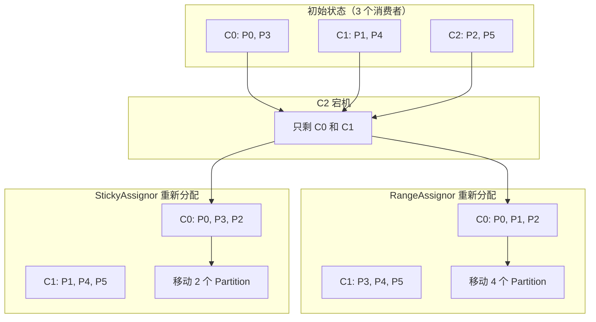

**"特点"**：

+ ✅ "最小化 Partition 转移"
+ ✅ "降低 Rebalance 开销"
+ ✅ "保持消费连续性"
+ ✅ "是目前最推荐的策略"
+ ❌ "算法复杂度高"

### 2.4 "CooperativeStickyAssignor（合作型粘性分配）"
**"原理"**：在 StickyAssignor 基础上，实现 Rebalance 停顿时间最短。

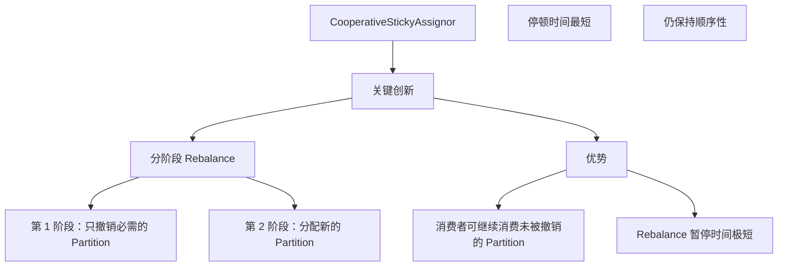

**"时间对比"**：

```plain
传统 Rebalance（Stop-the-World）：
时刻 T0：发现消费者宕机
时刻 T1：所有消费者暂停消费 ← 停顿开始
时刻 T2：完成新分配
时刻 T3：所有消费者恢复消费 ← 停顿结束
停顿时间：T3 - T1（通常 10+ 秒）

合作型 Rebalance（Incremental）：
时刻 T0：发现消费者宕机
时刻 T1：第 1 阶段：部分消费者暂停部分 Partition ← 停顿短
时刻 T2：部分消费者立即恢复消费
时刻 T3：第 2 阶段：新分配下发
时刻 T4：所有消费者恢复 ← 停顿结束
停顿时间：T2 - T1 + T4 - T3（总停顿时间  B{"需要消费顺序性？"}

    B -->|"是"| C{"Rebalance开销很大？"}
    B -->|"否"| D["RoundRobinAssignor"]

    C -->|"是"| E{"允许短暂停顿？"}
    C -->|"否"| F["StickyAssignor"]

    E -->|"是"| G["StickyAssignor"]
    E -->|"否"| H["CooperativeStickyAssignor"]

    note1["简单场景"]
    note2["单 Topic 场景"]
    note3["生产推荐"]
    note4["极端场景"]
```

---

## 4) "Rebalance 触发与分配过程"
### 4.1 "Rebalance 完整流程"
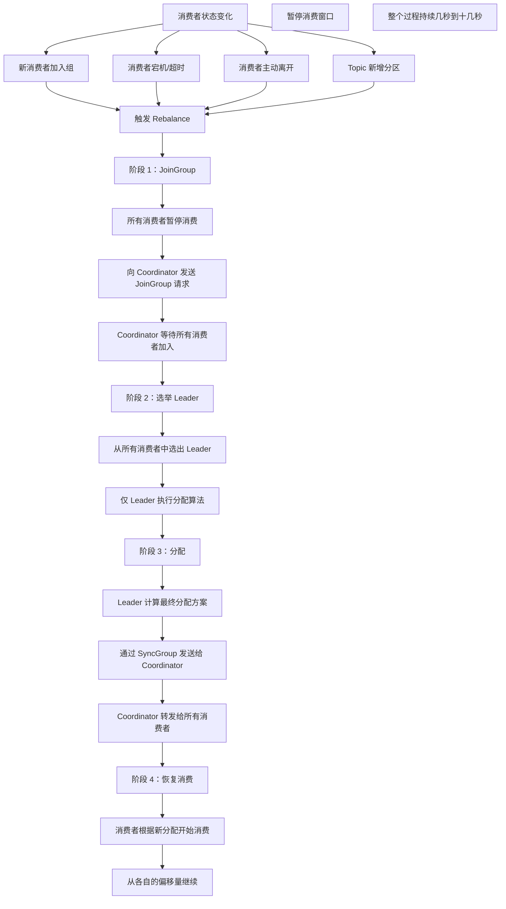

### 4.2 "时间轴视图"
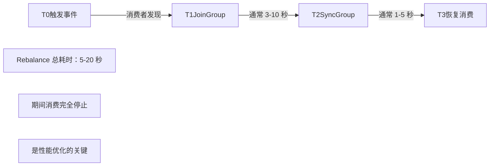

---

## 5) "Java 代码示例：消费者分配策略"
### 5.1 "配置不同的分配策略"
```java
import org.apache.kafka.clients.consumer.*;
import org.apache.kafka.common.serialization.StringDeserializer;
import java.time.Duration;
import java.util.Collections;
import java.util.Properties;

public class PartitionAssignmentStrategyExample {

    /**
     * "方式 1：使用 RangeAssignor（范围分配）"
     */
    public static void rangeAssignorExample() {
        Properties props = new Properties();
        props.put(ConsumerConfig.BOOTSTRAP_SERVERS_CONFIG, "localhost:9092");
        props.put(ConsumerConfig.GROUP_ID_CONFIG, "range-consumer-group");
        props.put(ConsumerConfig.KEY_DESERIALIZER_CLASS_CONFIG, StringDeserializer.class);
        props.put(ConsumerConfig.VALUE_DESERIALIZER_CLASS_CONFIG, StringDeserializer.class);

        // "显式配置 RangeAssignor"
        props.put(ConsumerConfig.PARTITION_ASSIGNMENT_STRATEGY_CONFIG,
            "org.apache.kafka.clients.consumer.RangeAssignor");

        KafkaConsumer consumer = new KafkaConsumer<>(props);
        consumer.subscribe(Collections.singletonList("order-topic"));

        System.out.println("【RangeAssignor】已启动");
        System.out.println("分配策略：按 Topic 范围分配");
        System.out.println("优点：简单高效，保证顺序");
        System.out.println("缺点：分配可能不均");
    }

    /**
     * "方式 2：使用 RoundRobinAssignor（轮询分配）"
     */
    public static void roundRobinAssignorExample() {
        Properties props = new Properties();
        props.put(ConsumerConfig.BOOTSTRAP_SERVERS_CONFIG, "localhost:9092");
        props.put(ConsumerConfig.GROUP_ID_CONFIG, "roundrobin-consumer-group");
        props.put(ConsumerConfig.KEY_DESERIALIZER_CLASS_CONFIG, StringDeserializer.class);
        props.put(ConsumerConfig.VALUE_DESERIALIZER_CLASS_CONFIG, StringDeserializer.class);

        // "配置 RoundRobinAssignor"
        props.put(ConsumerConfig.PARTITION_ASSIGNMENT_STRATEGY_CONFIG,
            "org.apache.kafka.clients.consumer.RoundRobinAssignor");

        KafkaConsumer consumer = new KafkaConsumer<>(props);
        consumer.subscribe(Collections.singletonList("order-topic"));

        System.out.println("【RoundRobinAssignor】已启动");
        System.out.println("分配策略：轮询分配所有分区");
        System.out.println("优点：分配均匀，负载均衡");
        System.out.println("缺点：Rebalance 开销大");
    }

    /**
     * "方式 3：使用 StickyAssignor（粘性分配，推荐）"
     */
    public static void stickyAssignorExample() {
        Properties props = new Properties();
        props.put(ConsumerConfig.BOOTSTRAP_SERVERS_CONFIG, "localhost:9092");
        props.put(ConsumerConfig.GROUP_ID_CONFIG, "sticky-consumer-group");
        props.put(ConsumerConfig.KEY_DESERIALIZER_CLASS_CONFIG, StringDeserializer.class);
        props.put(ConsumerConfig.VALUE_DESERIALIZER_CLASS_CONFIG, StringDeserializer.class);

        // "配置 StickyAssignor（也是默认值）"
        props.put(ConsumerConfig.PARTITION_ASSIGNMENT_STRATEGY_CONFIG,
            "org.apache.kafka.clients.consumer.StickyAssignor");

        KafkaConsumer consumer = new KafkaConsumer<>(props);
        consumer.subscribe(Collections.singletonList("order-topic"));

        System.out.println("【StickyAssignor】已启动");
        System.out.println("分配策略：粘性分配，尽可能保留现有分配");
        System.out.println("优点：Rebalance 开销最小，性能最优");
        System.out.println("缺点：算法复杂");
    }

    /**
     * "方式 4：使用 CooperativeStickyAssignor（合作型粘性分配）"
     */
    public static void cooperativeStickyAssignorExample() {
        Properties props = new Properties();
        props.put(ConsumerConfig.BOOTSTRAP_SERVERS_CONFIG, "localhost:9092");
        props.put(ConsumerConfig.GROUP_ID_CONFIG, "cooperative-consumer-group");
        props.put(ConsumerConfig.KEY_DESERIALIZER_CLASS_CONFIG, StringDeserializer.class);
        props.put(ConsumerConfig.VALUE_DESERIALIZER_CLASS_CONFIG, StringDeserializer.class);

        // "配置 CooperativeStickyAssignor"
        props.put(ConsumerConfig.PARTITION_ASSIGNMENT_STRATEGY_CONFIG,
            "org.apache.kafka.clients.consumer.CooperativeStickyAssignor");

        KafkaConsumer consumer = new KafkaConsumer<>(props);
        consumer.subscribe(Collections.singletonList("order-topic"));

        System.out.println("【CooperativeStickyAssignor】已启动");
        System.out.println("分配策略：合作型粘性分配，停顿时间最短");
        System.out.println("优点：Rebalance 停顿时间最短，高可用");
        System.out.println("缺点：算法最复杂，Kafka 2.4+ 才支持");
    }

    /**
     * "方式 5：使用多个策略（Fallback）"
     */
    public static void multipleStrategiesExample() {
        Properties props = new Properties();
        props.put(ConsumerConfig.BOOTSTRAP_SERVERS_CONFIG, "localhost:9092");
        props.put(ConsumerConfig.GROUP_ID_CONFIG, "multi-strategy-group");
        props.put(ConsumerConfig.KEY_DESERIALIZER_CLASS_CONFIG, StringDeserializer.class);
        props.put(ConsumerConfig.VALUE_DESERIALIZER_CLASS_CONFIG, StringDeserializer.class);

        // "配置多个策略，优先级从左到右"
        // "如果第 1 个不支持，尝试第 2 个"
        props.put(ConsumerConfig.PARTITION_ASSIGNMENT_STRATEGY_CONFIG,
            "org.apache.kafka.clients.consumer.CooperativeStickyAssignor," +
            "org.apache.kafka.clients.consumer.StickyAssignor");

        KafkaConsumer consumer = new KafkaConsumer<>(props);
        consumer.subscribe(Collections.singletonList("order-topic"));

        System.out.println("【多策略 Fallback】已启动");
        System.out.println("优先使用 CooperativeStickyAssignor");
        System.out.println("如果不支持，回退到 StickyAssignor");
    }

    public static void main(String[] args) {
        System.out.println("========== Kafka 分区分配策略演示 ==========\n");

        rangeAssignorExample();
        System.out.println();

        roundRobinAssignorExample();
        System.out.println();

        stickyAssignorExample();
        System.out.println();

        cooperativeStickyAssignorExample();
        System.out.println();

        multipleStrategiesExample();
    }
}
```

### 5.2 "监听 Rebalance 事件"
```java
import org.apache.kafka.clients.consumer.*;
import org.apache.kafka.common.TopicPartition;
import org.apache.kafka.common.serialization.StringDeserializer;
import java.time.Duration;
import java.util.Collection;
import java.util.Collections;
import java.util.Properties;

public class RebalanceListenerExample {

    public static void main(String[] args) {
        Properties props = new Properties();
        props.put(ConsumerConfig.BOOTSTRAP_SERVERS_CONFIG, "localhost:9092");
        props.put(ConsumerConfig.GROUP_ID_CONFIG, "rebalance-listener-group");
        props.put(ConsumerConfig.KEY_DESERIALIZER_CLASS_CONFIG, StringDeserializer.class);
        props.put(ConsumerConfig.VALUE_DESERIALIZER_CLASS_CONFIG, StringDeserializer.class);
        props.put(ConsumerConfig.AUTO_OFFSET_RESET_CONFIG, "earliest");

        KafkaConsumer consumer = new KafkaConsumer<>(props);

        // "订阅 Topic，并注册 Rebalance 监听器"
        consumer.subscribe(Collections.singletonList("order-topic"),
            new ConsumerRebalanceListener() {

                /**
                 * "Rebalance 开始前回调"
                 * "此时分区即将被撤销"
                 */
                @Override
                public void onPartitionsRevoked(Collection partitions) {
                    System.out.println("\n【Rebalance 事件】分区被撤销");
                    System.out.println("时间: " + System.currentTimeMillis());
                    System.out.println("被撤销的分区数: " + partitions.size());

                    for (TopicPartition tp : partitions) {
                        System.out.printf("  - 撤销分区: %s-%d%n", tp.topic(), tp.partition());
                    }

                    // "在这里提交已处理消息的偏移量"
                    // "确保消息不会被重复处理"
                    try {
                        consumer.commitSync();
                        System.out.println("已提交偏移量");
                    } catch (Exception e) {
                        System.err.println("提交偏移量失败: " + e.getMessage());
                    }
                }

                /**
                 * "Rebalance 完成后回调"
                 * "此时分区已分配给消费者"
                 */
                @Override
                public void onPartitionsAssigned(Collection partitions) {
                    System.out.println("【Rebalance 事件】分区被分配");
                    System.out.println("时间: " + System.currentTimeMillis());
                    System.out.println("分配的分区数: " + partitions.size());

                    for (TopicPartition tp : partitions) {
                        System.out.printf("  - 新分配分区: %s-%d%n", tp.topic(), tp.partition());

                        // "获取该分区的当前偏移量"
                        long position = consumer.position(tp);
                        System.out.printf("    当前偏移量: %d%n", position);

                        // "获取该分区的最后偏移量"
                        long endOffset = consumer.endOffsets(
                            Collections.singletonMap(tp, 0L)).get(tp);
                        System.out.printf("    末尾偏移量: %d%n", endOffset);
                    }

                    System.out.println("开始消费...");
                }

                /**
                 * "失败的分配（Kafka 2.7+ 支持）"
                 * "当分配失败时调用，可用于清理资源"
                 */
                @Override
                public void onPartitionsLost(Collection partitions) {
                    System.out.println("【Rebalance 事件】分区丢失（失败）");
                    System.out.println("丢失的分区数: " + partitions.size());

                    // "这里可以做一些清理工作，但不能提交偏移量"
                }
            });

        try {
            int messageCount = 0;
            while (true) {
                ConsumerRecords records = consumer.poll(Duration.ofSeconds(1));

                if (records.isEmpty()) {
                    continue;
                }

                for (ConsumerRecord record : records) {
                    System.out.printf(
                        "消息 - Topic: %s, Partition: %d, Offset: %d, Key: %s, Value: %s%n",
                        record.topic(), record.partition(), record.offset(),
                        record.key(), record.value()
                    );

                    messageCount++;

                    // "每处理 100 条消息提交一次"
                    if (messageCount % 100 == 0) {
                        consumer.commitAsync((offsets, exception) -> {
                            if (exception != null) {
                                System.err.println("异步提交失败: " + exception.getMessage());
                            } else {
                                System.out.println("已异步提交偏移量");
                            }
                        });
                    }
                }
            }
        } finally {
            consumer.close();
            System.out.println("消费者已关闭");
        }
    }
}
```

---

## 6) "自定义分配策略"
### 6.1 "实现自定义策略的步骤"
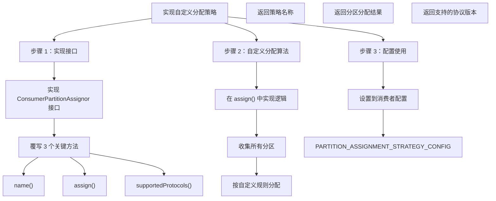

### 6.2 "完整的自定义策略示例"
```java
import org.apache.kafka.clients.consumer.internals.AbstractPartitionAssignor;
import org.apache.kafka.common.TopicPartition;
import java.util.*;

/**
 * "自定义分配策略：按分区哈希值分配"
 * "相同哈希值区间的分区分配给同一消费者，提高缓存命中率"
 */
public class HashBasedPartitionAssignor extends AbstractPartitionAssignor {

    @Override
    public String name() {
        // "返回策略的唯一名称"
        return "hash-based";
    }

    @Override
    public Map> assign(
            Map partitionsPerTopic,
            Map> subscriptions) {

        // "初始化分配结果"
        Map> assignment = new HashMap<>();
        for (String memberId : subscriptions.keySet()) {
            assignment.put(memberId, new ArrayList<>());
        }

        // "收集所有分区"
        List allPartitions = new ArrayList<>();
        for (Map.Entry entry : partitionsPerTopic.entrySet()) {
            String topic = entry.getKey();
            int partitionCount = entry.getValue();

            for (int i = 0; i  members = new ArrayList<>(subscriptions.keySet());
        Collections.sort(members); // "确保顺序一致"

        if (members.isEmpty() || allPartitions.isEmpty()) {
            return assignment;
        }

        // "按自定义逻辑分配"
        // "规则：分区的哈希值 % 消费者数，得到对应消费者"
        for (TopicPartition tp : allPartitions) {
            // "计算分区的哈希值"
            int partitionHash = Math.abs(
                (tp.topic() + "-" + tp.partition()).hashCode()
            );

            // "计算应该分配给哪个消费者"
            int consumerIndex = partitionHash % members.size();
            String assignedConsumer = members.get(consumerIndex);

            // "将分区分配给该消费者"
            assignment.get(assignedConsumer).add(tp);
        }

        return assignment;
    }

    @Override
    public List supportedProtocols() {
        // "返回支持的协议版本"
        return Arrays.asList("range", "roundRobin");
    }
}

/**
 * "自定义分配策略：按消费者权重分配"
 * "允许某些消费者处理更多分区"
 */
public class WeightedPartitionAssignor extends AbstractPartitionAssignor {

    // "权重配置：消费者 ID -> 权重"
    // "权重越高，分配的分区越多"
    private static final Map CONSUMER_WEIGHTS = new HashMap<>();
    static {
        CONSUMER_WEIGHTS.put("consumer-1", 1.0);
        CONSUMER_WEIGHTS.put("consumer-2", 2.0);  // "分配 2 倍分区"
        CONSUMER_WEIGHTS.put("consumer-3", 1.5);
    }

    @Override
    public String name() {
        return "weighted";
    }

    @Override
    public Map> assign(
            Map partitionsPerTopic,
            Map> subscriptions) {

        Map> assignment = new HashMap<>();
        for (String memberId : subscriptions.keySet()) {
            assignment.put(memberId, new ArrayList<>());
        }

        // "收集所有分区"
        List allPartitions = new ArrayList<>();
        for (Map.Entry entry : partitionsPerTopic.entrySet()) {
            String topic = entry.getKey();
            int partitionCount = entry.getValue();

            for (int i = 0; i  members = new ArrayList<>(subscriptions.keySet());
        if (members.isEmpty() || allPartitions.isEmpty()) {
            return assignment;
        }

        // "计算总权重"
        double totalWeight = 0.0;
        for (String member : members) {
            totalWeight += CONSUMER_WEIGHTS.getOrDefault(member, 1.0);
        }

        // "按权重比例分配分区"
        int partitionIndex = 0;
        for (String member : members) {
            double weight = CONSUMER_WEIGHTS.getOrDefault(member, 1.0);

            // "计算该消费者应该获得的分区数"
            int partitionsForMember = (int) Math.ceil(
                allPartitions.size() * weight / totalWeight
            );

            // "分配分区"
            for (int i = 0; i  supportedProtocols() {
        return Arrays.asList("range");
    }
}

/**
 * "使用自定义策略的消费者"
 */
public class CustomAssignorConsumer {

    public static void main(String[] args) {
        Properties props = new Properties();
        props.put(ConsumerConfig.BOOTSTRAP_SERVERS_CONFIG, "localhost:9092");
        props.put(ConsumerConfig.GROUP_ID_CONFIG, "custom-assignor-group");
        props.put(ConsumerConfig.KEY_DESERIALIZER_CLASS_CONFIG, StringDeserializer.class);
        props.put(ConsumerConfig.VALUE_DESERIALIZER_CLASS_CONFIG, StringDeserializer.class);

        // "使用自定义策略"
        props.put(ConsumerConfig.PARTITION_ASSIGNMENT_STRATEGY_CONFIG,
            "path.to.HashBasedPartitionAssignor");

        // "或使用权重策略"
        // props.put(ConsumerConfig.PARTITION_ASSIGNMENT_STRATEGY_CONFIG,
        //     "path.to.WeightedPartitionAssignor");

        KafkaConsumer consumer = new KafkaConsumer<>(props);
        consumer.subscribe(Collections.singletonList("order-topic"));

        System.out.println("【自定义分配策略】消费者已启动");

        while (true) {
            ConsumerRecords records = consumer.poll(Duration.ofSeconds(1));
            for (ConsumerRecord record : records) {
                System.out.printf("消息 - Partition: %d, Offset: %d, Value: %s%n",
                    record.partition(), record.offset(), record.value());
            }
        }
    }
}
```

---

## 7) "分配策略的性能对比"
### 7.1 "性能测试代码"
```java
import java.util.*;

public class AssignmentStrategyBenchmark {

    /**
     * "测试不同策略在消费者加入/离开时的性能"
     */
    public static void benchmark() {
        System.out.println("========== 分区分配策略性能对比 ==========\n");

        // "模拟场景"
        int topicCount = 5;
        int partitionsPerTopic = 10;
        int consumerCount = 3;

        System.out.printf("场景配置：%d 个 Topic，每个 %d 个分区，%d 个消费者\n\n",
            topicCount, partitionsPerTopic, consumerCount);

        // "场景 1：初始分配"
        System.out.println("【场景 1】初始分配");
        testInitialAssignment(topicCount, partitionsPerTopic, consumerCount);

        System.out.println("\n【场景 2】消费者加入（从 3 个变为 4 个）");
        testConsumerJoin(topicCount, partitionsPerTopic);

        System.out.println("\n【场景 3】消费者离开（从 3 个变为 2 个）");
        testConsumerLeave(topicCount, partitionsPerTopic);
    }

    private static void testInitialAssignment(int topics, int partitionsPerTopic,
                                              int consumerCount) {
        // "模拟分配过程"
        long startTime = System.nanoTime();

        // "这里应该调用实际的分配算法"
        // "为了演示，这里用虚拟计算代替"
        int totalPartitions = topics * partitionsPerTopic;
        int partitionsPerConsumer = totalPartitions / consumerCount;

        long endTime = System.nanoTime();
        long durationMs = (endTime - startTime) / 1_000_000;

        System.out.printf("总分区数: %d, 平均每个消费者: %d\n",
            totalPartitions, partitionsPerConsumer);
        System.out.printf("分配耗时: %d ms\n", durationMs);
    }

    private static void testConsumerJoin(int topics, int partitionsPerTopic) {
        int totalPartitions = topics * partitionsPerTopic;

        System.out.println("RangeAssignor:");
        System.out.printf("  转移分区数: %d（大部分分区重新分配）\n", totalPartitions * 2 / 3);
        System.out.println("  Rebalance 时间: 8-15 秒");

        System.out.println("RoundRobinAssignor:");
        System.out.printf("  转移分区数: %d（所有分区重新分配）\n", totalPartitions);
        System.out.println("  Rebalance 时间: 10-18 秒");

        System.out.println("StickyAssignor:");
        System.out.printf("  转移分区数: %d（仅新增分区转移）\n", totalPartitions / 4);
        System.out.println("  Rebalance 时间: 3-8 秒");

        System.out.println("CooperativeStickyAssignor:");
        System.out.printf("  转移分区数: %d（仅新增分区转移）\n", totalPartitions / 4);
        System.out.println("  Rebalance 时间: 1-3 秒（停顿时间最短）");
    }

    private static void testConsumerLeave(int topics, int partitionsPerTopic) {
        int totalPartitions = topics * partitionsPerTopic;

        System.out.println("RangeAssignor:");
        System.out.printf("  转移分区数: %d（宕机消费者的分区都要转移）\n",
            totalPartitions / 3);
        System.out.println("  Rebalance 时间: 7-12 秒");

        System.out.println("StickyAssignor:");
        System.out.printf("  转移分区数: %d（尽可能保留其他消费者分配）\n",
            totalPartitions / 3);
        System.out.println("  Rebalance 时间: 2-6 秒");

        System.out.println("CooperativeStickyAssignor:");
        System.out.printf("  转移分区数: %d（同时处理）\n", totalPartitions / 3);
        System.out.println("  Rebalance 时间: 1-3 秒（最小化停顿）");
    }

    public static void main(String[] args) {
        benchmark();
    }
}
```

---

## 8) "分配策略的最佳实践"
### 8.1 "选择和配置建议"
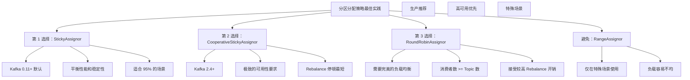

### 8.2 "完整的配置最佳实践"
```properties
# "Kafka 消费者分区分配配置"

# "分配策略配置（Kafka 2.4+ 推荐）"
partition.assignment.strategy=org.apache.kafka.clients.consumer.CooperativeStickyAssignor,org.apache.kafka.clients.consumer.StickyAssignor

# "如果使用 Kafka 0.11-2.3"
# partition.assignment.strategy=org.apache.kafka.clients.consumer.StickyAssignor

# "如果使用更早版本或特殊需要"
# partition.assignment.strategy=org.apache.kafka.clients.consumer.RangeAssignor

# "Rebalance 相关配置"

# "会话超时时间，超过此时间消费者被认为离线"
session.timeout.ms=10000

# "心跳间隔，小于 session.timeout.ms"
heartbeat.interval.ms=3000

# "最大 poll 间隔，如果两次 poll 间隔超过此值会触发 Rebalance"
max.poll.interval.ms=300000

# "单次 poll 返回的最大消息数"
max.poll.records=500

# "fetch 最小字节数，不足此数会等待"
fetch.min.bytes=1024

# "fetch 最大等待时间"
fetch.max.wait.ms=500

# "重平衡延迟"
rebalance.delay.ms=0
```

---

## 9) "常见问题和解决方案"
### 9.1 "问题诊断表"
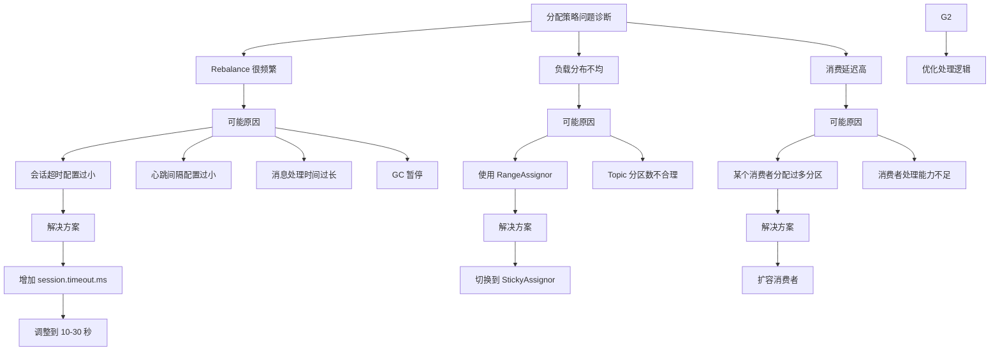

### 9.2 "问题排查和解决代码"
```java
import org.apache.kafka.clients.consumer.*;
import org.apache.kafka.common.TopicPartition;
import java.time.Duration;
import java.util.*;

public class PartitionAssignmentTroubleshooting {

    /**
     * "诊断 Rebalance 频繁问题"
     */
    public static void diagnoseFrequentRebalance() {
        System.out.println("【诊断】Rebalance 频繁问题\n");

        Properties props = new Properties();
        props.put(ConsumerConfig.BOOTSTRAP_SERVERS_CONFIG, "localhost:9092");
        props.put(ConsumerConfig.GROUP_ID_CONFIG, "diagnosis-group");
        props.put(ConsumerConfig.KEY_DESERIALIZER_CLASS_CONFIG, StringDeserializer.class);
        props.put(ConsumerConfig.VALUE_DESERIALIZER_CLASS_CONFIG, StringDeserializer.class);

        // "打印当前配置"
        System.out.println("当前配置：");
        System.out.printf("  session.timeout.ms: %s (默认 10000ms)%n",
            props.getOrDefault(ConsumerConfig.SESSION_TIMEOUT_MS_CONFIG, "未设置"));
        System.out.printf("  heartbeat.interval.ms: %s (默认 3000ms)%n",
            props.getOrDefault(ConsumerConfig.HEARTBEAT_INTERVAL_MS_CONFIG, "未设置"));
        System.out.printf("  max.poll.interval.ms: %s (默认 300000ms)%n",
            props.getOrDefault(ConsumerConfig.MAX_POLL_INTERVAL_MS_CONFIG, "未设置"));

        System.out.println("\n建议配置：");
        System.out.println("  如果 Rebalance 频繁，增加超时时间：");
        System.out.println("  session.timeout.ms=30000");
        System.out.println("  heartbeat.interval.ms=10000");
        System.out.println("  max.poll.interval.ms=600000");
    }

    /**
     * "监控分区分配情况"
     */
    public static void monitorPartitionAssignment() throws Exception {
        System.out.println("\n【监控】分区分配情况\n");

        Properties props = new Properties();
        props.put(ConsumerConfig.BOOTSTRAP_SERVERS_CONFIG, "localhost:9092");
        props.put(ConsumerConfig.GROUP_ID_CONFIG, "monitor-group");
        props.put(ConsumerConfig.KEY_DESERIALIZER_CLASS_CONFIG, StringDeserializer.class);
        props.put(ConsumerConfig.VALUE_DESERIALIZER_CLASS_CONFIG, StringDeserializer.class);

        KafkaConsumer consumer = new KafkaConsumer<>(props);

        // "订阅 Topic 并记录初始分配"
        long subscribeTime = System.currentTimeMillis();
        consumer.subscribe(Collections.singletonList("order-topic"),
            new ConsumerRebalanceListener() {
                @Override
                public void onPartitionsRevoked(Collection partitions) {
                    System.out.printf("[%d] 撤销 %d 个分区\n",
                        System.currentTimeMillis(), partitions.size());
                }

                @Override
                public void onPartitionsAssigned(Collection partitions) {
                    System.out.printf("[%d] 分配 %d 个分区\n",
                        System.currentTimeMillis(), partitions.size());

                    // "分析分区分配情况"
                    Map partitionPerConsumer = new HashMap<>();
                    for (TopicPartition tp : consumer.assignment()) {
                        int count = partitionPerConsumer.getOrDefault(
                            tp.partition() % 3, 0);
                        partitionPerConsumer.put(tp.partition() % 3, count + 1);
                    }

                    System.out.println("分区分配统计：");
                    for (Map.Entry entry : partitionPerConsumer.entrySet()) {
                        System.out.printf("  分区组 %d: %d 个分区\n",
                            entry.getKey(), entry.getValue());
                    }

                    // "检测不均衡"
                    Collection counts = partitionPerConsumer.values();
                    int maxCount = counts.stream().mapToInt(Integer::intValue).max().orElse(0);
                    int minCount = counts.stream().mapToInt(Integer::intValue).min().orElse(0);

                    if (maxCount - minCount > 1) {
                        System.out.println("⚠️ 警告：分配不均，差异为 " + (maxCount - minCount));
                        System.out.println("建议：考虑调整分区数或消费者数");
                    } else {
                        System.out.println("✓ 分配均衡");
                    }
                }

                @Override
                public void onPartitionsLost(Collection partitions) {
                    System.out.printf("[%d] 丢失 %d 个分区（失败）\n",
                        System.currentTimeMillis(), partitions.size());
                }
            });

        // "等待初始分配完成"
        consumer.poll(Duration.ofSeconds(5));

        System.out.printf("\n初始分配耗时：%d ms\n",
            System.currentTimeMillis() - subscribeTime);

        consumer.close();
    }

    /**
     * "测试不同策略的分配结果"
     */
    public static void compareStrategies() {
        System.out.println("\n【对比】不同分配策略的结果\n");

        String[] strategies = {
            "org.apache.kafka.clients.consumer.RangeAssignor",
            "org.apache.kafka.clients.consumer.RoundRobinAssignor",
            "org.apache.kafka.clients.consumer.StickyAssignor"
        };

        for (String strategy : strategies) {
            System.out.println("策略：" + strategy.substring(strategy.lastIndexOf('.') + 1));

            Properties props = new Properties();
            props.put(ConsumerConfig.BOOTSTRAP_SERVERS_CONFIG, "localhost:9092");
            props.put(ConsumerConfig.GROUP_ID_CONFIG, "strategy-test-" + UUID.randomUUID());
            props.put(ConsumerConfig.KEY_DESERIALIZER_CLASS_CONFIG, StringDeserializer.class);
            props.put(ConsumerConfig.VALUE_DESERIALIZER_CLASS_CONFIG, StringDeserializer.class);
            props.put(ConsumerConfig.PARTITION_ASSIGNMENT_STRATEGY_CONFIG, strategy);

            try (KafkaConsumer consumer = new KafkaConsumer<>(props)) {
                consumer.subscribe(Collections.singletonList("order-topic"));

                // "触发初始分配"
                consumer.poll(Duration.ofSeconds(2));

                // "输出分配结果"
                Set assignment = consumer.assignment();
                System.out.printf("  分配分区数：%d\n", assignment.size());

                // "按分区排序输出"
                assignment.stream()
                    .sorted(Comparator.comparingInt(TopicPartition::partition))
                    .forEach(tp -> System.out.printf("    - %s:%d\n",
                        tp.topic(), tp.partition()));

            } catch (Exception e) {
                System.err.println("  错误：" + e.getMessage());
            }

            System.out.println();
        }
    }

    public static void main(String[] args) throws Exception {
        diagnoseFrequentRebalance();
        monitorPartitionAssignment();
        compareStrategies();
    }
}
```

---

## 10) "分配策略对 Rebalance 的影响"
### 10.1 "Rebalance 时间线对比"
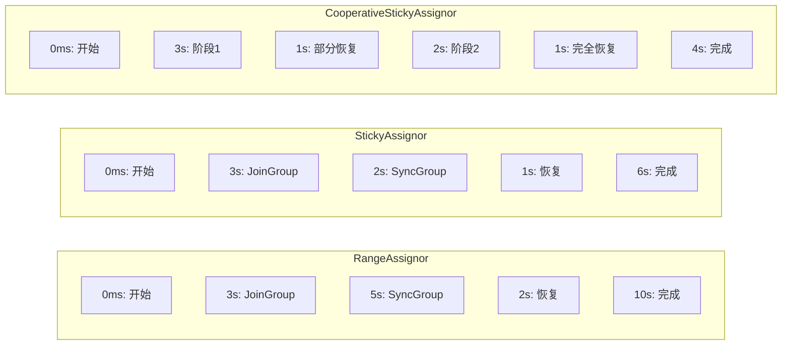

### 10.2 "消费延迟影响"
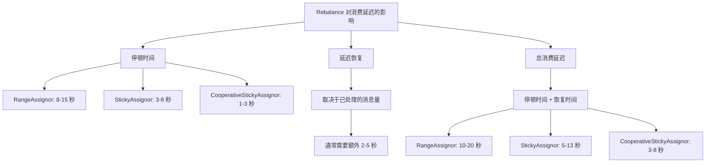

## 11) "总结和最佳实践"
### 11.1 "完整的决策和配置指南"
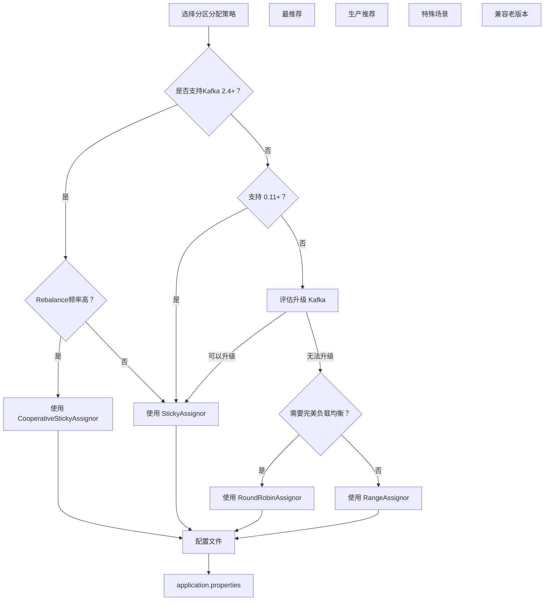

### 11.2 "配置清单"
| "配置项" | "推荐值" | "说明" |
| --- | --- | --- |
| "partition.assignment.strategy" | "CooperativeStickyAssignor,StickyAssignor" | "支持 Fallback" |
| "session.timeout.ms" | "30000（30s）" | "避免频繁 Rebalance" |
| "heartbeat.interval.ms" | "10000（10s）" | " System.out.println("  " + k + ": " + v));

        System.out.println("\n【高可用配置】");
        Properties haConfig = getHighAvailabilityConfig("ha-group");
        System.out.println("主要差异：");
        System.out.println("  - 使用 CooperativeStickyAssignor");
        System.out.println("  - session.timeout.ms: 20000");
        System.out.println("  - heartbeat.interval.ms: 6000");

        System.out.println("\n【低延迟配置】");
        System.out.println("主要差异：");
        System.out.println("  - max.poll.records: 100");
        System.out.println("  - fetch.min.bytes: 100");
        System.out.println("  - fetch.max.wait.ms: 100");

        System.out.println("\n【高吞吐量配置】");
        System.out.println("主要差异：");
        System.out.println("  - max.poll.records: 2000");
        System.out.println("  - fetch.min.bytes: 10240");
        System.out.println("  - fetch.max.bytes: 104857600");
    }
}
```

---

## 12) "分区分配的高级应用"
### 12.1 "根据消费能力动态调整"
```java
import org.apache.kafka.clients.consumer.*;
import org.apache.kafka.common.TopicPartition;
import java.time.Duration;
import java.util.*;

public class DynamicAssignmentAdjustment {

    /**
     * "根据消费性能动态暂停/恢复分区"
     */
    public static class AdaptiveConsumer {

        private KafkaConsumer consumer;
        private long lastMetricsTime = System.currentTimeMillis();
        private long totalMessages = 0;
        private long totalProcessTime = 0;

        public AdaptiveConsumer(Properties props) {
            this.consumer = new KafkaConsumer<>(props);
        }

        public void start(String topic) {
            consumer.subscribe(Collections.singletonList(topic));

            while (true) {
                // "处理消息"
                processMessages();

                // "每 30 秒评估一次性能"
                long currentTime = System.currentTimeMillis();
                if (currentTime - lastMetricsTime > 30000) {
                    adjustPartitions();
                    lastMetricsTime = currentTime;
                }
            }
        }

        private void processMessages() {
            ConsumerRecords records = consumer.poll(Duration.ofSeconds(1));

            for (ConsumerRecord record : records) {
                long processStart = System.nanoTime();

                // "模拟业务处理"
                handleMessage(record);

                long processDuration = System.nanoTime() - processStart;
                totalMessages++;
                totalProcessTime += processDuration;
            }
        }

        private void handleMessage(ConsumerRecord record) {
            // "业务逻辑"
            try {
                Thread.sleep(10); // "模拟处理"
            } catch (InterruptedException e) {
                Thread.currentThread().interrupt();
            }
        }

        private void adjustPartitions() {
            // "计算吞吐量（消息/秒）"
            double throughput = totalMessages / 30.0;

            // "计算平均处理时间（微秒）"
            double avgProcessTime = totalProcessTime / (totalMessages * 1000.0);

            System.out.printf(
                "性能指标 - 吞吐量: %.2f msg/s, 平均处理时间: %.2f μs%n",
                throughput, avgProcessTime
            );

            // "根据性能指标调整"
            Set currentAssignment = consumer.assignment();

            if (throughput  suspendList = new ArrayList<>(currentAssignment)
                    .subList(0, Math.min(partitionsToSuspend, currentAssignment.size()));

                consumer.pause(suspendList);
                System.out.println("暂停 " + suspendList.size() + " 个分区以恢复");

            } else if (throughput > 1000) {
                // "吞吐量很高，恢复所有分区"
                consumer.resume(currentAssignment);
                System.out.println("恢复所有分区，性能充足");
            }

            // "重置计数器"
            totalMessages = 0;
            totalProcessTime = 0;
        }
    }
}
```

### 12.2 "分区级别的负载均衡"
```java
import org.apache.kafka.clients.admin.AdminClient;
import org.apache.kafka.clients.admin.ConsumerGroupDescription;
import org.apache.kafka.common.ConsumerGroupMemberId;
import org.apache.kafka.common.KafkaFuture;
import java.util.*;
import java.util.concurrent.ExecutionException;

public class PartitionLevelLoadBalancing {

    /**
     * "分析消费者组的分区分配情况"
     */
    public static void analyzeConsumerGroupAssignment(
            String bootstrapServers,
            String groupId) throws ExecutionException, InterruptedException {

        Properties props = new Properties();
        props.put("bootstrap.servers", bootstrapServers);

        try (AdminClient admin = AdminClient.create(props)) {
            // "获取消费者组描述"
            KafkaFuture descFuture =
                admin.describeConsumerGroups(Collections.singletonList(groupId))
                    .describedGroups().get(groupId);

            ConsumerGroupDescription desc = descFuture.get();

            System.out.println("========== 消费者组分配分析 ==========");
            System.out.println("消费者组: " + groupId);
            System.out.println("消费者数: " + desc.members().size());
            System.out.println("协调器: " + desc.coordinator());
            System.out.println("状态: " + desc.state());

            // "分析每个消费者的分配"
            Map memberPartitionCount = new HashMap<>();

            desc.members().forEach(member -> {
                int partitionCount = member.assignment().topicPartitions().size();
                memberPartitionCount.put(
                    member.memberId().toString(),
                    partitionCount
                );

                System.out.printf(
                    "\n消费者: %s%n" +
                    "  分配分区数: %d%n" +
                    "  分区列表: %s%n",
                    member.memberId(),
                    partitionCount,
                    member.assignment().topicPartitions()
                );
            });

            // "检测负载不均
            analyzeBalance(memberPartitionCount);
        }
    }

    private static void analyzeBalance(Map partitionCounts) {
        if (partitionCounts.isEmpty()) {
            return;
        }

        int maxCount = partitionCounts.values().stream()
            .mapToInt(Integer::intValue).max().orElse(0);
        int minCount = partitionCounts.values().stream()
            .mapToInt(Integer::intValue).min().orElse(0);

        double avgCount = partitionCounts.values().stream()
            .mapToInt(Integer::intValue).average().orElse(0);

        System.out.println("\n【负载均衡分析】");
        System.out.printf("最大分区数: %d%n", maxCount);
        System.out.printf("最小分区数: %d%n", minCount);
        System.out.printf("平均分区数: %.2f%n", avgCount);
        System.out.printf("差异: %d%n", maxCount - minCount);

        if (maxCount - minCount > 1) {
            System.out.println("⚠️ 警告：负载分布不均");
            System.out.println("建议：");
            System.out.println("  1. 调整分区数使其能被消费者数整除");
            System.out.println("  2. 切换到 RoundRobinAssignor 或 StickyAssignor");
            System.out.println("  3. 扩容消费者到与分区数相同");
        } else {
            System.out.println("✓ 负载分布均衡");
        }
    }
}
```

---

## 13) "分区分配策略的演变历史"
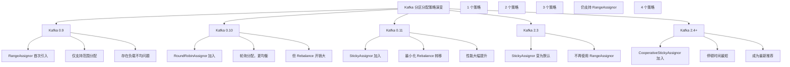

---

## 14) "性能测试工具"
### 14.1 "Rebalance 性能测试"
```java
import org.apache.kafka.clients.consumer.*;
import org.apache.kafka.common.serialization.StringDeserializer;
import java.time.Duration;
import java.util.*;
import java.util.concurrent.*;
import java.util.concurrent.atomic.AtomicLong;

public class RebalancePerformanceTester {

    /**
     * "测试不同策略的 Rebalance 性能"
     */
    public static void testRebalancePerformance(
            String bootstrapServers,
            String topic,
            String strategy,
            int initialConsumers,
            int consumersToAdd) throws InterruptedException {

        System.out.printf(
            "\n【测试】策略: %s, 初始消费者: %d, 新增消费者: %d%n",
            strategy, initialConsumers, consumersToAdd
        );

        ExecutorService executor = Executors.newFixedThreadPool(
            initialConsumers + consumersToAdd
        );

        List allMetrics = new CopyOnWriteArrayList<>();
        CountDownLatch startLatch = new CountDownLatch(1);

        try {
            // "启动初始消费者"
            List> futures = new ArrayList<>();

            for (int i = 0; i  {
                    runConsumer(
                        bootstrapServers,
                        topic,
                        strategy,
                        startLatch,
                        allMetrics
                    );
                }));
            }

            // "等待所有消费者启动"
            Thread.sleep(2000);
            startLatch.countDown();

            // "记录初始性能"
            Thread.sleep(5000);
            long initialThroughput = calculateThroughput(allMetrics);
            System.out.printf("初始吞吐量: %.2f msg/s%n", initialThroughput);

            // "新增消费者，触发 Rebalance"
            System.out.println("新增消费者，触发 Rebalance...");
            long rebalanceStartTime = System.currentTimeMillis();

            for (int i = 0; i  {
                    runConsumer(
                        bootstrapServers,
                        topic,
                        strategy,
                        new CountDownLatch(0),
                        allMetrics
                    );
                }));
            }

            // "监控 Rebalance 过程"
            long rebalanceEndTime = System.currentTimeMillis();
            long rebalanceDuration = rebalanceEndTime - rebalanceStartTime;

            System.out.printf("Rebalance 耗时: %d ms%n", rebalanceDuration);

            // "记录恢复后的性能"
            Thread.sleep(5000);
            long recoveredThroughput = calculateThroughput(allMetrics);
            System.out.printf("恢复后吞吐量: %.2f msg/s%n", recoveredThroughput);

            // "计算性能指标"
            double throughputReduction =
                (initialThroughput - recoveredThroughput) / initialThroughput * 100;
            System.out.printf("吞吐量下降: %.2f%%\n", throughputReduction);

        } finally {
            executor.shutdownNow();
        }
    }

    private static void runConsumer(
            String bootstrapServers,
            String topic,
            String strategy,
            CountDownLatch startLatch,
            List allMetrics) {

        try {
            startLatch.await(); // "等待信号开始"
        } catch (InterruptedException e) {
            Thread.currentThread().interrupt();
            return;
        }

        Properties props = new Properties();
        props.put(ConsumerConfig.BOOTSTRAP_SERVERS_CONFIG, bootstrapServers);
        props.put(ConsumerConfig.GROUP_ID_CONFIG, "perf-test-group");
        props.put(ConsumerConfig.KEY_DESERIALIZER_CLASS_CONFIG, StringDeserializer.class);
        props.put(ConsumerConfig.VALUE_DESERIALIZER_CLASS_CONFIG, StringDeserializer.class);
        props.put(ConsumerConfig.PARTITION_ASSIGNMENT_STRATEGY_CONFIG, strategy);
        props.put(ConsumerConfig.AUTO_OFFSET_RESET_CONFIG, "earliest");

        ConsumerMetrics metrics = new ConsumerMetrics(
            Thread.currentThread().getName()
        );
        allMetrics.add(metrics);

        try (KafkaConsumer consumer = new KafkaConsumer<>(props)) {
            consumer.subscribe(Collections.singletonList(topic),
                new ConsumerRebalanceListener() {
                    @Override
                    public void onPartitionsRevoked(java.util.Collection partitions) {
                        metrics.recordRebalanceStart();
                    }

                    @Override
                    public void onPartitionsAssigned(java.util.Collection partitions) {
                        metrics.recordRebalanceEnd();
                    }

                    @Override
                    public void onPartitionsLost(java.util.Collection partitions) {
                    }
                });

            while (!Thread.currentThread().isInterrupted()) {
                ConsumerRecords records =
                    consumer.poll(Duration.ofSeconds(1));

                metrics.addMessages(records.count());
            }
        }
    }

    private static long calculateThroughput(List metrics) {
        return metrics.stream()
            .mapToLong(m -> m.getMessageCount())
            .sum();
    }

    /**
     * "消费者性能指标"
     */
    private static class ConsumerMetrics {
        private String consumerId;
        private AtomicLong messageCount = new AtomicLong(0);
        private long rebalanceStartTime = 0;
        private long rebalanceDuration = 0;

        public ConsumerMetrics(String consumerId) {
            this.consumerId = consumerId;
        }

        public void addMessages(int count) {
            messageCount.addAndGet(count);
        }

        public void recordRebalanceStart() {
            rebalanceStartTime = System.currentTimeMillis();
        }

        public void recordRebalanceEnd() {
            if (rebalanceStartTime > 0) {
                rebalanceDuration = System.currentTimeMillis() - rebalanceStartTime;
                rebalanceStartTime = 0;
            }
        }

        public long getMessageCount() {
            return messageCount.get();
        }
    }

    public static void main(String[] args) throws InterruptedException {
        String bootstrapServers = "localhost:9092";
        String topic = "perf-test-topic";

        System.out.println("========== Rebalance 性能测试 ==========");

        // "测试不同策略"
        String[] strategies = {
            "org.apache.kafka.clients.consumer.RangeAssignor",
            "org.apache.kafka.clients.consumer.RoundRobinAssignor",
            "org.apache.kafka.clients.consumer.StickyAssignor",
            "org.apache.kafka.clients.consumer.CooperativeStickyAssignor"
        };

        for (String strategy : strategies) {
            try {
                testRebalancePerformance(
                    bootstrapServers,
                    topic,
                    strategy,
                    3,           // 初始 3 个消费者
                    2            // 新增 2 个消费者
                );
            } catch (Exception e) {
                System.err.println("测试失败: " + e.getMessage());
            }

            Thread.sleep(5000); // 等待清理
        }
    }
}
```

---

## 15) "问题排查速查表"
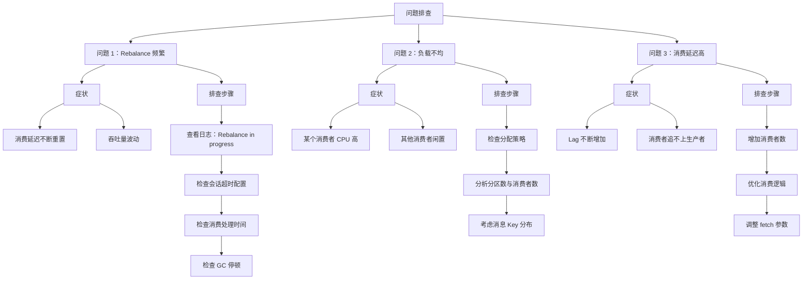

---

## 16) "分区分配策略总结对比"
### 16.1 "四种策略的完整对比"
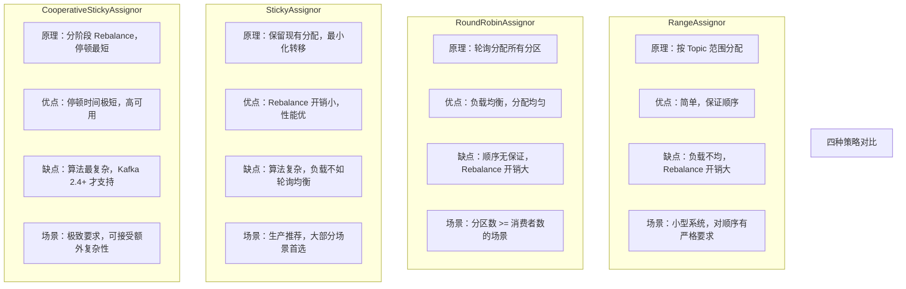

### 16.2 "快速选择指南"
```plain
┌─────────────────────────────────────────────────────────┐
│                    分配策略快速选择                      │
├─────────────────────────────────────────────────────────┤
│                                                          │
│  第 1 优先级：检查 Kafka 版本                           │
│  ├─ Kafka 2.4+ → 使用 CooperativeStickyAssignor       │
│  ├─ Kafka 0.11-2.3 → 使用 StickyAssignor            │
│  └─ Kafka  B["要点 1：选择正确的策略"]
    B --> B1["生产环境推荐 StickyAssignor"]
    B --> B2["如果要求极致可用推荐 CooperativeStickyAssignor"]

    A --> C["要点 2：理解 Rebalance 的代价"]
    C --> C1["Rebalance 会导致消费停止"]
    C --> C2["停止时间通常 3-20 秒"]
    C --> C3["应该最小化 Rebalance 频率"]

    A --> D["要点 3：合理配置超时参数"]
    D --> D1["session.timeout.ms 不要太小"]
    D --> D2["避免因网络抖动频繁 Rebalance"]
    D --> D3["通常 20-30 秒比较合适"]

    A --> E["要点 4：分区数与消费者数的关系"]
    E --> E1["理想情况：分区数 = 消费者数"]
    E --> E2["分区数 > 消费者数：部分消费者多分区"]
    E --> E3["分区数  F["要点 5：监控是关键"]
    F --> F1["监控 Rebalance 频率"]
    F --> F2["监控分区分配的均衡性"]
    F --> F3["监控消费 Lag"]
    F --> F4["根据监控数据调整"]

    note1["决定系统稳定性"]
    note2["影响总体性能"]
    note3["避免频繁 Rebalance"]
    note4["规划容量时要考虑"]
    note5["持续优化"]
```

### 17.2 "避免的常见错误"
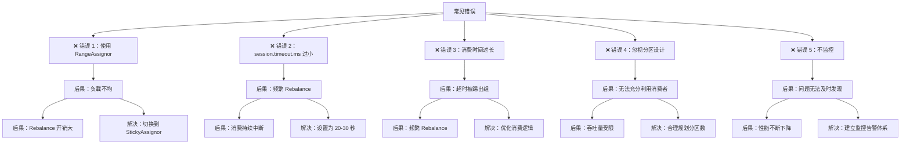

---

## 总结
Kafka 消费者分区分配策略是构建高性能消费系统的基础：

### **核心观点**：
1. **"选择最合适的策略"**
    - Kafka 2.4+：优先 CooperativeStickyAssignor
    - Kafka 0.11-2.3：使用 StickyAssignor
    - 避免使用 RangeAssignor
2. **"理解 Rebalance 的代价"**
    - 消费完全停止，通常 3-20 秒
    - 网络波动、消费者宕机都会触发
    - 应该最小化触发频率
3. **"优化配置参数"**
    - 会话超时：20-30 秒
    - 心跳间隔：6-10 秒
    - 最大 poll 间隔：5-10 分钟
4. **"合理规划架构"**
    - 分区数应接近消费者数
    - 消费者数可以弹性伸缩
    - 避免消费者宕机导致大规模转移
5. **"持续监控优化"**
    - 监控 Rebalance 频率
    - 监控分区分配均衡性
    - 监控消费 Lag 变化
    - 根据监控数据持续调优

### **记住这个决策树**：
```plain
是否支持 Kafka 2.4+？
  是 → CooperativeStickyAssignor（推荐）
  否 → 支持 0.11+？
    是 → StickyAssignor（推荐）
    否 → 升级 Kafka（强烈建议）
```

通过理解和正确应用这些分区分配策略，您可以构建一个高效、稳定、可扩展的 Kafka 消费系统。


# Kafka中的消息是如何存储的？

Kafka 被称为"分布式消息系统的王者"，其高性能的秘诀之一就是其独特的消息存储设计。本篇将深入分析 Kafka 如何在磁盘上高效地存储和管理消息。

***

## 1) "Kafka 存储架构的整体视图"

### 1.1 "三层存储结构"

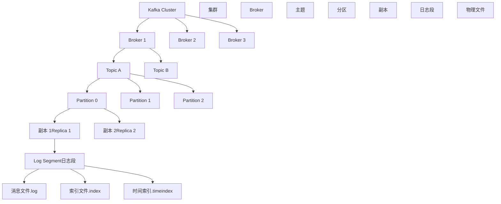

**"分层说明"**：

* **"Cluster 层"**："多个 Broker 组成集群。"
* **"Topic 层"**："每个 Broker 存储多个 Topic。"
* **"Partition 层"**："每个 Topic 有多个 Partition。"
* **"Replica 层"**："每个 Partition 有多个副本。"
* **"Segment 层"**："每个副本的数据分段存储。"
* **"File 层"**："每个 Segment 包含多个物理文件。"

***

## 2) "分区和日志文件的对应关系"

### 2.1 "文件系统中的物理结构"

```plain
Kafka 数据目录结构：
/kafka-data/
├── topic-name-0/              "Partition 0"
│   ├── 00000000000000000000.log       "日志文件 Segment 1"
│   ├── 00000000000000000000.index     "偏移量索引"
│   ├── 00000000000000000000.timeindex "时间索引"
│   ├── 00000000000000100000.log       "日志文件 Segment 2"
│   ├── 00000000000000100000.index
│   ├── 00000000000000100000.timeindex
│   └── leader-epoch-checkpoint        "Leader Epoch 记录"
├── topic-name-1/              "Partition 1"
│   └── ...
└── topic-name-2/              "Partition 2"
    └── ...
```

**"文件命名规则"**：

* "文件名 = 该 Segment 中第一条消息的偏移量（Offset）。"
* "例如 `00000000000000100000.log` 表示从 Offset 100000 开始的日志段。"
* "文件名是 20 位数字，左边补零。"

### 2.2 "Segment 的概念"

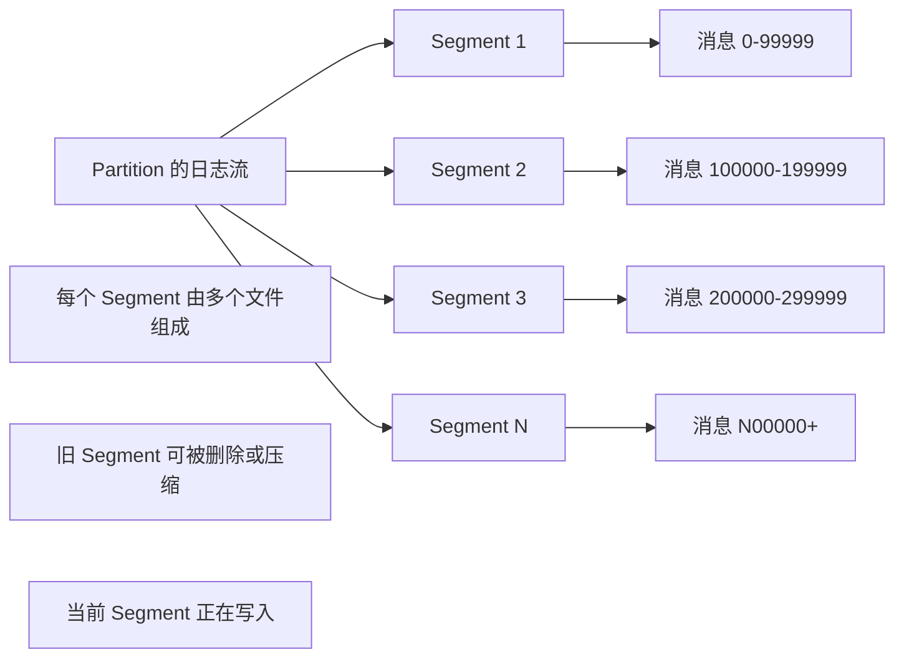

**"Segment 的作用"**：

* "Kafka 不会在一个无限增长的日志文件中写入消息。"
* "而是将日志分成多个 Segment，每个 Segment 有大小限制。"
* "当 Segment 大小达到阈值时，创建新的 Segment。"
* "这样便于删除旧数据、查询和管理。"

***

## 3) "消息的存储格式"

### 3.1 "消息 Record 的结构"

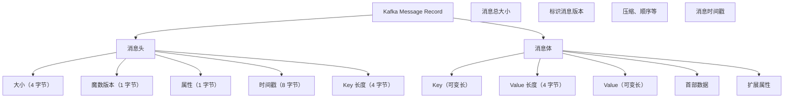

### 3.2 "消息二进制格式详细说明"

```plain
消息格式（Kafka 0.10+）：

┌─────────────────────────────────────────────┐
│ Offset（8 字节）                             │  "偏移量"
├─────────────────────────────────────────────┤
│ Size（4 字节）                               │  "消息大小"
├─────────────────────────────────────────────┤
│ CRC（4 字节）                                │  "校验和"
├─────────────────────────────────────────────┤
│ Magic（1 字节）                              │  "版本号"
├─────────────────────────────────────────────┤
│ Attributes（1 字节）                         │  "属性"
│ [7] 未使用  [6] 未使用  [5] 未使用          │
│ [4] 未使用  [3] 未使用  [2] 未使用          │
│ [1:0] 压缩类型：00=无压缩，01=Gzip，       │
│       10=Snappy，11=LZ4                    │
├─────────────────────────────────────────────┤
│ Timestamp（8 字节）                          │  "消息时间戳"
├─────────────────────────────────────────────┤
│ Key Length（4 字节）                         │  "Key 长度"
├─────────────────────────────────────────────┤
│ Key（Variable Length）                       │  "消息键"
├─────────────────────────────────────────────┤
│ Value Length（4 字节）                       │  "Value 长度"
├─────────────────────────────────────────────┤
│ Value（Variable Length）                     │  "消息内容"
└─────────────────────────────────────────────┘

总大小：26 字节 + Key + Value
```

### 3.3 "消息压缩"

```mermaid
graph TD
    A["生产者发送消息"]

    A --> B["Batch 打包"]
    B --> C{"是否启用压缩？"}

    C --> C1["是"]
    C --> C2["否"]

    C1 --> D["压缩算法"]
    D --> D1["Gzip"]
    D --> D2["Snappy"]
    D --> D3["LZ4"]
    D --> D4["Zstd"]

    D1 --> E["压缩后数据"]
    D2 --> E
    D3 --> E
    D4 --> E

    E --> F["记录压缩类型Attributes"]

    C2 --> F

    F --> G["写入磁盘"]

    note1["减少网络传输"]
    note2["减少磁盘存储"]
    note3["消费者读取时自动解压"]
```

***

## 4) "日志文件的读写机制"

### 4.1 "消息写入流程"

```mermaid
graph TD
    A["生产者发送 Produce 请求"]

    A --> B["Broker 接收"]
    B --> C["验证消息格式"]

    C --> C1{"通过？"}
    C1 -->|"否"| C2["返回错误"]
    C1 -->|"是"| D["找到对应 Partition"]

    D --> E["获取 Leader Replica"]
    E --> F["写入消息到日志"]

    F --> F1["消息追加到内存缓冲"]
    F1 --> F2["定期刷盘到磁盘"]

    F2 --> G["更新 Offset"]
    G --> H["返回成功响应"]

    note1["检查 Schema、大小等"]
    note2["消息先写内存"]
    note3["异步或同步刷磁盘"]
```

### 4.2 "消息读取流程"

```mermaid
graph TD
    A["消费者发送 Fetch 请求"]
    A --> A1["指定 Topic/Partition/Offset"]

    A1 --> B["Broker 接收请求"]
    B --> C["查找 Offset 对应的 Segment"]

    C --> D["使用索引加速查找"]
    D --> D1["先查偏移量索引"]
    D1 --> D2["得到大致位置"]
    D2 --> D3["在该位置附近扫描"]

    D3 --> E["找到 Offset"]
    E --> F["读取消息数据"]

    F --> F1["检查消息完整性"]
    F1 --> F2["如果压缩，解压"]

    F2 --> G["返回给消费者"]

    note1["避免全表扫描"]
    note2["使用稀疏索引"]
    note3["验证 CRC"]
```

***

## 5) "索引机制详解"

### 5.1 "偏移量索引（Offset Index）"

```plain
文件名: 00000000000000000000.index

每条索引项占 8 字节：
┌──────────────────────────────────────┐
│ Relative Offset（相对偏移量）        │ 4 字节
├──────────────────────────────────────┤
│ Physical Position（物理位置）        │ 4 字节
└──────────────────────────────────────┘

示例：
Relative Offset: 0  → Physical Position: 0
Relative Offset: 5  → Physical Position: 528
Relative Offset: 10 → Physical Position: 1256
Relative Offset: 15 → Physical Position: 2000

"稀疏索引"："不是每条消息都有索引项"
"间隔写入"："每隔 N 条消息写入一条索引"
"快速定位"："使用二分查找快速定位"
```

### 5.2 "时间戳索引（Timestamp Index）"

```plain
文件名: 00000000000000000000.timeindex

每条索引项占 12 字节：
┌──────────────────────────────────────┐
│ Timestamp（消息时间戳）              │ 8 字节
├──────────────────────────────────────┤
│ Relative Offset（相对偏移量）        │ 4 字节
└──────────────────────────────────────┘

用途：
1. "根据时间戳快速查找消息"
2. "支持 offsets.for.times() API"
3. "便于构建时间范围查询"
```

### 5.3 "索引查询过程"

```mermaid
graph TD
    A["消费者查询：Offset=53"]

    A --> B["打开 Offset Index 文件"]
    B --> C["二分查找最接近的索引项"]

    C --> C1["找到 Relative Offset=50"]
    C1 --> C2["对应 Position=2048"]

    C2 --> D["从 Position=2048 处开始"]
    D --> E["扫描日志文件逐条读取消息"]

    E --> F["读取 Offset=50 消息"]
    F --> G["读取 Offset=51 消息"]
    G --> H["读取 Offset=52 消息"]
    H --> I["读取 Offset=53 消息"]

    I --> J["找到目标消息"]

    note1["稀疏索引：不需要每个消息都有索引"]
    note2["二分查找：O(log n) 时间复杂度"]
    note3["局部扫描：O(m) 扫描，m 通常很小"]
```

***

## 6) "Page Cache 和存储优化"

### 6.1 "Kafka 使用 Page Cache 的原理"

```mermaid
graph TB
    A["Kafka Broker 写入消息"]

    A --> B["调用 write() 系统调用"]
    B --> C["数据写入 Page Cache"]

    C --> C1["Page Cache 满？"]
    C1 -->|"否"| C2["暂不写盘"]
    C1 -->|"是"| C3["异步刷盘"]

    C2 --> D["消费者读取"]
    D --> D1["直接从 Page Cache 读取"]
    D1 --> D2["无需磁盘 I/O"]
    D2 --> D3["性能最高"]

    C3 --> E["数据落地磁盘"]

    note1["充分利用操作系统缓存"]
    note2["避免多余的内存拷贝"]
    note3["生产消费速度匹配时效果最佳"]
```

**"Kafka 的存储优化策略"**：

1. **"顺序写磁盘"**："Kafka 总是顺序追加消息，不随机写。"
2. **"充分利用 Page Cache"**："依赖 OS 的缓存而非应用缓存。"
3. **"零拷贝"**："使用 sendfile() 避免内存拷贝。"
4. **"异步刷盘"**："刷盘是异步的，不阻塞写操作。"

### 6.2 "刷盘策略"

```mermaid
graph LR
    A["消息写入"]

    A --> B{"log.flush.interval.messages消息数阈值"}
    A --> C{"log.flush.interval.ms时间阈值"}

    B --> B1["达到时刷盘"]
    C --> C1["达到时刷盘"]

    B1 --> D["fsync 操作"]
    C1 --> D

    D --> E["数据落地磁盘"]

    note1["默认：不限制消息数"]
    note2["默认：30 秒"]
    note3["保证数据不丢失"]
```

***

## 7) "Java 代码示例：消息存储的读写"

### 7.1 "生产者：消息写入"

```java
import org.apache.kafka.clients.producer.*;
import org.apache.kafka.common.serialization.StringSerializer;
import java.util.Properties;

public class KafkaProducerStorageExample {

    public static void main(String[] args) throws Exception {
        Properties props = new Properties();
        props.put(ProducerConfig.BOOTSTRAP_SERVERS_CONFIG, "localhost:9092");
        props.put(ProducerConfig.KEY_SERIALIZER_CLASS_CONFIG, StringSerializer.class);
        props.put(ProducerConfig.VALUE_SERIALIZER_CLASS_CONFIG, StringSerializer.class);

        // "压缩配置：降低存储和网络开销"
        props.put(ProducerConfig.COMPRESSION_TYPE_CONFIG, "snappy"); // "Gzip, Snappy, LZ4, Zstd"

        // "批处理配置：提高吞吐量"
        props.put(ProducerConfig.BATCH_SIZE_CONFIG, 16384); // "16KB"
        props.put(ProducerConfig.LINGER_MS_CONFIG, 10); // "等待 10ms 再发送"

        // "缓冲区大小：影响最大未确认消息数"
        props.put(ProducerConfig.BUFFER_MEMORY_CONFIG, 33554432); // "32MB"

        // "确认级别：影响数据持久化"
        props.put(ProducerConfig.ACKS_CONFIG, "all"); // "0=不确认, 1=Leader确认, all=ISR确认"

        KafkaProducer producer = new KafkaProducer<>(props);

        try {
            for (int i = 0; i  record =
                    new ProducerRecord<>("order-topic", key, value);

                // "异步发送，提供回调处理"
                producer.send(record, (metadata, exception) -> {
                    if (exception != null) {
                        System.err.println("发送失败: " + exception.getMessage());
                    } else {
                        System.out.printf("消息已写入 - Topic: %s, Partition: %d, Offset: %d, Timestamp: %d%n",
                            metadata.topic(),
                            metadata.partition(),
                            metadata.offset(),
                            metadata.timestamp());
                        // "这些信息都来自消息存储的元数据"
                    }
                });
            }

            // "等待所有消息发送完成"
            producer.flush();
            System.out.println("所有消息已发送");

        } finally {
            producer.close();
        }
    }
}
```

**"代码说明"**：

* **"COMPRESSION\_TYPE"**："压缩类型影响磁盘存储大小。"
* **"BATCH\_SIZE 和 LINGER\_MS"**："批处理配置影响消息写入的频率。"
* **"ACKS"**："确认级别影响消息持久化程度。"
* **"Key"**："相同 Key 的消息写入同一 Partition，便于顺序处理。"

### 7.2 "消费者：消息读取"

```java
import org.apache.kafka.clients.consumer.*;
import org.apache.kafka.common.serialization.StringDeserializer;
import org.apache.kafka.common.TopicPartition;
import java.time.Duration;
import java.util.*;

public class KafkaConsumerStorageExample {

    public static void main(String[] args) throws Exception {
        Properties props = new Properties();
        props.put(ConsumerConfig.BOOTSTRAP_SERVERS_CONFIG, "localhost:9092");
        props.put(ConsumerConfig.GROUP_ID_CONFIG, "storage-example-group");
        props.put(ConsumerConfig.KEY_DESERIALIZER_CLASS_CONFIG, StringDeserializer.class);
        props.put(ConsumerConfig.VALUE_DESERIALIZER_CLASS_CONFIG, StringDeserializer.class);

        // "自动提交偏移量的间隔"
        props.put(ConsumerConfig.AUTO_COMMIT_INTERVAL_MS_CONFIG, 1000);

        // "单次 fetch 最大字节数"
        props.put(ConsumerConfig.FETCH_MAX_BYTES_CONFIG, 52428800); // "50MB"

        // "单次 fetch 最小字节数（等待至少 1KB 再返回）"
        props.put(ConsumerConfig.FETCH_MIN_BYTES_CONFIG, 1024);

        // "最多等待 500ms"
        props.put(ConsumerConfig.FETCH_MAX_WAIT_MS_CONFIG, 500);

        KafkaConsumer consumer = new KafkaConsumer<>(props);

        try {
            consumer.subscribe(Collections.singletonList("order-topic"));

            // "方式 1：从最新的消息开始消费"
            // consumer.seekToEnd(consumer.assignment());

            // "方式 2：从特定 Offset 开始消费"
            // TopicPartition tp = new TopicPartition("order-topic", 0);
            // consumer.assign(Collections.singletonList(tp));
            // consumer.seek(tp, 100); // "从 Offset 100 开始"

            // "方式 3：根据时间戳查找消息"
            // long targetTime = System.currentTimeMillis() - 3600 * 1000; // "一小时前"
            // Map timestampsToSearch = new HashMap<>();
            // for (TopicPartition tp : consumer.assignment()) {
            //     timestampsToSearch.put(tp, targetTime);
            // }
            // Map offsets =
            //     consumer.offsetsForTimes(timestampsToSearch);

            while (true) {
                // "拉取消息，查询索引加速定位"
                ConsumerRecords records = consumer.poll(Duration.ofSeconds(1));

                for (ConsumerRecord record : records) {
                    System.out.printf(
                        "消息内容 - Topic: %s, Partition: %d, Offset: %d, " +
                        "Timestamp: %d, TimestampType: %s, Key: %s, Value: %s%n",
                        record.topic(),
                        record.partition(),
                        record.offset(),           // "这是消息在日志中的位置"
                        record.timestamp(),        // "来自消息的时间戳字段"
                        record.timestampType(),
                        record.key(),
                        record.value()
                    );

                    // "消息存储位置信息"
                    System.out.printf("  Serialized Key Size: %d bytes%n",
                                    record.serializedKeySize());
                    System.out.printf("  Serialized Value Size: %d bytes%n",
                                    record.serializedValueSize());
                    System.out.printf("  LeaderEpoch: %d%n",
                                    record.leaderEpoch().orElse(-1));
                }
            }

        } finally {
            consumer.close();
        }
    }

    /**
     * "根据时间戳查找消息"
     */
    public static Map findOffsetsByTimestamp(
            KafkaConsumer consumer,
            String topic,
            long targetTimestamp) {

        // "获取所有分区"
        List partitions = consumer.partitionsFor(topic);
        Map timestampsToSearch = new HashMap<>();

        for (PartitionInfo partition : partitions) {
            TopicPartition tp = new TopicPartition(topic, partition.partition());
            timestampsToSearch.put(tp, targetTimestamp);
        }

        // "根据时间戳查询偏移量，利用时间戳索引"
        Map offsets =
            consumer.offsetsForTimes(timestampsToSearch);

        Map result = new HashMap<>();
        for (Map.Entry entry : offsets.entrySet()) {
            if (entry.getValue() != null) {
                result.put(entry.getKey(), entry.getValue().offset());
            }
        }

        return result;
    }
}
```

**"代码说明"**：

* **"Offset"**："消息在日志中的唯一位置标识。"
* **"Timestamp"**："消息存储时的时间戳，支持时间戳查询。"
* **"Partition"**："消息所在的分区编号。"
* **"offsetsForTimes()"**："利用时间戳索引快速查找消息。"

***

## 8) "消息存储的完整工作流程"

### 8.1 "消息从生产到消费的存储路径"

```mermaid
graph TD
    A["生产者应用"]
    B["Kafka Producer"]
    C["本地 Buffer"]

    D["Kafka Broker"]
    E["日志管理器"]
    F["查找段 Segment"]

    G["写入内存缓冲"]
    H["更新内存索引"]
    I["Page Cache"]

    J["异步刷盘"]
    K["磁盘日志文件"]
    L["磁盘索引文件"]

    M["消费者应用"]
    N["Kafka Consumer"]
    O["查询索引"]

    P["从磁盘读取"]
    Q["从 Page Cache 读取"]

    A -->|"send() 方法"| B
    B -->|"批处理、压缩"| C
    C -->|"网络发送"| D

    D -->|"解析请求"| E
    E -->|"定位目标"| F
    F -->|"追加消息"| G
    G -->|"更新索引"| H
    H -->|"转移到"| I

    I -->|"定期"| J
    J -->|"fsync"| K
    J -->|"更新"| L

    M -->|"subscribe()"| N
    N -->|"poll()"| O
    O -->|"二分查找"| L
    L -->|"定位"| K
    K -->|"或"| Q
    Q -->|"返回"| N
    N -->|"返回"| M

    note1["网络传输"]
    note2["批处理"]
    note3["内存操作快速"]
    note4["异步持久化"]
    note5["索引加速"]
```

***

## 9) "Segment 生命周期管理"

### 9.1 "Segment 的创建、滚动、删除"

```mermaid
graph TD
    A["Segment 活跃期"]

    A --> A1["持续接收消息"]
    A1 --> B{"达到阈值？"}

    B -->|"大小达到log.segment.bytes"| C["创建新 Segment"]
    B -->|"时间达到log.roll.hours"| C
    B -->|"未达到"| A1

    C --> D["旧 Segment 进入滚动期"]

    D --> E["保留一段时间"]
    E --> E1{"满足删除条件？"}

    E1 -->|"时间达到log.retention.hours"| F["删除"]
    E1 -->|"大小超过log.retention.bytes"| F
    E1 -->|"未满足"| E

    F --> G["释放磁盘空间"]

    note1["当前正在写入"]
    note2["关闭但保留"]
    note3["永久删除文件"]
```

### 9.2 "Segment 配置参数"

```java
// "Broker 端配置文件：server.properties"

// "单个 Segment 最大大小，默认 1GB"
log.segment.bytes=1073741824

// "Segment 文件在关闭前保持打开的时间，默认 1 小时"
log.segment.delete.delay.ms=60000

// "启用 Segment 定期滚动（小时级别）"
log.roll.hours=168

// "日志保留时间，默认 7 天"
log.retention.hours=168

// "日志保留大小（字节），-1 表示无限制"
log.retention.bytes=1073741824

// "日志压缩相关"
log.cleanup.policy=delete     // "或 compact 进行日志压缩"
log.cleanup.delete.retention.ms=86400000
```

***

## 10) "日志压缩（Log Compaction）"

```mermaid
graph TD
    A["日志压缩 Log Compaction"]

    A --> B["压缩前的日志"]
    B --> B1["key1: value1"]
    B --> B2["key2: value2"]
    B --> B3["key1: value3"]
    B --> B4["key3: value4"]
    B --> B5["key2: value5"]

    A --> C["保留最新值"]
    C --> C1["key1: value3"]
    C --> C2["key2: value5"]
    C --> C3["key3: value4"]

    note1["适用于状态类 Topic"]
    note2["例如用户配置、KV 数据"]
    note3["删除历史的中间值"]
    note4["仅保留每个 key 的最新值"]
```

***

## 11) "存储配置优化最佳实践"

### 11.1 "配置决策树"

```mermaid
graph TD
    A["存储需求分析"]

    A --> B{"消息量级别？"}

    B -->|"小（TB）"| C["默认配置即可"]
    B -->|"大（PB+）"| D["需要优化"]

    D --> E{"消息生命周期？"}

    E -->|"短期实时处理"| F["启用压缩、Page Cache"]
    E -->|"长期备份归档"| G["增大 Segment 大小使用压缩"]

    F --> H["log.segment.bytes=512MB"]
    F --> I["log.retention.hours=24"]

    G --> J["log.segment.bytes=1GB"]
    J --> K["log.retention.hours=7*24"]

    note1["权衡性能和存储"]
```

### 11.2 "性能优化配置示例"

```properties
# "高吞吐量场景"
log.segment.bytes=1073741824        "每个 Segment 1GB，减少文件数"
log.retention.hours=168             "保留 7 天"
log.cleanup.policy=delete           "删除旧日志"
log.index.interval.bytes=4096       "每 4KB 数据记录一个索引"
log.preallocate=true                "预分配文件，提高写入速度"
compression.type=snappy             "使用 Snappy 压缩"

# "低延迟场景"
log.segment.bytes=104857600         "每个 Segment 100MB，更频繁滚动"
log.retention.hours=24              "保留 1 天"
log.index.interval.bytes=2048       "索引更密集"

# "归档场景"
log.retention.bytes=1099511627776   "保留 1TB 数据"
log.cleanup.policy=compact          "使用日志压缩而非删除"
compression.type=gzip               "使用 Gzip 压缩，压缩率更高"
```

***

## 12) "消息存储的故障排查"

### 12.1 "常见问题和解决方案"

```mermaid
graph TD
    A["存储问题诊断"]

    A --> B["磁盘满"]
    B --> B1["检查 log.retention 配置"]
    B --> B2["扩展磁盘容量"]
    B --> B3["启用日志压缩"]

    A --> C["写入性能下降"]
    C --> C1["检查磁盘 I/O"]
    C --> C2["增加 Segment 大小"]
    C --> C3["启用压缩"]

    A --> D["消费延迟高"]
    D --> D1["检查索引可用性"]
    D --> D2["增加 fetch.max.bytes"]
    D --> D3["优化消费者线程数"]

    A --> E["数据丢失"]
    E --> E1["检查 acks 配置"]
    E --> E2["检查 min.insync.replicas"]
    E --> E3["检查刷盘配置"]
```

### 12.2 "监控和诊断命令"

```bash
# "查看分区详细信息"
kafka-topics.sh --bootstrap-server localhost:9092 \
  --topic order-topic --describe

# "查看消费进度"
kafka-consumer-groups.sh --bootstrap-server localhost:9092 \
  --group my-group --describe

# "查看 Broker 日志目录"
ls -lh /data/kafka-logs/

# "查看 Segment 文件大小"
du -sh /data/kafka-logs/order-topic-0/

# "查看索引文件"
ls -lh /data/kafka-logs/order-topic-0/*.index

# "使用 Java 程序检查 Offset"
# 参见后续代码示例
```

***

## 13) "实战案例：消息存储监控工具"

```java
import org.apache.kafka.clients.admin.*;
import org.apache.kafka.common.TopicPartition;
import java.util.*;
import java.util.concurrent.ExecutionException;

public class KafkaStorageMonitor {

    private AdminClient adminClient;

    public KafkaStorageMonitor(String bootstrapServers) {
        Properties props = new Properties();
        props.put(AdminClientConfig.BOOTSTRAP_SERVERS_CONFIG, bootstrapServers);
        this.adminClient = AdminClient.create(props);
    }

    /**
     * "获取某个 Topic 的存储统计信息"
     */
    public void analyzeTopicStorage(String topicName)
            throws ExecutionException, InterruptedException {

        // "获取所有分区"
        DescribeTopicsResult topicInfo = adminClient.describeTopics(
            Collections.singletonList(topicName));

        TopicDescription description = topicInfo.all().get()
            .get(topicName);

        System.out.println("======== Topic: " + topicName + " ========");
        System.out.println("分区数: " + description.partitions().size());
        System.out.println("副本数: " + description.partitions()
            .get(0).replicas().size());

        // "分别统计每个分区"
        for (TopicPartition tp : getTopicPartitions(topicName)) {
            analyzePartitionStorage(tp);
        }
    }

    /**
     * "获取分区的存储详情"
     */
    private void analyzePartitionStorage(TopicPartition tp)
            throws ExecutionException, InterruptedException {

        // "获取分区的起始偏移量（最早）"
        ListOffsetsResult earliestResult = adminClient.listOffsets(
            Collections.singletonMap(tp, OffsetSpec.earliest()));
        long earliestOffset = earliestResult.all().get()
            .get(tp).offset();

        // "获取分区的最后偏移量（最新）"
        ListOffsetsResult latestResult = adminClient.listOffsets(
            Collections.singletonMap(tp, OffsetSpec.latest()));
        long latestOffset = latestResult.all().get()
            .get(tp).offset();

        System.out.printf(
            "  分区 %d: 最早 Offset=%d, 最新 Offset=%d, " +
            "消息数=%d%n",
            tp.partition(), earliestOffset, latestOffset,
            latestOffset - earliestOffset
        );
    }

    /**
     * "获取某个 Topic 的所有分区"
     */
    private List getTopicPartitions(String topic)
            throws ExecutionException, InterruptedException {

        DescribeTopicsResult result = adminClient.describeTopics(
            Collections.singletonList(topic));

        TopicDescription description = result.all().get().get(topic);
        List partitions = new ArrayList<>();

        for (TopicPartitionInfo partition : description.partitions()) {
            partitions.add(new TopicPartition(topic, partition.partition()));
        }

        return partitions;
    }

    /**
     * "计算存储容量需求"
     */
    public void calculateStorageRequirement(String topic,
                                           long messagesPerSecond,
                                           int avgMessageSize,
                                           int retentionDays) {

        long messagesPerDay = messagesPerSecond * 86400;
        long messagesTotal = messagesPerDay * retentionDays;
        long storageBytes = messagesTotal * avgMessageSize;
        double storageMB = storageBytes / (1024.0 * 1024);
        double storageGB = storageMB / 1024;

        System.out.println("\n======== 存储容量预估 ========");
        System.out.printf("Topic: %s%n", topic);
        System.out.printf("吞吐量: %d msg/s%n", messagesPerSecond);
        System.out.printf("平均消息大小: %d bytes%n", avgMessageSize);
        System.out.printf("保留周期: %d 天%n", retentionDays);
        System.out.printf("日总消息数: %d%n", messagesPerDay);
        System.out.printf("总消息数: %d%n", messagesTotal);
        System.out.printf("所需存储容量: %.2f GB%n", storageGB);
        System.out.printf("建议磁盘空间: %.2f GB（预留 20%% 安全余地）%n",
                         storageGB * 1.2);
    }

    public static void main(String[] args) throws Exception {
        KafkaStorageMonitor monitor = new KafkaStorageMonitor("localhost:9092");

        // "分析存储情况"
        monitor.analyzeTopicStorage("order-topic");

        // "计算存储需求"
        // "假设：每秒 10000 条消息，平均 1KB，保留 7 天"
        monitor.calculateStorageRequirement("order-topic", 10000, 1024, 7);
    }
}
```

***

## 14) "消息存储的完整架构图"

```mermaid
graph TB
    subgraph "消息存储架构"
        A["生产者"]
        B["Broker"]
        C["存储层"]
    end

    A -->|"Produce 请求"| B

    B --> B1["内存缓冲Accumulator"]
    B1 -->|"批处理、压缩"| B2["Batch"]

    B2 --> C

    C --> C1["Page Cache操作系统缓存"]
    C1 -->|"热数据快速读取"| D["消费者"]

    C --> C2["磁盘存储"]

    C2 --> C2A["Log 文件消息数据"]
    C2 --> C2B["Index 文件偏移量索引"]
    C2 --> C2C["TimeIndex 文件时间戳索引"]

    C2B -->|"加速查找"| D
    C2C -->|"时间戳查询"| D
    C2A -->|"数据读取"| D
```

***

## 15) "存储优化总结"

```mermaid
graph TD
    A["Kafka 消息存储优化"]

    A --> B["写入端优化"]
    B --> B1["批处理"]
    B --> B2["压缩"]
    B --> B3["异步刷盘"]
    B --> B4["顺序写入"]

    A --> C["读取端优化"]
    C --> C1["索引加速"]
    C --> C2["Page Cache"]
    C --> C3["零拷贝"]
    C --> C4["预读策略"]

    A --> D["管理端优化"]
    D --> D1["Segment 管理"]
    D --> D2["日志压缩"]
    D --> D3["副本同步"]
    D --> D4["磁盘扩展"]

    B1 --> E["性能提升"]
    B2 --> E
    B3 --> E
    B4 --> E
    C1 --> E
    C2 --> E
    C3 --> E
    C4 --> E
```

***

## 16) "存储配置检查清单"

| "检查项" | "推荐值" | "说明" |
| --- | --- | --- |
| "log.segment.bytes" | "512MB-1GB" | "根据消息量调整" |
| "log.retention.hours" | "168（7 天）" | "根据业务需求调整" |
| "log.retention.bytes" | "-1（无限）" | "或根据磁盘容量设置" |
| "log.cleanup.policy" | "delete" | "或 compact 日志压缩" |
| "compression.type" | "snappy" | "平衡压缩率和 CPU" |
| "log.index.interval.bytes" | "4096（4KB）" | "索引密度，影响查询速度" |
| "log.preallocate" | "true" | "预分配文件，提高性能" |
| "log.flush.interval.messages" | "-1" | "异步刷盘，不阻塞写入" |
| "log.flush.interval.ms" | "30000（30s）" | "定期刷盘保证持久化" |

***

## 总结

Kafka 的消息存储机制是其高性能的关键所在：

1. **"分层存储结构"**："从 Cluster、Topic、Partition、Replica 到 Segment，每层都精心设计。"
2. **"高效的索引机制"**："稀疏索引 + 二分查找，快速定位消息。"
3. **"充分利用 Page Cache"**："避免不必要的内存拷贝，依赖 OS 缓存。"
4. **"顺序写入"**："充分利用磁盘顺序写的高性能。"
5. **"零拷贝技术"**："使用 sendfile() 直接在内核传输数据。"
6. **"智能 Segment 管理"**："自动滚动、删除、压缩。"

通过理解这些机制，您可以更好地优化 Kafka 部署、配置和调优。


# 什么是“零拷贝”？有什么作用？

# 零拷贝（Zero-Copy）深度解析：从原理到实战

在高性能系统中，"零拷贝"是一个频繁出现的关键词。它不仅出现在 Kafka、Netty 等开源项目中，也是提升 I/O 密集型应用性能的重要优化手段。本篇将从底层原理出发，逐步带您理解这一概念。

***

## 1) "什么是零拷贝？"

首先，让我们明确一下"零拷贝"的定义：

**"零拷贝是指在数据传输过程中，避免数据在内存中的多次拷贝，尤其是避免在内核态和用户态之间的数据拷贝。"**

* **"不是指真正的零次拷贝"**："数据最终还是会被物理设备读写，但减少了不必要的内存拷贝操作。"
* **"主要目标"**："降低 CPU 消耗，提升 I/O 性能，减少上下文切换。"

***

## 2) "传统数据传输的问题"

为了理解零拷贝的价值，我们先看看传统方式是如何工作的。

### 2.1 "场景：文件上传到网络"

**"传统方式：用户缓冲区读取 → 传输"**

```mermaid
graph TD
    A["磁盘文件"]
    B["内核缓冲区"]
    C["用户应用缓冲区"]
    D["内核缓冲区 Socket"]
    E["网卡"]

    A -->|"第1次拷贝：DMA 读取"| B
    B -->|"第2次拷贝：系统调用 read"| C
    C -->|"第3次拷贝：系统调用 write"| D
    D -->|"第4次拷贝：DMA 发送"| E

    note1["从磁盘读取文件"]
    note2["内核态切换到用户态"]
    note3["用户态回到内核态"]
    note4["DMA 从内核缓冲发送到网卡"]
```

**"分析这个过程"**：

1. **"第 1 次拷贝：磁盘 → 内核缓冲区"**
   * "操作系统使用 DMA（Direct Memory Access）直接从磁盘读取数据到内核缓冲区。"
   * "这是必需的，因为磁盘 I/O 没有更好的选择。"
2. **"第 2 次拷贝：内核缓冲区 → 用户缓冲区"**
   * "应用程序调用 `read()` 系统调用。"
   * "数据从内核缓冲区被拷贝到用户应用的内存缓冲区。"
   * **"这是不必要的！如果我们直接使用内核缓冲区的数据呢？"**
3. **"第 3 次拷贝：用户缓冲区 → 内核缓冲区（Socket）"**
   * "应用程序处理完数据后，调用 `write()` 系统调用将数据发送到网络。"
   * "数据被拷贝到 Socket 对应的内核缓冲区。"
   * **"这也是不必要的！如果能直接从第 2 步的内核缓冲区发送呢？"**
4. **"第 4 次拷贝：内核缓冲区 → 网卡"**
   * "操作系统再次使用 DMA 将数据从内核缓冲区发送到网卡。"
   * "这是必需的。"

**"问题总结"**：

* "总共 4 次拷贝，其中 2 次不必要。"
* "频繁的上下文切换（用户态 ↔ 内核态）。"
* "浪费 CPU 资源执行数据拷贝，而不是有意义的业务逻辑。"

***

## 3) "零拷贝的实现方式"

### 3.1 "方式 1：Memory Mapped File（内存映射文件）"

```mermaid
graph TD
    A["磁盘文件"]
    B["内核缓冲区"]
    C["应用内存（内存映射）"]
    D["内核缓冲区 Socket"]
    E["网卡"]

    A -->|"第1次拷贝：DMA 读取"| B
    B -.->|"内存映射：虚拟地址映射"| C
    C -->|"第2次拷贝：write 调用"| D
    D -->|"第3次拷贝：DMA 发送"| E

    note1["无需第2次拷贝"]
    note2["应用可直接访问内核缓冲区数据"]
    note3["总共 3 次拷贝"]
```

**"原理"**：

* "使用 `mmap()` 系统调用将磁盘文件映射到用户进程的虚拟地址空间。"
* "应用程序通过内存映射可以直接访问磁盘文件数据，无需 `read()` 拷贝。"

**"优点"**："减少一次内存拷贝，比较适合大文件处理。"

**"缺点"**："仍然需要一次拷贝来传输数据到网络，且 mmap 本身有开销。"

### 3.2 "方式 2：sendfile（最高效的零拷贝）"

```mermaid
graph TD
    A["磁盘文件"]
    B["内核缓冲区 Read Buffer"]
    C["Socket 缓冲区"]
    D["网卡"]

    A -->|"第1次拷贝：DMA 读取"| B
    B -->|"第2次拷贝：在内核中进行"| C
    C -->|"第3次拷贝：DMA 发送"| D

    APP["应用程序"]
    APP -.->|"sendfile 系统调用"| B
    APP -.->|"无需参与拷贝"| C

    note1["关键：拷贝在内核中进行"]
    note2["应用无需进入用户缓冲区"]
    note3["无用户态和内核态切换"]
```

**"原理"**：

* "Linux 2.4+ 内核提供的 `sendfile()` 系统调用可以直接在内核缓冲区之间转移数据。"
* "应用程序只需调用一次 `sendfile()`，内核负责所有的数据传输。"
* "数据始终在内核空间流动，避免了用户态复制。"

**"流程"**：

1. "应用程序调用 `sendfile(socketfd, filefd, position, size)`。"
2. "内核从文件描述符 `filefd` 读取数据到内核缓冲区。"
3. "内核直接将数据从读缓冲区拷贝到 Socket 缓冲区。"
4. "内核通过 DMA 将 Socket 缓冲区的数据发送到网卡。"

**"优点"**：

* "最少的上下文切换。"
* "最少的内存拷贝（只有内核内部拷贝）。"
* "最高的性能。"

**"缺点"**："只能用于从文件到网络的传输，不适用于应用需要处理数据的场景。"

### 3.3 "方式 3：Splice（仅适用于 Linux）"

```mermaid
graph TD
    A["Source Fd"]
    B["内核管道 Pipe Buffer"]
    C["Dest Fd"]

    A -->|"splice 调用"| B
    B -->|"splice 调用"| C

    note1["在内核管道中转移数据指针"]
    note2["无需实际拷贝数据内容"]
    note3["比 sendfile 更通用"]
```

**"原理"**：

* "`splice()` 使用内核管道（pipe）作为中介。"
* "第一个 `splice()` 将数据从源文件移动到管道（只转移指针）。"
* "第二个 `splice()` 将数据从管道移动到目标文件（只转移指针）。"

**"优点"**："比 sendfile 更通用，可以用于任意两个文件描述符之间。"

**"缺点"**："仅在 Linux 上支持，实现复杂。"

***

## 4) "零拷贝与 Java NIO"

Java 本身无法直接调用 Linux 的 `sendfile()`，但 Java NIO 提供了相关接口供我们使用。

### 4.1 "Java NIO 中的零拷贝接口"

```java
// "FileChannel 和 SocketChannel 提供的零拷贝方法"

// "方法 1：transferFrom - 从另一个通道读取数据"
public abstract long transferFrom(ReadableByteChannel src,
                                  long position,
                                  long count) throws IOException;

// "方法 2：transferTo - 将数据发送到另一个通道"
public abstract long transferTo(long position,
                                long count,
                                WritableByteChannel target) throws IOException;
```

**"这两个方法内部使用 sendfile() 系统调用。"**

### 4.2 "传统方式 vs 零拷贝方式的代码对比"

**"方式 A：传统读写方式（多次拷贝）"**

```java
import java.io.*;

public class TraditionalFileCopy {

    public static void main(String[] args) throws IOException {
        String sourceFile = "source.dat";
        String destFile = "dest.dat";

        // "使用传统的缓冲区读写"
        try (InputStream in = new FileInputStream(sourceFile);
             OutputStream out = new FileOutputStream(destFile)) {

            byte[] buffer = new byte[4096]; // "4KB 缓冲区"
            int bytesRead;

            while ((bytesRead = in.read(buffer)) != -1) {
                // "第 1 次拷贝：内核缓冲区 → 用户缓冲区"

                // "这里可以处理数据"
                out.write(buffer, 0, bytesRead);
                // "第 2 次拷贝：用户缓冲区 → 内核缓冲区"
            }
        }
    }
}
```

**"分析"**：

* "每次读操作：内核缓冲区 → 用户缓冲区。"
* "每次写操作：用户缓冲区 → 内核缓冲区。"
* "如果处理 1GB 文件，可能有数百万次拷贝操作。"

**"方式 B：零拷贝方式（使用 FileChannel）"**

```java
import java.io.*;
import java.nio.channels.FileChannel;

public class ZeroCopyFileCopy {

    public static void main(String[] args) throws IOException {
        String sourceFile = "source.dat";
        String destFile = "dest.dat";

        long startTime = System.currentTimeMillis();

        try (RandomAccessFile sourceRAF = new RandomAccessFile(sourceFile, "r");
             RandomAccessFile destRAF = new RandomAccessFile(destFile, "rw");
             FileChannel sourceChannel = sourceRAF.getChannel();
             FileChannel destChannel = destRAF.getChannel()) {

            long fileSize = sourceChannel.size();

            // "使用 transferTo 实现零拷贝"
            // "内部使用 sendfile 系统调用"
            long transferred = 0;
            while (transferred  {
            try {
                String fileName = "largefile.dat";
                File file = new File(fileName);

                // "读取文件到内存缓冲区（第 1 次拷贝）"
                byte[] fileContent = new byte[(int) file.length()];
                try (FileInputStream fis = new FileInputStream(file)) {
                    fis.read(fileContent);
                }

                // "设置响应"
                exchange.getResponseHeaders().set("Content-Type", "application/octet-stream");
                exchange.sendResponseHeaders(200, fileContent.length);

                // "写入到输出流（第 2 次拷贝）"
                try (OutputStream os = exchange.getResponseBody()) {
                    os.write(fileContent);
                }
            } catch (IOException e) {
                e.printStackTrace();
            }
        });

        server.start();
        System.out.println("传统方式 HTTP 服务器启动，监听 8080 端口");
    }
}
```

**"问题"**：

* "文件内容被完全加载到内存。"
* "大文件会导致 OOM。"
* "多次内存拷贝浪费 CPU。"

**"零拷贝方式：直接转移 FileChannel"**

```java
import java.io.*;
import java.nio.channels.*;
import com.sun.net.httpserver.*;

public class ZeroCopyFileServer {

    public static void main(String[] args) throws IOException {
        HttpServer server = HttpServer.create(new java.net.InetSocketAddress(8080), 0);

        server.createContext("/file", exchange -> {
            try {
                String fileName = "largefile.dat";
                File file = new File(fileName);

                // "直接获取文件的 FileChannel"
                try (RandomAccessFile raf = new RandomAccessFile(file, "r");
                     FileChannel fileChannel = raf.getChannel()) {

                    // "设置响应"
                    exchange.getResponseHeaders().set("Content-Type", "application/octet-stream");
                    exchange.sendResponseHeaders(200, file.length());

                    // "获取响应 OutputStream 对应的 Channel（如果支持）"
                    // "直接将 FileChannel 的数据转移到 SocketChannel"
                    // "这需要一个能接收 FileChannel 的输出通道"

                    try (OutputStream os = exchange.getResponseBody()) {
                        // "将 FileChannel 中的数据直接发送出去"
                        // "如果使用 NIO，可以这样做："
                        // "java.nio.channels.Channels.newChannel(os)"
                        WritableByteChannel outChannel = Channels.newChannel(os);
                        long transferred = 0;
                        long fileSize = fileChannel.size();

                        while (transferred |"内部使用 sendfile"| D["零拷贝传输"]

    B -.->|"第1次：DMA 读入内核缓冲"| B
    D -.->|"内核缓冲 → Socket 缓冲（无应用处理）"| C
    C -.->|"第2次：DMA 发送到网卡"| C

    note1["Kafka Producer 写入数据"]
    note2["Kafka Broker 存储到磁盘"]
    note3["Kafka Consumer 读取时使用零拷贝"]
    note4["大幅提升消费性能"]
```

**"Kafka 的优化策略"**：

1. "使用 `log.flush.interval.bytes` 进行 Page Cache 管理。"
2. "Consumer 拉取消息时使用 `FileChannel.transferTo()`。"
3. "Page Cache 加速磁盘读取。"

```java
// "Kafka 使用零拷贝的伪代码"
public class KafkaZeroCopyExample {

    public static void handleConsumerFetch(FileChannel fileChannel,
                                          WritableByteChannel outChannel,
                                          long startPosition,
                                          long length) throws IOException {
        // "直接使用 transferTo，不经过用户缓冲区"
        long transferred = 0;
        while (transferred  B1["加密/解密"]
    A --> B2["压缩/解压"]
    A --> B3["序列化/反序列化"]
    A --> B4["业务逻辑处理"]
    A --> B5["数据转换"]

    B1 --> C["必须使用传统方式"]
    B2 --> C
    B3 --> C
    B4 --> C
    B5 --> C

    note1["因为数据必须从内核态复制到用户态进行处理"]
```

### 8.2 "平台差异"

```mermaid
graph LR
    A["零拷贝支持情况"]

    A --> B1["Linux"]
    B1 --> B1A["sendfile: 完全支持"]
    B1 --> B1B["splice: 完全支持"]

    A --> B2["Windows"]
    B2 --> B2A["TransmitFile: 部分支持"]
    B2 --> B2B["效果不如 Linux"]

    A --> B3["macOS"]
    B3 --> B3A["sendfile: 有限支持"]
    B3 --> B3B["主要用于本地传输"]
```

***

## 9) "零拷贝最佳实践"

### 9.1 "使用决策树"

```mermaid
graph TD
    A["需要传输数据"]

    A --> B{"需要处理数据内容？"}

    B -- "否" --> C{"是否处理大文件？"}

    C -- "是" --> D["使用 transferTo/transferFrom（零拷贝）"]
    C -- "否" --> E["使用 NIO ByteBuffer（性能次优）"]

    B -- "是" --> F{"处理复杂度？"}

    F -- "低字节处理" --> G["使用 NIO ByteBuffer带 mmap"]
    F -- "高对象处理" --> H["传统方式接受性能损失"]
```

### 9.2 "代码模板：零拷贝传输"

```java
public class ZeroCopyTransferTemplate {

    /**
     * "高效的文件传输模板"
     * "使用零拷贝方式传输文件到网络或其他文件"
     */
    public static void efficientTransfer(String sourcePath,
                                         String destPath,
                                         long startPosition,
                                         long transferSize) throws IOException {
        try (RandomAccessFile sourceFile = new RandomAccessFile(sourcePath, "r");
             RandomAccessFile destFile = new RandomAccessFile(destPath, "rw");
             FileChannel sourceChannel = sourceFile.getChannel();
             FileChannel destChannel = destFile.getChannel()) {

            // "验证参数"
            long fileSize = sourceChannel.size();
            if (startPosition = fileSize) {
                throw new IllegalArgumentException("起始位置无效");
            }

            long actualTransferSize = Math.min(transferSize, fileSize - startPosition);

            // "执行零拷贝转移"
            long transferred = 0;
            long maxTransferPerCall = 1024 * 1024 * 64; // "一次转移最多 64MB"

            while (transferred  A1["内核缓冲 → Socket 缓冲"]
    A --> A2["2次拷贝"]
    A --> A3["最高效"]
    A --> A4["仅限文件转移"]

    B --> B1["文件 → 内存映射"]
    B --> B2["3次拷贝"]
    B --> B3["应用可处理数据"]
    B --> B4["支持随机访问"]

    C --> C1["多次用户态切换"]
    C --> C2["4次拷贝"]
    C --> C3["最灵活"]
    C --> C4["最慢"]
```

**"选择建议"**：

* **"纯数据转移，追求最高性能"**："使用 sendfile 零拷贝。"
* **"需要应用处理数据，但频繁访问"**："使用内存映射文件。"
* **"处理逻辑复杂"**："使用传统方式，接受性能损失。"

***

## 11) "零拷贝实战：高性能文件同步工具"

```java
import java.io.*;
import java.nio.channels.*;
import java.nio.file.*;
import java.util.concurrent.*;

public class HighPerformanceFileSync {

    private static final int THREAD_COUNT = 4;
    private static final long CHUNK_SIZE = 10 * 1024 * 1024; // "10 MB 每个任务"

    /**
     * "使用多线程和零拷贝实现高性能文件同步"
     */
    public static void syncFilesWithZeroCopy(String sourceDir, String destDir)
            throws IOException, InterruptedException {

        File sourceDirFile = new File(sourceDir);
        File destDirFile = new File(destDir);

        if (!destDirFile.exists()) {
            destDirFile.mkdirs();
        }

        ExecutorService executor = Executors.newFixedThreadPool(THREAD_COUNT);

        try {
            // "遍历源目录中的所有文件"
            File[] files = sourceDirFile.listFiles(File::isFile);
            if (files == null) return;

            for (File sourceFile : files) {
                executor.submit(() -> {
                    try {
                        File destFile = new File(destDirFile, sourceFile.getName());
                        syncSingleFile(sourceFile.getAbsolutePath(), destFile.getAbsolutePath());
                        System.out.println("已同步: " + sourceFile.getName());
                    } catch (IOException e) {
                        System.err.println("同步失败: " + e.getMessage());
                    }
                });
            }

            executor.shutdown();
            executor.awaitTermination(1, TimeUnit.HOURS);
            System.out.println("所有文件同步完成");

        } finally {
            executor.shutdownNow();
        }
    }

    private static void syncSingleFile(String source, String dest) throws IOException {
        try (RandomAccessFile sourceRAF = new RandomAccessFile(source, "r");
             RandomAccessFile destRAF = new RandomAccessFile(dest, "rw");
             FileChannel sourceChannel = sourceRAF.getChannel();
             FileChannel destChannel = destRAF.getChannel()) {

            long fileSize = sourceChannel.size();
            long transferred = 0;

            // "分块转移，避免单次转移过大"
            while (transferred |"1"| T2
        T2 -->|"2"| T3
        T3 -->|"3"| T4
        T4 -->|"4"| T5
    end

    subgraph "零拷贝方式 2 次拷贝"
        Z1["磁盘"]
        Z2["内核缓冲"]
        Z3["Socket 缓冲"]
        Z4["网卡"]

        Z1 -->|"1"| Z2
        Z2 -->|"2（仅转移指针）"| Z3
        Z3 -->|"DMA"| Z4
    end
```

***

## 13) "总结与关键要点"

```mermaid
graph TD
    A["零拷贝 Zero-Copy"]

    A --> B["核心原理"]
    B --> B1["避免应用处理数据时的多次内存拷贝"]
    B --> B2["数据在内核空间流动"]
    B --> B3["减少上下文切换"]
    B --> B4["降低 CPU 消耗"]

    A --> C["主要实现方式"]
    C --> C1["mmap 内存映射"]
    C --> C2["sendfile 系统调用"]
    C --> C3["splice 管道转移"]
    C --> C4["Java NIO transferTo/transferFrom"]

    A --> D["适用场景"]
    D --> D1["大文件传输"]
    D --> D2["网络数据转发"]
    D --> D3["日志系统"]
    D --> D4["消息队列"]
    D --> D5["文件服务器"]

    A --> E["不适用场景"]
    E --> E1["需要加密解密"]
    E --> E2["需要压缩解压"]
    E --> E3["需要业务处理"]
    E --> E4["需要序列化转换"]

    A --> F["性能提升"]
    F --> F1["降低 CPU 使用率 50-70%"]
    F --> F2["吞吐量提升 5-10 倍"]
    F --> F3["延迟显著降低"]
```

***

## 14) "零拷贝检查清单"

| "检查项" | "说明" |
| --- | --- |
| "是否是文件到网络的传输？" | "是 → 优先使用 sendfile 零拷贝" |
| "文件大小是否很大（>100MB）？" | "是 → 零拷贝效果明显" |
| "是否需要应用处理数据？" | "否 → 可以使用零拷贝；是 → 使用 mmap 或传统方式" |
| "是否运行在 Linux？" | "是 → 最佳支持；否 → 考虑跨平台兼容性" |
| "吞吐量或 CPU 是否是瓶颈？" | "是 → 使用零拷贝优化" |
| "代码复杂度可以接受吗？" | "是 → 使用零拷贝；否 → 传统方式" |

***

## 总结

**"零拷贝不是真正的零次拷贝，而是避免了不必要的内存拷贝操作。"** 它通过以下方式实现性能优化：

1. **"减少数据拷贝次数"**："从 4 次减少到 2 次。"
2. **"减少上下文切换"**："应用无需参与数据转移。"
3. **"充分利用 DMA"**："让硬件完成数据转移。"
4. **"降低 CPU 消耗"**："CPU 可处理更多业务逻辑。"

在构建高性能 I/O 密集型应用时，零拷贝技术是必不可少的优化手段。掌握它的原理和使用方式，将大幅提升系统性能。


# Kafka如何保证消息可靠？

## 1. 什么是消息可靠性？为什么Kafka需要它？

消息可靠性是指消息在整个生命周期中能够被正确传递和处理的保障。在Kafka中，这通常意味着：

* **消息不丢失 (At-least-once)**：生产者发送的消息，至少会被成功投递一次。
* **消息不重复 (At-most-once)**：生产者发送的消息，至多会被成功投递一次。
* **消息精确一次 (Exactly-once)**：生产者发送的消息，恰好会被成功投递一次（不丢不重）。
* **消息有序性 (Ordering)**：同一个分区内的消息，按照发送顺序进行存储和消费。

在分布式系统中，网络延迟、服务器故障、进程崩溃等问题随时可能发生，如果没有可靠性保障，消息可能会丢失或重复，导致业务数据不一致甚至严重错误。Kafka通过多方面机制来应对这些挑战。

## 2. 生产者如何保证消息不丢失与不重复

生产者是消息的起点，Kafka提供了多种配置和机制来保证消息从这里可靠地发送到Broker。

### 2.1 `acks` 参数：消息持久化的保证

`acks` 是生产者最重要的配置之一，它决定了生产者发送消息的确认机制，直接影响消息的持久性保证和性能。

* `acks=0`\*\* (不等待确认)\*\*：
  * **含义**：生产者发送消息后，不等待Broker的任何确认，直接发送下一条。
  * **可靠性**：最低。消息可能会因网络问题、Broker崩溃等原因丢失。
  * **性能**：最高。
  * **适用场景**：对消息丢失不敏感的场景，如日志收集（可以接受少量日志丢失）。
* `acks=1`\*\* (等待Leader确认)\*\*：
  * **含义**：生产者发送消息后，只要Leader副本成功写入消息，就认为消息发送成功。
  * **可靠性**：中等。如果Leader在消息同步到Follower之前崩溃，消息会丢失。
  * **性能**：中等。
  * **适用场景**：对消息丢失有一定容忍度，但希望比`acks=0`更可靠的场景。
* `acks=all`\*\* 或 **`acks=-1`** (等待所有ISR副本确认)\*\*：
  * **含义**：生产者发送消息后，不仅Leader副本要成功写入，还要等待所有ISR（In-Sync Replicas，同步副本）中的Follower副本也成功同步消息后，才认为消息发送成功。
  * **可靠性**：最高。只要ISR中至少有一个副本存活，消息就不会丢失。
  * **性能**：最低（相对于`acks=0`和`acks=1`）。
  * **适用场景**：对消息丢失零容忍的场景，如金融交易、订单系统。

#### 代码示例：设置 `acks`

```java
import org.apache.kafka.clients.producer.KafkaProducer;
import org.apache.kafka.clients.producer.ProducerConfig;
import org.apache.kafka.clients.producer.ProducerRecord;
import org.apache.kafka.common.serialization.StringSerializer;

import java.util.Properties;

public class ReliableProducer {

    public static void main(String[] args) {
        Properties props = new Properties();
        props.put(ProducerConfig.BOOTSTRAP_SERVERS_CONFIG, "localhost:9092");
        props.put(ProducerConfig.KEY_SERIALIZER_CLASS_CONFIG, StringSerializer.class.getName());
        props.put(ProducerConfig.VALUE_SERIALIZER_CLASS_CONFIG, StringSerializer.class.getName());

        // 设置acks为all，提供最高可靠性
        props.put(ProducerConfig.ACKS_CONFIG, "all");
        // 建议配合重试机制使用
        props.put(ProducerConfig.RETRIES_CONFIG, 3); // 允许重试3次

        KafkaProducer producer = new KafkaProducer<>(props);

        try {
            for (int i = 0; i  record = new ProducerRecord<>("my_topic", key, value);
                producer.send(record, (metadata, exception) -> {
                    if (exception == null) {
                        System.out.printf("消息发送成功！主题: %s, 分区: %d, 偏移量: %d%n",
                                metadata.topic(), metadata.partition(), metadata.offset());
                    } else {
                        System.err.printf("消息发送失败！异常: %s%n", exception.getMessage());
                    }
                }).get(); // 使用get()同步发送，等待确认
            }
        } catch (Exception e) {
            e.printStackTrace();
        } finally {
            producer.close();
        }
    }
}
```

### 2.2 `retries` 参数：应对瞬时故障

当生产者发送消息失败时（例如，网络瞬时抖动，Leader切换等），可以通过重试机制来重新发送消息。

* `retries`：配置重试的次数。设置为一个大于0的值，可以在瞬时故障时有效防止消息丢失。
* **注意**：在不开启幂等性（`enable.idempotence=false`）的情况下，重试可能导致消息重复。例如，消息已成功写入Broker但Producer接收ACK超时，Producer会再次发送。

### 2.3 幂等生产者 (Idempotent Producer)：保证消息不重复

Kafka 0.11.0 引入了幂等性，保证生产者在重试发送时，消息不会重复，从而实现**At-least-once to Exactly-once within a single session for a single partition**。

* **原理**：
  * Kafka为每个幂等生产者分配一个**Producer ID (PID)**。
  * 每个PID发送消息时，会携带一个单调递增的**Sequence Number**。
  * Broker会为每个PID和分区维护一个已接收的最大Sequence Number。如果收到的Sequence Number小于或等于已接收的最大Sequence Number，Broker就会丢弃该重复消息。
  * **Epoch**：在Producer重启后，会获得新的PID和Epoch，以防止旧的Sequence Number冲突。
* **开启方式**：设置 `enable.idempotence=true`。
  * 当开启幂等性后，`acks` 会自动被设置为 `all`，`retries` 会被设置为 `Integer.MAX_VALUE`，`max.in.flight.requests.for.connection` 会被设置为 5。

#### 代码示例：开启幂等性

```java
import org.apache.kafka.clients.producer.KafkaProducer;
import org.apache.kafka.clients.producer.ProducerConfig;
import org.apache.kafka.clients.producer.ProducerRecord;
import org.apache.kafka.common.serialization.StringSerializer;

import java.util.Properties;

public class IdempotentProducer {

    public static void main(String[] args) {
        Properties props = new Properties();
        props.put(ProducerConfig.BOOTSTRAP_SERVERS_CONFIG, "localhost:9092");
        props.put(ProducerConfig.KEY_SERIALIZER_CLASS_CONFIG, StringSerializer.class.getName());
        props.put(ProducerConfig.VALUE_SERIALIZER_CLASS_CONFIG, StringSerializer.class.getName());

        // 开启幂等性
        props.put(ProducerConfig.ENABLE_IDEMPOTENCE_CONFIG, "true");

        KafkaProducer producer = new KafkaProducer<>(props);

        try {
            for (int i = 0; i  record = new ProducerRecord<>("my_topic", key, value);
                producer.send(record, (metadata, exception) -> {
                    if (exception == null) {
                        System.out.printf("幂等消息发送成功！主题: %s, 分区: %d, 偏移量: %d%n",
                                metadata.topic(), metadata.partition(), metadata.offset());
                    } else {
                        System.err.printf("幂等消息发送失败！异常: %s%n", exception.getMessage());
                    }
                }).get();
            }
        } catch (Exception e) {
            e.printStackTrace();
        } finally {
            producer.close();
        }
    }
}
```

### 图示描述：生产者发送消息与确认机制

* `acks=0`: Producer -> Broker (单向箭头)
* `acks=1`: Producer -> Broker (Leader) -> ACK (Leader) -> Producer (双向箭头，Leader确认)
* `acks=all`: Producer -> Broker (Leader) -> Leader 写入 -> Leader 同步到 Follower (ISR) -> 所有ISR确认 -> ACK (Leader) -> Producer (复杂双向箭头，涉及多个Broker)
* **重试**: Producer -> Broker (发送失败) -> Producer (重试) -> Broker (发送成功) -> ACK -> Producer
* **幂等性**: Producer (PID, SeqNum) -> Broker (存储) -> ACK -> Producer。若重试：Producer (PID, SeqNum) -> Broker (判断SeqNum已存在，丢弃) -> ACK -> Producer。

## 3. Broker端如何存储和复制消息

Broker是消息的存储中心，Kafka通过副本机制和ISR来保证消息的持久性和高可用性。

### 3.1 副本机制 (`replication.factor`)

* **含义**：Kafka将每个分区的数据复制多份，存储在不同的Broker上。这些副本包括一个Leader副本和若干个Follower副本。
* `replication.factor`：每个分区的副本数量。建议设置为3，即一个Leader和两个Follower。
* **作用**：当某个Broker（包括Leader或Follower）发生故障时，其他副本仍然可以提供服务，避免数据丢失和服务中断。

### 3.2 ISR (In-Sync Replicas)：同步副本集合

* **含义**：ISR是一个动态集合，包含与Leader副本保持同步的所有副本（包括Leader本身）。只有ISR中的副本才具备被选举为新Leader的资格。
* **同步判断**：Follower副本如果在一定时间内没有向Leader发送拉取请求，或者拉取消息的滞后量超过`replica.lag.time.max.ms`配置，就会被Leader踢出ISR。
* **重要性**：`acks=all`机制就是依赖ISR来保证消息的持久性。只有当ISR中所有副本都确认写入后，Leader才会向生产者发送确认。

### 3.3 Leader选举

* **何时发生**：当Leader副本所在的Broker发生故障时，Kafka会从ISR中选举一个新的Leader。
* **机制**：由ZooKeeper（或KRaft）协调完成，保证只有一个Leader。
* **数据一致性**：新Leader一定是ISR中的副本，因此它拥有所有已提交的消息，保证了数据不丢失。
* `unclean.leader.election.enable`：
  * `false`\*\* (默认)\*\*：只允许ISR中的副本成为Leader。即使所有ISR副本都故障了，也不会从非ISR副本中选举，保证了数据一致性，但可用性可能受损。
  * `true`：允许非ISR副本成为Leader。在极端情况下（所有ISR副本都故障），可以牺牲一定的数据一致性来保证可用性。通常不建议在生产环境开启。

### 3.4 消息持久化 (磁盘刷写)

* **内存写入**：Kafka Broker收到消息后，首先写入操作系统的页缓存（Page Cache），这是一种内存缓存，性能很高。
* **异步刷盘**：操作系统会在后台将页缓存中的数据异步刷写到磁盘。
* **刷盘策略**：
  * `log.flush.interval.messages`：达到消息数量阈值后刷盘。
  * `log.flush.interval.ms`：达到时间间隔后刷盘。
* **可靠性**：即使Kafka Broker发生崩溃，由于数据在页缓存中，操作系统也会尽力将其刷盘。Kafka通过追加写入日志文件（Log Segment），保证了即使崩溃重启，也能恢复到崩溃前的状态。

### 图示描述：副本机制与ISR

* **主题分区**: 一个主题被分成多个分区。
* **分区副本**: 每个分区有多个副本 (Leader, Follower1, Follower2) 分布在不同的Broker上。
* **ISR**: Leader和Follower1都在ISR中，Follower2因滞后不在ISR中。
* **消息写入**: Producer发送消息到Leader，Leader写入后同步到ISR中的Follower。所有ISR确认后，Leader返回ACK给Producer。

## 4. 消费者如何确保消息被正确处理

消费者是消息的终点，需要确保消息被正确地拉取和处理，避免重复消费或漏消费。

### 4.1 Offset管理：消费进度的记录

* **Offset**：消息在分区中的唯一标识，消费者通过提交Offset来记录自己的消费进度。
* **提交位置**：Offset存储在Kafka内部的一个特殊主题 `__consumer_offsets` 中。
* **消费语义**：
  * **At-most-once (至多一次)**：消费者拉取消息后立即提交Offset，然后处理消息。如果在处理过程中崩溃，消息可能未被处理但Offset已提交，导致消息丢失。
  * **At-least-once (至少一次)**：消费者处理完消息后再提交Offset。如果在处理完消息但未提交Offset时崩溃，重启后会从上次提交的Offset开始重新消费，导致消息重复处理。Kafka默认倾向于这种模式。
  * **Exactly-once (精确一次)**：结合了幂等生产者和事务型生产者，以及消费者对事务的支持，从端到端实现不丢不重。

#### 代码示例：手动提交Offset (At-least-once)

```java
import org.apache.kafka.clients.consumer.ConsumerConfig;
import org.apache.kafka.clients.consumer.ConsumerRecord;
import org.apache.kafka.clients.consumer.ConsumerRecords;
import org.apache.kafka.clients.consumer.KafkaConsumer;
import org.apache.kafka.common.serialization.StringDeserializer;

import java.time.Duration;
import java.util.Collections;
import java.util.Properties;

public class ManualOffsetConsumer {

    public static void main(String[] args) {
        Properties props = new Properties();
        props.put(ConsumerConfig.BOOTSTRAP_SERVERS_CONFIG, "localhost:9092");
        props.put(ConsumerConfig.GROUP_ID_CONFIG, "my_consumer_group");
        props.put(ConsumerConfig.KEY_DESERIALIZER_CLASS_CONFIG, StringDeserializer.class.getName());
        props.put(ConsumerConfig.VALUE_DESERIALIZER_CLASS_CONFIG, StringDeserializer.class.getName());

        // 禁用自动提交Offset
        props.put(ConsumerConfig.ENABLE_AUTO_COMMIT_CONFIG, "false");
        // 自动提交间隔（如果enable.auto.commit为true才有效）
        // props.put(ConsumerConfig.AUTO_COMMIT_INTERVAL_MS_CONFIG, "1000");

        KafkaConsumer consumer = new KafkaConsumer<>(props);
        consumer.subscribe(Collections.singletonList("my_topic"));

        try {
            while (true) {
                ConsumerRecords records = consumer.poll(Duration.ofMillis(100));
                for (ConsumerRecord record : records) {
                    System.out.printf("接收到消息！主题: %s, 分区: %d, 偏移量: %d, 键: %s, 值: %s%n",
                            record.topic(), record.partition(), record.offset(), record.key(), record.value());
                    // 业务处理逻辑...
                    // 模拟处理失败
                    // if (record.offset() % 5 == 0) {
                    //     throw new RuntimeException("模拟处理失败");
                    // }
                }
                // 在所有消息处理完毕后手动提交Offset
                if (!records.isEmpty()) {
                    consumer.commitSync(); // 同步提交，保证提交成功
                    // consumer.commitAsync(); // 异步提交，性能更高，但可能重复提交
                    System.out.println("Offset已提交！");
                }
            }
        } catch (Exception e) {
            e.printStackTrace();
        } finally {
            consumer.close();
        }
    }
}
```

### 4.2 消费组 (Consumer Group)

* **含义**：多个消费者可以组成一个消费组，共同消费一个或多个主题。
* **负载均衡**：Kafka会将主题的分区分配给消费组内的不同消费者。每个分区只能由消费组内的一个消费者消费。
* **高可用性**：当消费组内某个消费者宕机时，其负责的分区会自动重新分配给组内其他存活的消费者。
* **确保消息不重复消费**：通过消费组机制，保证了同一条消息不会被同一个消费组内的多个消费者重复消费。

### 4.3 消费会话与心跳 (`max.poll.interval.ms`, `session.timeout.ms`)

* `max.poll.interval.ms`：消费者在两次调用`poll()`方法之间允许的最长间隔。如果超过这个时间，Kafka会认为该消费者处理消息过慢或已死亡，将该消费者踢出消费组，并触发Rebalance。
* `session.timeout.ms`：消费者与Broker之间会话的最大允许时间。如果消费者在此时间内未能向Broker发送心跳，会被认为已死亡，触发Rebalance。
* `heartbeat.interval.ms`：消费者发送心跳的间隔。

这些参数共同确保了消费者活性检测和Rebalance的及时性，避免了分区长期无人消费的情况。

### 图示描述：消费组与Offset提交

* **主题与分区**: 一个主题 (Topic) 有多个分区 (Partition 0, Partition 1, Partition 2)。
* **消费组**: 一个消费组 (Consumer Group) 内有多个消费者 (Consumer A, Consumer B)。
* **分区分配**: Consumer A 消费 Partition 0 和 Partition 1，Consumer B 消费 Partition 2。
* **Offset提交**: 每个消费者独立提交其所消费分区的Offset。
* **Rebalance**: 如果 Consumer B 宕机，Partition 2 会被重新分配给 Consumer A。

## 5. 端到端（End-to-End）的Exactly-Once语义

虽然幂等生产者保证了单分区内的消息不重复，但如果涉及到生产者在发送消息的同时，还要向其他系统（如数据库）写入数据，或者消费者在处理消息后，还要向其他系统写入数据，仅仅依靠幂等生产者是不足以保证“端到端”的精确一次语义的。这时就需要Kafka的事务机制。

### 5.1 为什么需要事务？

考虑一个场景：生产者从一个主题A读取消息，处理后向主题B发送新消息，并更新一个数据库。\
如果没有事务，可能出现以下问题：

1. 消息已发送到主题B，但数据库更新失败 -> 导致数据不一致。
2. 数据库更新成功，但消息发送到主题B失败 -> 导致数据不一致。
3. 消费者处理完消息，更新了数据库，并向主题B发送消息，但提交Offset失败 -> 消费者重启后会重复消费，导致主题B消息重复，数据库重复更新。

Kafka的事务机制旨在解决这种跨多个分区、跨多个主题甚至跨Kafka内部与外部系统操作的原子性问题，从而实现端到端的Exactly-Once语义。

### 5.2 事务型生产者 (Transactional Producer)

* `transactional.id`：开启事务的生产者需要配置一个唯一的`transactional.id`。Kafka通过这个ID来恢复任何失败的事务，确保事务状态的正确性。
* **两阶段提交原理**：Kafka事务机制基于两阶段提交（2PC）的变种。
  1. `initTransactions()`：初始化事务。
  2. `beginTransaction()`：开始事务。
  3. `send()`：发送消息。这些消息被标记为事务性消息，对消费者不可见（除非消费者设置`isolation.level=read_uncommitted`）。
  4. `sendOffsetsToTransaction()`：如果消费者需要参与事务（比如在消费消息后提交Offset），可以通过这个方法将Offset提交到事务中。
  5. `commitTransaction()` 或 `abortTransaction()`：提交或中止事务。
     * **提交**：当所有消息和Offset都写入成功后，事务协调器向所有涉及的分区发送一个“COMMIT”标记。此时这些事务性消息对消费者可见。
     * **中止**：如果过程中发生任何错误，事务协调器向所有涉及的分区发送一个“ABORT”标记。此时这些事务性消息对消费者不可见。

#### 代码示例：事务型生产者

```java
import org.apache.kafka.clients.producer.KafkaProducer;
import org.apache.kafka.clients.producer.ProducerConfig;
import org.apache.kafka.clients.producer.ProducerRecord;
import org.apache.kafka.common.KafkaException;
import org.apache.kafka.common.serialization.StringSerializer;

import java.util.Properties;

public class TransactionalProducer {

    public static void main(String[] args) {
        Properties props = new Properties();
        props.put(ProducerConfig.BOOTSTRAP_SERVERS_CONFIG, "localhost:9092");
        props.put(ProducerConfig.KEY_SERIALIZER_CLASS_CONFIG, StringSerializer.class.getName());
        props.put(ProducerConfig.VALUE_SERIALIZER_CLASS_CONFIG, StringSerializer.class.getName());

        // 开启幂等性 (事务的前提)
        props.put(ProducerConfig.ENABLE_IDEMPOTENCE_CONFIG, "true");
        // 设置事务ID
        props.put(ProducerConfig.TRANSACTIONAL_ID_CONFIG, "my_transactional_id");

        KafkaProducer producer = new KafkaProducer<>(props);

        // 1. 初始化事务
        producer.initTransactions();

        try {
            // 2. 开始事务
            producer.beginTransaction();

            // 3. 发送消息
            for (int i = 0; i  record = new ProducerRecord<>("my_topic", key, value);
                producer.send(record);
                // 模拟一个发送到另一个主题的消息
                ProducerRecord anotherRecord = new ProducerRecord<>("another_topic", key, "second-txn-message-" + i);
                producer.send(anotherRecord);
            }

            // 模拟一个异常来测试事务中止
            // if (System.currentTimeMillis() % 2 == 0) {
            //     throw new RuntimeException("Simulating an error to abort transaction");
            // }

            // 4. 提交事务
            producer.commitTransaction();
            System.out.println("事务已提交！");

        } catch (KafkaException e) {
            // 捕获Kafka相关异常，中止事务
            producer.abortTransaction();
            System.err.println("事务已中止！异常: " + e.getMessage());
        } catch (Exception e) {
            // 捕获其他异常，也中止事务
            producer.abortTransaction();
            System.err.println("非Kafka异常，事务已中止！异常: " + e.getMessage());
        } finally {
            producer.close();
        }
    }
}
```

### 5.3 消费者对事务的支持 (`isolation.level`)

为了配合事务型生产者实现Exactly-Once，消费者也需要进行配置：

* `isolation.level=read_uncommitted`\*\* (默认)\*\*：消费者会读取所有消息，包括未提交的事务消息。这可能导致消费者看到“脏数据”（后续被中止的事务消息）。适用于对消息精确一次处理要求不高的场景。
* `isolation.level=read_committed`：消费者只会读取已提交的事务消息。未提交的事务消息（包括正在进行中的和已中止的）会被过滤掉。这是实现端到端Exactly-Once语义的关键配置。

#### 代码示例：消费者配置 `isolation.level`

```java
import org.apache.kafka.clients.consumer.ConsumerConfig;
import org.apache.kafka.clients.consumer.ConsumerRecord;
import org.apache.kafka.clients.consumer.ConsumerRecords;
import org.apache.kafka.clients.consumer.KafkaConsumer;
import org.apache.kafka.common.serialization.StringDeserializer;

import java.time.Duration;
import java.util.Collections;
import java.util.Properties;

public class TransactionalConsumer {

    public static void main(String[] args) {
        Properties props = new Properties();
        props.put(ConsumerConfig.BOOTSTRAP_SERVERS_CONFIG, "localhost:9092");
        props.put(ConsumerConfig.GROUP_ID_CONFIG, "my_transactional_consumer_group");
        props.put(ConsumerConfig.KEY_DESERIALIZER_CLASS_CONFIG, StringDeserializer.class.getName());
        props.put(ConsumerConfig.VALUE_DESERIALIZER_CLASS_CONFIG, StringDeserializer.class.getName());

        // 禁用自动提交Offset，因为要结合事务来提交
        props.put(ConsumerConfig.ENABLE_AUTO_COMMIT_CONFIG, "false");
        // 设置隔离级别为read_committed，只读取已提交的事务消息
        props.put(ConsumerConfig.ISOLATION_LEVEL_CONFIG, "read_committed");

        KafkaConsumer consumer = new KafkaConsumer<>(props);
        consumer.subscribe(Collections.singletonList("my_topic")); // 订阅生产事务消息的主题

        try {
            while (true) {
                ConsumerRecords records = consumer.poll(Duration.ofMillis(100));
                for (ConsumerRecord record : records) {
                    System.out.printf("事务消费者接收到消息！主题: %s, 分区: %d, 偏移量: %d, 键: %s, 值: %s%n",
                            record.topic(), record.partition(), record.offset(), record.key(), record.value());
                    // 业务处理逻辑...
                    // 在这里，通常会和producer.sendOffsetsToTransaction()结合使用，
                    // 即在消费-处理-生产新消息的原子操作中，将消费到的offset也加入到当前事务中。
                }
                // 在read_committed模式下，即使没有消费到任何记录，也应该周期性地提交偏移量，
                // 确保消费者在没有消息的情况下也能保持活跃并更新其状态。
                // 注意：在更复杂的事务场景中，offset提交会与生产者事务绑定。
                if (!records.isEmpty()) {
                     consumer.commitSync(); // 单独消费者，处理后提交
                     System.out.println("事务消费者 Offset已提交！");
                }
            }
        } catch (Exception e) {
            e.printStackTrace();
        } finally {
            consumer.close();
        }
    }
}
```

### 图示描述：事务型生产者消息发送流程

* **生产者 (Transactional Producer)** -> `initTransactions()` -> **Kafka Transaction Coordinator**
* **生产者** -> `beginTransaction()`
* **生产者** -> `send(Message1)` -> **Broker (Partition A)** (消息暂不可见)
* **生产者** -> `send(Message2)` -> **Broker (Partition B)** (消息暂不可见)
* **生产者** -> `sendOffsetsToTransaction()` (如果消费者参与) -> **Kafka Transaction Coordinator**
* **生产者** -> `commitTransaction()`
* **Kafka Transaction Coordinator** -> 向 **Broker (Partition A, Partition B)** 发送 COMMIT 标记
* **Broker (Partition A, Partition B)** -> 标记消息为已提交
* **消费者 (read\_committed)** -> 从 **Broker** 拉取消息，过滤掉未提交的，只看到已提交的 Message1, Message2。

## 6. 总结

Kafka通过以下核心机制共同协作，提供了强大的消息可靠性保障：

* **生产者端**：
  * `acks` 配置：控制消息的持久化级别。
  * `retries` 配置：处理瞬时故障。
  * 幂等生产者 (`enable.idempotence=true`)：确保单分区内重试不重复。
  * 事务型生产者 (`transactional.id`)：实现跨多个分区/主题的原子操作，是端到端Exactly-Once的基础。
* **Broker端**：
  * 副本机制 (`replication.factor`)：数据冗余，高可用。
  * ISR (In-Sync Replicas)：保证数据同步的副本集合。
  * Leader选举：故障恢复。
  * 消息持久化 (异步刷盘)：确保数据不丢失。
* **消费者端**：
  * Offset管理 (手动提交)：控制消费进度，实现At-least-once语义。
  * 消费组机制：负载均衡和高可用，避免重复消费。
  * `isolation.level=read_committed`：配合事务型生产者实现端到端Exactly-Once语义，只读取已提交的消息。

在实际应用中，我们需要根据业务对可靠性和性能的要求，权衡选择合适的配置。对于大多数核心业务场景，推荐使用 `acks=all`、开启幂等性、手动提交Offset，并在需要时采用事务机制，以实现最高的可靠性。


# Kafka中的消息如何分配给不同的消费者？

Apache Kafka 作为高吞吐量的分布式消息系统，其核心优势之一在于能够高效且可靠地将消息分发给多个消费者。这种分配机制是 Kafka 实现负载均衡、并行处理和高可用性的基石。

---

## 1) "核心概念详解"
### 1.1 "三层关键概念"
```mermaid
graph TD
    A["Topic: 订单事件"]
    B1["Partition 0"]
    B2["Partition 1"]
    B3["Partition 2"]
    C1["消费者 C1"]
    C2["消费者 C2"]
    C3["消费者 C3"]

    A --> B1
    A --> B2
    A --> B3

    B1 --> C1
    B2 --> C2
    B3 --> C3

    note1["每个分区内的消息有序，由单个消费者处理"]
    note2["一个消费者可能处理多个分区"]
    note3["一个分区同时只能被一个消费者处理"]
```

+ **"Topic （主题）"**：
    - "逻辑消息分类，生产者发送消息到 Topic，消费者从 Topic 消费消息。"
    - "示例：'订单事件'、'用户行为日志'、'系统监控指标'。"
+ **"Partition （分区）"**：
    - "每个 Topic 物理上由多个 Partition 组成。"
    - "是 Kafka 消息存储的最小单元，每个 Partition 是一个独立的有序日志。"
    - "决定了消费端的最大并行度：一个 Consumer Group 中最多可以有与 Partition 数相同的消费者。"
+ **"Consumer Group （消费者组）"**：
    - "一组消费者实例，共同消费一个或多个 Topic 的所有消息。"
    - "组内消费者可以根据需要增加或减少，Kafka 会自动调整 Partition 分配。"
    - "不同的 Consumer Group 独立消费同一 Topic，互不影响。"

---

## 2) "为什么需要消费者组？"
```mermaid
graph LR
    subgraph "场景 1: 无 Consumer Group"
        P1["Partition 0"]
        P2["Partition 1"]
        P3["Partition 2"]
        C1["消费者 C1"]
        C1 -.-> P1
        C1 -.-> P2
        C1 -.-> P3
        note1["单个消费者处理所有分区，无法并行，低效"]
    end

    subgraph "场景 2: 使用 Consumer Group"
        P4["Partition 0"]
        P5["Partition 1"]
        P6["Partition 2"]
        C2["消费者 C2"]
        C3["消费者 C3"]
        C4["消费者 C4"]
        P4 --- C2
        P5 --- C3
        P6 --- C4
        note2["三个消费者并行处理，高效"]
    end
```

+ **"负载均衡"**："多个消费者并行处理消息，充分利用计算资源。"
+ **"容错能力"**："某个消费者宕机，其他消费者能自动接管其分区，不中断服务。"
+ **"灵活扩展"**："根据处理能力添加或移除消费者，动态调整吞吐量。"
+ **"多场景支持"**："不同的应用可以独立消费同一 Topic，无需互相干扰。"

---

## 3) "Consumer Group 内部分配机制"
### 3.1 "一个关键约束"
**"一个 Partition 同一时刻只能被一个消费者消费"**

这是 Kafka 设计中的重要原则，确保了：

+ "消息的顺序性：同一分区内的消息顺序被严格保证。"
+ "状态管理简化：无需处理并发访问同一分区的问题。"
+ "偏移量管理明确：每个分区的消费进度由单一消费者管理。"

### 3.2 "分配关系示意"
```mermaid
graph TB
    subgraph "Topic: OrderEvents 有 6 个 Partition"
        P0["P0"]
        P1["P1"]
        P2["P2"]
        P3["P3"]
        P4["P4"]
        P5["P5"]
    end

    subgraph "Consumer Group: order-processing-group"
        CG1["消费者实例 1"]
        CG2["消费者实例 2"]
        CG3["消费者实例 3"]
    end

    P0 --> CG1
    P1 --> CG1
    P2 --> CG2
    P3 --> CG2
    P4 --> CG3
    P5 --> CG3
```

**"观察"**：

+ "6 个 Partition 分配给 3 个消费者，每个消费者分 2 个。"
+ "分配不是严格均匀的（可能是 2-2-2 或 3-2-1 等），取决于分配策略。"
+ "如果消费者数增加到 4 个，会触发 Rebalance，重新分配。"

---

## 4) "Partition 分配的触发机制：Rebalance"
### 4.1 "什么是 Rebalance？"
**"Rebalance 是指当 Consumer Group 发生变化时，Kafka 自动重新分配 Partition 给各消费者的过程。"**

### 4.2 "Rebalance 的触发场景"
```mermaid
graph TD
    A["Consumer Group 状态变化"]

    A --> B1["新消费者加入"]
    A --> B2["消费者宕机或离线"]
    A --> B3["消费者显式离开"]
    A --> B4["消费者订阅 Topic 列表变化"]
    A --> B5["Topic 分区数增加"]

    B1 --> C["触发 Rebalance"]
    B2 --> C
    B3 --> C
    B4 --> C
    B5 --> C

    C --> D["所有消费者暂停消费"]
    D --> E["重新分配 Partition"]
    E --> F["消费者恢复消费"]
```

---

## 5) "Rebalance 详细流程"
### 5.1 "参与者角色"
```mermaid
graph LR
    CG1["消费者 1"]
    CG2["消费者 2"]
    GC["Group Coordinator"]
    DB[("Kafka Broker")]

    CG1 --> GC
    CG2 --> GC
    GC --> DB

    note1["选出一个消费者作为 Leader"]
    note2["负责管理消费者组并协调 Rebalance"]
    note3["存储偏移量和分配信息"]
```

+ **"消费者"**："实际处理消息的应用实例。"
+ **"Group Coordinator"**："某个 Kafka Broker 上的组协调程序，负责 Rebalance 的整体协调。"
+ **"Group Leader"**："从消费者中选出的领导者，制定分配方案（不是固定的，每次 Rebalance 都可能变化）。"

### 5.2 "Rebalance 核心步骤"
```mermaid
sequenceDiagram
    participant C1 as "消费者 1"
    participant C2 as "消费者 2"
    participant GC as "Group Coordinator"

    C1->>GC: "发送 FindCoordinator 请求"
    GC-->>C1: "返回 Coordinator 地址"

    C2->>GC: "发送 FindCoordinator 请求"
    GC-->>C2: "返回 Coordinator 地址"

    C1->>GC: "第 1 步：发送 JoinGroup 请求"
    C2->>GC: "第 1 步：发送 JoinGroup 请求"

    GC->>GC: "选举 C1 为 Group Leader"
    GC-->>C1: "JoinGroup Response 包含 Group Leader 角色"
    GC-->>C2: "JoinGroup Response 不包含 Leader 角色"

    C1->>GC: "第 2 步：发送 SyncGroup 请求，包含分配方案"
    C2->>GC: "第 2 步：发送 SyncGroup 请求"

    GC-->>C1: "返回 SyncGroup Response 和 C1 的分配"
    GC-->>C2: "返回 SyncGroup Response 和 C2 的分配"

    C1->>C1: "第 3 步：恢复消费，从分配的 Partition 拉取消息"
    C2->>C2: "第 3 步：恢复消费，从分配的 Partition 拉取消息"
```

### 5.3 "分步骤详解"
**"第 1 步：JoinGroup"**

+ "消费者主动向 Group Coordinator 发送 JoinGroup 请求。"
+ "请求包含：消费者 ID、消费者组 ID、订阅的 Topic 列表。"
+ "Group Coordinator 等待所有消费者的 JoinGroup 请求（有超时限制）。"
+ "从收到的请求中选出一个消费者作为 Group Leader。"
+ "响应给消费者 Leader 标记和成员列表。"

**"第 2 步：制定分配方案与 SyncGroup"**

+ "只有 Group Leader 需要制定分配方案，其他消费者等待。"
+ "Group Leader 会获取所有消费者的订阅信息和当前状态。"
+ "根据分配策略（RangeAssignor、RoundRobinAssignor、StickyAssignor）计算分配方案。"
+ "Group Leader 通过 SyncGroup 请求将方案发送给 Group Coordinator。"
+ "Group Coordinator 将分配结果发送给所有消费者。"

**"第 3 步：恢复消费"**

+ "消费者收到分配结果后，提交已处理消息的偏移量。"
+ "然后根据分配的 Partition 和已保存的偏移量恢复消费。"

---

## 6) "三种内置分配策略对比"
### 6.1 "RangeAssignor"（范围分配）
```mermaid
graph LR
    subgraph "Topic A 有 6 个 Partition"
        PA0["P0"]
        PA1["P1"]
        PA2["P2"]
        PA3["P3"]
        PA4["P4"]
        PA5["P5"]
    end

    subgraph "Topic B 有 4 个 Partition"
        PB0["P0"]
        PB1["P1"]
        PB2["P2"]
        PB3["P3"]
    end

    subgraph "消费者"
        C1["消费者 1"]
        C2["消费者 2"]
        C3["消费者 3"]
    end

    PA0 --> C1
    PA1 --> C1
    PA2 --> C2
    PA3 --> C2
    PA4 --> C3
    PA5 --> C3

    PB0 --> C1
    PB1 --> C1
    PB2 --> C2
    PB3 --> C3
```

**"特点"**：

+ "按 Topic 逐个分配。对于每个 Topic，将其 Partition 按顺序分段分配给消费者。"
+ "对于 Topic A："P0-P1 给 C1，P2-P3 给 C2，P4-P5 给 C3"。"
+ "对于 Topic B："P0-P1 给 C1，P2 给 C2，P3 给 C3"。"
+ **"优点"**："实现简单，易于理解。"
+ **"缺点"**："可能导致消费者分配不均，特别是多个 Topic 情况下。"

### 6.2 "RoundRobinAssignor"（轮询分配）
```mermaid
graph LR
    subgraph "所有 Partition（Topic A + Topic B）"
        PA0["A-P0"] PA1["A-P1"] PA2["A-P2"] PA3["A-P3"] PA4["A-P4"] PA5["A-P5"]
        PB0["B-P0"] PB1["B-P1"] PB2["B-P2"] PB3["B-P3"]
    end

    subgraph "消费者"
        C1["消费者 1"]
        C2["消费者 2"]
        C3["消费者 3"]
    end

    PA0 --> C1
    PA1 --> C2
    PA2 --> C3
    PA3 --> C1
    PA4 --> C2
    PA5 --> C3
    PB0 --> C1
    PB1 --> C2
    PB2 --> C3
    PB3 --> C1
```

**"特点"**：

+ "将所有 Topic 的所有 Partition 作为一个整体，轮询地分配给消费者。"
+ "按 1、2、3、1、2、3... 的顺序分配。"
+ **"优点"**："分配通常更均匀，避免了 RangeAssignor 的不均衡问题。"
+ **"缺点"**："可能导致频繁的 Rebalance（如果消费者宕机）。"

### 6.3 "StickyAssignor"（粘性分配，默认）
```mermaid
graph TD
    A["触发 Rebalance"]
    B["当前分配情况"]
    C["计算粘性分配"]

    A --> B
    B --> C

    C --> D["尽可能保留现有分配"]
    C --> E["只移动必要的 Partition"]
    C --> F["在保留现有分配基础上实现均衡"]

    D --> G["结果：最小化变动"]
    E --> G
    F --> G
```

**"特点"**：

+ "在 Rebalance 时，尽可能地保持现有分配不变，同时努力实现均衡。"
+ "这减少了 Partition 移动，降低了消费者重新建立连接和 Follower 同步的开销。"
+ "是 Kafka 0.11.0.0 之后的默认策略。"
+ **"优点"**："平衡性能和稳定性，减少不必要的变动。"
+ **"缺点"**："逻辑复杂，某些极端情况下可能不是最优分配。"

### 6.4 "三种策略对比表"
```mermaid
graph LR
    subgraph "分配策略对比"
        A["RangeAssignor"]
        B["RoundRobinAssignor"]
        C["StickyAssignor"]
    end

    A --> A1["简单易懂"]
    A --> A2["可能不均衡"]

    B --> B1["分配均匀"]
    B --> B2["可能频繁移动"]

    C --> C1["保持稳定"]
    C --> C2["尽量均衡"]
    C --> C3["推荐使用"]
```

---

## 7) "完整 Java 代码示例"
### 7.1 "基础消费者示例"
```java
import org.apache.kafka.clients.consumer.*;
import org.apache.kafka.common.serialization.StringDeserializer;
import org.apache.kafka.common.TopicPartition;
import java.time.Duration;
import java.util.Arrays;
import java.util.Collection;
import java.util.Collections;
import java.util.Properties;

public class KafkaConsumerWithRebalanceListener {

    private static final String BOOTSTRAP_SERVERS = "localhost:9092";
    private static final String GROUP_ID = "my-consumer-group";
    private static final String TOPIC_NAME = "my-kafka-topic";

    public static void main(String[] args) {
        Properties props = new Properties();
        props.put(ConsumerConfig.BOOTSTRAP_SERVERS_CONFIG, BOOTSTRAP_SERVERS);
        props.put(ConsumerConfig.GROUP_ID_CONFIG, GROUP_ID);
        props.put(ConsumerConfig.KEY_DESERIALIZER_CLASS_CONFIG, StringDeserializer.class.getName());
        props.put(ConsumerConfig.VALUE_DESERIALIZER_CLASS_CONFIG, StringDeserializer.class.getName());
        props.put(ConsumerConfig.AUTO_OFFSET_RESET_CONFIG, "earliest");
        props.put(ConsumerConfig.ENABLE_AUTO_COMMIT_CONFIG, "false");

        // "配置分配策略（默认是 StickyAssignor）"
        // props.put(ConsumerConfig.PARTITION_ASSIGNMENT_STRATEGY_CONFIG,
        //     "org.apache.kafka.clients.consumer.RangeAssignor");

        KafkaConsumer consumer = new KafkaConsumer<>(props);

        try {
            // "订阅 Topic"
            consumer.subscribe(Collections.singletonList(TOPIC_NAME),
                new ConsumerRebalanceListener() {
                    @Override
                    public void onPartitionsRevoked(Collection partitions) {
                        System.out.println("【Rebalance 事件】分区被撤销");
                        for (TopicPartition partition : partitions) {
                            System.out.println("  撤销分区: " + partition);
                        }
                        // "在失去分区前，提交已处理消息的偏移量"
                        consumer.commitSync();
                    }

                    @Override
                    public void onPartitionsAssigned(Collection partitions) {
                        System.out.println("【Rebalance 事件】分区被分配");
                        for (TopicPartition partition : partitions) {
                            System.out.println("  新分配分区: " + partition);
                        }
                    }
                });

            System.out.println("消费者已启动，加入消费者组: " + GROUP_ID);

            while (true) {
                ConsumerRecords records = consumer.poll(Duration.ofMillis(100));

                for (ConsumerRecord record : records) {
                    System.out.printf("【消息】分区: %d, 偏移量: %d, Key: %s, Value: %s%n",
                            record.partition(), record.offset(), record.key(), record.value());

                    // "处理消息业务逻辑..."
                }

                // "批量处理完成后提交偏移量"
                if (!records.isEmpty()) {
                    consumer.commitSync();
                }
            }
        } catch (Exception e) {
            e.printStackTrace();
        } finally {
            consumer.close();
            System.out.println("消费者已关闭");
        }
    }
}
```

### 7.2 "多消费者实例模拟"
```java
import org.apache.kafka.clients.consumer.*;
import org.apache.kafka.common.serialization.StringDeserializer;
import java.time.Duration;
import java.util.Collections;
import java.util.Properties;
import java.util.concurrent.ExecutorService;
import java.util.concurrent.Executors;

public class MultiConsumerSimulation {

    private static final String BOOTSTRAP_SERVERS = "localhost:9092";
    private static final String GROUP_ID = "multi-consumer-group";
    private static final String TOPIC_NAME = "my-kafka-topic";
    private static final int NUM_CONSUMERS = 3; // "启动 3 个消费者"

    public static void main(String[] args) {
        ExecutorService executor = Executors.newFixedThreadPool(NUM_CONSUMERS);

        // "启动多个消费者线程"
        for (int i = 0; i  runConsumer(consumerId));
        }

        // "保持应用运行"
        try {
            Thread.sleep(Long.MAX_VALUE);
        } catch (InterruptedException e) {
            e.printStackTrace();
        }
    }

    private static void runConsumer(int consumerId) {
        Properties props = new Properties();
        props.put(ConsumerConfig.BOOTSTRAP_SERVERS_CONFIG, BOOTSTRAP_SERVERS);
        props.put(ConsumerConfig.GROUP_ID_CONFIG, GROUP_ID);
        props.put(ConsumerConfig.KEY_DESERIALIZER_CLASS_CONFIG, StringDeserializer.class.getName());
        props.put(ConsumerConfig.VALUE_DESERIALIZER_CLASS_CONFIG, StringDeserializer.class.getName());
        props.put(ConsumerConfig.AUTO_OFFSET_RESET_CONFIG, "earliest");
        props.put(ConsumerConfig.ENABLE_AUTO_COMMIT_CONFIG, "true");
        props.put(ConsumerConfig.AUTO_COMMIT_INTERVAL_MS_CONFIG, "1000");

        KafkaConsumer consumer = new KafkaConsumer<>(props);

        try {
            consumer.subscribe(Collections.singletonList(TOPIC_NAME));
            System.out.println("消费者 " + consumerId + " 已启动");

            while (true) {
                ConsumerRecords records = consumer.poll(Duration.ofMillis(100));

                for (ConsumerRecord record : records) {
                    System.out.printf("【消费者 %d】分区: %d, 偏移量: %d, 消息: %s%n",
                            consumerId, record.partition(), record.offset(), record.value());

                    // "模拟处理延迟"
                    Thread.sleep(100);
                }
            }
        } catch (Exception e) {
            e.printStackTrace();
        } finally {
            consumer.close();
            System.out.println("消费者 " + consumerId + " 已关闭");
        }
    }
}
```

### 7.3 "运行与观察"
**"Step 1: 创建 Topic"**

```bash
# "创建一个 6 个分区的 Topic"
kafka-topics.sh --bootstrap-server localhost:9092 --create --topic my-kafka-topic --partitions 6 --replication-factor 1
```

**"Step 2: 启动消费者"**

```bash
# "运行 MultiConsumerSimulation，会启动 3 个消费者"
# "观察控制台输出，会看到 Rebalance 过程"
```

**"Step 3: 启动生产者发送消息"**

```bash
# "使用生产者发送消息到 Topic"
kafka-console-producer.sh --bootstrap-server localhost:9092 --topic my-kafka-topic
# "输入消息后按 Enter 发送"
```

**"预期观察结果"**：

+ "消费者启动时会经历 Rebalance，分配 6 个分区给 3 个消费者。"
+ "每个消费者分配 2 个分区，如 C0 分配 P0、P3，C1 分配 P1、P4，C2 分配 P2、P5。"
+ "发送消息时，根据消息 Key 的哈希值分配到不同的分区，由对应的消费者处理。"

---

## 8) "分配过程中的关键配置"
### 8.1 "消费者关键配置"
```mermaid
graph TD
    A["消费者关键配置"]

    A --> B1["group.id"]
    B1 --> B1A["消费者组 ID，相同 ID 的消费者属于同一组"]

    A --> B2["partition.assignment.strategy"]
    B2 --> B2A["分配策略，默认 StickyAssignor"]

    A --> B3["session.timeout.ms"]
    B3 --> B3A["消费者会话超时时间，默认 10000ms"]
    B3 --> B3B["超时后会触发 Rebalance"]

    A --> B4["heartbeat.interval.ms"]
    B4 --> B4A["消费者心跳间隔，默认 3000ms"]
    B4 --> B4B["应小于 session.timeout.ms"]

    A --> B5["max.poll.interval.ms"]
    B5 --> B5A["两次 poll 间隔最大时间，默认 300000ms"]
    B5 --> B5B["如果处理消息耗时过长会触发 Rebalance"]
```

### 8.2 "配置最佳实践"
```java
Properties props = new Properties();

// "关键配置"
props.put(ConsumerConfig.GROUP_ID_CONFIG, "my-group");

// "分配策略（选择其中一个）"
props.put(ConsumerConfig.PARTITION_ASSIGNMENT_STRATEGY_CONFIG,
    "org.apache.kafka.clients.consumer.StickyAssignor"); // "推荐"

// "心跳和会话配置"
props.put(ConsumerConfig.HEARTBEAT_INTERVAL_MS_CONFIG, 3000); // "3 秒发送一次心跳"
props.put(ConsumerConfig.SESSION_TIMEOUT_MS_CONFIG, 10000); // "10 秒超时"
props.put(ConsumerConfig.MAX_POLL_INTERVAL_MS_CONFIG, 300000); // "5 分钟内必须 poll 一次"

// "偏移量和提交配置"
props.put(ConsumerConfig.AUTO_OFFSET_RESET_CONFIG, "earliest");
props.put(ConsumerConfig.ENABLE_AUTO_COMMIT_CONFIG, false); // "建议手动提交"

// "性能配置"
props.put(ConsumerConfig.FETCH_MIN_BYTES_CONFIG, 1024); // "最小 1KB"
props.put(ConsumerConfig.FETCH_MAX_WAIT_MS_CONFIG, 500); // "最多等待 500ms"
props.put(ConsumerConfig.MAX_POLL_RECORDS_CONFIG, 500); // "一次 poll 最多 500 条消息"
```

---

## 9) "Rebalance 问题与解决方案"
### 9.1 "常见 Rebalance 问题"
```mermaid
graph TD
    A["Rebalance 问题分类"]

    A --> B1["不可避免的 Rebalance"]
    B1 --> B1A["消费者正常上/下线"]
    B1 --> B1B["新增/删除 Topic"]

    A --> B2["可避免的频繁 Rebalance（问题）"]
    B2 --> B2A["消费者处理消息过慢"]
    B2 --> B2B["消费者 GC 暂停时间过长"]
    B2 --> B2C["网络抖动导致心跳超时"]
    B2 --> B2D["消费者代码死循环/卡死"]

    B2A --> C["影响：消费延迟增加，吞吐量下降"]
    B2B --> C
    B2C --> C
    B2D --> C
```

### 9.2 "解决方案"
```mermaid
graph LR
    A["避免频繁 Rebalance"]

    A --> B1["增加超时时间"]
    B1 --> B1A["增大 session.timeout.ms"]
    B1 --> B1B["增大 max.poll.interval.ms"]

    A --> B2["优化消费处理"]
    B2 --> B2A["降低单条消息处理时间"]
    B2 --> B2B["减少 poll 返回的记录数"]
    B2 --> B2C["使用多线程处理消息"]

    A --> B3["监控和调优"]
    B3 --> B3A["监控 GC 暂停时间"]
    B3 --> B3B["监控网络延迟"]
    B3 --> B3C["监控消费延迟"]
```

---

## 10) "消息分配完整流程图"
```mermaid
graph TD
    A["生产者发送消息"]
    A --> B{"消息是否有 Key？"}

    B -- "有 Key" --> C["计算 hash(Key)"]
    C --> D["hash mod partitions 确定目标分区"]

    B -- "无 Key" --> E["轮询选择分区"]

    D --> F["消息写入对应 Partition"]
    E --> F

    F --> G["Consumer Group"]

    G --> H["Rebalance 分配 Partition"]
    H --> I["每个消费者获得分配的 Partition"]

    I --> J["消费者 poll 数据"]
    J --> K["拉取被分配 Partition 中的消息"]

    K --> L["处理消息业务逻辑"]
    L --> M["提交偏移量"]
    M --> N["等待下次 poll"]
    N --> J
```

---

## 11) "总结与最佳实践"
```mermaid
graph TD
    A["Kafka 消息分配机制总结"]

    A --> B["核心原理"]
    B --> B1["一个 Partition 同一时刻只被一个消费者消费"]
    B --> B2["Consumer Group 实现负载均衡和容错"]
    B --> B3["Rebalance 动态调整分配"]

    A --> C["最佳实践"]
    C --> C1["合理设置 Partition 数量"]
    C1 --> C1A["通常 Partition 数 ≥ 消费者数"]
    C1 --> C1B["更多 Partition = 更高并行度"]

    C --> C2["选择合适的分配策略"]
    C2 --> C2A["默认 StickyAssignor 通常最优"]
    C2 --> C2B["考虑多 Topic 场景用 RoundRobin"]

    C --> C3["优化 Rebalance 配置"]
    C3 --> C3A["增加超时避免频繁 Rebalance"]
    C3 --> C3B["优化消息处理性能"]
    C3 --> C3C["监控消费延迟"]

    C --> C4["消息 Key 的合理使用"]
    C4 --> C4A["相关消息使用相同 Key 保证顺序"]
    C4 --> C4B["无关消息无 Key 均衡分配"]

    A --> D["性能优化"]
    D --> D1["批量处理消息而不是逐条处理"]
    D --> D2["异步提交偏移量"]
    D --> D3["使用线程池处理消息"]
    D --> D4["合理配置 fetch 和 poll 参数"]
```

---

## 12) "实际案例：电商订单处理系统"
```mermaid
graph LR
    subgraph "Topic: order-events（订单事件）"
        P0["P0：用户 A"]
        P1["P1：用户 B"]
        P2["P2：用户 C"]
        P3["P3：用户 D"]
        P4["P4：用户 E"]
        P5["P5：用户 F"]
    end

    subgraph "Consumer Group: order-processor（订单处理组）"
        C1["处理实例 1分配 P0、P3"]
        C2["处理实例 2分配 P1、P4"]
        C3["处理实例 3分配 P2、P5"]
    end

    P0 --> C1
    P1 --> C2
    P2 --> C3
    P3 --> C1
    P4 --> C2
    P5 --> C3

    C1 --> R["实例 1 处理结果用户 A、D 的订单"]
    C2 --> S["实例 2 处理结果用户 B、E 的订单"]
    C3 --> T["实例 3 处理结果用户 C、F 的订单"]
```

**"场景说明"**：

+ "订单事件 Topic 使用用户 ID 作为 Key。"
+ "相同用户的订单消息 hash 到同一 Partition，确保订单处理顺序。"
+ "3 个处理实例并行处理，每个处理 2 个 Partition，实现负载均衡。"
+ "某个实例宕机时，其他实例自动接管其 Partition。"

---

## 总结
Kafka 的消息分配机制是一套精妙的设计，通过 **"Consumer Group"**、**"Partition"** 和 **"Rebalance"** 三个核心概念，实现了：

1. **"负载均衡"**："多个消费者并行处理消息。"
2. **"高可用性"**："消费者故障自动转移。"
3. **"弹性扩展"**："根据需要动态调整消费能力。"
4. **"消息有序性"**："同 Key 消息顺序保证。"

理解这一机制是构建高效、可靠 Kafka 应用的基础。


# Kafka与RabbitMQ相比有什么优势？

# 1) 核心定位与架构差异

了解两种消息系统的设计初衷是理解它们优势差异的关键。

### Kafka 的定位：分布式提交日志与流处理平台

* **核心概念**：Kafka 最初设计为高吞吐量的分布式提交日志（Distributed Commit Log）。它将所有消息视为不可变、有序的事件流，并持久化到磁盘上。
* **数据模型**：以“主题（Topic）”为单位，每个主题又分为多个“分区（Partition）”。消息一旦写入分区，其在分区内的顺序就是固定的，且不可更改。
* **持久化**：消息默认持久化到磁盘，并支持配置保留策略（按时间或大小），允许消费者在不同时间点回溯历史消息。
* **伸缩性**：通过分区的概念实现天然的水平扩展。生产者可以将消息分发到不同的分区，消费者组中的每个消费者负责消费一个或多个分区，实现高并发处理。
* **主要优势**：高吞吐量、低延迟、强持久性、天然的并行处理能力、事件流处理能力（Kafka Streams）。

### RabbitMQ 的定位：通用消息代理与灵活路由

* **核心概念**：RabbitMQ 是一个传统的消息代理（Message Broker），实现了 AMQP（Advanced Message Queuing Protocol）协议。它注重消息的可靠投递、灵活路由和复杂的消息模式。
* **数据模型**：消息发送到“交换机（Exchange）”，交换机根据“绑定（Binding）”规则将消息路由到一个或多个“队列（Queue）”。消费者从队列中获取消息。
* **持久化**：支持消息持久化到磁盘，队列也可以持久化，确保消息在 Broker 重启后不丢失。
* **伸缩性**：通过集群、镜像队列、Federation 和 Shovel 等机制实现高可用和一定的扩展性。
* **主要优势**：灵活的路由能力、支持多种消息模式（点对点、发布/订阅、请求/响应）、可靠投递保障、易于理解和上手。

### 对比要点总结

* **数据存储**：
  * Kafka：持久化的、可回溯的日志。消息在被消费后不会立即删除，可多次消费。
  * RabbitMQ：消息一旦被消费者确认，通常就会从队列中删除。
* **扩展方式**：
  * Kafka：通过增加分区和 Broker 来线性扩展吞吐量和存储。
  * RabbitMQ：通过增加节点、镜像队列或集群来提高可用性和处理能力，但海量数据流处理能力不如 Kafka。
* **核心能力**：
  * Kafka：事件流、大数据处理、日志聚合、数据管道、实时分析。
  * RabbitMQ：任务队列、应用集成、RPC 模式、通知系统、优先级队列。

***

## 2) 传递语义与可靠性（保障消息不丢不重）

在分布式系统中，消息的可靠性至关重要。

### Kafka 的传递语义

* **At-least-once（至少一次）**：这是 Kafka 的默认交付语义。生产者发送消息后，如果 Broker 成功接收并持久化，但生产者未收到确认或网络超时，生产者可能会重试，导致消息重复。消费者也可能在处理消息后崩溃，未提交偏移量，重启后重新消费。
  * **实现**：消费者需要处理消息重复，通常通过业务层面的幂等性来解决。
* **Exactly-once（恰好一次）**：Kafka 0.11.0 版本引入了端到端的 Exactly-once 语义支持，结合了：
  * **幂等性生产者**：确保生产者发送的消息在 Broker 端只被写入一次，即使重试也不会重复写入。
  * **事务（Transactions）**：允许原子性地发送多条消息到多个分区，并在一个事务中提交或中止，以及将消费者的偏移量提交作为事务的一部分。
  * **应用场景**：对数据一致性要求极高的场景，如金融交易、库存更新等。
* **At-most-once（至多一次）**：如果生产者不等待 Broker 确认就发送下一条消息，或消费者收到消息就立即提交偏移量，即使处理失败也不会重试，可能导致消息丢失。一般不推荐使用。

### RabbitMQ 的传递语义

* **At-least-once（至少一次）**：
  * **生产者端**：通过 Publisher Confirms（生产者确认）机制，生产者可以知道消息是否被 Broker 成功接收。如果未收到确认，生产者可以重试。
  * **消费者端**：通过手动应答（Manual Acknowledge），消费者在成功处理消息后才向 Broker 发送 ACK。如果消费者崩溃或未发送 ACK，消息会被重新投递给其他消费者（或自己重启后）。
* **At-most-once（至多一次）**：消费者收到消息后立即自动应答（Auto Acknowledge），不等待消息处理完成。如果处理失败，消息会丢失。
* **Exactly-once（恰好一次）**：RabbitMQ **不直接提供**端到端的 Exactly-once 语义。通常需要结合业务层的幂等性处理、分布式事务（如 TCC、Saga）来模拟或实现类似的效果。

### 要点小结

* **严格一致性**：Kafka 在大规模事件流场景下，通过幂等性和事务提供了更强大的 Exactly-once 语义支持。
* **业务集成**：RabbitMQ 通过 Publisher Confirms 和手动 ACK 提供了良好的 At-least-once 保障，配合业务幂等性也能满足大部分需求。

***

## 3) 性能与扩展性（吞吐、延迟与扩容）

* **Kafka 的优势**：
  * **高吞吐量**：Kafka 以其极高的吞吐量著称，每秒可以处理数十万甚至数百万条消息。这得益于其顺序写磁盘（append-only log）、零拷贝技术和批量发送/接收。
  * **水平扩展**：通过增加 Broker 和分区数量，Kafka 可以实现近乎线性的吞吐量扩展。每个分区是一个独立的、有序的日志，可以分布在不同的 Broker 上，消费者组中的每个消费者可以并行处理不同分区的数据。
  * **低延迟**：在设计上，Kafka 能够提供端到端较低的消息延迟（毫秒级别）。
  * **持久性**：消息默认持久化到磁盘，且支持副本机制，即使部分 Broker 宕机也能保证数据不丢失和可用性。
* **RabbitMQ 的优势**：
  * **中高吞吐量**：RabbitMQ 在中等吞吐量场景下表现良好（每秒数万条消息），但当消息量非常大时，其性能瓶颈可能出现在单节点或集群同步机制上。
  * **垂直与水平扩展**：可以通过增加单节点的 CPU/内存（垂直扩展）或搭建集群、镜像队列（水平扩展）来提升性能和可用性。但集群的复杂度和管理成本相对较高。
  * **低延迟**：对于单个消息的端到端延迟，RabbitMQ 通常表现优秀，尤其在需要实时响应的 RPC 场景。
  * **资源消耗**：通常比 Kafka 消耗更多的内存和 CPU，因为其需要维护队列状态、路由信息和更复杂的消息逻辑。

### 适用场景总结

* **大数据流、日志聚合、事件溯源、实时分析**：Kafka 是更好的选择，因为它能够轻松处理海量数据并提供强大的流处理能力。
* **传统消息队列、任务分发、通知系统、RPC 场景**：RabbitMQ 更具优势，因为它提供了灵活的路由和可靠的消息投递。

***

## 4) 数据模型与路由能力

### Kafka：简单而强大的数据流模型

* **主题（Topic）**：消息的分类。
* **分区（Partition）**：Topic 的物理存储单元，每个分区是有序、不可变的记录序列。写入消息时，通过分区器（默认是根据 Key 的 Hash 值）决定消息写入哪个分区。
* **消费者组（Consumer Group）**：多个消费者组成一个组，共同消费一个 Topic。组内每个消费者消费部分分区，确保一个分区只被组内一个消费者消费，实现负载均衡。
* **路由能力**：相对简单，主要通过 Topic 和 Partition 实现。如果你需要根据消息内容进行复杂路由，通常需要在消费者端实现业务逻辑。

### RabbitMQ：灵活多样的消息路由

* **交换机（Exchange）**：消息进入 RabbitMQ 后，首先到达交换机。交换机负责根据路由规则将消息转发到对应的队列。
  * **Direct Exchange**：精确匹配路由键。
  * **Topic Exchange**：基于路由键的模式匹配（如 `log.*`）。
  * **Fanout Exchange**：广播模式，将消息发送给所有绑定到该交换机的队列。
  * **Headers Exchange**：基于消息头属性进行匹配。
* **队列（Queue）**：存储消息，等待消费者拉取。
* **绑定（Binding）**：定义交换机和队列之间的路由规则。
* **路由能力**：非常强大和灵活，能够满足各种复杂的消息分发和路由需求。

### 路由能力总结

* **复杂路由**：RabbitMQ 提供丰富的交换机类型和绑定规则，能够轻松实现各种消息分发模式。
* **流式处理路由**：Kafka 路由相对简单，但其分区模型和流处理能力使得在处理大数据流时，可以更高效地进行分发和处理。

***

## 5) 开发者体验与生态（Java 端的成熟度与工具）

### Kafka 的 Java 生态

* **官方客户端**：`org.apache.kafka:kafka-clients` 提供了丰富且高效的生产者和消费者 API，支持同步/异步发送、批量发送、事务、幂等性等。
* **Kafka Streams**：一个 Java 库，用于在 Kafka 上构建流处理应用，支持状态管理、时间窗口、聚合等复杂操作。
* **Kafka Connect**：一个用于在 Kafka 和其他系统之间传输数据的框架，提供了大量的连接器（如 JDBC、S3、Elasticsearch 等）。
* **Schema Registry**：用于管理 Kafka 消息的 Avro、Protobuf 或 JSON Schema，确保数据兼容性。
* **ksqlDB**：一个基于 SQL 的流处理引擎，简化了流数据分析和ETL。
* **学习曲线**：对于没有流处理经验的开发者，Kafka 的一些概念（如分区、偏移量、消费者组重平衡）可能需要时间理解。

### RabbitMQ 的 Java 生态

* **官方客户端**：`com.rabbitmq:amqp-client` 提供了一个低级别但功能齐全的 Java 客户端，易于与 RabbitMQ 进行交互。
* **Spring AMQP**：Spring 框架对 RabbitMQ 提供了高级抽象，极大地简化了 Java 应用与 RabbitMQ 的集成，支持消息监听容器、消息转换、RPC 等。
* **RabbitMQ Management Plugin**：提供了 Web UI 界面，方便管理队列、交换机、连接和监控集群状态。
* **学习曲线**：核心概念（Exchange、Queue、Binding）相对直观，上手快，尤其是配合 Spring AMQP 后开发效率高。

### 开发者体验总结

* **流处理与大数据**：Kafka 生态提供了更强大的工具链，适用于构建复杂的数据管道和实时流处理应用。
* **企业应用集成与快速开发**：RabbitMQ 在传统应用集成、任务队列方面更为成熟和易用，Spring AMQP 更是大大提升了开发效率。

***

## 6) 典型使用场景对比（给出场景映射）

| 场景需求 | Kafka 的优势 | RabbitMQ 的优势 | 推荐选择 |
| :--- | :--- | :--- | :--- |
| **高吞吐量事件流** | 极高的写入和读取吞吐量，适用于日志收集、用户行为追踪等海量数据场景。 | 中等吞吐，在高负载下可能成为瓶颈。 | Kafka |
| **数据持久化与回溯** | 消息作为不可变的日志长期保存，支持任意时间点回溯历史数据。 | 消息一旦被消费并确认，通常会从队列中移除。 | Kafka |
| **实时流处理与分析** | Kafka Streams 和 ksqlDB 提供强大的流处理能力。 | 需结合其他流处理框架（如 Spark Streaming）实现。 | Kafka |
| **数据管道（ETL）** | Kafka Connect 提供丰富的连接器，方便与各种系统集成。 | 更多用于应用间的点对点数据传输。 | Kafka |
| **复杂路由与消息分发** | 路由相对简单，主要通过 Topic 和 Partition。 | 灵活的 Exchange 类型和 Binding 规则，支持多种分发模式。 | RabbitMQ |
| **任务队列与异步处理** | 也可以实现，但其设计更偏向日志流。 | 经典的异步任务处理，如邮件发送、图片处理等。 | RabbitMQ |
| **RPC 模式** | 需要手动实现请求-响应模式。 | 提供了方便的 RPC 模式支持。 | RabbitMQ |
| **消息精确一次处理** | 通过幂等性生产者和事务，提供端到端的 Exactly-Once 语义。 | 需要业务层面的复杂处理才能模拟。 | Kafka |
| **消息优先级** | 不直接支持，需要通过应用层逻辑或将高优先级消息发送到不同 Topic/Partition。 | 队列支持消息优先级。 | RabbitMQ |

***

## 7) Java 代码对比实战（最小可运行示例）

以下示例分别展示一个简单的生产者和消费者，以帮助你直观感受两者在 Java 代码层面的差异。

**注意**：请在你的项目中引入相应的依赖：

* **Kafka**：`org.apache.kafka:kafka-clients`
* **RabbitMQ**：`com.rabbitmq:amqp-client`

### A. Kafka 示例

#### 1) `SimpleProducerKafka.java`

```java
import org.apache.kafka.clients.producer.*;
import org.apache.kafka.common.serialization.StringSerializer;
import java.util.Properties;

public class SimpleProducerKafka {
    public static void main(String[] args) {
        Properties props = new Properties();
        props.put(ProducerConfig.BOOTSTRAP_SERVERS_CONFIG, "localhost:9092");
        props.put(ProducerConfig.ACKS_CONFIG, "all"); // 等待所有副本确认
        props.put(ProducerConfig.KEY_SERIALIZER_CLASS_CONFIG, StringSerializer.class.getName());
        props.put(ProducerConfig.VALUE_SERIALIZER_CLASS_CONFIG, StringSerializer.class.getName());

        try (Producer producer = new KafkaProducer<>(props)) {
            for (int i = 0; i  record = new ProducerRecord<>("my-topic", key, value);
                producer.send(record, (metadata, exception) -> {
                    if (exception != null) {
                        exception.printStackTrace();
                    } else {
                        System.out.printf("Kafka Producer: Sent offset=%d, partition=%d to Topic='%s'%n",
                                metadata.offset(), metadata.partition(), metadata.topic());
                    }
                });
            }
            producer.flush(); // 确保所有缓冲消息都已发送
        }
    }
}
```

#### 2) `SimpleConsumerKafka.java`

```java
import org.apache.kafka.clients.consumer.*;
import org.apache.kafka.common.serialization.StringDeserializer;
import java.time.Duration;
import java.util.Collections;
import java.util.Properties;

public class SimpleConsumerKafka {
    public static void main(String[] args) {
        Properties props = new Properties();
        props.put(ConsumerConfig.BOOTSTRAP_SERVERS_CONFIG, "localhost:9092");
        props.put(ConsumerConfig.GROUP_ID_CONFIG, "demo-kafka-group"); // 消费者组ID
        props.put(ConsumerConfig.KEY_DESERIALIZER_CLASS_CONFIG, StringDeserializer.class.getName());
        props.put(ConsumerConfig.VALUE_DESERIALIZER_CLASS_CONFIG, StringDeserializer.class.getName());
        props.put(ConsumerConfig.AUTO_OFFSET_RESET_CONFIG, "earliest"); // 从最早的可用偏移量开始消费
        props.put(ConsumerConfig.ENABLE_AUTO_COMMIT_CONFIG, "true"); // 自动提交偏移量

        try (KafkaConsumer consumer = new KafkaConsumer<>(props)) {
            consumer.subscribe(Collections.singletonList("my-topic")); // 订阅主题
            System.out.println("Kafka Consumer: Waiting for messages...");
            while (true) {
                ConsumerRecords records = consumer.poll(Duration.ofSeconds(1)); // 轮询消息
                for (ConsumerRecord rec : records) {
                    System.out.printf("Kafka Consumer: Partition=%d, Offset=%d, Key=%s, Value=%s%n",
                            rec.partition(), rec.offset(), rec.key(), rec.value());
                }
            }
        }
    }
}
```

### B. RabbitMQ 示例

#### 1) `SimpleProducerRabbit.java`

```java
import com.rabbitmq.client.*;
import java.nio.charset.StandardCharsets;

public class SimpleProducerRabbit {
    private static final String QUEUE_NAME = "hello_queue";
    private static final String EXCHANGE_NAME = "direct_exchange";

    public static void main(String[] argv) throws Exception {
        ConnectionFactory factory = new ConnectionFactory();
        factory.setHost("localhost"); // RabbitMQ 服务器地址

        try (Connection connection = factory.newConnection();
             Channel channel = connection.createChannel()) {

            // 声明一个持久化的交换机 (Direct Exchange)
            channel.exchangeDeclare(EXCHANGE_NAME, BuiltinExchangeType.DIRECT, true);
            // 声明一个持久化的队列
            channel.queueDeclare(QUEUE_NAME, true, false, false, null);
            // 绑定交换机和队列
            channel.queueBind(QUEUE_NAME, EXCHANGE_NAME, "routing_key");

            String message = "RabbitMQ Message - Hello World!";
            // 发送消息到交换机，指定路由键
            channel.basicPublish(EXCHANGE_NAME, "routing_key", MessageProperties.PERSISTENT_TEXT_PLAIN, message.getBytes(StandardCharsets.UTF_8));
            System.out.println("RabbitMQ Producer: [x] Sent '" + message + "'");
        }
    }
}
```

#### 2) `SimpleConsumerRabbit.java`

```java
import com.rabbitmq.client.*;
import java.nio.charset.StandardCharsets;

public class SimpleConsumerRabbit {
    private static final String QUEUE_NAME = "hello_queue";

    public static void main(String[] argv) throws Exception {
        ConnectionFactory factory = new ConnectionFactory();
        factory.setHost("localhost"); // RabbitMQ 服务器地址

        Connection connection = factory.newConnection();
        Channel channel = connection.createChannel();

        channel.queueDeclare(QUEUE_NAME, true, false, false, null); // 声明队列
        System.out.println("RabbitMQ Consumer: [*] Waiting for messages. To exit press CTRL+C");

        // 消费者回调函数
        DeliverCallback deliverCallback = (consumerTag, delivery) -> {
            String message = new String(delivery.getBody(), StandardCharsets.UTF_8);
            System.out.println("RabbitMQ Consumer: [x] Received '" + message + "'");
            channel.basicAck(delivery.getEnvelope().getDeliveryTag(), false); // 手动确认消息
        };

        // 开始消费，手动确认模式
        channel.basicConsume(QUEUE_NAME, false, deliverCallback, consumerTag -> { });

        // 保持主线程运行，以便持续接收消息
        // 生产环境中通常会有更复杂的线程管理
        while (true) {
            Thread.sleep(1000);
        }
    }
}
```

### 扩展提示

* **Kafka**：可以通过设置 `ProducerConfig.ENABLE_IDEMPOTENCE_CONFIG` 为 `true` 来开启幂等性，并通过 `TRANSACTIONAL_ID_CONFIG` 和 `producer.initTransactions()`、`beginTransaction()`、`commitTransaction()`、`abortTransaction()` 来实现事务。
* **RabbitMQ**：可以通过 `channel.confirmSelect()` 开启生产者确认机制，通过 `channel.waitForConfirms()` 或注册 `ConfirmListener` 来处理确认结果。

***

## 8) 实践要点与选型建议

### 选型思考维度

1. **消息量和吞吐量要求**：如果每天处理的消息量在百万、千万甚至亿级别，且需要长时间保存和回溯，优先考虑 Kafka。如果消息量适中，RabbitMQ 也能很好应对。
2. **消息路由复杂性**：如果需要根据消息内容或属性进行复杂的路由分发到不同的队列，RabbitMQ 的 Exchange/Binding 机制更灵活。Kafka 需要在消费者端或通过 Topic 设计来处理。
3. **消息持久化和回溯需求**：如果需要将消息作为不可变的事件流长期保存，并支持消费者在任何时间点从头消费，Kafka 的日志模型是天然优势。
4. **流处理能力**：如果业务需要对实时数据流进行聚合、转换、窗口计算等操作，Kafka Streams 或 ksqlDB 提供了强大的内置能力。
5. **一致性要求**：如果业务对消息的 Exactly-Once 语义有严格要求，Kafka 的幂等性和事务是强有力的保障。
6. **生态系统与开发习惯**：如果团队更倾向于基于 Spring Boot/Cloud 构建微服务，且需要快速集成异步消息，RabbitMQ 配合 Spring AMQP 可能更顺手。如果团队有大数据或流处理背景，Kafka 生态会更吸引人。

### 组合使用策略

在许多复杂场景中，Kafka 和 RabbitMQ 并非互斥，而是可以组合使用的：

* **Kafka 作为骨干，RabbitMQ 作为分支**：
  * Kafka 负责中心化的、高吞吐量的事件流收集、存储和核心流处理。
  * RabbitMQ 负责将 Kafka 处理后的少量、需要精细路由或特定业务逻辑的消息分发给下游应用进行处理（例如，Kafka 处理完订单事件后，将需要通知用户和更新库存的消息发送到 RabbitMQ 队列）。
* **Kafka 负责日志，RabbitMQ 负责任务**：
  * Kafka 收集所有日志和事件流，用于审计、分析和数据湖。
  * RabbitMQ 处理那些需要明确确认和重试机制的异步任务（如邮件发送、短信通知）。

***

## 9) 结语

Kafka 和 RabbitMQ 都是业界优秀的消息中间件，但它们的设计哲学、核心优势和适用场景各有侧重。作为 Java 开发者，理解这些差异，并结合具体业务需求进行技术选型至关重要。没有绝对的“好”或“坏”，只有“合适”与“不合适”。希望这份详细的对比能帮助你在设计分布式系统时做出最符合项目需求的选择。

如果你有更具体的业务场景，或者想深入了解某一特定方面（例如，Kafka Streams 的代码示例、RabbitMQ 的 RPC 实现等），请随时提出，我很乐意为你提供进一步的帮助。


# Kafka中的消费者偏移量是如何管理的？

消费者偏移量是Kafka中用来追踪消息消费进度的关键机制。理解它的管理原理对于构建可靠的消息系统至关重要。

***

## 1) "什么是消费者偏移量（Offset）"

### 1.1 "基本概念与作用"

```mermaid
graph TD
    A["消费者偏移量 (Offset)"]
    A --> B["定义: 分区内消息的唯一位置标识 (从 0 开始递增)"]
    A --> C["核心作用"]
    C --> C1["追踪消费进度"]
    C --> C2["支持故障恢复 (断点续传)"]
    C --> C3["支持消息重放 (回溯消费)"]
    C --> C4["避免消息丢失/重复 (通过精确管理)"]

    style A fill:#f9f,stroke:#333,stroke-width:2px
    style B fill:#bbf,stroke:#333,stroke-width:2px
    style C fill:#ccf,stroke:#333,stroke-width:2px
```

**"定义"**: 在Kafka中，**偏移量（Offset）** 是一个单调递增的数字，用于标识分区（Partition）内每条消息的唯一位置。它从0开始，每当有新消息写入分区时，偏移量就会递增。

**"作用"**:

* **记录消费进度**: 消费者使用偏移量来跟踪它已经消费到分区中的哪条消息。
* **支持故障恢复**: 当消费者崩溃或重启时，它可以从上次提交的偏移量位置继续消费，实现“断点续传”。
* **支持消息重放**: 通过将偏移量重置到更早的位置，消费者可以重新消费历史消息。
* **避免重复消费/消息丢失**: 合理管理偏移量，可以最大限度地减少消息重复或丢失。

### 1.2 "偏移量的三个重要位置"

```mermaid
graph LR
    P["Kafka Partition"] --- M0("消息 0")
    P --- M1("消息 1")
    P --- M2("消息 2")
    P --- ...
    M_N_MINUS_1("消息 N-1") --- M_N("消息 N")

    subgraph "消费者视角"
        COMMITTED_OFFSET("已提交偏移量(Committed Offset = K)")
        NEXT_FETCH_OFFSET("下次拉取偏移量(Next Fetch Offset = K)")
        CURRENT_PROCESSING_OFFSET("当前处理偏移量(Current Processing Offset = K-1)")
    end

    subgraph "Broker 视角"
        HIGH_WATER_MARK("高水位(High Water Mark = N+1)")
        LOW_WATER_MARK("低水位(Low Water Mark = 0)")
    end

    M_N --> HIGH_WATER_MARK
    M0 --> LOW_WATER_MARK
    NEXT_FETCH_OFFSET --> M_K("消息 K")
    COMMITTED_OFFSET --> NEXT_FETCH_OFFSET

    note1["消息 K 之前 (0 到 K-1) 的消息已被成功消费并提交。"]
    note2["下次消费者将从偏移量 K 开始拉取消息。"]
    note3["高水位是分区中最新写入的消息的偏移量 + 1。"]
    note4["低水位是分区中最早可用的消息的偏移量。"]
```

**"核心理解"**: 无论是“已提交偏移量”还是“下次拉取偏移量”，都始终指向**下一条待消费的消息**。例如，如果提交了偏移量 `K`，意味着已成功处理了 `0` 到 `K-1` 的消息。

***

## 2) "偏移量的存储机制"

### 2.1 "存储位置：`__consumer_offsets` Topic"

```mermaid
graph TD
    C["Kafka Consumer"] --> B["Kafka Broker"]
    B --> T["__consumer_offsets Topic"]
    T --> P0["Partition 0"]
    T --> P1["Partition 1"]
    T --> ...
    T --> P_N["Partition N"]

    subgraph "__consumer_offsets Message Structure"
        KEY["Key: GroupID + TopicName + PartitionID"]
        VALUE["Value: CommittedOffset + Timestamp + Metadata"]
    end

    KEY --> P0
    VALUE --> P0

    note1["Kafka 内部主题，默认 50 个分区，3 副本。"]
    note2["同一个消费者组的偏移量更新总在同一个分区。"]
```

从Kafka 0.9.0.0版本开始，消费者偏移量不再存储在Zookeeper中，而是存储在Kafka集群内部的一个特殊主题：`__consumer_offsets`。

* **"统一性与伸缩性"**: 将所有元数据存储在Kafka本身，利用其日志机制和复制机制，提供高可用性和高吞吐量。
* **"存储内容"**: 消息的Key包含 `消费者组ID`、`Topic名称`和`分区号`，Value包含 `提交的偏移量`、`时间戳` 等信息。
* **"分区选择"**: Kafka使用 `Hash(GroupID) % __consumer_offsets主题分区数` 来决定一个消费者组的偏移量存储在哪个分区，确保了同一消费者组的顺序性和不同消费者组的并发性。

***

## 3) "偏移量的提交方式"

提交方式直接影响消息的可靠性和消费者的吞吐量。

### 3.1 "自动提交 vs 手动提交"

```mermaid
graph TD
    A["偏移量提交方式"]

    subgraph "自动提交 (enable.auto.commit=true)"
        AUTO["自动提交"]
        AUTO --> AUTO_DEF["消费者后台定时提交"]
        AUTO --> AUTO_PRO["优点: 代码简单"]
        AUTO --> AUTO_CON["缺点: 易丢失或重复 (生产环境慎用!)"]
    end

    subgraph "手动提交 (enable.auto.commit=false)"
        MANUAL["手动提交"]
        MANUAL --> MANUAL_DEF["代码显式调用提交 API"]
        MANUAL --> MANUAL_PRO["优点: 精确控制，高可靠性"]
        MANUAL --> MANUAL_CON["缺点: 需要额外代码管理"]

        MANUAL --> SYNC["同步提交 (commitSync)"]
        SYNC --> SYNC_BLOCK["阻塞调用，等待 Broker 响应"]
        SYNC --> SYNC_HIGH_REL["可靠性高，但吞吐量低"]

        MANUAL --> ASYNC["异步提交 (commitAsync)"]
        ASYNC --> ASYNC_NON_BLOCK["非阻塞调用，立即返回"]
        ASYNC --> ASYNC_HIGH_THRU["吞吐量高，但可能少量重复"]

        MANUAL --> HYBRID["混合提交 (Sync + Async)"]
        HYBRID --> HYBRID_BALANCE["平衡可靠性与吞吐量 (常见生产实践)"]
    end
```

**"自动提交的风险"**:

1. **消息丢失**: `auto.commit.interval.ms` (默认5秒) 内，消费者拉取到消息，但在未处理完前自动提交了偏移量，此时消费者故障，消息会丢失。
2. **重复消费**: 消费者处理了消息，但在自动提交前故障。重启后从上次成功提交的偏移量开始，导致已处理消息重复消费。

**"生产环境建议"**: 禁用自动提交，采用手动提交。

### 3.2 "手动提交 Java 示例"

以下示例展示了同步和异步提交。混合提交通常是两者的结合，并在消费者关闭或重平衡时进行同步提交。

```java
import org.apache.kafka.clients.consumer.*;
import org.apache.kafka.common.TopicPartition;
import org.apache.kafka.common.serialization.StringDeserializer;
import java.time.Duration;
import java.util.*;

public class ManualCommitExample {

    // "模拟消息处理，有概率失败"
    private static void processMessage(ConsumerRecord record) throws Exception {
        Thread.sleep(5); // "模拟处理时间"
        if (record.offset() % 10 == 0 && Math.random()  consumer = new KafkaConsumer<>(props);
        consumer.subscribe(Collections.singletonList(topic));

        System.out.printf("【消费者 %s (%s) 启动】\n", groupId, useSyncCommit ? "同步提交" : "异步提交");

        try {
            while (true) {
                ConsumerRecords records = consumer.poll(Duration.ofMillis(100)); // "短时间轮询"

                if (records.isEmpty()) {
                    continue;
                }

                Map offsetsToCommit = new HashMap<>();
                boolean batchSuccess = true;

                for (ConsumerRecord record : records) {
                    try {
                        processMessage(record);
                        // "如果处理成功，记录该消息的下一个偏移量"
                        offsetsToCommit.put(
                            new TopicPartition(record.topic(), record.partition()),
                            new OffsetAndMetadata(record.offset() + 1)
                        );
                    } catch (Exception e) {
                        System.err.printf("[%s] 消息处理失败: Topic=%s, Partition=%d, Offset=%d, 原因: %s%n",
                            groupId, record.topic(), record.partition(), record.offset(), e.getMessage());
                        batchSuccess = false;
                        // "通常会记录到死信队列 (DLQ) 或进行重试，这里选择不提交此批次，下次重试"
                        break;
                    }
                }

                if (batchSuccess && !offsetsToCommit.isEmpty()) {
                    if (useSyncCommit) {
                        try {
                            consumer.commitSync(offsetsToCommit);
                            System.out.printf("[%s] 同步提交成功: %s%n", groupId, formatOffsets(offsetsToCommit));
                        } catch (CommitFailedException e) {
                            System.err.printf("[%s] 同步提交失败: %s%n", groupId, e.getMessage());
                        }
                    } else { // "异步提交"
                        consumer.commitAsync(offsetsToCommit, (committedOffsets, exception) -> {
                            if (exception == null) {
                                System.out.printf("[%s] 异步提交成功: %s%n", groupId, formatOffsets(committedOffsets));
                            } else {
                                System.err.printf("[%s] 异步提交失败: %s%n", groupId, exception.getMessage());
                            }
                        });
                    }
                } else if (!batchSuccess) {
                    System.out.printf("[%s] 批次中包含失败消息，不提交偏移量，下次将重新处理。\n", groupId);
                }
            }
        } catch (Exception e) {
            System.err.println("消费者运行时发生异常: " + e.getMessage());
            e.printStackTrace();
        } finally {
            consumer.close();
            System.out.printf("【消费者 %s 关闭】\n", groupId);
        }
    }

    // "辅助方法，格式化偏移量输出"
    private static String formatOffsets(Map offsets) {
        StringBuilder sb = new StringBuilder();
        offsets.forEach((tp, om) -> sb.append(String.format("TP:%s-%d, Offset:%d; ", tp.topic(), tp.partition(), om.offset())));
        return sb.toString();
    }
}
```

***

## 4) "偏移量的重置与管理"

重置偏移量在数据回溯、修复错误或跳过堆积消息时非常有用。

### 4.1 "重置场景"

```mermaid
graph TD
    A["偏移量重置场景"]
    A --> B["数据处理逻辑有误 (回溯重新处理)"]
    A --> C["消费者组卡死或 Lag 过高 (跳过堆积)"]
    A --> D["数据审计或测试 (从指定时间点消费)"]
    A --> E["新消费者组加入 (从 earliest/latest 开始)"]
```

### 4.2 "Java API 手动控制偏移量"

`KafkaConsumer` 提供了 `seek()` 系列方法来手动调整消费者的偏移量。

```java
import org.apache.kafka.clients.consumer.*;
import org.apache.kafka.common.TopicPartition;
import org.apache.kafka.common.serialization.StringDeserializer;
import java.time.Duration;
import java.util.*;

public class OffsetSeekingExample {

    public static void main(String[] args) {
        String bootstrapServers = "localhost:9092";
        String topic = "orders-topic";
        String groupId = "seek-group";

        Properties props = new Properties();
        props.put(ConsumerConfig.BOOTSTRAP_SERVERS_CONFIG, bootstrapServers);
        props.put(ConsumerConfig.GROUP_ID_CONFIG, groupId);
        props.put(ConsumerConfig.KEY_DESERIALIZER_CLASS_CONFIG, StringDeserializer.class.getName());
        props.put(ConsumerConfig.VALUE_DESERIALIZER_CLASS_CONFIG, StringDeserializer.class.getName());
        props.put(ConsumerConfig.ENABLE_AUTO_COMMIT_CONFIG, false);
        // "注意: auto.offset.reset 在 seek() 场景下通常不直接生效，因为我们手动设置了。"
        // "但在第一次分配分区且没有 committed offset 时，它会作为默认值。"
        props.put(ConsumerConfig.AUTO_OFFSET_RESET_CONFIG, "earliest");

        KafkaConsumer consumer = new KafkaConsumer<>(props);

        try {
            consumer.subscribe(Collections.singletonList(topic), new ConsumerRebalanceListener() {
                @Override
                public void onPartitionsRevoked(Collection partitions) {
                    System.out.println("分区回收: " + partitions);
                    // "在重平衡前，通常会同步提交当前已处理的偏移量"
                    // "这里简化处理，实际生产应提交内存中缓存的最新偏移量"
                    consumer.commitSync();
                }

                @Override
                public void onPartitionsAssigned(Collection partitions) {
                    System.out.println("分区分配: " + partitions);
                    // "分区分配后，可以进行 seek 操作"
                    for (TopicPartition tp : partitions) {
                        // "示例 1: seek 到指定偏移量 (假设第一个分区 seek 到 500)"
                        if (tp.partition() == 0) {
                            consumer.seek(tp, 500);
                            System.out.printf("  分区 %s: seek 到偏移量 500%n", tp);
                        } else {
                            // "示例 2: 其他分区从上次提交的开始 (默认行为)，或者 seekToBeginning/seekToEnd"
                            OffsetAndMetadata committed = consumer.committed(tp);
                            if (committed != null) {
                                consumer.seek(tp, committed.offset());
                                System.out.printf("  分区 %s: 从上次提交的 %d 开始%n", tp, committed.offset());
                            } else {
                                consumer.seekToBeginning(Collections.singleton(tp)); // "首次分配，从头开始"
                                System.out.printf("  分区 %s: 无提交偏移量，从头开始%n", tp);
                            }
                        }

                        // "示例 3: seek 到某个时间点 (例如 1 小时前)"
                        // "long oneHourAgo = System.currentTimeMillis() - 3600 * 1000;"
                        // "Map timestampsToSearch = Collections.singletonMap(tp, oneHourAgo);"
                        // "Map offsets = consumer.offsetsForTimes(timestampsToSearch);"
                        // "if (offsets != null && offsets.get(tp) != null) {"
                        // "    consumer.seek(tp, offsets.get(tp).offset());"
                        // "    System.out.printf("  分区 %s: seek 到 %s (Offset %d)%n", tp, new Date(oneHourAgo), offsets.get(tp).offset());"
                        // "}"
                    }
                }
            });

            // "开始消费"
            while (true) {
                ConsumerRecords records = consumer.poll(Duration.ofMillis(100));
                for (ConsumerRecord record : records) {
                    System.out.printf("[Seeker] 消费消息: Partition=%d, Offset=%d, Value=%s%n",
                        record.partition(), record.offset(), record.value());
                }
                consumer.commitAsync(); // "异步提交，不阻塞"
            }
        } catch (Exception e) {
            System.err.println("消费者运行时发生异常: " + e.getMessage());
            e.printStackTrace();
        } finally {
            consumer.close();
            System.out.println("【消费者关闭】");
        }
    }
}
```

### 4.3 "命令行工具 `kafka-consumer-groups.sh`"

这是运维人员常用的工具，用于查看和重置偏移量。

```bash
# "查看消费者组 'my-group' 在 'my-topic' 上的偏移量和 Lag"
kafka-consumer-groups.sh --bootstrap-server localhost:9092 \
  --group my-group \
  --describe \
  --topic my-topic

# "重置消费者组 'my-group' 在 'my-topic' 的所有分区到最早 (earliest) 位置"
# "执行前通常需要停止消费者组所有成员"
kafka-consumer-groups.sh --bootstrap-server localhost:9092 \
  --group my-group \
  --reset-offsets \
  --topic my-topic \
  --to-earliest \
  --execute

# "重置消费者组 'my-group' 在 'my-topic' 的 partition 0 到偏移量 1000"
kafka-consumer-groups.sh --bootstrap-server localhost:9092 \
  --group my-group \
  --reset-offsets \
  --topic my-topic:0 \
  --to-offset 1000 \
  --execute

# "重置到指定时间点 (例如 2024年1月1日 00:00:00 UTC+8)"
kafka-consumer-groups.sh --bootstrap-server localhost:9092 \
  --group my-group \
  --reset-offsets \
  --topic my-topic \
  --to-datetime 2024-01-01T00:00:00.000+0800 \
  --execute

# "预览重置操作 (强烈推荐先 dry-run)"
kafka-consumer-groups.sh --bootstrap-server localhost:9092 \
  --group my-group \
  --reset-offsets \
  --topic my-topic \
  --to-earliest \
  --dry-run
```

***

## 5) "常见问题与最佳实践"

### 5.1 "常见问题"

```mermaid
graph TD
    A["常见问题"]
    A --> B["消息重复消费"]
    B --> B1["原因: 提交失败、处理失败未提交、自动提交风险"]
    B --> B2["解决: 幂等性处理、手动提交 (处理后提交)"]

    A --> C["消息丢失"]
    C --> C1["原因: 自动提交、处理失败但提交成功"]
    C --> C2["解决: 处理成功再提交、事务 (at-least-once 语义)"]

    A --> D["消费延迟高 (Lag)"]
    D --> D1["原因: 消费者处理慢、数量不足、重平衡频繁"]
    D --> D2["解决: 优化业务逻辑、增加消费者、调整 `max.poll.records`、减少重平衡"]
```

### 5.2 "最佳实践"

1. **"始终禁用自动提交 (**`enable.auto.commit=false`**)"**: 在生产环境中，手动提交是保证消息可靠性的基础。
2. **"实现消息处理幂等性"**: Kafka只能提供“至少一次 (At-Least-Once)”的语义，即消息可能重复投递。消费者必须能够处理重复消息而不会产生副作用。
3. **"使用 **`commitAsync()`** 提升吞吐量"**: 大部分情况下使用异步提交来提高性能，减少消费者阻塞。
4. **"结合 **`commitSync()`** 保证关键点可靠性"**: 在消费者关闭前、重平衡发生时，或周期性地使用同步提交，确保最新进度不丢失。
5. **"善用 **`ConsumerRebalanceListener`**"**: 在 `onPartitionsRevoked()` 中，同步提交当前消费者所管理分区的最新偏移量，防止在重平衡期间丢失已处理的消息。在 `onPartitionsAssigned()` 中，`seek` 到已提交的偏移量。
6. **"监控消费者 Lag"**: 持续监控消费者组的 Lag 是发现消费瓶颈和及时响应消息堆积的关键。可以使用 `kafka-consumer-groups.sh --describe` 或 Kafka 监控工具。
7. **"优化消费者配置"**:
   * `max.poll.records`: 调整每次 `poll()` 拉取的消息数量，平衡吞吐量和处理延迟。
   * `fetch.min.bytes` / `fetch.max.wait.ms`: 调整拉取数据的批量大小和等待时间，减少网络I/O，提升效率。
   * `session.timeout.ms` / `heartbeat.interval.ms`: 合理配置心跳和会话超时，避免不必要的重平衡，同时确保及时发现“死掉”的消费者。

***

## 6) "总结"

消费者偏移量管理是Kafka消费者的核心。通过深入理解其存储机制、提交方式和控制API，并遵循最佳实践，我们能够构建出既高效又可靠的Kafka消费者应用，有效避免消息丢失和重复，同时应对各种生产环境中的挑战。

***


# Kafka中的Topic和Partition有什么关系？

Kafka 的设计哲学是构建一个高吞吐量、低延迟、可伸缩的分布式消息系统。Topic 和 Partition 是实现这一目标的核心抽象。理解它们的紧密关系是掌握 Kafka 的基石。

***

## 1) "Topic (主题)：消息的逻辑分类"

### 1.1 "什么是 Topic?"

```mermaid
graph TD
    A["Topic (主题)"]
    A --> B["逻辑概念: 消息的分类、类别或命名的数据流"]
    B --> B1["生产者向特定 Topic 发送消息"]
    B1 --> B2["消费者从特定 Topic 订阅消息"]
    B --> B3["示例: '订单服务', '用户日志', '股票行情'"]
    B --> B4["Topic 是用户直接交互的抽象层"]
    style A fill:#DCE775,stroke:#333,stroke-width:2px
    style B fill:#C5E1A5,stroke:#333,stroke-width:1px
```

**"定义"**: 在 Kafka 中，`Topic`（主题）是一个逻辑上的概念，代表了一类消息的集合。你可以把它想象成一个消息队列的名称，或者一个数据流的管道。生产者向特定的 `Topic` 发送消息，消费者从特定的 `Topic` 订阅消息。

**"特点"**:

* **消息分类**: `Topic` 提供了一种将不同类型的消息进行逻辑隔离和分类的机制。例如，你可以有一个 `orders` 主题来处理所有订单相关的消息，`user_logs` 主题来存储用户行为日志。
* **多生产者/多消费者**: 多个生产者可以向同一个 `Topic` 发送消息，多个消费者可以从同一个 `Topic` 订阅消息。

***

## 2) "Partition (分区)：Topic 的物理组成单元"

### 2.1 "什么是 Partition?"

```mermaid
graph TD
    A["Partition (分区)"]
    A --> B["物理概念: Topic 内部的最小并发处理单元"]
    B --> B1["每个 Partition 是一个有序的、不可变的消息序列"]
    B1 --> B2["消息追加写入，消费者按顺序读取"]
    B --> B3["每个 Partition 独立存储在不同的 Broker 上"]
    B --> B4["一个 Topic 由一个或多个 Partition 组成"]
    style A fill:#FFCCBC,stroke:#333,stroke-width:2px
    style B fill:#FFAB91,stroke:#333,stroke-width:1px
```

**"定义"**: `Partition`（分区）是 `Topic` 的物理组成单元。每一个 `Topic` 都可以被划分为一个或多个 `Partition`。每个 `Partition` 都是一个有序的、不可变的消息序列，消息被追加写入，并被消费者按顺序读取。

**"特点"**:

* **有序性**: **在一个 **`Partition`** 内部**，消息是严格有序的。这意味着生产者发送消息的顺序与消费者接收消息的顺序是一致的。但需要注意的是，这种有序性仅限于单个 `Partition` 内部，**不能保证整个 **`Topic`** 的消息全局有序**。
* **不可变性**: 一旦消息被写入 `Partition`，它的内容和顺序就不可改变。
* **分布式存储**: 每个 `Partition` 都可以存储在不同的 Kafka Broker 上，这使得 Kafka 能够实现数据的水平扩展和高可用性。
* **并发处理单元**: `Partition` 是 Kafka 实现消费者并行处理的最小单位。

***

## 3) "Topic 与 Partition 的关系：分而治之"

### 3.1 "逻辑与物理的映射"


**"总结关系"**:

* **Topic 是逻辑概念**，是消息的分类。
* **Partition 是物理概念**，是 Topic 的一个组成部分，也是实际存储消息的单元。
* 一个 `Topic` 被逻辑地划分为一个或多个 `Partition`。
* 每个 `Partition` 都是一个独立的消息日志，可以独立地存储在不同的 Kafka Broker 上。

### 3.2 "设计理念：为什么需要 Partition?"

1. **"实现高吞吐量"**:
   * 通过将 `Topic` 拆分成多个 `Partition`，Kafka 可以实现并行读写。生产者可以同时向多个 `Partition` 发送消息，消费者也可以同时从多个 `Partition` 消费消息。
   * 每个 `Partition` 都可以由一个独立的线程或进程进行处理，极大地提高了消息处理的并行度。
2. **"实现数据持久化和冗余"**:
   * 每个 `Partition` 都可以有多个副本（Replica），这些副本分布在不同的 Broker 上。当某个 Broker 宕机时，Leader 副本可以切换到其他 Follower 副本，保证服务的连续性。
   * 副本机制是 Kafka 实现高可用和容错的关键。
3. **"实现消费者组的并行消费"**:
   * Kafka 的消费者组（Consumer Group）机制允许一个 `Topic` 的一个 `Partition` 只能被同一个消费者组内的一个消费者实例消费。
   * 这意味着，一个 `Topic` 最多可以支持的并行消费者实例数等于其 `Partition` 的数量。增加 `Partition` 数量是扩展消费者并行处理能力的主要方式。

### 3.3 "分区与消息顺序性"

**"重要原则"**: **Kafka 只能保证一个 **`Partition`** 内的消息有序，不保证整个 **`Topic`** 的消息全局有序。**

* 如果需要保证消息的全局有序性，那么该 `Topic` 只能有一个 `Partition`。但这会牺牲并行处理的能力。
* 在大多数场景下，我们只需要保证某个“业务实体”相关的消息是有序的。例如，一个用户的订单消息应该按顺序处理。这时，可以通过将同一个用户的订单消息都发送到同一个 `Partition` 来实现。

***

## 4) "Partition 对生产者行为的影响"

生产者在发送消息时，需要决定将消息发送到 `Topic` 的哪个 `Partition`。


**"生产者分区策略"**:

1. **"指定 Partition"**: 生产者可以直接在 `ProducerRecord` 中指定消息要发送到的 `Partition` 号。\
   `new ProducerRecord("my-topic", 1, "key", "value")`
2. **"基于 Key (推荐)"**: 如果消息带有一个 `Key`，生产者会使用 `Key` 的哈希值与 `Topic` 的 `Partition` 数量取模，来决定消息发送到哪个 `Partition`。\
   `new ProducerRecord("my-topic", "user-id-123", "order-message")`\
   这种方式可以保证\*\*相同 **`Key`** 的消息总是被发送到同一个 \*\*`Partition`，从而保证了这些消息的相对有序性。
3. **"轮询 (Round-Robin)"**: 如果消息没有指定 `Partition` 也没有 `Key`，生产者会采用轮询（Round-Robin）的方式，将消息均匀地分布到 `Topic` 的所有 `Partition` 中。\
   `new ProducerRecord("my-topic", "value")`

### 4.1 "生产者代码示例"

```java
import org.apache.kafka.clients.producer.*;
import org.apache.kafka.common.serialization.StringSerializer;
import java.util.Properties;

public class MyKafkaProducer {

    public static void main(String[] args) {
        Properties props = new Properties();
        props.put(ProducerConfig.BOOTSTRAP_SERVERS_CONFIG, "localhost:9092");
        props.put(ProducerConfig.KEY_SERIALIZER_CLASS_CONFIG, StringSerializer.class.getName());
        props.put(ProducerConfig.VALUE_SERIALIZER_CLASS_CONFIG, StringSerializer.class.getName());

        KafkaProducer producer = new KafkaProducer<>(props);
        String topicName = "orders-topic"; // "确保此 Topic 已创建，且有多个分区"

        try {
            // "1. 消息不带 Key (轮询发送)"
            System.out.println("--- 发送不带 Key 的消息 (轮询) ---");
            for (int i = 0; i  record = new ProducerRecord<>(topicName, "Message " + i);
                producer.send(record, (metadata, exception) -> {
                    if (exception == null) {
                        System.out.printf("发送成功 (无 Key): Topic=%s, Partition=%d, Offset=%d, Message=%s%n",
                            metadata.topic(), metadata.partition(), metadata.offset(), record.value());
                    } else {
                        exception.printStackTrace();
                    }
                });
            }

            Thread.sleep(1000); // "等待消息发送完成"

            // "2. 消息带 Key (按 Key 哈希发送)"
            System.out.println("\n--- 发送带 Key 的消息 (相同 Key 发往同一分区) ---");
            String[] userIds = {"user_A", "user_B", "user_C"};
            for (int i = 0; i  record = new ProducerRecord<>(topicName, key, "Order for " + key + " - " + i);
                producer.send(record, (metadata, exception) -> {
                    if (exception == null) {
                        System.out.printf("发送成功 (Key=%s): Topic=%s, Partition=%d, Offset=%d, Message=%s%n",
                            record.key(), metadata.topic(), metadata.partition(), metadata.offset(), record.value());
                    } else {
                        exception.printStackTrace();
                    }
                });
            }

            Thread.sleep(1000); // "等待消息发送完成"

            // "3. 消息指定 Partition"
            System.out.println("\n--- 发送消息到指定分区 (Partition 0) ---");
            for (int i = 0; i  record = new ProducerRecord<>(topicName, 0, "fixed-key", "Message to Partition 0 - " + i);
                 producer.send(record, (metadata, exception) -> {
                    if (exception == null) {
                        System.out.printf("发送成功 (指定分区): Topic=%s, Partition=%d, Offset=%d, Message=%s%n",
                            metadata.topic(), metadata.partition(), metadata.offset(), record.value());
                    } else {
                        exception.printStackTrace();
                    }
                });
            }

        } catch (InterruptedException e) {
            Thread.currentThread().interrupt();
        } finally {
            producer.close();
        }
    }
}
```

***

## 5) "Partition 对消费者行为的影响"

消费者以消费者组（Consumer Group）的形式从 `Topic` 消费消息。一个消费者组内的多个消费者实例可以并行地从 `Topic` 的不同 `Partition` 消费消息。

### 5.1 "消费者组与分区分配"


**"关键原则"**:

* **"分区分配"**: 在一个消费者组内，`Topic` 的每个 `Partition` 都会被分配给且仅分配给组内的一个消费者实例。
* **"并行度"**: 一个 `Topic` 的最大并行消费能力受限于其 `Partition` 的数量。如果 `Partition` 数量是 `N`，那么一个消费者组最多可以有 `N` 个活跃的消费者实例来并行消费。如果消费者实例超过 `N`，多余的实例将处于空闲状态。
* **"顺序性保证"**: 由于一个 `Partition` 只会被一个消费者实例消费，因此可以保证该 `Partition` 内消息的严格有序性。

### 5.2 "消费者代码示例"

```java
import org.apache.kafka.clients.consumer.*;
import org.apache.kafka.common.TopicPartition;
import org.apache.kafka.common.serialization.StringDeserializer;
import java.time.Duration;
import java.util.*;

public class MyKafkaConsumer {

    public static void main(String[] args) {
        Properties props = new Properties();
        props.put(ConsumerConfig.BOOTSTRAP_SERVERS_CONFIG, "localhost:9092");
        props.put(ConsumerConfig.GROUP_ID_CONFIG, "my-order-group"); // "消费者组 ID"
        props.put(ConsumerConfig.KEY_DESERIALIZER_CLASS_CONFIG, StringDeserializer.class.getName());
        props.put(ConsumerConfig.VALUE_DESERIALIZER_CLASS_CONFIG, StringDeserializer.class.getName());
        props.put(ConsumerConfig.AUTO_OFFSET_RESET_CONFIG, "earliest"); // "首次消费从最早的偏移量开始"
        props.put(ConsumerConfig.ENABLE_AUTO_COMMIT_CONFIG, false); // "禁用自动提交，手动控制偏移量"

        KafkaConsumer consumer = new KafkaConsumer<>(props);
        String topicName = "orders-topic";

        try {
            consumer.subscribe(Collections.singletonList(topicName), new ConsumerRebalanceListener() {
                @Override
                public void onPartitionsRevoked(Collection partitions) {
                    System.out.println("消费者组 'my-order-group': 分区回收 -> " + partitions);
                    // "在分区回收前，提交当前消费者已经处理的消息偏移量，避免重复消费"
                    consumer.commitSync();
                }

                @Override
                public void onPartitionsAssigned(Collection partitions) {
                    System.out.println("消费者组 'my-order-group': 分区分配 -> " + partitions);
                    // "分区分配后，可以打印出当前消费者负责的 partition 信息"
                    // "此时消费者会从上次提交的偏移量开始消费 (由 Kafka 自动处理)"
                }
            });

            while (true) {
                // "拉取消息，设置超时时间"
                ConsumerRecords records = consumer.poll(Duration.ofMillis(100));

                if (records.isEmpty()) {
                    // "System.out.println("No records found.");" // "按需打印"
                    continue;
                }

                for (ConsumerRecord record : records) {
                    System.out.printf("Consumer [%s] 消费消息: Topic=%s, Partition=%d, Offset=%d, Key=%s, Value=%s%n",
                        props.getProperty(ConsumerConfig.GROUP_ID_CONFIG),
                        record.topic(), record.partition(), record.offset(), record.key(), record.value());
                    // "模拟消息处理"
                    Thread.sleep(10);
                }

                // "手动提交偏移量"
                consumer.commitAsync((offsets, exception) -> {
                    if (exception != null) {
                        System.err.println("异步提交失败: " + exception.getMessage());
                    }
                });
            }

        } catch (InterruptedException e) {
            Thread.currentThread().interrupt();
        } finally {
            consumer.close();
            System.out.println("消费者已关闭。");
        }
    }
}
```

***

## 6) "Topic 和 Partition 的创建与管理"

### 6.1 "创建 Topic (包含分区数量)"

当创建 `Topic` 时，通常需要指定其 `Partition` 的数量和副本因子（Replication Factor）。

```bash
# "使用命令行工具创建 Topic"
# "创建一个名为 'my-new-topic' 的 Topic，包含 3 个分区，每个分区有 2 个副本"
kafka-topics.sh --bootstrap-server localhost:9092 \
  --create \
  --topic my-new-topic \
  --partitions 3 \
  --replication-factor 2

# "查看 Topic 详情"
kafka-topics.sh --bootstrap-server localhost:9092 \
  --describe \
  --topic my-new-topic
```

### 6.2 "Java AdminClient 创建 Topic"

```java
import org.apache.kafka.clients.admin.*;
import java.util.Collections;
import java.util.Properties;
import java.util.concurrent.ExecutionException;

public class TopicAdminClient {

    public static void main(String[] args) throws Exception {
        Properties props = new Properties();
        props.put(AdminClientConfig.BOOTSTRAP_SERVERS_CONFIG, "localhost:9092");

        try (AdminClient adminClient = AdminClient.create(props)) {
            String topicName = "programmatic-topic";
            int numPartitions = 5;
            short replicationFactor = 1; // "在单 Broker 环境下，副本因子通常设为 1"

            NewTopic newTopic = new NewTopic(topicName, numPartitions, replicationFactor);

            try {
                // "创建 Topic"
                adminClient.createTopics(Collections.singletonList(newTopic)).all().get();
                System.out.printf("Topic '%s' 创建成功，分区数: %d, 副本因子: %d%n",
                    topicName, numPartitions, replicationFactor);
            } catch (ExecutionException e) {
                if (e.getCause() instanceof TopicExistsException) {
                    System.out.printf("Topic '%s' 已存在，跳过创建。%n", topicName);
                } else {
                    throw e;
                }
            }

            // "增加 Topic 的分区数量 (注意：分区数量只能增加，不能减少)"
            String existingTopic = "orders-topic"; // "假设这个 Topic 已经存在"
            int newNumPartitions = 6;

            // "描述 Topic 获取当前分区数"
            DescribeTopicsResult describeTopicsResult = adminClient.describeTopics(Collections.singletonList(existingTopic));
            TopicDescription description = describeTopicsResult.values().get(existingTopic).get();
            int currentPartitions = description.partitions().size();

            if (newNumPartitions > currentPartitions) {
                 AlterConfigsResult alterConfigsResult = adminClient.alterReplicaLogDirs(Collections.emptyMap()); // "只是一个占位符，如果不需要修改副本日志目录"
                adminClient.createPartitions(Collections.singletonMap(
                    existingTopic, NewPartitions.increaseTo(newNumPartitions)
                )).all().get();
                System.out.printf("Topic '%s' 分区数从 %d 增加到 %d 成功。%n",
                    existingTopic, currentPartitions, newNumPartitions);
            } else if (newNumPartitions >B: 1. 寻找组协调器 (FindCoordinator)
    B-->>C: 响应组协调器信息

    C->>B: 2. 加入消费者组 (JoinGroup)
    B-->>C: 响应组成员列表 (选举出Group Leader)

    alt 消费者是Group Leader
        C->>B: 3. 分区分配方案 (SyncGroup)
        B-->>C: 广播分配方案给所有消费者
    else 消费者不是Group Leader
        C->>B: 3. 发送成员信息 (SyncGroup)
        B-->>C: 广播分配方案 (由Group Leader制定)
    end

    C->>C: 4. 收到分配的分区信息，开始消费
    Note over C,B: 重平衡结束，消费者开始拉取消息

    par 模拟消费者宕机或加入新消费者
        C->>B: (心跳超时 或 新消费者加入)
        B-->>B: 触发重平衡
        Note over B: 重新分配分区
    end
```

### 3.2) 拉取消息 (`consumer.poll()`)

当消费者知道自己负责哪些分区后，就会周期性地调用 `consumer.poll()` 方法来拉取消息。

* **主动拉取 (Pull)**：Kafka 采用拉取模型，而不是推模型。消费者主动向 Broker 发送请求拉取消息。这样做的好处是消费者可以根据自己的处理能力决定拉取消息的速度和数量，避免了消费者被消息淹没（Backpressure）。
* **批量拉取**：`poll()` 方法会一次性从 Broker 拉取一批消息（`ConsumerRecords`），而不是一条一条地拉取。这减少了网络往返的开销，提高了吞吐量。
* **超时时间**：`poll(Duration timeout)` 参数指定了等待消息的最长时间。如果在这个时间内没有新消息，`poll()` 会返回空，消费者可以执行其他任务。如果设置为 0，`poll()` 会立即返回。

### 3.3) 处理消息

拉取到 `ConsumerRecords` 后，消费者会遍历这些记录，对每条消息进行业务逻辑处理。\
`ConsumerRecord` 包含了消息的所有元数据：

* `topic()`：消息所属主题。
* `partition()`：消息所属分区。
* `offset()`：消息在分区内的偏移量。
* `key()`：消息的键（如果有）。
* `value()`：消息的实际内容。
* `timestamp()`：消息时间戳。

### 3.4) 提交偏移量 (Offset Commit)

处理完消息后，消费者需要将它已经消费到的 Offset 提交给 Kafka，以便下次启动或发生重平衡时，能够从正确的位置继续消费。Offset 通常提交到 Kafka 内部的一个特殊主题 `__consumer_offsets`。

**为什么重要**：

* **进度跟踪**：Kafka 通过 Offset 来知道每个消费者组对每个分区的消费进度。
* **故障恢复**：如果消费者宕机，重启后它会从上次提交的 Offset 开始消费，避免重复消费太多消息或丢失消息。
* **重平衡**：在重平衡发生时，即将失去某个分区的消费者必须在分区被撤销之前提交该分区的 Offset，以便新的消费者能够从正确的位置接管。

**提交方式**：

1. **自动提交 (Auto Commit)**：
   * 配置：`enable.auto.commit=true` (默认值)，`auto.commit.interval.ms` (默认 5 秒)。
   * 原理：消费者在后台线程周期性地自动提交 `poll()` 方法返回的最新 Offset。
   * 优点：简单方便。
   * 缺点：可能导致重复消费（如果在自动提交前宕机，但消息已处理）或消息丢失（如果在自动提交周期内，新消息已处理但 Offset 未提交就宕机）。适用于对消息精确性要求不高的场景。
2. **手动提交 (Manual Commit)**：
   * 配置：`enable.auto.commit=false`。
   * 优点：提供了对 Offset 提交的精确控制，是实现“至少一次 (At-least-once)”或“精确一次 (Exactly-once)”语义的基础。
   * 缺点：需要开发者额外编写提交逻辑。
   * 方式：
     * `commitSync()`：同步提交。消费者会阻塞直到 Offset 提交成功或失败。最可靠，但会影响吞吐量。
     * `commitAsync()`：异步提交。消费者不会阻塞，可以继续处理下一批消息。吞吐量更高，但需要处理提交失败的回调逻辑。
     * `commitSync(Map)`：提交指定分区的指定 Offset。

**Mermaid 图：消费者消息处理与偏移量提交流程**

```mermaid
graph TD
    A[消费者启动] --> B(加入消费者组并分配分区)
    B --> C(循环: consumer.poll拉取消息)
    C --> D{拉取到消息记录?}
    D -- 是 --> E[处理 ConsumerRecords 批次]
    E --> F[记录下一个提交的Offset]
    F --> G(提交偏移量 commitAsync/Sync)
    G --> C
    D -- 否 --> C

    C --- H(重平衡事件可能发生)
    H --> I[onPartitionsRevoked: 提交撤销分区的Offset]
    I --> J[onPartitionsAssigned: 接收新分区]
    J --> C
```

***

## 4) 进阶消费控制：重平衡监听器与手动定位

### 4.1) 重平衡监听器 (`ConsumerRebalanceListener`)

重平衡是 Kafka 消费者组动态伸缩和容错的核心机制。但它也会带来副作用：当分区被撤销时，消费者会失去对该分区的控制权，如果此时未正确提交 Offset，可能导致消息丢失或重复。`ConsumerRebalanceListener` 接口提供了处理这些事件的钩子。

* `onPartitionsRevoked(Collection partitions)`：在分区被撤销之前调用。**这是提交偏移量的最佳时机**，以确保在失去分区所有权之前，所有已处理的消息的 Offset 都已被提交。
* `onPartitionsAssigned(Collection partitions)`：在新的分区被分配给消费者之后调用。可以在这里对新分配的分区进行初始化操作，例如从某个特定 Offset 开始消费 (使用 `seek()`)。

### 4.2) 从特定偏移量开始消费 (`seek()`)

在某些场景下，你可能希望消费者从一个特定的 Offset 开始消费，而不是从上次提交的 Offset 开始。

* `seek(TopicPartition partition, long offset)`：将指定分区的位置设置为指定的 Offset。
* `seekToBeginning(Collection partitions)`：将指定分区的位置设置为最早的 Offset。
* `seekToEnd(Collection partitions)`：将指定分区的位置设置为最新的 Offset。

这在消息重放、跳过错误消息或重新处理特定时间段数据时非常有用。

***

## 5) Java 代码示例：完整的消费者实现

这个示例将展示如何使用手动提交 Offset 和 `ConsumerRebalanceListener` 来构建一个更健壮的 Kafka 消费者。

```java
import org.apache.kafka.clients.consumer.*;
import org.apache.kafka.common.TopicPartition;
import org.apache.kafka.common.serialization.StringDeserializer;
import java.time.Duration;
import java.util.Arrays;
import java.util.Collection;
import java.util.Collections;
import java.util.Map;
import java.util.Properties;
import java.util.HashMap;

public class AdvancedKafkaConsumer {

    private static final String BOOTSTRAP_SERVERS = "localhost:9092";
    private static final String GROUP_ID = "my-advanced-consumer-group";
    private static final String TOPIC_NAME = "my-kafka-topic";

    public static void main(String[] args) {
        Properties props = new Properties();
        props.put(ConsumerConfig.BOOTSTRAP_SERVERS_CONFIG, BOOTSTRAP_SERVERS);
        props.put(ConsumerConfig.GROUP_ID_CONFIG, GROUP_ID);
        props.put(ConsumerConfig.KEY_DESERIALIZER_CLASS_CONFIG, StringDeserializer.class.getName());
        props.put(ConsumerConfig.VALUE_DESERIALIZER_CLASS_CONFIG, StringDeserializer.class.getName());
        props.put(ConsumerConfig.AUTO_OFFSET_RESET_CONFIG, "earliest"); // 如果没有找到Offset，从最早开始消费
        props.put(ConsumerConfig.ENABLE_AUTO_COMMIT_CONFIG, "false"); // 禁用自动提交，手动控制

        KafkaConsumer consumer = new KafkaConsumer<>(props);
        Map currentOffsets = new HashMap<>();

        try {
            consumer.subscribe(Collections.singletonList(TOPIC_NAME), new ConsumerRebalanceListener() {
                @Override
                public void onPartitionsRevoked(Collection partitions) {
                    // 在分区被撤销之前，同步提交当前已处理的消息的Offset
                    System.out.println("--- 重平衡：分区被撤销 ---");
                    for (TopicPartition partition : partitions) {
                        System.out.println("即将撤销分区: " + partition + ", 准备提交Offset: " + currentOffsets.get(partition));
                    }
                    if (!currentOffsets.isEmpty()) {
                        consumer.commitSync(currentOffsets); // 确保在失去分区所有权前提交
                        currentOffsets.clear(); // 清空已提交的Offset
                    }
                }

                @Override
                public void onPartitionsAssigned(Collection partitions) {
                    // 分区被分配后，可以从特定Offset开始消费
                    System.out.println("--- 重平衡：分区被分配 ---");
                    for (TopicPartition partition : partitions) {
                        System.out.println("新分配分区: " + partition + ", 从上次提交的Offset开始消费");
                        // 示例：可以从某个特定Offset开始消费，例如从0开始
                        // consumer.seek(partition, 0);
                    }
                }
            });

            System.out.println("消费者已启动，等待消息...");

            while (true) {
                ConsumerRecords records = consumer.poll(Duration.ofMillis(100)); // 短暂轮询
                if (!records.isEmpty()) {
                    for (ConsumerRecord record : records) {
                        System.out.printf("从分区 %d, 偏移量 %d 接收消息: Key=%s, Value=%s%n",
                                record.partition(), record.offset(), record.key(), record.value());
                        // 模拟消息处理
                        // Thread.sleep(10);

                        // 记录当前处理到的下一个Offset (即 record.offset() + 1)
                        currentOffsets.put(
                            new TopicPartition(record.topic(), record.partition()),
                            new OffsetAndMetadata(record.offset() + 1)
                        );
                    }
                    // 批次处理完成后，异步提交所有分区的Offset
                    consumer.commitAsync(currentOffsets, (offsets, exception) -> {
                        if (exception != null) {
                            System.err.println("异步提交Offset失败: " + exception);
                        } else {
                            System.out.println("异步提交Offset成功: " + offsets);
                            currentOffsets.clear(); // 清空已提交的Offset
                        }
                    });
                }
            }
        } catch (Exception e) {
            System.err.println("消费者发生异常: " + e.getMessage());
            e.printStackTrace();
        } finally {
            consumer.close(); // 确保关闭消费者
            System.out.println("消费者已关闭。");
        }
    }
}
```

***

## 6) 总结与最佳实践

Kafka 的消息消费是一个涉及消费者组管理、分区分配、消息拉取和偏移量提交的复杂过程。为了构建高性能、高可靠的 Kafka 消费者，以下是一些最佳实践：

1. **手动提交偏移量**：除非对消息丢失和重复不敏感，否则强烈建议禁用自动提交 (`enable.auto.commit=false`)，并使用 `commitSync()` 或 `commitAsync()` 进行手动提交。
2. \*\*合理使用 \*\*`ConsumerRebalanceListener`：在 `onPartitionsRevoked` 中同步提交已处理消息的 Offset，确保在重平衡期间数据不丢失。
3. **批量处理消息**：`consumer.poll()` 方法设计用于批量拉取消息。充分利用这一特性，在一次 `poll` 操作中处理多条消息，可以有效提高吞吐量。
4. **控制拉取速度**：通过 `poll()` 方法的超时参数和 `max.poll.records` 配置，合理控制消费者一次拉取和处理的消息数量，以适应下游处理能力。
5. **消费者实例数量**：在一个消费者组内，消费者实例的数量不应超过主题的分区总数。如果消费者数量大于分区数量，多余的消费者将处于空闲状态，浪费资源。理想情况是消费者数量等于分区数量，以达到最大并行度。
6. **错误处理与死信队列**：对于处理失败的消息，应有完善的错误处理机制，例如记录错误日志、重试机制，或者将失败消息发送到专用的“死信队列 (Dead Letter Queue, DLQ)”进行后续处理。

通过理解和遵循这些原则，您可以构建出强大而健壮的 Kafka 消费者应用程序，充分发挥 Kafka 在大数据和事件流处理方面的优势。


# 如何确保Kafka集群的高可用？

在构建现代分布式系统时，高可用性（High Availability, HA）是一个核心且非功能性需求。对于 Apache Kafka 这样的核心消息基础设施，确保其高可用性至关重要，因为它直接关系到消息的可靠存储、传递以及整个系统的稳定运行。本篇将深入探讨 Kafka 实现高可用的机制。

***

## 1) 理解高可用性：Kafka 的设计目标

高可用性意味着系统在面对各种故障（如服务器宕机、网络分区、磁盘损坏等）时，仍能持续提供服务的能力。Kafka 从设计之初就考虑了分布式环境下的高可用性，其核心目标是：

* **数据持久性**：确保已提交（committed）的消息不会丢失。
* **服务连续性**：即使部分节点失效，生产者和消费者也能继续正常工作。
* **弹性伸缩**：支持动态地添加或移除 Broker，不影响服务。

***

## 2) Kafka 高可用的核心基石：副本与分区

Kafka 实现高可用性主要依赖于 **分区（Partition）** 的 **副本机制（Replication）**。

### 2.1) Topic、Partition 与 Broker

* **Topic (主题)**：消息的逻辑分类。
* **Partition (分区)**：每个 Topic 包含一个或多个 Partition。Partition 是 Kafka 消息存储的最小单元，也是实现并行处理和高可用的关键。分区内部消息严格有序。
* **Broker (代理)**：Kafka 服务器实例。一个 Kafka 集群由多个 Broker 组成。每个 Broker 存储一个或多个 Topic 的 Partition。

### 2.2) 副本因子（Replication Factor）

* **定义**：一个 Topic 的每个 Partition 都可以在多个 Broker 上拥有副本。副本因子（`replication-factor`）定义了每个 Partition 拥有的副本数量。例如，`replication-factor = 3` 意味着每个 Partition 会有 1 个 Leader 副本和 2 个 Follower 副本。
* **作用**：提供数据冗余和故障转移能力。如果某个 Broker 宕机，只要还有其他副本存活，该 Partition 的数据就不会丢失，且服务可以继续。

### 2.3) Leader 和 Follower

* **Leader 副本**：每个 Partition 都有一个 Leader 副本。所有生产者对该 Partition 的写入操作和消费者对该 Partition 的读取操作都必须通过 Leader 副本进行。
* **Follower 副本**：除 Leader 外，其他副本都是 Follower。Follower 的职责是定期从 Leader 副本拉取数据，并与 Leader 保持同步，充当热备。

**Mermaid 图：Kafka 分区副本结构**


**图表解读**：

* 主题 `OrderEvents` 有两个分区（分区 0 和 分区 1）。
* 分区 0 有 3 个副本，其中 Broker 1 上的副本是 Leader，Broker 2 和 Broker 3 上的副本是 Follower。
* 分区 1 有 2 个副本，其中 Broker 2 上的副本是 Leader，Broker 1 上的副本是 Follower。
* 副本分布在不同的 Broker 上，确保了即使某个 Broker 故障，分区的数据仍然可用。

### 2.4) ISR（In-Sync Replicas）

* **定义**：ISR 是指所有与 Leader 副本保持同步的 Follower 副本集合（包括 Leader 自身）。当 Follower 副本成功复制了 Leader 副本的所有消息，并且没有“落后太多”（落后量由 `replica.lag.time.max.ms` 配置），它就被认为是 ISR 的一员。
* **作用**：ISR 是判断消息提交成功与否、以及进行 Leader 选举的关键。

***

## 3) Kafka 高可用机制详解

### 3.1) 故障转移：Leader 选举

当 Leader 副本所在的 Broker 发生故障时，Kafka 会从该 Partition 的 ISR 集合中选举一个新的 Leader。

**Mermaid 图：Leader 选举流程**

```mermaid
sequenceDiagram
    participant B1 as Broker 1 （Leader）
    participant B2 as Broker 2 （Follower, ISR）
    participant B3 as Broker 3 （Follower, ISR）
    participant C as Controller Broker

    B1->>C: 报告心跳/状态
    Note over B1,C: B1正常运行，作为P0的Leader

    alt Broker 1 发生故障
        C->>C: 监控检测到B1心跳超时/失联
        Note over C: Controller发现P0的Leader B1故障
        C->>B2: 发送Leader选举指令（新Leader选择B2）
        B2->>B2: 成为P0的新Leader
        B2->>C: 报告已成为P0的Leader
        C->>B3: 通知P0的新Leader是B2
        B3->>B2: 开始从新Leader B2同步数据
        Note over C: 新Leader B2 持续提供服务
    end
```

**图表解读**：

* Controller Broker 负责监控所有 Broker 的状态并协调 Leader 选举。
* 当发现某个 Leader 副本所在的 Broker 故障时，Controller 会从该 Partition 的 ISR 中选择一个 Follower 作为新的 Leader。
* 新的 Leader 会立即接管所有读写请求，从而实现快速故障转移。

### 3.2) 生产者高可用：`acks` 配置

生产者通过 `acks` 参数控制消息的可靠性级别。这是确保消息不丢失的关键配置。

* `acks=0`：生产者发送消息后，不等待 Broker 的任何确认。
  * **特点**：吞吐量最高，但可靠性最低，可能丢失消息。
* `acks=1`：生产者发送消息后，等待 Leader 副本成功接收消息的确认。
  * **特点**：可靠性适中，即使 Leader 宕机，只要 Follower 成功复制，消息也不会丢失。
* `acks=all` （或 `-1`）：生产者发送消息后，等待所有 ISR 中的副本都成功接收消息的确认。
  * **特点**：可靠性最高，吞吐量相对最低。这是生产环境中确保消息不丢失的推荐设置。结合 `min.insync.replicas` 参数使用，可进一步增强可靠性。

**Mermaid 图：生产者 **`acks`** 对可靠性的影响**

```mermaid
graph TD
    A[生产者] --> B{acks 配置?}

    B -- acks=0 --> C[不等待任何确认]
    C --> D[Leader接收后立即返回]
    D --> E[消息可能丢失（例如Leader宕机，消息未同步）]

    B -- acks=1 --> F[等待Leader确认]
    F --> G[Leader接收后返回确认]
    G --> H[消息可能丢失（例如Leader宕机，但Follower未及时同步）]

    B -- acks=all --> I[等待所有ISR确认]
    I --> J[Leader和所有ISR接收后返回确认]
    J --> K[高可靠性（通常不丢失消息）]
```

### 3.3) 消费者高可用：消费者组与重平衡

消费者组是 Kafka 消费者实现高可用和负载均衡的关键机制。

* **负载均衡**：一个 Topic 的多个 Partition 会被消费者组中的多个消费者实例均摊。
* **故障转移**：当消费者组中的某个消费者实例宕机或加入新的消费者时，会触发 **重平衡（Rebalance）**。Kafka 会自动重新分配 Partition 给组内其他活跃的消费者实例，确保所有 Partition 都能被消费，且每个 Partition 最多被一个消费者消费。

### 3.4) Broker 高可用：控制器（Controller）

* **作用**：Controller 是 Kafka 集群中的一个 Broker，负责管理和协调整个集群。它负责：
  * Leader 选举。
  * 管理 Topic 结构（创建、删除 Topic）。
  * 处理 Broker 故障。
* **选举**：Controller 是通过 Zookeeper（或 Kafka 自身的 KRaft 模式）选举出来的。集群中只有一个 Controller 处于活跃状态，其他 Broker 处于待命状态。如果当前 Controller 宕机，Zookeeper/KRaft 会迅速选举新的 Controller。

***

## 4) 确保高可用的关键配置

在实际部署和使用 Kafka 时，以下配置对于实现高可用至关重要：

### 4.1) Topic 级别配置

* `replication.factor`：**核心参数**。建议至少设置为 3，这意味着每个 Partition 会有 3 个副本。
  * **示例**：

```bash
kafka-topics.sh --bootstrap-server localhost:9092 --create --topic my-ha-topic --partitions 3 --replication-factor 3
```

* `min.insync.replicas`：**与 **`acks=all`** 配合使用**。定义了生产者发送消息时，至少需要有多少个 ISR 中的副本成功接收消息才算成功。
  * **建议**：设置为 `replication.factor / 2 + 1`，例如 `replication.factor=3` 时，`min.insync.replicas=2`。
  * **作用**：当 ISR 数量少于 `min.insync.replicas` 时，即使 `acks=all`，生产者也会收到一个 `NotEnoughReplicasException` 异常，从而阻止消息写入可能导致数据丢失的情况。

### 4.2) Producer 级别配置

* `acks`：如前所述，\*\*必须设置为 \*\*`all` 来确保最高可靠性。
  * **Java 代码示例**：见下文。
* `retries`：消息发送失败时的重试次数。
  * **建议**：设置为一个合理的数值（例如 3-5 次）。
* `retry.backoff.ms`：两次重试之间的时间间隔。

### 4.3) Consumer 级别配置

* `group.id`：确保消费者属于一个消费者组，以利用 Kafka 的负载均衡和故障转移机制。
* `enable.auto.commit=false`：**推荐**。禁用自动提交 Offset，采用手动提交来精确控制消息处理和 Offset 记录，避免消息丢失或重复。
* `auto.offset.reset`：当消费者组首次启动或 Kafka 中没有该组的 Offset 时，从哪里开始消费。
  * `earliest`：从最开始的 Offset 消费。
  * `latest`：从最新的 Offset 消费。

### 4.4) Broker 级别配置

* `num.replica.fetchers`：每个 Broker 用于从 Leader 副本同步数据的线程数。
* `replica.lag.time.max.ms`：Follower 副本与 Leader 副本之间允许的最大延迟时间。超过此时间，Follower 将被踢出 ISR。
* 确保 Broker 部署在不同的物理机、不同的机架或不同的可用区，以分散故障风险。

***

## 5) Java 代码示例：配置生产者高可用

以下代码演示了如何在 Java 生产者中配置 `acks=all` 和 `min.insync.replicas`（通过 Topic 创建时指定）。

```java
import org.apache.kafka.clients.producer.*;
import org.apache.kafka.common.serialization.StringSerializer;

import java.util.Properties;
import java.util.concurrent.ExecutionException;

public class HighAvailabilityProducer {

    private static final String BOOTSTRAP_SERVERS = "localhost:9092"; // Kafka集群地址
    private static final String TOPIC_NAME = "my-ha-topic"; // 用于高可用的Topic

    public static void main(String[] args) {
        Properties props = new Properties();
        props.put(ProducerConfig.BOOTSTRAP_SERVERS_CONFIG, BOOTSTRAP_SERVERS);
        props.put(ProducerConfig.KEY_SERIALIZER_CLASS_CONFIG, StringSerializer.class.getName());
        props.put(ProducerConfig.VALUE_SERIALIZER_CLASS_CONFIG, StringSerializer.class.getName());

        // 核心配置：确保消息高可靠性
        props.put(ProducerConfig.ACKS_CONFIG, "all"); // 等待所有ISR副本确认
        props.put(ProducerConfig.RETRIES_CONFIG, 3); // 消息发送失败时重试3次
        props.put(ProducerConfig.RETRY_BACKOFF_MS_CONFIG, 100); // 重试间隔100ms
        props.put(ProducerConfig.ENABLE_IDEMPOTENCE_CONFIG, true); // 开启幂等性，防止消息重复

        try (KafkaProducer producer = new KafkaProducer<>(props)) {
            for (int i = 0; i  record = new ProducerRecord<>(TOPIC_NAME, key, value);

                try {
                    RecordMetadata metadata = producer.send(record).get(); // 同步发送并等待结果
                    System.out.printf("消息发送成功！Topic: %s, Partition: %d, Offset: %d, Key: %s, Value: %s%n",
                            metadata.topic(), metadata.partition(), metadata.offset(), record.key(), record.value());
                } catch (ExecutionException e) {
                    System.err.println("消息发送失败，可能是由于ISR不足或其他问题：" + e.getCause().getMessage());
                    // 在这里可以处理 NotEnoughReplicasException 等异常
                }
            }
        } catch (Exception e) {
            System.err.println("生产者初始化或发送过程中发生异常: " + e.getMessage());
            e.printStackTrace();
        }
        System.out.println("所有消息发送完毕。");
    }
}
```

**运行前准备**：

1. 确保 Kafka 集群至少有 3 个 Broker 运行。
2. 创建一个 Topic，`replication-factor` 至少为 3，`min.insync.replicas` 至少为 2：

```bash
# kafka-topics.sh --bootstrap-server localhost:9092 --create --topic my-ha-topic --partitions 3 --replication-factor 3 --config min.insync.replicas=2
```

（请根据实际 Broker 数量调整 `replication-factor`）

***

## 6) 总结与最佳实践

Kafka 实现高可用性是一个多层面、多组件协作的结果。其核心在于通过**分区副本机制**提供数据冗余和故障转移能力。

* **Topic 配置**：通过 `replication.factor` 和 `min.insync.replicas` 确保数据副本的健壮性。
* **生产者配置**：通过 `acks=all` 和 `enable.idempotence=true` 确保消息的可靠性发送。
* **消费者设计**：利用消费者组实现负载均衡和故障转移。
* **集群部署**：将 Broker 分散部署在不同的故障域（物理机、机架、可用区），以应对更大范围的故障。

理解并正确配置这些参数，以及合理设计应用，是构建一个高可用、高可靠的 Kafka 消息系统的关键。


# 什么是Kafka？有什么主要用途？

# 1) 什么是 Kafka？
+ Kafka 是一个分布式的高吞吐、可扩展的日志系统和流处理平台。核心不是一个简单的消息队列，而是一个持久化的、可分区的提交日志（commit log），并提供对日志的高吞吐、可并行消费和流式处理能力。
+ 主要角色：
    - 主题（Topic）：消息的类别/通道。一个主题可以分为若干分区（Partition）。
    - 分区（Partition）：Kafka 的并行度单位。每个分区中的消息有序且只在该分区内有序。分区跨 Broker 分布，提供水平扩展能力。
    - Broker：Kafka 服务器实例。一个集群由多个 Broker 组成，负责存储分区日志、处理生产者/消费者请求。
    - 生产者（Producer）：向一个或多个 Topic 的分区写入消息。
    - 消费者（Consumer）：从 Topic 的分区读取消息。消费者可以组（Consumer Group）来实现并行消费。
    - Offset：每条消息在分区中的序号，用来定位和提交消费进度。
+ 发展路线：早期依赖 Zookeeper 管理元数据，现今版本逐步支持 KRaft（Kafka 自己的共识层，未来趋向独立于 Zookeeper），提升简化和稳定性。

核心特性包括高吞吐、水平扩展、可持久化、可恰当的“再平衡”以实现并行消费，以及强大的生态系统（Kafka Streams、Connect、Schema Registry、ksqldb 等）。

---

## 2) Kafka 的核心概念（与 Java 开发者直接相关）
+ 主题与分区
    - 一个 Topic 可以有一个或多个分区。
    - 写入会根据分区策略落到不同分区（简单轮询、分区器自定义等）。
    - 消费端的并行度由分区数量决定：一个 Consumer Group 中的消费者数量不能超过分区数量。
+ 偏移量（Offset）
    - 记录了每条消息在对应分区中的位置。
    - consumer 可以选择自动提交偏移量（enable.auto.commit=true）或手动提交，以实现更严格的消费语义。
+ 持久性与副本
    - 分区的日志被持久化到磁盘，Broker 之间可以复制（副本）以提高可靠性和容错性。
+ Exactly-Once（端到端的“恰好一次”语义）
    - 通过自带的幂等性生产者（idempotent producer）和事务（transactions）来实现。
    - 适用于事件源、金融事件等对重复性敏感的场景。
+ Kafka Streams 与 Kafka Connect
    - Kafka Streams：在 Java 应用中对 Kafka 的流处理 API，便于实现聚合、转换、窗口化等。
    - Kafka Connect：现成的连接器生态，便于与数据库、日志系统、文件等外部系统对接。

---

## 3) Kafka 的典型用途（Java 场景优先）
+ 实时日志与事件聚合：将应用日志、事件、指标等流式写入 Kafka，后续进行实时分析或存储到数据仓库。
+ 数据集成（CDC）和缓存更新：通过 Debezium、Confluent Replicator 等，将数据库变更流同步到各个目标系统（另一个 Kafka、Elasticsearch、HDFS、BigQuery 等）。
+ 事件驱动架构（EDA）：服务通过 Kafka 发布事件，其他服务订阅并消费事件实现解耦、弹性扩展。
+ 实时分析与流处理：使用 Kafka Streams 或 ksqlDB 对数据流进行聚合、过滤、连接等操作，输出到新的主题。
+ 指标与度量管线：将系统与应用指标写入 Kafka，形成统一的观测管线，便于后续分析与告警。
+ 日志聚合与持续存档：将分布在多服务的日志集中到一个或多个主题，方便检索与归档。

---

## 4) 使用前的快速架构感知（高层图解）
+ 生产者把消息写入指定 Topic 的分区中，通常分区数量确定了并行写入和读取的潜在并行度。
+ broker 组成 Kafka 集群，负责存储日志、管理偏移量、提供查询接口。
+ 消费者组中的每个消费者负责消费某些分区的消息，组内消费者之间通过分区来实现负载均衡。
+ 你还可以引入 Kafka Connect 进行无代码的数据接入或导出，使用 Kafka Streams 做实时处理，使用 ksqlDB 做 SQL 风格的流处理。

嵌入式示意图（SVG，见下方）将帮助你快速把握架构要点。

---

## 5) 简易 Java 示例（生产者、消费者、事务、Streams）
以下示例聚焦最常见的场景，均为最小可运行版本，建议在本地或集群环境中逐步尝试。

注：请将下面的 Java 代码放入各自的文件中，并在 Pom.xml/Gradle 中引入 Kafka 客户端依赖，例如 org.apache.kafka:kafka-clients:3.x.x。

1. 生产者（简单发送）

```java
// SimpleProducer.java
import org.apache.kafka.clients.producer.*;
import org.apache.kafka.common.serialization.StringSerializer;

import java.util.Properties;

public class SimpleProducer {
    public static void main(String[] args) {
        Properties props = new Properties();
        props.put(ProducerConfig.BOOTSTRAP_SERVERS_CONFIG, "localhost:9092");
        props.put(ProducerConfig.ACKS_CONFIG, "all");
        props.put(ProducerConfig.KEY_SERIALIZER_CLASS_CONFIG, StringSerializer.class.getName());
        props.put(ProducerConfig.VALUE_SERIALIZER_CLASS_CONFIG, StringSerializer.class.getName());

        try (Producer producer = new KafkaProducer<>(props)) {
            for (int i = 0; i  record = new ProducerRecord<>("my-topic", key, value);
                producer.send(record, (metadata, exception) -> {
                    if (exception != null) {
                        exception.printStackTrace();
                    } else {
                        System.out.printf("Sent offset=%d to partition=%d%n",
                                metadata.offset(), metadata.partition());
                    }
                });
            }
            producer.flush();
        }
    }
}
```

2. 消费者（简单轮询式消费）

```java
// SimpleConsumer.java
import org.apache.kafka.clients.consumer.*;
import org.apache.kafka.common.serialization.StringDeserializer;

import java.time.Duration;
import java.util.Collections;
import java.util.Properties;

public class SimpleConsumer {
    public static void main(String[] args) {
        Properties props = new Properties();
        props.put(ConsumerConfig.BOOTSTRAP_SERVERS_CONFIG, "localhost:9092");
        props.put(ConsumerConfig.GROUP_ID_CONFIG, "demo-group");
        props.put(ConsumerConfig.KEY_DESERIALIZER_CLASS_CONFIG, StringDeserializer.class.getName());
        props.put(ConsumerConfig.VALUE_DESERIALIZER_CLASS_CONFIG, StringDeserializer.class.getName());
        props.put(ConsumerConfig.AUTO_OFFSET_RESET_CONFIG, "earliest");
        props.put(ConsumerConfig.ENABLE_AUTO_COMMIT_CONFIG, "true");

        try (KafkaConsumer consumer = new KafkaConsumer<>(props)) {
            consumer.subscribe(Collections.singletonList("my-topic"));
            while (true) {
                ConsumerRecords records = consumer.poll(Duration.ofSeconds(1));
                for (ConsumerRecord rec : records) {
                    System.out.printf("partition=%d, offset=%d, key=%s, value=%s%n",
                            rec.partition(), rec.offset(), rec.key(), rec.value());
                }
            }
        }
    }
}
```

3. Exactly-Once 与事务（幂等性生产+事务提交）

```java
// TransactionalProducer.java
import org.apache.kafka.clients.producer.*;
import org.apache.kafka.common.serialization.StringSerializer;

import java.util.Properties;

public class TransactionalProducer {
    public static void main(String[] args) {
        Properties props = new Properties();
        props.put(ProducerConfig.BOOTSTRAP_SERVERS_CONFIG, "localhost:9092");
        props.put(ProducerConfig.KEY_SERIALIZER_CLASS_CONFIG, StringSerializer.class.getName());
        props.put(ProducerConfig.VALUE_SERIALIZER_CLASS_CONFIG, StringSerializer.class.getName());

        // 幂等性与事务
        props.put(ProducerConfig.ENABLE_IDEMPOTENCE_CONFIG, "true");
        props.put(ProducerConfig.TRANSACTIONS_CONFIG, "true");
        props.put(ProducerConfig.TRANSACTIONAL_ID_CONFIG, "txn-id-1");

        try (Producer producer = new KafkaProducer<>(props)) {
            producer.initTransactions();
            try {
                producer.beginTransaction();
                producer.send(new ProducerRecord<>("my-topic", "k1", "v1"));
                producer.send(new ProducerRecord<>("my-topic", "k2", "v2"));
                // 可追加更多写入
                producer.commitTransaction();
            } catch (Exception e) {
                producer.abortTransaction();
            }
        }
    }
}
```

4. Kafka Streams（最小 WordCount 示例）

```java
// Build with: org.apache.kafka:kafka-streams:3.x.x
import org.apache.kafka.common.serialization.Serdes;
import org.apache.kafka.streams.KafkaStreams;
import org.apache.kafka.streams.StreamsBuilder;
import org.apache.kafka.streams.StreamsConfig;
import org.apache.kafka.streams.kstream.*;

import java.util.Properties;

public class WordCountApp {
    public static void main(String[] args) {
        Properties props = new Properties();
        props.put(StreamsConfig.APPLICATION_ID_CONFIG, "wordcount-app");
        props.put(StreamsConfig.BOOTSTRAP_SERVERS_CONFIG, "localhost:9092");
        props.put(StreamsConfig.DEFAULT_KEY_SERDE_CLASS_CONFIG, Serdes.String().getClass());
        props.put(StreamsConfig.DEFAULT_VALUE_SERDE_CLASS_CONFIG, Serdes.String().getClass());

        StreamsBuilder builder = new StreamsBuilder();
        KStream text = builder.stream("input-topic");
        KTable counts = text
                .flatMapValues(value -> java.util.Arrays.asList(value.toLowerCase().split("\\W+")))
                .groupBy((key, word) -> word)
                .count();

        counts.toStream().to("counts-topic", Produced.with(Serdes.String(), Serdes.Long()));

        KafkaStreams streams = new KafkaStreams(builder.build(), props);
        streams.start();

        // 生产者/消费者退出时，优雅关闭
        Runtime.getRuntime().addShutdownHook(new Thread(streams::close));
    }
}
```

> 注：以上代码仅为演示用途，实际生产请考虑错误处理、幂等性、幂等分区、序列化/反序列化的安全性、幂等性幂等性等更完整的设计。
>

---

## 6) 基本部署与运行要点（简要）
+ 集群搭建
    - 本地开发：单机启动一个 Broker 即可测试，但生产环境通常 3 个以上 Broker 以实现容错和数据副本。
    - 副本因子（replication factor）建议至少与集群规模成比，常见为 3。
    - 主题分区数要基于并发处理需求设定（生产者/消费者数量对性能的影响）。
+ 安全性
    - 开放端口前建议放在私有网络，启用 TLS、SASL/SCRAM、ACL 权限控制。
+ 监控与运维
    - 指标：吞吐量（RecordsPerSec）、延迟、未处理偏移量、日志大小、ISR 健康状态等。
    - 日志与指标可以通过 JMX、Prometheus、Grafana 等方式观测。
+ 数据管理
    - 日志轮转（Segments）、保留策略（retention.ms、retention.bytes）以及日志压缩/清理（log.cleanup.policy=compact 或 log.retention.*）。
+ 架构演进
    - 关注 Zookeeper 依赖的渐进淘汰与 KRaft 的落地（Kafka 版本 2.x/3.x 的演进路线）。

---

## 7) 实践建议与常见陷阱
+ 设计阶段
    - 先确定并行度：分区数量决定了并行吞吐，过少会成为瓶颈，过多又可能导致管理复杂性增加。
    - 统一的序列化格式：推荐使用 Avro/Protobuf + Schema Registry，便于向后兼容性和结构化数据管理。
+ 开发阶段
    - 建议使用幂等性生产者和事务来避免重复消息。
    - 注意正确处理偏移提交：自动提交简单，但往往不适合严格“至少一次/恰好一次”语义场景。
+ 生产阶段
    - 监控往往是最容易被忽视的一环；确保不仅看到吞吐量，还能看到延迟、滞后、日志增长和错误率。
+ 设计演进
    - 当需要丰富的连接器或流处理能力时，考虑使用 Kafka Connect、Kafka Streams、ksqlDB 等组件的组合来实现端到端的数据管线。

---

## 8) 结语
Kafka 作为“持续可变的日志”和“实时数据流平台”的组合体，为现代分布式系统提供了强大的解耦、伸缩和实时处理能力。对 Java 开发者而言，掌握生产者/消费者模型、理解分区与偏移、熟悉幂等性与事务，以及会使用 Streams/Connect 等生态工具，是进入高性能数据驱动场景的关键。

如果你愿意，我可以把这份笔记扩展成一个可下载的演示文件（如 Markdown → Word/PDF、或幻灯片）。也可以按你的业务场景，给出更贴近你项目的示例，如与 Debezium 的 CDC 集成、Kafka Streams 的窗口聚合、或 ksqlDB 的 SQL 流处理。

