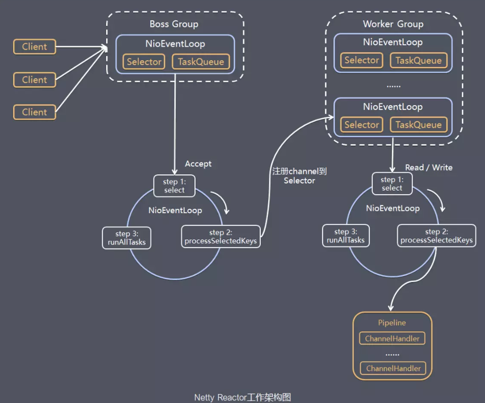

# Netty知识汇总
---


# 深入剖析：Netty为何是Java网络编程的性能之王？

在 Java 的中间件领域（如 Dubbo, RocketMQ, Zookeeper, Spark），Netty 几乎无处不在。当我们需要开发高性能、高并发的网络应用时，Netty 也是首选。

究竟是什么让 Netty 拥有如此惊人的吞吐量和极低的延迟？本文将从**IO 模型**、**内存管理**、**锁机制优化**等五个核心维度，揭秘 Netty 的高性能之道。


***

## 1. 核心引擎：异步事件驱动的 NIO 模型

Netty 的高性能首先建立在非阻塞 I/O（NIO）的基础之上，但它不仅仅是简单的 NIO 封装，而是实现了一个高效的 **Reactor 线程模型**。

### 1.1 传统 BIO 的痛点

在传统的 BIO（阻塞 I/O）模型中，每个连接都需要一个独立的线程来处理。当连接数达到数万时，线程上下文切换（Context Switch）的开销将耗尽 CPU 资源，系统瞬间崩溃。

### 1.2 Netty 的 Reactor 模式

Netty 采用了 **“主从 Reactor 多线程模型”**（Main-Sub Reactor），这也是它能轻松应对百万级并发的关键：

* **BossGroup (Main Reactor)**：专门负责“接待客人”。它只处理 OP_ACCEPT 事件（即连接请求）。一旦连接建立，它迅速将连接注册到 WorkerGroup 中的某个线程上，然后立刻返回去接收新的连接。
* **WorkerGroup (Sub Reactor)**：专门负责“服务客人”。它处理 OP_READ / OP_WRITE 事件。每个 Worker 线程都绑定了一个 Selector，并通过一个死循环（EventLoop）不断轮询其管理的所有连接是否有数据到达。

**性能优势**：

* **极少的线程数**：只需少量线程（通常为 CPU 核心数 \* 2）即可管理成千上万个连接。
* **非阻塞**：I/O 读写不再阻塞线程，CPU 利用率极大提高。

***

## 2. 极致的数据传输：Zero-Copy (零拷贝)

在网络传输中，“拷贝”是最昂贵的操作之一。Netty 在应用层和操作系统层都实现了“零拷贝”，将 CPU 从繁重的数据搬运中解放出来。

### 2.1 操作系统层面的零拷贝 (FileRegion)

当需要发送文件时（例如静态资源服务器），Netty 支持 FileRegion，底层调用 Java NIO 的 transferTo 方法（对应 Linux 的 sendfile 系统调用）。

* **传统方式**：硬盘 -> 内核缓冲 -> 用户缓冲 -> 内核 Socket 缓冲 -> 网卡。需要 4 次拷贝，4 次上下文切换。
* **Netty 方式**：硬盘 -> 内核缓冲 -> 网卡。**数据根本不经过 JVM 内存**，极大降低了 GC 压力和 CPU 开销。

### 2.2 Netty 应用层面的零拷贝 (CompositeByteBuf)

这是 Netty 的独门绝技。假设协议由 "Header" 和 "Body" 两部分组成：

* **普通做法**：创建一个新的大数组，将 Header 和 Body 拷贝进去。
* **Netty 做法**：使用 CompositeByteBuf。它像一个逻辑上的“视图”，将 Header 和 Body 的引用组合在一起。**物理上没有发生任何字节的复制**，但在逻辑上它就是一个完整的数据包。

### 2.3 Direct Memory (直接内存)

Netty 默认使用 DirectByteBuf。它直接在堆外（Native Memory）分配内存。

* **优势**：Socket 传输时，JVM 堆内存的数据通常需要先拷贝到堆外内存才能发送（因为 GC 可能会移动堆内对象）。使用 Direct Memory 省去了这“最后一步”的拷贝。

***

## 3. 内存管理的艺术：Jemalloc 算法与对象池

高并发下，频繁创建和销毁缓冲区（ByteBuf）会给 GC 带来巨大压力。Netty 引入了极为精细的内存管理机制。

### 3.1 内存池化 (PooledByteBufAllocator)

Netty 参考了 FreeBSD 的 **Jemalloc** 内存分配算法，实现了一个能够复用内存的分配器。

* 它预先申请一大块连续内存（Arena/Chunk），然后切分成小块（Page/SubPage）按需分配。
* 用完后的内存不会归还给 OS，而是放回池中，等待下一次分配。
* **结果**：对象创建几乎无开销，且极大减少了“内存碎片”。

### 3.2 引用计数 (Reference Counting)

为了配合内存池，Netty 对 ByteBuf 采用了手动管理生命周期的方式。通过 retain() 和 release() 显式控制引用计数，确保内存能被及时、安全地回收。

***

## 4. 无锁化设计 (Lock-Free)

并发编程中，锁是性能杀手。Netty 在设计上极力避免锁竞争。

### 4.1 串行化执行设计

Netty 的设计哲学是：**与其加锁，不如不共享**。\ 在一个 EventLoop（IO 线程）内，所有的 I/O 事件、定时任务、用户提交的异步任务，都是串行执行的。\ 这意味着在处理同一个 Channel 的业务逻辑时，你是**天然线程安全**的，完全不需要 synchronized。这种设计避免了大量的上下文切换和锁竞争。

### 4.2 专属的高性能数据结构

* **FastThreadLocal**：Netty 重新实现了 Java 的 ThreadLocal。标准的 ThreadLocal 使用哈希表（线性探测法）解决冲突，而 FastThreadLocal 直接使用数组下标索引，访问速度是 O(1)，且无哈希冲突。
* **MpscQueue**：Netty 的任务队列使用了 JCTools 提供的 MpscArrayQueue（Multi-Producer Single-Consumer），针对“多生产者-单消费者”场景进行了底层指令级别的优化，性能远超 JDK 的 LinkedBlockingQueue。

***

## 5. 总结：Netty 的性能金字塔

| **优化层级** | **关键技术** | **带来的价值** |
| :--- | :--- | :--- |
| **IO 模型** | NIO, Reactor 模式, Epoll 优化 | 解决 C10K/C100K 问题，支撑高并发 |
| **内存层** | Zero-Copy, Direct Memory | 减少 CPU 拷贝开销，降低 GC 压力 |
| **分配层** | Jemalloc, 对象池 (Recycler) | 内存分配速度极快，防止内存碎片 |
| **线程层** | 串行化设计, 无锁编程 | 消除上下文切换和锁竞争 |
| **微观层** | FastThreadLocal, 字节码优化 | 榨干 CPU 的每一个指令周期 |

Netty 之所以快，是因为它在每一个可能产生性能损耗的环节（IO、内存、线程、数据结构）都做到了极致。对于开发者而言，Netty 不仅是一个网络框架，更是一本写在代码里的“高性能 Java 编程教科书”。


# Netty的心跳机制怎么实现的

Netty 中的心跳机制通常用于保持客户端和服务器之间的长连接，以便在连接空闲一段时间后发送“心跳”消息来检测连接状态，避免连接意外断开。Netty 提供了一些工具和类来便捷地实现心跳机制。

以下是如何在 Netty 中实现心跳机制的详细步骤和示例代码：

### 步骤

1. **添加 IdleStateHandler**：\ Netty 提供的 IdleStateHandler 可以检测连接的空闲状态，根据设定的时间触发相应的事件。
2. **实现处理心跳事件的处理器**：\ 通过继承 ChannelInboundHandlerAdapter 或 ChannelDuplexHandler，处理 IdleStateEvent 事件，发送心跳消息或关闭连接。
3. **在 Pipeline 中添加处理器**：\ 将 IdleStateHandler 和自定义的心跳处理器添加到 ChannelPipeline 中。

### 示例代码

以下示例展示了如何实现一个简单的 Netty 心跳机制：

#### 服务端

```java
import io.netty.bootstrap.ServerBootstrap;
import io.netty.channel.ChannelInitializer;
import io.netty.channel.ChannelOption;
import io.netty.channel.ChannelPipeline;
import io.netty.channel.EventLoopGroup;
import io.netty.channel.nio.NioEventLoopGroup;
import io.netty.channel.socket.SocketChannel;
import io.netty.channel.socket.nio.NioServerSocketChannel;
import io.netty.handler.timeout.IdleStateHandler;

import java.util.concurrent.TimeUnit;

public class NettyServer {
    public static void main(String[] args) throws InterruptedException {
        // 创建 Boss 和 Worker 线程组
        // Boss 线程用于接收客户端的连接请求
        EventLoopGroup bossGroup = new NioEventLoopGroup(1);
        // Worker 线程用于处理每个连接的 I/O 读写操作
        EventLoopGroup workerGroup = new NioEventLoopGroup();

        try {
            // ServerBootstrap 用于启动 NIO 服务端
            ServerBootstrap b = new ServerBootstrap();
            b.group(bossGroup, workerGroup)
            .channel(NioServerSocketChannel.class) // 指定通道类型为 NIO
            .childHandler(new ChannelInitializer() { // 初始化每一个新连接的通道
                @Override
                public void initChannel(SocketChannel ch) {
                    ChannelPipeline p = ch.pipeline();
                    // 在管道中添加 IdleStateHandler 和自定义的心跳处理器
                    // IdleStateHandler 参数分别表示读空闲时间、写空闲时间和读写空闲时间
                    p.addLast(new IdleStateHandler(5, 0, 0, TimeUnit.SECONDS));
                    // 添加自定义的处理器，处理心跳事件
                    p.addLast(new ServerHeartbeatHandler);
                }
            })
            .childOption(ChannelOption.SO_KEEPALIVE, true); // 开启 TCP Keepalive 选项

            // 绑定端口并启动服务器
            b.bind(8080).sync().channel().closeFuture().sync();
        } finally {
            // 优雅地关闭线程组，释放资源
            workerGroup.shutdownGracefully();
            bossGroup.shutdownGracefully();
        }
    }
}

import io.netty.channel.ChannelHandlerContext;
import io.netty.channel.ChannelInboundHandlerAdapter;
import io.netty.handler.timeout.IdleStateEvent;
import io.netty.handler.timeout.IdleState;

public class ServerHeartbeatHandler extends ChannelInboundHandlerAdapter {
    @Override
    public void userEventTriggered(ChannelHandlerContext ctx, Object evt) throws Exception {
        // 检查是否是 IdleStateEvent 事件
        if (evt instanceof IdleStateEvent) {
            IdleStateEvent event = (IdleStateEvent) evt;
            if (event.state() == IdleState.READER_IDLE) { // 读空闲事件
                System.out.println("No read activity, sending heartbeat to client...");
                // 发送心跳消息到客户端
                ctx.writeAndFlush("HEARTBEAT");
            }
        }
    }

    @Override
    public void exceptionCaught(ChannelHandlerContext ctx, Throwable cause) {
        cause.printStackTrace();
        // 发生异常时关闭连接
        ctx.close();
    }
}
```

#### 客户端

```java
import io.netty.bootstrap.Bootstrap;
import io.netty.channel.ChannelInitializer;
import io.netty.channel.ChannelOption;
import io.netty.channel.EventLoopGroup;
import io.netty.channel.nio.NioEventLoopGroup;
import io.netty.channel.socket.SocketChannel;
import io.netty.channel.socket.nio.NioSocketChannel;
import io.netty.handler.timeout.IdleStateHandler;

import java.util.concurrent.TimeUnit;

public class NettyClient {
    public static void main(String[] args) throws InterruptedException {
        // 创建客户端线程组，只需一个线程组处理所有连接
        EventLoopGroup group = new NioEventLoopGroup();

        try {
            // Bootstrap 用于启动 NIO 客户端
            Bootstrap b = new Bootstrap();
            b.group(group)
            .channel(NioSocketChannel.class) // 指定通道类型为 NIO
            .handler(new ChannelInitializer() { // 初始化每一个新连接的通道
                @Override
                public void initChannel(SocketChannel ch) {
                    // 在管道中添加 IdleStateHandler 和自定义的心跳处理器
                    // IdleStateHandler 参数分别表示读空闲时间、写空闲时间和读写空闲时间
                    ch.pipeline().addLast(new IdleStateHandler(0, 0, 5, TimeUnit.SECONDS));
                    // 添加自定义的处理器，处理心跳事件
                    ch.pipeline().addLast(new ClientHeartbeatHandler());
                }
            })
            .option(ChannelOption.SO_KEEPALIVE, true); // 开启 TCP Keepalive 选项

            // 连接服务器并等待连接关闭
            b.connect("localhost", 8080).sync().channel().closeFuture().sync();
        } finally {
            // 优雅地关闭线程组，释放资源
            group.shutdownGracefully();
        }
    }
}

import io.netty.channel.ChannelHandlerContext;
import io.netty.channel.ChannelInboundHandlerAdapter;
import io.netty.handler.timeout.IdleStateEvent;
import io.netty.handler.timeout.IdleState;

public class ClientHeartbeatHandler extends ChannelInboundHandlerAdapter {
    @Override
    public void userEventTriggered(ChannelHandlerContext ctx, Object evt) throws Exception {
        // 检查是否是 IdleStateEvent 事件
        if (evt instanceof IdleStateEvent) {
            IdleStateEvent event = (IdleStateEvent) evt;
            if (event.state() == IdleState.ALL_IDLE) { // 读写空闲事件
                System.out.println("No write activity, sending heartbeat to server...");
                // 发送心跳消息到服务器
                ctx.writeAndFlush("HEARTBEAT");
            }
        }
    }

    @Override
    public void channelRead(ChannelHandlerContext ctx, Object msg) {
        // 接收并处理服务器发送的消息
        System.out.println("Received message: " + msg);
    }

    @Override
    public void exceptionCaught(ChannelHandlerContext ctx, Throwable cause) {
        cause.printStackTrace();
        // 发生异常时关闭连接
        ctx.close();
    }
}
```

### 代码解释

1. **服务端代码解释**：
   * ServerBootstrap：配置和启动 NIO 服务端。
   * NioServerSocketChannel：指定服务端的通道类型为 NIO。
   * IdleStateHandler：添加到 Pipeline 中，检测连接的空闲状态。这段代码中配置了 READ_IDLE 5 秒，即连接 5 秒未读取数据时触发空闲事件。
   * ServerHeartbeatHandler：自定义的处理器，处理空闲事件（心跳检测）。在发生读空闲事件时，发送心跳消息“HEARTBEAT”给客户端。遇到异常时关闭连接。
2. **客户端代码解释**：
   * Bootstrap：配置和启动 NIO 客户端。
   * NioSocketChannel：指定客户端的通道类型为 NIO。
   * IdleStateHandler：添加到 Pipeline 中，检测连接的空闲状态。配置了 ALL_IDLE 5 秒，即连接 5 秒既未读取也未写入数据时触发空闲事件。
   * ClientHeartbeatHandler：自定义的处理器，处理空闲事件（心跳检测）。在发生读写空闲事件时，发送心跳消息“HEARTBEAT”给服务器。处理服务器的心跳响应消息并打印。遇到异常时关闭连接。

通过以上代码示例和详细注释，您可以更好地理解 Netty 中心跳机制的实现方式。Netty 提供的 IdleStateHandler 非常便利，能够有效简化心跳检测的实现，确保连接在长时间闲置时保持活跃状态。


# Netty线上如何做性能调优

进行 Netty 程序的性能调优，可以从多个方面入手，包括线程模型、内存管理、数据压缩和连接管理等。以下是一些关键的性能调优策略和常见的坑：

### 1. 优化线程模型

#### 调优策略：

* **调整线程池的大小**：要确保线程池大小（NioEventLoopGroup）适合你的应用程序。通常，线程池大小为 CPU 核心数的 2 倍。
* **分开业务逻辑和 IO 线程**：将业务逻辑处理从 IO 处理线程池分离出来，避免阻塞 IO 线程。

**示例代码：**

```java
int bossGroupSize = Runtime.getRuntime().availableProcessors();
int workerGroupSize = bossGroupSize * 2;

EventLoopGroup bossGroup = new NioEventLoopGroup(bossGroupSize);
EventLoopGroup workerGroup = new NioEventLoopGroup(workerGroupSize);
```

#### 常见的坑：

* **线程池大小设置不当**：过大或过小的线程池会影响性能，导致 CPU 负载不均或过度切换。
* **阻塞 IO 线程**：避免在 IO 线程中执行耗时操作，如数据库查询或文件 I/O。

### 2. 内存管理

#### 调优策略：

* **使用池化内存分配**：启用 PooledByteBufAllocator 以提高内存分配效率。
* **减少对象创建和销毁**：尽量重用对象，减少垃圾回收的频率。

**示例代码：**

```java
ServerBootstrap b = new ServerBootstrap();
b.option(ChannelOption.ALLOCATOR, PooledByteBufAllocator.DEFAULT);
```

#### 常见的坑：

* **内存泄漏**：确保 ByteBuf 被正确释放，避免内存泄漏。
* **频繁的垃圾回收**：监控 GC 日志，避免频繁的 Full GC。

### 3. 数据压缩和编解码

#### 调优策略：

* **使用合适的编解码器**：选择高效的编解码器，如 Protobuf、JSON 等。
* **数据压缩**：对大数据块进行压缩，减少网络带宽消耗。

**示例代码：**

```java
pipeline.addLast("compressor", new JdkZlibEncoder(ZlibWrapper.GZIP));
pipeline.addLast("decompressor", new JdkZlibDecoder(ZlibWrapper.GZIP));
```

#### 常见的坑：

* **选择不当的编解码器**：不适合的数据格式会增加序列化和反序列化的开销。
* **过度压缩**：压缩和解压缩会消耗 CPU 资源，权衡压缩率和 CPU 开销。

### 4. 连接管理

#### 调优策略：

* **保持连接活跃**：使用心跳检测机制确保连接的长久性。
* **连接池化**：对于客户端，使用连接池来提高连接复用率。

**示例代码：**

```java
pipeline.addLast("idleStateHandler", new IdleStateHandler(60, 30, 0));
pipeline.addLast("heartbeatHandler", new HeartbeatHandler());
```

#### 常见的坑：

* **未处理的连接断开**：确保处理好连接断开和重新连接逻辑。

### 5. 调整 TCP 参数

#### 调优策略：

* **调整 TCP 缓冲区大小**：根据网络带宽和延迟，适当调整 SO_RCVBUF 和 SO_SNDBUF。
* **启用 TCP\_NODELAY**：在延迟敏感的场景下(比如实时聊天，金融融交易实时数据)，启用 TCP\_NODELAY 以禁用 Nagle 算法(Nagle 算法会导致小数据包被缓存，直到缓存区数据量达到一定大小后才会发送)。

**示例代码：**

```java
b.childOption(ChannelOption.SO_RCVBUF, 1024 * 1024);
b.childOption(ChannelOption.SO_SNDBUF, 1024 * 1024);
b.childOption(ChannelOption.TCP_NODELAY, true);
```

#### 常见的坑：

* **错误的缓冲区设置**：过大的缓冲区会增加内存消耗，过小的缓冲区会导致频繁的发送和接收。
* **误用 TCP\_NODELAY**：不在意延迟的场景下，不启用 TCP\_NODELAY 以避免额外的 CPU 开销。

####

####

### 6. 使用日志和监控

#### 调优策略：

* **使用日志和监控工具**：借助工具如 JMX、Grafana 和 Prometheus 监控应用性能。
* **配置合适的日志级别**：在生产环境下，避免过度的日志写操作。

**示例代码：**

```java
pipeline.addLast("logger", new LoggingHandler(LogLevel.INFO));
```

#### 常见的坑：

* **忽略监控数据**：未能及时发现和处理性能瓶颈。
* **过多的日志**：日志过多会影响应用性能。

### 综合示例

以下是一个综合的 ServerBootstrap 初始化示例，结合了多项调优策略：

```java
EventLoopGroup bossGroup = new NioEventLoopGroup(Runtime.getRuntime().availableProcessors());
EventLoopGroup workerGroup = new NioEventLoopGroup();
try {
    ServerBootstrap b = new ServerBootstrap();
    b.group(bossGroup, workerGroup)
    .channel(NioServerSocketChannel.class)
    .option(ChannelOption.SO_BACKLOG, 1024)
    .option(ChannelOption.ALLOCATOR, PooledByteBufAllocator.DEFAULT)
    .childOption(ChannelOption.SO_RCVBUF, 1024 * 1024)
    .childOption(ChannelOption.SO_SNDBUF, 1024 * 1024)
    .childOption(ChannelOption.TCP_NODELAY, true)
    .childHandler(new ChannelInitializer() {
        @Override
        protected void initChannel(SocketChannel ch) throws Exception {
            ChannelPipeline pipeline = ch.pipeline();
            pipeline.addLast("idleStateHandler", new IdleStateHandler(60, 30, 0));
            pipeline.addLast("compressor", new JdkZlibEncoder(ZlibWrapper.GZIP));
            pipeline.addLast("decompressor", new JdkZlibDecoder(ZlibWrapper.GZIP));
            pipeline.addLast("businessLogicHandler", new MyBusinessLogicHandler());
        }
    });

    ChannelFuture f = b.bind(8080).sync();
    f.channel().closeFuture().sync();
} finally {
    workerGroup.shutdownGracefully();
    bossGroup.shutdownGracefully();
}
```

通过针对 Netty 的特定需求，合理使用这些调优策略，可以显著提升 Netty 应用程序的性能和可靠性。同时，通过监控与日志分析，及时发现并解决问题，避免常见的坑。

###

```java
```


# Netty如何处理闲置连接

在 Netty 中，比如一个客户端连接长时间没有发送数据，这种闲置连接（idle connection）该如何监测并处理？Netty是通过 IdleStateHandler 来处理闲置连接的。IdleStateHandler 是一个 ChannelHandler，用于检测读、写或读写的空闲状态，并在空闲状态发生时触发 IdleStateEvent 事件。你可以通过捕获和处理这些事件来执行相应的操作，比如关闭闲置连接。

### 使用 IdleStateHandler 处理闲置连接

以下是如何使用 IdleStateHandler 处理闲置连接的步骤：

1. **添加\*\*\*\* ****IdleStateHandler**** \*\*\*\*到 ChannelPipeline**：

IdleStateHandler 的构造函数接受三个参数：读空闲时间、写空闲时间和读写空闲时间。你可以根据需要设置这些参数。

2. **捕获\*\*\*\* ****IdleStateEvent**** \*\*\*\*事件**：

创建一个自定义的 ChannelInboundHandler 来捕获 IdleStateEvent 事件，并在事件发生时执行相应的处理逻辑。

### 代码示例

以下是一个完整的示例，展示了如何在 Netty 中使用 IdleStateHandler 处理闲置连接：

#### 服务器端代码

1. **自定义处理器**：

```java
import io.netty.channel.ChannelHandlerContext;
import io.netty.channel.ChannelInboundHandlerAdapter;
import io.netty.handler.timeout.IdleState;
import io.netty.handler.timeout.IdleStateEvent;

public class MyIdleStateHandler extends ChannelInboundHandlerAdapter {
    @Override
    public void userEventTriggered(ChannelHandlerContext ctx, Object evt) throws Exception {
        if (evt instanceof IdleStateEvent) {
            IdleStateEvent event = (IdleStateEvent) evt;
            if (event.state() == IdleState.READER_IDLE) {
                System.out.println("读空闲超时，关闭连接");
                ctx.close();
            } else if (event.state() == IdleState.WRITER_IDLE) {
                System.out.println("写空闲超时");
            } else if (event.state() == IdleState.ALL_IDLE) {
                System.out.println("读写空闲超时");
            }
        } else {
            super.userEventTriggered(ctx, evt);
        }
    }
}
```

1. **初始化 ChannelPipeline**：

```java
import io.netty.channel.ChannelInitializer;
import io.netty.channel.socket.SocketChannel;
import io.netty.handler.timeout.IdleStateHandler;

public class MyChannelInitializer extends ChannelInitializer {
    @Override
    protected void initChannel(SocketChannel ch) throws Exception {
        ch.pipeline().addLast(new IdleStateHandler(60, 30, 0)); // 读超时60秒，写超时30秒
        ch.pipeline().addLast(new MyIdleStateHandler());
    }
}
```

1. **启动服务器**：

```java
import io.netty.bootstrap.ServerBootstrap;
import io.netty.channel.ChannelFuture;
import io.netty.channel.ChannelOption;
import io.netty.channel.nio.NioEventLoopGroup;
import io.netty.channel.socket.nio.NioServerSocketChannel;

public class NettyServer {
    public static void main(String[] args) throws Exception {
        NioEventLoopGroup bossGroup = new NioEventLoopGroup();
        NioEventLoopGroup workerGroup = new NioEventLoopGroup();
        try {
            ServerBootstrap b = new ServerBootstrap();
            b.group(bossGroup, workerGroup)
            .channel(NioServerSocketChannel.class)
            .childHandler(new MyChannelInitializer())
            .option(ChannelOption.SO_BACKLOG, 128)
            .childOption(ChannelOption.SO_KEEPALIVE, true);

            // 绑定端口，开始接收进来的连接
            ChannelFuture f = b.bind(8080).sync();

            // 等待服务器 socket 关闭
            f.channel().closeFuture().sync();
        } finally {
            workerGroup.shutdownGracefully();
            bossGroup.shutdownGracefully();
        }
    }
}
```

### 客户端代码

客户端代码类似于服务器端，只需要在客户端的 ChannelPipeline 中添加 IdleStateHandler 和自定义的处理器即可。

```java
import io.netty.bootstrap.Bootstrap;
import io.netty.channel.ChannelInitializer;
import io.netty.channel.ChannelOption;
import io.netty.channel.nio.NioEventLoopGroup;
import io.netty.channel.socket.SocketChannel;
import io.netty.channel.socket.nio.NioSocketChannel;
import io.netty.handler.timeout.IdleStateHandler;

public class NettyClient {
    public static void main(String[] args) throws Exception {
        NioEventLoopGroup group = new NioEventLoopGroup();
        try {
            Bootstrap b = new Bootstrap();
            b.group(group)
            .channel(NioSocketChannel.class)
            .option(ChannelOption.SO_KEEPALIVE, true)
            .handler(new ChannelInitializer() {
                @Override
                public void initChannel(SocketChannel ch) throws Exception {
                    ch.pipeline().addLast(new IdleStateHandler(0, 30, 0)); // 仅设置写超时
                    ch.pipeline().addLast(new MyIdleStateHandler());
                }
            });

            // 启动客户端
            ChannelFuture f = b.connect("localhost", 8080).sync();

            // 等待连接关闭
            f.channel().closeFuture().sync();
        } finally {
            group.shutdownGracefully();
        }
    }
}
```

### 总结

* **IdleStateHandler** 是 Netty 提供的处理闲置连接的工具。
* 通过在 ChannelPipeline 中添加 IdleStateHandler，可以检测读、写或读写空闲事件。
* 自定义处理器可以捕获 IdleStateEvent 事件，并执行相应的处理逻辑，如关闭闲置连接。
* 配置 IdleStateHandler 的读、写和读写空闲时间，可以灵活地应对不同的应用场景。

通过这些步骤，Netty 可以有效地监测并处理闲置连接，确保资源的合理利用和系统的稳定运行。


# Netty是如何实现零拷贝的

零拷贝（Zero-Copy）是一种优化技术，旨在减少或完全消除数据在内存中的复制过程，从而提高系统的性能和效率。在传统的数据传输过程中，数据可能会被多次复制，例如从磁盘到内核缓冲区，然后从内核缓冲区复制到用户缓冲区，再从用户缓冲区复制到另一块内存。这些多次复制不但浪费了 CPU 资源，还增加了内存带宽的使用。

### 零拷贝的工作原理

在实现零拷贝的过程中，数据不会在内存中被多次复制，而是直接从一个地址移动到另一个地址。常见的零拷贝技术包括：

1. **sendfile**** \*\*\*\*系统调用**：直接在内核空间中将文件数据发送到网络 socket。
2. **内存映射文件（Memory-Mapped Files）**：使用 mmap 系统调用将文件映射到内存空间，然后可以直接操作内存中的数据。
3. **DMA（直接内存访问）**：硬件级别的技术，允许设备直接访问主存而不需要通过 CPU。

### Netty 中如何实现零拷贝

Netty 通过多种机制来实现零拷贝，具体如下：

1. **FileRegion**** ****类和**** ****sendfile**** \*\*\*\*系统调用**：

FileRegion 是 Netty 提供的一个接口，代表一个文件区域。通过使用 FileRegion，Netty 可以直接将文件数据从文件系统发送到网络通道。在底层，Netty 利用了操作系统提供的 sendfile 系统调用，这个调用允许直接在内核空间传输文件数据到网络接口，不需要用户空间的中转。

```java
File file = new File("path/to/yourfile.txt");
RandomAccessFile raf = new RandomAccessFile(file, "r");
FileChannel fileChannel = raf.getChannel();

// 在 Netty 中发送文件
ChannelFuture future = channel.writeAndFlush(new DefaultFileRegion(fileChannel, 0, file.length()));
future.addListener((ChannelFutureListener) future -> {
    raf.close();
});
```

2. **CompositeByteBuf**：

CompositeByteBuf 是 Netty 中的一个组合缓冲区，它允许将多个 ByteBuf 实例组合成一个逻辑上的 ByteBuf 而不需要实际的数据复制。这在需要处理包含多个部分（比如头部和主体）的数据时特别有用。

```java
CompositeByteBuf compositeBuffer = Unpooled.compositeBuffer();
ByteBuf header = Unpooled.copiedBuffer("Header".getBytes(StandardCharsets.UTF_8));
ByteBuf body = Unpooled.copiedBuffer("Body".getBytes(StandardCharsets.UTF_8));

compositeBuffer.addComponents(header, body);
```

3. **缓冲区的切片（Slicing）和复制（Duplication）**：

ByteBuf 提供了切片和复制功能，这些功能允许创建共享同一内存区域的多个 ByteBuf 实例，从而避免不必要的数据拷贝。

```java
ByteBuf buf = Unpooled.copiedBuffer("Netty Zero-Copy Example".getBytes(StandardCharsets.UTF_8));

ByteBuf sliced = buf.slice(0, 5); // 创建一个切片，引用了相同的内存区域
ByteBuf duplicated = buf.duplicate(); // 创建一个副本，共享相同的内存区域
```

4. **包装现有的缓冲区（Wrapped Buffer）**：

可以通过 Unpooled.wrappedBuffer 方法将现有的数组或 ByteBuffer 包装成 ByteBuf ，而不需要进行数据的复制。

```java
byte[] array = new byte[1024];
ByteBuf wrappedBuffer = Unpooled.wrappedBuffer(array);
```

5. **直接内存（Direct Memory）**：

Netty 支持直接内存（Direct Memory），即使用 DirectByteBuf。直接内存缓冲区是分配在堆外内存的，可以直接被操作系统和硬件设备访问，避免了 JVM 堆和操作系统之间的数据复制。

```java
ByteBuf directBuffer = Unpooled.directBuffer(1024);
```

### 总结

零拷贝技术通过减少数据在内存中的复制过程，显著提高了数据传输的性能。Netty 通过一系列的机制，包括 sendfile 系统调用、CompositeByteBuf、缓冲区的切片和复制、包装现有的缓冲区、以及直接内存，来实现零拷贝。这些技术的结合，使得 Netty 成为一个高效且强大的网络编程框架，能够在高并发和大数据传输场景下表现出色。


# Netty的线程模型怎么设计的

Netty 的线程模型旨在高效地处理并发连接和请求，以优化网络应用程序的性能。其线程模型包括了多种优化技术，例如 **Reactor 模式、线程池和事件循环**等，用于在高负载下保持高效稳定的性能。下面详细介绍 Netty 的线程模型及其提升性能的方法。

### Netty 线程模型概述



### Netty 的线程模型

Netty 的线程模型由三类主要的线程组成：

1. **Boss 线程池（或 BossGroup）**
2. **Worker 线程池（或 WorkerGroup）**
3. **用户自定义线程**

#### 1. Boss 线程**池**

* **职责**：主要负责监听请求（如接收新连接）并将这些连接分发给 Worker 线程进行处理。
* **数量**：通常 Boss 线程组（NioEventLoopGroup）的线程数量为一个，处理所有的监听端口。

#### 2. Worker 线程**池**

* **职责**：负责处理 I/O 操作（如读写操作）的多线程池。Worker 线程从 Boss 线程那里接收到新的连接后，处理实际的数据读写、解码、编码等操作。
* **数量**：通常为 CPU 核心数的 2 倍，可以通过配置来调整。

#### 3. 用户自定义线程

* **职责**：用户可以根据需要定义自己的线程来处理业务逻辑，这些线程通常在 Handler 中异步执行耗时操作，以避免阻塞 Worker 线程。

### 示例代码：简单的 Netty 服务器线程模型

以下是一个简单的 Netty 服务器示例，展示了如何配置线程模型：

```java
public class NettyServer {

    public static void main(String[] args) throws InterruptedException {
        // 创建两个线程组：bossGroup 和 workerGroup
        EventLoopGroup bossGroup = new NioEventLoopGroup(1); // 接受连接请求
        EventLoopGroup workerGroup = new NioEventLoopGroup(); // 处理读写操作
        try {
            ServerBootstrap b = new ServerBootstrap(); // 服务端引导程序
            b.group(bossGroup, workerGroup)
            .channel(NioServerSocketChannel.class) // 使用 NIO 传输
            .childHandler(new ChannelInitializer() {
                @Override
                public void initChannel(SocketChannel ch) {
                    ch.pipeline().addLast(new SimpleChannelInboundHandler() {
                        @Override
                        protected void channelRead0(ChannelHandlerContext ctx, ByteBuf msg) {
                            System.out.println("Received data: " + msg.toString(CharsetUtil.UTF_8));
                            ctx.writeAndFlush(Unpooled.copiedBuffer("Hello, client!", CharsetUtil.UTF_8));
                        }
                    });
                }
            });

            // 绑定端口并启动服务器
            ChannelFuture f = b.bind(8080).sync();
            // 等待服务器套接字关闭
            f.channel().closeFuture().sync();
        } finally {
            // 优雅退出，释放线程池资源
            bossGroup.shutdownGracefully();
            workerGroup.shutdownGracefully();
        }
    }
}
```

在这个示例中：

* bossGroup 负责接受新连接。
* workerGroup 负责处理读写操作。
* ServerBootstrap 配置了通道类型、事件循环组和通道处理器。

### 提高性能的方法

Netty 通过以下方法来提高性能和扩展性：

1. **非阻塞 I/O 和事件驱动：**
   * Netty 基于 NIO（基于 NIO 的 Selector）实现非阻塞 I/O，通过事件驱动的方式来高效处理 I/O 事件。
   * 线程不会因为等待 I/O 操作完成而被阻塞，而是由事件循环（event loop）轮询 I/O 事件。
2. **事件循环（Event Loop）：**
   * Netty 的事件循环由一个或多个线程组成，当事件循环线程处理某一个连接时，不会被 I/O 操作阻塞。
   * 每个事件循环线程通过不断循环检查事件队列并执行相应的 I/O 操作，最大化 CPU 使用率。
3. **线程与通道的绑定：**
   * Netty 将每个 Channel 绑定到一个特定的事件循环线程上，这样避免了多线程竞争问题，简化了并发控制，降低了锁的使用，从而提高了性能。
4. **线程池复用：**
   * 通过线程池复用线程，避免了频繁创建销毁线程的开销，尤其是在高并发场景下，降低了系统资源的消耗，提高了响应速度。
5. **工作线程分离：**
   * 通过将连接管理和 I/O 操作分离到不同的线程中，使得各个部分能够独立伸缩和优化，避免单一线程成为系统瓶颈。

### 总结

Netty 的线程模型通过以下方式提高了性能：

* 利用 Reactor 模式进行异步和非阻塞 I/O 操作。
* 使用事件循环减少线程上下文切换和阻塞时间。
* 通过线程池复用、通道线程绑定等方式减少资源消耗和锁竞争。

这些机制使 Netty 能够高效处理大规模并发连接和请求，是其在高性能网络编程中广泛应用的基础。


# Netty的内存池机制怎样设计的

Netty 通过内存池机制来优化内存分配和回收过程，使得性能更加高效和稳定。Netty 的内存池机制主要依赖于 PooledByteBufAllocator 类，并结合了一些策略来实现高效的内存管理。以下是 Netty 内存池机制的详细介绍：

### 1. 内存池设计原则

* **内存重用**：通过重用内存，减少频繁的分配和回收操作，降低内存碎片和垃圾回收压力。
* **分级分配**：内存块按大小分级进行管理，较小的内存请求从小内存块分配，大的则从大内存块分配。
* **线程本地缓存（Thread-Local Cache）**：每个线程都有自己的内存缓存(用ThreadLocal实现)，从而减少多线程竞争，提高分配效率。

### 2. 核心组件及工作流程

#### Arena

Arena 是内存池的核心组件，它管理着内存的分配和释放。根据内存块的大小分为不同的子区域，包括小内存块（Tiny）、中等内存块（Small）和大内存块（Normal）。Arena 还包含了一组内存页（Page）和堆（Chunk），这些都是用于分配内存的基本单元。

#### PoolChunk 和 PoolSubpage

* **PoolChunk**：表示一大块内存，它被进一步划分为多个 PoolSubpage。
* **PoolSubpage**：表示较小的内存单元，用于分配细粒度的内存请求。

#### PoolThreadCache

PoolThreadCache 是每个线程私有的缓存，用于存储最近频繁使用的小内存块。这样可以避免线程间共享内存资源，减少竞争。

#### ByteBufAllocator

ByteBufAllocator 是用户与内存池交互的入口，Netty 提供了两个主要实现：PooledByteBufAllocator 和 UnpooledByteBufAllocator。前者采用内存池机制，后者则直接在堆内或堆外分配内存。

### 3. 内存分配流程

1. **请求大小**：当用户请求分配一定大小的内存时，首先判断请求的大小是否在缓存范围内（Tiny、Small）。
2. **线程本地缓存**：检查 PoolThreadCache 是否有可用的内存块。如果有，则直接从缓存中获取。
3. **Arena 分配**：如果线程本地缓存无法满足请求，则会从 Arena 中获取内存。根据请求大小选择合适的 Arena 子区域，并在其中分配内存。
4. **返回 ByteBuf**：最终返回用户一个 ByteBuf，它封装了实际的内存地址和操作接口。

### 4. 内存回收

当内存不再使用时，Netty 提供了几种方式来回收内存：

* **自动回收**：通过引用计数机制，当 ByteBuf 的引用计数为 0 时，自动回收内存。
* **显式回收**：用户可以调用 ByteBuf.release() 方法手动回收内存。

### 代码示例

以下是一个简单的例子，展示如何在 Netty 中使用 PooledByteBufAllocator 来分配和释放内存：

```java
import io.netty.buffer.ByteBuf;
import io.netty.buffer.PooledByteBufAllocator;

public class NettyMemoryPoolExample {

    public static void main(String[] args) {
        // 创建一个PooledByteBufAllocator实例
        PooledByteBufAllocator allocator = PooledByteBufAllocator.DEFAULT;

        // 分配一个100字节的ByteBuf
        ByteBuf byteBuf = allocator.buffer(100);

        try {
            // 使用ByteBuf进行数据操作
            byteBuf.writeBytes("Hello, Netty!".getBytes());
            System.out.println("ByteBuf content: " + byteBuf.toString());

            // 打印内存状态
            System.out.println("Allocator metrics: " + allocator.metric());

        } finally {
            // 释放ByteBuf
            byteBuf.release();
        }
    }
}
```

总结，Netty 的内存池机制通过 Arena、内存页、线程本地缓存等策略来高效管理内存，使得内存分配和回收更加快速和稳定，大大提高了网络应用的性能。


# Netty中用了哪些设计模式

Netty 作为一个高性能、异步事件驱动的网络框架，其实现中运用了多种设计模式，以提高代码复用性、可维护性以及系统的灵活性和可扩展性。下面列出了一些 Netty 中主要的设计模式及其实现：

### 1. 责任链模式（Chain of Responsibility）

Netty 的 ChannelPipeline 和 ChannelHandler 是责任链模式的典型实现。所有的 ChannelHandler 都链接在一个链中，每个 Handler 处理自己的部分，然后将事件传递到下一个 Handler。

**示例代码**：

```java
ChannelPipeline pipeline = channel.pipeline();
pipeline.addLast(new LoggingHandler(LogLevel.INFO));
pipeline.addLast(new HttpRequestDecoder());
pipeline.addLast(new HttpResponseEncoder());
pipeline.addLast(new MyBusinessLogicHandler());
```

### 2. 观察者模式（Observer Pattern）

Netty 的 Future 和 ChannelFutureListener 功能实现了观察者模式。当异步操作完成时，Future 通知所有的注册监听器。

**示例代码**：

```java
ChannelFuture future = channel.writeAndFlush(msg);
future.addListener(new ChannelFutureListener() {
    @Override
    public void operationComplete(ChannelFuture future) {
        if (future.isSuccess()) {
            System.out.println("Write successful");
        } else {
            System.err.println("Write failed");
            future.cause().printStackTrace();
        }
    }
});
```

### 3. Reactor 模式（Reactor Pattern）

Reactor 模式是 Netty 的核心，用于处理和分发 I/O 事件。Netty 的 EventLoopGroup 和 Channel 是这一模式的具体实现。

**示例代码**：

```java
EventLoopGroup bossGroup = new NioEventLoopGroup();
EventLoopGroup workerGroup = new NioEventLoopGroup();
ServerBootstrap b = new ServerBootstrap();
b.group(bossGroup, workerGroup)
.channel(NioServerSocketChannel.class)
.childHandler(new ChannelInitializer() {
    @Override
    protected void initChannel(SocketChannel ch) {
        ch.pipeline().addLast(new MyServerHandler());
    }
});
```

### 4. 工厂模式（Factory Pattern）

Netty 使用工厂模式来创建不同的 Channel 和 EventLoop 实例。例如，NioServerSocketChannel 和 NioEventLoopGroup 都是实现了相应接口的具体工厂类。

**示例代码**：

```java
EventLoopGroup group = new NioEventLoopGroup();
ServerBootstrap bootstrap = new ServerBootstrap();
bootstrap.group(group)
.channel(NioServerSocketChannel.class)
.childHandler(new ChannelInitializer() {
    @Override
    protected void initChannel(SocketChannel ch) {
        ch.pipeline().addLast(new MyServerHandler());
    }
});
```

### 5. 模板方法模式（Template Method Pattern）

Netty 中的 ChannelInitializer 类使用了模板方法模式。开发者可以通过继承 ChannelInitializer 类，并实现 initChannel 方法来配置自定义的 ChannelPipeline。

**示例代码**：

```java
public class MyChannelInitializer extends ChannelInitializer {
    @Override
    protected void initChannel(SocketChannel ch) {
        ch.pipeline().addLast(new MyHandler());
    }
}
```

### 6. 单例模式（Singleton Pattern）

Netty 中的一些核心组件，如 PooledByteBufAllocator 使用了单例模式，以确保全局范围内只存在一个实例，并且可以高效地进行内存分配。

**示例代码**：

```java
ByteBufAllocator allocator = PooledByteBufAllocator.DEFAULT;
ByteBuf buffer = allocator.buffer();
```

### 7. 装饰者模式（Decorator Pattern）

ChannelHandler 的装饰链实际上也是装饰者模式的一个典型实现。每个 ChannelHandler 可以在处理数据之前或之后添加一些附加的功能，而不用修改其他的处理器。

**示例代码**：

```java
ChannelPipeline pipeline = channel.pipeline();
pipeline.addLast("decoder", new MyDecoder());
pipeline.addLast("encoder", new MyEncoder());
pipeline.addLast("handler", new MyBusinessLogicHandler());
```

这些设计模式在 Netty 中被有机结合使用，使得 Netty 成为一个功能强大、灵活且高性能的网络通信框架。通过这些设计模式，Netty 能够更好地应对不同的应用场景和需求，提高开发效率与代码质量。


# Netty的ByteBuf与ByteBuffer相比的优势

ByteBuf 是 Netty 提供的一个用于字节数据操作的缓冲区。它解决了 ByteBuffer 的诸多局限性，提供了更加灵活、高效的内存管理功能，并且支持多种操作方式，适用于复杂网络编程场景。

### ByteBuf 与 ByteBuffer 相比的优势

1. **读写指针分离**
   * ByteBuffer 只有一个指针，当从写模式切换到读模式时，需要显式调用 flip() 方法。而 ByteBuf 拥有独立的 readerIndex 和 writerIndex，不用显式转换读写模式，读取和写入间的操作非常直观。
   * **示例代码：**

```java
ByteBuf byteBuf = Unpooled.buffer(256);
byteBuf.writeInt(42); // 写入数据
int value = byteBuf.readInt(); // 随时可以读取数据，无需flip()
```

2. **容量自动扩展**
   * ByteBuffer 的容量是固定的，超出容量时需要手动创建新的缓冲区并迁移数据。而 ByteBuf 的容量可以自动扩展，便于处理未知大小的数据流。
   * **示例代码：**

```java
ByteBuf byteBuf = Unpooled.buffer(256);
for (int i = 0; i ByteBuf 提供了池化机制，通过 PooledByteBufAllocator 实现对缓冲区的重用，减少内存分配和回收的开销。这对于性能要求高的应用非常重要。
   * **示例代码：**

```java
ByteBufAllocator allocator = PooledByteBufAllocator.DEFAULT;
ByteBuf pooledBuf = allocator.buffer(256); // 从池中获取缓冲区
```

4. **更丰富的API**
   * ByteBuf 提供了更多的操作方法，如随机访问、标记恢复读写指针、多种数据类型读写等，极大地方便了编程。
   * **示例代码：**

```java
ByteBuf byteBuf = Unpooled.buffer(256);
byteBuf.writeInt(42);
byteBuf.markReaderIndex();
int value = byteBuf.readInt();
byteBuf.resetReaderIndex(); // 恢复到标记的读指针位置
```

### 示例代码：将ByteBuf与ByteBuffer进行比较

```java
public class ByteBufVsByteBuffer {

    public static void main(String[] args) {
        // 使用ByteBuffer进行简单数据操作
        ByteBuffer byteBuffer = ByteBuffer.allocate(256);
        byteBuffer.putInt(42);   // 写入数据
        byteBuffer.flip();       // 必须调用flip()切换到读模式
        int value = byteBuffer.getInt();
        System.out.println("ByteBuffer value: " + value);

        // 使用ByteBuf进行相同的数据操作
        ByteBuf byteBuf = Unpooled.buffer(256);
        byteBuf.writeInt(42);    // 直接写入数据
        value = byteBuf.readInt(); // 直接读取数据，无需flip()
        System.out.println("ByteBuf value: " + value);

        // 输出
        // ByteBuffer value: 42
        // ByteBuf value: 42
    }
}
```

从代码可以看出，ByteBuf 在使用上更加简洁和灵活，避免了 ByteBuffer 中的一些繁琐步骤，如 flip() 的调用。此外，ByteBuf 多样的功能和高效的内存管理令人更加得心应手，特别是对高性能网络编程要求较高的场景。

### 结论

综上所述，ByteBuf 不仅解决了 ByteBuffer 的一些局限，还提供了许多高级功能，如读写指针分离、自动容量扩展和池化机制等，使其成为高性能网络编程的理想选择。希望这些解释能够帮助你更好地理解 ByteBuf 及其优势。

```java
```


# Netty如何处理粘包与拆包

在网络编程中，粘包和拆包是常见的问题，特别是在使用TCP协议进行通讯时。Netty作为一个高性能的网络框架，提供了多种方法来处理粘包和拆包问题。

### 什么是粘包和拆包

* **粘包**：指的是发送方将几段数据连续发送到网络中，接收方将若干段数据粘合在一起作为一次接收到的数据。
* **拆包**：指的是发送方一次性发送的数据由于某种原因被分成了多次发送，接收方在接收时将这些数据分成了若干次接收。

### 处理粘包和拆包的方法

Netty提供了一系列的ByteToMessageDecoder的具体实现类来解决粘包和拆包问题，包括但不限于以下几种方法：

1. **固定长度的帧解码器（FixedLengthFrameDecoder）**

这种方法适用于消息长度固定的场景。解码器会按照指定的长度来截取数据，从而避免粘包和拆包问题。

```java
ChannelPipeline pipeline = ...
pipeline.addLast(new FixedLengthFrameDecoder(10)); // 每个帧长度为10字节
```

2. **行分隔符解码器（LineBasedFrameDecoder）**

这种方法适用于以特定字符（如换行符）为分隔符的场景。解码器会在检测到分隔符时将数据截取出来。

```java
ChannelPipeline pipeline = ...
pipeline.addLast(new LineBasedFrameDecoder(1024)); // 设置单行最大长度为1024，如果超过这个长度且没有找到分隔符，将抛出 TooLongFrameException。
```

3. **分隔符解码器（DelimiterBasedFrameDecoder）**

这种方法适用于使用特定分隔符来标志消息边界的场景。可以自定义分隔符，如换行符、空格等。

```java
ChannelPipeline pipeline = ...
ByteBuf delimiter = Unpooled.copiedBuffer("||".getBytes());
pipeline.addLast(new DelimiterBasedFrameDecoder(1024, delimiter));
```

4. **基于长度的帧解码器（LengthFieldBasedFrameDecoder）**

这种方法适用于消息包含长度字段的场景。解码器通过读取长度字段的值来确定每个消息的边界。

```java
ChannelPipeline pipeline = ...
pipeline.addLast(new LengthFieldBasedFrameDecoder(
    1024, 0, 4, 0, 4)); // maxFrameLength, lengthFieldOffset, lengthFieldLength, lengthAdjustment, initialBytesToStrip
//maxFrameLength：消息帧的最大长度。如果接收到的消息帧长度超过这个值，将抛出 TooLongFrameException。
//lengthFieldOffset：长度字段的偏移量，即长度字段在消息中的起始位置。
//lengthFieldLength：长度字段的字节数，常见的值有 1、2、4、8。
//lengthAdjustment：长度调整值，用于修正长度字段的值。如果长度字段包含了消息头的长度，则需要减去消息头的长度。
//initialBytesToStrip：解码后需要跳过的字节数，通常用于跳过消息头。

```

### 具体示例

下面是一个示例，展示了如何使用LengthFieldBasedFrameDecoder和自定义解码器来处理粘包和拆包问题。

假设我们定义了一种协议，每条消息的前4个字节表示消息的长度，接下来的字节表示实际的消息内容。

#### 编码器和解码器

```java
// 解码器
public class CustomDecoder extends ByteToMessageDecoder {
    @Override
    protected void decode(ChannelHandlerContext ctx, ByteBuf in, List out) throws Exception {
        if (in.readableBytes()  {
    @Override
    protected void encode(ChannelHandlerContext ctx, String msg, ByteBuf out) throws Exception {
        byte[] bytes = msg.getBytes(StandardCharsets.UTF_8);
        int length = bytes.length;

        out.writeInt(length);   // 写入长度字段
        out.writeBytes(bytes);  // 写入内容
    }
}
```

#### 设置ChannelPipeline

```java
public class MyChannelInitializer extends ChannelInitializer {
    @Override
    protected void initChannel(SocketChannel ch) throws Exception {
        ChannelPipeline pipeline = ch.pipeline();
        pipeline.addLast(new LengthFieldBasedFrameDecoder(1024, 0, 4, 0, 4));
        pipeline.addLast(new CustomDecoder());
        pipeline.addLast(new CustomEncoder());
        pipeline.addLast(new MyBusinessLogicHandler());
    }
}
```

### 总结

* Netty 提供了一系列的解码器，如FixedLengthFrameDecoder、LineBasedFrameDecoder、DelimiterBasedFrameDecoder和LengthFieldBasedFrameDecoder，以处理粘包和拆包问题。
* 你可以根据你的具体需求选择合适的解码器，也可以自定义自己的解码器。
* 通过合理配置ChannelPipeline，可以高效地解决TCP通信中的粘包和拆包问题。

这些处理方法结合了Netty强大的内存管理和高效的网络IO，使得Netty在处理高并发网络通信时表现出色。


# Netty中无锁串行化是怎么设计的

Netty 的无锁串行化设计是其高性能和高并发处理能力的核心之一。无锁串行化设计的主要思想是每条连接对应一个独立的 ChannelPipeline，每个 ChannelPipeline 在特定的 EventLoop 中运行，该 EventLoop 在单一线程中处理所有事件。这种设计避免了多线程竞争和锁的开销，从而提高了系统的吞吐量和响应性能。

### 无锁串行化设计的核心

1. **每个 Channel 绑定到一个特定的 EventLoop**: 事件循环负责处理该 Channel 的所有事件（如读、写、连接等），确保同一个 Channel 的操作总是在同一个线程中执行。
2. **事件队列**: EventLoop 拥有一个事件队列，将所有事件提交到该队列中进行处理。
3. **任务调度**: EventLoop 的单线程模型会依次处理事件队列中的任务，从而避免了多线程竞争。

这种模型下，由于每个 Channel 的操作在其事件循环（单线程）中串行化执行，消除了多线程操作同一资源所需的锁和同步机制，降低了并发处理的复杂性。

### 代码示例

下面的代码展示了 Netty 的无锁串行化设计的基本思路：

```plain
import io.netty.bootstrap.ServerBootstrap;
import io.netty.channel.ChannelInitializer;
import io.netty.channel.ChannelOption;
import io.netty.channel.EventLoopGroup;
import io.netty.channel.nio.NioEventLoopGroup;
import io.netty.channel.socket.SocketChannel;
import io.netty.channel.socket.nio.NioServerSocketChannel;

public class NettyServer {
    public static void main(String[] args) throws Exception {
        // 创建事件循环组
        EventLoopGroup bossGroup = new NioEventLoopGroup(); // boss 线程组，用于接受连接
        EventLoopGroup workerGroup = new NioEventLoopGroup(); // worker 线程组，用于处理读写操作

        try {
            // 创建服务器启动类
            ServerBootstrap b = new ServerBootstrap();
            b.group(bossGroup, workerGroup)
                    .channel(NioServerSocketChannel.class)
                    .option(ChannelOption.SO_BACKLOG, 128)
                    .childOption(ChannelOption.SO_KEEPALIVE, true)
                    .childHandler(new ChannelInitializer() {
                        @Override
                        protected void initChannel(SocketChannel ch) throws Exception {
                            // 为每个已接受的连接创建一个新的 ChannelPipeline
                            ch.pipeline().addLast(new MyChannelHandler());
                        }
                    });

            // 绑定端口，开始接收连接
            b.bind(8080).sync().channel().closeFuture().sync();
        } finally {
            // 优雅地关闭事件循环组
            workerGroup.shutdownGracefully();
            bossGroup.shutdownGracefully();
        }
    }
}

class MyChannelHandler extends io.netty.channel.ChannelInboundHandlerAdapter {
    @Override
    public void channelRead(io.netty.channel.ChannelHandlerContext ctx, Object msg) throws Exception {
        // 这里的操作在同一个 EventLoop 的同一个线程中执行，保证了无锁串行化
        System.out.println("Received message: " + msg);
        ctx.writeAndFlush(msg);
    }

    @Override
    public void exceptionCaught(io.netty.channel.ChannelHandlerContext ctx, Throwable cause) throws Exception {
        cause.printStackTrace();
        ctx.close();
    }
}
```

### 关键点解释

1. **事件循环组 (EventLoopGroup)**: 包含多个 EventLoop，每个 EventLoop 负责处理多个 Channel 的 I/O 操作，但一个 Channel 只会被一个 EventLoop 处理。 NioEventLoopGroup 是其实现，用于处理基于 NIO 的 Channel。
2. **ChannelPipeline 和 ChannelHandler**: initChannel 方法为每个新接入的连接（Channel）创建一个 ChannelPipeline，并将 MyChannelHandler 加入其中。MyChannelHandler 中的操作将在同一个线程（同一个 EventLoop）中执行，确保了无锁串行化。
3. **无锁串行化的实现**: 由于 Netty 确保了每个 Channel 的所有 I/O 操作都由同一个 EventLoop 处理，并且是串行执行的，因此不需要使用锁机制来保证线程安全。

这种设计极大地简化了并发编程的复杂性，在高并发环境下提升了系统的性能和可扩展性。

