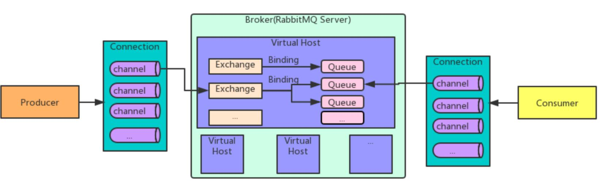
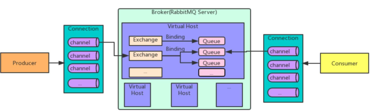

# RabbitMQ知识汇总
---


# RabbitMQ面试题合集

# RabbitMQ交换机类型
## direct(**直连交换机**)
作为**默认**交换机。路由键与队列名完全匹配交换机，此种类型交换机，通过RoutingKey路由键将交换机和队列进行绑定， 消息被发送到exchange时，需要根据消息的RoutingKey，来进行匹配，只将消息发送到完全匹配到此RoutingKey的队列。

比如：如果一个队列绑定到交换机要求路由键为“**key**”，则只转发RoutingKey标记为“key”的消息，不会转发"key1"，也不会转发“key.1”等等。它是完全匹配、单播的模式

[画板]

	同一个key可以绑定多个queue队列；当匹配到key1时，queue1和queue2都可以收到消息

## fanout(**扇型交换机，广播**)
Fanout，扇出类型交换机，此种交换机，会将消息分发给所有绑定了此交换机的队列，此时RoutingKey参数无效。

[画板]

fanout类型交换机下发送消息一条，无论RoutingKey是什么，直接**广播消息**，queue1,queue2,queue3,queue4都可以收到消息

## topic(**主题交换机**)
Topic，主题类型交换机，此种交换机与Direct类似，也是需要通过routingkey路由键进行匹配分发，区别在于Topic可以进行模糊匹配，Direct是完全匹配。

1. Topic中，将routingkey通过"."来分为多个部分
2. "*"：代表一个部分
3. "#"：代表0个或多个部分(如果绑定的路由键为 "#" 时，则接受所有消息，因为路由键所有都匹配)

[画板]

然后发送一条信息，routingkey为"key1.key2.key3.key4"，那么根据"."将这个路由键分为了4个部分，此条路由键，将会匹配：

1. key1.key2.key3.*：成功匹配，因为 * 可以代表一个部分
2. key1.# ：成功匹配，因为#可以代表0或多个部分
3. *.key2.*.key4： 成功匹配，因为第一和第三部分分别为key1和key3，且为4个部分，刚好匹配
4. #.key3.key4：成功匹配，#可以代表多个部分，正好匹配中了我们的key1和key2

如果发送消息routingkey为"key1"，那么将只能匹配中key1.#，#可以代表0个部分

## headers(**头部交换机**)
headers 匹配 AMQP 消息的 header 而不是路由键，此外 headers 交换器和 direct 交换器完全一致，但性能差很多，目前几乎用不到了

消费方指定的headers中必须包含一个"x-match"的键。

键"x-match"的值有2个

1. x-match = all ：表示所有的键值对都匹配才能接受到消息
2. x-match = any ：表示只要有键值对匹配就能接受到消息

[画板]

发送消息时间，如果其他参数信息是{ "name":"TianMingXX", "sex":"男" }，因为queue2的x-match是any，只需要有一个键值对匹配所以就能接收到消息，所以queue2可以接收到消息；queue1的x-match是all，需要所有的键值对都匹配才能接收到消息，所以此时queue1接收不到消息

# RabbitMQ架构设计
RabbitMQ 是一个开源的消息中间件，采用 AMQP（高级消息队列协议）进行消息传递。它允许应用程序之间进行异步通信，提供了一种高效、可扩展、可靠的消息传递机制。

以下是 RabbitMQ 的基本架构设计：



1. **生产者（Producer）：** 生产者是消息的发送方，负责产生并发送消息到 RabbitMQ。生产者通常将消息发送到交换机（Exchange）。
2. **交换机（Exchange）：** 交换机是消息的分发中心，负责将接收到的消息路由到一个或多个队列。它定义了消息的传递规则，可以根据规则将消息发送到一个或多个队列。
    - **直连交换机（Direct Exchange）：** 将消息路由到与消息中的路由键（Routing Key）完全匹配的队列。
    - **主题交换机（Topic Exchange）：** 根据通配符匹配路由键，将消息路由到一个或多个队列。
    - **扇出交换机（Fanout Exchange）：** 将消息广播到所有与交换机绑定的队列，忽略路由键。
    - **头部交换机（Headers Exchange）：** 根据消息头中的属性进行匹配，将消息路由到与消息头匹配的队列。
3. **队列（Queue）：** 队列是消息的存储区，用于存储生产者发送的消息。消息最终会被消费者从队列中取出并处理。每个队列都有一个名称，并且可以绑定到一个或多个交换机。
4. **消费者（Consumer）：** 消费者是消息的接收方，负责从队列中获取消息并进行处理。消费者通过订阅队列来接收消息。
5. **绑定（Binding）：** 绑定是交换机和队列之间的关联关系。生产者将消息发送到交换机，而队列通过绑定与交换机关联，从而接收到消息。
6. **虚拟主机（Virtual Host）：** 虚拟主机是 RabbitMQ 的基本工作单元，每个虚拟主机拥有自己独立的用户、权限、交换机、队列等资源，完全隔离于其他虚拟主机。
7. **连接（Connection）：** 连接是指生产者、消费者与 RabbitMQ 之间的网络连接。每个连接可以包含多个信道（Channel），每个信道是一个独立的会话通道，可以进行独立的消息传递。
8. **消息：** 消息是生产者和消费者之间传递的数据单元。消息通常包含消息体和可选的属性，如路由键等。

RabbitMQ 的架构设计允许多个生产者、多个消费者之间通过消息队列进行松耦合的通信，提高了系统的可伸缩性和可维护性。通过灵活配置交换机和队列，可以实现多种消息传递模式，满足不同应用场景的需求

# RabbitMQ如何保证消息不丢失
## 丢失原因分析
观察整个 RabbitMQ 消息发送过程：



从上述流程我们可以得知：消息从生产者到达消费者，经过两次网络传输，并且在 RabbitMQ 服务器中进行路由。

因此我们能知道整个流程中可能会出现三种消息丢失场景：

+ 生产者发送消息到 RabbitMQ 服务器的过程中出现消息丢失。 可能是网络波动未收到消息，又或者是服务器宕机。
+ RabbitMQ 服务器消息持久化出现消息丢失。 消息发送到 RabbitMQ 之后，未能及时存储完成持久化，RabbitMQ 服务器出现宕机重启，消息出现丢失。
+ 消费者拉取消息过程以及拿到消息后出现消息丢失。 消费者从 RabbitMQ 服务器获取到消息过程出现网络波动等问题可能出现消息丢失；消费者拿到消息后但是消费者未能正常消费，导致丢失，可能是消费者出现处理异常又或者是消费者宕机。

针对上述三种消息丢失场景，RabbitMQ 提供了相应的解决方案，confirm 消息确认机制（生产者），消息持久化机制（RabbitMQ 服务），ACK 事务机制（消费者）

## 解决方案
### confirm 消息确认机制（生产者）
Confirm 模式是 RabbitMQ 提供的一种消息可靠性保障机制。当生产者通过 Confirm 模式发送消息时，它会等待 RabbitMQ 的确认，确保消息已经被正确地投递到了指定的 Exchange 中。

消息正确投递到 queue 时，会返回 ack。

消息没有正确投递到 queue 时，会返回 nack。如果 exchange 没有绑定 queue，也会出现消息丢失。

**使用方法：**

+ 生产者通过 **confirm.select** 方法将 Channel 设置为 Confirm 模式。
+ 发送消息后，通过添加 **add_confirm_listener** 方法，监听消息的确认状态。

附源码：

```java
1.开启消息确认机制
spring:
  rabbitmq:
        # 开启消息确认机制
    publisher-confirms: true
    # 消息在未被队列收到的情况下返回
    #publisher-returns: true
    #publisher-confirm-type: correlated

2.消息未接收时调用ReturnCallback
rabbitTemplate.setMandatory(true);

3.生产者投递消息
@Service
public class ConfirmProvider implements RabbitTemplate.ConfirmCallback,RabbitTemplate.ReturnCallback {
@Autowired
    RabbitTemplate rabbitTemplate;
@PostConstruct
    public void init() {
        rabbitTemplate.setReturnCallback(this);
        rabbitTemplate.setConfirmCallback(this);
    }
@Override
    public void confirm(CorrelationData correlationData, boolean ack, String cause) {
        if(ack){
            System.out.println("确认了这条消息："+correlationData);
        }else{
            System.out.println("确认失败了："+correlationData+"；出现异常："+cause);
        }
    }
@Override
    public void returnedMessage(Message message, int replyCode, String replyText, String exchange, String routingKey) {
        System.out.println("这条消息发送失败了"+message+",请处理");
    }
public void publisMessage(String message){
        rabbitTemplate.setMandatory(true);
        rabbitTemplate.convertAndSend("javatrip",message);
    }
}

4.如果消息确认失败后，我们可以进行消息补偿，也就是消息的重试机制。当未收到确认信息时进行消息的重新投递。设置如下配置即可完成。
spring:
  rabbitmq:
    # 支持消息发送失败后重返队列
    publisher-returns: true
    # 开启消息确认机制
    # publisher-confirm-type: correlated
    listener:
      simple:
        retry:
          # 开启重试
          enabled: true
          # 最大重试次数
          max-attempts: 5
          # 重试时间间隔
```

### 消息持久化机制（RabbitMQ 服务）
持久化机制是指将消息存储到磁盘，以保证在 RabbitMQ 服务器宕机或重启时，消息不会丢失。

**使用方法：**

+ 生产者通过将消息的 **delivery_mode** 属性设置为 2(SpringBoot中deliveryMode默认为MessageDeliveryMode.PERSISTENT 等于2)，将消息标记为持久化。
+ 队列也需要进行持久化设置，确保队列在 RabbitMQ 服务器重启后仍然存在。需要将**durable**属性设置为true，且需配合autoDelete设置为false

**注意事项：**

+ 持久化机制会影响性能，因此在需要确保消息不丢失的场景下使用。

附源码：

```java
@Queue(value = "TianMingQ",durable = "true",autoDelete = "false")   //或者注入时
return new Queue("TianMingQ", true, false, false, map);
```

### ACK 事务机制（消费者）
ACK 事务机制用于确保消息被正确消费。当消息被消费者成功处理后，消费者发送确认（ACK）给 RabbitMQ，告知消息可以被移除。这个过程是自动处理的，也可以关闭进行手工发送 ACK。

**使用方法：**

+ 在 RabbitMQ 中，ACK 机制默认是开启的。当消息被消费者接收后，会立即从队列中删除，除非消费者发生异常。
+ 可以手动开启 ACK 机制，通过将 **auto_ack** 参数设置为 **False**，手动控制消息的 ACK （acknowledge-mode: manual）。

**注意事项：**

+ ACK 机制可以确保消息不会被重复处理，但如果消费者发生异常或者未发送 ACK，消息可能会被重复投递。

附源码：

```java
1.修改yml为手动签收模式
spring:
  rabbitmq:
    listener:
      simple:
        # 手动签收模式
        acknowledge-mode: manual
        # 每次签收一条消息
        prefetch: 1

2.消费者手动签收
@Component
@RabbitListener(queuesToDeclare = @Queue(value = "TianMingQ", durable = "true"))
public class SecondConsumer {
@RabbitHandler
    public void receive(String message, @Headers Map headers, Channel channel) throws Exception{
System.out.println(message);
        // 唯一的消息ID
        Long deliverTag = (Long) headers.get(AmqpHeaders.DELIVERY_TAG);
        // 确认该条消息
        if(...){
            channel.basicAck(deliverTag,false);
        }else{
            // 消费失败，消息重返队列
            channel.basicNack(deliverTag,false,true);
        }

    }
```

当然上面确保不丢失，会自动重试，可能会造成重复消费问题。具体处理可往下看第5点。

# RabbitMQ中如何解决消息堆积问题
### 
## 消息堆积原因
[画板]

## 解决方案
1. **消费者处理消息的速度太慢**
    - **增加消费者数量**：通过水平扩展，增加消费者的数量来提高处理能力。
    - **优化消费者性能**：提高消费者处理消息的效率，例如优化代码、增加资源。
    - **消息预取限制(prefetch count)**：调整消费者的预取数量以避免一次处理过多消息而导致处理缓慢。
2. **队列的容量太小**
    - **增加队列的容量**：调整队列设置以允许更多消息存储。
3. **网络故障**
    - **监控和告警**：通过监控网络状况并设置告警，确保在网络故障时快速发现并解决问题。
    - **持久化和高可用性**：确保消息和队列的持久化以避免消息丢失，并使用镜像队列提高可用性。
4. **消费者故障**
    - **使用死信队列**：将无法处理的消息转移到死信队列，防止堵塞主队列。
    - **容错机制**：实现消费者的自动重启和错误处理逻辑。
5. **队列配置不当**
    - **优化队列配置**：检查并优化消息确认模式、队列长度限制和其他相关配置。
6. **消息大小**
    - **消息分片**：将大型消息分割成小的消息片段，加快处理速度。
7. **业务逻辑复杂或耗时**
    - **优化业务逻辑**：简化消费者中的业务逻辑，减少处理每个消息所需的时间。
8. **消息产生速度快于消费速度**
    - **使用消息限流**：控制消息的生产速度，确保它不会超过消费者的处理能力。
    - **负载均衡**：确保消息在消费者之间公平分配，避免个别消费者过载。
9. **其他配置优化**
    - **消息优先级**：使用消息优先级确保高优先级消息优先处理。
    - **调整RabbitMQ配置**：优化RabbitMQ服务的配置，如文件描述符限制、内存使用限制等。

# RabbitMQ中如何保证消息不被重复消费
## 什么情况会导致消息被重复消费呢
1. 生产者：生产者可能会重复推送一条数据到 MQ 中，比如 Controller 接口被重复调用了 2 次，没有做接口幂等性导致的；
2. MQ：在消费者消费完准备响应 ack 消息消费成功时，MQ 突然挂了，导致 MQ 以为消费者还未消费该条数据，MQ 恢复后再次推送了该条消息，导致了重复消费。
3. 消费者：消费者已经消费完消息，正准备但是还未响应给ack消息到时，此时消费者挂了，服务重启后 MQ 以为消费者还没有消费该消息，再次推送了该条消息。

[画板]

## 解决方案
## 使用数据库唯一键约束
缺点：局限性很大，**仅仅只能用在我们数据新增场景**，并且性能也比较低

## 使用乐观锁
假设是更新订单状态，**在发送的消息的时候带上修改字段的版本号**

缺点：如果说更新字段比较多，并且更新场景比较多，可能会导致数据库字段增加并且还有可能出现多条消息同时在队列中此时他们修改字段版本号一致，排在后续的消息无法被消费

## 简单的消息去重，插入消费记录，增加数据库判断
[画板]

优点：很多场景下的确能起到不错的效果

缺点：

1. 这个消费者的代码执行需要1秒，重复消息在执行期间（假设100毫秒）内到达（例如生产者快速重发，Broker重启等），增加校验的地方是不是还是没数据（因为上一条消息还没消费完，没有记录）
2. 那么就会穿透掉检查的挡板，最后导致重复的消息消费逻辑进入到非幂等安全的业务代码中，从而引发重复消费的问题

## 并发消息去重基于消息幂等表
[画板]

+ 缺点：如果说第一次消息投递异常没有消费成功，并且没有将消息状态给置为成功或者没有删除消息表记录，此时延时消费每次执行下列都是一直处于消费中，最后消费就会被视为消费失败而被投递到死信Topic中
+ 方案：插入的消息表必须要带一个最长消费过期时间，例如10分钟

[画板]

+ 上述方案只需要一个存储的中心媒介，那我们可以选择更灵活的存储中心媒介，比如Redis。使用Redis有两个好处：
    - 性能上损耗更低
    - 上面我们讲到的超时时间可以直接利用Redis本身的ttl实现

## 总结
1. 利用数据库唯一键约束
2. 可以利用我们的乐观锁
3. 插入消费记录

不丢和不重是矛盾的（在分布式场景下），总的来说，开发者根据业务的实际需求来选择相应的方式即可。


# RabbitMQ中有哪几种交换机类型？

RabbitMQ 支持多种交换机（Exchange）类型，每种类型都用于不同的消息路由和分发策略：

1. **Direct Exchange**：

这种交换机根据消息的路由键（Routing Key）将消息发送到与之完全匹配的队列。只有当消息的路由键与队列绑定时指定的路由键完全相同时，消息才会被路由到队列。这是一种简单的路由策略，适用于点对点通信。

2. **Topic Exchange**：

这种交换机根据消息的路由键与队列绑定时指定的路由键模式（通配符）匹配程度，将消息路由到一个或多个队列。路由键可以使用通配符符号 *****（匹配一个单词）和 **#**（匹配零个或多个单词），允许更灵活的消息路由。用于发布/订阅模式和复杂的消息路由需求。

3. **Headers Exchange**：

这种交换机根据消息的标头信息（Headers）来决定消息的路由，而不是使用路由键。队列和交换机之间的绑定规则是根据标头键值对来定义的，只有当消息的标头与绑定规则完全匹配时，消息才会被路由到队列。适用于需要复杂消息匹配的场景。

4. **Fanout Exchange**：

这种交换机将消息广播到与之绑定的所有队列，无论消息的路由键是什么。用于发布/订阅模式，其中一个消息被广播给所有订阅者。

5. **Default Exchange**：

这是 RabbitMQ 默认实现的一种交换机，它不需要手动创建。当消息发布到默认交换机时，路由键会被解释为队列的名称，消息会被路由到与路由键名称相同的队列。默认交换机通常用于点对点通信，但不支持复杂的路由策略。

这些不同类型的交换机允许你在 RabbitMQ 中实现各种不同的消息路由和分发策略，以满足不同的应用需求。选择适当的交换机类型对于有效的消息传递非常重要。


# 什么是RabbitMQ？有什么显著的特点？

RabbitMQ 是一个开源的消息中间件，使用 Erlang 语言开发。这种语言天生非常适合分布式场景，RabbitMQ 也就非常适用于在分布式应用程序之间传递消息。RabbitMQ 有非常多显著的特点：

1. **消息传递模式**：RabbitMQ 支持多种消息传递模式，包括发布/订阅、点对点和工作队列等，使其更灵活适用于各种消息通信场景。
2. **消息路由和交换机**：RabbitMQ 引入了交换机（Exchange）的概念，用于将消息路由到一个或多个队列。这允许根据消息的内容、标签或路由键进行灵活的消息路由，从而实现更复杂的消息传递逻辑。
3. **消息确认机制**：RabbitMQ 支持消息确认机制，消费者可以确认已成功处理消息。这确保了消息不会在传递后被重复消费，增加了消息的可靠性。
4. **可扩展性**：RabbitMQ 是高度可扩展的，可以通过添加更多的节点和集群来增加吞吐量和可用性。这使得 RabbitMQ 适用于大规模的分布式系统。
5. **多种编程语言支持**：RabbitMQ 提供了多种客户端库和插件，支持多种编程语言，包括 Java、Python、Ruby、Node.js 等，使其在不同技术栈中都能方便地集成和使用。
6. **消息持久性**：RabbitMQ 允许消息和队列的持久性设置，确保消息在 RabbitMQ 重新启动后不会丢失。这对于关键的业务消息非常重要。
7. **灵活的插件系统**：RabbitMQ 具有丰富的插件系统，使其可以扩展功能，包括管理插件、数据复制插件、分布式部署插件等。
8. **管理界面**：RabbitMQ 提供了一个易于使用的 Web 管理界面，用于监视和管理队列、交换机、连接和用户权限等。

总之，RabbitMQ 是一个功能丰富、高度可扩展且灵活的消息中间件，适用于各种分布式应用程序和消息通信需求。它的强大功能和广泛的社区支持使其成为一个流行的消息中间件解决方案。


# 聊一聊常用的RabbitMQ插件

RabbitMQ 支持许多插件，这些插件可以扩展 RabbitMQ 的功能和特性。以下是一些常用的 RabbitMQ 插件：

1. **Management Plugin**：

RabbitMQ 管理插件提供了一个 Web 管理界面，用于监控和管理 RabbitMQ 服务器。可以查看队列、交换机、连接、通道等的状态，并进行配置和操作。

2. **Shovel Plugin**：

Shovel 插件用于将消息从一个 RabbitMQ 服务器传递到另一个 RabbitMQ 服务器，实现消息复制和跨集群通信。它可以用于实现数据复制、故障恢复、数据中心间同步等。

3. **Federation Plugin**：

Federation 插件允许不同 RabbitMQ 集群之间建立联合，实现消息的跨集群传递。这对于构建分布式系统、将消息从一个地理位置传递到另一个地理位置非常有用。

4. **STOMP Plugin**：

STOMP插件允许使用 STOMP 协议与 RabbitMQ 进行通信。这对于使用非 AMQP 协议的客户端与 RabbitMQ 交互非常有用，例如使用 WebSocket 的 Web 应用程序。

5. **Prometheus Plugin**：

Prometheus 插件用于将 RabbitMQ 的性能指标导出到 Prometheus 监控系统，以便进行性能监控和警报。

6. **Delayed Message Plugin**：

延迟消息插件允许发布延迟交付的消息，使你能够在稍后的时间点将消息传递给消费者。这对于实现定时任务、延迟重试等场景非常有用。

这些插件提供了丰富的功能扩展，可以根据需求选择并配置它们，


# RabbitMQ如何构建集群？

RabbitMQ 支持两种主要类型的集群：普通集群（Classic Cluster）和镜像集群（Mirrored Cluster）。他们之间有一些重要的区别：

+ **普通集群**： 这种模式使用Erlang语言天生具备的集群方式搭建。这种集群模式下，集群的各个节点之间只会有相同的元数据，即队列结构，而消息不会进行冗余，只存在一个节点中。消费时，如果消费的不是存有数据的节点， RabbitMQ会临时在节点之间进行数据传输，将消息从存有数据的节点传输到消费的节点。很显然，这种集群模式的消息可靠性不是很高。因为如果其中有个节点服务宕机了，那这个节点上的数据就无法消费了，需要等到这个节点服务恢复后才能消费，而这时，消费者端已经消费过的消息就有可能给不了服务端正确应答，服务起来后，就会再次消费这些消息，造成这部分消息重复消费。 另外，如果消息没有做持久化，重启就消息就会丢失。并且，这种集群模式也不支持高可用，即当某一个节点服务挂了后，需要手动重启服务，才能保证这一部分消息能正常消费。所以这种集群模式只适合一些对消息安全性不是很高的场景。而在使用这种模式时，消费者应该尽量的连接上每一个节点，减少消息在集群中的传输。
+ **镜像集群**：这种模式是在普通集群模式基础上的一种增强方案，这也就是RabbitMQ的官方HA高可用方案。需要在搭建了普通集群之后再补充搭建。其本质区别在于，这种模式会在镜像节点中间主动进行消息同步，而不是在客户端拉取消息时临时同步。并且在集群内部有一个算法会选举产生master和slave，当一个master挂了后，也会自动选出一个来。从而给整个集群提供高可用能力。这种模式的消息可靠性更高，因为每个节点上都存着全量的消息。而他的弊端也是明显的，集群内部的网络带宽会被这种同步通讯大量的消耗，进而降低整个集群的性能。这种模式下，队列数量最好不要过多

总的来说，普通集群适用于对性能要求高，但可以接受数据丢失的情况。而镜像集群则适用于对数据持久性和可用性有更高要求，并愿意付出一些性能代价的场景。


# RabbitMQ的核心组件有哪些？

RabbitMQ的核心组件包括以下几部分，他们共同构成了 RabbitMQ 的基本架构：

1. **Broker**：RabbitMQ服务器，负责接收和分发消息的应用。
2. **Virtual Host**：虚拟主机，是RabbitMQ中的逻辑容器，用于隔离不同环境或不同应用程序的信息流。每个虚拟主机都有自己的队列、交换机等设置，可以理解为一个独立的RabbitMQ服务。
3. **Connection 连接**：管理和维护与RabbitMQ服务器的TCP连接，生产者、消费者通过这个连接和 Broker 建立物理网络连接。
4. **Channel通道**：是在Connection 内创建的轻量级通信通道，用于进行消息的传输和交互。应用程序通过Channel进行消息的发送和接收。通常一个 Connection 可以建立多个 Channel。
5. **Exchange交换机**：交换机是消息的中转站，负责接收来自生产者的消息，并将其路由到一个或多个队列中。RabbitMQ 提供了多种不同类型的交换机，每种类型的交换机都有不同的消息路由规则。
6. **Queue队列**：队列是消息的存储位置。每个队列都有一个唯一的名称。消息从交换机路由到队列，然后等待消费者来获取和处理。
7. **Binding绑定关系**： Binding 是 Exchange 和 Queue 之间的关联规则，定义了消息如何从交换机路由到特定的队列。

此外，生产者和消费者也是RabbitMQ的核心组件，生产者负责发送消息到Exchange或者 Queue，消费者负责从Queue中订阅和处理消息。

这些核心组件共同构建了 RabbitMQ 的消息传递系统，他们协同工作才能实现消息的可靠传递、路由和业务处理等功能。


# RabbitMQ中如何进行事务处理？

 RabbitMQ 提供了事务处理机制，允许生产者在发送消息时将操作包装在一个事务中，以确保消息的可靠性传递。在 RabbitMQ 中，事务是通过通道（Channel）来实现的。可以通过以下步骤进行事务处理：

1. **开启事务**：在生产者端，可以通过调用  Channel 的 tx_select 方法来开启一个事务。这将启动一个新的事务，并将所有后续的消息发布操作放在该事务内。
2. **发送消息**：接下来在事务中，可以正常发送消息。如果消息发送失败，事务会自动回滚。
3. **提交事务**：如果事务中所有消息发送成功后，需要提交事务。可以通过调用 Channel 的tx_commit方法提交事务。
4. **处理异常**：如果在事务过程中发生异常，可以使用 try/catch 快来捕获异常。然后在异常处理过程中，调用 Channel 的 tx_rollback 方法来回滚 RabbitMQ 相关的事务操作。

需要注意的是，RabbitMQ 的事务处理是基于存储过程的，它可以保证在事务中的操作要么全部成功，要么全部失败。但是，由于 RabbitMQ 是一个异步的消息队列系统，事务处理可能会对其性能产生影响。因此，需要根据具体的应用场景和需求来权衡是否需要使用事务以及如何使用事务。


# RabbitMQ支持哪些消息模式？

RabbitMQ 支持多种消息传递模式，这些模式允许应用程序在不同的场景下进行灵活的消息交流。以下是几种最常见的消息分发机制：

+ workQueue 工作序列机制： Producer 将消息发送到 queue，多个 Consumer 同时消费Queue 上的消息。消息会均匀的分配给多个 Consumer 处理。
+ Publish/Subscribe 订阅发布机制： Producer 只负责将消息发送到exchange交换机上。Exchange 将消息转发到所有订阅的 Queue，并由对应的 Consumer 去进行消费
+ Routing 基于内容路由机制：在订阅发布机制的基础上，增加一个routingKey，并根据routingKey判断 Exchange 将消息转发到哪些 Queue 上。
+ Topic 基于话题路由机制：在基于内容路由的基础上，对routingKey增加了模糊匹配的功能。

另外，RabbitMQ 还支持双向同步的 RPC 机制，不过一般用得比较少。这些消息模式允许开发者根据应用程序的需求选择合适的消息通信方式，以满足不同的业务场景和可靠性要求。不同的模式可以用于构建各种类型的分布式系统和应用程序。


# RabbitMQ和AMQP是什么关系？

RabbitMQ 和 AMQP 有着非常密切的关系，但是他们是属于完全不同的两个概念。

+ AMQP： AMQP 不是一个具体的消息中间件产品，而是一个协议规范。他是一个开放的消息产地协议，是一种应用层的标准协议，为面向消息的中间件设计。AMQP 提供了一种统一的消息服务，使得不同程序之间可以通过消息队列进行通信。 SpringBoot 框架默认就提供了对 AMQP 协议的支持。
+ RabbitMQ：RabbitMQ则是一个开源的消息中间件，是一个具体的软件产品。RabbitMQ 使用 AMQP 协议来实现消息传递的标准，但其实他也支持其他消息传递协议，如 STOMP 和 MQTT。RabbitMQ 基于 AMQP 协议定义的消息格式和交互流程，实现了消息在生产者、交换机、队列之间的传递和处理。

总之，AMQP 本质上是一个开放的标准，他不光可以被 RabbitMQ 实现，也可以被其他产品实现。通过这种标准的协议，实际上是可以在不同的消息中间件系统之间进行灵活的消息传递。只不过，目前具体实现这种标准的产品目前并不多，RabbitMQ 则是最有影响力的一个产品。因此，RabbitMQ 成了 AMQP 协议事实上的代表。SpringBoot 框架默认提供的 AMQP 协议支持底层也是基于 RabbitMQ 产品实现的。


# RabbitMQ是如何实现死信队列的？

 死信队列是 RabbitMQ 提供的一种特殊序列，处理那些无法被正常消费的消息。有三种情况会产生死信：

+ 消息被消费者明确拒绝。
+ 消息达到预设的过期时间仍没有消费者消费。
+ 消息由于队列已经达到最大长度限制而被丢弃。

在 RabbitMQ 中，实现死信队列只需要给正常队列增加三个核心参数即可：

1. dead-letter-exchange：指定当前队列对应的死信队列
2. dead-letter-routing-key：指定消息转入死信队列时的路由键
3. message-ttl：消息在队列中的过期时间。

接下来，就可以往正常队列中发送消息。如果消息满足了某些条件，就会成为死信，并被重新发送到对应的死信队列中。而此时，RabbitMQ 会在消息的头部添加一些与死信相关的补充信息，例如时间、成为死信的原因、原队列等。应用程序可以按需处理这些补充的信息。

最后，死信队列中的消息都是正常业务处理失败的消息，应用程序需要创建一个消费者来专门处理这些被遗漏的消息。例如记录日志、发送警报等。这样才能保证业务数据的完整性。


# RabbitMQ如何实现消息的持久化？

RabbitMQ 允许消息的持久化，以确保即使在 RabbitMQ 服务器重新启动后，消息也不会丢失。RabbitMQ 可以通过以下方式实现消息的持久化：

1. 消息持久化：在 RabbitMQ 中，只需要在发送消息时，将delivery_mode属性设置为 2，就可以将消息标记为持久化。
2. 队列持久化：在 RabbitMQ 中声明队列时，也可以将队列声明为持久化。RabbitMQ 中的队列分为三种不同类型经典队列，仲裁队列和流式队列。其中，经典队列需要将durable属性设置为true。而仲裁队列和流式队列默认必须持久化保存。
3. 交换机持久化：与经典队列类似，RabbitMQ 也可以在声明交换机时，将交换机的 durable 属性设置为true，这样就可以将交换机标记为持久化。

RabbitMQ 的持久化机制会对其性能产生影响。因此，需要根据具体的业务场景和需求来权衡是否需要持久化以及需要哪种类型的持久化。

