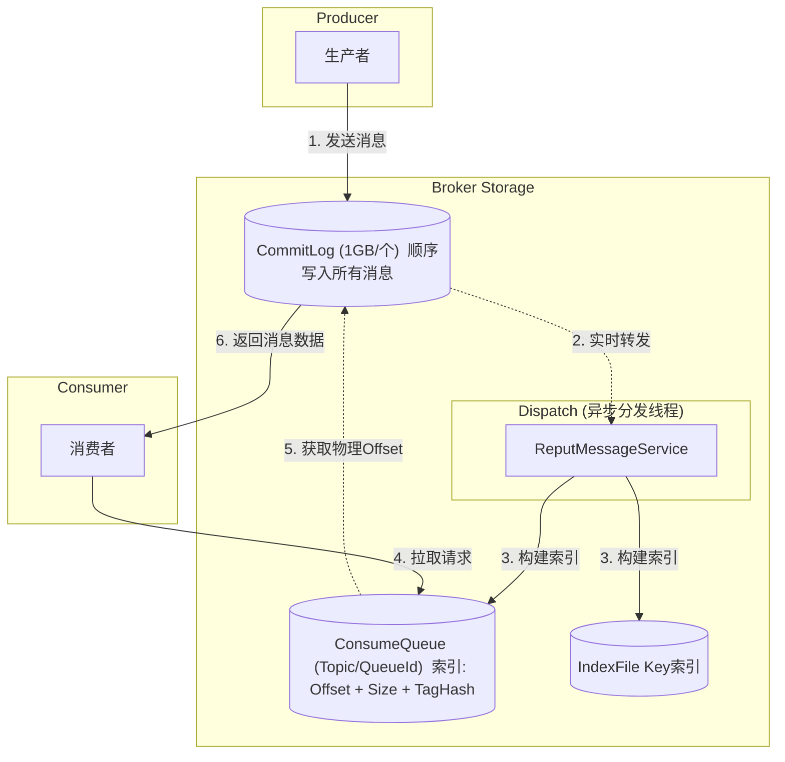

# Rocketmq知识汇总
---


# RocketMQ如何保证消息顺序

RocketMQ提供了两种级别的顺序消息：全局顺序消息和分区顺序消息。

### 1. 全局顺序消息

全局顺序消息确保一个主题内的所有消息都按照发送顺序被消费。这通常通过将所有消息路由到同一个队列来实现。

#### 生产者代码示例：

```java
import org.apache.rocketmq.client.producer.DefaultMQProducer;
import org.apache.rocketmq.client.producer.SendResult;
import org.apache.rocketmq.common.message.Message;

public class GlobalOrderProducer {
    public static void main(String[] args) throws Exception {
        DefaultMQProducer producer = new DefaultMQProducer("global_order_producer_group");
        producer.setNamesrvAddr("localhost:9876");
        producer.start();

        for (int i = 0; i  mqs.get(0), // 选择第一个队列
                                                  null);
            System.out.printf("%s%n", sendResult);
        }

        producer.shutdown();
    }
}
```

#### 消费者代码示例：

```java
import org.apache.rocketmq.client.consumer.DefaultMQPushConsumer;
import org.apache.rocketmq.client.consumer.listener.ConsumeOrderlyContext;
import org.apache.rocketmq.client.consumer.listener.ConsumeOrderlyStatus;
import org.apache.rocketmq.client.consumer.listener.MessageListenerOrderly;
import org.apache.rocketmq.common.message.MessageExt;

import java.util.List;

public class GlobalOrderConsumer {
    public static void main(String[] args) throws Exception {
        DefaultMQPushConsumer consumer = new DefaultMQPushConsumer("global_order_consumer_group");
        consumer.setNamesrvAddr("localhost:9876");
        consumer.subscribe("TopicTest", "*");

        consumer.registerMessageListener(new MessageListenerOrderly() {
            @Override
            public ConsumeOrderlyStatus consumeMessage(List msgs, ConsumeOrderlyContext context) {
                for (MessageExt msg : msgs) {
                    System.out.printf("Consume message: %s%n", new String(msg.getBody()));
                }
                return ConsumeOrderlyStatus.SUCCESS;
            }
        });

        consumer.start();
        System.out.println("Consumer Started.");
    }
}
```

### 2. 分区顺序消息

分区顺序消息保证具有相同分区键的消息按顺序被消费。这允许更高的并行度，因为不同分区键的消息可以并行处理。

#### 生产者代码示例：

```java
import org.apache.rocketmq.client.producer.DefaultMQProducer;
import org.apache.rocketmq.client.producer.SendResult;
import org.apache.rocketmq.common.message.Message;

public class PartitionOrderProducer {
    public static void main(String[] args) throws Exception {
        DefaultMQProducer producer = new DefaultMQProducer("partition_order_producer_group");
        producer.setNamesrvAddr("localhost:9876");
        producer.start();

        for (int i = 0; i  {
                Integer id = (Integer) arg;
                int index = id % mqs.size();
                return mqs.get(index);
            }, orderId);
            System.out.printf("%s%n", sendResult);
        }

        producer.shutdown();
    }
}
```

#### 消费者代码示例：

```java
import org.apache.rocketmq.client.consumer.DefaultMQPushConsumer;
import org.apache.rocketmq.client.consumer.listener.ConsumeOrderlyContext;
import org.apache.rocketmq.client.consumer.listener.ConsumeOrderlyStatus;
import org.apache.rocketmq.client.consumer.listener.MessageListenerOrderly;
import org.apache.rocketmq.common.message.MessageExt;

import java.util.List;
import java.util.concurrent.atomic.AtomicLong;

public class PartitionOrderConsumer {
    public static void main(String[] args) throws Exception {
        DefaultMQPushConsumer consumer = new DefaultMQPushConsumer("partition_order_consumer_group");
        consumer.setNamesrvAddr("localhost:9876");
        consumer.subscribe("TopicTest", "TagA");

        consumer.registerMessageListener(new MessageListenerOrderly() {
            AtomicLong consumeTimes = new AtomicLong(0);

            @Override
            public ConsumeOrderlyStatus consumeMessage(List msgs, ConsumeOrderlyContext context) {
                context.setAutoCommit(true);
                for (MessageExt msg : msgs) {
                    System.out.printf("Thread: %s, Consume message: %s%n",
                                      Thread.currentThread().getName(), new String(msg.getBody()));
                }
                this.consumeTimes.incrementAndGet();
                return ConsumeOrderlyStatus.SUCCESS;
            }
        });

        consumer.start();
        System.out.println("Consumer Started.");
    }
}
```

### 关键点解释

1. **消息队列选择**：
   * 全局顺序：所有消息都发送到同一个队列。
   * 分区顺序：使用自定义的队列选择算法，确保相同分区键的消息进入同一队列。
2. **MessageListenerOrderly**：\ 使用 MessageListenerOrderly 接口来确保消息的有序消费。RocketMQ 保证同一个队列的消息会被同一个线程顺序处理。
3. **ConsumeOrderlyStatus**：\ 消费者返回 ConsumeOrderlyStatus.SUCCESS 表示消息已成功处理。
4. **锁定机制**：\ RocketMQ 内部使用锁定机制确保同一时间只有一个消费者线程在处理特定队列的消息。
5. **重试机制**：\ 如果消息处理失败，RocketMQ 会自动重试，同时保持消息的顺序。
6. **负载均衡**：\ 分区顺序消息允许更好的负载均衡，因为不同的分区可以并行处理。

### 注意事项

1. 全局顺序消息可能会限制系统的吞吐量，因为所有消息都经过单一队列。
2. 分区顺序消息在保证局部顺序的同时提供了更好的并行性。
3. 选择合适的分区键对于分区顺序消息至关重要，以确保相关消息进入同一队列。
4. 消费者端需要正确处理并发和重试逻辑，以维护消息顺序。

通过这些机制和实践，RocketMQ 能够在不同场景下有效地保证消息的顺序性，同时兼顾系统的性能和可扩展性。


# RocketMQ的Consumer是如何消费消息的

RocketMQ提供了两种主要的消费模式：推送式消费（Push Consumer）和拉取式消费（Pull Consumer）。我们将主要讨论更常用的推送式消费模式，并提供相应的代码示例。

### Consumer消费消息的基本流程

1. **实例化Consumer**：创建并配置一个Consumer实例。
2. **订阅主题**：指定要订阅的主题和标签。
3. **注册消息监听器**：实现消息处理逻辑。
4. **启动Consumer**：开始消费消息。
5. **处理消息**：在监听器中处理接收到的消息。

### 代码示例

以下是一个基本的Push Consumer的代码示例：

```java
import org.apache.rocketmq.client.consumer.DefaultMQPushConsumer;
import org.apache.rocketmq.client.consumer.listener.ConsumeConcurrentlyContext;
import org.apache.rocketmq.client.consumer.listener.ConsumeConcurrentlyStatus;
import org.apache.rocketmq.client.consumer.listener.MessageListenerConcurrently;
import org.apache.rocketmq.common.message.MessageExt;
import org.apache.rocketmq.common.consumer.ConsumeFromWhere;

import java.util.List;

public class SimplePushConsumer {
    public static void main(String[] args) throws Exception {
        // 创建一个Consumer实例，并指定Consumer Group
        DefaultMQPushConsumer consumer = new DefaultMQPushConsumer("ConsumerGroupName");

        // 设置NameServer地址
        consumer.setNamesrvAddr("localhost:9876");

        // 设置消费起始位置
        consumer.setConsumeFromWhere(ConsumeFromWhere.CONSUME_FROM_FIRST_OFFSET);

        // 订阅一个或多个主题，并指定标签筛选表达式
        consumer.subscribe("TopicTest", "*");

        // 注册回调函数来处理消息
        consumer.registerMessageListener(new MessageListenerConcurrently() {
            @Override
            public ConsumeConcurrentlyStatus consumeMessage(List msgs,
                                                            ConsumeConcurrentlyContext context) {
                for (MessageExt msg : msgs) {
                    System.out.printf("Received message: %s%n", new String(msg.getBody()));
                }
                // 标记消息消费成功
                return ConsumeConcurrentlyStatus.CONSUME_SUCCESS;
            }
        });

        // 启动Consumer实例
        consumer.start();

        System.out.printf("Consumer started.%n");
    }
}
```

### 详细解释

1. **Consumer实例化**：
   * 使用DefaultMQPushConsumer类创建Consumer实例，并指定Consumer Group。
   * Consumer Group用于标识一组具有相同角色的Consumer实例。
2. **设置NameServer地址**：
   * 使用setNamesrvAddr()方法设置RocketMQ NameServer的地址。
3. **设置消费起始位置**：
   * setConsumeFromWhere()方法用于指定从哪里开始消费消息。
   * CONSUME_FROM_FIRST_OFFSET表示从最早的可用消息开始消费。
4. **订阅主题**：
   * subscribe()方法用于订阅指定的主题。
   * 第一个参数是主题名称，第二个参数是标签过滤表达式。"\*"表示订阅该主题下的所有消息。
5. **注册消息监听器**：
   * registerMessageListener()方法用于注册一个消息监听器。
   * 这里使用的是MessageListenerConcurrently接口，适用于并发消费场景。
   * 在consumeMessage()方法中实现具体的消息处理逻辑。
6. **消息处理**：
   * 在监听器的consumeMessage()方法中，我们遍历收到的消息列表并打印消息内容。
   * 返回ConsumeConcurrentlyStatus.CONSUME_SUCCESS表示消息已成功消费。
7. **启动Consumer**：
   * 调用start()方法启动Consumer实例，开始消费消息。

### 其他重要概念

1. **消费模式**：
   * Push模式：Broker主动将消息推送给Consumer。
   * Pull模式：Consumer主动从Broker拉取消息。
2. **消息过滤**：
   * 可以通过标签（Tag）或自定义属性进行消息过滤。
3. **消费进度**：
   * RocketMQ会自动管理消费进度，确保消息不会重复消费。
4. **消费失败处理**：
   * 如果消息处理失败，可以返回ConsumeConcurrentlyStatus.RECONSUME_LATER，RocketMQ会稍后重试。
5. **负载均衡**：
   * 同一个Consumer Group中的多个Consumer实例会自动进行负载均衡，分摊消息的消费。

### 小结

RocketMQ的Consumer提供了灵活且强大的消息消费机制。通过Push模式，开发者可以方便地实现消息的实时处理。Consumer的配置和使用相对简单，但要注意合理处理消息，包括正确设置消费起始位置、适当的消息过滤、以及妥善处理消费失败的情况。在实际应用中，还需要考虑Consumer的伸缩性、容错性和性能优化等方面。


# RocketMQ事务消息是如何实现的

### 第一层：核心痛点——“鱼和熊掌如何兼得？”

在微服务架构中，我们经常遇到这样的场景：**“转账”**。

* A 账户扣钱（DB 操作）。
* 给 B 账户发通知加钱（MQ 消息）。

**死局**：

* 先扣钱，再发 MQ？ -> 万一 MQ 发送失败，钱扣了，对方没收到，资金不平。
* 先发 MQ，再扣钱？ -> 万一 MQ 发出去了，本地扣钱报错回滚了，对方收到钱了，公司亏空。

RocketMQ 的事务消息，本质上是把 **MQ 消息变成了“两阶段提交”的协调者**，保证**本地事务**和**消息发送**最终要么都成功，要么都失败。

***

### 第二层：全链路可视化（图解）

为了让你彻底看清内部的流转，我为你生成了一张包含 **Topic 内部视角** 的架构图。

注意看图中的 **"Real Topic"** 和 **"Half Topic"** 的区别，这是理解的钥匙。


这张图展示了消息在 Broker 内部的“隐身”与“现身”过程。

***

### 第三层：Java 代码实战（状态机视角）

在 Java 代码层面，RocketMQ 的事务消息其实是一个**状态机**。你需要重点关注 `LocalTransactionState` 的三个状态：

1. `COMMIT_MESSAGE`：提交。
2. `ROLLBACK_MESSAGE`：回滚。
3. `UNKNOW`：未知（等待回查）。

#### 核心代码实现

我们来看一段生产环境级别的代码结构：

import org.apache.rocketmq.client.producer.LocalTransactionState;\
import org.apache.rocketmq.client.producer.TransactionListener;\
import org.apache.rocketmq.client.producer.TransactionMQProducer;\
import org.apache.rocketmq.common.message.Message;\
import org.apache.rocketmq.common.message.MessageExt;

import java.util.concurrent.ConcurrentHashMap;

public class TransactionService {

```plain
private TransactionMQProducer producer;
// 模拟本地事务存储（实际业务中通常是数据库）
private ConcurrentHashMap localTransStore = new ConcurrentHashMap<>();

public void start() throws Exception {
    producer = new TransactionMQProducer("tx_group");
    producer.setNamesrvAddr("localhost:9876");

    // 关键：注册事务监听器
    producer.setTransactionListener(new TransactionListenerImpl());
    producer.start();
}

public void sendOrder(String orderId) throws Exception {
    Message msg = new Message("OrderTopic", "TagA", orderId, ("Order: " + orderId).getBytes());

    // 1. 发送 Half 消息 (此时 Consumer 绝对收不到)
    // 第三个参数 arg 可以传递给 executeLocalTransaction 方法
    producer.sendMessageInTransaction(msg, orderId);
    System.out.println("Half 消息发送成功，开始执行本地逻辑...");
}

/**
 * 内部类：事务核心逻辑
 */
class TransactionListenerImpl implements TransactionListener {

    // 【阶段一】：执行本地事务
    // 当 Half 消息发送成功后，RocketMQ 自动回调此方法
    @Override
    public LocalTransactionState executeLocalTransaction(Message msg, Object arg) {
        String orderId = (String) arg;
        System.out.println("执行本地事务 for Order: " + orderId);

        try {
            // --- 核心业务开始 ---
            // 1. 开启数据库事务
            // 2. insert order...
            // 3. 提交数据库事务
            boolean success = saveOrderToDB(orderId);
            // --- 核心业务结束 ---

            if (success) {
                // 本地成功 -> 告诉 Broker 可以投递消息了
                localTransStore.put(orderId, 1); // 标记成功
                return LocalTransactionState.COMMIT_MESSAGE;
            } else {
                // 本地失败 -> 告诉 Broker 删除消息
                return LocalTransactionState.ROLLBACK_MESSAGE;
            }
        } catch (Exception e) {
            System.err.println("本地事务异常");
            // 异常情况下，建议返回 UNKNOW，利用回查机制兜底
            return LocalTransactionState.UNKNOW;
        }
    }

    // 【阶段二】：回查 (补偿机制)
    // 场景：executeLocalTransaction 返回 UNKNOW，或者网络断了 Broker 没收到结果
    @Override
    public LocalTransactionState checkLocalTransaction(MessageExt msg) {
        String orderId = msg.getKeys();
        System.out.println("触发回查 checkLocalTransaction for Order: " + orderId);

        // 去数据库查一下，这个订单到底存在不？
        Integer status = localTransStore.get(orderId);

        if (status != null && status == 1) {
            // 查到了，说明之前本地事务成功了，补交 Commit
            return LocalTransactionState.COMMIT_MESSAGE;
        } else {
            // 没查到，说明之前本地事务回滚了或没做，补交 Rollback
            return LocalTransactionState.ROLLBACK_MESSAGE;
        }
    }
}

private boolean saveOrderToDB(String orderId) {
    // 模拟 DB 操作
    return true;
}
```

}

***

### 第四层：底层源码揭秘（消息去哪了？）

这一层是专家与普通开发者的分水岭。\
你会发现，发完 Half 消息后，Consumer 明明订阅了 `OrderTopic`，为什么死活收不到？

**RocketMQ 在 Broker 端做了“偷梁换柱”：**

1. **篡改 Topic**：
   * Broker 接收到事务消息（Half 消息）时，并不会直接写入 `OrderTopic`。
   * 它会将 Topic 修改为系统内置的 `RMQ_SYS_TRANS_HALF_TOPIC`。
   * 它会将 `QueueId` 修改为 `0`。
   * 它会把 **原始的 Topic 和 QueueId** 存放在消息的 `Properties` 属性中（key 为 `REAL_TOPIC` 和 `REAL_QUEUE_ID`）。
2. **落盘**：
   * 修改后的消息被写入 CommitLog。因为 Topic 变了，Consumer 根本订阅不到这个系统 Topic，所以对消费者“隐身”。
3. **提交（Commit）**：
   * 当 Broker 收到 `COMMIT` 请求。
   * 它从 `RMQ_SYS_TRANS_HALF_TOPIC` 中读取出那条半消息。
   * 从 `Properties` 中**恢复**出原始的 `OrderTopic`。
   * 重新构建一条新消息，写入 CommitLog。
   * **此时，消费者终于能看到这条消息了！**
4. **删除（Op 标记）**：
   * 无论是 Commit 还是 Rollback，Broker 都会向另一个系统 Topic —— `RMQ_SYS_TRANS_OP_HALF_TOPIC` 写入一条标记消息。
   * 这个标记消息的内容，就是之前半消息在 Half Topic 里的物理偏移量（Offset）。
   * **作用**：告诉后台线程，“这条半消息已经处理过了，不要再回查它了”。

***

### 第五层：回查线程的“守夜人”机制

Broker 有一个后台线程 `TransactionalMessageCheckService`，每隔一段时间（默认 1 分钟）运行一次：

1. 它遍历 `RMQ_SYS_TRANS_HALF_TOPIC` 里的消息。
2. 它对比 `RMQ_SYS_TRANS_OP_HALF_TOPIC` 里的标记。
3. **如果发现一条消息在 Half Topic 里，但在 OP Topic 里没有标记**，说明它处于“悬而未决”状态。
4. 如果这条消息的时间超过了 `transactionTimeOut`（默认 6 秒），Broker 就会主动向 Producer 发起 **RPC 回查请求**。

### 总结

RocketMQ 事务消息的实现，其实是一场精密的\*\*“欺骗游戏”\*\*：

* **对消费者欺骗**：先把消息藏在 `HALF_TOPIC` 里，不让你看见。
* **对存储层欺骗**：虽然是同一条消息内容，但其实在 CommitLog 里写了两遍（一次是 Half，一次是 Real）。

通过这种机制，RocketMQ 完美解决了分布式事务中的**原子性**问题，且没有引入类似 XA 事务那样繁重的锁机制，性能非常高。


# RocketMQ提供了哪些消息过滤机制

RocketMQ提供了多种消息过滤机制，以便消费者能够根据业务需求进行精确的消息消费。主要的过滤机制包括：

1. **Tag过滤**：最常用的过滤方式，消费者可以基于消息的Tag进行过滤。
2. **SQL92语法过滤**：基于Message属性，以SQL92标准语法进行复杂条件过滤，该功能需要Broker支持。

### 1. Tag过滤

**Tag过滤**是RocketMQ最基本的过滤机制，性能最好，因为它是在服务器端完成的。

* 每条消息可以有一个或多个Tag。
* 消费者订阅时指定需接收的Tag。

#### 代码示例

生产者发送带Tag的消息：

```java
import org.apache.rocketmq.client.producer.DefaultMQProducer;
import org.apache.rocketmq.common.message.Message;

public class ProducerWithTagExample {
    public static void main(String[] args) throws Exception {
        // 创建一个生产者实例
        DefaultMQProducer producer = new DefaultMQProducer("ProducerGroupName");
        producer.setNamesrvAddr("localhost:9876");
        producer.start();

        // 发送消息，设置不同的Tags
        String[] tags = {"TagA", "TagB", "TagC"};
        for (int i = 0; i  msgs, ConsumeConcurrentlyContext context) {
                for (MessageExt msg : msgs) {
                    System.out.printf("Received message: %s, Tag: %s%n", new String(msg.getBody()), msg.getTags());
                }
                return ConsumeConcurrentlyStatus.CONSUME_SUCCESS;
            }
        });

        consumer.start();
        System.out.println("Consumer started.");
    }
}
```

### 2. SQL92语法过滤

**SQL92过滤**基于用户设置的消息属性，支持更复杂的过滤条件。这种过滤机制是由服务器端进行的，需要预先配置Broker支持属性过滤。

#### 使用方法

1. **启动Broker时启用过滤**：启动Broker时，需要配置enablePropertyFilter=true来启用SQL92语法过滤功能。
2. **生产者设置消息属性**：

```java
import org.apache.rocketmq.client.producer.DefaultMQProducer;
import org.apache.rocketmq.common.message.Message;

public class ProducerWithPropertyExample {
    public static void main(String[] args) throws Exception {
        DefaultMQProducer producer = new DefaultMQProducer("ProducerGroupName");
        producer.setNamesrvAddr("localhost:9876");
        producer.start();

        for (int i = 0; i  msgs, ConsumeConcurrentlyContext context) {
                for (MessageExt msg : msgs) {
                    System.out.printf("Received message: %s, Property key: %s%n", new String(msg.getBody()), msg.getUserProperty("key"));
                }
                return ConsumeConcurrentlyStatus.CONSUME_SUCCESS;
            }
        });

        consumer.start();
        System.out.println("Consumer started.");
    }
}
```

### 总结

* **Tag过滤**：简单高效，适合多订阅者需接受不同子类型消息的场景。
* **SQL92过滤**：灵活强大，适合需要复杂条件过滤的场景，但是需要对性能加以考虑，并且需要在Broker端配置以支持属性过滤。

通过提供这些过滤机制，RocketMQ可以大大优化消息消费的准确性和有效性，使得消息系统更能贴合业务需求。不同的机制有各自的优势，选择具体的过滤机制需根据业务需求和系统性能进行合理权衡。


# RocketMQ的存储模型和底层优化策略有哪些

# RocketMQ 存储模型与底层优化深度解析

RocketMQ 的存储设计遵循一个核心理念：**极致的顺序写，配合灵活的随机读**。

## 第一层：宏观存储架构（The Big Picture）

RocketMQ 的存储文件主要由三个核心部分组成：**CommitLog**、**ConsumeQueue** 和 **IndexFile**。我们可以用“图书馆”来类比这个模型。

### 1. 三大核心文件

| 文件类型 | 作用 | 对应图书馆类比 | 关键特性 |
| :--- | :--- | :--- | :--- |
| **CommitLog** | **消息主体存储**。无论哪个Topic的消息，全部混在一起顺序写入这个大文件。 | **书库的所有书籍**（按入库时间堆放，不分类） | 顺序写，单个默认1GB，文件名是起始偏移量。 |
| **ConsumeQueue** | **逻辑消费队列**。主要存储消息在CommitLog中的偏移量，供消费者拉取。 | **索引卡片/分类目录**（按类别分类，指向书的位置） | 索引文件，定长设计（20字节），轻量级。 |
| **IndexFile** | **哈希索引**。提供根据 Key 或时间区间查询消息的能力。 | **书名/作者检索电脑** | 底层是Hash表结构，用于运维排查。 |

### 2. 存储结构图解



***

## 第二层：核心优化策略（The Secret Sauce）

RocketMQ 为什么快？核心在于它绕过了操作系统标准IO的瓶颈。

### 1. 顺序写（Sequential Write）

磁盘（尤其是机械硬盘HDD）最怕随机IO（磁头频繁寻道）。

* **RocketMQ的做法**：所有 Topic 的消息**全部**写入同一个 `CommitLog`。
* **效果**：将随机写变成了顺序写。实验表明，磁盘顺序写的速度（约600MB/s）可以媲美内存的随机写。

### 2. 零拷贝技术（Zero Copy）与 mmap

这是 Java 高性能 IO 的基石。

#### 传统 IO 的痛点

普通的 `read/write` 操作需要**4次拷贝**和**4次上下文切换**：\
Disk -> Kernel Buffer -> User Buffer -> Kernel Socket Buffer -> NIC (网卡)。

#### mmap (内存映射文件)

RocketMQ 使用 Java NIO 的 `MappedByteBuffer`。

* **原理**：将内核空间的 PageCache 直接映射到用户空间的虚拟地址。
* **效果**：
  * 写数据：直接写入用户态的内存地址（实际是 PageCache），由 OS 异步刷盘。
  * 读数据：直接从 PageCache 读取，少了一次内核到用户的拷贝。
* **限制**：`MappedByteBuffer` 单个文件限制在 1.5GB - 2GB 左右，所以 RocketMQ 的 CommitLog 设定为 1GB。

#### Java 代码演示 mmap

```java
import java.io.RandomAccessFile;
import java.nio.MappedByteBuffer;
import java.nio.channels.FileChannel;

public class MmapDemo {
    public static void main(String[] args) throws Exception {
        // 模拟 RocketMQ 创建 CommitLog
        RandomAccessFile raf = new RandomAccessFile("00000000000000000000", "rw");
        FileChannel channel = raf.getChannel();

        // 核心代码：内存映射
        // MapMode.READ_WRITE: 读写模式
        // 0: 起始位置
        // 1024 * 1024 * 1024: 映射大小 (1GB)
        MappedByteBuffer mappedByteBuffer = channel.map(FileChannel.MapMode.READ_WRITE, 0, 1024 * 1024 * 1024);

        // 写数据 (看起来像写内存一样，其实直接进了 PageCache)
        String msg = "Hello RocketMQ Storage!";
        mappedByteBuffer.put(msg.getBytes());

        // 强制刷盘 (可选，RocketMQ有专门的刷盘线程)
        // mappedByteBuffer.force();

        System.out.println("Write success without User-Kernel copy!");

        // 资源清理...
    }
}
```

### 3. PageCache 与 预读（Readahead）

RocketMQ 严重依赖操作系统的 **PageCache**（页缓存）。

* **写**：消息先写入 PageCache，立刻返回 ACK，不仅快，而且利用了 OS 的掉电保护（尽力而为）。
* **读**：
  * 消费者拉取最新消息时，数据就在 PageCache 中，命中率极高，几乎无需读盘。
  * 产生**堆积**读取历史消息时，OS 的**预读机制**（Read-ahead）会将相邻的数据块预先加载到 PageCache，因为 CommitLog 是顺序存储的，预读效果极佳。

***

## 第三层：进阶优化——读写分离（TransientStorePool）

这是 RocketMQ 的**大杀器**。

在开启 `transientStorePoolEnable=true` 后（通常在 Master 节点开启），RocketMQ 会引入**堆外内存池**。

### 为什么需要这个？

如果使用默认的 `MappedByteBuffer`，高并发下，写入（生产）和读取（消费）都在竞争 PageCache。如果消费者消费滞后，会从磁盘读取冷数据到 PageCache，把热数据的 PageCache 挤出去，导致生产者写入性能抖动。

### 优化后的流程

1. **Write**：消息先写入 **DirectByteBuffer** (堆外内存池，Java完全控制)。
2. **Commit**：后台线程异步将 DirectByteBuffer 的数据写入 **FileChannel** (进入 PageCache)。
3. **Flush**：后台线程将 PageCache 刷入 **Disk**。

**好处**：实现了数据写入与 PageCache 的解耦。生产者直接写内存，极其稳定；消费者读 PageCache，互不干扰。

***

## 第四层：ConsumeQueue 的极致压缩

ConsumeQueue 是消费者能快速定位消息的关键。它采用**定长设计**，每条记录固定 **20 Bytes**。

### 数据结构

```latex
┌───────────────────────────────┐
│ CommitLog Offset (8 Bytes)    │ -> 消息在 CommitLog 中的物理地址
├───────────────────────────────┤
│ Message Size     (4 Bytes)    │ -> 消息长度
├───────────────────────────────┤
│ Tags HashCode    (8 Bytes)    │ -> Tag的哈希值（用于服务端过滤）
└───────────────────────────────┘
```

### 为什么这样设计？

1. **随机读变顺序读**：因为是定长，要找第 N 条消息，直接计算位置：`Pos = N * 20`。
2. **服务端过滤**：Consumer 拉取消息时，Broker 可以直接根据 `Tags HashCode` 过滤，不需要读取 CommitLog 中的具体内容，极大节省 IO。
3. **内存驻留**：30W 条消息的索引仅 5.7MB，极易被 PageCache 完全缓存。

***

## 总结：RocketMQ 存储性能公式

$ 高吞吐 = 顺序写(CommitLog) + 零拷贝(mmap) + 堆外内存池(TransientStorePool) $

$ 低延迟 = PageCache热读 + 极简索引(ConsumeQueue) + 服务端过滤 $

通过这种将硬盘当内存用的设计，RocketMQ 实现了在普通硬件上单机十万级甚至百万级的 TPS。


# RocketMQ的集群架构是怎样的

RocketMQ的集群架构设计旨在提高系统的可用性、可靠性和可扩展性。它通过多种组件协同工作，实现消息的生产、存储、分发和消费。以下是关于RocketMQ集群架构及其使用场景的详细说明。

### RocketMQ集群架构

1. **NameServer**：
   * 它是一个几乎无状态的节点，可以集群部署用于服务发现。
   * NameServer为Producer和Consumer提供路由信息。
2. **Broker**：
   * Broker负责接收、存储和转发消息。
   * 它可以分为Master和Slave，支持多对Master-Slave配置以实现高可用。
   * Master和Slave之间通过同步/异步机制进行数据复制。
3. **Producer**：
   * 消息生产者负责产生消息，并发送到Broker。
   * 支持同步和异步发送消息。
4. **Consumer**：
   * 消息消费者负责从Broker接收消息。
   * 支持Push和Pull两种消费方式，可以是集群消费或广播消费。

### 使用场景

1. **高可用性**：
   * 通过Master-Slave配置和Broker高可用机制，保证系统在部分节点失效的情况下仍能正常运行。
2. **消息持久化**：
   * 控制消息的存储策略（同步/异步），从而达成更高的可靠性需求。
3. **负载均衡**：
   * 使用多NameServer和Broker集群，支持负载均衡，从而支持大规模消息流量。
4. **弹性扩展**：
   * 可以按需添加NameServer和Broker节点，进行水平扩展。

### 代码示例

#### 创建NameServer集群

NameServer无状态，可以简单地在不同的服务器上启动多个实例：

```java
nohup sh mqnamesrv &
```

多台服务器上重复上述操作。

#### 配置和启动Broker集群

配置文件（broker-a.properties）示例：

```java
brokerClusterName=DefaultCluster
brokerName=broker-a
brokerId=0  // 0表示Master，>0表示Slave
namesrvAddr=localhost:9876;localhost:9877  // 多个NameServer地址
```

启动Broker：

```java
nohup sh mqbroker -c broker-a.properties &
```

#### 生产者与消费者代码示例

**生产者：**

```java
import org.apache.rocketmq.client.producer.DefaultMQProducer;
import org.apache.rocketmq.common.message.Message;

public class ClusterProducerExample {
    public static void main(String[] args) throws Exception {
        DefaultMQProducer producer = new DefaultMQProducer("ClusterProducerGroup");
        producer.setNamesrvAddr("localhost:9876;localhost:9877");
        producer.start();

        for (int i = 0; i  msgs, ConsumeConcurrentlyContext context) {
                for (MessageExt msg : msgs) {
                    System.out.printf("%s Receive New Messages: %s %n", Thread.currentThread().getName(), new String(msg.getBody()));
                }
                return ConsumeConcurrentlyStatus.CONSUME_SUCCESS;
            }
        });

        consumer.start();
        System.out.printf("Consumer started.%n");
    }
}
```

### 总结

RocketMQ的集群架构通过NameServer、Broker的灵活组合，实现了高可用、弹性伸缩和负载均衡，适用于各种规模的分布式系统。通过合理配置和使用，RocketMQ可以支持广泛的应用场景，如在线业务系统、异步处理和事件驱动架构。


# RocketMQ的Producer是如何发送消息的

RocketMQ的Producer发送消息过程涉及多个步骤，包括初始化、消息创建、发送方式选择等。让我们通过代码示例来详细解析这个过程。

### 1. Producer初始化

首先，我们需要创建并初始化一个Producer实例。

```java
import org.apache.rocketmq.client.producer.DefaultMQProducer;
import org.apache.rocketmq.client.exception.MQClientException;

public class RocketMQProducerExample {
    public static void main(String[] args) throws MQClientException {
        // 创建生产者实例，并指定生产者组名
        DefaultMQProducer producer = new DefaultMQProducer("ProducerGroupName");

        // 设置NameServer地址
        producer.setNamesrvAddr("localhost:9876");

        // 启动Producer实例
        producer.start();

        // ... 消息发送逻辑

        // 使用完毕后关闭Producer
        producer.shutdown();
    }
}
```

这段代码完成了以下步骤：

1. 创建DefaultMQProducer实例，并指定生产者组名。
2. 设置NameServer地址，用于服务发现和路由。
3. 调用start()方法启动Producer。

### 2. 创建消息

接下来，我们需要创建要发送的消息。

```java
import org.apache.rocketmq.common.message.Message;

// ... 在main方法中
String topic = "TopicTest";
String tags = "TagA";
String keys = "OrderID_100";
String messageBody = "Hello RocketMQ";

Message msg = new Message(topic, tags, keys, messageBody.getBytes());
```

这里我们创建了一个Message对象，指定了主题（Topic）、标签（Tag）、键（Key）和消息体。

### 3. 发送消息

RocketMQ支持多种发送方式，主要包括同步发送、异步发送和单向发送。

#### 3.1 同步发送

```java
import org.apache.rocketmq.client.producer.SendResult;

try {
    SendResult sendResult = producer.send(msg);
    System.out.printf("同步发送结果：%s%n", sendResult);
} catch (Exception e) {
    e.printStackTrace();
}
```

同步发送会等待服务器响应，适用于重要的通知消息。

#### 3.2 异步发送

```java
import org.apache.rocketmq.client.producer.SendCallback;

producer.send(msg, new SendCallback() {
    @Override
    public void onSuccess(SendResult sendResult) {
        System.out.printf("异步发送成功：%s%n", sendResult);
    }

    @Override
    public void onException(Throwable e) {
        System.out.printf("异步发送异常：%s%n", e);
    }
});
```

异步发送适用于对响应时间敏感的业务场景。

#### 3.3 单向发送

```java
producer.sendOneway(msg);
```

单向发送不关心发送结果，适用于不太重要的日志收集类消息。

### 4. 批量发送

RocketMQ还支持批量发送消息，以提高传输效率。

```java
import java.util.ArrayList;
import java.util.List;

List messages = new ArrayList<>();
messages.add(new Message(topic, tags, "Hello RocketMQ 1".getBytes()));
messages.add(new Message(topic, tags, "Hello RocketMQ 2".getBytes()));
messages.add(new Message(topic, tags, "Hello RocketMQ 3".getBytes()));

try {
    SendResult sendResult = producer.send(messages);
    System.out.printf("批量发送结果：%s%n", sendResult);
} catch (Exception e) {
    e.printStackTrace();
}
```

### 5. 发送过程中的重要考虑因素

1. **消息大小**：默认限制4MB，可以通过配置修改。
2. **发送超时**：可以设置发送超时时间，例如：

```java
producer.setSendMsgTimeout(3000);  // 设置发送超时为3秒
```

3. **重试机制**：同步和异步发送支持自动重试，可以设置重试次数：

```java
producer.setRetryTimesWhenSendFailed(3);  // 同步发送失败时重试3次
producer.setRetryTimesWhenSendAsyncFailed(3);  // 异步发送失败时重试3次
```

### 6. 最佳实践

1. 合理使用Tag：可以用于消息过滤，提高消费效率。
2. 适当设置Key：方便根据Key查询消息。
3. 合理选择发送方式：根据业务场景选择同步、异步或单向发送。
4. 注意异常处理：特别是在同步发送时，要处理可能的异常。
5. Producer实例线程安全：可在多线程环境中共享。

通过以上详细说明和代码示例，我们可以看到RocketMQ的Producer发送消息涉及多个方面，包括初始化、消息创建、多种发送方式、批量发送等。正确理解和使用这些特性，可以帮助开发者更好地利用RocketMQ来构建高效、可靠的消息传输系统。


# 为什么RocketMQ一个CommitLog文件就能抗住百万QPS

很多初学者觉得不可思议：**磁盘 IO 那么慢，数据库插入几万条都费劲，RocketMQ 凭什么往一个文件里写数据能抗住百万 QPS？**

秘密在于它把 "磁盘" 当 "内存" 用。

RocketMQ 的核心设计哲学是：**顺序写盘（Sequential Write） + 零拷贝（Zero Copy） + 内存映射（mmap）。**

我们分四个层级，像剥洋葱一样为你揭秘。

***

### 第一层：架构设计——“一种文件存所有”

RocketMQ 与 Kafka 最大的不同在于：

* **Kafka**：每个 Topic 的每个 Partition 一个文件。如果有 1000 个 Topic，写磁盘就是 1000 个文件的随机 IO。
* **RocketMQ**：无论你有多少 Topic，所有消息全部写入**同一个**逻辑文件，叫做 **CommitLog**。

**为什么要这么做？**\
为了把**随机 IO** 强制转换为 **顺序 IO**。

* **随机 IO (Random I/O)**：磁头在盘面上疯狂跳动，寻道时间极长（最慢）。
* **顺序 IO (Sequential I/O)**：磁头几乎不动，一直往后写。

**性能数据对比**：\
在机械硬盘（HDD）上，顺序写的速度可以达到 **600MB/s**，这甚至比**随机写内存**还要快！

我为你生成了一张架构图，直观对比这两种模式：


这图左边是普通 MQ 的噩梦，右边是 RocketMQ 的“单行道”策略。所有消息不分 Topic，全部排队进入 CommitLog，这就保证了极致的写性能。

***

### 第二层：底层实现—— MappedFile 与 mmap

即使是顺序写，如果每次写都要发生 `用户态  内核态` 的切换，性能也会崩。

RocketMQ 使用了 JDK 的 `MappedByteBuffer`，也就是操作系统的 **mmap (Memory Mapped Files)** 技术。

#### 1. 什么是 mmap？

它将磁盘文件直接映射到内存（PageCache）。

* **写数据**：直接写入内存映射区，操作系统会在后台异步刷盘到磁盘。
* **读数据**：直接从内存读，如果内存没有，操作系统利用缺页中断加载。

#### 2. Java 代码实现原理

在 RocketMQ 源码中，`MappedFile` 类是核心。每个 `MappedFile` 固定大小 **1GB**。

import java.io.File;\
import java.io.RandomAccessFile;\
import java.nio.MappedByteBuffer;\
import java.nio.channels.FileChannel;

public class MappedFileDemo {

```plain
// 1G 大小
public static final int FILE_SIZE = 1024 * 1024 * 1024;

public static void main(String[] args) throws Exception {
    File file = new File("00000000000000000000"); // 文件名通常是偏移量

    // 1. 获取 FileChannel
    FileChannel fileChannel = new RandomAccessFile(file, "rw").getChannel();

    // 2. 关键：执行 mmap 映射
    // MapMode.READ_WRITE: 读写模式
    // 0: 映射起始位置
    // FILE_SIZE: 映射大小
    MappedByteBuffer mappedByteBuffer = fileChannel.map(FileChannel.MapMode.READ_WRITE, 0, FILE_SIZE);

    // 3. 写入数据 (这一步就像写内存 byte[] 一样快，完全没有磁盘 IO 阻塞)
    String msg = "Hello RocketMQ High Performance!";
    mappedByteBuffer.put(msg.getBytes());

    // 4. 刷盘 (由后台线程定期执行，不阻塞写入主线程)
    // mappedByteBuffer.force();
}
```

}

**代码深度解析**：

* `fileChannel.map` 是系统调用。它返回的 `MappedByteBuffer` 对象，让你操作文件就像操作内存里的 `byte[]` 数组一样。
* **零拷贝 (Zero Copy)**：
  * **传统写**：磁盘 -> 内核 Buffer -> 用户 Buffer -> Socket Buffer -> 网卡。
  * **mmap 写**：用户 Buffer 直接映射到内核 PageCache。数据少拷贝了一次。

***

### 第三层：文件预热与文件组 (MappedFileQueue)

如果每次写到 1GB 边界，都要创建一个新文件，那那一瞬间性能会卡顿。RocketMQ 做了极致优化：**文件预热**。

1. **预分配**：Broker 启动或文件快满时，后台线程提前创建好下一个 1GB 文件。
2. **预热 (Warm up)**：
   * 创建完文件后，RocketMQ 会在这个 1GB 的空间里，每隔 4KB（一个内存页）写入一个 `0`。
   * **为什么？** 为了强制操作系统分配物理内存页。防止第一次写入时触发大量的“缺页中断”导致卡顿。
   * 源码中使用了 `mlock` 系统调用，锁定内存，防止被 SWAP 交换出去。

***

### 第四层：锁的艺术——如何抗住并发写入？

百万 QPS 意味着每秒有百万个线程（或者大量的并发请求）想往同一个 `MappedByteBuffer` 里写数据。\
如果不加锁，数据就乱了；如果加锁，性能就崩了。

RocketMQ 采用了 **自旋锁 (SpinLock)** 和 **ReentrantLock** 双重策略，并配合 **TransientStorePool**（堆外内存池）。

#### 关键优化：TransientStorePool (读写分离)

为了进一步榨干性能，RocketMQ 开启 `transientStorePoolEnable=true` 后，架构变成了这样：

1. **写入**：数据先写入 **堆外内存 (DirectByteBuffer)**。这个操作极快，因为完全纯内存，无锁或轻量级锁。
2. **提交**：后台线程异步将 堆外内存 `commit` 到 `PageCache` (MappedByteBuffer)。
3. **刷盘**：操作系统或后台线程将 `PageCache` `flush` 到磁盘。

**图解数据流向：**

> Producer -> DirectMemory (堆外内存) -> PageCache (内核缓存) -> Disk (磁盘)

这种**读写分离**的设计，让 Producer 的写入线程几乎不碰磁盘，甚至不碰 PageCache 的锁竞争，从而实现了极致的吞吐量。

***

### 总结：为什么能抗百万 QPS？

结合上面的层层递进，RocketMQ 的性能秘籍总结如下：

1. **顺序写 (Sequential Write)**：不管多少 Topic，统统写入一个 CommitLog，消灭磁盘寻道时间。
2. **内存映射 (mmap)**：利用 `MappedByteBuffer`，像写内存一样写文件，利用操作系统的 PageCache 做天然缓存。
3. **零拷贝 (Zero Copy)**：减少 CPU 上下文切换和内存拷贝次数。
4. **文件预热 (Pre-allocation)**：利用 `fallocate` 和 `mlock` 提前占坑，避免运行时分配内存的抖动。
5. **堆外内存池 (TransientStorePool)**：实现写入与刷盘的彻底解耦。

**一句话总结**：RocketMQ 并不是真的在“写磁盘”，它其实是在**并发写内存（PageCache/堆外内存）**，然后由操作系统在后台偷偷把数据落盘。这就是它快的本质！


# RocketMQ消费消息是推模式还是拉模式

RocketMQ实际上同时支持推模式和拉模式来消费消息，但这里有一个有趣的细节：虽然RocketMQ提供了所谓的"推模式"消费者，但在底层实现上，它仍然是基于拉模式的。让我们详细探讨这两种模式，并通过代码示例来解释它们的工作原理。

### 1. 推模式（Push Mode）
虽然称为"推模式"，但RocketMQ的DefaultMQPushConsumer实际上是在内部通过长轮询（Long Polling）来实现的，这本质上还是一种拉模式。不过，对于开发者来说，使用起来就像是推模式，因为消息会自动被"推送"到消费者的监听器中。

#### 推模式示例代码：
```java
import org.apache.rocketmq.client.consumer.DefaultMQPushConsumer;
import org.apache.rocketmq.client.consumer.listener.ConsumeConcurrentlyContext;
import org.apache.rocketmq.client.consumer.listener.ConsumeConcurrentlyStatus;
import org.apache.rocketmq.client.consumer.listener.MessageListenerConcurrently;
import org.apache.rocketmq.common.message.MessageExt;

public class PushConsumerExample {
    public static void main(String[] args) throws Exception {
        // 创建消费者实例
        DefaultMQPushConsumer consumer = new DefaultMQPushConsumer("PushConsumerGroup");

        // 设置NameServer地址
        consumer.setNamesrvAddr("localhost:9876");

        // 订阅主题和标签
        consumer.subscribe("TestTopic", "*");

        // 注册消息监听器
        consumer.registerMessageListener(new MessageListenerConcurrently() {
            @Override
            public ConsumeConcurrentlyStatus consumeMessage(List msgs, ConsumeConcurrentlyContext context) {
                for (MessageExt msg : msgs) {
                    System.out.println("Received message: " + new String(msg.getBody()));
                }
                return ConsumeConcurrentlyStatus.CONSUME_SUCCESS;
            }
        });

        // 启动消费者
        consumer.start();

        System.out.println("Push Consumer Started.");
    }
}
```

在这个例子中，我们使用DefaultMQPushConsumer，它会自动从Broker拉取消息并调用我们注册的监听器。对开发者来说，这就像是消息被推送到了消费者。

### 2. 拉模式（Pull Mode）
拉模式允许消费者主动从Broker拉取消息。这种模式给了开发者更多的控制权，可以根据自己的节奏来消费消息。

#### 拉模式示例代码：
```java
import org.apache.rocketmq.client.consumer.DefaultMQPullConsumer;
import org.apache.rocketmq.client.consumer.PullResult;
import org.apache.rocketmq.common.message.MessageExt;
import org.apache.rocketmq.common.message.MessageQueue;

public class PullConsumerExample {
    public static void main(String[] args) throws Exception {
        // 创建消费者实例
        DefaultMQPullConsumer consumer = new DefaultMQPullConsumer("PullConsumerGroup");

        // 设置NameServer地址
        consumer.setNamesrvAddr("localhost:9876");

        // 启动消费者
        consumer.start();

        // 获取主题的消息队列
        Set mqs = consumer.fetchSubscribeMessageQueues("TestTopic");

        for (MessageQueue mq : mqs) {
            long offset = consumer.fetchConsumeOffset(mq, true);

            while (true) {
                PullResult pullResult = consumer.pull(mq, "*", offset, 32);
                offset = pullResult.getNextBeginOffset();

                switch (pullResult.getPullStatus()) {
                    case FOUND:
                        for (MessageExt msg : pullResult.getMsgFoundList()) {
                            System.out.println("Received message: " + new String(msg.getBody()));
                        }
                        break;
                    case NO_NEW_MSG:
                        break;
                    case NO_MATCHED_MSG:
                        break;
                    case OFFSET_ILLEGAL:
                        break;
                    default:
                        break;
                }

                // 更新消费偏移量
                consumer.updateConsumeOffset(mq, offset);

                // 模拟处理时间
                Thread.sleep(1000);
            }
        }
    }
}
```

在这个例子中，我们使用DefaultMQPullConsumer来主动拉取消息。消费者需要自己管理消费偏移量，并决定何时拉取下一批消息。

### 比较和选择
1. **推模式（Push）**:
    - 优点：使用简单，自动管理消费进度，适合大多数场景。
    - 缺点：灵活性较低，无法完全控制消费节奏。
2. **拉模式（Pull）**:
    - 优点：更灵活，可以精确控制消费速度和批次大小。
    - 缺点：需要自己管理偏移量，实现相对复杂。

### 结论
虽然RocketMQ提供了所谓的"推模式"，但实际上它是基于拉模式实现的。对于大多数应用场景，使用DefaultMQPushConsumer就足够了，因为它提供了一个类似推模式的简单接口。只有在需要精细控制消息消费过程时，才需要考虑使用拉模式。

无论选择哪种模式，理解它们的底层工作原理都是很重要的，这样可以在遇到性能问题或特殊需求时做出正确的选择和优化。


# RocketMQ如何保证消息不丢失

要保证 RocketMQ 消息不丢失，我们必须像“特工押运”一样，确保消息在 **发送端（Producer）**、**存储端（Broker）**、**消费端（Consumer）** 这三个环节都万无一失。任何一个环节掉链子，消息就丢了。

我为你总结了一个\*\*“防丢铁三角”\*\*模型，我们逐层拆解。

***

### 第一层：生产端（Producer）—— “不拿到回执绝不松手”

很多消息丢失发生在发送阶段：比如网络抖动，或者 Broker 刚收到请求还没处理就挂了。

**策略：使用同步发送 + 重试机制**

不要用 `sendOneway`（只管发，不问结果），那个快但是不可靠。要用 `send` 同步方法，并检查发送结果。

import org.apache.rocketmq.client.producer.DefaultMQProducer;\
import org.apache.rocketmq.client.producer.SendResult;\
import org.apache.rocketmq.client.producer.SendStatus;\
import org.apache.rocketmq.common.message.Message;\
import org.apache.rocketmq.client.consumer.DefaultMQPushConsumer;\
import org.apache.rocketmq.client.consumer.listener.ConsumeConcurrentlyStatus;\
import org.apache.rocketmq.client.consumer.listener.MessageListenerConcurrently;

public class ZeroLossDemo {

```plain
/**
 * 1. 生产端：同步发送 + 检查回执
 */
public void producer() throws Exception {
    DefaultMQProducer producer = new DefaultMQProducer("reliable_group");
    producer.setNamesrvAddr("127.0.0.1:9876");
    // 关键点：设置重试次数 (默认2次)
    producer.setRetryTimesWhenSendFailed(3);
    producer.start();

    Message msg = new Message("TopicTest", "TagA", "Hello".getBytes());

    try {
        // 同步发送，等待 Broker 响应
        SendResult sendResult = producer.send(msg);

        // 关键点：必须判断发送状态
        if (sendResult.getSendStatus() != SendStatus.SEND_OK) {
            // 如果不是 OK，比如是 FLUSH_DISK_TIMEOUT，需要记录日志或人工介入
            System.err.println("发送由于 Broker 问题可能丢失，状态: " + sendResult.getSendStatus());
            // todo: 存入本地数据库，后续定时任务重试
        }
    } catch (Exception e) {
        // 捕获异常（网络断了等），进行本地补偿
        System.err.println("发送异常，执行本地降级策略");
        // todo: 存入本地数据库
    }
}

/**
 * 3. 消费端：先干活，后签字 (ACK)
 */
public void consumer() throws Exception {
    DefaultMQPushConsumer consumer = new DefaultMQPushConsumer("reliable_consumer");
    consumer.setNamesrvAddr("127.0.0.1:9876");
    consumer.subscribe("TopicTest", "*");

    consumer.registerMessageListener((MessageListenerConcurrently) (msgs, context) -> {
        try {
            for (Message msg : msgs) {
                // 1. 执行核心业务逻辑 (比如扣减库存)
                doBusinessLogic(msg);
            }
            // 2. 只有业务不报错，才返回 SUCCESS (相当于告诉 Broker：消息我吃掉了)
            return ConsumeConcurrentlyStatus.CONSUME_SUCCESS;
        } catch (Exception e) {
            // 3. 如果业务报错，返回 RECONSUME (告诉 Broker：我处理失败了，一会再发给我)
            // RocketMQ 会自动进行指数退避重试 (1s, 5s, 10s...)
            return ConsumeConcurrentlyStatus.RECONSUME_LATER;
        }
    });
    consumer.start();
}

private void doBusinessLogic(Message msg) {
    // 模拟业务
}
```

}

***

### 第二层：Broker 端（存储端）—— “落袋为安，双重保险”

这是最关键的环节。如果 Broker 收到消息，还没来得及写硬盘，或者硬盘坏了，怎么办？

RocketMQ 提供了两个核心配置，**用性能换安全**。

#### 1. 刷盘机制：SYNC\_FLUSH (同步刷盘)

* **默认 (ASYNC\_FLUSH)**：Broker 收到消息放在内存（PageCache）就返回成功。如果此时断电，内存数据丢失。
* **零丢失配置 (SYNC\_FLUSH)**：Broker 必须把数据**真正写入物理磁盘**后，才给 Producer 返回成功。
  * 配置：`flushDiskType = SYNC_FLUSH`

#### 2. 主从复制：SYNC\_MASTER (同步复制)

就算你同步刷盘了，如果这台机器硬盘物理损坏了呢？数据还是丢。\
所以我们需要 Master-Slave 架构。

* **默认 (ASYNC\_MASTER)**：Master 收到消息就返回成功，然后异步传给 Slave。如果 Master 挂了，Slave 可能还没同步到最新消息。
* **零丢失配置 (SYNC\_MASTER)**：Master 收到消息后，必须**等 Slave 也写成功了**，才给 Producer 返回成功。
  * 配置：`brokerRole = SYNC_MASTER`

**专家建议**：为了达到由内而外的“铁桶阵”，真正的金融级配置必须是 **SYNC\_FLUSH + SYNC\_MASTER**。

***

### 第三层：消费端（Consumer）—— “吃完再擦嘴”

Broker 把消息给到了 Consumer，如果 Consumer 代码写得有问题，或者刚拿到消息还没处理机器就重启了，怎么保证不丢？

**策略：手动 ACK (At-Least-Once)**

请看上面代码中的 `consumer` 部分。

* **错误做法**：拿到消息先 `return success`，然后再异步处理业务。这样一旦业务报错，Broker 以为你处理完了，消息就丢了。
* **正确做法**：**同步处理业务**。只有业务逻辑（如写库）完全成功，才返回 `CONSUME_SUCCESS`。如果抛出异常，返回 `RECONSUME_LATER`，Broker 会稍后重试。

***

### 图解：全链路防丢失流程

为了让你一眼看清这三个关卡，我为你生成一张架构图。这张图展示了同步刷盘和同步复制是如何像两道闸门一样拦截数据丢失的。


这张图清晰地展示了“最严格”的路径：

1. **发送**：Producer 等待响应。
2. **存储**：注意中间那个绿色的回执箭头，它必须等待 **Master 刷盘完成** 且 **Slave 复制完成** 这两个动作都结束后，才会发给 Producer。这就是 `SYNC_FLUSH + SYNC_MASTER` 的威力。
3. **消费**：Consumer 执行完业务逻辑，才返回状态。

### 总结

RocketMQ 保证消息不丢失的**终极公式**：

$ 消息不丢失 = \text{Producer(同步发送+重试)} + \text{Broker(同步刷盘+同步复制)} + \text{Consumer(手动ACK)} $


# RocketMQ有哪些使用场景

RocketMQ是一个分布式消息中间件，最初由阿里巴巴开发并开源，现在是Apache基金会孵化的顶级项目。与其他消息中间件类似，RocketMQ的核心功能是提供一种可靠、高效、可扩展的分布式消息传递机制。在大型分布式系统中，RocketMQ用于实现系统间的异步通信、解耦和数据流管理。

### RocketMQ的主要特性
1. **高吞吐量**：RocketMQ可以处理高流量、低延迟的数据流，非常适合金融、电子商务等高并发场景。
2. **高可靠性**：通过消息持久化、多副本机制，RocketMQ确保消息的高度可靠性。
3. **灵活的消息模型**：支持多种模型，包括点对点和发布/订阅。
4. **支持顺序消息**：可以保证在同一主题内，消息的消费顺序。
5. **事务消息**：支持分布式事务，确保消息与数据库操作的一致性。
6. **丰富的消息过滤机制**：支持基于Tag和属性的消息过滤。

### 使用场景
1. **系统解耦**：微服务架构中，服务间通信通过消息中间件实现解耦，降低服务间的相互依赖。
2. **异步处理**：非实时处理任务通过消息队列异步执行，提高系统响应速度。
3. **流量削峰**：在高并发情况下，消息队列可以缓冲流量，防止流量骤增导致系统崩溃。
4. **事件驱动架构**：实现复杂业务流程的事件驱动，推动业务中各个阶段的事件流转。
5. **日志处理**：收集和处理日志、监控数据等场景，尤其适合大规模数据的实时处理。

### 代码示例
#### 生产者示例
生产者用于将消息发送到指定的Topic。

```java
import org.apache.rocketmq.client.producer.DefaultMQProducer;
import org.apache.rocketmq.common.message.Message;

public class ProducerExample {
    public static void main(String[] args) throws Exception {
        // 创建生产者实例并指定生产者组
        DefaultMQProducer producer = new DefaultMQProducer("ProducerGroupName");
        // 设置NameServer地址
        producer.setNamesrvAddr("localhost:9876");
        // 启动生产者实例
        producer.start();

        // 发送10条消息
        for (int i = 0; i  msgs, ConsumeConcurrentlyContext context) {
                for (MessageExt msg : msgs) {
                    System.out.printf("%s Receive New Messages: %s %n", Thread.currentThread().getName(), new String(msg.getBody()));
                }
                return ConsumeConcurrentlyStatus.CONSUME_SUCCESS;
            }
        });

        // 启动消费者实例
        consumer.start();
        System.out.printf("Consumer started.%n");
    }
}
```

### 总结
RocketMQ是一个功能强大且灵活的分布式消息中间件，适用于各种规模的应用程序，从小型应用到大型企业级系统。它在高可用性、可扩展性和丰富功能支持方面表现出色，因此在许多复杂场景中都得到了广泛应用。通过提供异步通信机制和支持事件驱动架构，RocketMQ帮助开发者构建健壮、高效的现代应用程序。


# RocketMQ生产环境如何优化

RocketMQ在生产环境中的优化是一个多方面的任务，涉及到系统配置、应用代码、监控和运维等多个层面。以下是一些关键的优化策略，并附带相关的代码和配置示例：

### 生产者优化

a) 批量发送消息\ 批量发送可以提高吞吐量，减少网络开销。

```java
DefaultMQProducer producer = new DefaultMQProducer("ProducerGroupName");
producer.setNamesrvAddr("nameserver1:9876;nameserver2:9876");
producer.start();

List messages = new ArrayList<>();
for (int i = 0; i true 时，RocketMQ 会在创建映射文件时对其进行预热。具体的实现方式可能包括写入一些数据以触发操作系统将文件的物理页与虚拟内存页面相关联，可以减少I/O延迟和提高文件读写效率。

```java
warmMapedFileEnable=true
```

### 监控和告警

使用RocketMQ的Dashboard或者其他监控工具（如Prometheus + Grafana）来监控系统状态，并设置适当的告警阈值。

### 消息压缩

对于大消息，可以考虑进行压缩：

```java
Message msg = new Message("TopicTest", "TagA", "Hello RocketMQ".getBytes(StandardCharsets.UTF_8));
msg.setCompressed(true);
```

这些优化策略涵盖了RocketMQ的多个方面，包括生产者、消费者、Broker配置、网络、JVM、存储等。在实际应用中，需要根据具体的业务场景和硬件环境来选择合适的优化策略。同时，优化是一个持续的过程，需要不断监控、测试和调整，以达到最佳的性能表现。


# RocketMQ延迟消息是如何实现的

想象一下这个场景：**用户下了订单，如果 30 分钟内没付款，系统需要自动关闭订单。**\
如果用 `Timer` 或 `ScheduledExecutorService`，服务器重启数据就没了；如果用数据库轮询，数据量大时数据库会挂。

RocketMQ 的延迟消息就是为了解决这类问题。它允许你发送一条消息，但指定\*\*“现在别发，过段时间再发给消费者”\*\*。

今天我们同样用**由浅入深**的方式，通过代码、原理、图解，彻底搞懂它。

***

### 第一层：怎么用？（代码实战）

RocketMQ 的延迟消息**不支持任意时间**（RocketMQ 5.0 之前），而是采用了\*\*“预设等级”\*\*的机制。

默认支持 **18 个等级**：\
`1s 5s 10s 30s 1m 2m 3m 4m 5m 6m 7m 8m 9m 10m 20m 30m 1h 2h`

**代码实现：**

```plain
import org.apache.rocketmq.client.producer.DefaultMQProducer;
import org.apache.rocketmq.common.message.Message;
public class DelayProducer {
    public static void main(String[] args) throws Exception {
      DefaultMQProducer producer = new DefaultMQProducer("delay_group");
      producer.setNamesrvAddr("127.0.0.1:9876");
      producer.start();
      Message msg = new Message("TopicOrder", "TagA", "订单号123".getBytes());

    // 【关键点】设置延迟等级
    // level=1 -> 1s
    // level=2 -> 5s
    // level=3 -> 10s
    // ...
    // level=16 -> 30m (对应 30分钟未支付关闭订单)
    msg.setDelayTimeLevel(3);

    // 发送消息
    producer.send(msg);

    System.out.println("消息已发送，但在 10秒 后消费者才能收到");
    producer.shutdown();
  }
}
```

***

### 第二层：核心原理——“偷梁换柱”

你可能会好奇：**Broker 收到消息后，怎么做到“暂存”起来，等时间到了再给消费者的？**

其实，RocketMQ 再次使用了**Topic 替换**（偷梁换柱）的大法，这点和事务消息非常像。

#### 1. 偷梁换柱（Ingress）

当 Broker 收到一条消息，如果发现 `msg.getDelayTimeLevel() > 0`：

* **备份原信息**：把原来的 Topic (`TopicOrder`) 和 QueueId 存到消息属性（Properties）里。
* **篡改 Topic**：把 Topic 改成系统内置的 `SCHEDULE_TOPIC_XXXX`。
* **篡改 QueueId**：根据延迟等级计算 QueueId。
  * 公式：`queueId = delayLevel - 1`。
  * 也就是说，**所有 1s 延迟的消息都在 Queue-0，所有 5s 的都在 Queue-1**，以此类推。这样做的好处是，同一个队列里的消息，延迟时间是相同的，保证了先进先出（FIFO），处理起来极其高效。
* **落盘**：写入 CommitLog。此时消费者订阅的是 `TopicOrder`，所以根本看不见这条消息。

#### 2. 倒计时（Polling）

Broker 内部有一个核心服务类 `ScheduleMessageService`。

* 它会启动 **18 个定时任务**（对应 18 个延迟等级）。
* 每个定时任务只扫描自己对应的那个 Queue。
* **逻辑**：它会读取 `SCHEDULE_TOPIC_XXXX` 队列里的消息，判断：`现在时间 >= 消息存储时间 + 延迟时间` 吗？
  * **没到时间**：停止扫描，等一会再来（因为队列是有序的，头部的没到时间，后面的肯定也没到）。
  * **到时间了**：执行下一步“还原”。

#### 3. 还原真相（Restoration）

一旦时间到了：

* Broker 把消息取出来。
* 从属性里读取出**原来的 Topic** (`TopicOrder`) 和 **原来的 QueueId**。
* **清除延迟属性**：防止被再次处理。
* **重新写入**：把恢复后的消息再次写入 CommitLog。
* **结果**：现在这条消息变成了普通消息，消费者立马就能拉取到了！

***

### 第三层：图解全流程

为了让你更直观地理解这个“存储-等待-投递”的过程，我为你生成了一张架构图。

这张图清晰地展示了消息如何在 Broker 内部经历“整容”和“恢复”的过程。


这就是 RocketMQ 延迟消息的完整生命周期。

**看图重点**：

1. **中间的橙色区域**：这是消息“隐身”的阶段。它被存在了 `SCHEDULE_TOPIC_XXXX` 的特定队列里。
2. **Queue 的隔离**：注意看，Level 3 的消息专门放在 Queue 2 里。这种设计非常巧妙，避免了对所有消息进行复杂的排序（比如像 PriorityQueue 那样），极大地提升了写入和扫描的性能。

### 总结与思考

RocketMQ 延迟消息的设计哲学是 **“简单即高效”**。

* **为什么不支持任意时间？**（指 4.x 版本）\
  如果要支持任意时间（比如 3分17秒），Broker 就需要对所有消息按时间排序。这在大数据量下会消耗巨大的 CPU 和内存。\
  通过**固定等级**，RocketMQ 把“排序问题”转化为了“队列归类问题”，每个队列内部天然有序，扫描效率极高。
* **如果我非要用任意时间怎么办？**
  * **方案 A**：使用 RocketMQ 5.0。5.0 版本引入了 **时间轮 (TimingWheel)** 算法，终于支持任意精度的定时消息了。
  * **方案 B**（老版本 Hacker 做法）：自己写个服务，把消息存 MySQL，用 Netty 时间轮或者 Quartz 扫表，到了时间再发给 MQ。


# 为什么不建议用MQ实现订单到期关闭

使用消息队列（MQ）实现订单到期关闭虽然在一些场景下可能被考虑，但通常不被建议，其原因主要如下：

### 1. 时间精度和可靠性问题
#### 延迟不确定性
+ **延迟队列的不可预测性**：MQ通常为异步通信设计，会受到网络延迟、队列长度等多种因素影响，可能无法在确切的时间执行消息消费，导致订单关闭时间不准确。这对于需要严格时间控制的订单业务来说是一个重要问题。

#### 消息可靠性
+ **消息丢失或重复消费**：尽管MQ能提供相对可靠的消息投递，但在极端情况下，消息丢失或重复消费依然可能发生。这会给订单的准确关闭带来风险，如订单未关闭或多次错误关闭。

### 2. 系统复杂性增加
#### 额外的基础设施
+ **技术栈复杂性**：为了实现这一功能，系统需要引入并维护消息队列，例如ActiveMQ、RabbitMQ或Kafka，这增加了系统的复杂性和运维负担。

#### 资源开销
+ **性能与负载问题**：需要处理大量与订单相关的延迟消息，可能会导致MQ系统负载增加，尤其是在高并发环境下，这会影响系统整体性能。

### 3. 灵活性和扩展性问题
#### 需求变更的灵活性
+ **动态性不足**：如果需要调整订单关闭时间，已经在队列中的消息很难修改。这会限制系统灵活适应业务需求变化的能力。

#### 流程控制复杂
+ **复杂的业务逻辑**：实现简单的定时关闭功能需要复杂的处理逻辑，包括消息的发送、接收、消费、异常处理等，这会增加业务流程的复杂性。

### 替代方案和更好的实践
1. **数据库轮询与定时任务**
    - **定期扫描与批量处理**：使用定时任务（如Spring Schedule, Quartz）定期扫描数据库，关闭已到期订单。这样可以得到更高的时间精度和系统的简化。

```java
@Service
public class OrderService {

    @Autowired
    private OrderRepository orderRepository;

    // 每隔5分钟检查一次
    @Scheduled(fixedRate = 300000)
    public void closeExpiredOrders() {
        LocalDateTime expiryTime = LocalDateTime.now().minusMinutes(30);
        List expiredOrders = orderRepository.findOrdersBefore(expiryTime, OrderStatus.PENDING);

        expiredOrders.forEach(order -> {
            order.setStatus(OrderStatus.CLOSED);
            orderRepository.save(order);
        });
    }
}
```

2. **利用Redis的TTL功能**
    - **高效的过期管理**：可用Redis的TTL实现订单超时功能，但要注意需要额外的逻辑控制来确保数据一致性。
3. **分布式任务调度系统**
    - **专业的任务调度**：使用XXL-JOB、Elastic Job这类的调度工具可更精准地管理任务执行，与其他解决方案相比可提供更高的可维护性和可扩展性。

总结来说，虽然消息队列在异步通讯领域强大而灵活，但是在需要严格时间控制的任务（如订单到期自动关闭）中，其缺乏时间精度、增加系统复杂性和造成额外资源开销的特性，使其并不适合作为首选方案。选用其他更加稳定和精确的技术方案，更符合业务需求和现代架构的要求。


# RocketMQ消息是如何存储的

RocketMQ的消息存储是一个复杂而高效的过程，设计上充分考虑了性能和扩展性。消息存储的主要组件包括 CommitLog 文件、消费队列文件（ConsumeQueue）、以及索引文件（IndexFile）。我们来详细解释一下这几个核心部分。

### 1. CommitLog文件

CommitLog是RocketMQ的核心存储文件，负责保存消息的完整内容。

* **顺序写入**：所有的消息都顺序写入CommitLog文件，这种方式减少了磁盘寻道时间，提高了写入性能。
* **文件滚动**：CommitLog按照固定大小（比如1GB）进行分片。当一个文件写满后，会创建一个新的文件。
* **存储所有数据**：包括消息体、主题、队列ID等。

### 2. ConsumeQueue文件

ConsumeQueue是针对消息的逻辑视图，旨在加快消费者对消息的访问速度。

* **条目固定**：每个ConsumeQueue条目固定为20字节，包含消息在CommitLog中的偏移量、消息大小、Tag哈希值。
* **独立文件**：每个主题的每个队列都有独立的ConsumeQueue文件，文件路径为store/consumequeue/{topic}/{queueId}。
* **快速定位**：通过ConsumeQueue，消费者无需扫描整个CommitLog即可快速找到消息的位置。

### 3. IndexFile文件

IndexFile用于支持消息的快速检索。

* **哈希索引**：为消息的key建立哈希索引，支持通过key快速检索消息偏移。
* **增强查询**：IndexFile是可选的，用于需要基于消息属性进行快速查找的场景。

### 消息存储流程

1. **接收消息**：Broker接收到消息后，将其放入内存缓冲区（待写入CommitLog）。
2. **写入CommitLog**：
   * 每条消息追加到当前活跃的CommitLog文件中。使用顺序写入提升写入效率和磁盘利用率。
3. **同步到ConsumeQueue**：
   * 异步转发服务（ReputMessageService）从CommitLog读取新写入的消息。
   * 将消息的偏移量和其他元数据（如大小和Tag哈希值）存储到相应的ConsumeQueue文件中。
4. **更新IndexFile**（可选）：
   * 若消息带有key（如业务ID），则将其哈希和偏移量存入IndexFile。
   * 这样，可以通过该key快速查找消息。


# RocketMQ的消息存储如何进行清理和归档

RocketMQ 提供了消息存储清理和归档的机制，以便管理消息存储空间，删除过期消息，并将历史消息归档到其他存储介质中。这些功能有助于维护消息队列的性能和可用性。以下是关于 RocketMQ 消息存储清理和归档的主要方面：

1. **消息文件删除策略：** RocketMQ 支持多种消息文件删除策略，可以在配置文件中进行设置。以下是一些常见的策略：
+ **定时删除策略：** 您可以配置 RocketMQ 定期删除过期的消息文件和索引文件。这样，一旦消息文件中的消息过期，RocketMQ 将自动删除它们。
+ **空间满策略：** 如果存储磁盘空间达到一定限制，RocketMQ 可以自动删除最早的消息文件，以释放磁盘空间。这个策略确保了存储空间不会无限制地增长。
+ **指定时间段删除策略：** 您可以配置 RocketMQ 只删除特定时间段内的消息文件，以保留历史消息。
2. **消息归档：** RocketMQ 允许您将历史消息归档到其他存储介质中，以减小消息服务器的存储负担。归档通常涉及将消息转移到长期存储（如云存储或本地归档系统）中。归档可以手动触发，也可以自动触发，具体取决于您的需求。
3. **历史消息访问：** 尽管消息被归档，RocketMQ 仍然提供了访问历史消息的机制。通过合适的归档系统或者存储介质，您可以检索和访问历史消息，以满足合规性要求或其他业务需求。

需要注意的是，清理和归档消息不是 RocketMQ 的核心功能，而是辅助功能。您需要根据自己的需求和业务场景来配置和管理消息的清理和归档策略。确保配置合理的清理策略以防止存储空间耗尽，并根据业务需求进行消息的归档操作，以保留历史消息数据。同时，归档后的消息可以根据需要进行合适的检索和恢复，以满足特定的数据需求。


# RocketMQ的Broker有哪几种集群模式

RocketMQ的Broker有三种集群模式：

1. 单Master模式：只有一个Master节点，其他都是Slave节点。Master节点负责响应客户端的请求并存储消息，Slave节点只同步Master节点的消息，也会响应部分客户端的读请求。这种模式的优点是简单易部署，但是存在单点故障的问题，如果Master节点宕机，会导致整个服务不可用。
2. Master-Slave模式（经典双集群部署）：一个Master节点对应多个Slave节点，Master和Slave都是独立的NameServer。Master节点负责响应客户端请求并存储消息，Slave节点只同步Master节点的消息，也会响应部分客户端的读请求。这种模式的优点是高可用性，即使Master节点宕机，Slave节点可以自动升级为Master节点，继续提供服务。但是，如果只有一个Master节点，存在单点故障的问题。
3. Dledger模式（高可用集群部署）：在Master-Slave模式的基础上增加了Raft协议，实现了自动脑裂后的数据高可靠性。即使某个节点从网络上掉下来或者宕机后，仍然能够保证所有的消息不会丢失。这种模式的优点是高可用性和高可靠性，即使某个节点出现故障，也能保证服务的可用性。

总的来说，单Master模式适合测试和开发环境，Master-Slave模式适合生产环境，而Dledger模式适合需要高可靠性的生产环境。


# RocketMQ的广播消息和集群消息有什么区别？

广播消息和集群消息是 RocketMQ 的两种不同的消息消费模式。其中

+ 广播模式意味着一条消息会被发送到所有订阅了这个主题 Topic 的消费者，而所有消费者都会收到相同的消息副本。
+ 集群模式意味着一条消息只会分发给订阅了这个主题 Topic 的同一个消费者组中的一个消费者处理。每个消费者组只会处理一次消息。

他们的区别主要提现在实现方式以及适用场景上。

+ 集群模式在 Broker 端统一管理每个消费者组的消费进度，对消费进度的管理是严格的。这样，每次消费者服务启动后，都可以从上一次消费的进度开始开始进行消费。 而广播模式是交由每个消费者自行管理消费进度，消费进度的管理是不严格的，容易产生丢失。当消费者服务启动后，如果本地的消费进度丢失了，就只能消费到启动之后的消息，而无法从上一次消费的进度开始消费。因此，广播模式对于消息的连续性保证是不强的。
+ 集群模式适用于大多数常规对消息安全敏感的业务场景，例如订单处理、库存管理等。多个消费者协同工作可以提高消息的处理能力并实现消息的负载均衡。而广播模式适用于一些对消息安全不太敏感的特殊业务场景。例如日记记录、时间通知等。这些场景下所有的消费者都需要处理相同的消息。

