# 分布式知识汇总
---


# 分布式事务有哪些常见的实现方案

资：12-25K

岗位：中高级开发工程师

分布式事务：在分布式系统中一次操作需要由多个服务协同完成，这种由不同的服务之间通过网络协同完成的事务称为分布式事务

[bilibili](https://player.bilibili.com/player.html?bvid=BV1mC4y1f7CG&autoplay=0)

## **一、2PC：**
2PC，两阶段提交，将事务的提交过程分为资源准备和资源提交两个阶段，并且由事务协调者来协调所有事务参与者，如果准备阶段所有事务参与者都预留资源成功，则进行第二阶段的资源提交，否则事务协调者回滚资源。

### **1、第一阶段：准备阶段**
由事务协调者询问通知各个事务参与者，是否准备好了执行事务，具体流程图如下：

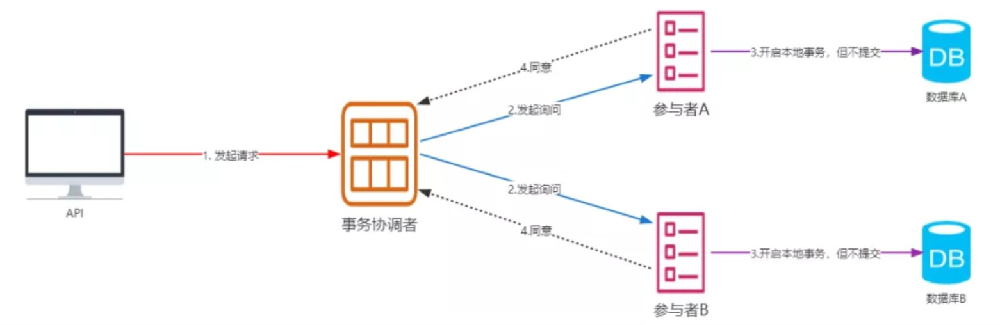

+ ① 协调者向所有参与者发送事务内容，询问是否可以提交事务，并等待答复
+ ② 各参与者执行本地事务操作，将 undo 和 redo 信息记入事务日志中（但不提交事务）
+ ③ 如参与者执行成功，给协调者反馈同意，否则反馈中止，表示事务不可以执行

### **2、第二阶段：提交阶段**
协调者收到各个参与者的准备消息后，根据反馈情况通知各个参与者commit提交或者rollback回滚

**（1）事务提交：**

当第一阶段所有参与者都反馈同意时，协调者发起正式提交事务的请求，当所有参与者都回复同意时，则意味着完成事务，具体流程如下：

+ ① 协调者节点向所有参与者节点发出正式提交的 commit 请求。
+ ② 收到协调者的 commit 请求后，参与者正式执行事务提交操作，并释放在整个事务期间内占用的资源。
+ ③ 参与者完成事务提交后，向协调者节点发送ACK消息。
+ ④ 协调者节点收到所有参与者节点反馈的ACK消息后，完成事务。

所以，正常提交时，事务的完整流程图如下：

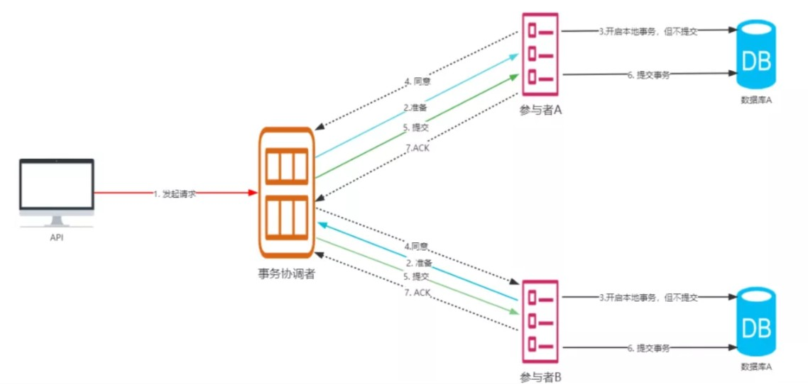

**（2）事务回滚：**

如果任意一个参与者节点在第一阶段返回的消息为中止，或者协调者节点在第一阶段的询问超时之前无法获取所有参与者节点的响应消息时，那么这个事务将会被回滚，具体流程如下：

+ ① 协调者向所有参与者发出 rollback 回滚操作的请求
+ ② 参与者利用阶段一写入的undo信息执行回滚，并释放在整个事务期间内占用的资源
+ ③ 参与者在完成事务回滚之后，向协调者发送回滚完成的ACK消息
+ ④ 协调者收到所有参与者反馈的ACK消息后，取消事务

所以，事务回滚时，完整流程图如下：

 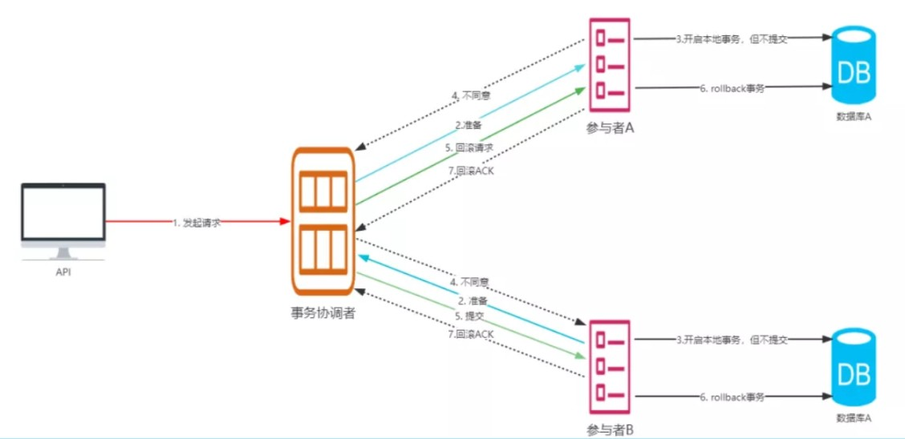

### **3、2PC的缺点：**
二阶段提交确实能够提供原子性的操作，但是不幸的是，二阶段提交还是有几个缺点的：

（1）性能问题：执行过程中，所有参与节点都是事务阻塞性的，当参与者占有公共资源时，其他第三方节点访问公共资源就不得不处于阻塞状态，为了数据的一致性而牺牲了可用性，对性能影响较大，不适合高并发高性能场景

（2）可靠性问题：2PC非常依赖协调者，当协调者发生故障时，尤其是第二阶段，那么所有的参与者就会都处于锁定事务资源的状态中，而无法继续完成事务操作（如果是协调者挂掉，可以重新选举一个协调者，但是无法解决因为协调者宕机导致的参与者处于阻塞状态的问题）

（3）数据一致性问题：在阶段二中，当协调者向参与者发送commit请求之后，发生了局部网络异常或者在发送commit请求过程中协调者发生了故障，这会导致只有一部分参与者接受到了commit请求。而在这部分参与者接到commit请求之后就会执行commit操作。但是其他部分未接到commit请求的机器则无法执行事务提交。于是整个分布式系统便出现了数据部一致性的现象。

（4）二阶段无法解决的问题：协调者在发出 commit 消息之后宕机，而唯一接收到这条消息的参与者同时也宕机了，那么即使协调者通过选举协议产生了新的协调者，这条事务的状态也是不确定的，没人知道事务是否被已经提交。

## **二、3PC：**
3PC，三阶段提交协议，是二阶段提交协议的改进版本，三阶段提交有两个改动点：

+ （1）在协调者和参与者中都引入超时机制
+ （2）在第一阶段和第二阶段中插入一个准备阶段，保证了在最后提交阶段之前各参与节点的状态是一致的。

所以3PC会分为3个阶段，CanCommit 准备阶段、PreCommit 预提交阶段、DoCommit 提交阶段，处理流程如下：

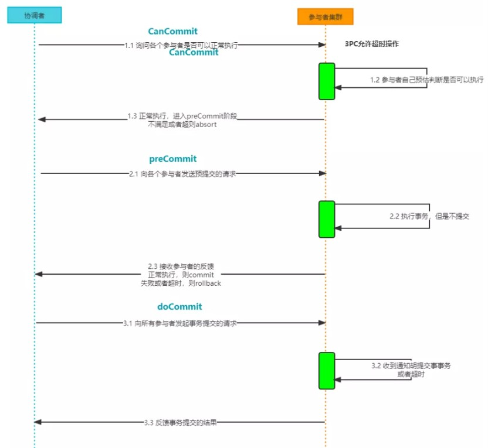

### **1、阶段一：CanCommit 准备阶段**
协调者向参与者发送 canCommit 请求，参与者如果可以提交就返回Yes响应，否则返回No响应，具体流程如下：

+ （1）事务询问：协调者向所有参与者发出包含事务内容的 canCommit 请求，询问是否可以提交事务，并等待所有参与者答复。
+ （2）响应反馈：参与者收到 canCommit 请求后，如果认为可以执行事务操作，则反馈 yes 并进入预备状态，否则反馈 no。

### **2、阶段二：PreCommit 阶段**
协调者根据参与者的反应情况来决定是否可以进行事务的 PreCommit 操作。根据响应情况，有以下两种可能：

**（1）执行事务：**

假如所有参与者均反馈 yes，协调者预执行事务，具体如下：

+ ① 发送预提交请求：协调者向参与者发送 PreCommit 请求，并进入准备阶段
+ ② 事务预提交 ：参与者接收到 PreCommit 请求后，会执行本地事务操作，并将 undo 和 redo 信息记录到事务日志中（但不提交事务）
+ ③ 响应反馈 ：如果参与者成功的执行了事务操作，则返回ACK响应，同时开始等待最终指令。

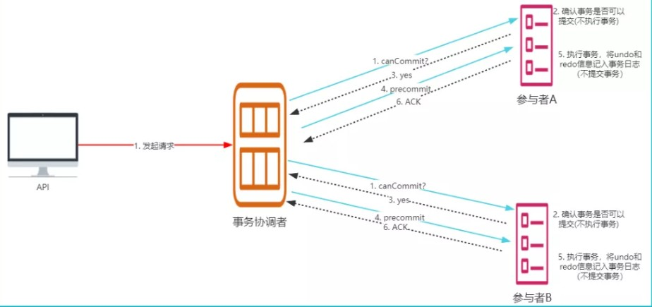

**（2）中断事务：**

假如有任何一个参与者向协调者发送了No响应，或者等待超时之后，协调者都没有接到参与者的响应，那么就执行事务的中断，流程如下：

+ ① 发送中断请求 ：协调者向所有参与者发送 abort 请求。
+ ② 中断事务 ：参与者收到来自协调者的 abort 请求之后（或超时之后，仍未收到协调者的请求），执行事务的中断。

 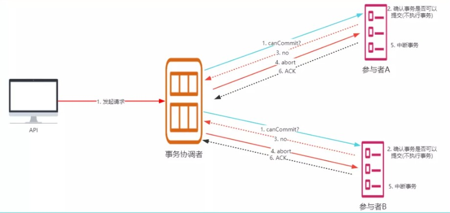

### **3、阶段三：doCommit阶段**
该阶段进行真正的事务提交，也可以分为以下两种情况：

**（1）提交事务：**

+ ① 发送提交请求：协调接收到所有参与者发送的ACK响应，那么他将从预提交状态进入到提交状态，并向所有参与者发送 doCommit 请求
+ ② 本地事务提交：参与者接收到doCommit请求之后，执行正式的事务提交，并在完成事务提交之后释放所有事务资源
+ ③ 响应反馈：事务提交完之后，向协调者发送ack响应。
+ ④ 完成事务：协调者接收到所有参与者的ack响应之后，完成事务。

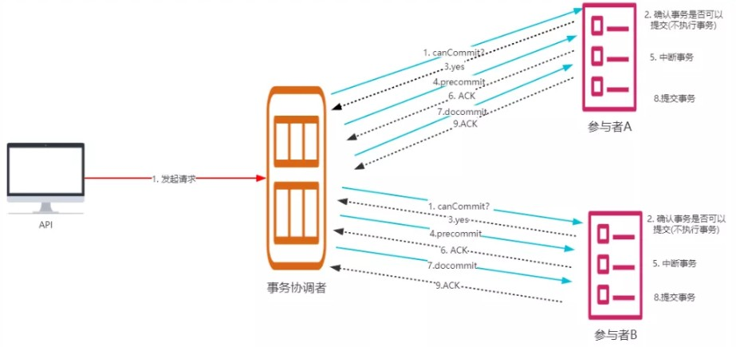

**（2）中断事务：**任何一个参与者反馈 no，或者等待超时后协调者尚无法收到所有参与者的反馈，即中断事务

+ ① 发送中断请求：如果协调者处于工作状态，向所有参与者发出 abort 请求
+ ② 事务回滚：参与者接收到abort请求之后，利用其在阶段二记录的undo信息来执行事务的回滚操作，并在完成回滚之后释放所有的事务资源。
+ ③ 反馈结果：参与者完成事务回滚之后，向协调者反馈ACK消息
+ ④ 中断事务：协调者接收到参与者反馈的ACK消息之后，执行事务的中断。

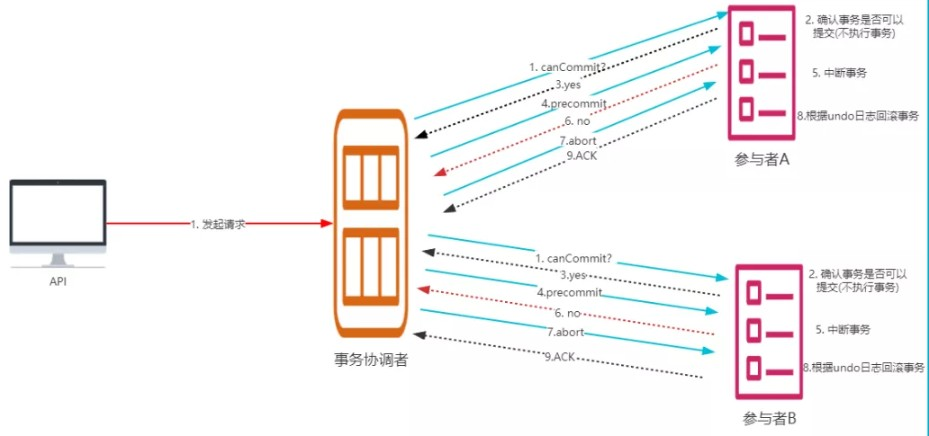

进入doCommit阶段后，无论协调者出现问题，或者协调者与参与者之间的网络出现问题，都会导致参与者无法接收到协调者发出的 doCommit 请求或 abort 请求。此时，参与者都会在等待超时之后，继续执行事务提交。这其实基于概率来决定的，当进入第三阶段时，说明第一阶段收到所有参与者的CanCommit响应都是Yes，意味着大家都同意修改了，并且第二阶段所有的参与者对协调者的PreCommit请求也都是同意的。所以，一句话概括就是，当进入第三阶段时，由于网络超时等原因，虽然参与者没有收到commit或者abort响应，但是他有理由相信：成功提交的几率很大。

### **4、3PC的优缺点：**
与2PC相比，3PC降低了阻塞范围，并且在等待超时后，协调者或参与者会中断事务，避免了协调者单点问题，阶段三中协调者出现问题时，参与者会继续提交事务。

数据不一致问题依然存在，当在参与者收到 preCommit 请求后等待 doCommit 指令时，此时如果协调者请求中断事务，而协调者因为网络问题无法与参与者正常通信，会导致参与者继续提交事务，造成数据不一致。

2PC和3PC都无法保证数据绝对的一致性，一般为了预防这种问题，可以添加一个报警，比如监控到事务异常的时候，通过脚本自动补偿差异的信息。

## **三、TCC：**
### **1、什么是TCC：**
TCC（Try Confirm Cancel）是应用层的两阶段提交，所以对代码的侵入性强，其核心思想是：针对每个操作，都要实现对应的确认和补偿操作，也就是业务逻辑的每个分支都需要实现 try、confirm、cancel 三个操作，第一阶段由业务代码编排来调用Try接口进行资源预留，当所有参与者的 Try 接口都成功了，事务协调者提交事务，并调用参与者的 confirm 接口真正提交业务操作，否则调用每个参与者的 cancel 接口回滚事务，并且由于 confirm 或者 cancel 有可能会重试，因此对应的部分需要支持幂等。

### **2、TCC的执行流程：**
TCC的执行流程可以分为两个阶段，分别如下：

（1）第一阶段：Try，业务系统做检测并预留资源 (加锁，锁住资源)，比如常见的下单，在try阶段，我们不是真正的减库存，而是把下单的库存给锁定住。

（2）第二阶段：根据第一阶段的结果决定是执行confirm还是cancel

+ Confirm：执行真正的业务（执行业务，释放锁）
+ Cancle：是对Try阶段预留资源的释放（出问题，释放锁）

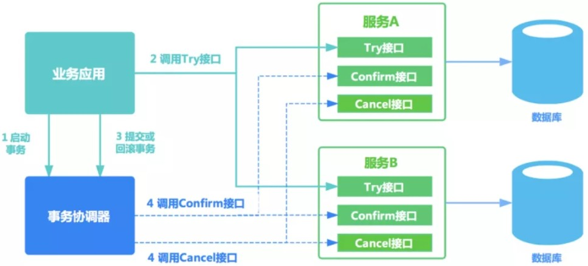

### **3、TCC如何保证最终一致性：**
+ TCC 事务机制以 Try 为中心的，Confirm 确认操作和 Cancel 取消操作都是围绕 Try 而展开。因此，Try 阶段中的操作，其保障性是最好的，即使失败，仍然有 Cancel 取消操作可以将其执行结果撤销。
+ Try阶段执行成功并开始执行 Confirm 阶段时，默认 Confirm 阶段是不会出错的，也就是说只要 Try 成功，Confirm 一定成功（TCC设计之初的定义）
+ Confirm 与 Cancel 如果失败，由TCC框架进行重试补偿
+ 存在极低概率在CC环节彻底失败，则需要定时任务或人工介入

### **4、TCC的注意事项：**
**（1）允许空回滚：**

空回滚出现的原因是 Try 超时或者丢包，导致 TCC 分布式事务二阶段的 回滚，触发 Cancel 操作，此时事务参与者未收到Try，但是却收到了Cancel 请求，如下图所示：

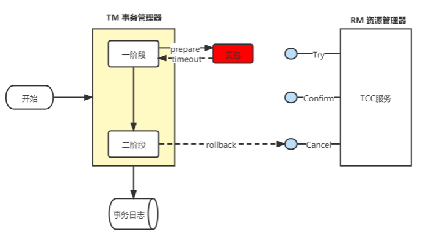

所以 cancel 接口在实现时需要允许空回滚，也就是 Cancel 执行时如果发现没有对应的事务 xid 或主键时，需要返回回滚成功，让事务服务管理器认为已回滚。

**（2）防悬挂控制：**

悬挂指的是二阶段的 Cancel 比 一阶段的Try 操作先执行，出现该问题的原因是 Try 由于网络拥堵而超时，导致事务管理器生成回滚，触发 Cancel 接口，但之后拥堵在网络的 Try 操作又被资源管理器收到了，但是 Cancel 比 Try 先到。但按照前面允许空回滚的逻辑，回滚会返回成功，事务管理器认为事务已回滚成功，所以此时应该拒绝执行空回滚之后到来的 Try 操作，否则会产生数据不一致。因此我们可以在 Cancel 空回滚返回成功之前，先记录该条事务 xid 或业务主键，标识这条记录已经回滚过，Try 接口执行前先检查这条事务xid或业务主键是否已经标记为回滚成功，如果是则不执行 Try 的业务操作。

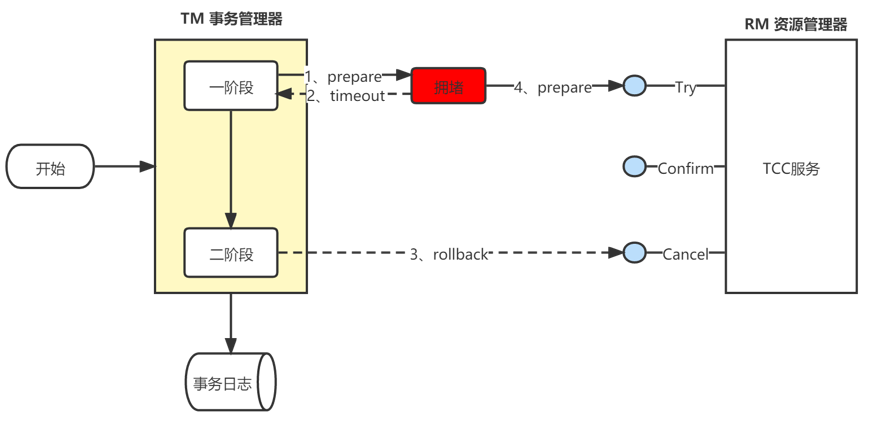

**（3）幂等控制：**

由于网络原因或者重试操作都有可能导致 Try - Confirm - Cancel 3个操作的重复执行，所以使用 TCC 时需要注意这三个操作的幂等控制，通常我们可以使用事务 xid 或业务主键判重来控制。

### **5、TCC方案的优缺点：**
（1）TCC 事务机制相比于上面介绍的 XA 事务机制，有以下优点：

+ 性能提升：具体业务来实现，控制资源锁的粒度变小，不会锁定整个资源。
+ 数据最终一致性：基于 Confirm 和 Cancel 的幂等性，保证事务最终完成确认或者取消，保证数据的一致性。
+ 可靠性：解决了 XA 协议的协调者单点故障问题，由主业务方发起并控制整个业务活动，业务活动管理器也变成多点，引入集群。

（2）缺点：TCC 的 Try、Confirm 和 Cancel 操作功能要按具体业务来实现，业务耦合度较高，提高了开发成本。

## **四、Saga事务：**
### **1、什么是Saga事务：**
Saga 事务核心思想是将长事务拆分为多个本地短事务并依次正常提交，如果所有短事务均执行成功，那么分布式事务提交；如果出现某个参与者执行本地事务失败，则由 Saga 事务协调器协调根据相反顺序调用补偿操作，回滚已提交的参与者，使分布式事务回到最初始的状态。Saga 事务基本协议如下：

+ （1）每个 Saga 事务由一系列幂等的有序子事务(sub-transaction) Ti 组成。
+ （2）每个 Ti 都有对应的幂等补偿动作 Ci，补偿动作用于撤销 Ti 造成的结果。

与TCC事务补偿机制相比，TCC有一个预留(Try)动作，相当于先报存一个草稿，然后才提交；Saga事务没有预留动作，直接提交。

### **2、Saga的恢复策略：**
对于事务异常，Saga提供了两种恢复策略，分别如下：

**（1）向后恢复(backward recovery)：**

当执行事务失败时，补偿所有已完成的事务，是“一退到底”的方式，这种做法的效果是撤销掉之前所有成功的子事务，使得整个 Saga 的执行结果撤销。如下图：

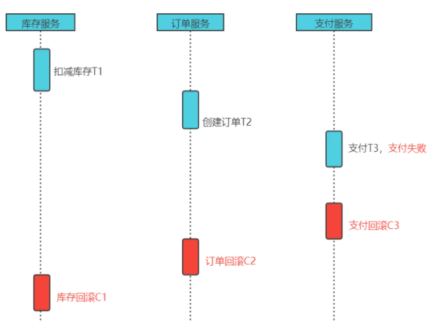

从上图可知事务执行到了支付事务T3，但是失败了，因此事务回滚需要从C3,C2,C1依次进行回滚补偿，对应的执行顺序为：T1,T2,T3,C3,C2,C1。

**（2）向前恢复(forward recovery)：**

对于执行不通过的事务，会尝试重试事务，这里有一个假设就是每个子事务最终都会成功，这种方式适用于必须要成功的场景，事务失败了重试，不需要补偿。流程如下图：

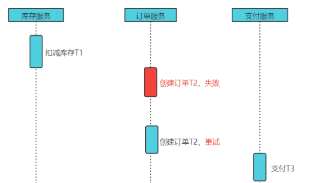

### **3、Saga事务的实现方式：**
Saga事务有两种不同的实现方式，分别如下：

+ 命令协调（Order Orchestrator）
+ 事件编排（Event Choreographyo）

**（1）命令协调：**

中央协调器（Orchestrator，简称 OSO）以命令/回复的方式与每项服务进行通信，全权负责告诉每个参与者该做什么以及什么时候该做什么。整体流程如下图：

 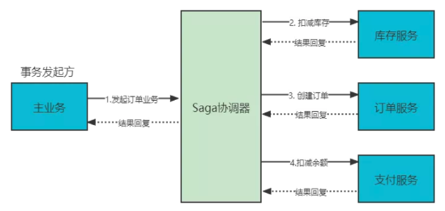

+ ① 事务发起方的主业务逻辑请求 OSO 服务开启订单事务
+ ② OSO 向库存服务请求扣减库存，库存服务回复处理结果。
+ ③ OSO 向订单服务请求创建订单，订单服务回复创建结果。
+ ④ OSO 向支付服务请求支付，支付服务回复处理结果。
+ ⑤ 主业务逻辑接收并处理 OSO 事务处理结果回复。

中央协调器 OSO 必须事先知道执行整个事务所需的流程，如果有任何失败，它还负责通过向每个参与者发送命令来撤销之前的操作来协调分布式的回滚，基于中央协调器协调一切时，回滚要容易得多，因为协调器默认是执行正向流程，回滚时只要执行反向流程即可。

**（2）事件编排：**

命令协调方式基于中央协调器实现，所以有单点风险，但是事件编排方式没有中央协调器。事件编排的实现方式中，每个服务产生自己的事件并监听其他服务的事件来决定是否应采取行动。

在事件编排方法中，第一个服务执行一个事务，然后发布一个事件，该事件被一个或多个服务进行监听，这些服务再执行本地事务并发布（或不发布）新的事件。当最后一个服务执行本地事务并且不发布任何事件时，意味着分布式事务结束，或者它发布的事件没有被任何 Saga 参与者听到都意味着事务结束。

 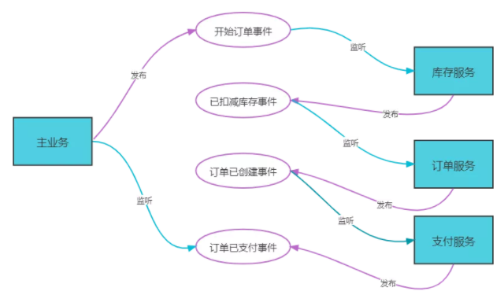

+ ① 事务发起方的主业务逻辑发布开始订单事件。
+ ② 库存服务监听开始订单事件，扣减库存，并发布库存已扣减事件。
+ ③ 订单服务监听库存已扣减事件，创建订单，并发布订单已创建事件。
+ ④ 支付服务监听订单已创建事件，进行支付，并发布订单已支付事件。
+ ⑤ 主业务逻辑监听订单已支付事件并处理。

如果事务涉及 2 至 4 个步骤，则非常合适使用事件编排方式，它是实现 Saga 模式的自然方式，它很简单，容易理解，不需要太多的代码来构建。

### **4、Saga事务的优缺点：**
**（1）命令协调设计的优缺点：**

① 优点：

+ 服务之间关系简单，避免服务间循环依赖，因为 Saga 协调器会调用 Saga 参与者，但参与者不会调用协调器。
+ 程序开发简单，只需要执行命令/回复(其实回复消息也是一种事件消息)，降低参与者的复杂性。
+ 易维护扩展，在添加新步骤时，事务复杂性保持线性，回滚更容易管理，更容易实施和测试。

② 缺点：

+ 中央协调器处理逻辑容易变得庞大复杂，导致难以维护。
+ 存在协调器单点故障风险。

**（2）事件编排设计的优缺点：**

① 优点：

+ 避免中央协调器单点故障风险。
+ 当涉及的步骤较少服务开发简单，容易实现。

② 缺点：

+ 服务之间存在循环依赖的风险。
+ 当涉及的步骤较多，服务间关系混乱，难以追踪调测。

由于 Saga 模型没有 Prepare 阶段，因此事务间不能保证隔离性。当多个 Saga 事务操作同一资源时，就会产生更新丢失、脏数据读取等问题，这时需要在业务层控制并发，例如：在应用层面加锁，或者应用层面预先冻结资源。

## **五、本地消息表：**
### **1、什么是本地消息表：**
本地消息表的核心思路就是将分布式事务拆分成本地事务进行处理，在该方案中主要有两种角色：事务主动方和事务被动方。事务主动发起方需要额外新建事务消息表，并在本地事务中完成业务处理和记录事务消息，并轮询事务消息表的数据发送事务消息，事务被动方基于消息中间件消费事务消息表中的事务。

这样可以避免以下两种情况导致的数据不一致性：

+ 业务处理成功、事务消息发送失败
+ 业务处理失败、事务消息发送成功

### **2、本地消息表的执行流程：**
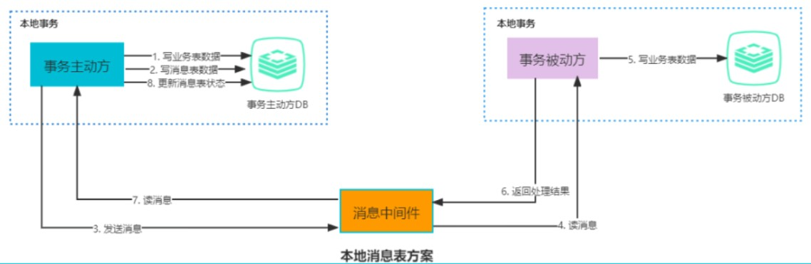

+ ① 事务主动方在同一个本地事务中处理业务和写消息表操作
+ ② 事务主动方通过消息中间件，通知事务被动方处理事务消息。消息中间件可以基于 Kafka、RocketMQ 消息队列，事务主动方主动写消息到消息队列，事务消费方消费并处理消息队列中的消息。
+ ③ 事务被动方通过消息中间件，通知事务主动方事务已处理的消息。
+ ④ 事务主动方接收中间件的消息，更新消息表的状态为已处理。

一些必要的容错处理如下：

+ 当①处理出错，由于还在事务主动方的本地事务中，直接回滚即可
+ 当②、③处理出错，由于事务主动方本地保存了消息，只需要轮询消息重新通过消息中间件发送，通知事务被动方重新读取消息处理业务即可。
+ 如果是业务上处理失败，事务被动方可以发消息给事务主动方回滚事务
+ 如果事务被动方已经消费了消息，事务主动方需要回滚事务的话，需要发消息通知事务主动方进行回滚事务。

### **3、本地消息表的优缺点：**
（1）优点：

+ 从应用设计开发的角度实现了消息数据的可靠性，消息数据的可靠性不依赖于消息中间件，弱化了对 MQ 中间件特性的依赖。
+ 方案轻量，容易实现。

（2）缺点：

+ 与具体的业务场景绑定，耦合性强，不可公用
+ 消息数据与业务数据同库，占用业务系统资源
+ 业务系统在使用关系型数据库的情况下，消息服务性能会受到关系型数据库并发性能的局限

## **六、MQ事务消息：**
### **1、MQ事务消息的执行流程：**
基于MQ的分布式事务方案本质上是对本地消息表的封装，整体流程与本地消息表一致，唯一不同的就是将本地消息表存在了MQ内部，而不是业务数据库中，如下图：

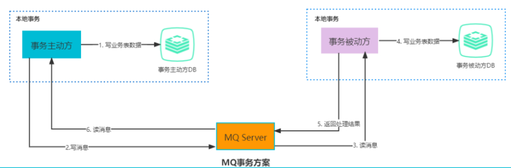

由于将本地消息表存在了MQ内部，那么MQ内部的处理尤为重要，下面主要基于 RocketMQ4.3 之后的版本介绍 MQ 的分布式事务方案

### **2、RocketMQ事务消息：**
在本地消息表方案中，保证事务主动方发写业务表数据和写消息表数据的一致性是基于数据库事务，而 RocketMQ 的事务消息相对于普通 MQ提供了 2PC 的提交接口，方案如下：

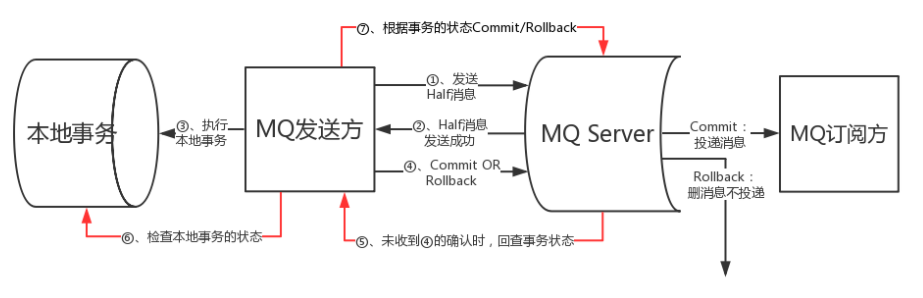

**（1）正常情况：**

在事务主动方服务正常，没有发生故障的情况下，发消息流程如下：

+ 步骤①：发送方向 MQ Server(MQ服务方)发送 half 消息
+ 步骤②：MQ Server 将消息持久化成功之后，向发送方 ack 确认消息已经发送成功
+ 步骤③：发送方开始执行本地事务逻辑
+ 步骤④：发送方根据本地事务执行结果向 MQ Server 提交二次确认（commit 或是 rollback）。
+ 最终步骤：MQ Server 如果收到的是 commit 操作，则将半消息标记为可投递，MQ订阅方最终将收到该消息；若收到的是 rollback 操作则删除 half 半消息，订阅方将不会接受该消息

**（2）异常情况：**

在断网或者应用重启等异常情况下，图中的步骤④提交的二次确认超时未到达 MQ Server，此时的处理逻辑如下：

+ 步骤⑤：MQ Server 对该消息发起消息回查
+ 步骤⑥：发送方收到消息回查后，需要检查对应消息的本地事务执行的最终结果
+ 步骤⑦：发送方根据检查得到的本地事务的最终状态再次提交二次确认。
+ 最终步骤：MQ Server基于 commit/rollback 对消息进行投递或者删除。

### **3、MQ事务消息的优缺点：**
（1）优点：相比本地消息表方案，MQ 事务方案优点是：

+ 消息数据独立存储 ，降低业务系统与消息系统之间的耦合
+ 吞吐量大于使用本地消息表方案

（2）缺点：

+ 一次消息发送需要两次网络请求(half 消息 + commit/rollback 消息) 。
+ 业务处理服务需要实现消息状态回查接口。

## **七、最大努力通知：**
最大努力通知也称为定期校对，是对MQ事务方案的进一步优化。它在事务主动方增加了消息校对的接口，如果事务被动方没有接收到主动方发送的消息，此时可以调用事务主动方提供的消息校对的接口主动获取

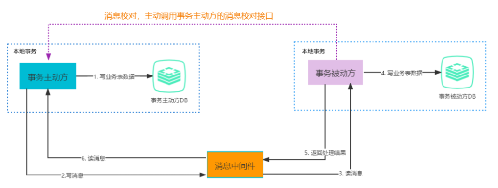

在可靠消息事务中，事务主动方需要将消息发送出去，并且让接收方成功接收消息，这种可靠性发送是由事务主动方保证的；但是最大努力通知，事务主动方仅仅是尽最大努力（重试，轮询....）将事务发送给事务接收方，所以存在事务被动方接收不到消息的情况，此时需要事务被动方主动调用事务主动方的消息校对接口查询业务消息并消费，这种通知的可靠性是由事务被动方保证的。

所以最大努力通知适用于业务通知类型，例如微信交易的结果，就是通过最大努力通知方式通知各个商户，既有回调通知，也有交易查询接口。

## **八、各方案常见使用场景总结：**
+ **2PC/3PC**：依赖于数据库，能够很好的提供强一致性和强事务性，但延迟比较高，比较适合传统的单体应用，在同一个方法中存在跨库操作的情况，不适合高并发和高性能要求的场景。
+ **TCC**：准备阶段业务多，锁粒度小，性能要求高，  只要把try、confirm、cancel各阶段的逻辑捋清楚就可以使用TCC了， 但是存在业务耦合。
+ **本地消息表/MQ 事务**：适用于事务中参与方支持操作幂等，对一致性要求不高，业务上能容忍数据不一致到一个人工检查周期，事务涉及的参与方、参与环节较少，业务上有对账/校验系统兜底。
+ **Saga 事务**：由于 Saga 事务不能保证隔离性，需要在业务层控制并发，适合于业务场景事务并发操作同一资源较少的情况。Saga 由于缺少预提交动作，导致补偿动作的实现比较麻烦，例如业务是发送短信，补偿动作则得再发送一次短信说明撤销，用户体验比较差。所以，Saga 事务较适用于补偿动作容易处理的场景


# 有哪些分布式锁的实现方案

资：12-25K

岗位：中高级开发工程师

### 一、[分布式锁](https://so.csdn.net/so/search?q=%E5%88%86%E5%B8%83%E5%BC%8F%E9%94%81&spm=1001.2101.3001.7020)场景
一般需要使用分布式锁的场景如下：

+ 效率：使用分布式锁可以避免不同节点重复相同的工作，比如避免重复执行定时任务等；
+ 正确性：使用分布式锁同样可以避免破坏数据正确性，如果两个节点在同一条数据上面操作，可能会出现并发问题。

### 二、分布式锁特点
一个完善的分布式锁需要满足以下特点：

+ 互斥性：互斥是所得基本特性，分布式锁需要按需求保证线程或节点级别的互斥。；
+ 可重入性：同一个节点或同一个线程获取锁，可以再次重入获取这个锁；
+ 锁超时：支持锁超时释放，防止某个节点不可用后，持有的锁无法释放；
+ 高效性：加锁和解锁的效率高，可以支持高并发；
+ 高可用：需要有高可用机制预防锁服务不可用的情况，如增加降级；
+ 阻塞性：支持阻塞获取锁和非阻塞获取锁两种方式；
+ 公平性：支持公平锁和非公平锁两种类型的锁，公平锁可以保证安装请求锁的顺序获取锁，而非公平锁不可以。

### 三、分布式锁的实现
分布式锁常见的实现有三种实现，下文我们会一一介绍这三种锁的实现方式：

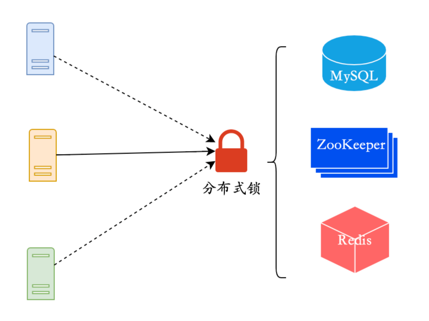

+ 基于数据库的分布式锁；
+ 基于Redis的分布式锁；
+ 基于Zookeeper的分布式锁。

### 1、基于数据库的分布式锁
用数据库实现分布式锁比较简单，就是创建一张锁表，数据库对字段作唯一性约束。

加锁的时候，在锁表中增加一条记录即可；释放锁的时候删除记录就行。

如果有并发请求同时提交到数据库，数据库会保证只有一个请求能够得到锁。

这种属于数据库 IO 操作，效率不高，而且频繁操作会增大数据库的开销，因此这种方式在高并发、高性能的场景中用的不多。

#### 方案概览
我们上面列举出了分布式锁需要满足的特点，使用数据库实现分布式锁也需要满足这些特点，下面我们来一一介绍实现方法：

+ 互斥性：通过数据库update的原子性达到两次获取锁之间的互斥性；
+ 可重入性：在数据库中保留一个字段存储当前锁的持有者；
+ 锁超时：在数据库中存储锁的获取时间点和超时时长；
+ 高效性：数据库本身可以支持比较高的并发；
+ 高可用：可以增加主从数据库逻辑，提升数据库的可用性；
+ 阻塞性：可以通过看门狗轮询的方式实现线程的阻塞；
+ 公平性：可以添加锁队列，不过不建议，实现起来比较复杂。

#### 表结构设计
数据库的表名为lock，各个字段的定义如下所示：

| **字段名名称** | **字段类型** | **说明** |
| :--- | :--- | :--- |
| lock_key | varchar | 锁的唯一标识符号 |
| lock_time | timestample | 加锁的时间 |
| lock_duration | integer | 锁的超时时长，单位可以业务自定义，通常为秒 |
| lock_owner | varchar | 锁的持有者，可以是节点或线程的唯一标识，不同可重入粒度的锁有不同的含义 |
| locked | boolean | 当前锁是否被占有 |

#### 获取锁的SQL语句
获取锁的SQL语句分不同的情况，如果锁不存在，那么首先需要创建锁，并且创建锁的线程可以获取锁：

```plain
insert into lock(lock_key,lock_time,lock_duration,lock_owner,locked) values ('xxx',now(),1000,'ownerxxx',true)
```

如果锁已经存在，那么就尝试更新锁的信息，如果更新成功则表示获取锁成功，更新失败则表示获取锁失败。

```sql
update lock set
    locked = true,
    lock_owner = 'ownerxxxx',
    lock_time = now(),
    lock_duration = 1000
where
    lock_key='xxx' and(
      lock_owner = 'ownerxxxx' or
      locked = false or
      date_add(lock_time, interval lock_duration second) > now())
```

#### 释放锁的SQL语句
当用户使用完锁需要释放的时候，可以直接更新locked标识位为false。

```plsql
update lock set
    locked = false,
where
    lock_key='xxx' and
    lock_owner = 'ownerxxxx' and
    locked = true
```

#### 看门狗
通过上面的步骤，我们可以实现获取锁和释放锁，那么看门狗又是做什么的呢？

大家想象一下，如果用户获取锁到释放锁之间的时间大于锁的超时时间，是不是会有问题？是不是可能会出现多个节点同时获取锁的情况？这个时候就需要看门狗了，看门狗可以通过定时任务不断刷新锁的获取事件，从而在用户获取锁到释放锁期间保持一直持有锁。

### 2、基于Redis的分布式锁
Redis的Java客户端Redisson实现了分布式锁，我们可以通过类似ReentrantLock的加锁-释放锁的逻辑来实现分布式锁。

```java
RLock disLock = redissonClient.getLock("DISLOCK");
disLock.lock();
try {
    // 业务逻辑
} finally {
    // 无论如何, 最后都要解锁
    disLock.unlock();
}
```

#### Redisson分布式锁的底层原理
如下图为Redisson客户端加锁和释放锁的逻辑：

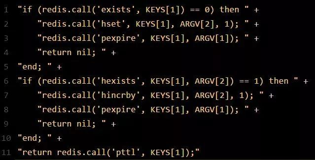

####
#### 加锁机制
从上图中可以看出来，Redisson客户端需要获取锁的时候，要发送一段Lua脚本到Redis集群执行，为什么要用Lua脚本呢？因为一段复杂的业务逻辑，可以通过封装在Lua脚本中发送给Redis，保证这段复杂业务逻辑执行的原子性。

**Lua源码分析**：如下为Redisson加锁的lua源码，接下来我们会对源码进行分析。

**源码入参**：Lua脚本有三个输入参数：KEYS[1]、ARGV[1]和ARGV[2]，含义如下：

+ KEYS[1]代表的是加锁的Key，例如RLock lock = redisson.getLock("myLock")中的“myLock”；
+ ARGV[1]代表的就是锁Key的默认生存时间，默认30秒；
+ ARGV[2]代表的是加锁的客户端的ID，类似于下面这样的：8743c9c0-0795-4907-87fd-6c719a6b4586:1。

Lua脚本及加锁步骤如下代码块所示，可以看出其大致原理为：

+ 锁不存在的时候，创建锁并设置过期时间；
+ 锁存在的时候，如果是重入场景则刷新锁的过期事件；
+ 否则返回加锁失败和锁的过期时间。

```java
-- 判断锁是不是存在
if (redis.call('exists', KEYS[1]) == 0) then
    -- 添加锁，并且设置客户端和初始锁重入次数
    redis.call('hincrby', KEYS[1], ARGV[2], 1);
    -- 设置锁的超时事件
    redis.call('pexpire', KEYS[1], ARGV[1]);
    -- 返回加锁成功
    return nil;
end;
-- 判断当前锁的持有者是不是请求锁的请求者
if (redis.call('hexists', KEYS[1], ARGV[2]) == 1) then
    -- 当前锁被请求者持有，重入锁，增加锁重入次数
    redis.call('hincrby', KEYS[1], ARGV[2], 1);
    -- 刷新锁的过期时间
    redis.call('pexpire', KEYS[1], ARGV[1]);
    -- 返回加锁成功
    return nil;
end;
-- 返回当前锁的过期时间
return redis.call('pttl', KEYS[1]);
```

#### 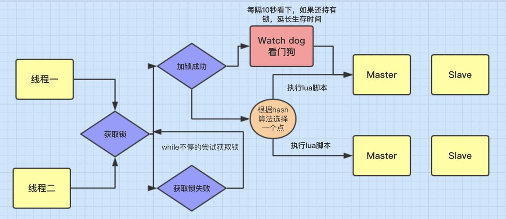
#### 看门狗逻辑
客户端1加锁的锁Key默认生存时间才30秒，如果超过了30秒，客户端1还想一直持有这把锁，怎么办呢？只要客户端1加锁成功，就会启动一个watchdog看门狗，这个后台线程，会每隔10秒检查一下，如果客户端1还持有锁Key，就会不断的延长锁Key的生存时间。

#### 释放锁机制
如果执行lock.unlock()，就可以释放分布式锁，此时的业务逻辑也是非常简单的。就是每次都对myLock数据结构中的那个加锁次数减1。

如果发现加锁次数是0了，说明这个客户端已经不再持有锁了，此时就会用：“del myLock”命令，从Redis里删除这个Key。

而另外的客户端2就可以尝试完成加锁了。这就是所谓的分布式锁的开源Redisson框架的实现机制。

一般我们在生产系统中，可以用Redisson框架提供的这个类库来基于Redis进行分布式锁的加锁与释放锁。

#### Redisson分布式锁的缺陷
Redis分布式锁会有个缺陷，就是在Redis哨兵模式下:

1. 客户端1对某个master节点写入了redisson锁，此时会异步复制给对应的slave节点。但是这个过程中一旦发生master节点宕机，主备切换，slave节点从变为了master节点。
2. 客户端2来尝试加锁的时候，在新的master节点上也能加锁，此时就会导致多个客户端对同一个分布式锁完成了加锁。
3. 系统在业务语义上一定会出现问题，导致各种脏数据的产生。

这个缺陷导致在哨兵模式或者主从模式下，如果master实例宕机的时候，可能导致多个客户端同时完成加锁。

### 四、基于Zookeeper的分布式锁
Zookeeper实现的分布式锁适用于引入Zookeeper的服务，如下所示，有两个服务注册到Zookeeper，并且都需要获取Zookeeper上的分布式锁，流程式什么样的呢？

首先，在 Zookeeper 当中创建一个持久节点 ParentLock。当第一个客户端想要获得锁时，需要在ParentLock这个节点下面创建一个临时顺序节点 Lock1。

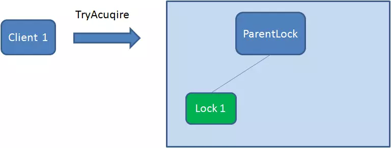之后，Client1 查找 ParentLock 下面所有的临时顺序节点并排序，判断自己所创建的节点 Lock1 是不是顺序最靠前的一个。如果是第一个节点，则成功获得锁。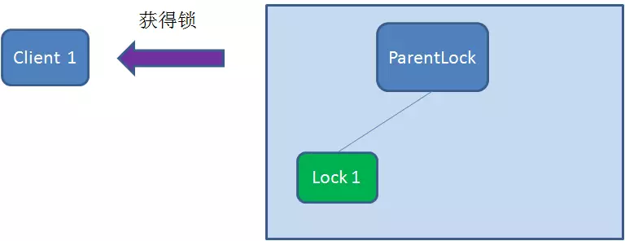这时候，如果再有一个客户端 Client2 前来获取锁，则在 ParentLock 下再创建一个临时顺序节点Lock2。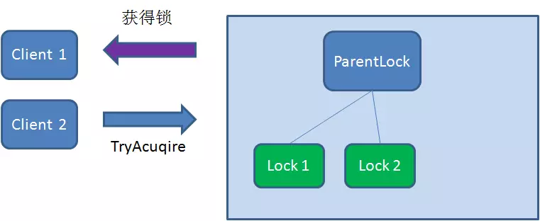Client2 查找 ParentLock 下面所有的临时顺序节点并排序，判断自己所创建的节点 Lock2 是不是顺序最靠前的一个，结果发现节点 Lock2 并不是最小的。

于是，Client2 向排序仅比它靠前的节点 Lock1 注册 Watcher，用于监听 Lock1 节点是否存在。这意味着 Client2 抢锁失败，进入了等待状态。

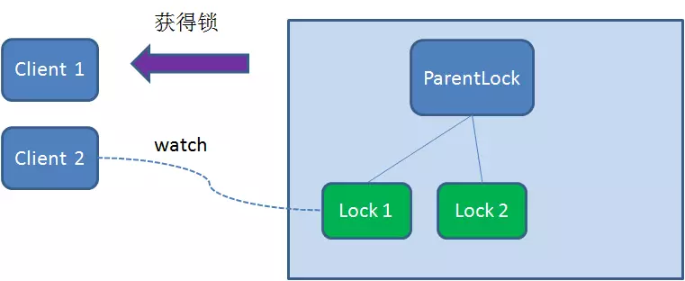这时候，如果又有一个客户端 Client3 前来获取锁，则在ParentLock下载再创建一个临时顺序节点Lock3。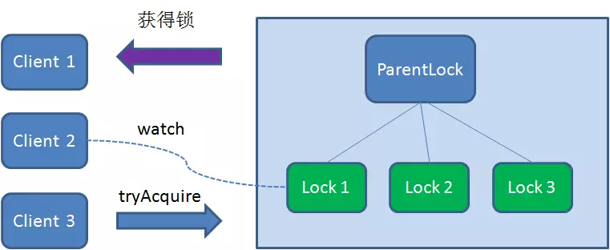Client3 查找 ParentLock 下面所有的临时顺序节点并排序，判断自己所创建的节点 Lock3 是不是顺序最靠前的一个，结果同样发现节点 Lock3 并不是最小的。

于是，Client3 向排序仅比它靠前的节点 Lock2 注册 Watcher，用于监听 Lock2 节点是否存在。这意味着 Client3 同样抢锁失败，进入了等待状态。

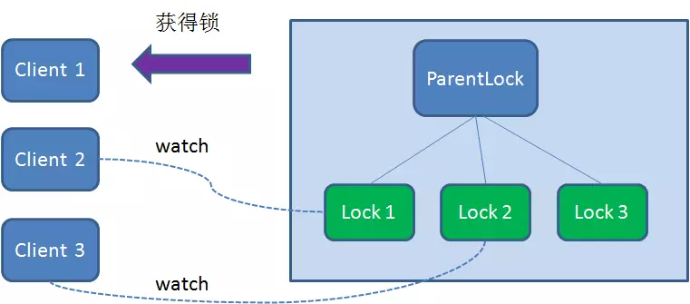这样一来，Client1 得到了锁，Client2 监听了 Lock1，Client3 监听了 Lock2。这恰恰形成了一个等待队列，很像是 Java 当中 ReentrantLock 所依赖的 AQS（AbstractQueuedSynchronizer）。

### 释放锁
释放锁分为两种情况：

1、任务完成，客户端显示释放

当任务完成时，Client1 会显示调用删除节点 Lock1 的指令。

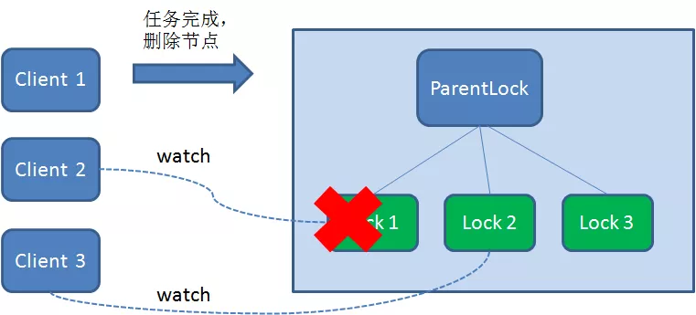2.任务执行过程中，客户端崩溃

获得锁的 Client1 在任务执行过程中，如果 Duang 的一声崩溃，则会断开与 Zookeeper 服务端的链接。根据临时节点的特性，相关联的节点 Lock1 会随之自动删除。

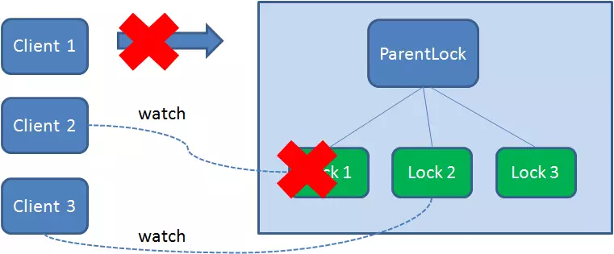

由于 Client2 一直监听着 Lock1 的存在状态，当 Lock1 节点被删除，Client2 会立刻收到通知。这时候 Client2 会再次查询 ParentLock 下面的所有节点，确认自己创建的节点 Lock2 是不是目前最小的节点。如果是最小，则 Client2 顺理成章获得了锁。

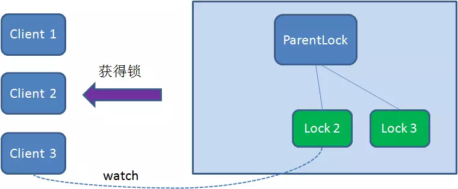同理，如果 Client2 也因为任务完成或者节点崩溃而删除了节点 Lock2，那么 Client3 就会接到通知。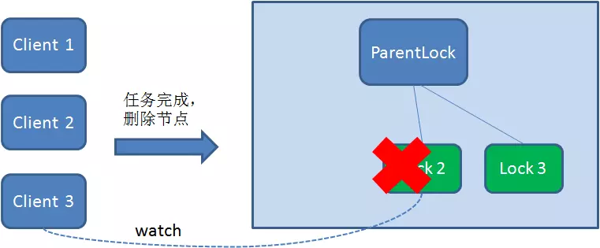最终，Client3 成功得到了锁。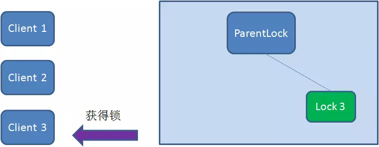

### 五、三种锁的优缺点
**基于数据库的分布式锁**：

+ 数据库并发性能较差；
+ 阻塞式锁实现比较复杂；
+ 公平锁实现比较复杂。

**基于Redis的分布式锁**：

+ 主从切换的情况下可能出现多客户端获取锁的情况；
+ Lua脚本在单机上具有原子性，主从同步时不具有原子性。

**基于Zookeeper的分布式锁**：

+ 需要引入Zookeeper集群，比较重量级；
+ 分布式锁的可重入粒度只能是节点级别；


# 为什么CAP原则不能全部满足

## (1) 场景
如下图，是我们证明CAP的基本场景，分布式网络中有两个节点Host1和Host2，他们之间网络可以连通，Host1中运行Process1程序和对应的数据库Data，Host2中运行Process2程序和对应数据库Data。

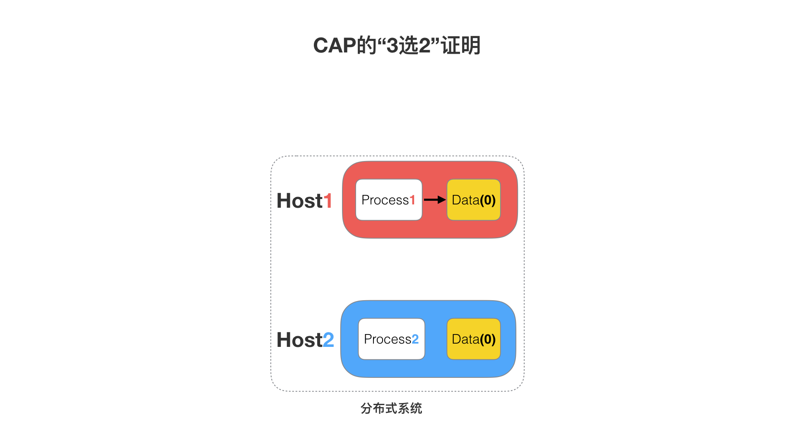

## (2) CAP特性
+ 如果满足一致性(C)：那么Data(0) = Data(0).
+ 如果满足可用性(A): 用户不管请求Host1或Host2，都会立刻响应结果。
+ 如果满足分区容错性(P): Host1或Host2有一方脱离系统(故障)， 都不会影响Host1和Host2彼此之间正常运作。

## (3) 分布式系统正常运行流程
如下图，是分布式系统正常运转的流程。

> A、用户向Host1主机请求数据更新，程序Process1更新数据库Data(0)为Data(1)
>
> B、分布式系统将数据进行同步操作，将Host1中的Data(1)同步的Host2中``Data(0),使Host2中的数据也变为Data(1)`
>
> C、当用户请求主机Host2时，则Process2则响应最新的Data(1)数据
>

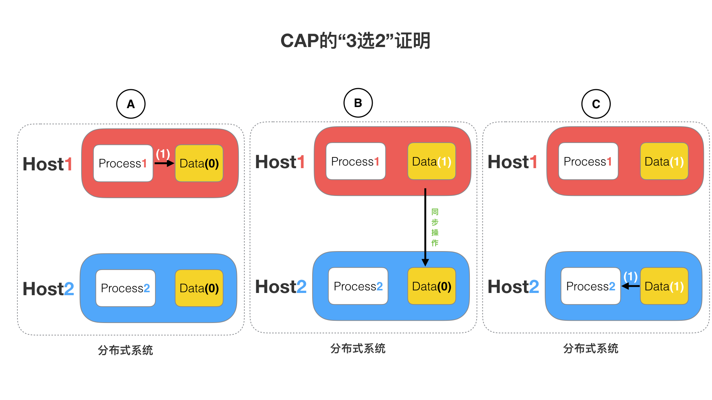

根据CAP的特性：

> 1.Host1和Host2的数据库Data之间的数据是否一样为一致性©
>
> 2.用户对Host1和Host2的请求响应为可用性(A)
>
> 3.Host1和Host2之间的各自网络环境为分区容错性§
>

当前是一个正常运作的流程，目前CAP三个特性可以同时满足，也是一个理想状态,但是实际应用场景中，发生错误在所难免，那么如果发生错误CAP是否能同时满足，或者该如何取舍？

## (4) 分布式系统异常运行流程
假设Host1和Host2之间的网络断开了，我们要支持这种网络异常，相当于要满足分区容错性(P)，能不能同时满足一致性(C)和可用响应性(A)呢？

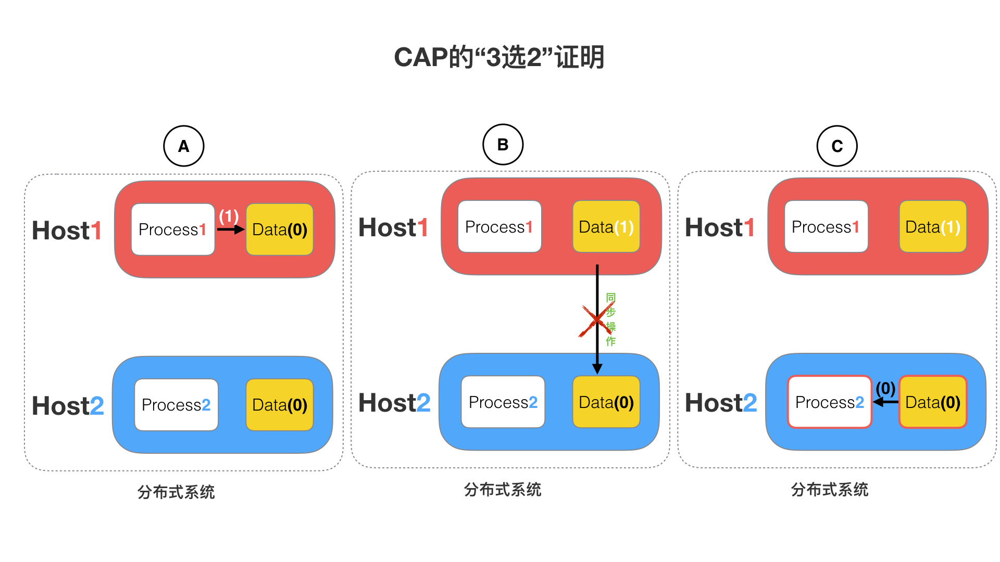

假设在N1和N2之间网络断开的时候，

> A、用户向Host1发送数据更新请求，那Host1中的数据Data(0)将被更新为Data(1)
>
> B、弱此时Host1和Host2网络是断开的，所以分布式系统同步操作将失败，Host2中的数据依旧是Data(0)
>
> C、有用户向Host2发送数据读取请求，由于数据还没有进行同步，Process2没办法立即给用户返回最新的数据V1，那么将面临两个选择。
>
> 第一，牺牲数据一致性(c)，响应旧的数据Data(0)给用户；
>
> 第二，牺牲可用性(A)，阻塞等待，直到网络连接恢复，数据同步完成之后，再给用户响应最新的数据Data(1)。
>
> 这个过程，证明了要满足分区容错性(p)的分布式系统，只能在一致性(C)和可用性(A)两者中，选择其中一个。
>

## (5) "3选2"的必然性
> 通过CAP理论，我们知道无法同时满足一致性、可用性和分区容错性这三个特性，那要舍弃哪个呢？
>

### CA 放弃 P
一个分布式系统中，不可能存在不满足P，放弃分区容错性(p)，即不进行分区，不考虑由于网络不通或结点挂掉的问题，则可以实现一致性和可用性。那么系统将不是一个标准的分布式系统。我们最常用的关系型数据就满足了CA，如下：

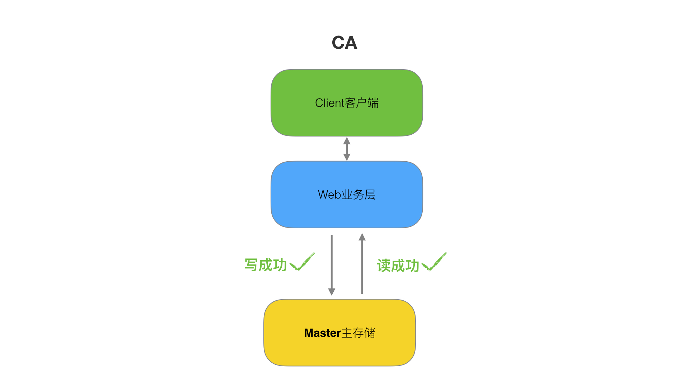

主数据库和从数据库中间不再进行数据同步，数据库可以响应每次的查询请求，通过事务(原子性操作)隔离级别实现每个查询请求都可以返回最新的数据。

> 注意：
>
> 对于一个分布式系统来说。P是一个基本要求，CAP三者中，只能在CA两者之间做权衡，并且要想尽办法提升P。
>

### CP 放弃 A
如果一个分布式系统不要求强的可用性，即容许系统停机或者长时间无响应的话，就可以在CAP三者中保障CP而舍弃A。

放弃可用性，追求一致性和分区容错性，如Redis、HBase等，还有分布式系统中常用的Zookeeper也是在CAP三者之中选择优先保证CP的。

场景：

跨行转账，一次转账请求要等待双方银行系统都完成整个事务才算完成。

### AP 放弃 C
放弃一致性，追求分区容忍性和可用性。这是很多分布式系统设计时的选择。实现AP，前提是只要用户可以接受所查询的到数据在一定时间内不是最新的即可。

通常实现AP都会保证最终一致性，后面讲的BASE理论就是根据AP来扩展的。

场景1：

淘宝订单退款。今日退款成功，明日账户到账，只要用户可以接受在一定时间内到账即可。

场景2：

12306的买票。都是在可用性和一致性之间舍弃了一致性而选择可用性。

你在12306买票的时候肯定遇到过这种场景，当你购买的时候提示你是有票的（但是可能实际已经没票了），你也正常的去输入验证码，下单了。但是过了一会系统提示你下单失败，余票不足。这其实就是先在可用性方面保证系统可以正常的服务，然后在数据的一致性方面做了些牺牲，会影响一些用户体验，但是也不至于造成用户流程的严重阻塞。

但是，我们说很多网站牺牲了一致性，选择了可用性，这其实也不准确的。就比如上面的买票的例子，其实舍弃的只是强一致性。退而求其次保证了最终一致性。也就是说，虽然下单的瞬间，关于车票的库存可能存在数据不一致的情况，但是过了一段时间，还是要保证最终一致性的。

## (6) 总结:
**CA 放弃 P**：如果不要求P（不允许分区），则C（强一致性）和A（可用性）是可以保证的。这样分区将永远不会存在，因此CA的系统更多的是允许分区后各子系统依然保持CA。

**CP 放弃 A**：如果不要求A（可用），相当于每个请求都需要在Server之间强一致，而P（分区）会导致同步时间无限延长，如此CP也是可以保证的。很多传统的数据库分布式事务都属于这种模式。

**AP 放弃 C**：要高可用并允许分区，则需放弃一致性。一旦分区发生，节点之间可能会失去联系，为了高可用，每个节点只能用本地数据提供服务，而这样会导致全局数据的不一致性。现在众多的NoSQL都属于此类。

## 思考：
按照CAP理论如何设计一个电商系统？

首先个电商网站核心模块有用户，订单，商品，支付，促销管理等

1、对于用户模块，包括登录，个人设置，个人订单，购物车，收藏夹等，这些模块保证AP，数据短时间不一致不影响使用。

2、订单模块的下单付款扣减库存操作是整个系统的核心，CA都需要保证，极端情况下面牺牲A保证C

3、商品模块的商品上下架和库存管理保证CP

4、搜索功能因为本身就不是实时性非常高的模块，所以保证AP就可以了。

5、促销是短时间的数据不一致，结果就是优惠信息看不到，但是已有的优惠要保证可用，而且优惠可以提前预计算，所以可以保证AP。

6、支付这一块是独立的系统，或者使用第三方的支付宝，微信。其实CAP是由第三方来保证的，支付系统是一个对CAP要求极高的系统，C是必须要保证的，AP中A相对更重要，不能因为分区，导致所有人都不能支付


# 说下你对Seata的理解

:::tips
工资：12-25K

岗位：中高级开发工程师

:::

Seata是一款开源的分布式事务解决方案，致力于提供高性能和简单易用的分布式事务服务。Seata将为用户提供了AT、TCC、SAGA和XA事务模式，为用户打造一站式的分布式解决方案。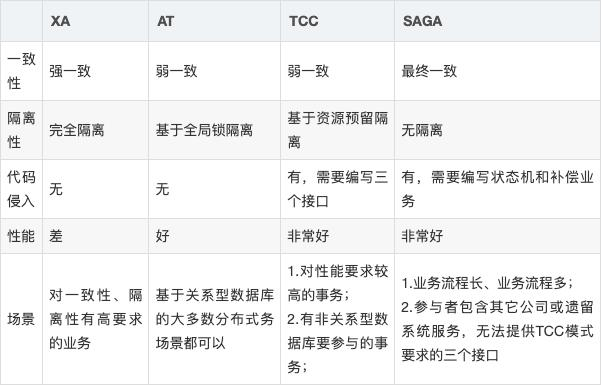

##
## 1.1 Seata的三大角色
在 Seata 的架构中，一共有三个角色：

**TC (Transaction Coordinator) - 事务协调者**

维护全局和分支事务的状态，驱动全局事务提交或回滚。

**TM (Transaction Manager) - 事务管理器**

定义全局事务的范围：开始全局事务、提交或回滚全局事务。

**RM (Resource Manager) - 资源管理器**

管理分支事务处理的资源，与TC交谈以注册分支事务和报告分支事务的状态，并驱动分支事务提交或回滚。

其中，TC 为单独部署的 Server 服务端，TM 和 RM 为嵌入到应用中的 Client 客户端。

## XA模型
###
1.2.Seata的XA模型
Seata对原始的XA模式做了简单的封装和改造，以适应自己的事务模型，基本架构如图：

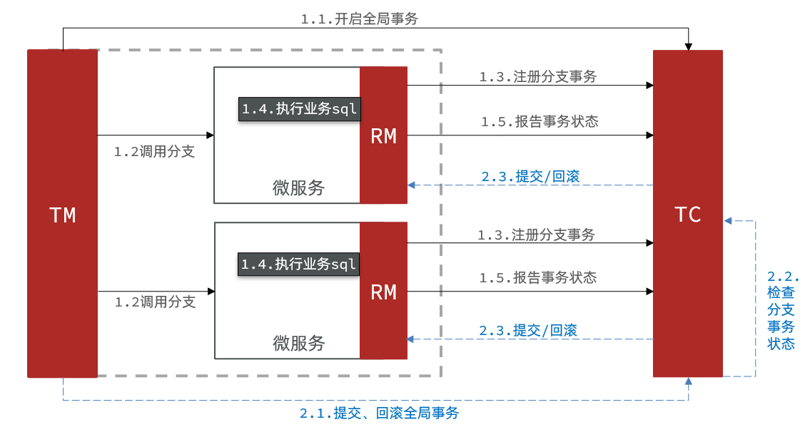

**RM一阶段的工作：**

① 注册分支事务到TC

② 执行分支业务sql但不提交

③ 报告执行状态到TC

**TC二阶段的工作：**

+ TC检测各分支事务执行状态a.如果都成功，通知所有RM提交事务b.如果有失败，通知所有RM回滚事务

**RM二阶段的工作：**

+ 接收TC指令，提交或回滚事务

### 1.3.优缺点
XA模式的优点是什么？

+ 事务的强一致性，满足ACID原则。
+ 常用数据库都支持，实现简单，并且没有代码侵入

XA模式的缺点是什么？

+ 因为一阶段需要锁定数据库资源，等待二阶段结束才释放，性能较差
+ 依赖 关系型数据库 实现事务

## 2.AT模式
AT模式同样是分阶段提交的事务模型，不过缺弥补了XA模型中资源锁定周期过长的缺陷。

### 2.1.Seata的AT模型
基本流程图：
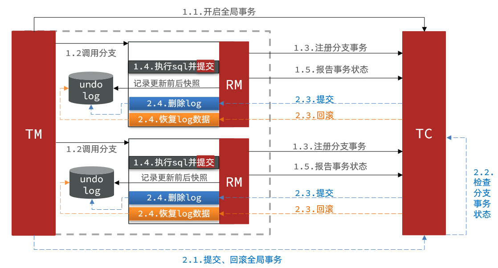

阶段一RM的工作：

+ 注册分支事务
+ 记录undo-log（数据快照）
+ 执行业务sql并提交
+ 报告事务状态

阶段二提交时RM的工作：

+ 删除undo-log即可

阶段二回滚时RM的工作：

+ 根据undo-log恢复数据到更新前

### 2.2.流程梳理
我们用一个真实的业务来梳理下AT模式的原理。

比如，现在又一个数据库表，记录用户余额：

| **id** | **money** |
| :--- | :--- |
| 1 | 100 |

其中一个分支业务要执行的SQL为：

```sql
update tb_account set money = money - 10 where id = 1
```

AT模式下，当前分支事务**执行流程**如下：

**一阶段：**

1）TM发起并注册全局事务到TC

2）TM调用分支事务

3）分支事务准备执行业务SQL

4）RM拦截业务SQL，根据where条件查询原始数据，形成快照。

```json
{
    "id": 1, "money": 100
}
```

5）RM执行业务SQL，提交本地事务，释放数据库锁。此时 money = 90

6）RM报告本地事务状态给TC

**二阶段：**

1）TM通知TC事务结束

2）TC检查分支事务状态

a）如果都成功，则立即删除快照

b）如果有分支事务失败，需要回滚。读取快照数据（{"id": 1, "money": 100}），将快照恢复到数据库。此时数据库再次恢复为100

### 2.3.脏写问题
在多线程并发访问AT模式的分布式事务时，有可能出现脏写问题，如图：

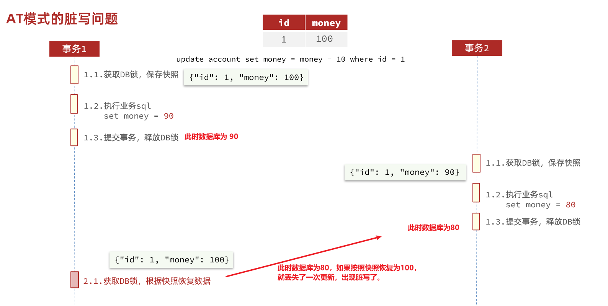

解决思路就是引入了全局锁的概念。在释放DB锁之前，先拿到全局锁。避免同一时刻有另外一个事务来操作当前数据。

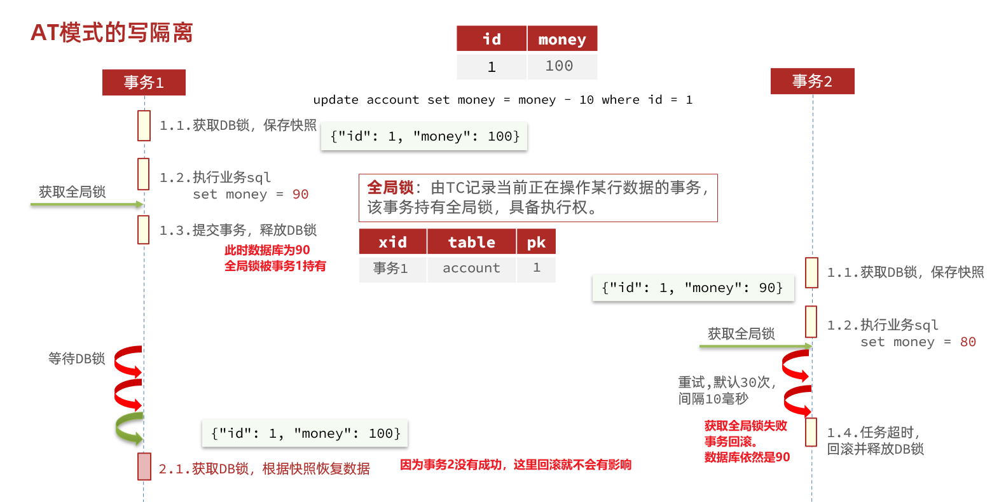

- > 但是也可能在一个极端的情况下造成脏读,比如一个非Seata管理的全局事务，在事务1提交事务释放DB锁之后获取了DB锁，从而造成脏写问题。 > 这时事务1会根据快照数据发现异常，发出警告，进行人工介入。

### 2.4.优缺点
AT模式的优点：

+ 一阶段完成直接提交事务，释放数据库资源，性能比较好
+ 利用全局锁实现读写隔离
+ 没有代码侵入，框架自动完成回滚和提交

AT模式的缺点：

+ 两阶段之间属于软状态，属于最终一致
+ 框架的快照功能会影响性能，但比XA模式要好很多

## 3.AT与XA的区别
简述AT模式与XA模式最大的区别是什么？

+ XA模式一阶段不提交事务，锁定资源；AT模式一阶段直接提交，不锁定资源。
+ XA模式依赖数据库机制实现回滚；AT模式利用数据快照实现数据回滚。
+ XA模式强一致；AT模式最终一致


# 说说什么是幂等性

什么是幂等性？

幂等性是一个数学概念，用在接口上：用在接口上就可以理解为：**同一个接口，多次发出同一个请求，请求的结果是一致的。**

简单说，就是多次调用如一次。

什么是幂等性问题？

在系统的运行中，可能会出现这样的问题：

1. **用户在填写某些****form表单****时，保存按钮不小心快速点了两次，表中竟然产生了两条重复的数据，只是id不一样。**
2. **开发人员在项目中为了解决****接口超时****问题，通常会引入了****重试机制****。第一次请求接口超时了，请求方没能及时获取返回结果（此时有可能已经成功了），于是会对该请求重试几次，这样也会产生重复的数据。**
3. **mq消费者在读取消息时，有时候会读取到****重复消息****，也会产生重复的数据。**

这些都是常见的幂等性问题。

在分布式系统里，只要下游服务有写（保存、更新）的操作，都有可能会产生幂等性问题。

PS:幂等和防重有些不同，防重强调的防止数据重复，幂等强调的是多次调用如一次，防重包含幂等。

## 怎么保证接口幂等性？
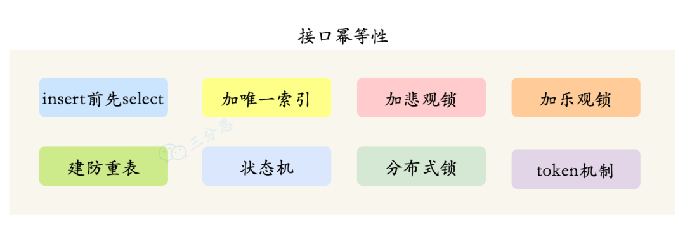

接口幂等性

1. **insert前先select****在保存数据的接口中，在****insert****前，先根据****requestId****等字段先****select****一下数据。如果该数据已存在，则直接返回，如果不存在，才执行  ****insert****操作。**
2. **加唯一索引****加唯一索引是个非常简单但很有效的办法，如果重复插入数据的话，就会抛出异常，为了保证幂等性，一般需要捕获这个异常。****如果是****java****程序需要捕获：****DuplicateKeyException****异常，如果使用了****spring****框架还需要捕获：****MySQLIntegrityConstraintViolationException****异常。**
3. **加悲观锁****更新逻辑，比如更新用户账户余额，可以加悲观锁，把对应用户的哪一行数据锁住。同一时刻只允许一个请求获得锁，其他请求则等待。**

```plain
select * from user id=123 for update;
```

**这种方式有一个缺点，获取不到锁的请求一般只能报失败，比较难保证接口返回相同值。**

4. **加乐观锁****更新逻辑，也可以用乐观锁，性能更好。可以在表中增加一个****timestamp****或者****version****字段，例如****version****:****在更新前，先查询一下数据，将version也作为更新的条件，同时也更新version：**

```plain
update user set amount=amount+100,version=version+1 where id=123 and version=1;
```

**更新成功后，version增加，重复更新请求进来就无法更新了。**

5. **建防重表****有时候表中并非所有的场景都不允许产生重复的数据，只有某些特定场景才不允许。这时候，就可以使用防重表的方式。****例如消息消费中，创建防重表，存储消息的唯一ID，消费时先去查询是否已经消费，已经消费直接返回成功。**
6. **状态机****有些业务表是有状态的，比如订单表中有：1-下单、2-已支付、3-完成、4-撤销等状态，可以通过限制状态的流动来完成幂等。**
7. **分布式锁****直接在数据库上加锁的做法性能不够友好，可以使用分布式锁的方式，目前最流行的分布式锁实现是通过Redis，具体实现一般都是使用Redission框架。**
8. **token机制请求接口之前，需要先获取一个唯一的token，再带着这个token去完成业务操作，服务端根据这个token是否存在，来判断是否是重复的请求。**


# 你了解哪些限流算法

+ **计数器**

计数器比较简单粗暴，比如我们要限制1s能够通过的请求数，实现的思路就是从第一个请求进来开始计时，在接下来的1s内，每个请求进来请求数就+1，超过最大请求数的请求会被拒绝，等到1s结束后计数清零，重新开始计数。

这种方式有个很大的弊端：比如前10ms已经通过了最大的请求数，那么后面的990ms的请求只能拒绝，这种现象叫做“突刺现象”。

+ **漏桶算法**

就是桶底出水的速度恒定，进水的速度可能快慢不一，但是当进水量大于出水量的时候，水会被装在桶里，不会直接被丢弃；但是桶也是有容量限制的，当桶装满水后溢出的部分还是会被丢弃的。

**算法实现**：可以准备一个队列来保存暂时处理不了的请求，然后通过一个线程池定期从队列中获取请求来执行。

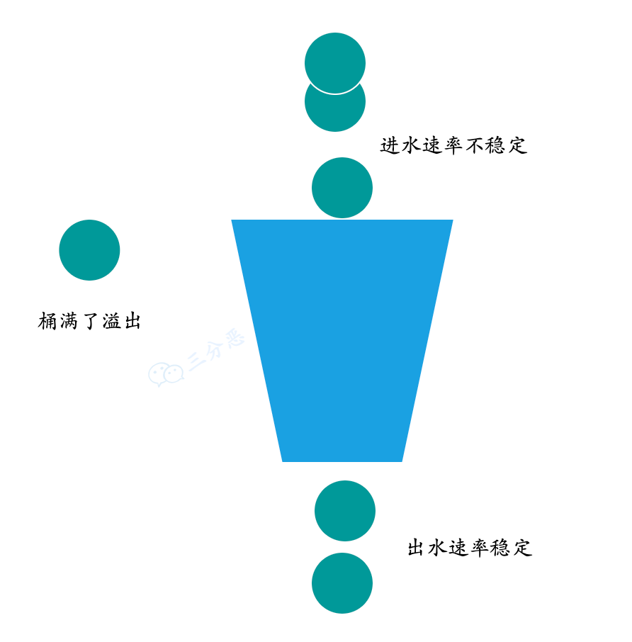

漏桶算法

+ **令牌桶算法**

令牌桶就是生产访问令牌的一个地方，生产的速度恒定，用户访问的时候当桶中有令牌时就可以访问，否则将触发限流。

**实现方案**：Guava RateLimiter限流

Guava RateLimiter是一个谷歌提供的限流，其基于令牌桶算法，比较适用于单实例的系统。

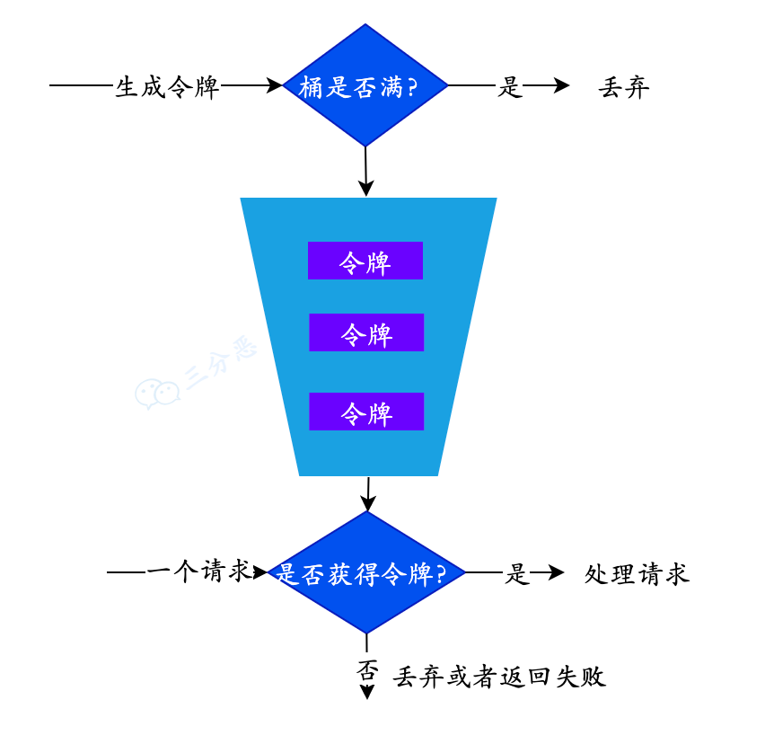

令牌桶算法

---

这一期的分布式面试题就整理到这里了，主要是偏理论的一些问题，分布式其实是个很大的类型，比如分布式调用、分布式治理……

所以，这篇文章只是个开始，后面还会有分布式调用（RPC）、微服务相关的主题文章，敬请期待。


# 什么是分布式系统

薪资：6k-12k

岗位：初级开发工程师

一个系统   _**各组件**_分别部署在不同服务器。_**彼此通过网络通信和协调的系统。**_

_** **_

+ 可以指**多个不同组件**分布在网络上互相协作，比如说电商网站
+ 也可以**一个组件的多个副本**组成集群，互相协作如同一个组件，比如数据存储服务中为了数据不丢失而采取的多个服务备份冗余，当数据修改时也需要通信来复制数据

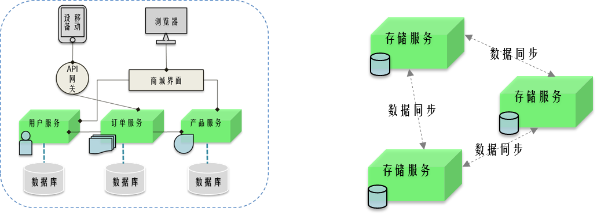

_**分布式最早出现的目地首先是解决单点问题，避免单点故障，然后解决了性能问题。**_

---

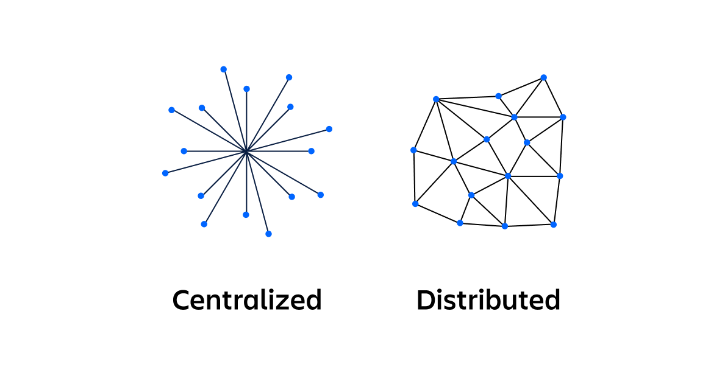


# 什么是分布式事务

分布式事务是相对本地事务而言的，对于本地事务，利用数据库本身的事务机制，就可以保证事务的ACID特性。

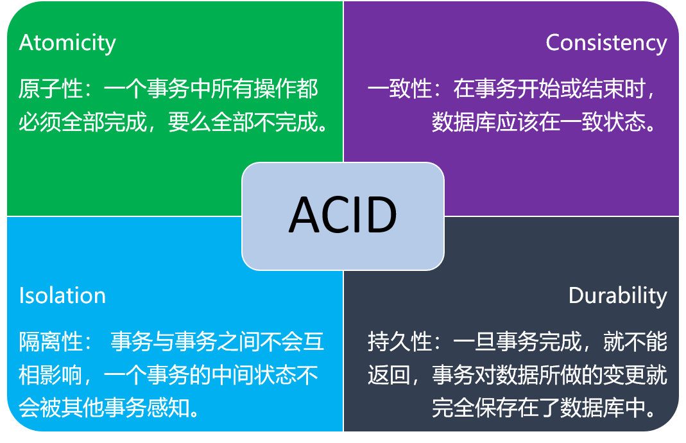

ACID

而在分布式环境下，会涉及到多个数据库。

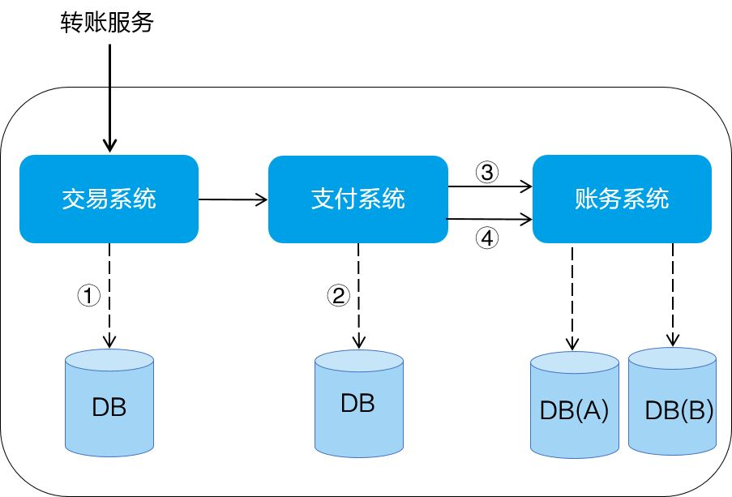

多数据库

分布式事务其实就是将对同一库事务的概念扩大到了对多个库的事务。目的是为了保证分布式系统中的数据一致性。

分布式事务处理的关键是：

1. **需要记录事务在任何节点所做的所有动作；**
2. **事务进行的所有操作要么全部提交，要么全部回滚。**


# 最大努力通知&事务消息&本地消息表区别是什么

