# 分库分表知识汇总
---


# 一次搞定MySQL分库分表

## [天明](https://www.yuque.com/tianming-aroh0/sagnbd/nfkf7dvzxgp26nw4)寄语：

**应学员要求更新分库分表部分相关问题。注意在MySQL基础之上再看此篇。**

## 什么是分库分表？

对于阅读本文的读者来说，分库分表概念应该并不会陌生，其拆开来讲是分库和分表两个手段：

* 分表：将一个表中的数据按照某种规则分拆到多张表中，**降低锁粒度以及索引树**，提升数据查询效率。

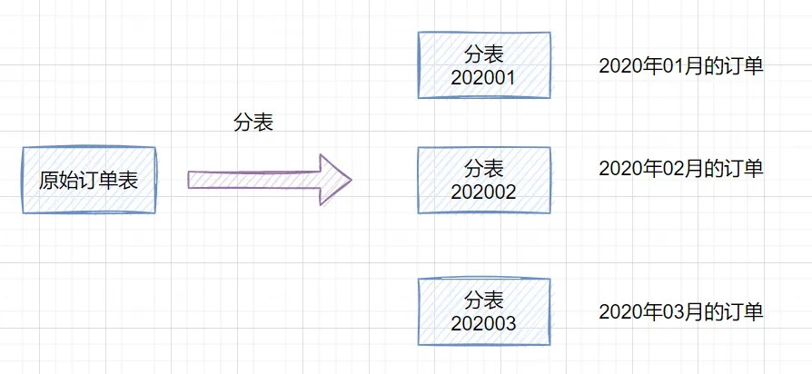

* 分库：将一个数据库中的数据按照某种规则分拆到多个数据库中，以**缓解单服务器的压力**（CPU、内存、磁盘、IO）。

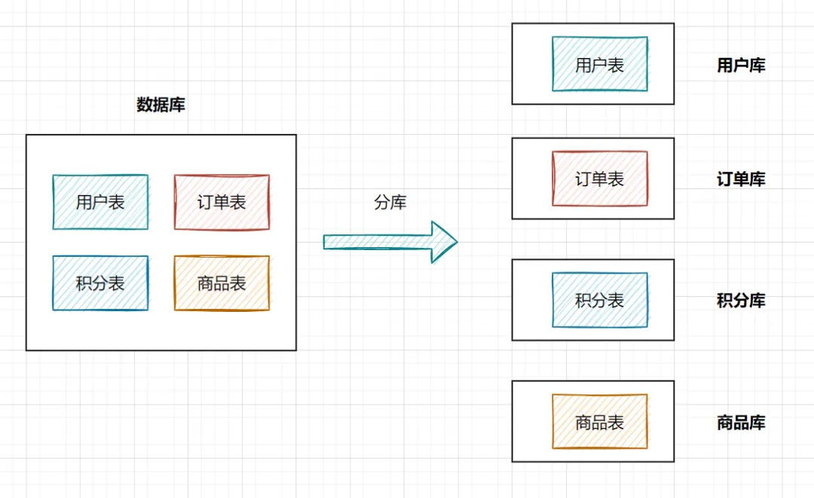

分库分表手段，其在解决如 IO 瓶颈、读写性能、物理存储瓶颈、内存瓶颈、单机故障影响面等问题的同时也带来如事务性、主键冲突、跨库 join、跨库聚合查询等问题。anyway，在综合业务场景考虑，正如缓存的使用一样，本着非必须勿使用原则。如数据库确实成为性能瓶颈时，在设计分库分表方案时也应充分考虑方案的扩展性，或者考虑采用成熟热门的分布式数据库解决方案，如 TiDB。

目标：

* 什么是分库分表以及为什么分库分表
* 如何分库分表
* 分库分表常见几种方式以及优缺点
* 如何选择分库分表的方式

## 数据库常见优化方案

对于后端程序员来说，绕不开数据库的使用与方案选型，那么随着业务规模的逐渐扩大，其对于存储的使用上也需要随之进行升级和优化。

随着规模的扩大，数据库面临如下问题：

* 读压力：并发 QPS、索引不合理、SQL 语句不合理、锁粒度
* 写压力：并发 QPS、事务、锁粒度
* 物理性能：磁盘瓶颈、CPU 瓶颈、内存瓶颈、IO 瓶颈
* 其他：宕机、网络异常

面对上述问题，常见的优化手段有：

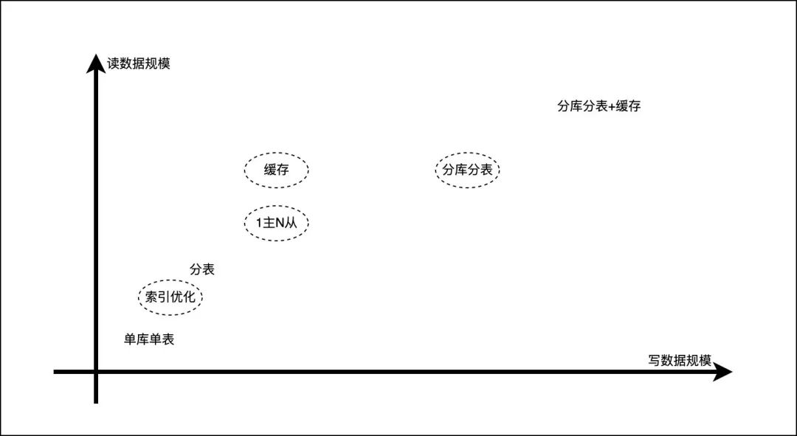

索引优化、主从同步、缓存、分库分表每个技术手段都可以作为一个专题进行讲解，本文主要介绍分库分表的技术方案实现。

## 为什么分库分表？

如果业务量剧增，数据库可能会出现性能瓶颈，这时候就需要考虑拆分数据库。从这几方面来看：

* **磁盘存储**

业务量剧增，MySQL单机磁盘容量会撑爆，拆成多个数据库，磁盘使用率大大降低。

* **并发连接支撑**

数据库连接是有限的。在高并发的场景下，大量请求访问数据库，MySQL单机是扛不住的！当前非常火的**微服务架构**出现，就是为了应对高并发。它把**订单、用户、商品**等不同模块，拆分成多个应用，并且把单个数据库也拆分成多个不同功能模块的数据库（**订单库、用户库、商品库**），以分担读写压力。

* **性能角度：CPU、内存、磁盘、IO 瓶颈**
  * 随着业务体量扩大，数据规模达到百万行，数据库索引树庞大，查询性能出现瓶颈。
  * 用户并发流量规模扩大，由于单库(单服务器)物理性能限制也无法承载大流量。
* **可用性角度：单机故障率影响面**
  * 如果是单库，数据库宕机会导致 100%服务不可用，N 库则可以将影响面降低 N 倍。

## 分库分表带来的问题？

* **事务性问题**
  * 方案一：在进行分库分表方案设计过程中，从业务角度出发，尽可能保证一个事务所操作的表分布在一个库中，从而实现数据库层面的事务保证。
  * 方案二：方式一无法实现的情况下，业务层引入分布式事务组件保证事务性，如事务性消息、TCC、Seata 等分布式事务方式实现数据最终一致性。
  * 分库**可能**导致执行一次事务所需的数据分布在不同服务器上，数据库层面无法实现事务性操作，需要更上层业务引入分布式事务操作，难免会给业务带来一定复杂性，那么要想解决事务性问题一般有两种手段：
* **主键(自增 ID)唯一性问题**
  * 在数据库表设计时，经常会使用自增 ID 作为数据主键，这就导致后续在迁库迁表、或者分库分表操作时，会因为主键的变化或者主键不唯一产生冲突，要解决主键不唯一问题，有如下方案：
  * 方案一：自增 ID 做主键时，设置自增步长，采用等差数列递增，避免各个库表的主键冲突。但是这个方案仍然无法解决迁库迁表、以及分库分表扩容导致主键 ID 变化问题
  * 方案二：主键采用全局统一 ID 生成机制：如 UUID、雪花算法、数据库号段等方式。
* **跨库多表 join 问题**
  * 首先来自大厂 DBA 的建议是，线上服务尽可能不要有表的 join 操作，join 操作往往会给后续的分库分表操作带来各种问题，可能导致数据的死锁。可以采用多次查询业务层进行数据组装(需要考虑业务上多次查询的事务性的容忍度)
* **跨库聚合查询问题**

分库分表会导致常规聚合查询操作，如 group by，order by 等变的异常复杂。需要复杂的业务代码才能实现上述业务逻辑，其常见操作方式有：

§ 方案一：赛道赛马机制，每次从 N 个库表中查询出 TOP N 数据，然后在业务层代码中进行聚合合并操作。

```sql
§  假设： 以2库1表为例，每次分页查询N条数据。
§
§  第一次查询：
§  ① 每个表中分别查询出N条数据：
§  SELECT * FROM db1_table1 where $col > 0 order by $col   LIMITT  0,N
§  SELECT * FROM db2_table1 where $col > 0 order by $col   LIMITT  0,N
§  ② 业务层代码对上述两者做归并排序，假设最终取db1数据K1条，取db2数据K2条，则K1+K2 = N
§  此时的DB1 可以计算出OffSet为K1 ，DB2计算出Offset为K2
§  将获取的N条数据以及相应的Offset  K1/K2返回给 端上。
§
§  第二次查询：
§  ① 端上将上一次查询对应的数据库的Offset  K1/K2 传到后端
§  ② 后端根据Offset构造查询语句查询分别查询出N条语句
§  SELECT * FROM db1_table1 where $col > 0 order by $col   LIMITT  $K1,N
§  SELECT * FROM db2_table1 where $col > 0 order by $col   LIMITT  $K2,N
§  ③ 再次使用归并排序，获取TOP N数据，将获取的N条数据以及相应的Offset  K1/K2返回给 端上。
§
§  第三次查询:
依次类推.......
```

§ 方案二：可以将经常使用到 groupby,orderby 字段存储到一个单一库表(可以是 REDIS、ES、MYSQL)中，业务代码中先到单一表中根据查询条件查询出相应数据，然后根据查询到的主键 ID，到分库分表中查询详情进行返回。2 次查询操作难点会带来接口耗时的增加，以及极端情况下的数据不一致问题。

## 什么是好的分库分表方案？

* **满足业务场景需要**：根据业务场景的不同选择不同分库分表方案：比如按照时间划分、按照用户 ID 划分、按照业务能力划分等
* **方案可持续性**：
  * 何为可持续性？其实就是：业务数据量级和流量量级未来进一步达到新的量级的时候，分库分表方案可以持续灵活扩容处理。
* **最小化数据迁移**：扩容时一般涉及到历史数据迁移，其扩容后需要迁移的数据量越小其可持续性越强，理想的迁移前后的状态是（同库同表>同表不同库>同库不同表>不同库不同表）
* **数据偏斜**：数据在库表中分配的均衡性，尽可能保证数据流量在各个库表中保持等量分配，避免热点数据对于单库造成压力。
  * 最大数据偏斜率：（数据量最大样本 - 数据量最小样本）/ 数据量最小样本。一般来说，如果最大数据偏斜率在 5%以内是可以接受的。

## 数据分片

通常在提到分库分表的时候，大多是以水平切分模式（水平分库、分表）为基础来说的，数据分片它将原本一张数据量较大的表 t\_order 拆分生成数个**表结构完全一致**的小数据量表（拆分表） t\_order\_0、t\_order\_1、···、t\_order\_n，每张表只存储原大表中的一部分数据。

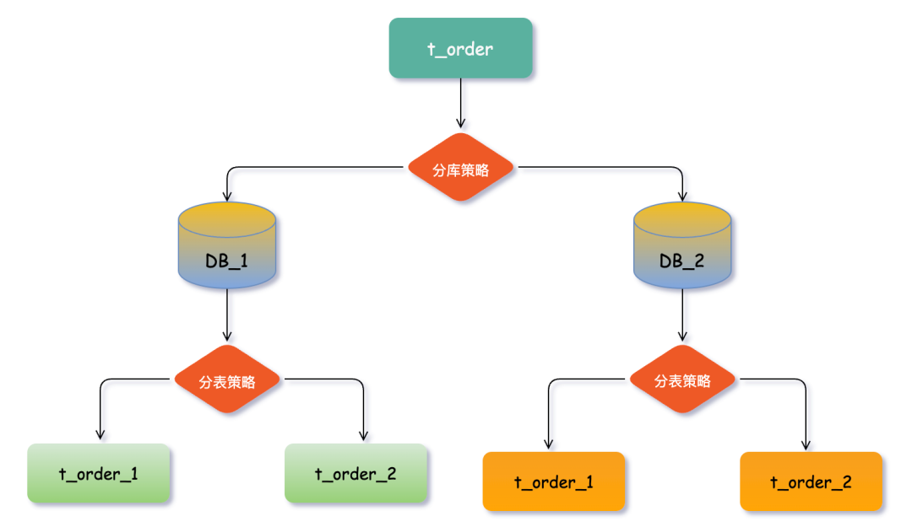

## 数据节点

数据节点是数据分片中一个不可再分的最小单元（表），它由数据源名称和数据表组成，例如上图中 DB\_1.t\_order\_1、DB\_2.t\_order\_2 就表示一个数据节点。


## 逻辑表

逻辑表是指具有相同结构的水平拆分表的逻辑名称。

比如将订单表t\_order 分表拆分成 t\_order\_0 ··· t\_order\_9等10张表，这时的数据库中已经不存在 t\_order这张表，取而代之的是若干的t\_order\_n表。

分库分表通常对业务代码都是无侵入式的，开发者只专注于业务逻辑SQL编码，在代码中SQL依然按 t\_order来写，而在执行逻辑SQL前将其解析成对应的数据库真实执行的SQL。此时 t\_order 就是这些拆分表的逻辑表。

业务逻辑SQL

```sql
select * from t_order where order_no='A11111'
```

真实执行SQL

```sql
select * from DB_1.t_order_n where order_no='A11111'
```

## 真实表

真实表就是在数据库中真实存在的物理表DB\_1.t\_order\_n。


## 广播表

广播表是一类特殊的表，其表结构和数据在所有分片数据源中均完全一致。与拆分表相比，广播表的数据量较小、更新频率较低，通常用于字典表或配置表等场景。由于其在所有节点上都有副本，因此可以大大降低JOIN关联查询的网络开销，提高查询效率。

需要注意的是，对于广播表的修改操作需要保证同步性，以确保所有节点上的数据保持一致。

**广播表的特点**：

* 在所有分片数据源中，广播表的数据完全一致。因此，对广播表的操作（如插入、更新和删除）会实时在每个分片数据源中执行一遍，以保证数据的一致性。
* 对于广播表的查询操作，仅需要在任意一个分片数据源中执行一次即可。
* 与任何其他表进行JOIN操作都是可行的，因为由于广播表的数据在所有节点上均一致，所以可以访问到任何一个节点上的相同数据。

什么样的表可以作为广播表呢？

订单管理系统中，往往需要查询统计某个城市地区的订单数据，这就会涉及到省份地区表t\_city与订单流水表DB\_n.t\_order\_n进行JOIN查询，因此可以考虑将省份地区表设计为广播表，核心理念就是**避免跨库JOIN操作**。

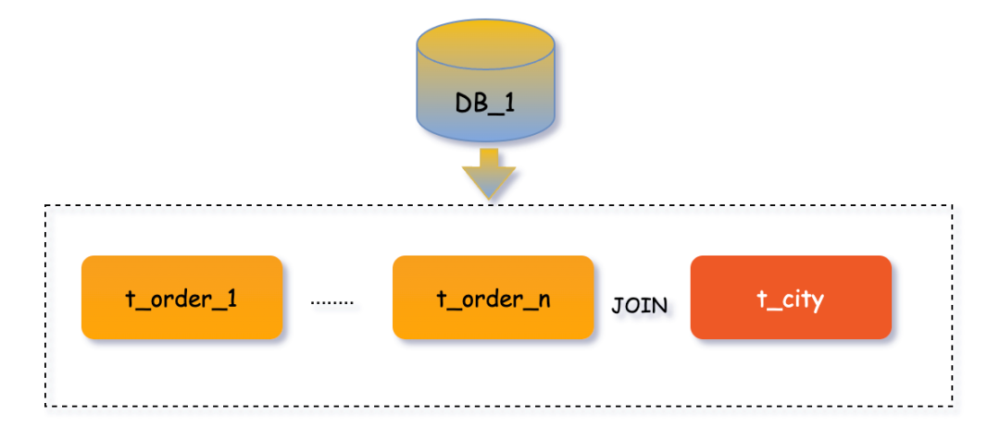

**注意**：上边提到广播表在数据插入、更新与删除会实时在每个分片数据源均执行，也就是说如果有1000个分片数据源，那么修改一次广播表就要执行1000次SQL，所以尽量不在并发环境下和业务高峰时进行，以免影响系统的性能。

## 单表

单表指所有的分片数据源中仅唯一存在的表（没有分片的表），适用于数据量不大且无需分片的表。

如果一张表的数据量预估在千万级别，且没有与其他拆分表进行关联查询的需求，建议将其设置为单表类型，存储在默认分片数据源中。

## 分片键

分片键决定了数据落地的位置，也就是数据将会被分配到哪个数据节点上存储。因此，分片键的选择非常重要。

比如将 t\_order 表进行分片后，当插入一条订单数据执行SQL时，需要通过解析SQL语句中指定的分片键来计算数据应该落在哪个分片中。以表中order\_no字段为例，可以通过对其取模运算（比如 order\_no % 2）来得到分片编号，然后根据分片编号分配数据到对应的数据库实例（比如 DB\_1 和 DB\_2）。拆分表也是同理计算。

在这个过程中，order\_no 就是 t\_order 表的分片键。也就是说，每一条订单数据的 order\_no 值决定了它应该存放的数据库实例和表。选择一个适合作为分片键的字段可以更好地利用水平分片带来的性能提升。

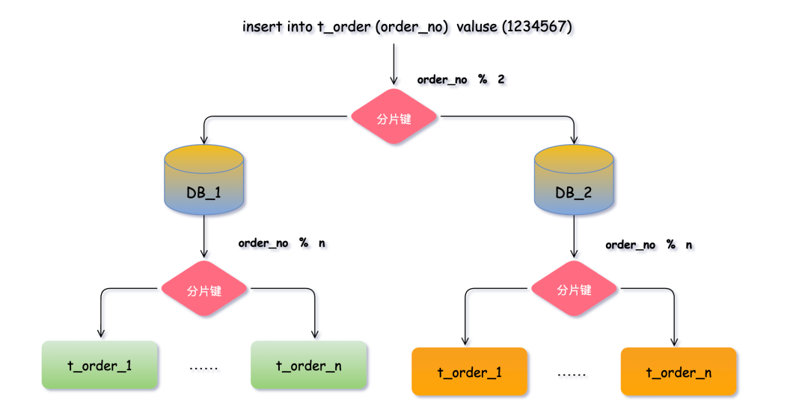

这样同一个订单的相关数据就会落在同一个数据库、表中，查询订单时同理计算，就可直接定位数据位置，大幅提升数据检索的性能，避免了全库表扫描。

不仅如此 ShardingSphere 还支持根据多个字段作为分片健进行分片，这个在后续对应章节中会详细讲。

## 分片策略

分片策略来指定使用哪种分片算法、选择哪个字段作为分片键以及如何将数据分配到不同的节点上。

分片策略是由分片算法和分片健组合而成，分片策略中可以使用多种分片算法和对多个分片键进行运算。

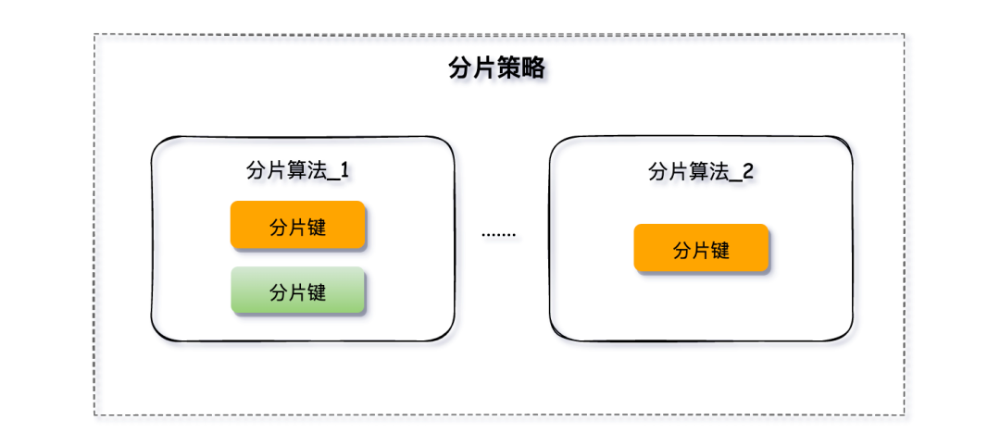

分库、分表的分片策略配置是相对独立的，可以各自使用不同的策略与算法，每种策略中可以是多个分片算法的组合，每个分片算法可以对多个分片健做逻辑判断。

## 分片算法

分片算法则是用于对分片键进行运算，将数据划分到具体的数据节点中。

常用的分片算法有很多：

* **哈希分片**：根据分片键的哈希值来决定数据应该落到哪个节点上。例如，根据用户 ID 进行哈希分片，将属于同一个用户的数据分配到同一个节点上，便于后续的查询操作。
* **范围分片**：分片键值按区间范围分配到不同的节点上。例如，根据订单创建时间或者地理位置来进行分片。
* **取模分片**：将分片键值对分片数取模，将结果作为数据应该分配到的节点编号。例如， order\_no % 2 将订单数据分到两个节点之一。
* .....

实际业务开发中分片的逻辑要复杂的多，不同的算法适用于不同的场景和需求，需要根据实际情况进行选择和调整。

## 绑定表

绑定表是那些具有相同分片规则的一组分片表，由于分片规则一致所产生的的数据落地位置相同，在JOIN联合查询时能有效**避免跨库**操作。

比如：t\_order 订单表和 t\_order\_item 订单项目表，都以 order\_no 字段作为分片键，并且使用 order\_no 进行关联，因此两张表互为绑定表关系。

使用绑定表进行多表关联查询时，必须使用分片键进行关联，否则会出现笛卡尔积关联或跨库关联，从而影响查询效率。

当使用 t\_order 和 t\_order\_item 表进行多表联合查询，执行如下联合查询的逻辑SQL。

```sql
SELECT * FROM t_order o JOIN t_order_item i ON o.order_no=i.order_no
```

如果不配置绑定表关系，两个表的数据位置不确定就会全库表查询，出现笛卡尔积关联查询，将产生如下四条SQL。

```sql
SELECT * FROM t_order_0 o JOIN t_order_item_0 i ON o.order_no=i.order_no
SELECT * FROM t_order_0 o JOIN t_order_item_1 i ON o.order_no=i.order_no
SELECT * FROM t_order_1 o JOIN t_order_item_0 i ON o.order_no=i.order_no
SELECT * FROM t_order_1 o JOIN t_order_item_1 i ON o.order_no=i.order_no
```

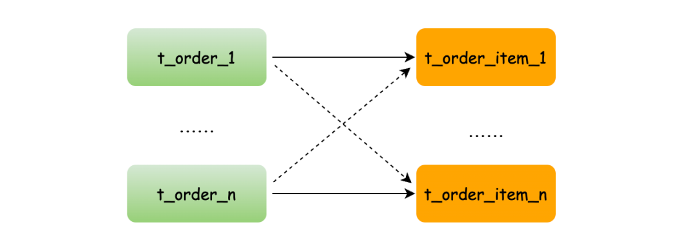

而配置绑定表关系后再进行关联查询时，分片规则一致产生的数据就会落到同一个库表中，那么只需在当前库中 t\_order\_n 和 t\_order\_item\_n 表关联即可。

```sql
SELECT * FROM t_order_0 o JOIN t_order_item_0 i ON o.order_id=i.order_id
SELECT * FROM t_order_1 o JOIN t_order_item_1 i ON o.order_id=i.order_id
```

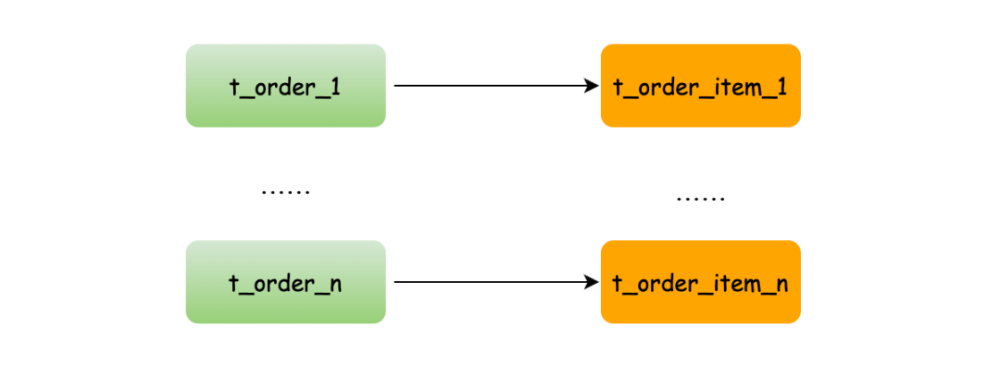

**注意**：在关联查询时 t\_order 它作为整个联合查询的主表。所有相关的路由计算都只使用主表的策略，t\_order\_item 表的分片相关的计算也会使用 t\_order 的条件，所以要保证绑定表之间的分片键要完全相同。

## SQL 解析

分库分表后在应用层面执行一条 SQL 语句时，通常需要经过以下六个步骤：SQL 解析 -> 执⾏器优化 -> SQL 路由 -> SQL 改写 -> SQL 执⾏ -> 结果归并 。

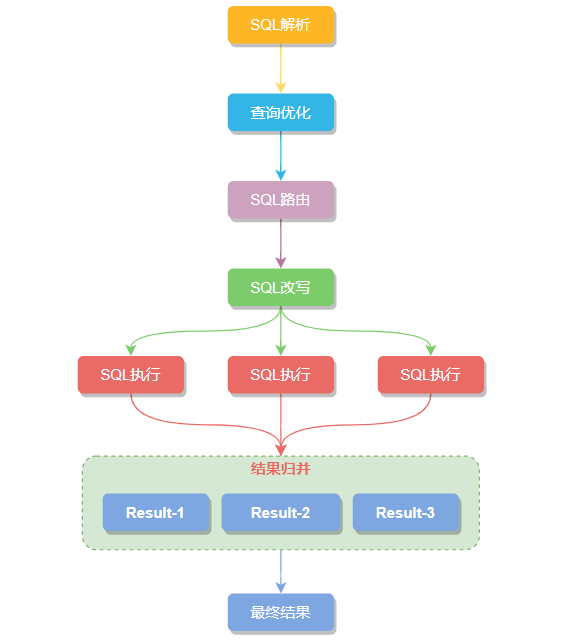

SQL解析过程分为词法解析和语法解析两步，比如下边查询用户订单的SQL，先用词法解析将这条SQL拆解成不可再分的原子单元。在根据不同数据库方言所提供的字典，将这些单元归类为关键字，表达式，变量或者操作符等类型。

```sql
SELECT order_no FROM t_order where  order_status > 0  and user_id = 10086
```

接着语法解析会将拆分后的SQL关键字转换为抽象语法树，通过对抽象语法树遍历，提炼出分片所需的上下文，上下文包含查询字段信息（Field）、表信息（Table）、查询条件（Condition）、排序信息（Order By）、分组信息（Group By）以及分页信息（Limit）等，并标记出 SQL中有可能需要改写的位置。

[抽象语法树]

## 执行器优化

执行器优化是根据SQL查询特点和执行统计信息，选择最优的查询计划并执行，比如user\_id字段有索引，那么会调整两个查询条件的位置，主要是提高SQL的执行效率。

```sql
SELECT order_no FROM t_order where user_id = 10086 and order_status > 0
```

## SQL 路由

通过上边的SQL解析得到了分片上下文数据，在匹配用户配置的分片策略和算法，就可以运算生成路由路径，将 SQL 语句路由到相应的数据节点上。

简单点理解就是拿到分片策略中配置的分片键等信息，在从SQL解析结果中找到对应分片键字段的值，计算出 SQL该在哪个库的哪个表中执行，SQL路由又根据有无分片健分为 分片路由 和 广播路由。

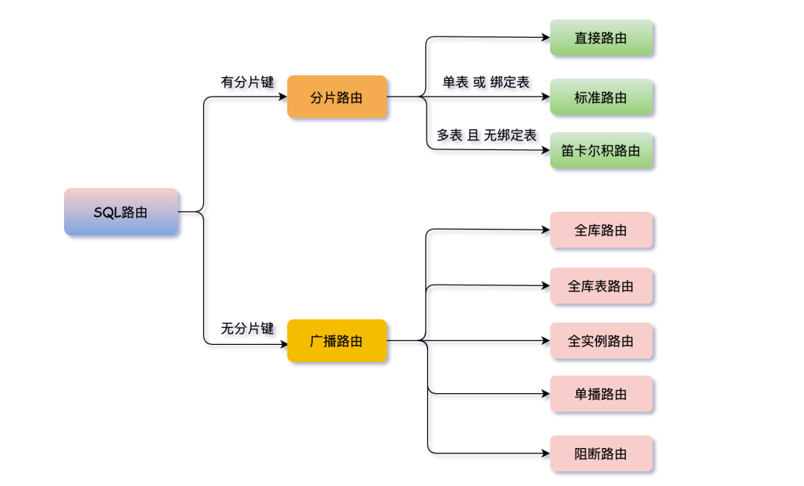

有分片键的路由叫分片路由，细分为直接路由、标准路由和笛卡尔积路由这3种类型。

### 标准路由

标准路由是最推荐也是最为常用的分片方式，它的适用范围是不包含关联查询或仅包含绑定表之间关联查询的SQL。

当 SQL分片健的运算符为 = 时，路由结果将落入单库（表），当分片运算符是 BETWEEN 或 IN 等范围时，路由结果则不⼀定落⼊唯⼀的库（表），因此⼀条逻辑SQL最终可能被拆分为多条用于执行的真实SQL。

```sql
SELECT * FROM t_order  where t_order_id in (1,2)
```

SQL路由处理后

```sql
SELECT * FROM t_order_0  where t_order_id in (1,2)
SELECT * FROM t_order_1  where t_order_id in (1,2)
```

### 直接路由

直接路由是直接将SQL路由到指定⾄库、表的一种分⽚方式，而且直接路由可以⽤于分⽚键不在SQL中的场景，还可以执行包括子查询、自定义函数等复杂情况的任意SQL。

### 笛卡尔积路由

笛卡尔路由是由非绑定表之间的关联查询产生的，比如订单表t\_order 分片键是t\_order\_id 和用户表t\_user分片键是t\_order\_id ，两个表的分片键不同，要做联表查询，会执行笛卡尔积路由，查询性能较低尽量避免走此路由模式。

```sql
SELECT * FROM t_order_0 t LEFT JOIN t_user_0 u ON u.user_id = t.user_id WHERE t.user_id = 1
SELECT * FROM t_order_0 t LEFT JOIN t_user_1 u ON u.user_id = t.user_id WHERE t.user_id = 1
SELECT * FROM t_order_1 t LEFT JOIN t_user_0 u ON u.user_id = t.user_id WHERE t.user_id = 1
SELECT * FROM t_order_1 t LEFT JOIN t_user_1 u ON u.user_id = t.user_id WHERE t.user_id = 1
```

无分片键的路由又叫做广播路由，可以划分为全库表路由、全库路由、 全实例路由、单播路由和阻断路由这 5种类型。

### 全库表路由

全库表路由针对的是数据库 DQL 和 DML，以及 DDL等操作，当执行一条逻辑表 t\_order SQL时，在所有分片库中对应的真实表 t\_order\_0 ···  t\_order\_n 内逐一执行。

### 全库路由

全库路由主要是对数据库层面的操作，比如数据库 SET 类型的数据库管理命令，以及 TCL 这样的事务控制语句。

对逻辑库设置 autocommit 属性后，所有对应的真实库中都执行该命令。

```sql
SET autocommit=0;
```

### 全实例路由

全实例路由是针对数据库实例的 DCL 操作（设置或更改数据库用户或角色权限），比如：创建一个用户 order ，这个命令将在所有的真实库实例中执行，以此确保 order 用户可以正常访问每一个数据库实例。

```sql
CREATE USER order@127.0.0.1 identified BY 'Fcant';
```

### 单播路由

单播路由用来获取某一真实表信息，比如获得表的描述信息：

```sql
DESCRIBE t_order;
```

t\_order 的真实表是 t\_order\_0 ···· t\_order\_n，他们的描述结构相完全同，只需在任意的真实表执行一次就可以。

### 阻断路由

用来屏蔽SQL对数据库的操作，例如：

```sql
USE order_db;
```

这个命令不会在真实数据库中执行，因为 ShardingSphere 采⽤的是逻辑 Schema（数据库的组织和结构） 方式，所以无需将切换数据库的命令发送至真实数据库中。

### 一、数据库瓶颈

不管是 IO 瓶颈，还是 CPU 瓶颈，最终都会导致数据库的活跃连接数增加，进而逼近甚至达到数据库可承载活跃连接数的阈值。在业务 Service 来看就是，可用数据库连接少甚至无连接可用。接下来就可以想象了吧（并发量、吞吐量、崩溃）。

#### 1、IO 瓶颈

第一种：磁盘读 IO 瓶颈，热点数据太多，数据库缓存放不下，每次查询时会产生大量的 IO，降低查询速度 -> 分库和垂直分表。

第二种：网络 IO 瓶颈，请求的数据太多，网络带宽不够 -> 分库。

#### 2、CPU 瓶颈

第一种：SQL 问题，如 SQL 中包含 join，group by，order by，非索引字段条件查询等，增加 CPU 运算的操作 -> SQL 优化，建立合适的索引，在业务 Service 层进行业务计算。

第二种：单表数据量太大，查询时扫描的行太多，SQL 效率低，增加 CPU 运算的操作 -> 水平分表。

### 二、分库分表

#### 1、水平分库

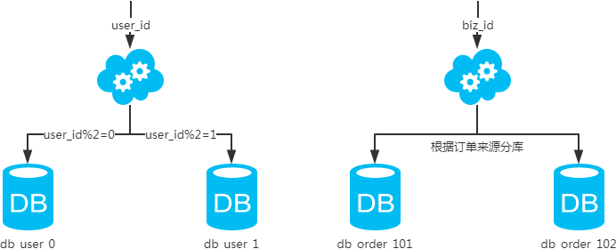

##### 概念：

以字段为依据，按照一定策略（hash、range 等），将一个库中的数据拆分到多个库中。

##### 结果：

* 每个库的结构都一样；
* 每个库的数据都不一样，没有交集；
* 所有库的并集是全量数据；

##### 场景：

系统绝对并发量上来了，分表难以根本上解决问题，并且还没有明显的业务归属来垂直分库。

##### 分析：

库多了，io 和 cpu 的压力自然可以成倍缓解。

#### 2、水平分表

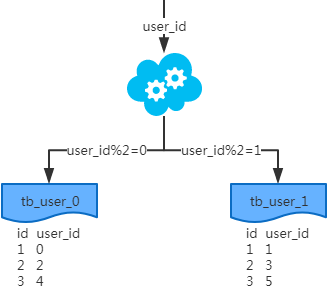

##### 概念：

以字段为依据，按照一定策略（hash、range 等），将一个表中的数据拆分到多个表中。

##### 结果：

* 每个表的结构都一样；
* 每个表的数据都不一样，没有交集；
* 所有表的并集是全量数据；

##### 场景：

系统绝对并发量并没有上来，只是单表的数据量太多，影响了 SQL 效率，加重了 CPU 负担，以至于成为瓶颈。

##### 分析：

表的数据量少了，单次 SQL 执行效率高，自然减轻了 CPU 的负担。

#### 3、垂直分库

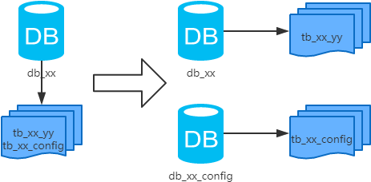

##### 概念：

以表为依据，按照业务归属不同，将不同的表拆分到不同的库中。

##### 结果：

* 每个库的结构都不一样；
* 每个库的数据也不一样，没有交集；
* 所有库的并集是全量数据；

##### 场景：

系统绝对并发量上来了，并且可以抽象出单独的业务模块。

##### 分析：

到这一步，基本上就可以服务化了。例如，随着业务的发展一些公用的配置表、字典表等越来越多，这时可以将这些表拆到单独的库中，甚至可以服务化。再有，随着业务的发展孵化出了一套业务模式，这时可以将相关的表拆到单独的库中，甚至可以服务化。

#### 4、垂直分表

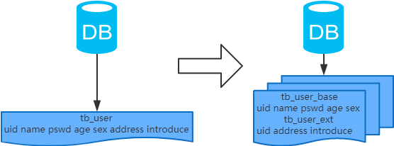

##### 概念：

以字段为依据，按照字段的活跃性，将表中字段拆到不同的表（主表和扩展表）中。

##### 结果：

* 每个表的结构都不一样；
* 每个表的数据也不一样，一般来说，每个表的字段至少有一列交集，一般是主键，用于关联数据；
* 所有表的并集是全量数据；

##### 场景：

系统绝对并发量并没有上来，表的记录并不多，但是字段多，并且热点数据和非热点数据在一起，单行数据所需的存储空间较大。以至于数据库缓存的数据行减少，查询时会去读磁盘数据产生大量的随机读 IO，产生 IO 瓶颈。

##### 分析：

可以用列表页和详情页来帮助理解。垂直分表的拆分原则是将热点数据（可能会冗余经常一起查询的数据）放在一起作为主表，非热点数据放在一起作为扩展表。这样更多的热点数据就能被缓存下来，进而减少了随机读 IO。拆了之后，要想获得全部数据就需要关联两个表来取数据。

但记住，千万别用 join，因为 join 不仅会增加 CPU 负担并且会讲两个表耦合在一起（必须在一个数据库实例上）。关联数据，应该在业务 Service 层做文章，分别获取主表和扩展表数据然后用关联字段关联得到全部数据。

### 三、分库分表工具

* **Sharding-jdbc** 这种 client 层方案的优点在于不用部署，运维成本低，不需要代理层的二次转发请求，性能很高，但是各个系统都需要耦合 Sharding-jdbc 的依赖，升级比较麻烦
* \*\*Mycat \*\*这种 proxy 层方案的缺点在于需要部署，自己运维一套中间件，运维成本高，但是好处在于对于各个项目是透明的，如果遇到升级之类的都是自己中间件那里搞就行了

### 四、分库分表步骤

根据容量（当前容量和增长量）评估分库或分表个数 -> 选 key（均匀）-> 分表规则（hash 或 range 等）-> 执行（一般双写）-> 扩容问题（尽量减少数据的移动）。

假设系统目前有1亿用户：场景 10万写并发，100万读并发，60亿数据量设计时考虑极限情况，32库\*32表~64个表，一共1000 ~ 2000张表

* 支持3万的写并发，配合MQ实现每秒10万的写入速度
* 读写分离6万读并发，配合分布式缓存每秒100读并发
* 2000张表每张300万，可以最多写入60亿的数据
* 32张用户表，支撑亿级用户，后续最多也就扩容一次

**动态扩容的步骤**

1. 推荐是 32 库 \* 32 表，对于上述量级的公司来说，可能几年都够了。
2. 配置路由的规则，uid % 32 = 库，uid / 32 % 32 = 表
3. 扩容的时候，申请增加更多的数据库服务器，呈倍数扩容
4. 由 DBA 负责将原先数据库服务器的库，迁移到新的数据库服务器上去
5. 修改一下配置，重新发布系统，上线，原先的路由规则变都不用变
6. 直接可以基于 n 倍的数据库服务器的资源，继续进行线上系统的提供服务。

### 五、分库分表问题

1、非 partition key 的查询问题（水平分库分表，拆分策略为常用的 hash 法）

#### 单key业务

##### 索引表法、缓存映射法

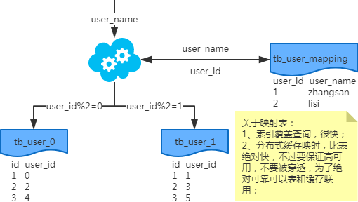

##### 基因法

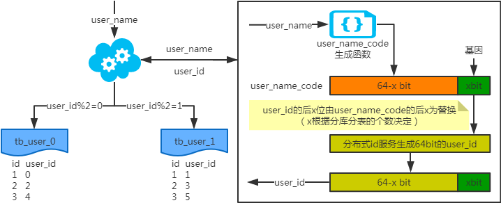

注：

通过对user\_name执行一个随机函数，得到一个68bit的code，然后取最后4个bit作为基因，比如4bit基因是1010

写入时，基因法生成 user\_id，如图。关于 xbit 基因，例如要分16张表，2的4次方等于16，故 x 取4，即 4bit 基因，这个基因可以是0到15之间的任意值，根据 user\_id 查询时可直接取模路由到对应的分库或分表，比如：user\_id=777，777的二进制表示为：0011 0000 1001，然后拼接4bit基因1010，1010转换为10进制为10，之后10%16，落在表10

根据 user\_name 查询时，先通过 user\_name\_code 生成函数生成 user\_name\_code 再对其取模路由到对应的分库或分表。id 生成常用 snowflake 算法。

#### 多key业务

##### 索引表法、缓存映射法

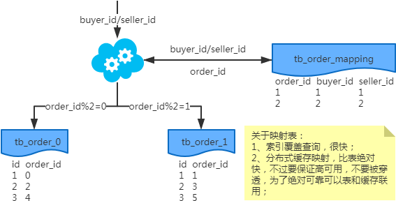

**冗余法**

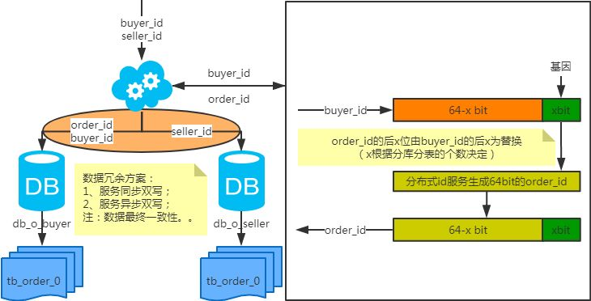

* 异步双写：包含线上异步(ESB)和线下异步(Log)
* 按照 order\_id 或 buyer\_id 查询时路由到 db\_o\_buyer 库中，按照 seller\_id 查询时路由到 db\_o\_seller 库中

### 六、分库分表总结

* 分库分表，首先得知道瓶颈在哪里，然后才能合理地拆分（分库还是分表？水平还是垂直？分几个？）。且不可为了分库分表而拆分。
* 选 key 很重要，既要考虑到拆分均匀，也要考虑到非 partition key 的查询。
* 只要能满足需求，拆分规则越简单越好。


# 分库分表如何预估分多少个库和多少张表

预估分库分表的数量需要考虑多个因素，并结合具体的业务场景。让我们通过一个实际的例子来说明这个过程。

假设我们有一个电子商务平台，主要处理订单信息。我们将以订单表为例进行分析。

### 示例：订单系统

#### 1. 数据量分析

假设我们有以下数据：

* 当前订单数：1亿
* 每日新增订单：100万
* 预计5年后的订单总量：1亿 + (100万 \* 365 \* 5) ≈ 28.25亿

#### 2. 性能考量

* 假设单个MySQL实例能够高效处理的数据量上限是500GB。
* 每条订单记录大小约为1KB。

#### 3. 业务需求

* 需要支持按用户ID和订单时间查询。
* 需要保证单个用户的订单在同一个分片，以便于事务处理和查询。

#### 4. 分库分表策略

考虑到上述因素，我们可以采用双层分片策略：先分库，再分表。

##### 分库策略：

使用用户ID作为分库键，确保同一用户的订单在同一个库中。

##### 分表策略：

在每个库内，按照订单创建时间范围分表。

#### 5. 具体计算

1. **预估总数据量**：\ 28.25亿 \* 1KB ≈ 2.825TB
2. **预估需要的库数量**：\ 2.825TB / 500GB ≈ 5.65，向上取整到8个库（2的幂次，便于后续扩展）
3. **每个库的表数量**：\ 假设我们希望单表控制在5000万条记录以内\ 每个库的记录数：28.25亿 / 8 ≈ 3.53亿\ 每个库需要的表数：3.53亿 / 5000万 ≈ 7.06，向上取整到8张表

#### 6. 最终方案

* 分8个库
* 每个库8张表
* 总共64个分片（8 \* 8）

### 实现示例

```java
public class OrderShardingStrategy {
    private static final int DB_COUNT = 8;
    private static final int TABLE_COUNT_PER_DB = 8;

    public static int getDbIndex(long userId) {
        return (int) (userId % DB_COUNT);
    }

    public static int getTableIndex(Date orderTime) {
        // 假设按季度分表
        Calendar cal = Calendar.getInstance();
        cal.setTime(orderTime);
        int quarter = cal.get(Calendar.MONTH) / 3;
        int year = cal.get(Calendar.YEAR) - 2023; // 假设从2023年开始
        return (year * 4 + quarter) % TABLE_COUNT_PER_DB;
    }

    public static String getTableName(long userId, Date orderTime) {
        int dbIndex = getDbIndex(userId);
        int tableIndex = getTableIndex(orderTime);
        return String.format("db_%d.order_%d", dbIndex, tableIndex);
    }
}
```

在这个示例中：

* getDbIndex 方法根据用户ID确定数据库索引。
* getTableIndex 方法根据订单时间确定表索引，这里假设按季度分表。
* getTableName 方法结合两者，返回完整的表名。

### 注意事项

1. 这只是初始设计，需要根据实际运行情况进行调整。
2. 考虑使用分库分表中间件（如ShardingSphere）来简化实现。
3. 预留足够的扩展空间，比如这里我们用了8个库而不是6个。
4. 定期监控数据增长情况，及时调整分片策略。

这个例子展示了如何基于具体的业务需求和数据特征来设计分库分表方案。实际应用中，还需要考虑更多因素，如查询模式、数据分布的均匀性等，并通过压力测试来验证方案的可行性。

发散思维：如果日均订单约500W增量呢？

思路：1年约18亿，至少保留2-3年热数据就是 40~50亿，算上空间预留可以准备50亿。可以按照32个库，每个库32张表来规划 。一共1024张表，每个表预计存放500万，即可满足50亿数据的容量规划了


# 分库分表后如何进行分页查询

在分库分表后进行分页查询是一项复杂的任务，因为数据被分布在多个表或数据库中，不像单个表那样可以直接利用数据库提供的分页功能（如 LIMIT 和 OFFSET）。在这种情况下，您需要在应用程序层面进行一些策略上的调整。以下是一些常见的解决方案：

### 方法 1：应用层合并

1. **每个分表查询：** 分别在每个子表或数据库上执行相同的分页查询，但不使用 LIMIT 和 OFFSET。这意味着对于每个分表，你都可能需要查询比单表环境中更多的数据。
2. **合并结果：** 将来自所有分表的结果合并在一起。
3. **排序和截取：** 在应用程序层面，对合并后的数据进行排序，然后根据全局的分页参数（如 page 和 pageSize）计算出实际需要返回的记录范围，并从中截取出需要的数据。

### 方法 2：主键或逻辑分页

1. **确定分页字段：** 在分库分表设计时，确保有一个能够全局排序的字段，如时间戳、主键（如果是全局唯一）或其他可以用于排序的字段。
2. **分表分页查询：** 利用上面确定的分页字段，对每个子表执行固定条件的子查询，比如选取某个范围的字段值。
3. **循环迭代：** 使用一个外层循环依次查询每个子表中的下一页的数据，根据分页字段逐步推进，直到得到足够多的记录用来展示所需页。
4. **合并结果：** 合并每次查询得到的结果，根据全局排序字段进行排序，并截取所需的记录段。

### 方法 3：中间件或工具支持

1. **使用中间件：** 使用数据访问中间件来承接分库分表对应用开发过程的复杂性。这些中间件通常内置了分页处理、查询合并等复杂操作。
2. **工具辅助：** 一些分库分表的解决方案工具提供了分页功能，例如 MyCat、ShardingSphere。这些工具通常可以透过配置执行自动的跨分片分页查询。

### 方法 4：异步批查询

1. **分步执行：** 通过异步请求每个子表的分页数据。
2. **缓存全量索引：** 依据全局排序字段定期缓存数据的索引或结果，以降低实时查询的开销。
3. **动态刷新：** 针对高实时性要求，通过间隔更新和必要时即时刷新来保证数据的时效性。

### 开发建议

* **选择合适的分库分表策略**：在数据分片策略设计之初，就需要重点考虑到如何高效进行全局分页查询。
* **平衡延迟和查询成本**：通过增加一些计算或存储（如缓存）来减少复杂度和轮询开销。
* **性能监测**：在事情进行调整时，使用性能监测工具来时刻关注数据库和应用程序开销变化情况。

通过以上策略，结合实际的应用需求，可以有效应对分库分表后分页查询过程中的挑战。


# 分库分表后如何进行跨库join

在分库分表架构下进行跨库JOIN需要特别谨慎，因为传统的数据库JOIN操作无法直接在分布式环境中跨库执行。以下是几种常用的策略和方法来解决这个问题：

### 1. 应用层Join
应用层Join是最直接的方法，通过在应用程序中编写逻辑来处理多个数据库的查询结果并进行合并。

**示例代码:**

```java
public List performJoin() {
    List listA = repositoryA.findEntitiesBySomeCriteria();
    List listB = repositoryB.findEntitiesByOtherCriteria();

    // Join in application logic
    List result = new ArrayList<>();
    for (EntityA a : listA) {
        for (EntityB b : listB) {
            if (a.getJoinKey().equals(b.getJoinKey())) {
                ResultType combined = new ResultType(a, b);
                result.add(combined);
            }
        }
    }
    return result;
}
```

### 2. 数据冗余
在某些情况下，可以通过冗余存储部分必要的数据以避免跨库Join。例如，将信息复制到一个中心库或每个分片中包含必要的冗余字段。

**示例:**

假设有订单(Order)和用户(User)数据分库。可以在Order表中冗余存储User的部分信息（如username），以减少跨库查询。

### 3. 使用中间件
利用分布式中间件或数据库中间件，例如Mycat、ShardingSphere，这些工具通常能处理分库分表的情况下进行复杂查询。

**ShardingSphere示例:**

```java
# ShardingSphere configuration example
tables:
t_order:
actualDataNodes: ds_${0..1}.t_order_${0..1}
                      # ... other configurations
```

### 4. 数据仓库
将数据归集到数据仓库（如Hadoop、Apache Drill），并在那里执行复杂的跨库JOIN查询。数据仓库通常更擅长处理大规模数据的JOIN操作。

### 5. 缓存和异步处理
利用Redis或其他缓存系统缓存部分跨库JOIN结果，减少实时计算负荷。或者，异步地进行定时数据处理，预先准备合并的结果。

### 风险和注意事项
1. **性能问题**：应用层Join可能导致性能问题，尤其是在数据量很大时。
2. **一致性**：如果使用数据冗余或中间件，需要小心维护数据一致性。
3. **复杂性**：采用复杂的中间件或数据仓库可能引入额外的系统复杂性和运维负担。

### 最佳实践
+ **减少跨库操作**：在系统设计时，尽量减少需要跨库的场景。
+ **数据设计**：在数据设计阶段考虑拆分策略，最大化本地数据访问。
+ **持续监控**：监控性能和负载，必要时优化查询策略。

跨库JOIN是一个系统复杂性较高的问题，应根据具体场景做出合理选择和优化设计。在大多数情况下，通过良好的数据设计和应用级优化，可以有效地缓解跨库数据访问带来的复杂性和性能挑战。


# ShardingSphere的读写分离是如何实现的？

读写分离是ShardingSphere 的重要功能。主要负责将 SQL 语句根据他们的执行逻辑不同，路由到不同的数据库中执行。读写分离功能只负责 SQL 路由，而不负责不同数据库之间的数据同步。通常，MySQL 的数据同步是通过 MySQL 主从集群机制完成。要在ShardingSphere中实现读写分离功能，主要通过以下几个步骤：

1. **数据源配置**：首先，在应用程序的配置中，你需要配置多个数据库数据源，包括主库（用于写操作）和多个从库（用于读操作）。每个数据源都有一个唯一的名称和连接信息。
2. **SQL解析**：当应用程序发送SQL查询请求时，ShardingSphere的SQL 执行引擎会拦截并解析SQL语句。
3. **读写分离规则**：ShardingSphere通过读写分离规则来确定查询应该发送到主库还是从库。这些规则可以在配置文件中定义，通常基于SQL的类型（SELECT、INSERT、UPDATE、DELETE）来决定路由。
4. **路由查询**：根据读写分离规则，Sharding-JDBC将查询请求路由到适当的数据源。如果是SELECT查询，它将路由到一个从库；如果是INSERT、UPDATE或DELETE操作，它将路由到主库。这确保了写操作总是发送到主库，而读操作可以发送到从库，以分担主库的负载。
5. **执行查询**：一旦确定了目标数据源，Sharding-JDBC会将查询请求转发到相应的数据库。主库用于写操作，从库用于读操作。
6. **返回结果**：数据库执行查询后，将结果返回给Sharding-JDBC，然后Sharding-JDBC将结果返回给应用程序。

ShardingSphere的读写分离实现主要依赖于SQL解析和读写分离规则。通过解析SQL语句，它能够识别查询类型并将其路由到适当的数据库数据源。这使得应用程序可以实现自动的读写分离，从而提高了系统性能和负载均衡。开发人员只需配置好数据源和读写分离规则，ShardingSphere会自动处理剩下的工作。具体的配置方式，根据 ShardingSphere 版本不同会略有不同。


# ShardingSphere的核心模块有哪些？他们是如何工作的？

ShardingSphere 是一个分布式数据库中间件，它由多个核心模块组成，包括 Sharding-JDBC、Sharding-Proxy 和 Sharding-Sidecar。

1. Sharding-JDBC 是 ShardingSphere 的核心模块之一，它提供了一个轻量级的 Java 框架，在 Java 的 JDBC 层提供额外的服务。使用客户端直连数据库，以 jar 包形式提供服务，无需额外部署和依赖，可理解为增强版的 JDBC 驱动，完全兼容 JDBC 和各种 ORM 框架。Sharding-JDBC主要用于嵌入到应用程序中，使应用程序能够透明地使用分片和读写分离功能，而无需对应用程序进行大规模修改。
2. Sharding-Proxy 是 ShardingSphere 的另一核心模块，它以代理的形式部署在应用程序与数据库之间，实现了对 SQL 的解析和改写以及请求的转发。用户无需修改任何应用程序代码，只需通过配置文件或 API 接口进行分片规则设置，即可实现数据分片和读写分离等功能。Sharding-Proxy主要用于需要将数据库访问透明地分片化的情况，而不想在应用程序中引入Sharding-JDBC的情况。它也可以用于监控和审计数据库操作。
3. Sharding-Sidecar 是 ShardingSphere 的规划中的第三个模块，它将作为一个独立的微服务，为用户提供更为灵活和强大的数据分片、分布式事务和数据治理等功能。Sarding-SideCar 主要用于云原生环境。

总体来说，ShardingSphere 的三个核心模块通过相互配合，共同实现了数据库的分片和分布式事务等功能的解决方案。开发人员可以根据其应用程序的要求选择合适的模块来集成ShardingSphere。这些模块共同为分布式数据库操作提供了更好的性能、可扩展性和可用性。


# ShardingSphere支持水平分片和垂直分片吗？请解释它们的区别。

ShardingSphere是支持水平分片和垂直分片的，但它们的区别在于：

+ 垂直分片：是在应用层面上进行的一种策略，它主要是为了解决单台数据库性能瓶颈的问题，将数据根据业务逻辑分类进行分片存储。每个表中的数据会被分散到不同的数据库中。它的优点是能够减轻单个库的负载压力，方便数据维护等；缺点是没有根本解决单库数据量过大、并发性高的性能瓶颈，并且可能会产生跨服务的事务一致性问题。在应用模块间存在较强耦合关系的情况下，这种策略可能更适合使用。
+ 水平分片：是在数据库层面上进行的一种策略，能够将数据根据某种规则分散至多个库或表中，每个分片仅包含数据的一部分。例如，可以根据某个字段（或某几个字段），如主键进行分片存储。这种策略可以有效地解决单库数据量过大、并发性高的性能瓶颈，提高系统的稳定性和负载能力。水平分片在理论上突破了单机数据量处理的瓶颈，并且扩展相对自由，是分库分表的标准解决方案。

在实际应用中，可以同时使用水平和垂直分片，根据具体业务需求来设计复杂的分片策略，以实现更好的性能、可扩展性和数据管理。ShardingSphere提供了支持这两种分片方式的功能，以满足不同应用场景的需求。


# 如何配置ShardingSphere的数据分片策略？

在ShardingSphere中配置数据分片策略涉及到定义如何将数据分布到不同的数据库和表中，以满足分库分表的需求。通常按照以下步骤来配置一个数据分片策略：

1. 配置数据源：在 ShardingSphere 的配置文件中，配置多个数据源，每个数据源对应一个数据库实例。
2. 配置逻辑表： 在配置文件中，配置多个逻辑表。每个逻辑表对应一个或多个真实数据表。
3. 配置逻辑表的主键生成策略：分库分表场景下，主键不能由数据库本地生成，所以通常会在 ShardingSphere 中配置主键生成策略，用来在分布式场景下，给逻辑表的每一条记录生成一个唯一的主键
4. 配置逻辑表的分库策略和分表策略：分别配置逻辑表的分库策略和分表策略。在配置策略时，一般先配置逻辑表的分片键，也就是按哪个字段分片。然后配置对应的分片算法，也就是按什么规则进行分片。常用的分片算法有取模算法、哈希算法等，也可以自定义复杂算法。
5. 补充一些其他规则：根据具体业务要求，配置一些补充的规则。例如敏感数据加密、广播表、绑定表、影子库等。


# ShardingSphere如何保证分布式事务一致性？

ShardingSphere 保证分布式事务一致性的方式主要有两种：XA事务和柔性事务。

+ XA事务通过在准备阶段和提交阶段进行两阶段锁，来保证分布式事务的一致性。在准备阶段，ShardingSphere 会对所有的数据库节点进行锁定，保证在事务执行过程中不会有其他操作干扰。在提交阶段，ShardingSphere 会对所有的数据库节点进行提交或者回滚操作，以保证事务的一致性。
+ 柔性事务则是通过BASE理论来实现的。BASE理论包括基本可用（Basically Available）、软状态（Soft State）和最终一致性（EventualConsistency）。在柔性事务中，ShardingSphere 采用了柔性状态和最终一致性的理念，允许短时间内不同步，最终保证数据的一致性。

另外，ShardingSphere 还提供了接入分布式事务的 SPI，并针对性能要求较高、一致性要求较低的业务提供了基于柔性事务的方案。在整合Seata AT事务时，ShardingSphere 通过扩展服务间的传输机制，将Seata的全局事务上下文传递到分片执行引擎中，从而保证了分布式事务的一致性。

总之，ShardingSphere 通过XA事务和柔性事务两种方式来保证分布式事务的一致性。在实现过程中，ShardingSphere 还提供了相应的工具类和抽象类，方便开发者进行相关操作。


# ShardingSpehre的分库分表功能是如何工作的？

ShardingSphere 的分库分表功能主要通过如下几个步骤完成：

1. 配置管控：ShardingSphere 需要解析复杂的配置信息，并且支持将配置信息上传到第三方注册中心。
2. SQL 解析：将要执行的 SQL 语句解析成抽象语法树。
3. SQL 路由：根据解析上下文匹配数据库和表的分片策略，并生成 SQL 的路由路径。
4. SQL 优化：用户只需要面向逻辑库和逻辑表来写SQL，最终由ShardigSphere的改写引擎将SQL改写为在真实数据库中可以正确执行的语句。SQL改写分为正确性改写和优化改写。
5. SQL 执行：ShardingSphere 采用一套自动化的执行引擎，负责将路由和改写完成之后的真实 SQL 安全且高效发送到底层数据源执行。
6. 结果归并：将从各个数据节点获取的多数据结果集，组合成为一个结果集并正确的返回至请求客户端。ShardingSphere 内部实现了流式归并和内存归并两种方案。

ShardingSphere 的分库分表功能使得应用程序能够透明地访问分布式数据库，而无需关心具体的数据库分片细节。开发人员只需配置好数据源和分片规则，ShardingSphere会自动处理数据的分布和查询路由。这有助于提高系统性能、可扩展性和可用性。


# 什么是ShardingSphere，它的主要功能是什么？

ShardingSphere 是一套开源的分布式数据库中间件解决方案组成的生态圈，主要由 JDBC、Proxy 组成。这两个产品均提供标准化的数据分片、分布式事务和数据库治理功能，可适用于如 Java 同构、异构语言、云原生等各种多样化的应用场景。

ShardingSphere是一个功能强大的数据库中间件，可用于解决分布式数据库架构中的多种挑战，包括数据分片、读写分离、分布式事务、影子库、数据加密等，从而提高了系统的性能、扩展性和可用性。

ShardingSphere 保留了非常多的功能扩展。通过使用 ShardingSphere，开发者可以无需修改原有业务代码，即可实现数据库的水平扩展和垂直拆分。

ShardingSphere 5.x 版本开始致力于可插拔架构，项目的功能组件能够灵活的以可插拔的方式进行扩展，从而满足更多定制化的需求。

另外，ShardingSphere 还针对分库分表场景，致力于设计并实现一整套分库分表的解决方案，包括数据迁移、冷热数据分离等一系列的问题。


# ShardingSphere支持哪些分片算法？

ShardingSphere支持多种分片算法，主要包括：

1. 精确分片算法（PreciseShardingAlgorithm）：用于处理使用单一键作为分片键的=与IN进行分片的场景。
2. 范围分片算法（RangeShardingAlgorithm）：用于处理使用单一键作为分片键的BETWEEN AND、>、=、<=进行分片的场景。
3. 复合分片算法（ComplexKeysShardingAlgorithm）：用于处理使用多键作为分片键进行分片的场景，多个分片键的逻辑较复杂，需要应用开发者自行处理其中的复杂度。
4. 提示分片算法（HintShardingAlgorithm）：用于处理分片规则与 SQL 无关的场景。对于分片字段非SQL决定，而由其他外置条件决定的场景，可使用SQL Hint灵活的注入分片字段。

此外，随着版本不断演进，ShardingSphere还在不断丰富分片算法，例如基于分片边界的范围分片算法（BoundaryBasedRangeShardingAlgorithm）、基于分片容量的范围分片算法（VolumeBasedRangeShardingAlgorithm）等。


# 如何使用ShardingSphere进行数据加密？

ShardingSphere 的数据加密功能配置主要分为以下步骤：

1. 数据源配置：首先需要配置数据源信息，包括数据源的名称、连接池等信息。
2. 加密算法配置：在 ShardingSphere 中内置了一些常见的加密算法，例如 AES、MD5、RC4、SM3 和 SM4，用户可以选择其中一种或多种算法进行加解密操作。同时，用户也可以通过实现 ShardingSphere 提供的接口来自定义加密算法。
3. 加密表配置：该步骤主要用于配置数据表里哪个列为密文数据（cipherColumn）、使用什么算法进行加解密（encryptorName）、哪个列为辅助查询数据（assistedQueryColumn）、使用什么算法进行加解密（assistedQueryEncryptorName）、哪个列为明文数据（plainColumn）以及使用哪个列进行 SQL 编写（logicColumn）。

通过以上步骤，用户可以完成 ShardingSphere 数据加密功能的配置。


# 什么是ShardingSphere的广播表？

ShardingSphere的广播表是指存在于每个分片数据源中的表。这些表的结构和数据在每个数据库中都完全一致。这种表适用于数据量不大且需要与海量数据的表进行关联查询的场景，例如字典表、省份信息等。对于广播表，ShardingSphere不会对数据进行分片，所有节点的数据都是完全一致的。当有新的插入、更新操作时，它们会实时在所有节点上执行，以保证各个分片的数据一致性。查询操作只需要从一个节点获取，而不是从多个节点获取。同时，广播表可以与任何一个表进行JOIN操作。在ShardingSphere中，可以通过创建广播表的方式来实现广播表的功能。

在ShardingSphere中，开发人员可以配置广播表，使其在分片集群中自动生效。广播表的使用可以简化分布式系统中的数据管理，确保全局数据的一致性，同时降低了查询广播表的复杂性。

