# 并发编程知识汇总
---


# Java并发面试题合集

# 判断线程池任务执行完成的方式
Thread线程是否执行完成，我们可以调用join方法然后等待线程执行完成；那在使用线程池的时候，我们如何知道线程已经执行完成了？本文就带给大家**五种**判断的方式：

+ isTerminated() 方式，在执行 shutdown() ，关闭线程池后，判断是否所有任务已经完成。
+ ThreadPoolExecutor 的 getCompletedTaskCount() 方法，判断完成任务数和全部任务数是否相等。
+ CountDownLatch计数器，使用闭锁计数来判断是否全部完成。
+ 手动维护一个公共计数 ，原理和闭锁类似，就是更加灵活。
+ 使用submit向线程池提交任务，Future判断任务执行状态。

## 方法一：isTerminated()
### 测试代码
```powershell
package pool;

import java.util.concurrent.LinkedBlockingQueue;
import java.util.concurrent.ThreadPoolExecutor;
import java.util.concurrent.TimeUnit;

/**
 * @author 百里
 */
public class BaiLiIsShutdownThreadPoolDemo {
    /**
     * 创建一个最大线程数15的线程池
     */
    public static ThreadPoolExecutor pool = new ThreadPoolExecutor(
            10,
            15,
            0L,
            TimeUnit.MILLISECONDS,
            new ArrayBlockingQueue<>(10));
    /**
     * 线程执行方法，随机等待0到10秒
     */
    private static void sleepMethod(int index){
        try {
            long sleepTime = new Double(Math.random() * 10000).longValue();
            Thread.sleep(sleepTime);
            System.out.println("当前线程执行结束: " + index);
        } catch (InterruptedException e) {
            e.printStackTrace();
        }
    }

    /**
     * 方法一：isTerminated
     * @param args
     * @throws InterruptedException
     */
    public static void main(String[] args) throws InterruptedException {
        for (int i = 0; i  sleepMethod(index));
        }
        pool.shutdown();
        while (!pool.isTerminated()){
            Thread.sleep(1000);
            System.out.println("还没停止。。。");
        }
        System.out.println("全部执行完毕");
    }
}
```

上述代码处理逻辑在主线程中进行循环判断，全部任务是否已经完成。

这里有两个主要方法：

+ shutdown() ：对线程池进行有序关闭。调用该方法后，线程池将不再接受新的任务，但会继续执行已提交的任务。如果线程池已经处于关闭状态，则对该方法的调用没有额外的作用。
+ isTerminated() ：判断线程池中的所有任务是否在关闭后完成。只有在调用了shutdown()或shutdownNow()方法后，所有任务执行完毕，才会返回true。需要注意的是，在调用shutdown()之前调用isTerminated()方法始终返回false。

### 优缺点分析
优点 ：操作简单。
缺点 ：需要关闭线程池。并且日常使用是将线程池注入到Spring容器，然后各个组件中统一用同一个线程池，不能直接关闭线程池。

## 方法二：getCompletedTaskCount()
### 测试代码
```powershell
package pool;

import java.util.concurrent.*;
import java.util.concurrent.locks.Lock;
import java.util.concurrent.locks.ReentrantLock;

/**
 * @author 百里
 */
public class BaiLiIsShutdownThreadPoolDemo {
    /**
     * 创建一个最大线程数15的线程池
     */
    public static ThreadPoolExecutor pool = new ThreadPoolExecutor(
            10,
            15,
            0L,
            TimeUnit.MILLISECONDS,
            new ArrayBlockingQueue<>(10));
    /**
     * 线程执行方法，随机等待0到10秒
     */
    private static void sleepMethod(int index){
        try {
            long sleepTime = new Double(Math.random() * 10000).longValue();
            Thread.sleep(sleepTime);
            System.out.println("当前线程执行结束: " + index);
        } catch (InterruptedException e) {
            e.printStackTrace();
        }
    }

    /**
     * 方法二：getCompletedTaskCount
     * @param args
     * @throws InterruptedException
     */
    public static void main(String[] args) throws InterruptedException {
        for (int i = 0; i  sleepMethod(index));
        }
        //当线程池完成的线程数等于线程池中的总线程数
        while (!(pool.getTaskCount() == pool.getCompletedTaskCount())) {
            System.out.println("任务总数:" + pool.getTaskCount() + "； 已经完成任务数:" + pool.getCompletedTaskCount());
            Thread.sleep(1000);
            System.out.println("还没停止。。。");
        }
        System.out.println("全部执行完毕");
    }
}

```

上述代码处理逻辑还是一样在主线程循环判断，主要就两个方法：

+ getTaskCount() ：返回计划执行的任务总数。由于任务和线程的状态可能在计算过程中动态变化，返回的值只是一个近似值。这个方法返回的是线程池提交的任务总数，包括已经完成和正在执行中的任务。
+ getCompletedTaskCount() ：返回已经完成执行的任务的大致总数。由于任务和线程的状态可能在计算过程中动态改变，返回的值只是一个近似值，并且在连续的调用中不会减少。这个方法返回的是已经完成执行的任务数量，不包括正在执行中的任务。

### 优缺点分析
+ 优点 ：不必关闭线程池，避免了创建和销毁带来的损耗。
+ 缺点 ：使用这种判断存在很大的限制条件；必须确定在循环判断过程中没有新的任务产生。

## 方法三：CountDownLatch
### 测试代码
```powershell
package pool;

import java.util.concurrent.*;
import java.util.concurrent.locks.Lock;
import java.util.concurrent.locks.ReentrantLock;

/**
 * @author 百里
 */
public class BaiLiIsShutdownThreadPoolDemo {
    /**
     * 创建一个最大线程数15的线程池
     */
    public static ThreadPoolExecutor pool = new ThreadPoolExecutor(
            10,
            15,
            0L,
            TimeUnit.MILLISECONDS,
            new ArrayBlockingQueue<>(10));
    /**
     * 线程执行方法，随机等待0到10秒
     */
    private static void sleepMethod(int index){
        try {
            long sleepTime = new Double(Math.random() * 10000).longValue();
            Thread.sleep(sleepTime);
            System.out.println("当前线程执行结束: " + index);
        } catch (InterruptedException e) {
            e.printStackTrace();
        }
    }

    /**
     * 方法三：CountDownLatch
     * @throws Exception
     */
    public static void main(String[] args) throws Exception {
        //计数器，判断线程是否执行结束
        CountDownLatch taskLatch = new CountDownLatch(10);
        for (int i = 0; i  {
                sleepMethod(index);
                taskLatch.countDown();
                System.out.println("当前计数器数量：" + taskLatch.getCount());
            });
        }
        //当前线程阻塞，等待计数器置为0
        taskLatch.await();
        System.out.println("全部执行完毕");
    }
}

```

### 优缺点分析
优点 ：代码优雅，不需要对线程池进行操作。
缺点 ：需要提前知道线程数量；性能较差；还需要在线程代码块内加上异常判断，否则在 countDown之前发生异常而没有处理，就会导致主线程永远阻塞在 await。

## 方法四：公共计数
### 测试代码
```powershell
package pool;

import java.util.concurrent.*;
import java.util.concurrent.locks.Lock;
import java.util.concurrent.locks.ReentrantLock;

/**
 * @author 百里
 */
public class BaiLiIsShutdownThreadPoolDemo {
    /**
     * 创建一个最大线程数15的线程池
     */
    public static ThreadPoolExecutor pool = new ThreadPoolExecutor(
            10,
            15,
            0L,
            TimeUnit.MILLISECONDS,
            new ArrayBlockingQueue<>(10));
    /**
     * 线程执行方法，随机等待0到10秒
     */
    private static void sleepMethod(int index){
        try {
            long sleepTime = new Double(Math.random() * 10000).longValue();
            Thread.sleep(sleepTime);
            System.out.println("当前线程执行结束: " + index);
        } catch (InterruptedException e) {
            e.printStackTrace();
        }
    }

    private static int taskNum = 0; //计数器

    /**
     * 方法四：公共计数
     * @throws Exception
     */
    public static void main(String[] args) throws Exception {
        Lock lock = new ReentrantLock();
        for (int i = 0; i  {
                sleepMethod(index);
                lock.lock();
                taskNum++;
                lock.unlock();
            });
        }
        while(taskNum (10));
    /**
     * 线程执行方法，随机等待0到10秒
     */
    private static void sleepMethod(int index){
        try {
            long sleepTime = new Double(Math.random() * 10000).longValue();
            Thread.sleep(sleepTime);
            System.out.println("当前线程执行结束: " + index);
        } catch (InterruptedException e) {
            e.printStackTrace();
        }
    }

    /**
     * 方法五：Future
     * @throws Exception
     */
    public static void main(String[] args) throws Exception {
        Future future = pool.submit(() -> sleepMethod(1));
        while (!future.isDone()){
            Thread.sleep(1000);
            System.out.println("还没停止。。。");
        }
        System.out.println("全部执行完毕");
    }
}

```

### 优缺点分析
优点：使用简单，不需要关闭线程池。

缺点：每个提交给线程池的任务都会关联一个Future对象，这可能会引入额外的内存开销。如果需要处理大量的任务，可能会占用较多的内存。

## 测试代码汇总
```powershell
package pool;

import java.util.concurrent.*;
import java.util.concurrent.locks.Lock;
import java.util.concurrent.locks.ReentrantLock;

/**
 * 五种判断线程池任务执行完成的方式
 * @author 百里
 */
public class BaiLiIsShutdownThreadPoolDemo {
    /**
     * 创建一个最大线程数15的线程池
     */
    public static ThreadPoolExecutor pool = new ThreadPoolExecutor(
            10,
            15,
            0L,
            TimeUnit.MILLISECONDS,
            new ArrayBlockingQueue<>(10));
    /**
     * 线程执行方法，随机等待0到10秒
     */
    private static void sleepMethod(int index){
        try {
            long sleepTime = new Double(Math.random() * 10000).longValue();
            Thread.sleep(sleepTime);
            System.out.println("当前线程执行结束: " + index);
        } catch (InterruptedException e) {
            e.printStackTrace();
        }
    }

    /**
     * 方法一：isTerminated
     * @param args
     * @throws InterruptedException
     */
    public static void isTerminatedTest(String[] args) throws InterruptedException {
        for (int i = 0; i  sleepMethod(index));
        }
        pool.shutdown();
        while (!pool.isTerminated()){
            Thread.sleep(1000);
            System.out.println("还没停止。。。");
        }
        System.out.println("全部执行完毕");
    }

    /**
     * 方法二：getCompletedTaskCount
     * @param args
     * @throws InterruptedException
     */
    public static void completedTaskCountTest(String[] args) throws InterruptedException {
        for (int i = 0; i  sleepMethod(index));
        }
        //当线程池完成的线程数等于线程池中的总线程数
        while (!(pool.getTaskCount() == pool.getCompletedTaskCount())) {
            System.out.println("任务总数:" + pool.getTaskCount() + "； 已经完成任务数:" + pool.getCompletedTaskCount());
            Thread.sleep(1000);
            System.out.println("还没停止。。。");
        }
        System.out.println("全部执行完毕");
    }

    /**
     * 方法三：CountDownLatch
     * @throws Exception
     */
    public static void countDownLatchTest(String[] args) throws Exception {
        //计数器，判断线程是否执行结束
        CountDownLatch taskLatch = new CountDownLatch(10);
        for (int i = 0; i  {
                sleepMethod(index);
                taskLatch.countDown();
                System.out.println("当前计数器数量：" + taskLatch.getCount());
            });
        }
        //当前线程阻塞，等待计数器置为0
        taskLatch.await();
        System.out.println("全部执行完毕");
    }

    private static int taskNum = 0;

    /**
     * 方法四：公共计数
     * @throws Exception
     */
    public static void countTest(String[] args) throws Exception {
        Lock lock = new ReentrantLock();
        for (int i = 0; i  {
                sleepMethod(index);
                lock.lock();
                taskNum++;
                lock.unlock();
            });
        }
        while(taskNum  sleepMethod(1));
        while (!future.isDone()){
            Thread.sleep(1000);
            System.out.println("还没停止。。。");
        }
        System.out.println("全部执行完毕");
    }
}
```

# 如何理解阻塞、非阻塞与同步、异步的区别？
## 同步与异步
同步与异步关注的是**消息通信机制**。

+ **所谓同步**，就是在发出一个**调用**时，在没有得到结果之前，该调用就不返回。但是一旦调用返回，就得到返回值了。换句话说，就是由调用者主动等待这个调用的结果。
+ 而**异步**则是相反，调用在发出之后，这个调用就直接返回了，所以就没有返回结果。换句话说，当一个异步过程调用发出后，调用者不会立刻得到结果。而是在调用发出之后，被调用者通过**“状态”**、**“通知”**、**“回调”**三种途径通知调用者。

可以使用哪一种途径依赖于被调用者的实现，除非被调用者提供多种选择，否则不受调用者控制。

+ 如果被调用者用状态来通知，那么调用者就需要每隔一定时间检查一次，效率就很低。
+ 如果使用通知和回调的方式，效率则很高。因为被调用者几乎不需要做额外的操作。

**举个例子：**

你打电话问书店老板有没有《高效演讲》这本书。

如果是**同步通信机制**，书店老板会说，你稍等，”我查一下"，然后开始查啊查，等查好了（可能是5秒，也可能是一天）告诉你结果（返回结果）。

而**异步通信机制**，书店老板直接告诉你我查一下啊，查好了打电话给你，然后直接挂电话了（不返回结果）。然后查好了，他会主动打电话给你。在这里老板通过“回电”这种方式来回调。

## 阻塞与非阻塞
阻塞和非阻塞关注的是**程序在等待调用结果**（消息，返回值）时的状态。

+ **阻塞**调用是指调用结果返回之前，当前线程会被挂起。调用线程只有在得到结果之后才会返回。
+ **非阻塞**调用指在不能立刻得到结果之前，该调用不会阻塞当前线程。

接着上面的例子：

打电话问书店老板有没有《高效演讲》这本书，

+ 如果是阻塞式调用，你会一直把自己“挂起”，直到得到这本书有没有的结果。
+ 如果是非阻塞式调用，你不管老板有没有告诉你，你自己先一边去玩了（先去干点别的，不用傻等）， 当然你也要偶尔过几分钟检查一下老板有没有返回结果。

## 故事描述
百里爱喝茶。

出场人物：百里，水壶两把（普通水壶，简称水壶；会响的水壶，简称响水壶）。

1. 百里把水壶放到火上，立等水开，什么都不做，（同步阻塞）百里觉得自己有点傻。
2. 百里把水壶放到火上，去客厅看电视，时不时去厨房看看水开没有。（同步非阻塞）。
3. 百里还是觉得自己有点傻，于是变高端了，买了把会响笛的那种水壶。水开之后，能大声发出嘀~~~~的噪音。
4. 百里烧水，但站在水壶前啥也不干（线程阻塞），等水壶响了（异步回调）取水。（异步阻塞）。
5. 百里觉得这样傻等意义不大，百里把响水壶放到火上，去客厅看电视，水壶响之前不再去看它了，响了再去拿壶。（异步非阻塞）。
+ **同步异步，只是对于水壶而言**。
    - 普通水壶，同步。
    - 响水壶，异步。

虽然都能干活，但响水壶可以在自己完工之后，提示百里水开了。这是普通水壶所不能及的。同步只能让调用者去轮询自己（情况2中），造成百里效率的低下。

+ **阻塞非阻塞，仅仅对于百里而言。**
    - 立等的百里，阻塞。
    - 看电视的百里，非阻塞。

情况1和情况3中百里就是阻塞的，媳妇喊他都不知道。虽然3中响水壶是异步的，可对于立等的百里没有太大的意义。所以一般异步是配合非阻塞使用的，这样才能发挥异步的效用。

## 回调函数
前面提到，回调是异步调用的一种实现方式。那么什么是回调函数呢？

+ **概念**

回调函数就是一个通过函数指针调用的函数。如果你把函数的[指针](http://baike.baidu.com/view/159417.htm)（地址）作为[参数传递](http://baike.baidu.com/view/2691131.htm)给另一个函数，当这个指针被用来调用其所指向的函数时，我们就说这是回调函数。

回调函数不是由该函数的实现方直接调用，而是在特定的事件或条件发生时由另外的一方调用的，用于对该事件或条件进行响应。

+ **举个例子**

概念不是太好理解，我们举个例子。

沿用上面买书的例子，你的电话号码就叫**回调函数**，你把电话留给书店老板就叫**登记回调函数**，书店老板查好了叫做触发了回调关联的事件，老板给你打电话叫做**调用回调函数。**你接电话叫做响应回调事件。

# SpringBoot + 虚拟线程，性能炸裂！
虚拟线程是Java19开始增加的一个特性，和Golang的携程类似，

 说白了就是JVM提供一层线程的接口抽象，通过普通的操作系统线程可以调度成千上万个虚拟线程。

虚拟线程比普通线程的消耗要小得多得多，在内存足够的情况下，我们甚至可以创建上百万的虚拟线程，这在之前基本(Java19以前)是不可能的。

要在SpringBoot中使用虚拟线程很简单，只需要为@Async的线程池配置为虚拟线程池就可以

```java

@Bean
public AsyncTaskExecutor applicationTaskExecutor() {
    return new TaskExecutorAdapter(Executors.newVirtualThreadPerTaskExecutor());
}

```

然后我做个了测试：写一个异步service，里面睡眠50ms，模拟MySQL或Redis等IO操作：

```java
@Service
public class AsyncService {

    /**
     * @param countDownLatch 用于测试
     */
    @Async
    public void doSomething(CountDownLatch countDownLatch) throws InterruptedException {
        Thread.sleep(50);
        countDownLatch.countDown();
    }
}
```

 循环调用这个方法10万次，计算所有方法执行完成的消耗的时间：

最后测试类，很简单，就是循环调用这个方法10万次，计算所有方法执行完成的消耗的时间：

```java
@Test
public void testAsync() throws InterruptedException {
long start = System.currentTimeMillis();
int n = 100000;
CountDownLatch countDownLatch = new CountDownLatch(n);
for (int i = 0; i  {
    // 线程任务逻辑
});
thread.start();
```

5. **使用线程池（****Executor框架****）：** 可以使用**Executor**框架中的线程池来管理和执行线程。通过**ExecutorService**接口的实现类，例如**ThreadPoolExecutor**，可以提交任务并由线程池管理线程的生命周期。

```plain
javaCopy code
ExecutorService executorService = Executors.newFixedThreadPool(5);
executorService.submit(() -> {
    // 线程任务逻辑
});
```

这些方法都可以用来创建和启动线程，选择哪种方式取决于具体的需求和编程风格。通常情况下，推荐使用实现**Runnable**接口或使用Lambda表达式的方式来创建线程，因为它们更加灵活，可以避免Java单继承的限制，并且符合面向对象的设计原则。

# 如何停止一个正在运行的线程
要停止一个正在运行的线程，通常有几种方法，但需要根据具体情况选择适当的方式，因为线程的停止涉及到线程安全和资源释放等问题。以下是一些常用的停止线程的方法：

1. **使用标志位：** 在线程的执行体中使用一个标志位，当该标志位为true时，线程会自行退出执行。这是一种比较安全和可控的方式。例如：

```java
public class MyThread extends Thread {
    private volatile boolean stopRequested = false;

    public void run() {
        while (!stopRequested) {
            // 执行线程任务
        }
    }

    public void stopThread() {
        stopRequested = true;
    }
}
```

在上面的示例中，**stopThread**方法用于设置**stopRequested**标志位，从而停止线程的执行。

2. **使用****interrupt****方法：** 使用线程的**interrupt**方法可以中断线程的执行。在线程的执行体中，可以使用**Thread.currentThread().isInterrupted()**检查线程是否被中断，然后做出相应的处理。例如：

```java
public class MyThread extends Thread {
    public void run() {
        while (!Thread.currentThread().isInterrupted()) {
            // 执行线程任务
        }
    }
}

// 停止线程的方法
myThread.interrupt();
```

在这种方法中，线程需要主动检查是否被中断，并根据需要停止执行。

3. **使用****Thread.stop****方法（不推荐使用）：****Thread.stop**方法可以强制停止一个线程，但不建议使用它，因为它可能导致线程的状态不一致和资源泄漏等问题，容易引发不可预测的错误。
4. **使用****ExecutorService****：** 如果线程是通过**ExecutorService**创建的，可以使用**shutdown**或**shutdownNow**方法来停止线程池中的线程。
5. **使用****Future****：** 如果线程是通过**Future**对象启动的，可以使用**cancel**方法来取消线程的执行。

总的来说，为了安全地停止线程，建议使用标志位或**interrupt**方法，并在线程的执行体中检查相应的标志或中断状态。避免使用**Thread.stop**方法，以及要谨慎处理线程的资源释放问题。

# 有三个线程T1,T2,T3,如何保证顺序执行
确保三个线程 T1、T2、T3 按照指定顺序执行有多种方式。以下是其中一些常见的方式：

+ **使用 join() 方法**： 可以在每个线程内部使用 join() 方法来等待前一个线程执行完成。具体操作是在线程 T2 的 run() 方法中调用 T1.join()，在线程 T3 的 run() 方法中调用 T2.join()。这样可以确保 T1 在 T2 之前执行，T2 在 T3 之前执行。

```java

Thread T1 = new Thread(() -> {
    // 线程 T1 的任务
});

Thread T2 = new Thread(() -> {
    try {
        T1.join(); // 等待 T1 执行完成
    } catch (InterruptedException e) {
        e.printStackTrace();
    }
    // 线程 T2 的任务
});

Thread T3 = new Thread(() -> {
    try {
        T2.join(); // 等待 T2 执行完成
    } catch (InterruptedException e) {
        e.printStackTrace();
    }
    // 线程 T3 的任务
});

T1.start();
T2.start();
T3.start();
```

+ **使用 CountDownLatch**： 可以使用 CountDownLatch 来控制线程的执行顺序。创建一个 CountDownLatch 对象，设置初始计数为 2，分别在 T1 和 T2 的线程内等待计数器减少到 0，然后释放 T3 线程。

```java
CountDownLatch latch1 = new CountDownLatch(1);
CountDownLatch latch2 = new CountDownLatch(1);

Thread t1 = new Thread(() -> {
    System.out.println("T1 running.");
    latch1.countDown(); // T1 执行完后释放 latch1
});

Thread t2 = new Thread(() -> {
    try {
        latch1.await(); // 等待 latch1 的释放
      	System.out.println("T2 running.");
        latch2.countDown(); // T2 执行完后释放 latch2
    } catch (InterruptedException e) {
        e.printStackTrace();
    }
});

Thread t3 = new Thread(() -> {
    try {
        latch2.await(); // 等待 latch2 的释放
      	System.out.println("T3 running.");
    } catch (InterruptedException e) {
        e.printStackTrace();
    }
});

t1.start();
t2.start();
t3.start();
```

+ **使用 LockSupport**： 可以使用LockSupport的park和unpark来控制线程的执行顺序。

```java
public class Test {
    private static Thread t1;
    private static Thread t2;
    private static Thread t3;
    public static void main(String[] args) {

        t1 = new Thread(() -> {
            System.out.println("T1 is running.");
            LockSupport.unpark(t2); // 唤醒线程T2
        });

        t2 = new Thread(() -> {
            LockSupport.park(); // 阻塞线程T2
            System.out.println("T2 is running.");
            LockSupport.unpark(t3); // 唤醒线程T3
        });

        t3 = new Thread(() -> {
            LockSupport.park(); // 阻塞线程T3
            System.out.println("T3 is running.");
        });

        t1.start();
        t2.start();
        t3.start();
    }
}
```

这些方法都可以用来确保线程按照指定顺序执行。选择其中一种方式取决于你的具体需求和场景。

# ThreadLocaL如何防止内存泄漏
ThreadLocal 变量的内存泄漏问题主要是由于 ThreadLocalMap 中的 Entry 没有被及时清理导致的。ThreadLocalMap 是 ThreadLocal 的底层数据结构，它用于存储每个线程独立的变量副本。

要防止 ThreadLocal 内存泄漏，可以考虑以下方法：

## 使用完 ThreadLocal 后及时调用 remove() 方法
1. 在不再需要使用 ThreadLocal 存储的数据时，手动调用 ThreadLocal.remove() 方法将该数据从当前线程的 ThreadLocalMap 中清除。这样可以确保 ThreadLocalMap 不会持有对对象的引用，从而帮助垃圾回收器正常回收不再需要的对象。

```plain
javaCopy code
ThreadLocal threadLocal = new ThreadLocal<>();
// 存储数据
threadLocal.set(someData);
// 使用完毕后清除
threadLocal.remove();
```

## 使用 try-with-resources 或 try-finally 块
2. 如果你的 ThreadLocal 变量在需要清理的资源管理上下文中使用，可以使用 try-with-resources（自动清理）或 try-finally（手动清理）块来确保及时清理。

```plain
javaCopy code
try (ThreadLocalResource resource = new ThreadLocalResource()) {
    // 使用 ThreadLocalResource
}
// 或者使用 try-finally
ThreadLocalResource resource = new ThreadLocalResource();
try {
    // 使用 ThreadLocalResource
} finally {
    resource.close(); // 在 close 方法中清理 ThreadLocal 变量
}
```

## 使用 InheritableThreadLocal
3. 如果需要在子线程中访问父线程的 ThreadLocal 变量，并且确保在子线程中正确清理，可以考虑使用 InheritableThreadLocal。这个类允许子线程继承父线程的 ThreadLocal 变量，并在子线程完成后自动清理。

```plain
javaCopy code
ThreadLocal threadLocal = new InheritableThreadLocal<>();
threadLocal.set("Hello, Parent Thread");
Runnable childTask = () -> {
    String value = threadLocal.get(); // 子线程可以访问父线程的 ThreadLocal 变量
    // ...
};
Thread childThread = new Thread(childTask);
childThread.start();
```

通过采取这些预防措施，可以有效避免 ThreadLocal 变量的内存泄漏问题，确保不再需要的对象能够被及时回收。

# CompletableFuture解析
```java
public class CompletableFuture implements Future, CompletionStage {
	// ...
}
```

CompletableFuture实现了Future和CompletionStage接口，所以CompletableFuture首先是一个Future，除开拥有Future的功能外，还拥有CompletionStage接口所提供的功能，而CompletionStage表示异步执行整个过程中的某个步骤，表示我们可以利用CompletableFuture来对异步执行的多个任务进行编排（这是Future所不支持的）。

## 创建CompletableFuture
### supplyAsync
```java
public static  CompletableFuture supplyAsync(Supplier supplier) {
    return asyncSupplyStage(asyncPool, supplier);
}
```

```java
@FunctionalInterface
public interface Supplier {
    T get();
}
```

### runAsync
```java
public static CompletableFuture runAsync(Runnable runnable) {
	return asyncRunStage(asyncPool, runnable);
}
```

```java
@FunctionalInterface
public interface Runnable {
    public abstract void run();
}
```

这两个区别本质上就是Supplier和Runnable的区别：

1. Supplier：有返回值
2. Runnable：没有返回值

从而：

1. supplyAsync()创建的CompletableFuture支持获取异步执行结果
2. runAsync()创建的CompletableFuture不支持获取异步执行结果

## 编排
### A然后B
```java
package com.zhouyu;

import java.util.concurrent.*;
import java.util.function.Function;
import java.util.function.Supplier;

public class Main {

    public static void main(String[] args) throws ExecutionException, InterruptedException {

        ExecutorService executorService = Executors.newFixedThreadPool(10);

        Supplier taskA = () -> {
            System.out.println("1:" + Thread.currentThread().getName());
            return "Hello";
        };

        Function taskB = s -> {
            System.out.println("2:" + Thread.currentThread().getName());
            return s + " World";
        };

        CompletableFuture.supplyAsync(taskA, executorService)
                .thenApply(taskB);

    }

    private static void sleep(int i) {
        try {
            TimeUnit.SECONDS.sleep(i);
        } catch (InterruptedException e) {
            e.printStackTrace();
        }
    }
}

```

以上代码就是在定义A任务执行完成后才执行B任务，A任务会交给指定的线程池执行，B任务到底会让哪个线程执行得看情况，如果A任务还没执行完，那么B任务也会由线程池中的线程来执行，main线程执行后续代码，如果A任务已经执行完了，那么B任务则会由main线程直接执行。

# 线程池中提交一个任务的流程是怎样的？
😍 薪资范围：10k-20k

😏 对应岗位：初中级开发工程师

🤠 面试频率：❤️❤️❤️❤️❤️

👤 讲解作者：大都督周瑜

**💨****文字版**：

1. 在使用execute()方法提交一个Runnable对象时
2. 会先判断当前线程池中的线程数是否小于corePoolSize
3. 如果小于，则创建新线程并执行Runnable
4. 如果大于等于，则尝试将Runnable加入到workQueue中
5. 如果workQueue没满，则将Runnable正常入队，等待执行
6. 如果workQueue满了，则会入队失败，那么会尝试继续增加线程
7. 如果当前线程池中的线程数是否小于maximumPoolSize
8. 如果小于，则创建新线程并执行任务
9. 如果大于等于，则执行拒绝策略，拒绝此Runnable

💨**流程图版**：

[画板]

💨**注意点**：

注意1：提交一个Runnable时，不管当前线程池中的线程是否空闲，只要数量小于核心线程数就会创建新线程。

注意2：ThreadPoolExecutor相当于是非公平的，比如队列满了之后提交的Runnable可能会比正在排队的Runnable先执行。

****

---

# 线程池有几种状态？分别是如何变化的？
😍 薪资范围：10k-20k

😏 对应岗位：初中级开发工程师

🤠 面试频率：❤️❤️❤️❤️❤️

👤 讲解作者：大都督周瑜

**线程池有五种状态，分别为：**

****

| RUNNING | **会**接收新任务并且**会**处理队列中的任务 |
| --- | --- |
| SHUTDOWN | **不会**接收新任务并且**会**处理队列中的任务，任务处理完后会中断所有线程 |
| STOP | **不会**接收新任务并且**不会**处理队列中的任务，并且会直接中断所有线程 |
| TIDYING | 所有线程都停止了之后，线程池的状态就会转为TIDYING，一旦达到此状态，就会调用线程池的terminated() |
| TERMINATED | **terminated()执行完**之后就会转变为TERMINATED |

**这五种状态并不能任意转换，只会有以下几种转换情况：**

****

| **转变前** | **转变后** | **转变条件** |
| --- | --- | --- |
| RUNNING | SHUTDOWN | 手动调用shutdown()触发，或者线程池对象GC时会调用finalize()从而调用shutdown() |
| RUNNING | STOP | 手动调用shutdownNow()触发 |
| SHUTDOWN | STOP | 手动先调用shutdown()紧着调用shutdownNow()触发 |
| SHUTDOWN | TIDYING | 线程池所有线程都停止后自动触发 |
| STOP | TIDYING | 线程池所有线程都停止后自动触发 |
| TIDYING | TERMINATED | 线程池自动调用terminated()后触发 |

---

# 如何优雅的停止一个线程？
😍 薪资范围：15k-25k

😏 对应岗位：中高级开发工程师

🤠 面试频率：❤️❤️❤️❤️

👤 讲解作者：大都督周瑜

Thread类中有两个方法：

+ start()：开启一个线程
+ stop()：停止一个线程

但是stop()方法是不建议使用，并且是有可能在未来版本中删除掉的：

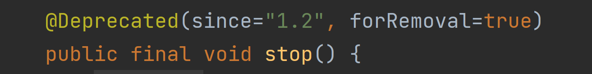

因为stop()方法太粗暴了，一旦调用了stop()，就会**直接停掉线程**，这样就可能造成严重的问题，比如任务执行到哪一步了？该释放的锁释放了没有？都存在疑问。

> 这里强调一点，stop()会释放线程占用的synchronized锁，而不会自动释放ReentrantLock锁
>

我们建议通过中断来停止线程:

```java
/**
 * 作者：周瑜大都督
 */
public class ThreadTest {

    public static void main(String[] args) throws InterruptedException {

        Thread thread = new Thread(() -> {

            for (int i = 0; i  500000) {
                    break;
                }

                System.out.println(i);

            }

        });
        thread.start();

        Thread.sleep(1000);

        thread.interrupt();

    }

}
```

以上代码，我们可以控制：变量i只有在大于500000时才会停止，不然就算中断了也不会停止。

另外，线程池中也是通过interrupt()来停止线程的，比如shutdownNow()方法中会调用：

```java
void interruptIfStarted() {
    Thread t;
    if (getState() >= 0 && (t = thread) != null && !t.isInterrupted()) {
        try {
            t.interrupt();
        } catch (SecurityException ignore) {
        }
    }
}
```

---

# Tomcat是如何自定义线程池的？

😍 薪资范围：20k-30k

😏 对应岗位：高级开发工程师

🤠 面试频率：❤️❤️❤️❤️

👤 讲解作者：大都督周瑜

Tomcat中自己定义了一个**org.apache.tomcat.util.threads.ThreadPoolExecutor**，类名也叫ThreadPoolExecutor，但是包名是Tomcat自己的。

Tomcat会创建这个线程池：

```java
public void createExecutor() {
    // ...
    TaskQueue taskqueue = new TaskQueue();
    TaskThreadFactory tf = new TaskThreadFactory(getName() + "-exec-", daemon, getThreadPriority());
    executor = new ThreadPoolExecutor(getMinSpareThreads(), getMaxThreads(), 60, TimeUnit.SECONDS,taskqueue, tf);
    taskqueue.setParent( (ThreadPoolExecutor) executor);
}
```

注入传入的队列为TaskQueue，它的入队逻辑为：

```java
public boolean offer(Runnable o) {
    //we can't do any checks
    if (parent==null) {
    	return super.offer(o);
	}

	//we are maxed out on threads, simply queue the object
	//线程数等于最大线程数时可以入队
	if (parent.getPoolSize() == parent.getMaximumPoolSize()) {
    	return super.offer(o);
	}

	//we have idle threads, just add it to the queue
    //在执行的任务数小于线程数，表示有空闲线程，此时也可以入队
	if (parent.getSubmittedCount() 任务执行时间*2+线程上下文切换的时间
>

而如果只有一个线程，这个线程来执行两个任务，那么时间为：

> 任务执行时间*2
>

所以对于CPU密集型任务，线程数最好就等于CPU核心数，可以通过以下API拿到你电脑的核心数：

```java
Runtime.getRuntime().availableProcessors()
```

只不过，为了应对线程执行过程发生缺页中断或其他异常导致线程阻塞的请求，我们可以额外在多设置一个线程，这样当某个线程暂时不需要CPU时，可以有替补线程来继续利用CPU。

所以，对于CPU密集型任务，我们可以设置线程数为：**CPU核心数+1**

****

我们在来看IO型任务，线程在执行IO型任务时，可能大部分时间都阻塞在IO上，假如现在有10个CPU，如果我们只设置了10个线程来执行IO型任务，那么很有可能这10个线程都阻塞在了IO上，这样这10个CPU就都没活干了，所以，对于IO型任务，我们通常会设置线程数为：**2*CPU核心数**

****

不过，就算是设置为了**2*CPU核心数**，也不一定是最佳的，比如，有10个CPU，线程数为20，那么也有可能这20个线程同时阻塞在了IO上，所以可以再增加线程，从而去压榨CPU的利用率。

**通常，如果IO型任务执行的时间越长，那么同时阻塞在IO上的线程就可能越多，我们就可以设置更多的线程，但是，线程肯定不是越多越好**，我们可以通过以下这个公式来进行计算：

> 线程数 = CPU核心数   *（ 1 + 线程等待时间 / 线程运行总时间 ）
>

+ 线程等待时间：指的就是线程没有使用CPU的时间，比如阻塞在了IO
+ 线程运行总时间：指的是线程执行完某个任务的总时间

我们可以利用jvisualvm抽样来估计这两个时间：

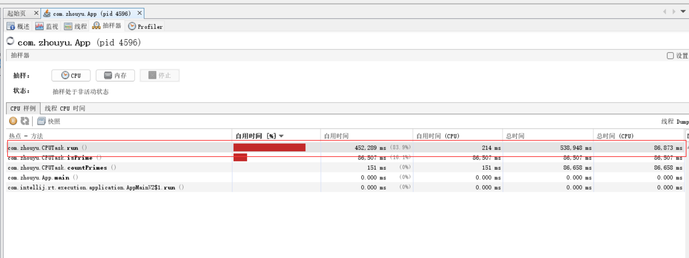

图中表示，在刚刚这次抽样过程中，run()总共的执行时间为538948ms，利用了CPU的时间为86873ms，所以没有利用CPU的时间为538948ms-86873ms。

所以我们可以计算出：

线程等待时间 = 538948ms-86873ms

线程运行总时间 = 538948ms

所以：线程数 = 8   *（ 1 + （538948ms-86873ms） / 538948ms ）= 14.xxx

所以根据公式算出来的线程为14、15个线程左右。

按上述公式，如果我们执行的任务IO密集型任务，那么：线程等待时间 = 线程运行总时间，所以：

线程数 = CPU核心数   *（ 1 + 线程等待时间 / 线程运行总时间 ）

           = CPU核心数   *（ 1 + 1 ）

    = CPU核心数   *  2

以上只是理论，实际工作中情况会更复杂，比如一个应用中，可能有多个线程池，除开线程池中的线程可能还有很多其他线程，或者除开这个应用还是一些其他应用也在运行，所以实际工作中如果要确定线程数，最好是压测。

比如我写了一个：

```java
@RestController
public class ZhouyuController {

    @GetMapping("/test")
    public String test() throws InterruptedException {
        Thread.sleep(1000);
        return "zhouyu";
    }

}
```

这个接口会执行1s，我现在利用apipost来压：

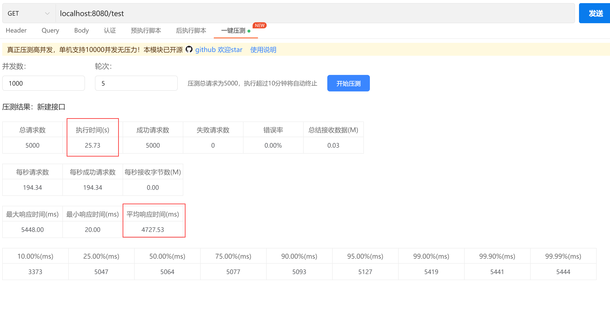

这是在Tomcat默认最大200个线程的请求下的压测结果。

当我们把线程数调整为500：

```java
server.tomcat.threads.max=500
```


发现执行效率提高了一倍，假如再增加线程数到1000：


性能就降低了。

总结，我们再工作中，对于：

1. CPU密集型任务：CPU核心数+1，这样既能充分利用CPU，也不至于有太多的上下文切换成本
2. IO型任务：建议压测，或者先用公式计算出一个理论值（理论值通常都比较小）
3. 对于核心业务（访问频率高），可以把核心线程数设置为我们压测出来的结果，最大线程数可以等于核心线程数，或者大一点点，比如我们压测时可能会发现500个线程最佳，但是600个线程时也还行，此时600就可以为最大线程数
4. 对于非核心业务（访问频率不高），核心线程数可以比较小，避免操作系统去维护不必要的线程，最大线程数可以设置为我们计算或压测出来的结果。

# 如何理解Java并发中的可见性？
😍 薪资范围：10k-20k

😏 对应岗位：中高级开发工程师

🤠 面试频率：❤️❤️❤️❤️❤️

👤 讲解作者：大都督周瑜

Java并发可见性指的是多线程并发访问共享变量时，对变量的更改能够被其他线程及时感知，即在一个线程修改变量后，其他线程能够立即看到这个变量的修改结果。

[画板]

当线程A读取变量i的值时，会从内存中读取数据，并缓存一份在CPU1内部的高速缓存中，然后线程1修改i，改为i=2，但是还没有回写到内存，此时线程B也来读取i，那么也会从内存读取，读到的i仍然为1，此时就出现了可见性问题。

在Java中，可以volatile关键字来保证变量的可见性，对于加了volatile的变量，线程在读取该变量时会直接从内存中读取，再修改该变量时会同时修改CPU高速缓存和内存中的值。

# 如何理解Java并发中的原子性？
😍 薪资范围：10k-20k

😏 对应岗位：中高级开发工程师

🤠 面试频率：❤️❤️❤️❤️❤️

👤 讲解作者：大都督周瑜

Java并发原子性指的是在多线程并发的情况下，一段代码或操作要么完全执行成功，要么完全不执行，不出现执行一半被其他线程打断或干扰的情况。换句话说，就是对同一个变量的多个操作能够像原子操作一样，保证多线程环境下的数据一致性，避免出现数据竞争和脏数据等问题。

由于CPU、内存、IO（磁盘、网络）之间的性能差距，为了能充分利用CPU，当线程执行IO操作时，线程会让出CPU，使得CPU去执行其他线程的指令，并且本身来说，为了达到线程并发执行的效果，CPU也会按固定时间片来切换执行不同线程。

当我们执行i++这行代码时，底层其实对应的是三条指令：

1. 从内存中读取i的值
2. 对i+1
3. 写回i的值到CPU高速缓存

但是有可能执行线程A执行了第1条指令后，就发生了线程切换，线程A相当于暂停执行，此时如果有另外一个线程B也在执行i++，并且把3条执行都执行完了，那么线程B得到的结果是i=2，然后线程A又切换回来继续执行，最终导致线程A得到的i也为2，正常来说i应该等于3的，这就是原子性问题。

[画板]

Java中我们需要通过各种锁机制来保证原子性。

# 如何理解Java并发中的有序性？
😍 薪资范围：10k-20k

😏 对应岗位：中高级开发工程师

🤠 面试频率：❤️❤️❤️❤️❤️

👤 讲解作者：大都督周瑜

Java并发有序性指的是多个线程执行的指令和操作，按照开发者编写程序的顺序或者预定的顺序进行执行。多线程并发执行时，可能会发生指令的重排，导致程序的执行顺序与预期不一致，从而出现数据竞争和线程安全问题。

编译器有时为了进行编译优化，会进行指令重排序，比如：

```java
new Person();
```

这行代码会分为三步：

1. 申请内存空间
2. 在内存空间初始化Person对象相关的内容
3. 返回内存空间地址

但是编译有可能会优化为：

1. 申请内存空间
2. 返回内存空间地址
3. 在内存空间初始化Person对象相关的内容

所以对于我们的单例模式实现：

```java

public class Person {
  static Person instance;

  static Person getInstance(){
    if (instance == null) {
      synchronized(Person.class) {
        if (instance == null)
          instance = new Person();
        }
    }
    return instance;
  }
}
```

就算了用DCL可能也会有问题，比如线程A拿到锁后，在new Person()时，第二步就返回了内存地址并赋值给了instance变量，此时线程B来执行getInstance()，直接就判断出了instance不为空，但是instance对于的对象其实是还没有初始化的，里面的成员变量可能为null。

我们可以通过锁机制或者volatile来保证有序性。

# 如何理解Java并发中的条件等待队列？
当一个线程加到锁之后，可能并不能立马执行业务逻辑，得在满足某个条件后才能执行，比如对于阻塞队列而言，当我们要条件元素时，会先加锁，加到锁之后，会判断队列是否满了，如果队列满了则需要阻塞当前线程并等待队列有空位，这样当前线程会进入条件等待队列，同时有可能其他线程也会进入此条件等待队列，而一旦队列有元素出队了，那么会可以唤醒条件等待队列中的某一个线程了，使得该线程去执行它的入队操作。

所以条件等待队列就是针对某一条件，如果线程在没有满足此条件下需要阻塞就可以加入到该条件等待队列进行等待。

# 如何理解守护线程以及它的作用？

线程分为用户线程和守护线程，用户线程就是普通线程，守护线程就是JVM的后台线程，比如垃圾回收线程就是一个守护线程，守护线程会在其他普通线程都停止运行之后自动关闭。我们可以通过设置thread.setDaemon(true)来把一个线程设置为守护线程。

# 如何理解ThreadLocal以及它的底层执行原理
1. ThreadLocal是Java中所提供的线程本地存储机制，可以利用该机制将数据缓存在某个线程内部，该线程可以在任意时刻、任意方法中获取缓存的数据
2. ThreadLocal底层是通过ThreadLocalMap来实现的，每个Thread对象（注意不是ThreadLocal对象）中都存在一个ThreadLocalMap，Map的key为ThreadLocal对象，Map的value为需要缓存的值
3. 如果在线程池中使用ThreadLocal会造成内存泄漏，因为当ThreadLocal对象使用完之后，应该要把设置的key，value，也就是Entry对象进行回收，但线程池中的线程不会回收，而线程对象是通过强引用指向ThreadLocalMap，ThreadLocalMap也是通过强引用指向Entry对象，线程不被回收，Entry对象也就不会被回收，从而出现内存泄漏，解决办法是，在使用了ThreadLocal对象之后，手动调用ThreadLocal的remove方法，手动清楚Entry对象
4. ThreadLocal经典的应用场景就是连接管理（一个线程持有一个连接，该连接对象可以在不同的方法之间进行传递，线程之间不共享同一个连接）

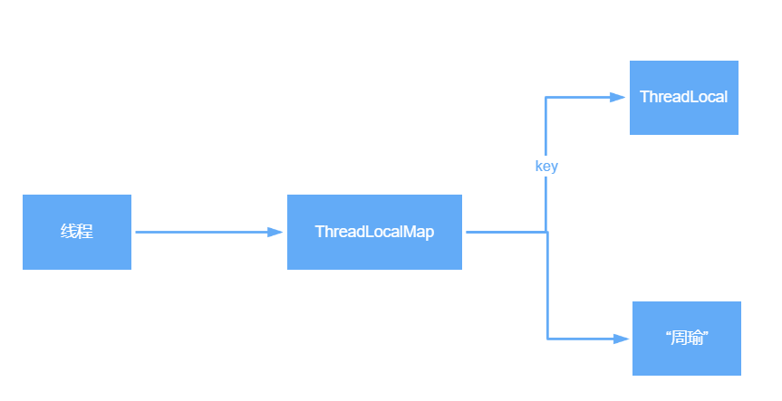

# Java中如何避免死锁?
造成死锁的几个原因：

1. 一个资源每次只能被一个线程使用
2. 一个线程在阻塞等待某个资源时，不释放已占有资源
3. 一个线程已经获得的资源，在未使用完之前，不能被强行剥夺
4. 若干线程形成头尾相接的循环等待资源关系

这是造成死锁必须要达到的4个条件，如果要避免死锁，只需要不满足其中某一个条件即可。而其中前3个条件是作为锁要符合的条件，所以要避免死锁就需要打破第4个条件，不出现循环等待锁的关系。

在开发过程中：

1. 要注意加锁顺序，保证每个线程按同样的顺序进行加锁
2. 要注意加锁时限，可以针对所设置一个超时时间
3. 要注意死锁检查，这是一种预防机制，确保在第一时间发现死锁并进行解决

# ReentrantLock中的公平锁和非公平锁的底层实现
首先不管是公平锁和非公平锁，它们的底层实现都会使用AQS来进行排队，它们的区别在于：线程在使用lock()方法加锁时，如果是公平锁，会先检查AQS队列中是否存在线程在排队，如果有线程在排队，则当前线程也进行排队，如果是非公平锁，则不会去检查是否有线程在排队，而是直接竞争锁。

不管是公平锁还是非公平锁，一旦没竞争到锁，都会进行排队，当锁释放时，都是唤醒排在最前面的线程，所以非公平锁只是体现在了线程加锁阶段，而没有体现在线程被唤醒阶段。

另外，ReentrantLock是可重入锁，不管是公平锁还是非公平锁都是可重入的。

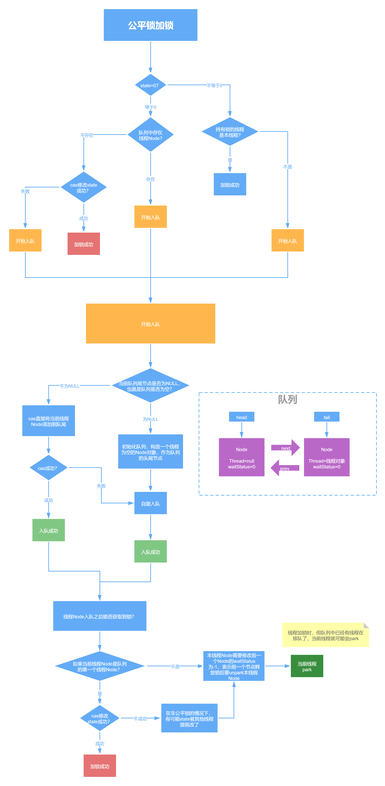                                                   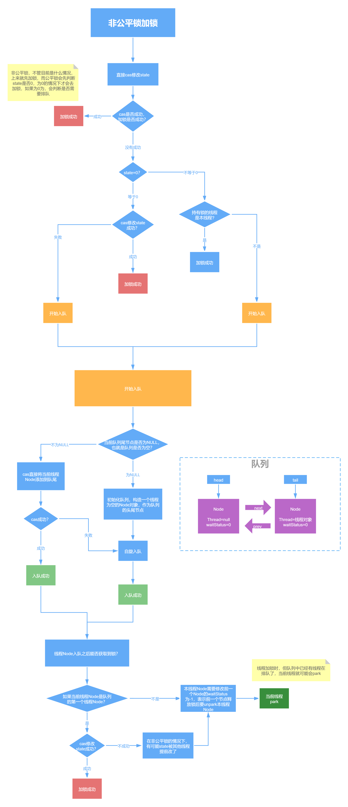

****

# ReentrantLock中tryLock()和lock()方法的区别
1. tryLock()表示尝试加锁，可能加到，也可能加不到，该方法不会阻塞线程，如果加到锁则返回true，没有加到则返回false
2. lock()表示阻塞加锁，线程会阻塞直到加到锁，方法也没有返回值

****

# CountDownLatch和Semaphore的区别和底层原理
CountDownLatch表示计数器，可以给CountDownLatch设置一个数字，一个线程调用CountDownLatch的await()将会阻塞，其他线程可以调用CountDownLatch的countDown()方法来对CountDownLatch中的数字减一，当数字被减成0后，所有await的线程都将被唤醒。

对应的底层原理就是，调用await()方法的线程会利用AQS排队，一旦数字被减为0，则会将AQS中排队的线程依次唤醒。

Semaphore表示信号量，可以设置许可的个数，表示同时允许最多多少个线程使用该信号量，通过acquire()来获取许可，如果没有许可可用则线程阻塞，并通过AQS来排队，可以通过release()方法来释放许可，当某个线程释放了某个许可后，会从AQS中正在排队的第一个线程开始依次唤醒，直到没有空闲许可。

# Sychronized的偏向锁、轻量级锁、重量级锁
1. 偏向锁：在锁对象的对象头中记录一下当前获取到该锁的线程ID，该线程下次如果又来获取该锁就可以直接获取到了
2. 轻量级锁：由偏向锁升级而来，当一个线程获取到锁后，此时这把锁是偏向锁，此时如果有第二个线程来竞争锁，偏向锁就会升级为轻量级锁，之所以叫轻量级锁，是为了和重量级锁区分开来，轻量级锁底层是通过自旋来实现的，并不会阻塞线程
3. 如果自旋次数过多仍然没有获取到锁，则会升级为重量级锁，重量级锁会导致线程阻塞
4. 自旋锁：自旋锁就是线程在获取锁的过程中，不会去阻塞线程，也就无所谓唤醒线程，阻塞和唤醒这两个步骤都是需要操作系统去进行的，比较消耗时间，自旋锁是线程通过CAS获取预期的一个标记，如果没有获取到，则继续循环获取，如果获取到了则表示获取到了锁，这个过程线程一直在运行中，相对而言没有使用太多的操作系统资源，比较轻量。

# Sychronized和ReentrantLock的区别
1. sychronized是一个关键字，ReentrantLock是一个类
2. sychronized会自动的加锁与释放锁，ReentrantLock需要程序员手动加锁与释放锁
3. sychronized的底层是JVM层面的锁，ReentrantLock是API层面的锁
4. sychronized是非公平锁，ReentrantLock可以选择公平锁或非公平锁
5. sychronized锁的是对象，锁信息保存在对象头中，ReentrantLock通过代码中int类型的state标识来标识锁的状态
6. sychronized底层有一个锁升级的过程

#


# 并发编程的三大特性及底层追问

## **一、原子性**

#### 1.1 什么是并发编程的原子性

**原子性的定义：原子性指一个操作是不可分割的，不可中断的，一个线程在执行时，另一个线程不会影响到他。**

##### Java的并发编程如何做到跨平台的？

JMM（Java Memory Model）。不同的硬件和不同的操作系统在内存上的操作有一定差异的。Java为了解决相同代码在不同操作系统上出现的各种问题，用JMM屏蔽掉各种硬件和操作系统带来的差异。

让Java的并发编程可以做到跨平台。

JMM规定所有变量都会存储在主内存中，在操作的时候，需要从主内存中复制一份到线程内存（CPU内存），在线程内部做计算。**然后再写回主内存中（不一定！）。**

并发编程的原子性用代码阐述：

```java
private static int count;
/**
* @author TianMing
**/
public static void increment(){
    try {
        Thread.sleep(10);
    } catch (InterruptedException e) {
        e.printStackTrace();
    }
    count++;
}

public static void main(String[] args) throws InterruptedException {
    Thread t1 = new Thread(() -> {
        for (int i = 0; i  {
        for (int i = 0; i synchronized 方法时，它就获得了这个对象的锁；同步代码块可以指定任意的对象作为锁。这使得开发者可以根据实际需求选择锁的粒度。

3，性能：sync会导致不必要开销；同步代码块能够减少锁的粒度

4，操作性：sync简洁方便；同步代码块灵活复杂

#### 1.2.2 CAS

##### 到底什么是CAS？

CAS：Compare and Swap。从字面意义上来说，就是先进行比较，然后替换

他在替换内存的某个位置的值时，首先查看内存中的值与预期值是否一致，如果一致，执行替换操作。这个操作是一个原子性操作。

它是[乐观锁](https://so.csdn.net/so/search?q=%E4%B9%90%E8%A7%82%E9%94%81\&spm=1001.2101.3001.7020)思想的一种实现，尤其是在并发量大的业务场景下保证单个实例的原子性，使用较为频繁。java类库中java.util.concurrent.atomic包下一些方法，也均使用CAS处理

Java中基于Unsafe的类提供了对CAS的操作的方法，JVM会帮助我们将方法实现CAS汇编指令。

但是要清楚CAS只是比较和交换，在获取原值的这个操作上，需要你自己实现。

```java
private static AtomicInteger count = new AtomicInteger(0);
/**
* @author TianMing
**/
public static void main(String[] args) throws InterruptedException {
    Thread t1 = new Thread(() -> {
        for (int i = 0; i  {
        for (int i = 0; i B , 线程2也是A>B ;

线程3在线程2判断是否A之前将B>A；

当线程2通过CAS判断是否被修改过时，会误以为没有发生过修改，但实际已经被多次修改

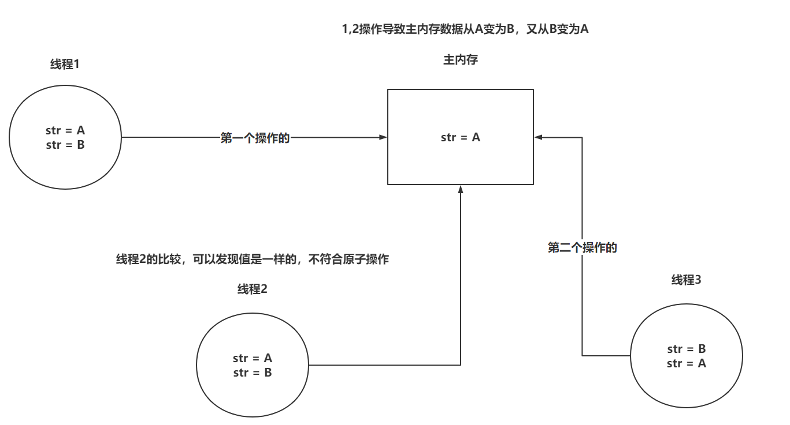

**解决方案**：可以引入版本号的方式，来解决ABA的问题。Java中提供了一个类在CAS时，针对各个版本追加版本号的操作。 AtomicStampeReference

AtomicStampedReference在CAS时，不但会判断原值，还会比较版本信息。

```java
public static void main(String[] args) {
    AtomicStampedReference reference = new AtomicStampedReference<>("AAA",1);

    String oldValue = reference.getReference();
    int oldVersion = reference.getStamp();

    boolean b = reference.compareAndSet(oldValue, "B", oldVersion, oldVersion + 1);
    System.out.println("修改1版本的：" + b);

    boolean c = reference.compareAndSet("B", "C", 1, 1 + 1);
    System.out.println("修改2版本的：" + c);
}
```

思考：这ABA看似没是啥影响，有回到最初该干啥继续干不就行了？什么情况不允许！

		 如：缓存系统中数据新旧判断；任务调度系统状态的就绪，执行，完成切换；

				银行风险评估；证券交易策略；女友帽子颜色判断

2：**自旋时间过长问题**：多个线程同时尝试更新同一个变量

```
- 可以指定CAS一共循环多少次，如果超过这个次数，直接失败/或者挂起线程。（自旋锁、自适应自旋锁）
- 可以在CAS一次失败后，将这个操作暂存起来，后面需要获取结果时，将暂存的操作全部执行，再返回最后的结果。
```

AtomicStampedReference 内部维护了一个 Pair的数据结构：reference(数据体)、stamp(版本)两个部分。该数据结构用volatile修饰，保证了线程可见性。

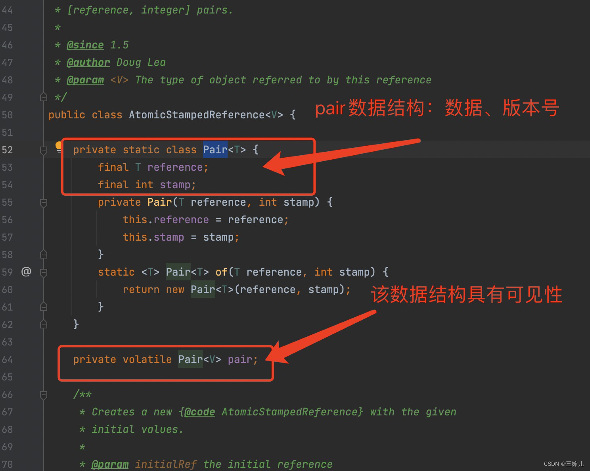

核心方法为：compareAndSet方法。

该方法中参数：expectedReference：表示预期值，newReference：表示新的值，expectedStamp：表示预期版本号，newStamp表示新的版本号。

从数据和版本号两个方面来判断传入的参数是否符合 Pair 的预期，有一个不符合就返回false。

```plain
可以看到，这里底层也是使用了c

而casPair实质上调用的是UNSAFE.compareAndSwapObject（）

由此可见，AtomicStampedReference是通过加版本号来解决ABA问题的。对于加版本号，compareAndSwapObject只能对比交互一个对象，所以将数据和版本号放到一个对象里就可以解决问题了
```

#### 1.2.3 Lock锁

Lock锁是在JDK1.5由Doug Lea研发的，他的性能相比synchronized在JDK1.5的时期，性能好了很多多，

但是在JDK1.6对synchronized优化之后，性能相差不大，但是如果涉及并发比较多时，推荐ReentrantLock锁，性能会更好。

实现方式：

```java
private static int count;

private static ReentrantLock lock = new ReentrantLock();
/**
* @author TianMing
**/
public static void increment()  {
    lock.lock();
    try {
        count++;
        try {
            Thread.sleep(10);
        } catch (InterruptedException e) {
            e.printStackTrace();
        }
    } finally {
        lock.unlock();
    }

}

public static void main(String[] args) throws InterruptedException {
    Thread t1 = new Thread(() -> {
        for (int i = 0; i  {
        for (int i = 0; i @hide 的FinalizerReference 引用，用于支持 Java Finalizer 机制，更多内容见 Finalizer 机制。

#### **1.2 指针、引用和句柄有什么区别？**

引用、指针和句柄都具有指向对象地址的含义，可以将它们都简单地理解为一个内存地址。只有在具体的问题中，才需要区分它们的含义：

* **1、引用（Reference）：** 引用是 Java 虚拟机为了实现灵活的对象生命周期管理而实现的对象包装类，引用本身并不持有对象数据，而是通过直接指针或句柄 2 种方式来访问真正的对象数据；
* **2、指针（Point）：** 指针也叫直接指针，它表示对象数据在内存中的地址，通过指针就可以直接访问对象数据；
* **3、句柄（Handler）：** 句柄是一种特殊的指针，句柄持有指向对象实例数据和类型数据的指针。使用句柄的优点是让对象在垃圾收集的过程中移动存储区域的话，虚拟机只需要改变句柄中的指针，而引用持有的句柄是稳定的。缺点是需要两次指针访问才能访问到对象数据。

##### **引用相关的问题**：

ThreadLocal是一个用来解决线程安全性的一个工具，它相当于让每个线程都开辟一块内存空间用来存储共享变量的副本。

然后每个线程只需要去访问和操作自己的共享变量的一个副本就可以了。从而去避免多线程竞争同一个共享资源。

每一个线程都一个成员变量，叫ThreadLocalMap。当线程访问ThreadLocal修饰的共享变量的时候，这个线程就会在自己的成员变量ThreadLocalMap里面去保存一份数据副本。

key指向的是ThreadLocal这样一个引用。并且是一个**弱引用关系**。而value保存是共享数据的一个副本。因为每个线程都持有一份数据副本，所以线程之间就不存在对于共享数据的一个并发操作。所以就解决了线程安全性的问题。

ThreadLocal保证原子性的方式，是不让多线程去操作**临界资源**，让每个线程去操作属于自己的数据.一定程度也能保证线程安全

代码实现

```java
static ThreadLocal tl1 = new ThreadLocal();
static ThreadLocal tl2 = new ThreadLocal();

public static void main(String[] args) {
    tl1.set("123");
    tl2.set("456");
    Thread t1 = new Thread(() -> {
        System.out.println("t1:" + tl1.get());
        System.out.println("t1:" + tl2.get());
    });
    t1.start();

    System.out.println("main:" + tl1.get());
    System.out.println("main:" + tl2.get());
}
```

##### **ThreadLocal实现原理**：

* 每个Thread中都存储着一个成员变量，ThreadLocalMap
* ThreadLocal本身不存储数据，像是一个工具类，基于ThreadLocal去操作ThreadLocalMap
* ThreadLocalMap本身就是基于Entry\[]实现的，因为一个线程可以绑定多个ThreadLocal，这样一来，可能需要存储多个数据，所以采用Entry\[]的形式实现。
* 每一个现有都自己独立的ThreadLocalMap，再基于ThreadLocal对象本身作为key，对value进行存取
* ThreadLocalMap的key是一个弱引用，弱引用的特点是，即便有弱引用，在GC时，也必须被回收。这里是为了在ThreadLocal对象失去引用后，如果key的引用是强引用，会导致ThreadLocal对象无法被回收

##### ThreadLocal内存泄漏问题：

**内存泄漏是指：程序已经不再使用某字段、某对象。但是却无法回收掉它占用的内存。**

两个关键点：不再使用 并且 无法回收

代码示范：

可以发现问题，ThreadLocal已经被清理掉了，代表现在已经没有方式去访问当前ThreadLocal存到Map里的value数据了

但是当前线程由于还在执行、没有关闭，所以内部的value还一直存在！

此时 造成内存泄漏

* 如果ThreadLocal引用丢失，key因为弱引用会被GC回收掉，如果同时线程还没有被回收，就会导致内存泄漏，内存中的value无法被回收，同时也无法被获取到。

**解决方案：**

官方也认识到了这个问题，所以Map的key设置为了弱引用

所以现在会变成这个样子，当ThreadLocal被清理掉了。Key无人引用后，就会被gc清理掉，因为他是弱引用，key变为null了，代表此时value需要被清理了。这个时候调用set、get、remove方法时都会触发清理机制（监测key==null就清理value）

而如果key是强引用，就不知道是不是没人引用这个值了，就不知道要不要清理。

只需要在使用完毕ThreadLocal对象之后，及时的**调用remove方法**，移除Entry即可

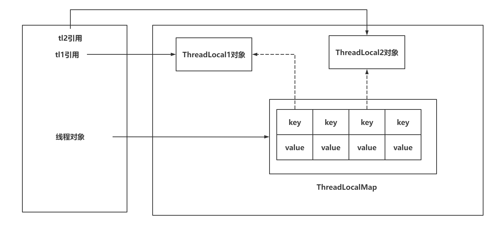

## **二、可见性**

### 2.1 什么是可见性

**可见性：一个线程对共享变量值的修改，能够及时地被其他线程看到。**

可见性问题是基于CPU位置出现的，CPU处理速度非常快，相对CPU来说，去主内存获取数据这个事情太慢了，CPU就提供了L1，L2，L3的三级缓存，每次去主内存拿完数据后，就会存储到CPU的三级缓存，每次去三级缓存拿数据，效率肯定会提升。

这就带来了问题，现在CPU都是多核，每个线程的工作内存（CPU三级缓存）都是独立的，会告知每个线程中做修改时，只改自己的工作内存，没有及时的同步到主内存，导致数据不一致问题。

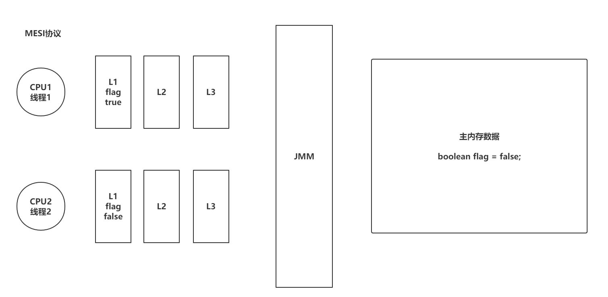

可见性问题的代码逻辑

```plain
private static boolean flag = true;

public static void main(String[] args) throws InterruptedException {
    Thread t1 = new Thread(() -> {
        while (flag) {
            // ....
        }
        System.out.println("t1线程结束");
    });

    t1.start();
    Thread.sleep(10);
    flag = false;
    System.out.println("主线程将flag改为false");
}
```

### 2.2 解决可见性的方式

#### 2.2.1 volatile

volatile是一个关键字，用来修饰成员变量。

如果属性被volatile修饰，相当于会告诉CPU，对当前属性的操作，不允许使用CPU的缓存，必须去和主内存操作

volatile的内存语义：

* volatile属性被**写**：当写一个volatile变量，JMM会将当前线程对应的CPU缓存及时的刷新到主内存中
* volatile属性被**读**：当读一个volatile变量，JMM会将对应的CPU缓存中的内存设置为无效，必须去主内存中重新读取共享变量

**实现原理：**

其实加了volatile就是告知CPU，对当前属性的读写操作，不允许使用CPU缓存，加了volatile修饰的属性，会在转为汇编之后后，追加一个lock的前缀，CPU执行这个指令时，如果带有lock前缀会做两个事情：

* 将当前处理器缓存行的数据写回到主内存
* 这个写回的数据，在其他的CPU内核的缓存中，直接无效。

**总结：volatile就是让CPU每次操作这个数据时，必须立即同步到主内存，以及从主内存读取数据。**

```java
//volatile修饰，确保了线程 t1 对 flag 的读取操作是从主内存中读取的
private volatile static boolean flag = true;
public static void main(String[] args) throws InterruptedException {
    Thread t1 = new Thread(() -> {
        while (flag) {
            // ....
        }
        System.out.println("t1线程结束");
    });

    t1.start();
    Thread.sleep(10);
    flag = false;
    System.out.println("主线程将flag改为false");
}
```

#### 2.2.2 synchronized

synchronized也是可以解决可见性问题的，synchronized的内存语义。

如果涉及到了synchronized的同步代码块或者是同步方法

**获取锁**资源之后，将内部涉及到的变量从CPU缓存中移除，必须去主内存中重新拿数据，

**释放锁**之后，会立即将CPU缓存中的数据同步到主内存。

```java
private static boolean flag = true;

public static void main(String[] args) throws InterruptedException {
    Thread t1 = new Thread(() -> {
        while (flag) {
            synchronized (TiMiTest.class){
                //...
            }
            System.out.println(111);
        }
        System.out.println("t1线程结束");

    });

    t1.start();
    Thread.sleep(10);
    flag = false;
    System.out.println("主线程将flag改为false");
}
```

#### 2.2.3 Lock

Lock锁保证可见性的方式和synchronized完全不同，synchronized基于他的内存语义，在获取锁和释放锁时，对CPU缓存做一个同步到主内存的操作。

**加锁和释放锁**时，会对一个由volatile修饰的state属性进行加减操作。

**实现原理：  **

Lock锁是基于volatile实现的。如果对volatile修饰的属性进行写操作，CPU会执行带有lock前缀的指令，CPU会将修改的数据，从CPU缓存立即同步到主内存，同时也会将其他的属性也立即同步到主内存中。还会将其他CPU缓存行中的这个数据设置为无效，必须重新从主内存中拉取。

```java
private static boolean flag = true;
private static Lock lock = new ReentrantLock();

public static void main(String[] args) throws InterruptedException {
    Thread t1 = new Thread(() -> {
        while (flag) {
            lock.lock();
            try{
                //...
            }finally {
                lock.unlock();
            }
        }
        System.out.println("t1线程结束");

    });

    t1.start();
    Thread.sleep(10);
    flag = false;
    System.out.println("主线程将flag改为false");
}
```

#### 2.2.4 final

final修饰的属性，在运行期间是不允许修改的，这样一来，就间接的保证了可见性，所有多线程读取final属性，值肯定是一样。

final并不是说每次取数据从主内存读取，他没有这个必要，而且**final和volatile是不允许同时**修饰一个属性的。**原因**在于：final修饰的内容已经不允许再次被写了，而volatile是保证每次读写数据去主内存读取，并且volatile会影响一定的性能，就不需要同时修饰。

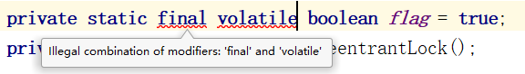

##### **问**：volatile 变量的读写操作是否具有原子性？

**答**：volatile 变量的读写操作本身是原子性的，但对于需要多个操作完成的复合操作（如 i++），volatile 并不能保证其原子性。因为这些复合操作会涉及读取、修改和写回三个步骤，中间可能会被其他线程打断

##### **问**：synchronized 和 volatile 在保证可见性方面的区别是什么？

**答**：synchronized 保证了锁范围内的变量在每次进入和退出锁时都会进行主内存的读写操作，而 volatile 只是对单个变量的读写操作进行控制。synchronized 可以保证更广泛的变量可见性，但 volatile 的性能开销相对较小。

##### **问**：Lock 和 synchronized 在可见性上有什么不同？

**答**：两者都能保证可见性，但 Lock 提供了更灵活的锁操作，比如尝试获取锁、可中断获取锁等。而 synchronized 是一种更简单的锁机制，自动释放锁等操作由JVM处理。Lock 的性能通常优于 synchronized，但在某些简单场景下，synchronized 的性能可能更好。

## 三、有序性

### 3.1 什么是有序性

有序性是指由于**JIT动态编译器、操作系统为了给提高程序的执行效率，可能会对按顺序书写好的指令进行重排**，**线程或者CPU执行的时候不一定按照程序书写的顺序来执行**

在Java中，.java文件中的内容会被编译，在执行前需要再次转为CPU可以识别的指令，CPU在执行这些指令时，为了提升执行效率，在不影响最终结果的前提下（满足一些要求），会对指令进行重排。

指令乱序执行的原因，是为了尽可能的发挥CPU的性能。

**指令重排序**：CPU为了提高运行效率，可能会对编译后的代码指令进行优化，即：代码书写顺序与实际执行的顺序不同，但执行结果一定与按照编写顺序执行的结果一致（符合指令间的依赖关系）。 – 有些代码翻译成机器指令后，进行重排序 ，重排序后的指令更加符合CPU执行特点，这样就可以最大限度的发挥CPU性能 ——as-if-serial语义:无论如何重排序，程序执行的结果应该与代码顺序执行的结果一致（Java编译器、运行时和处理器都会保证Java在单线程下遵循as-if-serial语义）

Java中的程序是乱序执行的。

Java程序验证乱序执行效果：

```java
static int a,b,x,y;

public static void main(String[] args) throws InterruptedException {
    for (int i = 0; i  {
            a = 1;
            x = b;
        });
        Thread t2 = new Thread(() -> {
            b = 1;
            y = a;
        });

        t1.start();
        t2.start();
        t1.join();
        t2.join();

        if(x == 0 && y == 0){
            System.out.println("第" + i + "次，x = "+ x + ",y = " + y);
        }
    }
}
```

单例模式由于指令重排序可能会出现问题：

线程可能会拿到没有初始化的对象，导致在使用时，可能由于内部属性为默认值，导致出现一些不必要的问题

```java
//volatile 修饰 ，确保对象的初始化完成之前，其他线程不会看到未初始化的实例。
private static volatile TiMiTest test;
private TiMiTest(){}
public static TiMiTest getInstance(){
    // B
    if(test  == null){
        synchronized (TiMiTest.class){

            if(test == null){
                // A   ,  开辟空间，test指向地址，初始化
                //即使test == null的判断通过了，test对象可能仍然未完全初始化。
                test = new TiMiTest();
            }
        }
    }
    return test;
}
```

### 3.2 as-if-serial语义

as-if-serial语义：

不论指定如何重排序，需要保证单线程的程序执行结果是不变的。

而且如果存在依赖的关系，那么也不可以做指令重排。

但是多线程环境下，指令重排序可能导致不可预测的行为。

```plain
// 这种情况肯定不能做指令重排序
int i = 0;
i++;

// 这种情况肯定不能做指令重排序
int j = 200;
j * 100;
j + 100;
// 这里即便出现了指令重排，也不可以影响最终的结果，20100
```

### 3.3 happens-before原则

**具体规则：**

```plain
1. 单线程happen-before原则：在同一个线程中，书写在前面的操作happen-before后面的操作。
2. 锁的happen-before原则：同一个锁的unlock操作happen-before此锁的lock操作。
3. volatile的happen-before原则： 对一个volatile变量的写操作happen-before对此变量的任意操作。
4. happen-before的传递性原则： 如果A操作 happen-before B操作，B操作happen-before C操作，那么A操作happen-before C操作。
3. 线程启动的happen-before原则：同一个线程的start方法happen-before此线程的其它方法。
6. 线程中断的happen-before原则：对线程interrupt方法的调用happen-before被中断线程的检测到中断发送的代码。
7. 线程终结的happen-before原则：线程中的所有操作都happen-before线程的终止检测。
8. 对象创建的happen-before原则：一个对象的初始化完成先于他的finalize方法调用。
     JMM只有在不出现上述8中情况时，才不会触发指令重排效果。
```

不需要过分的关注happens-before原则，只需要可以写出线程安全的代码就可以了。

### 3.4 volatile

如果需要让程序对某一个属性的操作不出现指令重排，除了满足happens-before原则之外，还可以基于volatile修饰属性，JVM编译时会插入**内存屏障**（Memory Barrier）指令防止指令重排，就不会出现指令重排的问题了。

volatile如何实现的禁止指令重排？

在编译时，插入内存屏障，防止编译器对指令进行重排序。可将内存屏障看成一条指令。会在两个操作之间，添加上一道指令，这个指令就可以避免上下执行的其他指令进行重排序。

##### 问题思考：(答案上翻)

什么是指令重排序？它对Java程序有什么影响？

什么是as-if-serial语义？它在Java中有什么作用？

volatile如何禁止指令重排序？

happens-before原则有哪些具体规则？

为什么单例模式中可能会出现指令重排序的问题？如何解决？


# 阿里一面直接挂！我用CompletableFuture优化代码，面试官：你这是在生产环境埋雷！

## \*\*

写在开头\*\* 上周有个粉丝阿强哭丧着脸来找我，说阿里一面被“秒杀”了。

起因很简单，面试官问他：“**有一个核心接口响应很慢，里面串行调用了用户信息、积分查询、优惠券三个服务，你会怎么优化？**”

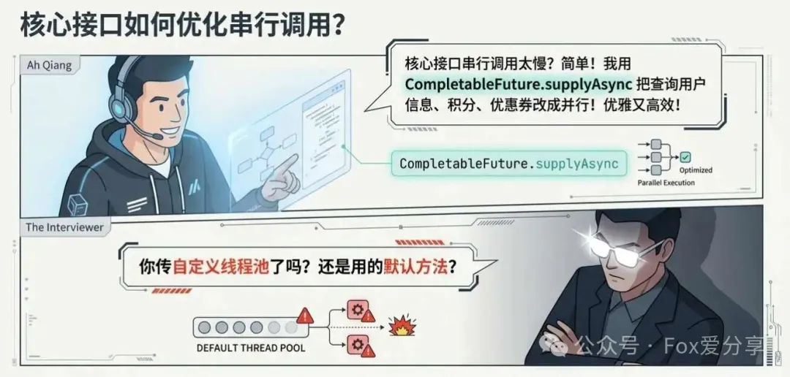

阿强自信满满：“这题熟！用 JDK8 的神器 CompletableFuture 啊！把三个串行调用改成 CompletableFuture.supplyAsync() 并行处理，最后用 allOf 等待结果。代码优雅又高效！”

面试官听完，推了推眼镜，冷冷地问了一句： **“你传自定义线程池了吗？还是用的默认方法？”**

阿强愣了一下：“这就三个小任务，用默认的 supplyAsync(Runnable) 就行了吧，没必要单独配个线程池吧？”

面试官当场合上简历：“**你敢在生产环境‘裸用’ CompletableFuture，就是给系统埋雷。一旦某个第三方服务卡顿，你的整个应用可能都会被拖垮。回去等通知吧。**”

阿强觉得面试官在危言耸听。

兄弟们，这真不是危言耸听。**“裸用” CompletableFuture 是并发编程里最大的骗局之一。**

今天 Fox 带你拆解这背后的 3 个“核弹级”大坑，并附上源码铁证。

# **地雷一：共用线程池 = 级联雪崩**

很多兄弟觉得 supplyAsync 是魔法，只要调用了，Java 就会自动给你分配一个“VIP 线程”去跑任务。

**错！大错特错！**

如果你不传线程池，JDK 默认使用的是 ForkJoinPool.commonPool()。

## **【源码铁证】所有任务挤在一个“黑网吧”里**

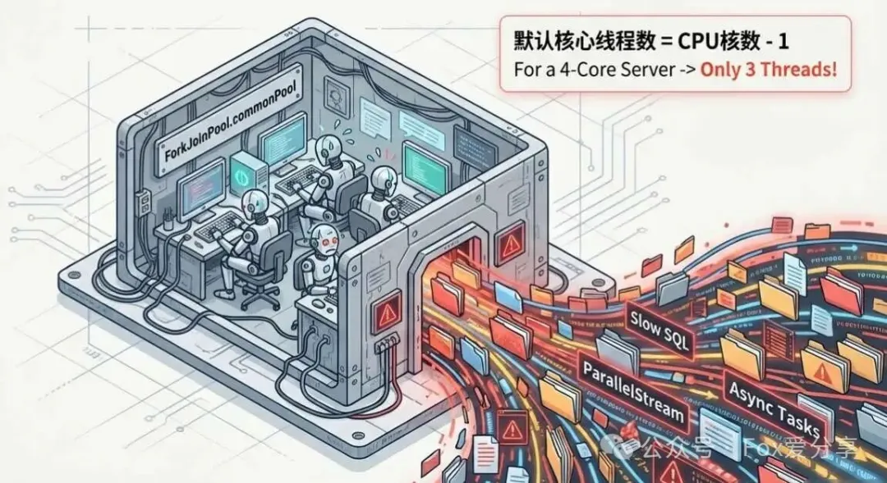

请看 CompletableFuture 的源码：

```plain
// 如果你不传 Executor，这个 asyncPool 就是默认的线程池
private static final Executor asyncPool = useCommonPool ?
    ForkJoinPool.commonPool() : new ThreadPerTaskExecutor();

// 这是一个全局共享的静态常量！
// 整个 JVM 里的所有 CompletableFuture，甚至所有 parallelStream，都共用这一个池子！
```

**这意味着什么？**

ForkJoinPool.commonPool() 的默认核心线程数仅为 **CPU 核数 - 1**。 假设你的服务器是 4 核的，那个这个池子只有 **3** 个线程。

**你要问了：“ForkJoinPool 不是能自动扩容吗？”**

这里有个极大的误区！ForkJoinPool 只有在检测到任务实现了 ManagedBlocker 接口时（比如 JDK 内部的 Phaser 等并发工具），才会为了避免饥饿而扩容。

**但是！** 你在业务代码里写的 Thread.sleep、JdbcTemplate 查库、RestTemplate 调接口，统统**没有**实现这个接口。

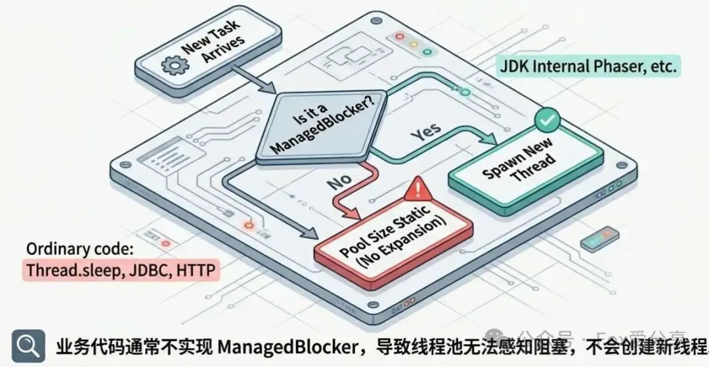

**生产惨案还原：**

1. 你在这个“公共池子”里扔了一个耗时 2 秒的 SQL 查询任务。
2. 隔壁组的同事，在同一个 JVM 里写了个 List.parallelStream() 做数据计算。
3. **注意！****parallelStream**\*\* 也是共用这个 ****commonPool**** 的！\*\*
4. 结果就是：**这 3 个可怜的线程瞬间被你的慢 SQL 占满，池子也不会扩容。**

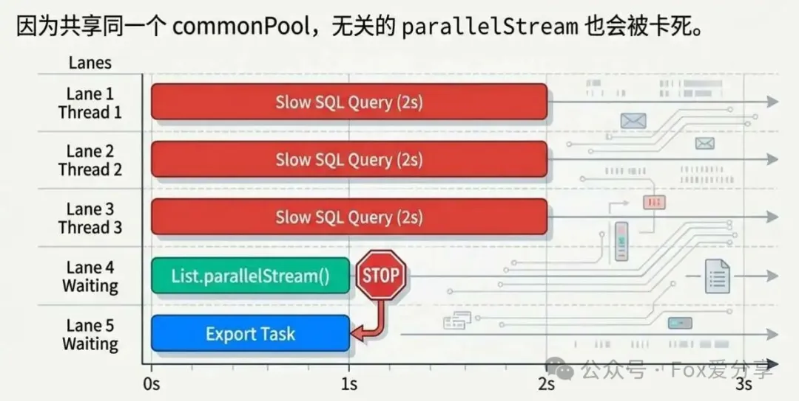

结局？隔壁的并行流计算全部卡死，甚至连系统里其他完全不相关的异步导出功能也一起“陪葬”。大家抢的是同一个“黑网吧”里的 3 台机器！这就是典型的**级联雪崩**。

# **地雷二：发版重启时，你的任务直接“暴毙”**

面试官问：“**你知道守护线程（Daemon Thread）在生产发布时会有什么问题吗？**”

很多同学只知道守护线程会随主线程结束，但在 Spring Boot/Tomcat 环境下，这事儿没那么简单。

## **【源码铁证】它是“守护线程”**

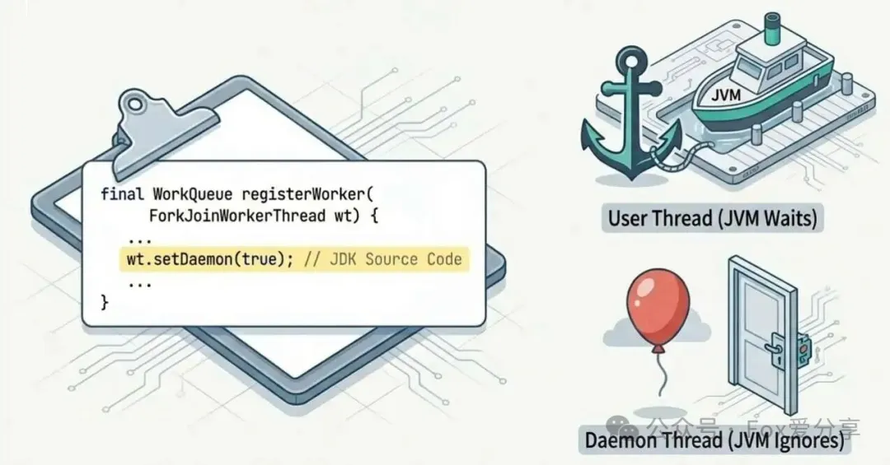

ForkJoinPool.commonPool() 里的线程，默认都是 **Daemon Thread**。

```plain
// ForkJoinWorkerThread 默认被 JVM 视为守护线程管理
protected ForkJoinWorkerThread(ForkJoinPool pool) {
    super("aForkJoinWorkerThread");
    this.pool = pool;
    this.workQueue = pool.registerWorker(this);
}
#java.util.concurrent.ForkJoinPool#registerWorker
final WorkQueue registerWorker(ForkJoinWorkerThread wt) {
    ...
    wt.setDaemon(true);
    ...
}
```

**这在生产环境有个巨大的隐患：优雅停机失效。** 我们在生产环境发版部署，或者重启服务时，都会触发 JVM 的关闭流程。

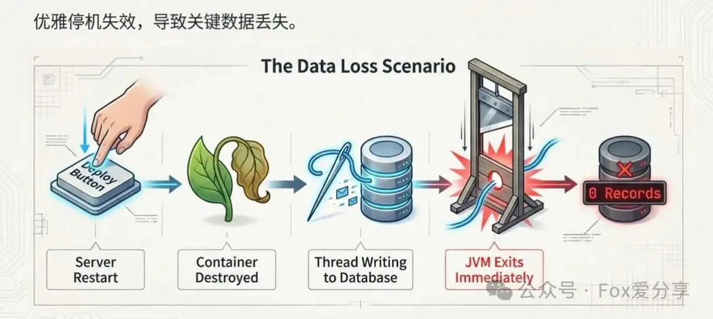

**JVM 的规矩是：** 当所有“非守护线程”结束时，JVM 就会退出，它**绝对不会**等待守护线程执行完毕。

**场景复现：** 你正开心地点了 Jenkins 上的“部署”按钮，服务开始重启。 此时，Spring 容器正在销毁 Bean，Tomcat 停止接收请求。 但是！你的 CompletableFuture 还在 commonPool 里跑一个关键的数据落库任务。 因为它是守护线程，JVM 关门的那一刻，直接把它“咔嚓”了！

**结果：** 任务执行了一半被强杀，数据没存进去，也没有任何报错日志（因为日志系统可能也被关了）。等你第二天发现数据对不上，对着空荡荡的日志文件，哭都找不到调。

# **地雷三：异常被“吃”得骨头都不剩**

在传统的 try-catch 里，出错了你能看到日志。 但在 CompletableFuture 里，如果你不调用 get() 或 join()，也不用 exceptionally 处理异常，**任务里的异常会被直接吞掉**。

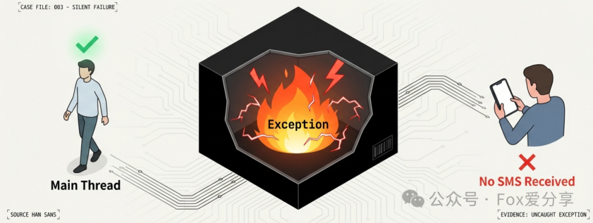

## **【实战隐患】**

你的异步任务是“发送短信”。结果短信服务挂了，抛出了异常。 由于是异步执行，主线程继续往下走，告诉用户“操作成功”。 结果用户死活收不到短信，你查日志还查不到任何报错信息！因为异常被封装在 Future 对象里，你不去“拆开”看，它就永远烂在肚子里。

# **✅\*\*\*\* 大厂王者级解法：自定义 + 兜底**

别再“裸用”了！任何生产级的异步代码，必须遵循这两条铁律：

## **1. 必须依附于独立的业务线程池**


不要跟别人抢 commonPool，那是找死。

```plain
// ❌ 错误写法（自杀式袭击）
CompletableFuture.supplyAsync(() -> { ... });

// ✅ 正确写法（舱壁模式）
// 不同的业务，用不同的池子。查询业务崩了，别把支付业务拖死。
// 使用自定义 ThreadPoolExecutor，完全由你掌控核心线程数和队列
CompletableFuture.supplyAsync(() -> {
    return queryUserInfo();
}, myBizThreadPool); //  {
        log.error("异步任务执行失败，报警！", ex);
        return null; // 或者返回默认值
    });
```

# **王者级回答模板（直接背）**

下次面试官问你怎么用 CompletableFuture，别背 API，直接把这段话拍在他桌子上：

“我从不在生产环境直接使用无参的 supplyAsync。

**第一，资源隔离与防雪崩**：JDK 默认的 ForkJoinPool.commonPool 是全 JVM 所有 CompletableFuture 和 parallelStream 共享的。且普通的 JDBC/HTTP 请求无法触发其 ManagedBlocker 扩容机制，核心线程数通常只有 CPU-1。一旦出现慢 IO，就会导致整个系统的异步任务集体卡死。所以我一定会传入自定义的 ThreadPoolExecutor 做业务隔离。

**第二，优雅停机保障**：默认池使用的是守护线程（Daemon）。在服务发布重启或关闭时，JVM 不会等待守护线程完成，极易导致关键任务执行中断、数据丢失。使用自定义线程池配合 Spring 的 DisposableBean 或 JVM ShutdownHook，才能保证任务安全落地。

**第三，异常风暴**：异步任务的异常极易被吞没，我的代码规范要求必须配合 exceptionally 或 handle 进行异常记录和监控。”

## **最后再唠两句**

兄弟们，**异步是为了提升性能，不是为了制造 Bug**。

能看懂 ForkJoinPool 的 ManagedBlocker 机制，能指出 parallelStream 共享池的风险，能考虑到**服务重启时的数据安全**，你就是 Team Leader 眼里的“靠谱架构师”。

**觉得这篇真的能帮你避坑的，点个赞，收藏起来。** 别等生产环境炸了，才想起来回来翻这篇救命文。


# ConcurrentSkipList系列原理

ConcurrentSkipList是有序的容器

是TreeMap 和TreeSet的并发集合替代品.

 

ConcurrentSkipListMap  有序Map

ConcurrentSkipListSet   有序Set

 

TreeMap和TreeSet使用红黑树按照key的顺序（自然顺序、自定义顺序）来使得键值对有序存储_，_但是只能在单线程下安全使用；多线程下想要使键值对按照key的顺序来存储，则需要使用ConcurrentSkipListMap和ConcurrentSkipListSet，分别用以代替TreeMap和TreeSet，存入的数据按key排序。在实现上，ConcurrentSkipListSet 本质上就是ConcurrentSkipListMap。

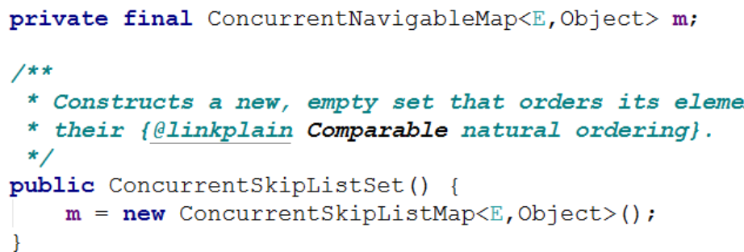

 

## （一）了解什么是SkipList？
### 1．二分查找和AVL树查找
二分查找要求元素可以随机访问，所以决定了需要把元素存储在连续内存。这样查找确实很快，但是插入和删除元素的时候，为了保证元素的有序性，就需要大量的移动元素了。

如果需要的是一个能够进行二分查找，又能快速添加和删除元素的数据结构，首先就是二叉查找树，二叉查找树在最坏情况下可能变成一个链表。

于是，就出现了平衡二叉树，根据平衡算法的不同有AVL树，B-Tree，B+Tree，红黑树等，但是AVL树实现起来比较复杂，平衡操作较难理解，这时候就可以用SkipList跳跃表结构。

 

### 2．什么是跳表
 

传统意义的单链表是一个线性结构，向有序的链表中插入一个节点需要O(n)的时间，查找操作需要O(n)的时间。

 

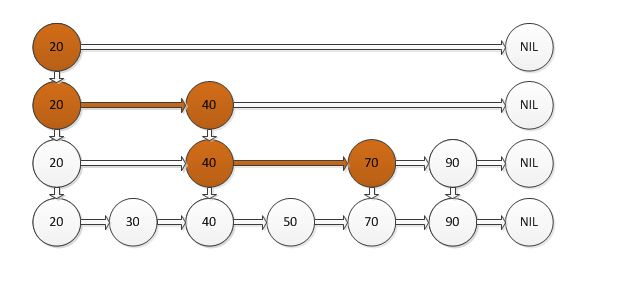

 

如果我们使用上图所示的跳跃表，就可以减少查找所需时间为O(n/2)，因为我们可以先通过每个节点的最上面的指针先进行查找，这样子就能跳过一半的节点。

 

查找过程:

比如我们想查找50，首先和20比较，大于20之后，在和40进行比较，然后在和70进行比较，发现70大于50，说明查找的点在40和50之间，从这个过程中，我们可以看出，查找的时候跳过了30。

 

设计思想:

跳跃表其实也是一种通过“空间来换取时间”的一个算法，令链表的每个结点不仅记录next结点位置，还可以按照level层级分别记录后继第level个结点。此法使用的就是“先大步查找确定范围，再逐渐缩小迫近”的思想进行的查找。跳跃表在算法效率上很接近红黑树。

 

概率数据结构

 

跳跃表又被称为概率，或者说是随机化的数据结构，目前开源软件 Redis 和 lucence都有用到它。

新插入的元素的时候,这个元素到底应不应该成节点呢,就是随机,如果随机到了就成为节点了,如果不是就算了.

 

 

都是线程安全的Map实现，ConcurrentHashMap的性能和存储空间要优于ConcurrentSkipListMap，但是ConcurrentSkipListMap有一个功能： 它会按照键的顺序进行排序。

 

 

## （二）ConcurrentSkipListMap
 

使用场景

 

ConcurrentSkipListMap使用跳表结构来保存链表的顺序，解决了在有序链表中快速查找的问题，所以ConcurrentSkipListMap适合在需要链表的高效更新效率(删除/插入)以及还要保证一定的随机访问效率(查找/更新)的场景下使用。

 

 

参考:

[https://www.cnblogs.com/skywang12345/p/3498556.html](https://www.cnblogs.com/skywang12345/p/3498556.html)

[https://blog.csdn.net/sunxianghuang/article/details/52221913](https://blog.csdn.net/sunxianghuang/article/details/52221913)

 

### 1．API
|  // 构造一个新的空映射，该映射按照键的自然顺序进行排序。ConcurrentSkipListMap()// 构造一个新的空映射，该映射按照指定的比较器进行排序。ConcurrentSkipListMap(Comparator comparator)// 构造一个新映射，该映射所包含的映射关系与给定映射包含的映射关系相同，并按照键的自然顺序进行排序。ConcurrentSkipListMap(Map m)// 构造一个新映射，该映射所包含的映射关系与指定的有序映射包含的映射关系相同，使用的顺序也相同。ConcurrentSkipListMap(SortedMap m) // 返回与大于等于给定键的最小键关联的键-值映射关系；如果不存在这样的条目，则返回 null。Map.Entry ceilingEntry(K key)// 返回大于等于给定键的最小键；如果不存在这样的键，则返回 null。K ceilingKey(K key)// 从此映射中移除所有映射关系。void clear()// 返回此 ConcurrentSkipListMap 实例的浅表副本。ConcurrentSkipListMap clone()// 返回对此映射中的键进行排序的比较器；如果此映射使用键的自然顺序，则返回 null。Comparator comparator()// 如果此映射包含指定键的映射关系，则返回 true。boolean containsKey(Object key)// 如果此映射为指定值映射一个或多个键，则返回 true。boolean containsValue(Object value)// 返回此映射中所包含键的逆序 NavigableSet 视图。NavigableSet descendingKeySet()// 返回此映射中所包含映射关系的逆序视图。ConcurrentNavigableMap descendingMap()// 返回此映射中所包含的映射关系的 Set 视图。Set> entrySet()// 比较指定对象与此映射的相等性。boolean equals(Object o)// 返回与此映射中的最小键关联的键-值映射关系；如果该映射为空，则返回 null。Map.Entry firstEntry()// 返回此映射中当前第一个（最低）键。K firstKey()// 返回与小于等于给定键的最大键关联的键-值映射关系；如果不存在这样的键，则返回 null。Map.Entry floorEntry(K key)// 返回小于等于给定键的最大键；如果不存在这样的键，则返回 null。K floorKey(K key)// 返回指定键所映射到的值；如果此映射不包含该键的映射关系，则返回 null。V get(Object key)// 返回此映射的部分视图，其键值严格小于 toKey。ConcurrentNavigableMap headMap(K toKey)// 返回此映射的部分视图，其键小于（或等于，如果 inclusive 为 true）toKey。ConcurrentNavigableMap headMap(K toKey, boolean inclusive)// 返回与严格大于给定键的最小键关联的键-值映射关系；如果不存在这样的键，则返回 null。Map.Entry higherEntry(K key)// 返回严格大于给定键的最小键；如果不存在这样的键，则返回 null。K higherKey(K key)// 如果此映射未包含键-值映射关系，则返回 true。boolean isEmpty()// 返回此映射中所包含键的 NavigableSet 视图。NavigableSet keySet()// 返回与此映射中的最大键关联的键-值映射关系；如果该映射为空，则返回 null。Map.Entry lastEntry()// 返回映射中当前最后一个（最高）键。K lastKey()// 返回与严格小于给定键的最大键关联的键-值映射关系；如果不存在这样的键，则返回 null。Map.Entry lowerEntry(K key)// 返回严格小于给定键的最大键；如果不存在这样的键，则返回 null。K lowerKey(K key)// 返回此映射中所包含键的 NavigableSet 视图。NavigableSet navigableKeySet()// 移除并返回与此映射中的最小键关联的键-值映射关系；如果该映射为空，则返回 null。Map.Entry pollFirstEntry()// 移除并返回与此映射中的最大键关联的键-值映射关系；如果该映射为空，则返回 null。Map.Entry pollLastEntry()// 将指定值与此映射中的指定键关联。V put(K key, V value)// 如果指定键已经不再与某个值相关联，则将它与给定值关联。V putIfAbsent(K key, V value)// 从此映射中移除指定键的映射关系（如果存在）。V remove(Object key)// 只有目前将键的条目映射到给定值时，才移除该键的条目。boolean remove(Object key, Object value)// 只有目前将键的条目映射到某一值时，才替换该键的条目。V replace(K key, V value)// 只有目前将键的条目映射到给定值时，才替换该键的条目。boolean replace(K key, V oldValue, V newValue)// 返回此映射中的键-值映射关系数。int size()// 返回此映射的部分视图，其键的范围从 fromKey 到 toKey。ConcurrentNavigableMap subMap(K fromKey, boolean fromInclusive, K toKey, boolean toInclusive)// 返回此映射的部分视图，其键值的范围从 fromKey（包括）到 toKey（不包括）。ConcurrentNavigableMap subMap(K fromKey, K toKey)// 返回此映射的部分视图，其键大于等于 fromKey。ConcurrentNavigableMap tailMap(K fromKey)// 返回此映射的部分视图，其键大于（或等于，如果 inclusive 为 true）fromKey。ConcurrentNavigableMap tailMap(K fromKey, boolean inclusive)// 返回此映射中所包含值的 Collection 视图。Collection values() |
| --- |

 

 

## （三）ConcurrentSkipListSet
 

就是线程安全的有序的集合

 

更多源码解析可参考:

[https://www.cnblogs.com/skywang12345/p/3498634.html](https://www.cnblogs.com/skywang12345/p/3498634.html)


# Future和CompletableFuture的区别

Future 和 CompletableFuture 是 Java 中用于异步编程的两个重要接口，它们都在 java.util.concurrent 包中被定义，但它们的设计和用途有显著的不同。

### Future

Future 接口代表了一个异步计算的结果。它提供了一种检查计算是否完成的方法，以及在计算完成后获取结果或处理可能的异常。

#### 特点

1. **获取结果**：可以通过 get() 方法阻塞等待计算完成并获取结果。
2. **取消任务**：可以通过 cancel() 方法尝试取消任务。
3. **异步但不易组合**：Future 本身没有提供处理异步结果的方法，也没有组合多个 Future 的机制。

#### 示例代码

```java
import java.util.concurrent.Callable;
import java.util.concurrent.ExecutionException;
import java.util.concurrent.ExecutorService;
import java.util.concurrent.Executors;
import java.util.concurrent.Future;

public class FutureExample {
    public static void main(String[] args) {
        ExecutorService executor = Executors.newFixedThreadPool(2);

        Callable task = () -> {
            Thread.sleep(1000); // 模拟长时间任务
            return 42;
        };

        Future future = executor.submit(task);

        try {
            // do something else
            System.out.println("Doing something else...");
            Integer result = future.get(); // 阻塞等待结果
            System.out.println("Result: " + result);
        } catch (InterruptedException | ExecutionException e) {
            e.printStackTrace();
        } finally {
            executor.shutdown();
        }
    }
}
```

### CompletableFuture

CompletableFuture 是 Java 8 引入的新特性，支持更多的异步编程功能和更丰富的组合手段。

#### 特点

1. **非阻塞**：提供了很多方法如 thenApply(), thenAccept() 等进行异步计算，避免阻塞。
2. **组合任务**：支持组合多个异步操作，如使用 thenCombine(), allOf(), anyOf() 等。
3. **手动完成**：可以通过 complete() 方法手动设置结果。
4. **与流式操作结合**：支持更多的函数式操作，像流式 API 一样链式调用。

#### 示例代码

```java
import java.util.concurrent.CompletableFuture;
import java.util.concurrent.ExecutionException;

public class CompletableFutureExample {
    public static void main(String[] args) throws ExecutionException, InterruptedException {
        CompletableFuture future = CompletableFuture.supplyAsync(() -> {
            sleep(1000);
            return 42;
        });

        // 非阻塞链式操作
        CompletableFuture resultFuture = future.thenApply(result -> {
            System.out.println("Result: " + result);
            return result * 2;
        }).thenAccept(result -> System.out.println("Transformed Result: " + result));

        resultFuture.get(); // 等待所有阶段完成
    }

    private static void sleep(int milliseconds) {
        try {
            Thread.sleep(milliseconds);
        } catch (InterruptedException e) {
            throw new IllegalStateException(e);
        }
    }
}
```

### 主要区别

1. **功能范围**：CompletableFuture 为更复杂的异步操作提供了更广泛的功能，而 Future 仅提供基本的任务完成和结果获取。
2. **组合能力**：CompletableFuture 支持异步任务的流式组合，而 Future 需要显式的阻塞和同步。
3. **非阻塞**：CompletableFuture 可以方便地进行非阻塞操作链，而 Future 本质上是阻塞的。

CompletableFuture 提供了更现代的接口来处理复杂的异步编程需求，它支持 completablepatables 和更丰富的组合能力，尤其适合复杂的异步数据流处理场景。


# 如果不允许线程池丢弃任务，应该选择哪个拒绝策略？

大家应该都知道，  线程池的核心线程满了， 就会放在阻塞队列，  阻塞队列满了会创建临时线程，  如果超过最大线程数， 就会触发拒绝策略。 那很多人都是用直接拒绝的策略，这样任务就直接丢了。

线程池的拒绝策略是指当线程池无法继续接收新任务时（例如线程池已满且任务队列已满），如何处理新提交的任务。Java的`ThreadPoolExecutor`提供了4种内置的拒绝策略，每种策略都有其适用场景和特点。

### 1. **AbortPolicy（默认策略）**

* **行为**：当任务无法被线程池接收时，抛出`RejectedExecutionException`异常。
* **适用场景**：适用于对任务执行非常关键的场景，异常可以提示调用者任务无法执行。
* **缺点**：直接抛出异常，可能会导致调用方无法处理任务。

### 2. **CallerRunsPolicy**

* **行为**：由提交任务的线程（调用线程）来执行该任务。这会降低线程池的负载，但可能会导致调用线程阻塞。
* **适用场景**：适用于任务提交方可以接受在当前线程中执行任务的场景，有助于缓解线程池的压力。
* **优点**：可以避免任务丢失，确保任务最终被执行。
* **缺点**：可能会导致调用线程阻塞，影响调用方的性能。

### 3. **DiscardPolicy**

* **行为**：直接丢弃任务，不抛出异常。
* **适用场景**：适用于任务可以被丢弃的场景，例如日志记录等非关键任务。
* **优点**：简单直接，不会影响调用方。
* **缺点**：任务丢失，调用方无法感知任务未执行。

### 4. **DiscardOldestPolicy**

* **行为**：丢弃队列中最早的任务，尝试执行当前任务。
* **适用场景**：适用于队列中的任务可以被丢弃，且希望尽可能执行最新任务的场景。
* **优点**：可以尝试执行最新任务，减少任务积压。
* **缺点**：可能会导致一些任务被丢弃，且调用方无法感知任务丢失。

### 如何选择拒绝策略？

选择合适的拒绝策略需要根据实际业务需求来决定：

* 如果任务非常关键，不能丢失，可以使用`AbortPolicy`或`CallerRunsPolicy`。
* 如果任务可以被丢弃，且不想影响调用方，可以选择`DiscardPolicy`。
* 如果希望尽可能执行最新任务，可以选择`DiscardOldestPolicy`。

### 示例代码

以下是一个使用`CallerRunsPolicy`的线程池示例：

java**复制**

```java
ThreadPoolExecutor executor = new ThreadPoolExecutor(
    2, // 核心线程数
    4, // 最大线程数
    60, // 线程存活时间
    TimeUnit.SECONDS, // 时间单位
    new LinkedBlockingQueue<>(2), // 任务队列
    Executors.defaultThreadFactory(), // 线程工厂
    new ThreadPoolExecutor.CallerRunsPolicy() // 拒绝策略
);
```

在这个示例中，当线程池和任务队列都满了时，新提交的任务会在调用线程中执行。

通过合理选择拒绝策略，可以更好地控制线程池的行为，确保系统在高负载下仍然能够稳定运行。

#### 但是如果任务很重要，不允许丢弃你会怎么做呢？

那大家可以把工作中用到的方案发在评论区， 我给你提供几种：

1. 用CallerRunsPolicy ，他会采用主线程执行任务， 但是如果任务非常耗时会阻塞主线程，在高并发场景慎用！
2. 将任务进行持久化，可以采用mysql、redis、或者mq异步 等方案持久化， 后续再对任务进行补偿执行。
3. 也可以参考netty: 他会再创建新的一个异步线程处理任务。

```java
@Override
public void rejectedExecution(Runnable r, ThreadPoolExecutor executor) {
    try {
        //创建一个临时线程处理任务
        final Thread t = new Thread(r, "Temporary task executor");
        t.start();
    } catch (Throwable e) {
        throw new RejectedExecutionException(
            "Failed to start a new thread", e);
    }
}
```

4. 也参考ActiveMQ： 再次插入阻塞队列，  会加入等待时间， 尽可能的保证执行。

```java
@Override
public void rejectedExecution(final Runnable r, final ThreadPoolExecutor executor) {
    try {
        //限时阻塞等待，实现尽可能交付
        //如果队列未满，则立即插入任务并返回 true。
        //如果队列已满，则会等待指定的时间（这里是 60 秒）。
        //如果在 60 秒内队列仍然无法腾出空间（比如没有任务被消费），则插入失败，返回 false。
        executor.getQueue().offer(r, 60, TimeUnit.SECONDS);
    } catch (InterruptedException e) {
        throw new RejectedExecutionException("Interrupted waiting for BrokerService.worker");
    }
    throw new RejectedExecutionException("Timed Out while attempting to enqueue Task.");
}

```

当然如果系统资源运行的情况下我们还可以调整最大线程数和阻塞队列的长度， 这样可以减少拒绝策略的触发。


# 什么是伪共享问题以及如何解决

伪共享（False Sharing）是多线程编程中的一个重要性能问题，尤其在多核处理器中尤为显著。了解如何因共享缓存行引起的无谓性能消耗，从而有效规避，是编写高效并发程序的关键。

### 伪共享的核心概念

在现代处理器中，缓存行（Cache Line）是缓存的最小可分配单位，通常是64字节。当多个线程在不同CPU核心上操作缓存行中的不同变量时，如果这些变量位于同一个缓存行，修改其中一个变量会导致整个缓存行被标记为无效(cpu缓存一致性决定)。这种重复的缓存行无效化和重新加载的现象就是伪共享。

它的本质问题在于：虽然多个线程操作的是物理上不同的数据，但由于它们共享了同一个缓存行，造成不必要的缓存同步，导致性能下降。

### 示例代码解释

为了更好地理解伪共享，我们结合上面的代码来详细解释：

```java
public class FalseSharingExample implements Runnable {
    // 定义线程数
    public static int NUM_THREADS = 4;
    public static final long ITERATIONS = 5000000000L; // 每个线程的迭代次数

    private final int arrayIndex; // 此线程操作的共享数据索引

    private static ValuePadding[] values; // 用于存储共享数据

    public FalseSharingExample(int arrayIndex) {
        this.arrayIndex = arrayIndex;
    }

    public static void main(final String[] args) throws InterruptedException {
        Thread[] threads = new Thread[NUM_THREADS];

        // 初始化共享变量数组
        values = new ValuePadding[NUM_THREADS];
        for (int i = 0; i **ValuePadding**** \*\*\*\*类的设计**：
   * 这里使用了ValuePadding类来存储每个线程要操作的共享变量value。
   * 通过在value字段的前后添加几个填充字段（p1到p7和p9到p15），每个ValuePadding对象会占据多个缓存行，从而使value与相邻的对象实际分离至不同的缓存行。
   * 这可以有效防止多个线程不必要地共享同一缓存行（即避免伪共享），从而提升程序的并发性能。
2. **主程序的执行流程**：
   * 主线程启动了多个工作线程，每个线程负责增加自己的ValuePadding实例中的value。
   * 每个线程访问和更新values数组中的一个ValuePadding实例，由于填充字段的存在，每个线程访问的value字段分布在不同缓存行上，尽可能减少缓存争用。
3. **代码运行效率**：
   * 如果不采用填充策略，不同线程可能会因共享同一缓存行而导致频繁的缓存无效化和重新加载，造成性能的严重下降。
   * 通过填充确保每个value字段在不同缓存行上，甚至在高并发下也能高效执行，从而减少伪共享。

### 总结

伪共享问题的解决尤其适合在性能敏感的大规模并发应用中。通过了解缓存行的基本原理并采取适当的填充策略，可以有效减少缓存行争用带来的性能开销，从而在不改变逻辑操作的前提下实现更佳的性能。注意，Java8还提供@Contended注解用于更高级的填充，但使用它需要相应的JVM参数配置支持。


# synchronized可以锁字符串吗

在日常项目开发中为了解决用户数据并发操作的问题，需要对代码块进行加锁保护。

例如：一个教务系统， 提供不同学校使用， 有一个考试场景， 需要记录不同学校的考试次数， 这里想尽可能把锁的对象放小，因此通常都是锁用户而不是锁整个类或者代码块；然而在用synchronized(school)\ 的时候可能会存在一些问题。

## synchronized 锁字符串的问题

### 使用synchronized锁一个字符串👇

```java
@RequestMapping("/saving")
public String saving(String school) {
// 常量池  全局
synchronized (school) {
    System.out.println(school + "学生交卷");
    save(school);
    System.out.println(school + "学生交卷完成");
    return "ok";
}
}
```

### 测试：

模拟http接口请求， Spring底层会通过new String()方式传入字符串参数， 而不是传入“”常量值

```java

static Map values=new ConcurrentHashMap<>();
private  void extracted() throws InterruptedException {

Thread thread = new Thread(() -> saving(new String("北大")));
Thread thread1 = new Thread(() -> saving(new String("清华")));
Thread thread2 = new Thread(() -> saving(new String("清华")));
thread.start();
thread1.start();;
thread2.start();;
thread.join();
thread1.join();
thread2.join();
System.out.println(values);
}
```

### 运行结果如下：

3个同时并行：


发生线程安全问题：

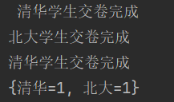

可以发现还是并发执行了，因为synchronized (new String("字符串常量"))\ **锁的对象不是同一个，仅仅是值相等**，此时的字符串是在堆栈中。将代码修改为如下

```java
 @RequestMapping("/saving")
    public String saving(String school) {
        // 常量池  全局
        synchronized (school.intern()) {
            System.out.println(school + "学生交卷");
            save(school);
            System.out.println(school + "学生交卷完成");
            return "ok";
        }
    }
```

得到运行结果为：

不同学校并行:


同一个学校串行：

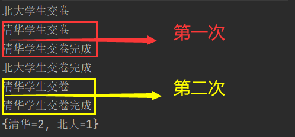

通过上面结果可以看出此时通过**school.intern()把字符串对象放入常量池中，则"清华”地址是同一个**。

## synchronized 锁字符串用String的intern()存在的问题

通过上面的demo可以得出，使用synchronized 锁字符串，需要将字符串添加到字符串常量池中。日常使用中通过通过new对象的方式创建对象，再取对象的字段，因此需要使用intern把字符串放入常量池中，但是**直接使用String的intern全部把字符串放入常量池会存在一些问题**。显然在数据量很大的情况下，将所有字符串都放入常量池是不合理的，常量池大小依赖服务器内存，且只有等待fullGC，极端情况下会导致**频繁fullGC**。并且在数据量很大的情况下，将字符串放入常量会**存在性能问题**。

可以用google的guava包的interner类：

```java
public class test{
    private static Interner lock = Interners.newWeakInterner();
    public void test() {
        synchronized (lock.intern(id.toString())){
            //do...
        }
    }
}
```

Interner是通过MapMaker构造ConcurrentMap来实现弱引用，ConcurrentMap用分段的方式保证安全。这里个人觉得比常量池的**优点**就在于这里是**弱引用的方式，便于map的回收，常量池只能依赖于fullGC，这里的回收在不使用或内存不够用条件下即可被回收**（Minor GC阶段）。

## 总结

* synchronized可以锁存活于字符串常量池中的值，不能锁存活于堆栈中的字符串（字符串地址要相同）
* 可以使用String对象.intern()\ 将该字符串放入字符串常量池中，但是常量池的回收只能依赖于fullGC，故不推荐使用
* 推荐使用guava包下的interner类，使用弱引用的方式，在内存不足的时候自动进行垃圾回收


# Synchronized是如何实现线程同步的

synchronized关键字是Java中实现线程同步的基本机制之一。它用于保护共享资源不被多个线程同时访问，从而避免数据不一致和保证线程安全。synchronized可以用于方法和代码块，有助于确保在同一时刻只有一个线程可以进入同步代码块。

### 实现原理

synchronized基于监视器锁（Monitor Lock）实现，底层依赖于操作系统的互斥锁（Mutex）。每个对象在Java中都与一个隐式的监视器相关联，使用synchronized时，线程需要获得对象的监视器锁，然后才能进入同步代码块。

Java的对象有一个头（Object Header），其中包含一个Mark Word，用于存储锁的信息。锁有不同的状态，包括无锁状态、偏向锁、轻量级锁和重量级锁，JVM会根据竞争情况自动进行状态变换以优化性能。

### 使用示例

#### 1. 同步方法

使用synchronized直接修饰实例方法或静态方法，以同步整个方法。下面是一个示例：

```java
public class Counter {
    private int count = 0;

    // Synchronized instance method
    public synchronized void increment() {
        count++;
    }

    public synchronized int getCount() {
        return count;
    }
}
```

在这个示例中，increment()和getCount()方法是同步的，这意味着对同一实例的这些方法调用是线程安全的。

#### 2. 同步代码块

为了减少锁的粒度，您可以在方法中使用synchronized代码块，从而只锁住特定的部分。

```java
public class Counter {
    private int count = 0;
    private final Object lock = new Object(); // 使用自定义锁对象

    public void increment() {
        synchronized(lock) {
            count++;
        }
    }

    public int getCount() {
        synchronized(lock) {
            return count;
        }
    }
}
```

这种方法允许更精细地控制同步范围，常用于只需保护代码的一部分而非整个方法的场景。

### 同步静态方法

对于静态方法，synchronized锁定的是类对象，因为静态方法属于类，而不是实例。

```java
public class Counter {
    private static int count = 0;

    // Synchronized static method
    public static synchronized void increment() {
        count++;
    }

    public static synchronized int getCount() {
        return count;
    }
}
```

在这个例子中，加锁保护的是整个类Counter的静态成员count，使用类级别的锁来保证线程安全。

### 注意事项

1. **性能**：使用synchronized可能导致线程阻塞，从而影响程序性能。尽量将synchronized锁的范围缩小，以减少锁竞争。
2. **死锁风险**：错误使用同步可能导致死锁。例如，多个线程在不同的锁上循环等待。要避免持有多个锁，或者确保获取锁的顺序一致。
3. **原子性和可见性**：synchronized不仅保证代码块的原子性，还保证进入同步代码块之前对变量的修改，对于其他线程是可见的。
4. **公平性**：synchronized不保证线程获取锁的公平性，即线程获取锁的顺序不一定按照调用顺序。如果需要严格的公平性控制，可能需要使用ReentrantLock等高级锁。

通过synchronized，我们可以确保共享资源在多线程环境下的安全访问，同时通过合适的使用方式来优化性能和避免常见的多线程问题。


# Java中读写锁的应用场景是什么

ReadWriteLock 是 Java 提供的一种用于解决并发读写问题的锁机制，其主要目的在于提高在**读多写少的场景**下的并发性能。ReadWriteLock 允许多个线程同时读取共享资源，但是对写操作是独占的。这意味着在一个线程写入数据时，其他线程既不能读取也不能写入。

### 应用场景

1. **缓存系统**：
   * 在缓存系统中，数据读取频率通常远高于数据写入，因此使用读写锁可以提高读取操作的并发性和效率。
2. **配置管理**：
   * 系统配置或应用程序配置的数据通常在初始化后多为读取，只有在特殊情况下才会更新，因此适合使用读写锁。
3. **文档编辑**：
   * 多人协同编辑文档时，可能会有许多人同时查看文档内容，只有少数人进行编辑，这种场合也可以使用读写锁。
4. **游戏状态**：
   * 游戏服务器可能需要频繁读取玩家的状态，而状态更新相对较少，因此读写锁可以提高状态读取的性能。

### 代码示例

以下是一个使用 ReadWriteLock 的示例代码，这个示例演示了如何在共享数据结构中使用读写锁，以确保线程安全并提高并发读取的性能。

```java
import java.util.concurrent.locks.ReadWriteLock;
import java.util.concurrent.locks.ReentrantReadWriteLock;
import java.util.HashMap;
import java.util.Map;

public class ReadWriteLockExample {

    private final Map dataStore = new HashMap<>();
    private final ReadWriteLock lock = new ReentrantReadWriteLock();

    // 读取数据的方法
    public String read(String key) {
        lock.readLock().lock(); // 获取读锁
        try {
            System.out.println(Thread.currentThread().getName() + " is reading.");
            return dataStore.get(key);
        } finally {
            lock.readLock().unlock(); // 释放读锁
        }
    }

    // 写入数据的方法
    public void write(String key, String value) {
        lock.writeLock().lock(); // 获取写锁
        try {
            System.out.println(Thread.currentThread().getName() + " is writing.");
            dataStore.put(key, value);
        } finally {
            lock.writeLock().unlock(); // 释放写锁
        }
    }

    public static void main(String[] args) {
        ReadWriteLockExample example = new ReadWriteLockExample();

        // 创建一个线程用于写操作
        Thread writerThread = new Thread(() -> {
            example.write("key1", "value1");
            System.out.println(Thread.currentThread().getName() + " has written key1 -> value1");
        }, "WriterThread");

        // 创建多个线程用于读操作
        Thread readerThread1 = new Thread(() -> {
            String value = example.read("key1");
            System.out.println(Thread.currentThread().getName() + " read key1 -> " + value);
        }, "ReaderThread1");

        Thread readerThread2 = new Thread(() -> {
            String value = example.read("key1");
            System.out.println(Thread.currentThread().getName() + " read key1 -> " + value);
        }, "ReaderThread2");

        writerThread.start();
        readerThread1.start();
        readerThread2.start();

        try {
            writerThread.join();
            readerThread1.join();
            readerThread2.join();
        } catch (InterruptedException e) {
            Thread.currentThread().interrupt();
        }
    }
}
```

### 关键点

* **提升读取性能**：ReadWriteLock 允许多个读取线程同时访问共享资源，从而提高了读取性能。
* **写锁独占**：只有在没有其他线程读取或写入时，写锁才能获得，这保障了数据在写入时的一致性和安全性。
* **适用性**：适用于读多写少场景，能显著提高系统在并发读取场景下的性能。
* **易于使用**：ReadWriteLock 提供了清晰的语义分离（读与写），使得代码更具可读性和维护性。

在高并发应用中，通过合理使用 ReadWriteLock 可以在保持数据一致性的同时大幅提高程序的并发性能。


# 锁的优化机制了解吗

### 一、 标准面试回答模版（建议背诵）

**面试官：** 了解锁的优化机制吗？（或者问：JDK 1.6 对 synchronized 做了哪些优化？）

**Fox版标准回答：**

“JDK 1.6 之后，为了彻底解决 `synchronized` 重量级锁性能低下的问题，引入了大量的优化技术。

它的核心机制可以归纳为‘**运行时锁升级’和‘编译时锁优化**’两个层面：

1. **运行时锁升级（核心）：**

锁的状态不再是一成不变的，而是根据竞争情况，遵循由轻到重、不可降级的流转过程：

**无锁 ——> 偏向锁 ——> 轻量级锁 ——> 自适应自旋（膨胀过渡） ——> 重量级锁**。

2. **编译时优化（JIT）：**

编译器在编译过程中，通过静态分析，会智能地进行锁消除（Lock Elimination）和锁粗化（Lock Coarsening），进一步减少不必要的加锁开销。”

### 第二部分：底层流转逻辑

“接下来我详细拆解一下锁的升级流程，这里有一个关键的**自旋时机**经常被人搞错：

1. **偏向锁 (Biased Lock)**：
   * **场景**：只有一个线程访问。
   * **原理**：修改 Mark Word，记录当前线程 ID。下次该线程再来，对比 ID 成功直接放行。**全程无锁，无 CAS，性能最高。**
2. **轻量级锁 (Lightweight Lock)**：
   * **场景**：线程交替执行，无强竞争。
   * **原理**：偏向锁失效后升级。线程在栈帧中创建 `Lock Record`，通过 **CAS** 将 Mark Word 指向该记录。
   * **关键点**：轻量级锁本身**只依靠 CAS**，**不涉及自旋**。
3. **自适应自旋 (Adaptive Spinning) —— 锁膨胀的缓冲防线**：
   * **场景**：轻量级锁 CAS 失败（意味着有竞争），但在彻底挂起线程之前。
   * **原理**：JVM 赌持有锁的线程很快会释放，于是让当前线程‘空转’（自旋）一会儿。
     * 如果自旋期间拿到了锁，避免了内核态切换，大赚。
     * 如果自旋超时，赌输了，才会进入下一步。
   * **自适应**：自旋次数不固定，由前一次在同一个锁上的自旋结果动态决定。
4. **重量级锁 (Heavyweight Lock)**：
   * **场景**：自旋也失败了，彻底放弃治疗。
   * **原理**：Mark Word 指向堆中的 **Monitor** 对象。线程进入 **BLOCKED** 状态，调用操作系统 Mutex Lock 挂起等待。”

### 第三部分：代码证据

“除了理论，我在研究底层时，还关注到了 JIT 编译器的优化以及如何验证锁状态，以下是我的代码实践。”

#### 1. JIT 编译器优化（锁消除与锁粗化）

```java
public class JITOptimizationDemo {

    /**
     * 场景A：锁消除 (Lock Elimination)
     * 原理：JIT 通过逃逸分析发现 sb 是局部变量，属于“栈封闭”，
     * 根本不可能被其他线程访问。所以这里的 synchronized 会被 JIT 直接擦除。
     */
    public void lockElimination() {
        StringBuffer sb = new StringBuffer();
        sb.append("Hello"); // synchronized 方法
        sb.append("Fox");
    }

    /**
     * 场景B：锁粗化 (Lock Coarsening)
     * 原理：JIT 发现循环内频繁加锁解锁，性能损耗大。
     * 优化后：将锁的范围扩大到循环体外部，只加一次锁。
     */
    public void lockCoarsening() {
        StringBuffer sb = new StringBuffer();
        // 优化前：100次加锁解锁
        // 优化后：synchronized(sb) { for... } 1次加锁
        for (int i = 0; i  {
            synchronized (obj) {
                // 2. 打印轻量级锁状态 (Mark Word最后两位 00)
                // 指向栈帧 Lock Record
                System.out.println(ClassLayout.parseInstance(obj).toPrintable());
            }
        }).start();

        // ... 通过制造竞争，可以看到最后两位变为 10 (Monitor) ...
    }
}
```

### 第四部分：Fox的面试压箱底（降维打击）

“最后，我想补充两个**反直觉**的生产环境细节：

1. **偏向锁的‘死刑’：**

虽然教科书上都讲偏向锁，但在高并发实战中，它往往弊大于利（撤销成本高）。所以 JDK 15 默认禁用偏向锁，JDK 18 彻底废弃。面试时提到这一点，说明我们紧跟技术前沿。

2. **对象头位图 (Mark Word Bitmask)：**

锁的本质就是修改对象头最后两位的 tag：

```
- **01**：无锁/偏向
- **00**：轻量级锁（Ptr to Stack）
- 10：重量级锁（Ptr to Monitor）
```

这也是我看 Hotspot 源码学到的。”

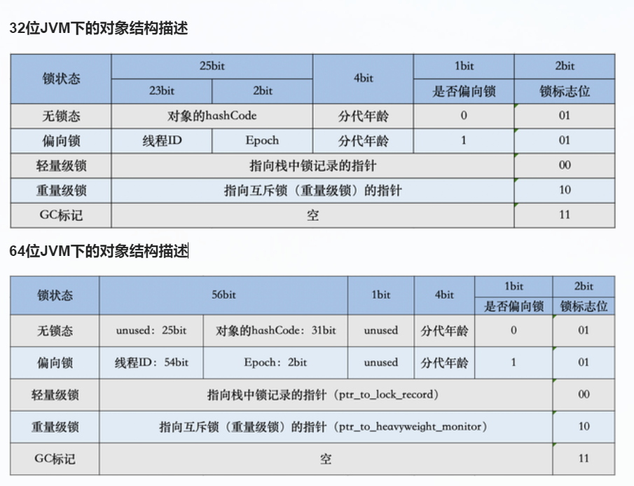

## 拓展：

### 锁升级的流程分析

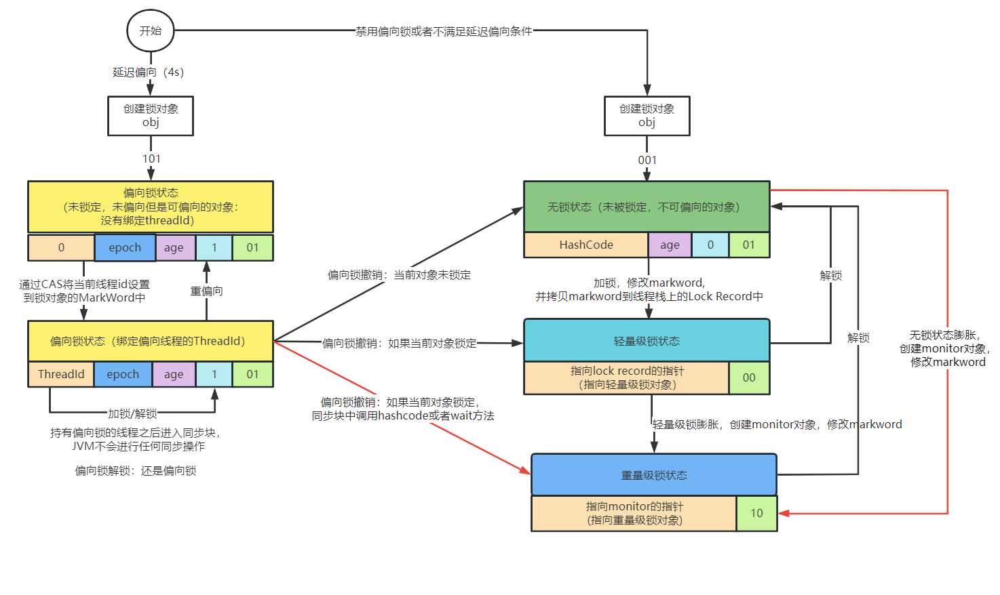

### synchronized源码分析

**偏向锁源码分析**

[https://www.processon.com/view/link/6188c6c95653bb1471107283](https://www.processon.com/view/link/6188c6c95653bb1471107283)

**轻量级锁源码分析**

[https://www.processon.com/view/link/618e7dd61e0853689b0c0df0](https://www.processon.com/view/link/618e7dd61e0853689b0c0df0)

**重量级锁源码分析**

[https://www.processon.com/view/link/618e7e1b7d9c08562aec6638](https://www.processon.com/view/link/618e7e1b7d9c08562aec6638)

拓展视频：

[轻量级锁会自旋吗？它和重量级锁的区别是什么？](https://open.douyin.com/player/video?vid=7442300142285294888\&autoplay=0)


# 线程池的哪些参数影响性能

面试官： 线程池的哪些参数会影响性能？具体怎么设置？

**Fox版标准回答：**

“这个问题不能一概而论。在我的经验里，线程池调优是一个\*\*‘三部曲’\*\*的过程：**理论估算 -> 压测验证 -> 动态监控**。

### 第一步：理解核心参数（流量漏斗模型）

`ThreadPoolExecutor` 的参数中，对性能影响最大的有三个，它们构成了一个**流量漏斗**：

1. **CorePoolSize（核心线程数）：** 决定了系统的**基准水位**。
   * 设小了：任务积压，RT（响应时间）变高。
   * 设大了：浪费资源，空闲线程抢占内存。
2. **WorkQueue（任务队列）：** 它是**缓冲池**。
   * 容量决定了能堆积多少请求。**这是最容易被忽视的OOM隐患点**（尤其是无界队列）。
3. **MaximumPoolSize（最大线程数）：** 决定了系统的**爆发水位**。
   * 它负责扛住突发的流量洪峰。如果设太大，CPU 上下文切换频繁，反而导致系统‘假死’。

### 第二步：如何确定初始值？（理论公式）

我会根据业务类型，利用公式得出一个‘理论下限’：

* **CPU 密集型**（计算为主）： 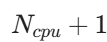。
  * *逻辑：* 防止线程缺页中断导致 CPU 空转。
* **IO 密集型**（业务为主）： 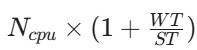。
  * \_逻辑：\_WT 是线程等待时间，ST 是计算时间。因为业务大部分时间在等数据库或接口（WT），所以需要更多线程来压榨 CPU。通常我会先按 **2N** 左右预设。

### 第三步：如何结合压测找到最优值？（实战修正）

**公式只是理论值，生产环境的 $WT$ 是动态变化的。** 所以我必须通过**压测**来寻找真正的‘**性能拐点**’：

1. **手段：** 使用 Jmeter 或 TCPCopy 进行流量回放。
2. **寻找拐点：** 我会不断增加线程数，直到出现以下现象之一：
   * **QPS** 增长曲线趋于平缓。
   * **RT** 开始出现指数级飙升。
   * **CPU** 利用率达到 80% 警戒线。
3. **定值：** 这个拐点就是最佳线程数。我会在此基础上**留 10%~20% 的余量**（Buffer）作为最终配置。

### 第四步：上线后如何应对突发流量？（动态治理）

即使压测过，生产环境依然可能出现不可预知的流量洪峰。为了避免‘改个参数要重启服务’的痛点，我们在架构中引入了‘**动态线程池**’：

* **方案：** 结合 **Nacos** 或 **Apollo** 配置中心。
* **闭环：** 监听配置变更 -> 实时调用 `setCorePoolSize` 热更新 -> 结合 Prometheus 监控告警自动扩容。这才是生产环境的终极解决方案。”

## 二、 运行原理深度解析（Talk is cheap）

### 1. 为什么说它是“流量漏斗”？

**Look at me!** 面试时，你要在白板上画出这个执行顺序，告诉面试官你懂**优先级**：

```java
// 假设配置：Core=10, Max=20, Queue=100
ThreadPoolExecutor pool = new ThreadPoolExecutor(
    10,  // 1. 正式员工（常驻）
    20,  // 3. 临时工（救急）
    60L, TimeUnit.SECONDS,
    new ArrayBlockingQueue<>(100), // 2. 候客区（缓冲）
    new ThreadPoolExecutor.CallerRunsPolicy() // 4. 兜底策略
);
```

**性能崩塌的三个阶段：**

* **阶段一（平稳）：** 任务  10 且  110。Queue 满了，开始创建临时线程（Max）。
  * *痛点：***CPU 飙升**。如果 Max 设置过大，上下文切换会导致吞吐量反而下降。

### 2. 动态线程池的代码实现（核心展示）

如果面试官问：“动态调整真的不需要重启吗？”

你可以直接甩出这两行底层源码，证明这是 JDK 原生支持的，绝对安全：

```java
// Spring Boot 监听 Nacos 配置变化的回调
@NacosConfigListener(dataId = "thread-pool-config", timeout = 500)
public void onMessage(String configInfo) {
Properties props = parse(configInfo);
int newCore = Integer.parseInt(props.getProperty("coreSize"));

// 【核心】：JDK 允许运行时动态修改核心线程数
threadPoolExecutor.setCorePoolSize(newCore);
// 修改最大线程数
threadPoolExecutor.setMaximumPoolSize(newMax);

log.info("线程池参数热更新完成！Core: {}", newCore);
}
```

***

## 三、 Fox的避坑指南

最后，给面试官补一个“**生产事故**”级别的细节，展示你的实战经验。

Fox版解析：**拒绝策略的坑**

“面试官，除了参数，RejectPolicy（拒绝策略） 也会极大影响系统稳定性。

JDK 默认的 AbortPolicy 会抛异常，这还好。

最坑的是 CallerRunsPolicy（调用者运行）：

很多同学觉得它好，因为‘不丢任务’。

* **现象：** 线程池满了，任务退回给主线程（比如 Tomcat 的 HTTP 线程）去执行。
* **后果：** 这会导致 Tomcat 线程被耗尽，无法接收新的 HTTP 请求。
* **结局：** 整个服务对外不可用（假死）。这就是所谓的**反压（Backpressure）效应**扩散。
* **建议：** 核心业务宁可抛异常降级，也不要阻塞主路；或者使用自定义策略，将溢出任务持久化到 MQ 中后续处理。”

拓展视频：

[接口响应时间 500ms，要扛 1 万 QPS，线程池怎么设计？需要多少台机器？](https://open.douyin.com/player/video?vid=7563920089968299264\&autoplay=0)

[京东二面：线程池参数怎么配？别再背N+1了 ](https://open.douyin.com/player/video?vid=7585495772792114447\&autoplay=0)


# 线程池的底层工作原理

**面试官：** 请讲一下线程池的底层工作原理。

**Fox的标准回答：** “线程池的底层工作原理，本质上是**生产者-消费者模型**的实现，主要由 `ThreadPoolExecutor` 类完成。它的核心原理可以概括为两部分：**任务流转机制**和**线程复用机制**。

**1. 宏观上的任务流转机制（4步走）：** 当调用 `execute()` 提交一个任务时：

* **第一步（查核心）：** 判断当前工作线程数是否小于 `corePoolSize`。如果小于，直接创建一个新的**核心线程**来执行任务（需要获取全局锁）。
* **第二步（进队列）：** 如果核心线程满了，线程池会尝试把任务放入 `workQueue`**阻塞队列**中等待。这是为了复用已有线程，避免频繁创建销毁。
* **第三步（扩容）：** 如果队列满了（offer失败），判断当前线程数是否小于 `maximumPoolSize`。如果小于，则创建**非核心线程**来执行这个新提交的任务（注意：是执行新任务，不是队列里的）。
* **第四步（拒绝）：** 如果队列满且线程数达到最大值，执行 `RejectedExecutionHandler`**拒绝策略**（默认抛出 AbortPolicy 异常）。

**2. 微观上的线程复用机制（Worker Loop）：** 线程池里的线程被封装成了 `Worker` 对象。线程之所以能复用，是因为 `Worker` 启动后进入了一个**死循环（While Loop）**。

* 它不断地调用 `getTask()` 方法从阻塞队列中获取任务。
* 如果队列为空，核心线程会调用 `take()` 方法**阻塞挂起**（不会占用CPU，也不会销毁）；
* 非核心线程会调用 `poll(time)` 进行**超时等待**。如果在 `keepAliveTime` 内没拿到任务，循环结束，线程销毁。 这就实现了线程的动态伸缩和复用。”

### 二、 核心源码解析（手写伪代码）

面试时，如果在白板或纸上写出这两个核心方法的伪代码，杀伤力极大。

#### 1. 任务提交逻辑 (`execute` 方法精简版)

```java
public void execute(Runnable command) {
if (command == null) throw new NullPointerException();

int c = ctl.get(); // ctl 是一个原子整数，高3位存状态，低29位存线程数

// 1. 如果当前线程数  核心数)
        boolean timed = allowCoreThreadTimeOut || wc > corePoolSize;

        try {
            // 核心线程调用 take() 死等
            // 非核心线程调用 poll() 超时等待
            Runnable r = timed ?
            workQueue.poll(keepAliveTime, TimeUnit.NANOSECONDS) :
            workQueue.take();

            if (r != null) return r;

            // 如果 r == null，说明超时了，设置标志位，下次循环会让线程结束
            timedOut = true;
        } catch (InterruptedException retry) {
            timedOut = false;
        }
    }
}
```

### 三、 Fox的解析（面试避坑指南）

作为面试官，我听过几百遍这个回答，以下几点是拉开差距的关键：

1. **关于顺序的误区：** 千万不要说“先创建核心，再创建非核心，最后放队列”。这是完全错误的！ **必须强调：** 是先尝试放队列，队列满了，**为了救火**，才去创建非核心线程。 *话术钩子：* “之所以先放队列，是为了最大限度复用已有资源，减少上下文切换。只有扛不住了才扩容。”
2. **关于线程状态：** 很多候选人不知道线程怎么“保活”。 **必须强调：** 线程没有神奇的“暂停键”，它是利用了 `BlockingQueue` 的**阻塞特性** (`take`方法) 让 CPU 挂起当前线程，从而实现的“保活”。
3. **关于 ****ctl**** 变量（加分项）：** 如果你能提到 `ctl` 这个 `AtomicInteger` 变量（高3位存运行状态 `RUNNING/SHUTDOWN`，低29位存线程数量），面试官会认为你真读过源码，而不是背的面经。


# 什么是阻塞队列以及应用场景

阻塞队列（BlockingQueue）是一个支持线程安全的队列接口，它的实现类提供了在插入和移除元素时进行阻塞的功能。它可以自动管理生产者和消费者之间的同步，适用于多线程编程中需要安全和高效的数据共享场合。

### 阻塞队列应用场景

1. **生产者-消费者模型**：\ 在生产者-消费者模型中，生产者线程生成数据并放入队列，消费者线程从队列中取出数据进行处理。阻塞队列的自动阻塞机制使得它能够简单高效地实现生产者-消费者模型。

**代码示例**：

```java
import java.util.concurrent.ArrayBlockingQueue;
import java.util.concurrent.BlockingQueue;

public class ProducerConsumerExample {
    public static void main(String[] args) {
        BlockingQueue queue = new ArrayBlockingQueue<>(5);

        // 生产者线程
        Thread producer = new Thread(() -> {
            try {
                for (int i = 0; i  {
            try {
                for (int i = 0; i ThreadPoolExecutor使用阻塞队列来管理提交但未被执行的任务。

**代码示例**：

```java
import java.util.concurrent.ArrayBlockingQueue;
import java.util.concurrent.ThreadPoolExecutor;
import java.util.concurrent.TimeUnit;

public class ThreadPoolExample {
    public static void main(String[] args) {
        BlockingQueue queue = new ArrayBlockingQueue<>(10);

        ThreadPoolExecutor executor = new ThreadPoolExecutor(
            2, // core thread pool size
            4, // maximum thread pool size
            1, // time to wait before resizing pool
            TimeUnit.SECONDS,
            queue
        );

        for (int i = 0; i  {
                System.out.println("Executing task: " + taskNum);
                try {
                    Thread.sleep(2000); // Simulating task
                } catch (InterruptedException e) {
                    Thread.currentThread().interrupt();
                }
            });
        }
        executor.shutdown();  // Initiates an orderly shutdown
    }
}
```

3. **实时数据处理系统**：\ 在需要处理实时流数据的系统中，阻塞队列可以用于在数据生成模块和数据处理模块之间传递数据，确保数据以正确的顺序被处理，并且不会因过快的生产速度导致数据丢失。

**代码示例**：

```java
import java.util.concurrent.LinkedBlockingQueue;

public class RealTimeDataProcessing {
    private static final int NUM_OF_DATA = 50;
    private static final LinkedBlockingQueue dataQueue = new LinkedBlockingQueue<>();

    public static void main(String[] args) {
        // 数据生产者线程
        Thread producer = new Thread(() -> {
            for (int i = 0; i  {
            while (true) {
                try {
                    String data = dataQueue.take();
                    System.out.println("Processed: " + data);
                } catch (InterruptedException e) {
                    Thread.currentThread().interrupt();
                    break;
                }
            }
        });

        producer.start();
        consumer.start();
    }
}
```

### 结论

阻塞队列在多线程环境中提供了非常强大且灵活的工具来管理线程间的数据共享与通信。通过自动同步和阻塞，它能合理控制生产与消费节奏，避免死锁和数据丢失，是实现多线程程序的优秀工具。


# Java死锁问题如何解决

在Java中，死锁是一种阻塞现象，发生在两个或多个线程相互持有对方所需的资源，从而导致线程无法继续执行。当线程陷入死锁状态时，就无法释放它们持有的资源，因为它们在等待其他线程释放其持有的资源。死锁的四个必要条件是：

1. **互斥条件**：资源不能被多个线程共享。
2. **持有和等待**：线程已经持有至少一个资源并等待获取另外的资源。
3. **不剥夺条件**：资源不能从持有它的线程中剥夺，必须由线程自行释放。
4. **循环等待条件**：存在一个线程循环等待链，链中的每个线程都等待下一个线程所持有的资源。

### 示例代码造成死锁

下面是一个简单的造成死锁的Java代码示例：

```java
public class DeadlockExample {

    private static class Resource {
        private final String name;

        public Resource(String name) {
            this.name = name;
        }

        public String getName() {
            return name;
        }
    }

    private static final Resource resource1 = new Resource("Resource1");
    private static final Resource resource2 = new Resource("Resource2");

    public static void main(String[] args) {
        Thread thread1 = new Thread(() -> {
            synchronized (resource1) {
                System.out.println("Thread 1: locked " + resource1.getName());

                try { Thread.sleep(100); } catch (InterruptedException e) {}

                synchronized (resource2) {
                    System.out.println("Thread 1: locked " + resource2.getName());
                }
            }
        });

        Thread thread2 = new Thread(() -> {
            synchronized (resource2) {
                System.out.println("Thread 2: locked " + resource2.getName());

                try { Thread.sleep(100); } catch (InterruptedException e) {}

                synchronized (resource1) {
                    System.out.println("Thread 2: locked " + resource1.getName());
                }
            }
        });

        thread1.start();
        thread2.start();
    }
}
```

在这个示例中，thread1首先锁定resource1然后尝试锁定resource2。同时，thread2锁定resource2后尝试锁定resource1。由于两个线程都在相互等待对方释放资源，因此会形成死锁。

### 检测死锁

1. **线程转储分析**：可以通过JVM工具如jstack获取线程转储来识别死锁。线程转储会展示所有线程的状态以及所有锁的持有情况。
2. **使用JVisualVM/JConsole**：这些工具可以实时监控JVM状态，并且会自动检测和报告死锁。

### 预防死锁

1. **资源排序（Resource Ordering）**：避免循环等待，可以提前规定资源获取的顺序。所有线程在锁定资源时，必须按预定顺序加锁。

```java
private void acquireResourcesInOrder() {
    synchronized (resource1) {
        synchronized (resource2) {
            // Perform operations
        }
    }
}
```

2. **尝试锁定（Try-Lock）**：使用tryLock()方法非阻塞地获取锁。可以设置超时时间来避免死锁。

```java
ReentrantLock lock1 = new ReentrantLock();
ReentrantLock lock2 = new ReentrantLock();

public void safeMethod() {
    try {
        if (lock1.tryLock(100, TimeUnit.MILLISECONDS)) {
            try {
                if (lock2.tryLock(100, TimeUnit.MILLISECONDS)) {
                    try {
                        // Perform operations
                    } finally {
                        lock2.unlock();
                    }
                }
            } finally {
                lock1.unlock();
            }
        }
    } catch (InterruptedException e) {
        e.printStackTrace();
    }
}
```

通过适当的设计和策略，死锁是可以预防和管理的，特别是在复杂应用程序多线程编程环境中。


# 说下CAS的实现与原理

CAS（Compare-And-Swap）是一种用于多线程编程中的原子操作，它通过硬件支持的指令来实现无锁同步。在多线程环境下，CAS操作通过比较和交换来更新变量的值，是一种乐观锁的实现方式，可以避免锁机制带来的开销。

### CAS工作原理

CAS操作涉及三个操作数：

1. **内存位置V**：需要修改的变量的内存地址。
2. **预期值A**：期望变量当前持有的值。
3. **新值B**：需要更新到变量的新值。

CAS工作过程如下：

* 比较内存位置V的当前值是否等于预期值A。
* 如果是，则用新值B更新内存位置中的值。
* 如果不是，则不更新值，并返回当前实际值。

这个操作是原子的，硬件保证比较并更新的操作不会被中断。

### CAS在Java中的实现

在Java中，CAS操作主要通过java.util.concurrent.atomic包中的类来实现。例如，AtomicInteger、AtomicBoolean、AtomicReference等。通过这些类的操作，Java应用可以在多线程环境下安全地对基本数据类型进行操作，而无需显式锁定。

#### 示例：使用 AtomicInteger

AtomicInteger类提供了以原子方式更新int型变量的方法，其中compareAndSet是CAS操作实现的核心方法。

```java
import java.util.concurrent.atomic.AtomicInteger;

public class CASExample {
    private AtomicInteger atomicInteger = new AtomicInteger(0);

    public void increment() {
        int expectedValue;
        int newValue;
        do {
            expectedValue = atomicInteger.get(); // 获取当前值
            newValue = expectedValue + 1;        // 计算新值
        } while (!atomicInteger.compareAndSet(expectedValue, newValue)); // CAS操作
    }

    public int getValue() {
        return atomicInteger.get();
    }

    public static void main(String[] args) {
        CASExample example = new CASExample();
        example.increment();
        System.out.println("Value after increment: " + example.getValue());
    }
}
```

在这个示例中，increment方法尝试获取当前值、计算新值并使用compareAndSet方法进行更新。compareAndSet返回true表示更新成功，返回false表示需要重试。

### 优势与考虑

* **无锁机制**：CAS允许许多线程尝试更新同一个变量，而无需锁定，大大减小了锁竞争。
* **性能提升**：在无锁的情况下，通常会有更好的性能表现，适合高并发场景。
* **ABA问题**：CAS无法直接解决ABA问题（一个值从A变到B，又变回A），可以使用带版本号的变量如AtomicStampedReference来解决这个问题。
* **活锁**：在高争用环境下，如果许多线程不断重试更新操作，可能会导致活锁，程序一直循环重试而得不到进展。

CAS是实现乐观并发控制的基础技术，它在Java的并发编程中起着非常重要的作用，尤其是在实现无锁算法时。通过适当使用CAS，可以在保证线程安全的同时，减少锁竞争，提高程序性能。


# Java中如何安全地停止线程

在Java中，安全地停止线程通常涉及通过标志位来指示线程应该停止执行，而不是使用诸如Thread.stop()之类的过时且不安全的方法。直接强制终止线程可能会导致资源泄露或数据库状态不一致等问题。

### 使用标志位停止线程

1. **InterruptedException**：对于阻塞操作，使用线程的中断机制。
2. **标志位（Volatile）**：对于正在执行的非阻塞任务，可以使用一个volatile类型的布尔标志。

以下是使用标志位和中断机制停止线程的示例：

#### 示例代码

```java
public class SafeThreadStop {
    private static class WorkerThread extends Thread {
        // 使用volatile关键字，保证多线程情况下的可见性
        private volatile boolean running = true;

        @Override
        public void run() {
            System.out.println("WorkerThread is running.");
            try {
                while (running && !Thread.currentThread().isInterrupted()) {
                    // 模拟工作
                    System.out.println("Working...");
                    Thread.sleep(1000); // 模拟阻塞操作
                }
            } catch (InterruptedException e) {
                // 如果线程被中断，则退出循环
                System.out.println("WorkerThread interrupted.");
            } finally {
                cleanUp();
            }
        }

        public void stopThread() {
            running = false; // 设置标志位为false
            interrupt();     // 中断线程以退出阻塞状态
        }

        // 清理工作，确保资源释放等
        private void cleanUp() {
            System.out.println("Cleaning up resources...");
        }
    }

    public static void main(String[] args) throws InterruptedException {
        WorkerThread worker = new WorkerThread();
        worker.start();

        // 运行5秒后请求停止 WorkerThread
        Thread.sleep(5000);
        worker.stopThread();
        System.out.println("Requested to stop the WorkerThread.");

        worker.join(); // 等待线程结束
        System.out.println("WorkerThread has stopped.");
    }
}
```

### 关键点

1. **Volatile变量**：
   * running标志被声明为volatile，确保线程间的可见性，使得主线程修改running标志后，WorkerThread能够及时看到变化。
2. **线程中断**：
   * 调用interrupt()方法可以使线程从阻塞操作（如sleep()、wait()等）中被中断跳出。
   * 在执行长时间任务的循环中，也应该定期检查Thread.currentThread().isInterrupted()状态以退出循环。
3. **清理操作**：
   * 在可能终止的操作中包含一个finally块，用于处理任何必要的清理工作（释放资源等）。
4. **安全停止**：
   * 最大限度地减少资源泄露和不一致性的风险，通过设置标志位与中断线程相结合，有序地、安全地终止线程操作。

上述方法有效地结合了标志位与线程中断，显式控制线程的生命周期，实现了对线程的安全停止。


# Synchronized与ReentrantLock的区别

### 一、 标准面试回答模版（建议背诵）

**面试官：** Synchronized与ReentrantLock有什么区别？

**Fox版标准回答：**

“它们都是Java中实现线程同步的机制，都具有**互斥性**和**可重入性**。但它们的区别主要体现在**层面、用法、功能和底层实现**四个维度：

1. **层面不同**：
   * `synchronized` 是 **JVM 层面**的关键字，是内置的语言特性，由 JVM 负责实现。
   * `ReentrantLock` 是 **JDK API 层面**的类（JUC包下），是基于 Java 代码实现的。
2. **用法不同（关键点）**：
   * `synchronized` 是**自动挡**：进入同步块加锁，出了同步块（或异常）自动释放锁，开发者不需要手动操作。
   * `ReentrantLock` 是**手动挡**：需要手动调用 `lock()` 加锁，且**必须**在 `finally` 块中调用 `unlock()` 释放锁，否则容易导致死锁。
3. **功能丰富度不同（核心加分项）**：
   * `ReentrantLock` 比 `synchronized` 多了三个高级功能：
     * **等待可中断**：`lockInterruptibly()` 可以响应中断，不想等了可以取消。
     * **公平锁支持**：构造函数传 `true` 可实现公平锁（先来后到），`synchronized` 只能是非公平锁。
     * **多条件绑定**：通过 `Condition` 可以实现分组唤醒（如 `notEmpty.signal()`），而 `synchronized` 只有一个 `wait/notify` 队列，要么全醒，要么随机醒一个。
4. **底层实现不同**：
   * `synchronized` 底层基于对象头（Mark Word）和 **Monitor（监视器锁）**，JDK 1.6 后引入了偏向锁、轻量级锁的锁升级机制。
   * `ReentrantLock` 底层基于 **AQS（抽象队列同步器）** 和 **CAS** 操作来实现。”

### 二、 代码层面对比（Talk is cheap, show me the code）

面试时，如果你能在白板上写出这两段代码的对比，尤其是 `ReentrantLock` 的 `finally` 块，非常加分。

#### 1. Synchronized（傻瓜式）

JVM 帮你搞定了一切（异常处理、锁释放）。

```java
// 方式一：修饰方法
public synchronized void syncMethod() {
    // 业务逻辑
}

// 方式二：修饰代码块
public void syncBlock() {
    Object lock = new Object();
    synchronized (lock) {
        // 自动加锁
        try {
            // 业务逻辑
        } catch (Exception e) {
            e.printStackTrace();
        }
        // 执行完或抛异常，JVM自动释放锁
    }
}
```

#### 2. ReentrantLock（精细控制）

**Look at me!** 这里有个巨大的坑：`unlock()`**必须**放在 `finally` 里，且 `lock()` 建议放在 `try` 之前。

```java
import java.util.concurrent.locks.ReentrantLock;

public class LockDemo {
    // 定义锁对象
    private final ReentrantLock lock = new ReentrantLock();
    // private final ReentrantLock fairLock = new ReentrantLock(true); // 公平锁

    public void doSomething() {
        // 1. 手动加锁
        lock.lock();
        try {
            // 2. 业务逻辑
            System.out.println("线程抢到了锁");

            // 高级功能示例：尝试获取锁，不等就走
            // if (lock.tryLock()) { ... }

        } catch (Exception e) {
            e.printStackTrace();
        } finally {
            // 3. 【绝对重点】必须手动释放锁，否则死锁！
            lock.unlock();
        }
    }
}
```

***

### 三、 底层原理深挖

如果面试官追问：“它们底层到底是怎么卡住线程的？”这时候你要抛出这两个核心概念。

#### 1. Synchronized 的底层：ObjectMonitor

* **依赖对象**：每个 Java 对象头里都有个 Mark Word，指向一个 C++ 实现的 `ObjectMonitor`。
* **核心结构**：
  * `_owner`：指向持有锁的线程。
  * `_EntryList`：阻塞队列（竞争锁失败的线程去这里排队）。
  * `_WaitSet`：等待队列（调用 `wait()` 后线程去这里休息）。
* **机制**：依赖操作系统的 `Mutex Lock`（互斥量），这也是为什么 JDK 1.6 之前它比较重（涉及到用户态和内核态切换）的原因。

#### 2. ReentrantLock 的底层：AQS (AbstractQueuedSynchronizer)

* **依赖代码**：纯 Java 实现，不完全依赖操作系统。
* **核心结构**：
  * `state`：一个 `volatile int` 变量。0 代表无锁，1 代表有锁，>1 代表重入次数。
  * `CLH 队列`：一个双向链表，存着所有排队的线程。
* **机制**：
  * 抢锁：用 **CAS** (Compare And Swap) 尝试把 `state` 从 0 改成 1。改成功了就拿到锁。
  * 排队：改失败了，就自己封装成节点入队，然后调用 `LockSupport.park()` 挂起自己。

### 四、 总结（一句话定胜负）

**面试官：** 那我在项目中该怎么选？

**回答：**

“在并发竞争不激烈，且不需要高级功能（如公平锁、中断响应）时，\*\*首选 \*\***synchronized**，因为它是 JVM 原生支持的，代码更简洁，且 JDK 1.6 之后引入了锁升级，性能和 `ReentrantLock` 差不多。

只有当我们需要**精细化控制**（比如尝试加锁 `tryLock`、需要公平锁、或者需要 `Condition` 实现复杂的生产消费模型）时，才使用 `ReentrantLock`。”


# 线程调用2次start会怎样

**各种各样****五花八门的面试****题让你****防不胜防****！     今天一个5年经验的小伙伴去面试被问到：**

**线程调用2次start****会怎样，  直接就没答上来， ****这没做过啊****！ ****谁有事没事调用2次start()****。**

****

我们知道 ， 虽然很多八股文面试题中说**Java创建线程的方式有3种、4种，或者更多种**，但实际上他们**底层都是new Thread()**

那当**创建完一个Thread**，这时线程处于**NEW状态**，那这时**调用start()**方法，会让线程**进入到RUNNABLE状态**。

那如果在**RUNNABLE的线程再次调用start呢****？其实就会** **线程状态的异常**。

那面试官接着问， **为什么会报错呢**？ 这个时候很多人**想楱面试官**，  其实没什么这么多为什么，   就是底层源码在**调用start()**方法的时候** **针对状态**做了判断**， 如果**不是NEW状态就会**报线程状态的**异常**。

那面试官接着继续问！   如果**线程执行完，再调用一次start**又会怎么样**？  那**线程**运行完会进入TERMINATED**状态**！   也不是NEW状态！ ****所以肯定也是报错啊！**

所以这个面试题说白了就是**另一种线程状态的考核方式**， 你要知道**线程有几种状态**， 只要知道线程只能是**刚NEW 出来的才可以start()**;   记住了没有！


# 说下Fork_Join框架，与传统线程池有何不同

### 一、 标准面试回答模版（建议背诵）

**面试官：** 说下 Fork/Join 框架，它和传统线程池有什么区别？

**Fox版标准回答：**

“Fork/Join 框架是 Java 7 引入的，专门用于处理**CPU密集型**任务的并行计算框架。它的核心思想是 **‘分而治之’ (Divide and Conquer)**：把一个大任务拆（Fork）成多个小任务并行执行，最后再把结果合并（Join）。

它与传统线程池（`ThreadPoolExecutor`）最大的区别在于两点：

1. **任务队列的设计不同**：
   * 传统线程池共享一个阻塞队列（WorkQueue），所有线程去抢这一个队列里的任务，存在竞争。
   * Fork/Join 框架中，**每个工作线程都有自己独立的双端队列（Deque）**。
2. **工作窃取算法（Work-Stealing）—— 这是核心！**
   * 在 Fork/Join 中，当一个线程把自己队列里的任务干完了，它不会闲着，而是会去**窃取（Steal）其他繁忙线程队列队尾**的任务来执行。
   * 这极大利用了 CPU 资源，减少了线程空闲时间，并且由于窃取的是队尾，正常线程操作队头，大大减少了锁竞争。”

### 二、 代码层面对比（Talk is cheap）

面试时，手写一个简单的 **Fork/Join 累加求和** 例子，最能说明“分而治之”的逻辑。

```java
import java.util.concurrent.RecursiveTask;
import java.util.concurrent.ForkJoinPool;

// 1. 继承 RecursiveTask (有返回值) 或 RecursiveAction (无返回值)
public class ForkJoinDemo extends RecursiveTask {

    private long start;
    private long end;
    // 阈值：决定任务什么时候不再拆分
    private static final long THRESHOLD = 10000;

    public ForkJoinDemo(long start, long end) {
        this.start = start;
        this.end = end;
    }

    @Override
    protected Long compute() {
        long length = end - start;

        // A. 如果任务足够小，直接计算（Base Case）
        if (length **ThreadPoolExecutor****！**”


# JAVA中怎样唤醒一个阻塞的线程

### 一、 标准面试回答模版（建议背诵）

**面试官：** Java 中怎样唤醒一个阻塞的线程？

**Fox版标准回答：**

“唤醒一个阻塞的线程，必须先看它是**怎么被阻塞的**。主要有三种场景，对应三种不同的唤醒方式：

1. **因 ****Object.wait()**** 而阻塞（WAITING）：**
   * **手段**：必须由另一个线程在**同一个对象锁**上调用 `notify()` 或 `notifyAll()` 方法。
   * **结果**：线程会从等待队列（Wait Set）移动到同步队列（Entry List），也就是从 WAITING 变为 BLOCKED 状态，准备抢锁。
2. **因 ****LockSupport.park()**** 而阻塞（WAITING/TIMED\_WAITING）：**
   * **手段**：这是 JUC 锁（如 ReentrantLock）底层的机制。需要调用 `LockSupport.unpark(thread)`。
   * **结果**：线程会直接从挂起状态恢复运行，**不需要**持有 Monitor 锁。
3. **因 ****sleep()****, ****join()**** 或 ****wait()**** 而阻塞（中断唤醒）：**
   * **手段**：调用该线程对象的 `interrupt()` 方法。
   * **结果**：目标线程会抛出 `InterruptedException` 异常，从而‘被迫’醒来（结束阻塞状态）。

**避坑补充**：如果是因争抢 `synchronized` 锁失败而进入 **BLOCKED** 状态的线程，是**无法**被显式唤醒的（连 `interrupt` 都没用）。它只能被动等待持有锁的线程释放锁。”

### 二、 代码层面对比（Talk is cheap）

面试时，展示这三种最典型的唤醒方式。

#### 1. 经典方式：wait / notify

这是基于 JVM 内置 Monitor 机制的。

```java
public class WaitNotifyDemo {
    private static final Object lock = new Object();

    public static void main(String[] args) throws InterruptedException {
        Thread t1 = new Thread(() -> {
            synchronized (lock) {
                try {
                    System.out.println("T1: 我先睡了 (wait)...");
                    lock.wait(); // 释放锁，进入 WAITING
                } catch (InterruptedException e) { e.printStackTrace(); }
                System.out.println("T1: 谁叫醒了我？(Resumed)");
            }
        });
        t1.start();

        Thread.sleep(100); // 保证 T1 先 wait

        new Thread(() -> {
            synchronized (lock) {
                System.out.println("T2: 我来叫醒你 (notify)...");
                lock.notify(); // 唤醒 T1
            }
        }).start();
    }
}
```

#### 2. JUC 方式：LockSupport (park / unpark)

这是 Java 并发包（AQS）的基石，更灵活，**不需要在同步块中调用**。

```java
import java.util.concurrent.locks.LockSupport;

public class ParkUnparkDemo {
    public static void main(String[] args) throws InterruptedException {
        Thread t1 = new Thread(() -> {
            System.out.println("T1: 我被挂起了 (park)...");
            LockSupport.park(); // 阻塞当前线程
            System.out.println("T1: 我被放行了 (unpark)!");
        });
        t1.start();

        Thread.sleep(100);

        System.out.println("Main: 发放通行证 (unpark)...");
        // 【优势】直接指定唤醒某个线程，不需要拿锁
        LockSupport.unpark(t1);
    }
}
```

#### 3. 暴力方式：Interrupt (中断异常)

适用于想要**终止**或**打断**长时间等待的场景。

```java
public class InterruptDemo {
    public static void main(String[] args) throws InterruptedException {
        Thread t1 = new Thread(() -> {
            try {
                System.out.println("T1: 准备睡 10 秒...");
                Thread.sleep(10000);
            } catch (InterruptedException e) {
                System.out.println("T1: 哎呀！被中断异常叫醒了！");
            }
        });
        t1.start();

        Thread.sleep(100);
        System.out.println("Main: 别睡了，起来嗨！(interrupt)");
        t1.interrupt(); // 抛出异常唤醒
    }
}
```

### 三、 Fox的深度解析

如果面试官追问：**“为什么不推荐使用 ****Thread.stop()**** 来强行唤醒/停止线程？”**

**Fox版回答：**

“`stop()` 是被**废弃（Deprecated）的方法，它太暴力了。 就像电脑直接拔电源一样，它会立即释放**线程持有的所有锁，导致数据可能只写了一半，破坏了**数据的一致性**。

现在的标准做法是利用 **中断机制（Interrupt）**。 `interrupt()` 只是给线程打个招呼（设置标志位），至于线程是想立马停下，还是处理完手头工作再停下，控制权在**线程自己**手里（通过 catch 异常或检查 `isInterrupted`）。这叫‘**优雅停机**’。”


# 死锁与活锁，死锁与饥饿的区别

### 一、 标准面试回答模版（建议背诵）

**面试官：** 请说一下死锁、活锁、饥饿的区别。

**Fox版标准回答：**

“这三种都是多线程活跃性问题，但表现形式完全不同。

**1. 死锁 (Deadlock) vs 活锁 (Livelock)**

* **状态不同**：
  * **死锁**是‘大家都动不了’。线程处于 **BLOCKED / WAITING** 状态，无法继续执行。
  * **活锁**是‘大家都在动，但谁也推不动’。线程一直处于 **RUNNABLE** 状态，一直在做任务（比如重试），但进度一直为 0。
* **CPU 表现（关键区别）**：
  * **死锁**通常会导致 CPU 利用率**归零**（因为线程都挂起了）。
  * **活锁**通常会导致 CPU 利用率**飙升**（因为线程在疯狂空转重试）。
* **形象比喻**：
  * **死锁**：两辆车在单行道相遇，互不相让，都熄火停车，谁也过不去。
  * **活锁**：两个人在走廊相遇，A 往左躲，B 也往左躲；A 往右，B 也往右。两人都在动，都在‘礼让’，但谁也过不去。

**2. 死锁 (Deadlock) vs 饥饿 (Starvation)**

* **产生原因不同**：
  * **死锁**是基于**资源互斥**和**循环等待**，是‘互相卡死’。
  * **饥饿**是基于**调度策略不公**。比如线程优先级过低，或者非公平锁导致某个线程一直抢不到锁。
* **结果不同**：
  * **死锁**是必然没救了，必须人工干预（重启或 kill）。
  * **饥饿**是有几率恢复的，只要高优先级的任务执行完了，饿着的线程终究有机会吃上一口（虽然机会渺茫）。
* **形象比喻**：
  * **饥饿**：你在自助餐厅排队，但是总有 VIP 插队。你一直站在那等，虽然没死，但一直吃不上饭。”

### 二、 代码层面对比

#### 1. 死锁（Deadlock）

最经典的“互相持有对方需要的锁”。

```java
public class DeadlockDemo {
    private static final Object lockA = new Object();
    private static final Object lockB = new Object();

    public static void main(String[] args) {
        new Thread(() -> {
            synchronized (lockA) {
                System.out.println("A拿到锁A，想要锁B");
                try { Thread.sleep(100); } catch (Exception e) {} // 模拟耗时，让B有机会拿锁
                synchronized (lockB) {
                    System.out.println("A拿到锁B");
                }
            }
        }).start();

        new Thread(() -> {
            synchronized (lockB) {
                System.out.println("B拿到锁B，想要锁A");
                try { Thread.sleep(100); } catch (Exception e) {}
                synchronized (lockA) { // 这里卡死
                    System.out.println("B拿到锁A");
                }
            }
        }).start();
    }
}
```

#### 2. 活锁（Livelock）

两个线程互相“谦让”，导致谁也干不成活。 **场景：** 两个人吃饭，只有一双筷子。A 拿到左边，B 拿到右边。A 发现 B 也要吃，就把左边放下；B 发现 A 也要吃，也把右边放下。然后两人又同时拿起……无限循环。

```java
public class LivelockDemo {
    static class Diner {
        private boolean isHungry = true;

        public void eatWith(Diner spouse, Object lock) {
            while (isHungry) {
                synchronized (lock) {
                    if (spouse.isHungry) {
                        System.out.println("你先吃...");
                        try { lock.wait(100); } catch (InterruptedException e) {} // 让出资源
                        continue; // 【关键点】：放弃当前操作，重新重试 -> 导致活锁
                    }
                    // 实际吃饭逻辑（永远到不了这里）
                    isHungry = false;
                }
            }
        }
    }
    // 代码简化示意，核心在于：获取资源失败 -> 主动回滚 -> 立即重试 -> 再次冲突
}
```

***

### 三、 Fox的实战必杀技（生产环境怎么排查）

面试官如果问：**“生产环境怎么判断是死锁还是活锁？”**

**Fox版回答：**

“Look at me! 别只看代码，要看监控！

1. **排查死锁**：
   * 直接用命令 `jstack `。
   * JVM 会非常贴心地在最后直接打印 `Found one Java-level deadlock`，并把哪些线程互相卡住了列得明明白白。
2. **排查活锁**：
   * `jstack` 是看不出来的，因为它没有 BLOCKED。
   * 你要结合 **CPU 监控** (`top -H -p `)。
   * 如果你发现几个线程的 CPU 占用率常年 **100%**，但日志又不更新，业务进度不走，大概率就是活锁（在做无意义的死循环重试）。”


# JDK21中的虚拟线程是怎么回事

JDK 21引入了一个重要的新特性：虚拟线程（Virtual Threads）。虚拟线程是Java的项目Loom的一部分，旨在简化并发编程并提高Java应用程序的可扩展性。以下是关于虚拟线程的一些关键细节：

### 什么是虚拟线程？

* **轻量级线程**：虚拟线程是轻量级的用户模式线程，它们与传统的Java平台线程（也称为内核线程）不同。虚拟线程在JVM中运行，而不是直接映射到操作系统的内核线程。
* **调度和管理**：虚拟线程由JVM调度和管理，而不是依赖于操作系统提供的调度机制。这使得虚拟线程的创建和切换成本非常低。
* **并发模型简化**：因为虚拟线程极其轻量，因此可以创建大量线程，而不需要担心原有平台线程的高开销。这使得以“每个请求一个线程”来处理并发任务变得可行，简化了编程模型。

### 优势

1. **高可扩展性**：可以创建大量的虚拟线程，数百万级别的线程创建和销毁是可行的，从而更好地利用多核处理器的能力。
2. **简化代码**：程序员无需使用复杂的非阻塞编程手法（如回调和Future）来实现并发和并行代码，因为虚拟线程使得以同步风格编写并发程序成为可能。
3. **减少阻塞问题**：在传统线程中，一个线程阻塞会浪费系统资源，而虚拟线程在阻塞时会自动切换到其他正在运行的线程，利用时间片效率。

### 使用示例

使用虚拟线程，您可以像使用普通线程一样，简单地启动和操作它们。以下是一个简单的代码示例：

```java
public class VirtualThreadExample {
    public static void main(String[] args) throws InterruptedException {
        Thread virtualThread = Thread.ofVirtual().start(() -> {
            System.out.println("Hello from virtual thread: " + Thread.currentThread());
        });

        virtualThread.join(); // 等待虚拟线程完成
    }
}
```

### 创建虚拟线程

虚拟线程可以通过Thread.ofVirtual().start()方法启动，API的设计使得使用虚拟线程与现有线程API保持一致，降低了学习成本。

### 适用场景

虚拟线程特别适合IO密集型任务或需要大量并发执行的任务，例如服务器编程场景中处理大量请求，或使用阻塞IO操作的应用程序。

### 对现有代码的影响

虚拟线程的引入不会影响现有的应用程序，因为它们增加了一种并发操作的选择，而不会移除或替换现有的功能。同时，由于它们是轻量级的，迁移到使用虚拟线程通常只需要很少的代码修改。

### 注意事项

1. **性能监控**：虽然虚拟线程相对于传统线程更轻量，但在监控和调试时仍需要注意它们的生命周期，因为它们可能会大规模地被创建和销毁。
2. **库支持**：大部分现有的Java库在使用虚拟线程时无需修改，不过某些需要深度与操作系统线程交互的库可能需要检查兼容性。

虚拟线程为Java引入了一种新的并发编程模型，使编写高并发Java应用程序变得更直观和简单，它极大地提升了Java程序的可扩展性和可维护性。


# 说说你对JMM内存模型的理解

### 一、 标准面试回答模版（建议背诵）

**面试官：** 说说你对 JMM（Java 内存模型）的理解。

**Fox版标准回答：**

“JMM (Java Memory Model) 是 Java 虚拟机规范中定义的一种**抽象概念**（注意：它不是物理存在的），用于屏蔽各种硬件和操作系统的内存访问差异，保证 Java 程序在各种平台下对内存的访问都能达到一致的效果。

它的核心理解包含三个维度：

1. **内存划分（物理架构的映射）：**
   * **主内存（Main Memory）：** 所有变量都存在这里，所有线程共享（对应物理硬件的 RAM）。
   * **工作内存（Working Memory）：** 每个线程私有的。线程不能直接读写主内存的变量，必须先把变量 **Copy** 到自己的工作内存中，操作完后再写回主内存（对应 CPU 的 Cache 和寄存器）。
2. **三大特性（并发编程的灵魂）：**
   * **原子性 (Atomicity)：** 一个操作要么全部执行，要么全不执行。JMM 只能保证基本读取和赋值的原子性，复合操作需要 `synchronized` 或 `Atomic` 类。
   * **可见性 (Visibility)：** 当一个线程修改了共享变量，其他线程能立刻看到。核心实现是 `volatile`、`synchronized` 和 `final`。
   * **有序性 (Ordering)：** 防止编译器和处理器为了优化性能而进行的**指令重排序**。核心实现是 `volatile`（内存屏障）和 `synchronized`。
3. **Happens-Before 原则（先行发生原则）：**
   * 这是 JMM 的**核心保底规则**。如果两个操作满足 Happens-Before 关系（比如 volatile 写先于读、锁释放先于锁获取），则 JVM 保证前一个操作的结果对后一个操作可见，且不进行重排序。这是判断线程安全与否的最主要依据。”

### 二、 图解 JMM 架构

面试时，脑海里一定要有这张图。

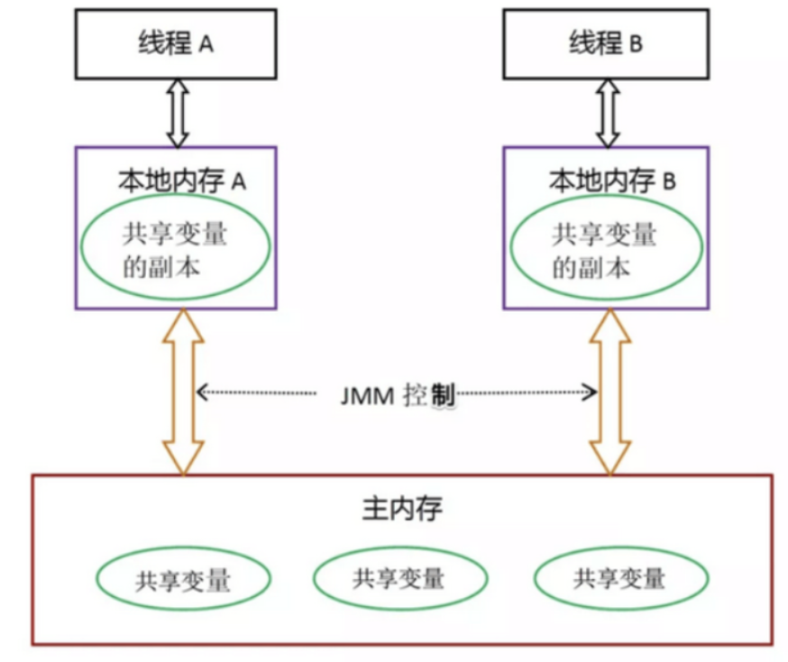

这也是 JMM 存在问题的根源：**工作内存的数据可能和主内存不一致**。

### 三、 代码实战：可见性问题的“照妖镜”

这段代码直接证明了：**如果没有 JMM 的可见性保证，线程会死循环。**

```java
public class JMMVisibilityDemo {

    // 场景：如果不加 volatile，run 线程永远停不下来！
    // 因为它一直在读自己工作内存里的旧值 (false)
    private static boolean flag = true;

    // 正确做法：加上 volatile，保证可见性
    // private static volatile boolean flag = true;

    public static void main(String[] args) throws InterruptedException {

        new Thread(() -> {
            System.out.println("子线程开始运行...");
            // 【死循环陷阱】
            // 这里的 flag，线程会从主内存拷一份到自己的工作内存（Cache）。
            // 如果主线程改了 flag，但没有通知子线程刷新的话，
            // 子线程会一直用缓存里的旧值，导致死循环。
            while (flag) {
                // do nothing
            }
            System.out.println("子线程检测到 flag 变为 false，停止运行！");
        }).start();

        Thread.sleep(1000); // 保证子线程先跑起来

        System.out.println("主线程把 flag 改为 false...");
        flag = false; // 修改共享变量
        // 此时，如果是 volatile 变量，会强制将新值刷回主内存，
        // 并让其他线程的工作内存缓存失效。
    }
}
```

***

### 四、 Fox的深度解析

如果面试官追问：**“JMM 和 JVM 运行时内存区域（堆、栈）是一回事吗？”**

**Fox版回答：**

“**完全不是一回事！** 这是初学者最容易混淆的点。

* **JVM 运行时数据区（Runtime Data Area）：** 讲的是 **Java 程序在内存中是怎么存放的**。比如对象在堆里，局部变量在栈里。这是**物理存储**维度的描述。
* **JMM（Java Memory Model）：** 讲的是 **多线程间怎么通过内存进行通信的**。它是一组**规则**和**协议**。

**对应关系**： JMM 中的**主内存**，大致对应 JVM 的**堆（Heap）中存放对象实例数据部分。 JMM 中的工作内存**，大致对应 \*\*JVM 的虚拟机栈（Stack）\*\*以及底层硬件的 **CPU 寄存器和高速缓存（Cache）**。

所以，一个是‘仓库怎么盖’（JVM内存结构），一个是‘货怎么运’（JMM模型），维度不同。”


# JDK7与JDK8之间HashMap的区别？

## 一、 标准面试回答模版（建议背诵）

**面试官：** JDK 1.7 和 JDK 1.8 中的 HashMap 有什么区别？

**Fox版标准回答：**

“HashMap 在 JDK 1.8 做了一次彻底的重构，核心区别主要体现在**底层数据结构**、**插入方式**和**扩容机制**三个方面：

1. **底层数据结构：**
   * **JDK 1.7：**`数组 + 链表`。无论链表多长，都一直遍历，极端情况下查询性能退化为 $O(n)$。
   * **JDK 1.8：**`数组 + 链表 + 红黑树`。当链表长度超过 8（且数组长度大于 64）时，链表会强制转为红黑树，将查询性能从 $O(n)$ 提升到 $O(\log n)$，解决哈希冲突导致的性能衰减问题。
2. **插入数据的操作：**
   * **JDK 1.7：** 采用**头插法**（Head Insertion）。新来的节点插在链表头部。
   * **JDK 1.8：** 采用**尾插法**（Tail Insertion）。新来的节点插在链表尾部。
   * **原因：** 1.7 的头插法在多线程扩容时会导致\*\*‘死循环’\*\*（环形链表）问题，1.8 改为尾插法解决了这个问题（但仍不保证线程安全）。
3. **扩容（Resize）时的计算：**
   * **JDK 1.7：** 需要对每个元素**重新计算哈希值**，再取模算出新下标，效率较低。
   * **JDK 1.8：** 采用**高低位算法**。不需要重新算哈希值，只需要判断 Hash 值新增的那一位是 0 还是 1，要么索引不变，要么索引 = 原索引 + 原数组长度。效率极大提升。”

## 二、 结构与源码对比（Talk is cheap）

面试时，建议脑子里要有这两张图的画面感，最好能给面试官画出来。

### 1. 数据结构对比

* JDK 1.7 (Entry)

就是一个纯粹的 Entry 数组。链表单纯是为了解决 Hash 冲突。

```java
static class Entry implements Map.Entry {
    final K key;
    V value;
    Entry next; // 只有 next，典型的单向链表
    int hash;
}
```

* JDK 1.8 (Node / TreeNode)

Look at me! 这里多了一个复杂的 TreeNode。

```java
// 普通节点
static class Node implements Map.Entry { ... }

// 红黑树节点（继承自 LinkedHashMap.Entry）
static final class TreeNode extends LinkedHashMap.Entry {
    TreeNode parent;  // 红黑树需要的父节点
    TreeNode left;
    TreeNode right;
    boolean red; // 颜色属性
    // ...
}
```

```
- **关键阈值：**`TREEIFY_THRESHOLD = 8` (链表转树), `UNTREEIFY_THRESHOLD = 6` (树退化回链表)。
```

### 2. 扩容逻辑对比（核心优化）

* **JDK 1.7 逻辑：**

```java
// 伪代码
newIndex = hash(key) & (newCapacity - 1); // 必须重新计算位置
```

* JDK 1.8 逻辑（Fox高光点）：

不需要重新取模，直接看 hash & oldCap 的结果。

```java
// 伪代码逻辑
if ((e.hash & oldCap) == 0) {
    // 放在原位置
    newTab[j] = e;
} else {
    // 放在“原位置 + 原数组长度”的位置
    newTab[j + oldCap] = e;
}
```

**解析：** 这种位运算设计非常巧妙，直接利用了二进制的高位特性，省去了大量的哈希计算。

## 三、 Fox的深度解析

如果面试官问：“为什么 JDK 1.7 会出现死循环？JDK 1.8 改成尾插法就线程安全了吗？”

这是区分 P6 和 P7 的关键点。

**Fox版解析：**

1. 关于死循环（JDK 1.7）：

“核心原因是头插法在扩容时会改变链表元素的顺序。

假设线程 A 和线程 B 同时进行 transfer（扩容转移）。

```
- 原链表：A -> B -> C
- 线程 A 挂起，线程 B 完成扩容。因为是头插法，新数组里顺序变成了 C -> B -> A（**倒序**）。
- 线程 A 恢复执行，它还持有旧的引用关系。
- **结果：** 线程 A 试图把 B 接在 A 后面，但内存中 B 的 next 已经被线程 B 改成了 A。这就形成了 **A -> B -> A** 的环形链表。
- 一旦后续有查询操作 `get()` 命中这个环，CPU 直接飙升 100%。”
```

2\. 关于 JDK 1.8 的安全性：

“JDK 1.8 改用尾插法，扩容时保持了链表元素的引用顺序（A 还是在 B 前面），所以解决了环形链表死循环的问题。

但是！Look at me!

JDK 1.8 的 HashMap 依然不是线程安全的！

在多线程并发插入时，可能会出现\*\*数据覆盖（Data Overwrite）\*\*的情况。

（例如：两个线程同时判断 slot 为空，同时写入，后一个会把前一个覆盖掉）。

所以，高并发场景下，请出门左转找 ConcurrentHashMap。”


# 请谈谈你对Final的理解

### 一、 标准面试回答模版（建议背诵）

**面试官：** 谈谈你对 `final` 的理解。

**Fox版标准回答：** “`final` 在 Java 中不仅仅是一个语法修饰符，在并发编程中，它更是一个**轻量级的内存安全屏障**。我的理解分为三个层次：

1. **基础语法层 (Syntax)**：
   * 修饰类：不可被继承（如 `String` 类）。
   * 修饰方法：不可被重写（Override）。
   * 修饰变量：引用不可变。一旦赋值，就不能指向别的对象，但**指向的对象内容是可以变的**。
2. **内存语义层 (JMM Semantics) —— 这是核心**：
   * `final` 拥有**禁止指令重排序**的特殊能力。
   * 在 JMM 中，它通过插入 **StoreStore 内存屏障**，保证了**初始化安全性 (Initialization Safety)**。
   * 具体来说，它强制保证：**在构造函数返回之前，所有 ****final**** 字段的写入，必须在把对象引用赋值给其他变量之前完成**。这确保了其他线程只要拿到对象引用，读到的 `final` 字段一定是初始化好的，绝对不会读到‘半成品’或默认值（0/null）。
3. **架构设计层 (Design)**：
   * 利用 `final` 可以构建 **不可变对象 (Immutable Object)**。
   * 不可变对象是**天生线程安全**的，不需要任何 `synchronized` 锁，读性能极高。”

### 二、 代码层面的体现

#### 1. 场景一：引用不可变 vs 内容可变（避坑指南）

很多新手以为加了 `final` 数据就安全了，这是大错特错的。`final` 只能锁住“引用指向”，锁不住“堆内存里的数据”。

```java
import java.util.ArrayList;
import java.util.List;

public class FinalReferenceDemo {
    // final 修饰引用类型
    private final List list = new ArrayList<>();

    public void test() {
        // 【允许】：修改对象内部的内容 (Content Mutable)
        list.add(1);
        System.out.println("List 添加数据成功，内容变了！");

        // 【报错】：尝试改变引用指向 (Reference Immutable)
        // list = new ArrayList<>(); // 编译报错！无法重新赋值
    }
}
```

**解析**：如上代码所示，虽然 `list` 是 `final` 的，但我们依然可以往里面 `add` 数据 。

#### 2. 场景二：致命陷阱 —— "this" 引用逃逸

就算用了 `final`，如果构造函数写得烂，照样线程不安全。

```java
public class ThisEscapeDemo {
    final int x;
    static ThisEscapeDemo obj;

    public ThisEscapeDemo() {
        x = 1; // 1. 初始化 final 字段

        // 【致命错误】：构造函数还没跑完，就把 this 泄露给外部了！
        // 此时 x 的赋值可能还没被刷新到主内存，或者因重排序被排到了后面
        obj = this;
    }
}
```

**解析**：`final` 的内存屏障生效的前提是：**在构造函数结束前，****this**\*\* 引用不能被其他线程看到\*\*。如果发生了 `this` 逃逸，`final` 的保证就会失效 。

### 三、 Fox的深度解析（JMM 与重排序）

**如果面试官追问：** “你刚才提到 `final` 禁止重排序，能详细讲讲它是怎么防止‘对象早产’的吗？”

**Fox版解析：** “这涉及到了对象创建的底层步骤。 当我们 `new` 一个普通对象时，CPU 或编译器可能会为了性能进行**指令重排序**。 正常的步骤是：

1. **分配内存** (Allocate) 。
2. **初始化数据** (Initialize) 。
3. **建立关联** (Associate，即把引用指向内存地址) 。

\*\*如果没有 \*\***final**： 步骤 2 和 步骤 3 可能会被重排成 **1 -> 3 -> 2**。

* **后果**：线程 A 执行了 3（引用指向了地址），但还没执行 2（数据还没初始化）。此时线程 B 来了，拿到了这个引用，去读里面的字段，结果读到的是 **0 或 null**（对象的默认值）。这就叫**对象早产**，拿到的是个**半成品**。

**有了 ****final**** 之后**： JMM 会在 `final` 字段的写操作之后，构造函数返回之前，插入一个 **StoreStore 屏障**。

* **作用**：它像交警一样，强制要求 **步骤 2（初始化）必须在 步骤 3（引用赋值）之前完成**。
* **结论**：只要你拿到这个对象的引用，你看到的 `final` 字段一定是已经正确初始化为 1 的，绝对不会看到 0。这就是**初始化安全性**，也是 `final` 在高并发中真正的威力所在 。”


# volatile有哪些应用场景？

## 一、 标准面试回答模版（建议背诵）

**面试官：**`volatile` 关键字主要用在哪些场景？

**Fox版标准回答：**

“`volatile` 的核心作用是保证\*\*‘可见性’**和**‘禁止指令重排序’**，但它**不保证原子性\*\*。基于这两个特性，它最经典的应用场景主要有两个：

1. **作为状态标志（Status Flag）：** 用于多线程之间的信号通知。比如控制线程的停止（shutdown）、或者某个服务的初始化完成状态。
   * **逻辑：** 一个线程修改了标志位，其他线程能立刻‘看’到，从而停止循环或执行后续逻辑。
   * **关键点：** 这里利用了 `volatile` 的**可见性**，且对该变量的写操作不依赖于当前值（即没有原子性问题）。
2. **双重检查锁定（DCL）的单例模式：** 这是 `volatile` 最“教科书”级的应用。
   * **逻辑：** 在 `Double-Checked Locking` 实现单例时，`instance` 引用必须修饰为 `volatile`。
   * **关键点：** 这里主要利用了 `volatile` 的**禁止指令重排序**特性，防止对象‘半初始化’导致其他线程拿到一个还没构造完成的空壳对象。”

## 二、 经典场景代码解析（Talk is cheap）

面试时，不要只说概念，直接把这两个场景的代码逻辑写出来（或口述出来），效果最好。

### 场景 1：状态标记量 (Status Flag)

**Look at me!** 这是最简单也最常用的场景。通常用来让一个线程通知另一个线程“该停了”。

```java
public class ShutdownTask implements Runnable {
    // 【关键】：必须用 volatile 修饰，保证主线程修改后，子线程能立刻感知
    private volatile boolean shutdown = false;

    public void shutdown() {
        this.shutdown = true;
    }

    @Override
    public void run() {
        // 只要 shutdown 为 false，就一直跑
        while (!shutdown) {
            // 执行业务逻辑...
            doWork();
        }
        System.out.println("任务收到停止信号，优雅退出...");
    }
}
```

### 场景 2：双重检查锁单例 (DCL - Double Checked Locking)

**Look at me!** 这段代码是面试重灾区。很多人知道要写 `volatile`，但不知道为什么。

```java
public class Singleton {
    // 【关键】：如果没有 volatile，这里可能会发生指令重排！
    private static volatile Singleton instance;

    private Singleton() {}

    public static Singleton getInstance() {
        // 第一次检查：如果已经初始化了，就别抢锁了，提高性能
        if (instance == null) {
            synchronized (Singleton.class) {
                // 第二次检查：防止两个线程同时过了第一层检查
                if (instance == null) {
                    // 【核心爆发点】：这一行代码不是原子的！
                    instance = new Singleton();
                }
            }
        }
        return instance;
    }
}
```

***

## 三、 Fox的深度解析

如果面试官追问：“**为什么 DCL 单例中一定要加 ****volatile****？不加会怎么样？**” 这时候你要展示你对底层（字节码/汇编）的理解。

**Fox版解析：**

“这主要是为了防止\*\*‘对象半初始化’\*\*问题。

`instance = new Singleton();` 这一行 Java 代码，在字节码层面其实分成了**三步**：

1. **memory = allocate();** // 1. 分配内存空间
2. **ctorInstance(memory);** // 2. 初始化对象（执行构造方法）
3. **instance = memory;** // 3. 将 instance 引用指向刚分配的内存地址

**问题在于：** 如果不加 `volatile`，编译器或 CPU 可能会进行**指令重排序**。 步骤可能会变成 **1 -> 3 -> 2**。

**后果：**

1. 线程 A 执行了步骤 1 和 3（引用指过去了），但步骤 2 （初始化）还没执行。
2. 此时 `instance` 已经不为 `null` 了（指向了一块还没初始化的内存）。
3. 线程 B 进来了，在第一次检查 `if (instance == null)` 时发现不为空。
4. 线程 B 直接拿走了这个\*\*‘半成品’\*\*对象去使用。
5. **结果：** 线程 B 访问该对象属性时，可能会报错或读到错误的数据（空指针或默认值）。

**结论：** 加上 `volatile` 后，会插入**内存屏障（Memory Barrier）**，强制禁止步骤 2 和 3 的重排序，保证了‘先初始化好，再把引用指过去’，从而保证了线程安全。”


# 什么是不可变对象，对写并发有什么帮助

### 一、 标准面试回答模版（建议背诵）

**面试官：** 什么是不可变对象？它对写并发程序有什么帮助？

**Fox版标准回答：**

“**1. 什么是不可变对象？** 不可变对象（Immutable Object）是指**对象一旦被创建，其内部状态（数据）就永远无法被改变**的对象。 在 Java 中，典型的例子是 `String`、`Integer` 等包装类。要构建一个不可变对象，通常需要遵守以下 4 条规则：

* 类被 `final` 修饰（防止子类破坏）。
* 所有成员变量都是 `private final` 的。
* **不提供任何 Setter 方法**。
* **关键点**：如果有引用类型的成员变量（如 `List`、`Date`），在构造器和 Getter 方法中必须进行**防御性拷贝（Defensive Copy）**，防止外部修改内部状态。

**2. 对并发编程的帮助（核心价值）：**

* **天生线程安全（Biggest Win）：** 因为状态不可变，所以不存在‘竞态条件’，多线程同时访问**不需要任何加锁同步（synchronized/Lock）**。
* **高性能：** 省去了加锁、解锁、上下文切换的开销，读取性能极高。
* **原子性保证：** 任何操作要么返回一个新对象，要么返回旧对象，永远不会出现‘数据被改了一半’的中间状态（Failure Atomicity）。
* **JMM 内存语义：**`final` 关键字提供了特殊的内存屏障保证（初始化安全性），确保对象只要构造完成，其他线程立马就能看到正确的值，不会发生指令重排导致的‘半初始化’问题。”

### 二、 代码层面对比

面试时，手写出**防御性拷贝**是证明你懂不可变对象的关键细节。

```java
import java.util.ArrayList;
import java.util.Collections;
import java.util.List;

// 1. 类用 final 修饰，断子绝孙，防止子类修改
public final class ImmutablePerson {

    // 2. 字段用 final 修饰，一旦赋值不可变
    private final String name;
    private final List hobbies;

    public ImmutablePerson(String name, List hobbies) {
        this.name = name;
        // 【Look at me - 坑点】
        // 千万不能直接 this.hobbies = hobbies;
        // 必须深拷贝！否则外部持有这个 List 的引用依然能修改它。
        this.hobbies = new ArrayList<>(hobbies);
    }

    public String getName() {
        return name;
    }

    public List getHobbies() {
        // 【Look at me - 坑点】
        // 不能直接返回 internal list，否则外面拿到引用就能 add/remove。
        // 返回一个不可修改的视图
        return Collections.unmodifiableList(hobbies);
    }
}

// 测试并发安全性
class Test {
    public static void main(String[] args) {
        List list = new ArrayList<>();
        list.add("Coding");

        ImmutablePerson person = new ImmutablePerson("Fox", list);

        // 就算我在外面疯狂改原 list
        list.add("Fishing");

        // 不可变对象内部依然稳如泰山，完全不受影响，线程绝对安全
        System.out.println(person.getHobbies()); // 输出 [Coding]
    }
}
```

### 三、 Fox的深度解析（降维打击）

如果面试官问：**“String 为什么要设计成不可变的？”** 或者 **“final 关键字在 JMM 中有什么特殊作用？”**

你要甩出这个**P7级**的底层视角：

**1. JMM 的 Final 域重排序规则：**

“面试官，不可变对象不仅仅是‘不许改’这么简单。 在 Java 内存模型中，`final` 域有特殊的语义。 编译器和处理器会遵守一条规则：**在构造函数内对一个 ****final**** 域的写入，与随后把这个被构造对象的引用赋值给一个引用变量，这两个操作不能重排序。**

**翻译成人话就是：** 只要对象构造完毕（构造器返回了），其他线程看到的 `final` 字段一定是初始化好的值。而不像普通变量，可能因为指令重排，导致其他线程看到一个‘默认值（0或null）’的中间状态。这就是**初始化安全性（Initialization Safety）**。”

**2. 字符串常量池（String Pool）：**

“正是因为 `String` 是不可变的，JVM 才能放心大胆地实现**字符串常量池**。如果是可变的，两个引用指向同一个池里的字符串，一个改了，另一个也跟着变了，世界就乱套了。”


# 线程数设定成多少更合适

设定合适的线程数是设计高效并发程序的关键之一。适当的线程数取决于多个因素，包括：

1. **CPU核数**：对于计算密集型任务，线程数通常与可用的CPU核心数相同。
2. **IO操作**：对于I/O密集型任务，因为线程大部分时间在等待，可以使用多于核心数的线程。
3. **任务性质**：任务的性质和线程上下文切换的开销也是考虑的因素。

### 理论指导

1. **计算密集型任务**：建议线程数 = CPU核心数。例如，假设有8核CPU，可以启动8个线程来充分利用所有CPU资源。
2. **I/O密集型任务**：建议线程数稍高于核心数，通常采用的策略是线程数 = 核心数 * (1 + 线程等待时间/线程计算时间)。

### 代码示例

以下是一个简单线程池的示例，展示如何根据CPU核心数设置线程池：

```java
import java.util.concurrent.ExecutorService;
import java.util.concurrent.Executors;

public class ThreadPoolExample {

    public static void main(String[] args) {
        // 获取可用的CPU核心数
        int coreCount = Runtime.getRuntime().availableProcessors();
        System.out.println("Available CPU Cores: " + coreCount);

        // 根据任务类型设定线程池大小
        // 计算密集型任务推荐配置
        ExecutorService computeThreadPool = Executors.newFixedThreadPool(coreCount);

        // I/O密集型任务推荐配置（假设等待时间与计算时间接近）
        int maxIOTasks = coreCount * 2;
        // 实际值应根据测量的IO等待时间调整
        ExecutorService ioThreadPool = Executors.newFixedThreadPool(maxIOTasks);

        // 提交一些示例任务给线程池
        for (int i = 0; i  {
                System.out.println("Executing compute task on " + Thread.currentThread().getName());
            });

            ioThreadPool.submit(() -> {
                System.out.println("Executing IO task on " + Thread.currentThread().getName());
                try {
                    Thread.sleep(1000);  // 模拟IO操作的等待时间
                } catch (InterruptedException e) {
                    Thread.currentThread().interrupt();
                }
            });
        }

        // 关闭线程池
        computeThreadPool.shutdown();
        ioThreadPool.shutdown();
    }
}
```

### 关键点

1. **合理配置线程池**：根据计算任务和I/O任务的比例合理配置线程池的大小可以提高应用程序的性能。
2. **测量等待时间**：在I/O密集型任务中，精确测量线程等待时间与计算时间的比例有助于更准确地配置线程数。
3. **资源限制**：注意系统的资源限制，过多的线程可能导致上下文切换的开销增加，同时消耗过多的系统资源。
4. **负载测试**：实际应用中，需要通过负载测试和性能监控来调整线程数，以达到最佳性能。

这种配置方法遵循了通用的指导原则，但在实践中需要根据具体的应用场景、系统配置和性能要求进行动态调整。


# 说说进程和线程的区别

### 一、 标准面试回答模版（建议背诵）

**面试官：** 说说进程和线程的区别。

**Fox版标准回答：**

“进程和线程是操作系统中并发执行的两个核心概念，它们的根本区别在于**职责不同**。

1. **根本区别（定义）**：
   * **进程（Process）是操作系统进行资源分配**（内存、文件句柄等）的最小单位。
   * **线程（Thread）是操作系统进行CPU调度和执行**的最小单位。
2. **内存空间与资源**：
   * **进程**之间是**完全隔离**的，每个进程都有独立的地址空间。一个进程崩溃一般不会影响其他进程。
   * **线程**共享所属进程的堆内存（Heap）和方法区（Method Area），但每个线程拥有自己独立的**程序计数器（PC）和虚拟机栈（Stack）**。所以，一个线程OOM或野指针崩溃，往往会导致整个进程挂掉。
3. **开销与性能**：
   * **进程**的创建、销毁和切换（Context Switch）开销非常大，因为涉及到页表的切换和CPU缓存的失效。
   * **线程**的切换开销小得多，只需要保存和恢复寄存器上下文，不涉及内存地址空间的切换。
4. **通信方式**：
   * \*\*进程间通信（IPC）\*\*比较麻烦，需要通过管道、消息队列、共享内存等机制。
   * **线程间通信**非常方便，直接通过读写共享变量（配合锁机制）即可。”

### 二、 代码层面对比（Java视角的实证）

口说无凭，上代码。这段代码能直观地展示：**进程是启动另一个程序，线程是在当前程序里分身。**

#### 1. 进程 (Process)

在 Java 中启动一个进程，相当于让操作系统再开一个独立的工厂。

```java
public class ProcessDemo {
    public static void main(String[] args) throws Exception {
        System.out.println("当前JVM进程ID: " + ProcessHandle.current().pid());

        // 启动一个新的进程（例如打开记事本，或者运行另一个Java程序）
        // 这两个进程的内存是完全隔离的，你没法直接读到记事本里的变量
        ProcessBuilder pb = new ProcessBuilder("notepad.exe");
        Process process = pb.start();

        System.out.println("新启动的进程ID: " + process.pid());
    }
}
```

#### 2. 线程 (Thread)

在 Java 中启动一个线程，是在当前 JVM 进程内部增加一个执行流。

```java
public class ThreadDemo {
    // 静态变量（在堆/方法区），被所有线程共享
    private static int sharedCount = 0;

    public static void main(String[] args) throws InterruptedException {
        Thread t1 = new Thread(() -> {
            // 线程可以直接修改进程内的共享资源
            sharedCount = 100;
            System.out.println("Thread-1 修改了变量");
        });

        t1.start();
        t1.join(); // 等待t1执行完

        // 主线程（Main Thread）能看到 T1 的修改结果
        System.out.println("Main Thread 读取变量: " + sharedCount);
    }
}
```

***

### 三、 Fox的独家解析（降维打击面试官）

如果想拿高薪，光背上面的八股文不够，你得甩出这个**操作系统内核级**的视角：

**1. "伪"线程（Linux视角的真相）：**

"面试官，其实在 Linux 内核（Java 的主要运行环境）看来，**根本没有严格意义上的‘线程’！** Linux 把线程看作是**轻量级进程（LWP - Light Weight Process）**。

无论是 `fork()` 创建进程，还是 `pthread_create()` 创建线程，底层调用的都是同一个内核函数 `clone()`。 区别仅仅在于传参不同：

* 创建**进程**时，不传 `CLONE_VM`，完全复制一份内存空间。
* 创建**线程**时，传入 `CLONE_VM`，复用父进程的内存空间。

所以，Java 线程本质上是\*\*映射到操作系统的原生内核级线程（KLT）\*\*上的，这也是为什么 Java 线程很多时候受限于操作系统资源的原因。"

**2. 为什么栈要私有？（关键理解）：**

"面试官，虽然线程共享内存，但**虚拟机栈（Stack）必须私有**。 因为线程是执行任务的，每个任务的方法调用链、局部变量、执行进度都是独立的。如果栈也共享，A线程调用方法修改了局部变量，B线程的方法逻辑就全乱套了。这是线程安全的底线。"


# 为什么wait和notify方法要在同步块中调用

### 一、 标准面试回答模版（建议背诵）

**面试官：** 为什么 `wait` 和 `notify` 方法要在同步块（synchronized）中调用？

**Fox版标准回答：**

“这主要有两个原因：一个是**强制语法约束**，一个是**底层逻辑保护**。

1. **语法层面（直接后果）**：
   * Java 强制规定，调用 `wait()` 或 `notify()` 的线程必须先持有该对象的**Monitor（监视器锁）**。
   * 如果在没有加锁的情况下调用，JVM 会直接抛出 `IllegalMonitorStateException` 异常。
2. **逻辑层面（核心原因 - 满分关键）**：
   * 是为了防止\*\*‘丢失唤醒问题’（Lost Wake-up Problem）\*\*。
   * `wait()` 往往是伴随着**条件检查**（如 `while(!condition)`）使用的。如果没有同步块，线程在‘检查条件’和‘执行 wait’之间可能会发生**上下文切换**。
   * 如果在切换期间，另一个线程修改了条件并调用了 `notify()`，而挂起的线程还没来得及 `wait`，它就会**错过这次唤醒信号**，导致后续无故死等。
   * 同步块保证了‘检查条件 + 进入等待’这两个动作是**原子**的，不可被打断。”

### 二、 代码层面对比

#### 1. 错误示范（如果 Java 不强制报错，逻辑会死在哪里？）

假设 Java 允许不加锁调用（仅做逻辑演示），会发生什么？

```java
class Buffer {
    boolean isEmpty = true;

    // 消费者线程
    void consume() {
        // 【Step 1】检查条件：发现是空的
        while (isEmpty) {
            // ---> 假设线程在这里被切走了！Context Switch  {
            System.out.println("等待线程开始...");
            while (!flag) {
                // 如果 flag 没有 volatile，这里可能读取的是 CPU 缓存里的旧值 (false)
                // 导致死循环
            }
            System.out.println("检测到 flag 变为 true，任务结束！");
        }).start();

        Thread.sleep(1000);

        // 线程B：修改 flag
        new Thread(() -> {
            System.out.println("修改线程把 flag 改为 true");
            flag = true;
        }).start();
    }
}
```

#### 2. 场景二：不保证原子性（避坑演示）

证明 `volatile` 不能替代 `synchronized`。

```java
public class VolatileAtomicityDemo {
    // 即使加了 volatile
    private static volatile int count = 0;

    public static void main(String[] args) throws InterruptedException {
        // 10个线程，每个加 1000 次
        for (int i = 0; i  {
                for (int j = 0; j  2 -> 3 的顺序。”

拓展视频：

[volatile 不保证原子性？那你把 long和double 置于何地？](https://open.douyin.com/player/video?vid=7578407384561880335\&autoplay=0)


# 线程池中核心线程数量大小怎么设置

### 一、 标准面试回答模版（建议背诵）

**面试官：** 线程池的核心线程数（CorePoolSize）怎么设置？

**Fox版标准回答：**

“这个问题不能一概而论，必须根据**业务任务的类型**来划分：

1. **CPU 密集型任务（计算型）：**
   * **公式**：`CPU核数 + 1`
   * **原理**：这种任务主要消耗 CPU 资源（如加密解密、压缩、复杂算法）。线程数应该尽量少，以减少线程上下文切换带来的开销。
   * **为什么要 +1**？是为了防止某个线程因为页缺失（Page Fault）或其他原因暂停时，CPU 闲置，多一个线程可以顶上去，保持 CPU 满载。
2. **IO 密集型任务（业务型）：**
   * **公式**：`CPU核数 * 2` （或者 `CPU核数 / (1 - 阻塞系数)`）
   * **原理**：绝大多数互联网业务都属于此类（读写数据库、调 RPC、读写文件）。
   * 因为线程在等待 I/O 响应时是不占用 CPU 的。为了不让 CPU 闲着，我们需要配置更多的线程来‘填满’ CPU 的等待时间。
3. **终极答案（生产环境）：**
   * 理论公式往往和实际有偏差。在实际生产中，我会**通过压测**来评估，或者使用**动态线程池**（如 Nacos + 线程池监控），支持在不重启服务的情况下动态调整参数，找到系统吞吐量和资源占用的平衡点。”

### 二、 代码层面对比

面试时，不要光说 N，要写出“怎么获取 N”。

```java
import java.util.concurrent.LinkedBlockingQueue;
import java.util.concurrent.ThreadPoolExecutor;
import java.util.concurrent.TimeUnit;

public class ThreadPoolConfigDemo {

    public static void main(String[] args) {
        // 1. 获取服务器的 CPU 核心数 (逻辑核心)
        // 这里的 N 就是面试时说的 "核数"
        int N_CPU = Runtime.getRuntime().availableProcessors();

        // 2. 场景一：CPU 密集型配置
        // 尽量减少切换，+1 是为了容错
        int corePoolSize_CPU = N_CPU + 1;

        // 3. 场景二：IO 密集型配置
        // 因为大量时间在等待 IO，所以需要更多线程来压榨 CPU
        // 通用粗略估算：2N
        int corePoolSize_IO = N_CPU * 2;

        System.out.println("当前机器核心数: " + N_CPU);
        System.out.println("CPU密集型建议核心数: " + corePoolSize_CPU);
        System.out.println("IO密集型建议核心数: " + corePoolSize_IO);

        // 创建示范
        ThreadPoolExecutor executor = new ThreadPoolExecutor(
            corePoolSize_IO, // 核心线程
            corePoolSize_IO * 2, // 最大线程（根据压测调整）
            60L, TimeUnit.SECONDS,
            new LinkedBlockingQueue<>(1000) // 有界队列！
        );
    }
}
```

### 三、 深度解析（Fox 杀手锏：阻塞系数公式）

如果面试官追问：“为什么有些资料说 IO 密集型是 2N？这个 2 是怎么来的？”

你要甩出这个专业公式，直接降维打击：

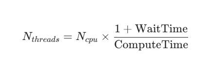

**Fox 解析：**

“2N 只是一个经验值。更科学的算法是看阻塞系数。

假设一个请求总耗时 100ms：

* CPU 计算用了 10ms (`ComputeTime`)
* 等待 DB 查数据用了 90ms (`WaitTime`)

带入公式：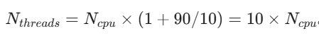。

你看！在这种极端 IO 阻塞的情况下，甚至需要开到 10 倍的线程数才能把 CPU 跑满。

所以，最佳实践不是背公式，而是看监控（APM），根据 CPU 利用率动态调整。”

拓展视频：

[接口响应时间 500ms，要扛 1 万 QPS，线程池怎么设计？需要多少台机器？](https://open.douyin.com/player/video?vid=7563920089968299264\&autoplay=0)

[京东二面：线程池参数怎么配？别再背N+1了 ](https://open.douyin.com/player/video?vid=7585495772792114447\&autoplay=0)


# 父子线程之间如何共享传递数据

在Java中，父线程和子线程之间共享或传递数据可以通过多种方式实现，具体可以根据需求选择以下几种常用的方法：

### 1. 使用ThreadLocal

ThreadLocal是一种特殊的Java对象，它为每个线程提供了独立的变量副本。通过ThreadLocal可以实现线程范围内的变量隔离，但不直接用于父子线程数据共享。不过，父线程可以在线程启动之前将数据放到InheritableThreadLocal，子线程可以读取到这些数据。

```java
public class ThreadLocalExample {
    // 创建一个ThreadLocal对象
    private static final ThreadLocal threadLocal = new InheritableThreadLocal（）;

    public static void main(String[] args) {
        // 设置ThreadLocal的值
        threadLocal.set("Shared Data");

        // 子线程
        Thread childThread = new Thread(() -> {
            System.out.println("Child Thread: " + threadLocal.get());
        });

        // 启动子线程
        childThread.start();
    }
}
```

### 2. 使用Concurrent Collections

Java提供了一些线程安全的集合类，如ConcurrentHashMap、CopyOnWriteArrayList等，可以安全并发地访问和修改，适用于需要较多线程共享数据的场景。

```java
import java.util.concurrent.ConcurrentHashMap;
import java.util.Map;

public class ConcurrentCollectionExample {
    public static void main(String[] args) {
        Map sharedMap = new ConcurrentHashMap<>();

        sharedMap.put("key", "value from parent");

        // 子线程
        Thread childThread = new Thread(() -> {
            // 等待父线程设置完值
            while (!sharedMap.containsKey("key")) {
                // active waiting
            }
            System.out.println("Child read from map: " + sharedMap.get("key"));
        });

        childThread.start();
    }
}
```

### 3. 使用消息队列

在复杂的多线程环境下，使用Java的阻塞队列（如BlockingQueue）可以在父子线程之间传递数据，并控制线程的执行顺序。

```java
import java.util.concurrent.ArrayBlockingQueue;
import java.util.concurrent.BlockingQueue;

public class BlockingQueueExample {
    public static void main(String[] args) {
        BlockingQueue queue = new ArrayBlockingQueue<>(5);

        for (int i = 0; i  {
            try {
                for (int i = 0; i **run()**\*\* 只是普通方法调用\*\*： 如果直接调用 `run()`，它仅仅是在**当前线程**（比如 main 线程）中调用了一个普通的 Java 方法。代码会**顺序执行**，不会创建新的调用栈，也就无法实现并发。
2. **start()**\*\* 才是启动线程\*\*： 调用 `start()` 方法时，JVM 会执行一系列复杂的底层操作：
   * 首先检查线程状态（确保未被启动过）。
   * 然后调用 `private native void start0()` 本地方法。
   * **关键点**：`start0()` 会请求操作系统分配系统级资源，创建一个新的**原生线程（Native Thread）**，并分配新的**程序计数器**和**虚拟机栈**。
   * 最后，这个新诞生的线程会自动回调 `run()` 方法。

**一句话总结：调用 ****run()**** 是在‘原来的路’上跑，调用 ****start()**** 是修了一条‘新的路’去跑。**”

### 二、 代码层面对比（Talk is cheap）

这段代码直接打印出执行线程的名字，真相一目了然。

```java
public class StartVsRunDemo {
    public static void main(String[] args) {

        Thread thread = new Thread(() -> {
            // 打印当前执行任务的线程名字
            System.out.println("当前执行线程: " + Thread.currentThread().getName());
        });

        // 场景1：直接调用 run()
        System.out.println("--- 调用 run() ---");
        thread.run();
        // 结果：打印 "main"。
        // 说明：依然是主线程在干活，根本没有多线程并发。

        // 场景2：调用 start()
        System.out.println("--- 调用 start() ---");
        thread.start();
        // 结果：打印 "Thread-0"。
        // 说明：JVM 开启了一个全新的线程来执行任务。
    }
}
```

***

### 三、 源码级解析（Fox 杀手锏）

如果面试官想深挖，你要能把 JDK 里的 `start()` 方法逻辑说出来，这才是 **P7 级别的回答**。

打开 `java.lang.Thread` 源码：

```java
public synchronized void start() {
    // 1. 【状态检查】
    // 线程的状态必须是 0 (NEW)。
    // 这也是为什么同一个线程不能调用两次 start() 的原因，会抛 IllegalThreadStateException。
    if (threadStatus != 0)
        throw new IllegalThreadStateException();

    // 2. 加入线程组
    group.add(this);

    boolean started = false;
    try {
        // 3. 【核心调用】
        // 调用本地方法 start0()
        start0();
        started = true;
    } finally {
        if (!started) {
            group.threadStartFailed(this);
        }
    }
}

// 这是底层 C++ 实现的入口，它负责与操作系统交互
private native void start0();
```

**解析：**

* **synchronized**：`start` 方法是加锁的，保证了状态检查和启动过程的原子性。
* **start0()**：这是一个 `native` 方法。在 JVM (Hotspot) 的 C++ 源码中，它最终会调用操作系统的 API（如 Linux 的 `pthread_create`）来真正创建一个内核级线程。
* 只有当这个内核线程创建成功后，JVM 才会回调 Java 层面的 `run()` 方法。

### 四、 Fox的避坑指南

如果面试官追问：**“如果我非要调用两次 ****start()**** 会怎么样？”**

**回答：**

“会抛出 `IllegalThreadStateException` 异常。 因为 `start()` 方法第一行就在检查 `threadStatus`。 一旦线程启动，状态就变了（不再是 NEW），即使线程执行完变成了 TERMINATED 状态，也不能再次复用 `start()` 重新启动。 **线程是属于一次性消耗品，想复用任务，请用线程池！**”

**附录**：start的jvm源码分析


# 什么是线程调度器和时间分片

### 一、 标准面试回答模版（建议背诵）

**面试官：** 什么是线程调度器（Thread Scheduler）和时间分片（Time Slicing）？

**Fox版标准回答：**

“这两个概念是**操作系统实现多任务并发**的基石。

1. **线程调度器 (Thread Scheduler)**：
   * 它是操作系统内核（OS Kernel）中的一个**核心模块**。
   * **职责**：它负责决定在任意时刻，**哪个线程**应该获得 CPU 的使用权，以及获得**多长时间**。
   * **Java 的关系**：Java 的线程是映射到操作系统原生线程（KLT）上的，所以 Java 虚拟机（JVM）通常**不直接控制调度**，而是把这项工作全权委托给操作系统的调度器。
2. **时间分片 (Time Slicing)**：
   * 它是调度器实现**抢占式调度（Preemptive Scheduling）的一种机制**。
   * **原理**：CPU 的时间被切分成一个个极短的时间段，称为‘时间片’（Time Quantum）（通常是几十毫秒）。
   * **过程**：调度器分配给当前线程一个时间片。当时间片用完，不管线程任务有没有做完，操作系统都会**强制剥夺**它的 CPU 使用权（触发上下文切换），把 CPU 让给下一个就绪的线程。
   * **目的**：让多个线程看起来像是在‘同时’运行（并发），防止一个长耗时的任务独占 CPU 导致系统卡死。”

### 二、 代码层面的体现

虽然我们无法写代码直接控制 OS 调度器，但我们可以通过 `Thread.yield()` 来观察时间分片的作用。

**yield()**\*\* 的本质\*\*：就是告诉调度器，“我的时间片虽然还没用完，但我愿意主动放弃，提前交出 CPU”。

```java
public class TimeSliceDemo {
    public static void main(String[] args) {
        Runnable task = () -> {
            for (int i = 0; i  extends Dictionary implements Map {
    // 整个方法被锁住，其他线程想 get 都得排队！
    public synchronized V put(K key, V value) {
        // ...
    }

    public synchronized V get(Object key) {
        // ...
    }
}
```

### 2. ConcurrentHashMap JDK 1.8 (细粒度锁)

**Look at me!** 只有在发生 Hash 冲突，且 CAS 失败时，才锁住那个**特定的 Node**（头节点）。

```java
final V putVal(K key, V value, boolean onlyIfAbsent) {
    // ... 前面有一堆 CAS 的尝试 ...

    // 只有当这个桶（Bucket）不为空，且 CAS 失败时
    synchronized (f) { // f 就是这个桶的头节点 (Node)
        if (tabAt(tab, i) == f) {
            // 操作链表或红黑树...
        }
    }
    // ...
}
```

## 三、 Fox的深度解析（面试杀手锏）

如果面试官追问：“**为什么它们都不允许 null 键和 null 值？而 HashMap 却允许？**” 这是一个非常刁钻但高频的问题，必须用\*\*二义性（Ambiguity）\*\*来解释。

**Fox版解析：**

“这主要是为了解决并发环境下的\*\*‘二义性’\*\*问题。

* **在 HashMap（非并发）中：** 如果 `map.get(key)` 返回 `null`，我有两种情况：
  1. 这个 key 不存在。
  2. 这个 key 存在，但值就是 `null`。 **解决办法：** 我可以调用 `map.containsKey(key)` 再确认一下。因为是单线程，这两步操作之间 Map 不会变。
* **在 ConcurrentHashMap（并发）中：** 假如允许 null。 线程 A 调用 `map.get(key)` 得到 `null`。 线程 A 想去检查 `containsKey(key)`。 **Bug 来了：** 在这两行代码之间，线程 B 可能**刚好把这个 key 删除了**，或者**刚好把这个 key 设为了 null**。 这就导致线程 A 根本无法判断刚才那个 `null` 到底代表什么意思（是‘没有’还是‘值为null’）。 为了避免这种无法自证的逻辑死局，并发 Map 干脆直接禁止 `null`。”


# 线程池中线程复用原理

### 一、 标准面试回答模版（建议背诵）

**面试官：** 线程池里的线程执行完一个任务后，为什么不会销毁？它是怎么实现复用的？

**Fox版标准回答：**

“线程池的线程复用机制，核心在于 **Worker**\*\* 类的内部死循环\*\* 和 **阻塞队列的阻塞等待**。

1. **包装机制**：线程池将底层的 `Thread` 包装成了一个内部类 `Worker`。`Worker` 实现了 `Runnable` 接口。
2. **循环执行（核心）**：`Worker` 启动后，执行的是 `runWorker` 方法。这个方法内部是一个 **while**\*\* 死循环\*\*。它会不断地调用 `getTask()` 方法从阻塞队列中获取任务。
3. **直接调用 run()**：拿到任务后，`Worker` 是直接调用 `task.run()` 来执行业务逻辑，而不是调用 `task.start()`。这意味着任务是在**当前 Worker 线程**中同步执行的，没有创建新线程，从而实现了复用。
4. **阻塞保活**：当队列为空时，`getTask()` 方法会调用阻塞队列的 `take()` 方法，利用 `LockSupport.park()` 让当前线程**挂起（阻塞）**。线程此时处于 WAITING 状态，不占用 CPU 也不销毁，直到有新任务提交将其唤醒。”

### 二、 源码级解析（带代码证据）

口说无凭，面试时如果你能手写出这两段核心伪代码，直接杀光比赛。

#### 1. 复用的核心：`runWorker` 的死循环

这是 `ThreadPoolExecutor` 里最关键的代码片段。

```java
final void runWorker(Worker w) {
Runnable task = w.firstTask;
w.firstTask = null;

// 【Look at me】这就是复用的真相：while循环！
// 只要 task 不为空，或者 getTask() 能拿出来任务，线程就不死！
while (task != null || (task = getTask()) != null) {
    try {
        // 钩子方法
        beforeExecute(wt, task);
        try {
            // 【高能预警】：
            // 这里直接调用 run()，把 task 当成普通对象的方法执行！
            // 绝对不是 start()，否则就变成新线程了！
            task.run();
        } finally {
            afterExecute(task, null);
        }
    } finally {
        // 做完一个任务，置空，准备下次循环去 getTask() 拿新任务
        task = null;
    }
}
// 只有跳出循环（getTask返回null），线程才会真正销毁
processWorkerExit(w, completedAbruptly);
}
```

#### 2. 存活的关键：`getTask` 的阻塞机制

为什么线程执行完任务不退出？因为它卡在 `getTask` 里了。

```java
private Runnable getTask() {
    boolean timedOut = false;

    for (;;) {
        // ... 省略状态检查 ...

        try {
            // workQueue 是阻塞队列（BlockingQueue）

            // 核心线程：调用 take()。
            // 如果队列空了，take() 会利用 LockSupport.park() 把线程挂起。
            // 线程就停在这里不动了，也不会销毁，直到有新任务入队把它唤醒。
            Runnable r = timed ?
            workQueue.poll(keepAliveTime, TimeUnit.NANOSECONDS) :
            workQueue.take();

            if (r != null) return r;

            // 如果是 poll 超时了还没拿到任务，这就意味着非核心线程该销毁了
            timedOut = true;
        } catch (InterruptedException retry) {
            timedOut = false;
        }
    }
}
```

### 三、 这一题的杀手锏

如果想让面试官觉得你“精通”，一定要补上这句总结：

**“所以，简单来说： ****Thread.start()**** 只是开启了一个可以执行代码的载体（Worker）。 而真正的业务任务（Runnable），只是这个载体上不断被替换、不断被执行的‘数据’而已。 载体是不变的，变的是载体上跑的数据。”**


# 说说并发和并行的区别

**面试官：** 说说并发（Concurrency）和并行（Parallelism）的区别。

**Fox版标准回答：**

“并发和并行虽然经常一起出现，但它们描述的维度完全不同。

1. **核心定义的区别**：
   * **并发（Concurrency）是逻辑上的同时处理**。它指的是系统具有**处理**多个任务的能力。在单核 CPU 上，通过时间片轮转（Context Switch），让多个任务交替执行，给人一种‘同时在做’的错觉。
   * **并行（Parallelism）是物理上的同时执行**。它指的是系统具有**同时执行**多个任务的能力。这必须依赖**多核 CPU**，多个任务在不同的核心上，在同一时刻真正地一起跑。
2. **关键差异（一句话总结）**：
   * **并发**是关于**结构**的，它解决的是‘怎么利用等待时间’的问题（比如 IO 阻塞时切换去做别的事）。
   * **并行**是关于**执行**的，它解决的是‘怎么利用多核算力’的问题（提高吞吐量）。
3. **存在关系**：
   * 你可以有并发但没有并行（例如：单核 CPU 跑多线程）。
   * 并行往往建立在并发的设计基础之上（你需要先把任务拆分并发，才能丢给多核去并行）。”

### 二、 图解与类比（Fox 独家记忆法）

如果面试官皱眉，立刻甩出这个类比，让他秒懂：

* **并发（Concurrency）**： 你是一个人（单核），你要**一边吃面，一边回微信**。 你不能同时把面塞嘴里又打字。你是吃一口面，放下筷子，回一条信息，再拿起筷子吃面。 *宏观上看，你在做两件事；微观上看，你在快速切换。*
* **并行（Parallelism）**： 你和你朋友两个人（双核），坐在饭桌上。 **你在吃面，你朋友在回微信**。 *同一时刻，两件事都在发生，互不干扰。*

### 三、 代码层面的体现（Java视角的真相）

在 Java 代码中，我们写的 `Thread` 只是定义了**并发的结构**。至于它到底是不是**并行**，Java 说了不算，**操作系统和硬件说了算**。

```java
public class ConcurrencyVsParallelism {

    public static void main(String[] args) {
        // 模拟任务
        Runnable task = () -> {
            String threadName = Thread.currentThread().getName();
            System.out.println(threadName + " 正在运行...");
            // 模拟CPU计算
            long sum = 0;
            for (int i = 0; i  挂起 -> T2执行 -> 挂起 -> T1执行...

        // 【场景二：并行 (多核环境)】
        // 现代电脑通常都是多核。
        // 当我们启动两个线程时，操作系统会发现有两个空闲核心。
        // 于是把 T1 扔给 Core-0，把 T2 扔给 Core-1。
        // 这时候，才是真正的并行。

        Thread t1 = new Thread(task, "Thread-1");
        Thread t2 = new Thread(task, "Thread-2");

        t1.start();
        t2.start();
    }
}
```

***

### 四、 Fox的降维打击（引用大神语录）

如果想让回答更有逼格，最后加上这一句 Go 语言之父 **Rob Pike** 的名言：

**“Concurrency is about dealing with lots of things at once. Parallelism is about doing lots of things at once.”**

（并发是关于**应对**很多事情，并行是关于**做**很多事情。）

视频： [串行、并发、并行的区别与联系你知道多少？](https://open.douyin.com/player/video?vid=7566181848020192558\&autoplay=0)


# 什么情况线程会进入WAITING状态

### 一、 标准面试回答模版（建议背诵）

**面试官：** 什么情况下线程会进入 WAITING 状态？

**Fox版标准回答：**

“在 Java 中，线程进入 **WAITING（无限期等待）** 状态，通常是因为调用了以下三个方法之一。处于该状态的线程**不会自动苏醒**，必须等待其他线程显式地唤醒或者中断。

1. **Object.wait()**（不带超时参数）：
   * 调用此方法会释放持有的对象锁，并进入等待队列。
   * **唤醒条件**：必须由其他线程在同一个锁对象上调用 `notify()` 或 `notifyAll()`。
2. **Thread.join()**（不带超时参数）：
   * 当前线程等待另一个线程执行完毕。
   * **唤醒条件**：被 Join 的那个线程运行结束（Terminated）。
3. **LockSupport.park()**：
   * 这是 JUC（并发包）锁实现的底层机制。它会挂起当前线程，不涉及 Monitor 锁的释放（因为它不依赖 Monitor）。
   * **唤醒条件**：其他线程调用 `LockSupport.unpark(thread)`。

**关键区别**：WAITING 是**主动**等待（为了业务逻辑），而 BLOCKED 是**被动**阻塞（为了抢 synchronized 锁）。”

### 二、 代码层面对比

这段代码演示了最常见的进入 WAITING 状态的场景，并验证了状态。

```java
import java.util.concurrent.locks.LockSupport;

public class WaitingStateDemo {
    private static final Object lock = new Object();

    public static void main(String[] args) throws InterruptedException {

        // 场景1：Object.wait()
        Thread t1 = new Thread(() -> {
            synchronized (lock) {
                try {
                    // 必须先拿到锁才能 wait，否则抛 IllegalMonitorStateException
                    lock.wait();
                } catch (InterruptedException e) {
                    e.printStackTrace();
                }
            }
        }, "Thread-Wait");

        t1.start();
        Thread.sleep(100); // 稍微等一下让 t1 跑起来
        // 输出: WAITING
        System.out.println("t1 state: " + t1.getState());

        // 场景2：LockSupport.park() (JUC 锁的基石)
        Thread t2 = new Thread(() -> {
            // 直接挂起，不需要 synchronize
            LockSupport.park();
        }, "Thread-Park");

        t2.start();
        Thread.sleep(100);
        // 输出: WAITING
        System.out.println("t2 state: " + t2.getState());

        // 唤醒 t2
        LockSupport.unpark(t2);
    }
}
```

### 三、 Fox的避坑指南（面试杀手锏）

面试官经常会搞混淆概念来忽悠你，你要学会反杀：

**1. 问：****sleep()**\*\* 会让线程进入 WAITING 吗？\*\*

**Fox：\*\*\*\*不会！**`sleep()` 必须传入时间参数，所以它进入的是 **TIMED\_WAITING**（超时等待）状态，而不是 WAITING。

**2. 问：线程在等待 ****synchronized**** 锁的时候，是 WAITING 吗？**

\*\*Fox：\*\***不是！** 这种是被动争抢锁失败，进入的是 **BLOCKED** 状态。

* **BLOCKED**：在等锁（门口排队，没进去）。
* **WAITING**：已经进去了，但是因为条件不满足（比如 `wait`），又主动释放锁出来等信号。

**3. 问：JUC 的 ****ReentrantLock.lock()**** 拿不到锁时，线程是什么状态？**

**Fox：** 这是高阶坑！ 虽然 `synchronized` 拿不到锁是 BLOCKED，但 **JUC 的锁**底层用的是 `LockSupport.park()`。 所以，`ReentrantLock` 等待锁时，线程状态实际上是 **WAITING**（或者 TIMED\_WAITING），而不是 BLOCKED！这一点能直接证明你看过 AQS 源码。


# JAVA中用到的线程调度算法是什么

### 一、 标准面试回答模版（建议背诵）

**面试官：** Java 中用到的线程调度算法是什么？

**Fox版标准回答：**

“Java 虚拟机本身**并不直接实现**复杂的线程调度算法，而是**委托给底层的操作系统**来处理。

1. **核心模式：抢占式调度 (Preemptive Scheduling)**
   * Java 的线程（Platform Thread）是**1:1 映射**到操作系统的内核级线程（KLT）上的。
   * 因此，Java 采用的是**抢占式优先级调度**算法。
   * **机制**：每个线程都有机会获得 CPU 时间片。当一个线程的时间片用完，或者有一个更高优先级的线程就绪，操作系统会强制剥夺当前线程的 CPU 使用权，切换给下一个线程。这也避免了单线程独占 CPU 导致系统假死。
2. **辅助机制：优先级 (Priority)**
   * Java 提供了 `Thread.setPriority(1~10)` 方法，但这只是给操作系统的一个\*\*‘建议’（Hint）\*\*。
   * 操作系统不一定采纳。因为不同 OS 的优先级等级不一样（比如 Linux 的 nice 值），Java 的 1-10 无法完美映射，甚至在某些场景下会被 OS 忽略。
3. **特例（JDK 21+ 虚拟线程）：**
   * 如果是 JDK 21 引入的**虚拟线程（Virtual Thread）**，则由 JVM 内部的调度器（基于 `ForkJoinPool`）进行**协作式调度**，不再完全依赖 OS。”

### 二、 代码层面对比

面试时，写这段代码证明“**Java 的优先级是不靠谱的**”，能直接证明你懂底层实现。

```java
public class PriorityDemo {
    public static void main(String[] args) {

        // 线程1：最高优先级
        Thread high = new Thread(() -> {
            while(true) { System.out.println("--- High Priority Running"); }
        });
        high.setPriority(Thread.MAX_PRIORITY); // 设置为10

        // 线程2：最低优先级
        Thread low = new Thread(() -> {
            while(true) { System.out.println("Low Priority Running"); }
        });
        low.setPriority(Thread.MIN_PRIORITY); // 设置为1

        // 【Look at me】
        // 理论上 High 应该比 Low 抢到更多 CPU。
        // 但在实际运行中，你会发现 Low 依然会频繁打印！
        // 这证明了：Java 无法强制控制调度，控制权在操作系统手里。
        low.start();
        high.start();
    }
}
```

### 三、 深度解析（Fox 杀手锏：时间片与协同式）

如果面试官追问：“除了抢占式，还有什么调度方式？Java 为什么不用？”

**回答：**

“除了抢占式，还有**协同式调度 (Cooperative Scheduling)**。

* **协同式**：线程执行时间由线程自己控制，线程不主动让出 CPU（比如调用 `yield`），别的线程就永远没机会执行。
* **Java 不用的原因**：太危险！如果一个线程写了死循环或者阻塞了，整个 JVM 甚至整个系统都会卡死（参考 Windows 3.x 时代）。
* **抢占式的好处**：系统拥有最高控制权，通过**时间片轮转（Time Slicing）**，保证所有线程雨露均沾，任何一个线程挂了都不会拖垮整个系统。”

### 四、 避坑指南（关于 Yield）

面试中经常会问到 `Thread.yield()`。

**Fox 提醒：**

“`Thread.yield()` 本质上也是一种基于抢占式调度的‘礼让’**行为。 它告诉 CPU：‘我现在不急，可以把时间片让给**同优先级**或**更高优先级的线程’。

但是！这依然只是个**建议**。CPU 可能完全无视这个建议，刚让出去，下一毫秒又调度回你了。所以在生产业务逻辑中，**千万不要依赖 yield 来控制执行顺序！**”


# JAVA守护线程和本地线程的区别

### 一、 标准面试回答模版（建议背诵）

**面试官：** Java 中守护线程和用户线程有什么区别？

**Fox版标准回答：**

“它们的主要区别在于 **JVM 什么时候离开（退出）**。

1. **定义不同**：
   * **用户线程（User Thread）**：也叫前台线程，是执行业务逻辑的主力。JVM 启动时的 `main` 线程就是用户线程。
   * **守护线程（Daemon Thread）**：是后台运行的‘服务员’，为用户线程提供服务（比如 GC 线程、心跳检测）。
2. **生命周期不同（核心区别）**：
   * **JVM 的退出原则**：JVM 会检查当前系统中是否还有**用户线程**在运行。
   * 只要还有一个**用户线程**活着，JVM 就不会退出。
   * 如果所有的**用户线程**都结束了，只剩下**守护线程**，JVM 会直接退出，**并且不会等待守护线程执行完**。
3. **创建方式**：
   * 默认创建的线程都是用户线程。
   * 必须在调用 `start()`**之前**，调用 `setDaemon(true)` 才能将其设置为守护线程。”

### 二、 代码层面对比

这段代码展示了：**当主线程（用户线程）结束时，守护线程就算在死循环里，也会立马暴毙。**

```java
public class DaemonVsUserDemo {
    public static void main(String[] args) {

        // 1. 创建一个守护线程
        Thread daemonThread = new Thread(() -> {
            while (true) {
                try {
                    System.out.println("我是守护线程，我在默默守护...");
                    Thread.sleep(500);
                } catch (InterruptedException e) {
                    e.printStackTrace();
                }
            }
        });

        // 【关键代码】：设置为守护线程（必须在 start 之前！）
        daemonThread.setDaemon(true);
        daemonThread.start();

        // 2. 主线程（用户线程）执行一段短逻辑
        try {
            System.out.println("我是主线程（用户线程），我开始干活了...");
            Thread.sleep(2000); // 模拟业务耗时2秒
            System.out.println("主线程干完活了，准备下班（JVM退出）！");
        } catch (InterruptedException e) {
            e.printStackTrace();
        }

        // 结果：主线程打印完最后一句后，JVM 退出。
        // 守护线程虽然写的是 while(true)，但也会立即停止打印，因为它失去了存在的意义。
    }
}
```

***

### 三、 Fox的独家解析（避坑指南）

如果面试官问：“守护线程有什么坑？” 或者 “能用守护线程写文件吗？” **Look at me!** 这时候要抛出这个**P7级的生产事故点**：

“**绝对不能用守护线程去进行文件读写或 I/O 操作！**

**Why?** 因为守护线程没有‘优雅关闭’机制。 当用户线程全部结束后，JVM 发现只剩守护线程，它会**直接粗暴地终止**守护线程。

这会导致一个严重后果：**守护线程中的 ****finally**** 代码块可能根本不会被执行！** 如果你在 `finally` 里写了 `close()` 释放流资源，或者回滚事务，这些操作统统会失效，导致数据损坏或资源泄露。

所以，守护线程通常只用于：垃圾回收、心跳检测、或者本地缓存的清理等不涉及关键数据一致性的场景。”

拓展： [阿里一面：OOM后JVM一定会退出吗？为什么？](https://open.douyin.com/player/video?vid=7547152544221498666\&autoplay=0)


# 如何确保线程安全

### 一、 标准面试回答模版（建议背诵）

**面试官：** 在 Java 中如何确保线程安全？

**Fox版标准回答：**

“确保线程安全的核心思路只有三条：**不共享、共享不可变、共享可变（同步控制）**。具体落地为以下 4 种方案：

1. **互斥同步（阻塞锁 - 悲观策略）：**
   * 使用 `synchronized` 关键字（JVM 层面）或 `ReentrantLock`（API 层面）。
   * 通过加锁，保证同一时刻只有一个线程能修改共享变量，确保**原子性**和**可见性**。
2. **非阻塞同步（CAS - 乐观策略）：**
   * 利用 CPU 指令集的 **CAS (Compare-And-Swap)** 原子指令。
   * 典型实现是 JUC 包下的原子类（如 `AtomicInteger`）。适用于竞争不激烈的场景，避免了线程切换的开销。
3. **线程隔离（无同步）：**
   * **栈封闭**：变量定义在方法内（局部变量），线程私有，天生安全。
   * **ThreadLocal**：为每个线程提供一份独立的变量副本，互不干扰，以空间换时间。
4. **不可变对象（Immutable）：**
   * 一旦创建，状态就不能被修改的对象。如 `String`、`Integer` 以及用 `final` 关键字修饰的属性。
   * 这种对象天生线程安全，不需要任何同步手段。”

### 二、 代码层面对比

这里展示三种最主流的处理方式：**Synchronized** vs **Lock** vs **Atomic**。

```java
import java.util.concurrent.locks.Lock;
import java.util.concurrent.locks.ReentrantLock;
import java.util.concurrent.atomic.AtomicInteger;

public class ThreadSafetyDemo {

    // 共享变量
    private int count = 0;

    // 方案1：Atomic 原子类 (最推荐 - 性能好，代码少)
    private AtomicInteger atomicCount = new AtomicInteger(0);

    // 方案2：Lock 显式锁 (灵活)
    private final Lock lock = new ReentrantLock();

    // --- 方法对比 ---

    // 1. 使用 Atomic (CAS机制)
    public void incrementAtomic() {
        atomicCount.getAndIncrement();
    }

    // 2. 使用 Synchronized (JVM内置锁)
    public synchronized void incrementSync() {
        count++;
    }

    // 3. 使用 ReentrantLock (手动锁)
    public void incrementLock() {
        lock.lock(); // 手动加锁
        try {
            count++;
        } finally {
            lock.unlock(); // 【关键】必须在 finally 释放
        }
    }
}
```

### 三、 Fox的深度解析（降维打击）

如果面试官问：**“使用了 ****ConcurrentHashMap**** 或者 ****Vector**** 这种线程安全的集合，代码就一定线程安全了吗？”**

**Look at me!** 这是 P7 面试的必杀技。

**Fox版回答：**

“**不一定！** 虽然这些集合的**单个方法**（如 `put`、`get`、`add`）是原子的、线程安全的。 但是，**复合操作（Compound Operations）** 依然是不安全的！

**举个例子：**`if (!map.containsKey(key)) { map.put(key, value); }` 这是一个典型的 **Check-Then-Act（先检查后执行）** 模式。

就算 `containsKey` 和 `put` 都是线程安全的，但这两个操作之间**没有加锁**。 线程 A 刚检查完不存在，还没来得及 put，线程 B 抢先 put 进去了。线程 A 恢复执行后再 put，就会**覆盖** B 的数据。

**解决方案：** 必须使用 `ConcurrentHashMap` 提供的原子复合方法，比如 `putIfAbsent()`，或者在业务层面加锁。”


# 线程池中线程异常后：销毁还是复用？

面试官又出难题了：

线程池中线程异常后：销毁还是复用？

当一个线程池里面的线程异常后:

当一个线程池里面的线程异常后:

◦当执行方式是execute时,当执行任务出现异常，内部会抛出异常，进而就会导致线程中断而被移除掉，并且会创建一个新的线程填充到线程池中。

◦当执行方式是submit时, 内部会把异常捕获住且不会抛出，所以就不会把这个线程移除掉，也不会创建新的线程放入到线程池中。

这俩种执行方式，都不会影响线程池里面其他线程的正常执行。


# CompletableFuture异步编排

视频：

[bilibili](https://player.bilibili.com/player.html?bvid=BV13u4m1F7VK&autoplay=0)

脑图：[CompletableFuture的使用| ProcessOn免费在线作图,在线流程图,在线思维导图](https://www.processon.com/view/link/6638e5d996857d67d2e3e998?cid=6618dbe5c04c1e02ff4f0754)

