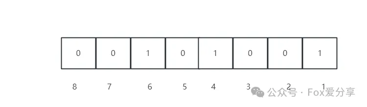
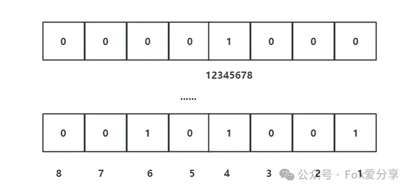

# 数据结构与算法知识汇总
---


# 实现归并排序算法

归并排序（Merge Sort）是一种基于分治法的排序算法。它将数组分成两个子数组，分别排序，然后合并这两个子数组。归并排序的时间复杂度为O(n log n)，并且是稳定的排序算法。以下是详细的代码示例和解释：

### 归并排序实现

1. **思路**：
   * 将数组分成两半，递归地对每一半进行归并排序。
   * 合并两个已排序的子数组。
2. **代码示例**：

```java
public class MergeSortExample {
    // 归并排序主方法
    public static void mergeSort(int[] arr, int left, int right) {
        if (left int[] arr是待排序的数组，int left是起始索引，int right是结束索引。
   * **递归条件**：if (left ，当起始索引小于结束索引时，继续排序。
   * **计算中间索引**：int mid = left + (right - left) / 2;。
   * **递归调用**：
     * 对左半部分进行归并排序：mergeSort(arr, left, mid)。
     * 对右半部分进行归并排序：mergeSort(arr, mid + 1, right)。
   * **合并两个子数组**：调用merge(arr, left, mid, right)。
2. **merge方法**：
   * **参数**：int[] arr是待合并的数组，int left是左子数组的起始索引，int mid是中间索引，int right是右子数组的结束索引。
   * **创建临时数组**：int[] L和int[] R用于存储左右子数组。
   * **复制数据到临时数组**：将左右子数组的数据复制到临时数组L和R。
   * **合并临时数组**：
     * 使用两个索引i和j遍历临时数组L和R。
     * 比较L[i]和R[j]，将较小的元素放入原数组arr。
     * 继续合并直到一个临时数组耗尽。
   * **复制剩余元素**：将未耗尽的临时数组的剩余元素复制到arr。
3. **main方法**：
   * 创建一个未排序的数组arr。
   * 调用mergeSort方法对数组进行排序。
   * 打印排序前和排序后的数组。

通过这种方式，我们可以高效地对数组进行排序，归并排序的时间复杂度为O(n log n)。


# 实现一个LRU（最近最少使用）缓存

实现一个LRU（最近最少使用）缓存可以通过使用HashMap和双向链表来实现。HashMap用于快速查找缓存中的元素，而双向链表用于维护元素的使用顺序。以下是详细的代码示例和解释：

### LRU缓存实现

1. **思路**：
   * 使用HashMap存储键值对，以便快速访问。
   * 使用双向链表维护元素的使用顺序，最近使用的元素放在链表头部，最少使用的元素放在链表尾部。
   * 每次访问或插入元素时，将该元素移动到链表头部。
   * 当缓存容量达到上限时，移除链表尾部的元素。
2. **代码示例**：

```java
import java.util.HashMap;

class LRUCache {
    private class Node {
        int key;
        int value;
        Node prev;
        Node next;

        Node(int key, int value) {
            this.key = key;
            this.value = value;
        }
    }

    private final int capacity;
    private final HashMap map;
    private final Node head;
    private final Node tail;

    public LRUCache(int capacity) {
        this.capacity = capacity;
        this.map = new HashMap<>();
        this.head = new Node(0, 0); // 哨兵节点，头部
        this.tail = new Node(0, 0); // 哨兵节点，尾部
        head.next = tail;
        tail.prev = head;
    }

    public int get(int key) {
        Node node = map.get(key);
        if (node == null) {
            return -1; // 如果键不存在，返回-1
        }
        moveToHead(node); // 将访问的节点移动到头部
        return node.value;
    }

    public void put(int key, int value) {
        Node node = map.get(key);
        if (node == null) {
            Node newNode = new Node(key, value);
            map.put(key, newNode);
            addNode(newNode);
            if (map.size() > capacity) {
                Node tail = popTail();
                map.remove(tail.key);
            }
        } else {
            node.value = value;
            moveToHead(node);
        }
    }

    private void addNode(Node node) {
        node.prev = head;
        node.next = head.next;
        head.next.prev = node;
        head.next = node;
    }

    private void removeNode(Node node) {
        Node prev = node.prev;
        Node next = node.next;
        prev.next = next;
        next.prev = prev;
    }

    private void moveToHead(Node node) {
        removeNode(node);
        addNode(node);
    }

    private Node popTail() {
        Node res = tail.prev;
        removeNode(res);
        return res;
    }

    public static void main(String[] args) {
        LRUCache cache = new LRUCache(2);

        cache.put(1, 1);
        cache.put(2, 2);
        System.out.println(cache.get(1)); // 返回 1

        cache.put(3, 3); // 该操作会使得键 2 作废
        System.out.println(cache.get(2)); // 返回 -1 (未找到)

        cache.put(4, 4); // 该操作会使得键 1 作废
        System.out.println(cache.get(1)); // 返回 -1 (未找到)
        System.out.println(cache.get(3)); // 返回 3
        System.out.println(cache.get(4)); // 返回 4
    }
}
```

### 详细解释

1. **Node类**：
   * int key, value: 存储缓存的键和值。
   * Node prev, next: 指向前一个和后一个节点的指针。
   * 构造函数Node(int key, int value): 初始化节点的键和值。
2. **LRUCache类**：
   * **成员变量**：
     * int capacity: 缓存的容量。
     * HashMap map: 存储键到节点的映射。
     * Node head, tail: 哨兵节点，用于标记链表的头部和尾部。
   * **构造函数**：
     * 初始化容量、HashMap和哨兵节点。
     * 将head和tail连接起来。
   * **get方法**：
     * 从map中获取节点，如果不存在返回-1。
     * 如果存在，将节点移动到链表头部，并返回节点的值。
   * **put方法**：
     * 检查键是否存在于map中。
     * 如果不存在，创建新节点并添加到链表头部。
     * 如果map的大小超过容量，移除链表尾部的节点。
     * 如果存在，更新节点的值并移动到链表头部。
   * **辅助方法**：
     * addNode(Node node): 将节点添加到链表头部。
     * removeNode(Node node): 从链表中移除节点。
     * moveToHead(Node node): 将节点移动到链表头部。
     * popTail(): 移除并返回链表尾部的节点。

通过这种方式，我们可以高效地实现一个LRU缓存，get和put操作的时间复杂度均为O(1)。


# 腾讯面试：40亿QQ号，给你1G内存，怎么去重？

前段时间，有个小伙伴给我分享了他去腾讯面试的经历。他说被问到了一道去重的面试题：

**给你40亿个QQ号，要求****相同的QQ号码仅保留一个****，内存限制为1个G，你会怎么实现？**

小伙伴由于没有回答好，导致面试挂了。

这其实就是个经典的**海量数据去重问题**，而且还附带一个让人头疼的条件：**内存限制只有1G！**

### **1.理解题目：从QQ号和内存限制说起**
我们先来分析一下问题本身。

QQ号其实是一串数字，范围是4字节的无符号正整数，也就是32位，理论上最大值接近43亿。所以，如果单纯存储这40亿个QQ号，需要耗费多少内存呢？

简单计算一下：

```plain
4000000000*4 /1024/1024/1024 ≈ 15GB
```

总共需要15GB的内存，显然远远超过了题目给的1GB限制。这就需要我们换个思路，不能“硬塞”，要想办法巧妙地存储和处理这些QQ号。

所以问题的本质就是“**在内存非常有限的情况下，高效实现重复数据的去重**”。

解决方案有很多，但是主流的方案有两种：

+ 方案1：使用BitMap
+ 方案2：使用布隆过滤器

两者各有千秋，但在本题中，我们使用BitMap更加合适。

### **2.解决方案：用BitMap的精妙之处化繁为简**
#### **2.1 什么是BitMap？**
所谓位图（BitMap）其实就是一个bit数组，即每一个位置都是一个bit，其中的取值可以是0或者1。

通俗点说，BitMap就像一个超级节省空间的“登记簿”。

+ 如果某个QQ号存在，就在对应的“格子”上标记为1；
+ 如果不存在，则是0。

比如，我们需要记录QQ号：1、4、6。传统方法可能需要用3个整型变量，每个4字节，总共12字节。但是BitMap只需要用一个字节（8位），直接把第1、4、6位分别置为1即可，是不是更高效？这里节省了 12倍空间。



BitMap最大的优势在于能够用**极小的存储空间**去表示**巨大的数值范围**，并且支持快速查询、去重等操作。它特别适合这种“有或没有”的问题，不需要存储原始数据。

#### **2.2 ****如何使用BitMap进行40亿个QQ号去重？**
回到我们的问题：40亿个QQ号，限制1G内存，如何用BitMap去重？

**步骤如下：**

**1）申请一个足够大的BitMap，大小为40亿个bit，也就是：**

```plain
4000000000 * 1 /8/1024/1024 = 476M
```

只需要不到500MB的空间就可以搞定！

2）遍历这40亿QQ号，把每个号码映射到BitMap中，把对应位置的bit设置为1。

比如，QQ号“12345678”会直接映射到BitMap的第“12345678”个位置，然后置为1，表示它已经出现过。



3）通过遍历BitMap，找出所有bit值为1的位置，这些就是所有的去重后的QQ号。

通过这样的方式，我们用BitMap成功实现了40亿QQ号去重，最大内存消耗也不到500MB，不会有内存不足的问题。

#### **2.3 BitMap的优缺点**
**优点：**

+ **超极节省内存**

相比直接存储数据，BitMap的内存消耗大约只有八分之一甚至更少，非常高效。

+ 操作快

插入、查询、去重的时间复杂度都是O(1)，十分适合处理海量数据。

+ 易于实现

算法简单，只需要依赖一个数组，理解成本低。

**
**

**缺点：**

+ 只能表示“有或没有”

BitMap只能用0和1表示是否存在，无法存储更复杂的数据（如具体值或出现次数）。

+ 需要确定值域范围

BitMap只能操作固定范围的数据，超出范围将导致无法标记。

**
**

### **3.总结**
通过这道题我们看到了BitMap的优雅之处，它让我们用不到500MB的内存，成功完成了40亿QQ号的去重操作。更重要的是，这种思路在很多场景中都有广泛应用，比如：

+ 大规模数据去重
+ 数据快速排序
+ 集合运算（交集、并集、差集）
+ 布隆过滤器的底层实现

所以，掌握BitMap不仅能帮你顺利通过面试，在实际的大数据场景中也非常实用！

你还有其他更好的思路吗？欢迎留言讨论~


# 找出两个单链表的交点

找出两个单链表的交点是一个常见的问题，可以通过双指针法来解决。以下是详细的代码示例和解释：

### 双指针法

1. **思路**：
   * 使用两个指针pA和pB分别遍历两个链表。
   * 当pA到达链表A的末尾时，将其重定位到链表B的头部。
   * 当pB到达链表B的末尾时，将其重定位到链表A的头部。
   * 如果两个链表相交，pA和pB将在交点相遇。
   * 如果不相交，pA和pB将在遍历完两个链表后同时到达null。
2. **代码示例**：

```java
class ListNode {
    int val; // 节点的值
    ListNode next; // 指向下一个节点的指针

    ListNode(int val) {
        this.val = val;
        this.next = null; // 初始化时，next指针指向null
    }
}

public class LinkedListIntersection {
    // 找出两个链表的交点
    public static ListNode getIntersectionNode(ListNode headA, ListNode headB) {
        if (headA == null || headB == null) {
            return null; // 如果任一链表为空，则不可能有交点
        }

        ListNode pA = headA; // 指针pA初始化为链表A的头节点
        ListNode pB = headB; // 指针pB初始化为链表B的头节点

        // 遍历两个链表
        while (pA != pB) {
            // 如果pA到达链表A的末尾，则重定位到链表B的头部
            pA = (pA == null) ? headB : pA.next;
            // 如果pB到达链表B的末尾，则重定位到链表A的头部
            pB = (pB == null) ? headA : pB.next;
        }

        // 返回交点节点或null
        return pA;
    }

    public static void main(String[] args) {
        // 创建链表A: 1 -> 2 -> 3
        ListNode headA = new ListNode(1);
        headA.next = new ListNode(2);
        headA.next.next = new ListNode(3);

        // 创建链表B: 6 -> 7
        ListNode headB = new ListNode(6);
        headB.next = new ListNode(7);

        // 创建交点: 8 -> 9
        ListNode intersection = new ListNode(8);
        intersection.next = new ListNode(9);

        // 将交点连接到链表A和链表B
        headA.next.next.next = intersection;
        headB.next.next = intersection;

        // 找出交点
        ListNode intersectNode = getIntersectionNode(headA, headB);

        if (intersectNode != null) {
            System.out.println("The intersection node's value is: " + intersectNode.val);
        } else {
            System.out.println("The two linked lists do not intersect.");
        }
    }
}
```

### 详细解释

1. **ListNode类**：
   * int val: 存储节点的值。
   * ListNode next: 指向下一个节点的指针。
   * 构造函数ListNode(int val): 初始化节点的值，并将next指针设为null。
2. **getIntersectionNode方法**：
   * **初始检查**：如果任一链表为空，则不可能有交点，直接返回null。
   * **初始化指针**：
     * pA指针初始化为链表A的头节点。
     * pB指针初始化为链表B的头节点。
   * **循环遍历**：
     * while (pA != pB): 遍历两个链表，直到pA和pB相等。
     * pA = (pA == null) ? headB : pA.next: 如果pA到达链表A的末尾，则重定位到链表B的头部。
     * pB = (pB == null) ? headA : pB.next: 如果pB到达链表B的末尾，则重定位到链表A的头部。
   * **返回结果**：返回交点节点或null。
3. **main方法**：
   * 创建两个链表A和B，并在它们之间创建一个交点。
   * 调用getIntersectionNode方法找出交点，并输出结果。

这种方法的时间复杂度为O(n + m)，空间复杂度为O(1)，其中n和m分别是两个链表的长度。通过这种方式，我们可以高效地找出两个单链表的交点。


# 检测单链表中是否有环

检测单链表中是否存在环是一个经典的问题，可以使用“快慢指针”方法来解决。这种方法也被称为“龟兔赛跑”算法。以下是详细的代码示例和解释：

### 快慢指针方法

1. **思路**：
   * 使用两个指针：slow和fast。
   * slow指针每次移动一步，fast指针每次移动两步。
   * 如果链表中存在环，fast指针最终会与slow指针相遇。
   * 如果链表中没有环，fast指针会在到达链表末尾时变为null。
2. **代码示例**：

```java
class ListNode {
    int val; // 节点的值
    ListNode next; // 指向下一个节点的指针

    ListNode(int val) {
        this.val = val;
        this.next = null; // 初始化时，next指针指向null
    }
}

public class LinkedListCycleDetection {
    // 检测链表中是否有环的方法
    public static boolean hasCycle(ListNode head) {
        if (head == null || head.next == null) {
            return false; // 如果链表为空或只有一个节点，则不可能有环
        }

        ListNode slow = head; // 慢指针初始化为头节点
        ListNode fast = head; // 快指针初始化为头节点

        // 遍历链表
        while (fast != null && fast.next != null) {
            slow = slow.next; // 慢指针每次移动一步
            fast = fast.next.next; // 快指针每次移动两步

            if (slow == fast) {
                return true; // 如果快慢指针相遇，则链表中有环
            }
        }

        return false; // 如果快指针到达链表末尾，则链表中没有环
    }

    public static void main(String[] args) {
        // 创建链表 1 -> 2 -> 3 -> 4 -> 5
        ListNode head = new ListNode(1);
        head.next = new ListNode(2);
        head.next.next = new ListNode(3);
        head.next.next.next = new ListNode(4);
        head.next.next.next.next = new ListNode(5);

        // 创建一个环：5 -> 3
        head.next.next.next.next.next = head.next.next;

        if (hasCycle(head)) {
            System.out.println("The linked list has a cycle.");
        } else {
            System.out.println("The linked list does not have a cycle.");
        }
    }
}
```

### 详细解释

1. **ListNode类**：
   * int val: 存储节点的值。
   * ListNode next: 指向下一个节点的指针。
   * 构造函数ListNode(int val): 初始化节点的值，并将next指针设为null。
2. **hasCycle方法**：
   * **初始检查**：如果链表为空或只有一个节点，则不可能有环，直接返回false。
   * **初始化指针**：
     * slow和fast都初始化为头节点。
   * **循环遍历**：
     * while (fast != null && fast.next != null): 遍历链表，直到fast指针到达链表末尾。
     * slow = slow.next: 慢指针每次移动一步。
     * fast = fast.next.next: 快指针每次移动两步。
     * 如果slow和fast相遇，则链表中存在环，返回true。
   * **返回结果**：如果循环结束且没有相遇，返回false，表示链表中没有环。
3. **main方法**：
   * 创建一个链表1 -> 2 -> 3 -> 4 -> 5。
   * 手动创建一个环，使节点5指向节点3。
   * 调用hasCycle方法检测链表中是否有环，并输出结果。

这种方法的时间复杂度为O(n)，空间复杂度为O(1)，因为它只使用了常量级别的额外空间来存储指针。通过这种方式，我们可以高效地检测单链表中是否存在环。


# 实现快速排序算法

快速排序（QuickSort）是一种高效的排序算法，采用分治法策略。它的基本思想是选择一个“基准”元素，通过一趟排序将待排序序列分成两部分，其中一部分的所有元素都比基准元素小，另一部分的所有元素都比基准元素大，然后递归地对这两部分进行排序。以下是详细的代码示例和解释：

### 快速排序实现

1. **思路**：
   * 选择一个基准元素（通常选择数组的最后一个元素）。
   * 通过分区操作将数组分为两部分：左边部分的元素都小于基准元素，右边部分的元素都大于基准元素。
   * 递归地对左边和右边部分进行快速排序。
2. **代码示例**：

```java
public class QuickSortExample {
    // 快速排序主方法
    public static void quickSort(int[] arr, int low, int high) {
        if (low int[] arr是待排序的数组，int low是起始索引，int high是结束索引。
   * **递归条件**：if (low ，当起始索引小于结束索引时，继续排序。
   * **分区操作**：调用partition方法获取分区索引pi。
   * **递归调用**：
     * 对左子数组进行快速排序：quickSort(arr, low, pi - 1)。
     * 对右子数组进行快速排序：quickSort(arr, pi + 1, high)。
2. **partition方法**：
   * **选择基准**：选择数组的最后一个元素作为基准。
   * **初始化索引**：int i = low - 1，用于标记小于基准的元素的索引。
   * **遍历数组**：从low到high-1遍历数组。
     * 如果当前元素小于或等于基准，增加i并交换arr[i]和arr[j]。
   * **交换基准**：将基准元素与arr[i+1]交换。
   * **返回分区索引**：返回i + 1作为新的分区索引。
3. **main方法**：
   * 创建一个未排序的数组arr。
   * 调用quickSort方法对数组进行排序。
   * 打印排序前和排序后的数组。

通过这种方式，我们可以高效地对数组进行排序，快速排序的平均时间复杂度为O(n log n)。


# 给定一个字符串，找出其中最长的回文子串

要找出一个字符串中的最长回文子串，可以使用中心扩展法。这个方法的基本思想是从每个字符（以及字符之间的空隙）作为中心，向两边扩展以寻找回文。以下是详细的代码示例和解释：

### 中心扩展法实现

1. **思路**：
   * 遍历字符串中的每个字符和每对相邻字符作为中心。
   * 从中心向两边扩展，检查是否为回文。
   * 记录最长的回文子串。
2. **代码示例**：

```java
public class LongestPalindromicSubstring {
    // 找出最长回文子串的方法
    public static String longestPalindrome(String s) {
        if (s == null || s.length()  end - start) {
                start = i - (len - 1) / 2;
                end = i + len / 2;
            }
        }

        return s.substring(start, end + 1);
    }

    // 中心扩展法
    private static int expandAroundCenter(String s, int left, int right) {
        while (left >= 0 && right String s是输入字符串。
   * **边界检查**：如果字符串为空或长度小于1，返回空字符串。
   * **初始化**：int start = 0, end = 0;用于记录最长回文子串的起始和结束索引。
   * **遍历字符串**：
     * 对于每个字符i，尝试以i为中心扩展（单字符中心）和以i和i+1为中心扩展（双字符中心）。
     * 调用expandAroundCenter方法计算从中心扩展得到的回文长度len1和len2。
     * 取较长的回文长度len = Math.max(len1, len2)。
     * 如果当前回文长度大于已记录的最长回文长度，更新start和end索引。
   * **返回结果**：返回最长回文子串return s.substring(start, end + 1);。
2. **expandAroundCenter方法**：
   * **参数**：String s是输入字符串，int left和int right是中心的左右索引。
   * **扩展回文**：在while循环中，检查左右字符是否相等并且索引在有效范围内，若是则继续扩展。
   * **返回长度**：返回扩展后的回文长度right - left - 1。
3. **main方法**：
   * 创建一个字符串s。
   * 调用longestPalindrome方法获取结果。
   * 打印最长回文子串。

通过这种方法，我们可以高效地找出字符串中的最长回文子串，时间复杂度为O(n^2)。


# 实现一个基本的图数据结构，并实现深度优先搜索（DFS）和广度优先搜索（BFS）

实现一个基本的图数据结构可以使用邻接表来表示图。邻接表是一种常用的图表示方法，其中每个节点都有一个列表，存储与其相邻的节点。我们将实现图的基本结构，并提供深度优先搜索（DFS）和广度优先搜索（BFS）算法。以下是详细的代码示例和解释：

### 图数据结构及DFS和BFS实现

1. **思路**：
   * 使用一个Map来存储图的邻接表，其中键是节点，值是与该节点相邻的节点列表。
   * 实现DFS和BFS算法来遍历图。
2. **代码示例**：

```java
import java.util.*;

public class Graph {
    private Map> adjList; // 邻接表

    // 构造函数
    public Graph() {
        adjList = new HashMap<>();
    }

    // 添加边
    public void addEdge(int source, int destination) {
        adjList.computeIfAbsent(source, k -> new ArrayList<>()).add(destination);
        adjList.computeIfAbsent(destination, k -> new ArrayList<>()).add(source); // 无向图
    }

    // 深度优先搜索
    public void dfs(int start) {
        Set visited = new HashSet<>();
        dfsUtil(start, visited);
    }

    private void dfsUtil(int node, Set visited) {
        visited.add(node);
        System.out.print(node + " ");

        for (int neighbor : adjList.getOrDefault(node, new ArrayList<>())) {
            if (!visited.contains(neighbor)) {
                dfsUtil(neighbor, visited);
            }
        }
    }

    // 广度优先搜索
    public void bfs(int start) {
        Set visited = new HashSet<>();
        Queue queue = new LinkedList<>();

        visited.add(start);
        queue.add(start);

        while (!queue.isEmpty()) {
            int node = queue.poll();
            System.out.print(node + " ");

            for (int neighbor : adjList.getOrDefault(node, new ArrayList<>())) {
                if (!visited.contains(neighbor)) {
                    visited.add(neighbor);
                    queue.add(neighbor);
                }
            }
        }
    }

    public static void main(String[] args) {
        Graph graph = new Graph();
        graph.addEdge(0, 1);
        graph.addEdge(0, 2);
        graph.addEdge(1, 2);
        graph.addEdge(2, 3);
        graph.addEdge(3, 4);

        System.out.println("Depth First Search starting from node 0:");
        graph.dfs(0);

        System.out.println("\nBreadth First Search starting from node 0:");
        graph.bfs(0);
    }
}
```

### 详细解释

1. **Graph类**：
   * **成员变量**：
     * Map> adjList: 用于存储图的邻接表。
   * **构造函数**：初始化邻接表。
   * **addEdge方法**：添加边到图中。
     * 使用computeIfAbsent方法确保每个节点都有一个列表。
     * 对于无向图，添加双向边。
2. **深度优先搜索（DFS）**：
   * **dfs方法**：初始化一个Set用于存储已访问节点，并调用dfsUtil。
   * **dfsUtil方法**：递归地访问节点。
     * 将当前节点标记为已访问并打印。
     * 递归访问所有未访问的邻居节点。
3. **广度优先搜索（BFS）**：
   * **bfs方法**：使用队列实现。
   * 初始化一个Set用于存储已访问节点和一个Queue用于存储待访问节点。
   * 将起始节点标记为已访问并加入队列。
   * 迭代访问队列中的节点，打印节点并将未访问的邻居节点加入队列。
4. **main方法**：
   * 创建一个Graph实例。
   * 添加一些边。
   * 调用dfs和bfs方法从节点0开始遍历图，并打印结果。

通过这种实现，我们可以创建一个简单的图数据结构，并使用DFS和BFS算法遍历图。


# 判断一棵二叉树是否是平衡二叉树

判断一棵二叉树是否是平衡二叉树（即AVL树）是一个常见的问题。平衡二叉树的定义是：对于树中的每个节点，其左右子树的高度差不超过1。我们可以通过递归的方法来判断一棵二叉树是否是平衡的。以下是详细的代码示例和解释：

### 判断平衡二叉树实现

1. **思路**：
   * 使用递归的方法来计算每个节点的高度。
   * 在计算高度的过程中，检查每个节点的左右子树的高度差是否超过1。
   * 如果超过1，则该树不是平衡二叉树。
2. **代码示例**：

```java
// 定义二叉树节点类
class TreeNode {
    int val; // 节点的值
    TreeNode left; // 左子节点
    TreeNode right; // 右子节点

    TreeNode(int val) {
        this.val = val;
        this.left = null;
        this.right = null;
    }
}

public class BalancedBinaryTree {
    // 判断二叉树是否是平衡二叉树的方法
    public static boolean isBalanced(TreeNode root) {
        return checkHeight(root) != -1;
    }

    // 检查节点高度的方法
    private static int checkHeight(TreeNode node) {
        if (node == null) {
            return 0; // 空节点的高度为0
        }

        // 递归计算左子树的高度
        int leftHeight = checkHeight(node.left);
        if (leftHeight == -1) {
            return -1; // 如果左子树不平衡，返回-1
        }

        // 递归计算右子树的高度
        int rightHeight = checkHeight(node.right);
        if (rightHeight == -1) {
            return -1; // 如果右子树不平衡，返回-1
        }

        // 检查当前节点的左右子树高度差
        if (Math.abs(leftHeight - rightHeight) > 1) {
            return -1; // 如果高度差超过1，返回-1
        }

        // 返回当前节点的高度
        return Math.max(leftHeight, rightHeight) + 1;
    }

    public static void main(String[] args) {
        // 创建一个平衡二叉树
        TreeNode root = new TreeNode(1);
        root.left = new TreeNode(2);
        root.right = new TreeNode(3);
        root.left.left = new TreeNode(4);
        root.left.right = new TreeNode(5);
        root.right.left = new TreeNode(6);
        root.right.right = new TreeNode(7);

        System.out.println("Is the tree balanced? " + isBalanced(root)); // 输出 true

        // 创建一个不平衡二叉树
        TreeNode unbalancedRoot = new TreeNode(1);
        unbalancedRoot.left = new TreeNode(2);
        unbalancedRoot.left.left = new TreeNode(3);

        System.out.println("Is the tree balanced? " + isBalanced(unbalancedRoot)); // 输出 false
    }
}
```

### 详细解释

1. **TreeNode类**：
   * int val: 存储节点的值。
   * TreeNode left, right: 分别指向左子节点和右子节点。
   * 构造函数TreeNode(int val): 初始化节点的值，并将左右子节点设为null。
2. **isBalanced方法**：
   * 调用checkHeight方法来检查树的高度。
   * 如果checkHeight返回-1，表示树不平衡，返回false；否则返回true。
3. **checkHeight方法**：
   * **初始检查**：如果节点为空，返回高度0。
   * **递归计算左子树高度**：调用checkHeight(node.left)。
     * 如果返回-1，表示左子树不平衡，直接返回-1。
   * **递归计算右子树高度**：调用checkHeight(node.right)。
     * 如果返回-1，表示右子树不平衡，直接返回-1。
   * **检查高度差**：如果左右子树高度差超过1，返回-1。
   * **返回节点高度**：返回左右子树高度的最大值加1。
4. **main方法**：
   * 创建一个平衡二叉树并检查其是否平衡。
   * 创建一个不平衡二叉树并检查其是否平衡。

通过这种方式，我们可以高效地判断一棵二叉树是否是平衡的，时间复杂度为O(n)，其中n是二叉树的节点数。


# 实现一个简单的哈希表

实现一个简单的哈希表需要考虑如何存储键值对、处理哈希冲突、以及基本的操作如插入、删除和查找。我们可以使用链地址法来处理哈希冲突，这意味着每个哈希表的槽位将存储一个链表来处理冲突。以下是详细的代码示例和解释：

### 简单哈希表实现

1. **思路**：
   * 使用一个数组来存储链表，每个链表用于存储哈希冲突的键值对。
   * 计算键的哈希值并将其映射到数组的索引。
   * 提供插入、删除和查找操作。
2. **代码示例**：

```java
import java.util.LinkedList;

public class SimpleHashTable {
    // 定义哈希表的节点
    private static class HashNode {
        K key;
        V value;
        HashNode next;

        public HashNode(K key, V value) {
            this.key = key;
            this.value = value;
        }
    }

    private LinkedList>[] table; // 哈希表数组
    private int capacity; // 哈希表的容量
    private int size; // 当前哈希表中的元素数量

    // 构造函数
    public SimpleHashTable(int capacity) {
        this.capacity = capacity;
        this.table = new LinkedList[capacity];
        this.size = 0;
    }

    // 计算哈希值
    private int hash(K key) {
        return Math.abs(key.hashCode()) % capacity;
    }

    // 插入键值对
    public void put(K key, V value) {
        int index = hash(key);
        if (table[index] == null) {
            table[index] = new LinkedList<>();
        }

        for (HashNode node : table[index]) {
            if (node.key.equals(key)) {
                node.value = value; // 更新现有键的值
                return;
            }
        }

        table[index].add(new HashNode<>(key, value));
        size++;
    }

    // 获取值
    public V get(K key) {
        int index = hash(key);
        LinkedList> chain = table[index];

        if (chain != null) {
            for (HashNode node : chain) {
                if (node.key.equals(key)) {
                    return node.value;
                }
            }
        }
        return null; // 如果键不存在
    }

    // 删除键值对
    public V remove(K key) {
        int index = hash(key);
        LinkedList> chain = table[index];

        if (chain != null) {
            for (HashNode node : chain) {
                if (node.key.equals(key)) {
                    V value = node.value;
                    chain.remove(node);
                    size--;
                    return value;
                }
            }
        }
        return null; // 如果键不存在
    }

    // 获取哈希表的大小
    public int size() {
        return size;
    }

    public static void main(String[] args) {
        SimpleHashTable hashTable = new SimpleHashTable<>(10);
        hashTable.put("apple", 1);
        hashTable.put("banana", 2);
        hashTable.put("orange", 3);

        System.out.println("Value for 'apple': " + hashTable.get("apple"));
        System.out.println("Value for 'banana': " + hashTable.get("banana"));
        System.out.println("Removing 'banana': " + hashTable.remove("banana"));
        System.out.println("Value for 'banana' after removal: " + hashTable.get("banana"));
        System.out.println("Current size of hash table: " + hashTable.size());
    }
}
```

### 详细解释

1. **HashNode类**：
   * 定义了一个节点，包含键、值和指向下一个节点的引用。
2. **SimpleHashTable类**：
   * **成员变量**：
     * LinkedList>[] table: 用于存储链表的数组。
     * int capacity: 哈希表的容量。
     * int size: 当前哈希表中的元素数量。
   * **构造函数**：初始化哈希表的容量和数组。
   * **hash方法**：计算键的哈希值并映射到数组的索引。
   * **put方法**：插入键值对，处理哈希冲突。
   * **get方法**：根据键查找值。
   * **remove方法**：删除键值对并返回被删除的值。
   * **size方法**：返回哈希表的当前大小。
3. **main方法**：
   * 创建一个SimpleHashTable实例。
   * 插入一些键值对。
   * 获取和删除键值对，并打印结果。

通过这种实现，我们可以创建一个简单的哈希表，支持基本的插入、查找和删除操作。


# 给定一个数组，找出其中的最大子数组和

要找出一个数组中的最大子数组和，可以使用Kadane's算法。这种算法通过动态规划的思想，以线性时间复杂度O(n)解决问题。以下是详细的代码示例和解释：

### Kadane's算法实现

1. **思路**：
   * 初始化两个变量：maxSoFar用于存储全局最大子数组和，maxEndingHere用于存储当前子数组的最大和。
   * 遍历数组，对于每个元素，更新maxEndingHere为当前元素与maxEndingHere + 当前元素的较大值。
   * 更新maxSoFar为maxSoFar与maxEndingHere的较大值。
   * 最终maxSoFar即为最大子数组和。
2. **代码示例**：

```java
public class MaximumSubarraySum {
    // 找出最大子数组和的方法
    public static int maxSubArray(int[] nums) {
        if (nums == null || nums.length == 0) {
            throw new IllegalArgumentException("Array is empty or null");
        }

        int maxSoFar = nums[0]; // 全局最大子数组和
        int maxEndingHere = nums[0]; // 当前子数组的最大和

        for (int i = 1; i int[] nums是输入数组。
   * **边界检查**：如果数组为空或长度为0，抛出异常。
   * **初始化**：
     * int maxSoFar = nums[0];：初始化全局最大子数组和为数组的第一个元素。
     * int maxEndingHere = nums[0];：初始化当前子数组的最大和为数组的第一个元素。
   * **遍历数组**：
     * 从第二个元素开始遍历数组。
     * **更新当前子数组的最大和**：maxEndingHere = Math.max(nums[i], maxEndingHere + nums[i]);。
       * 选择当前元素或将其加入当前子数组，取较大值。
     * **更新全局最大子数组和**：maxSoFar = Math.max(maxSoFar, maxEndingHere);。
       * 更新全局最大值为当前最大值与全局最大值的较大者。
   * **返回结果**：返回全局最大子数组和maxSoFar。
2. **main方法**：
   * 创建一个整数数组nums。
   * 调用maxSubArray方法获取结果。
   * 打印最大子数组和。

通过这种方法，我们可以高效地找出数组中的最大子数组和，时间复杂度为O(n)。


# 给定一个二叉树，实现层序遍历

层序遍历（也称为广度优先遍历）是一种遍历二叉树的方式，按照从上到下、从左到右的顺序访问每一层的节点。可以使用队列来实现层序遍历。以下是详细的代码示例和解释：

### 层序遍历实现

1. **思路**：
   * 使用一个队列来辅助遍历。
   * 首先将根节点入队。
   * 当队列不为空时，取出队首节点，访问该节点，并将其左右子节点（如果存在）入队。
   * 重复上述过程直到队列为空。
2. **代码示例**：

```java
import java.util.LinkedList;
import java.util.Queue;

// 定义二叉树节点类
class TreeNode {
    int val; // 节点的值
    TreeNode left; // 左子节点
    TreeNode right; // 右子节点

    TreeNode(int val) {
        this.val = val;
        this.left = null;
        this.right = null;
    }
}

public class BinaryTreeLevelOrderTraversal {
    // 层序遍历二叉树的方法
    public static void levelOrderTraversal(TreeNode root) {
        if (root == null) {
            return; // 如果树为空，直接返回
        }

        Queue queue = new LinkedList<>(); // 创建一个队列
        queue.add(root); // 将根节点入队

        while (!queue.isEmpty()) {
            TreeNode currentNode = queue.poll(); // 取出队首节点
            System.out.print(currentNode.val + " "); // 访问当前节点

            // 如果左子节点不为空，将其入队
            if (currentNode.left != null) {
                queue.add(currentNode.left);
            }

            // 如果右子节点不为空，将其入队
            if (currentNode.right != null) {
                queue.add(currentNode.right);
            }
        }
    }

    public static void main(String[] args) {
        // 创建二叉树
        TreeNode root = new TreeNode(1);
        root.left = new TreeNode(2);
        root.right = new TreeNode(3);
        root.left.left = new TreeNode(4);
        root.left.right = new TreeNode(5);
        root.right.left = new TreeNode(6);
        root.right.right = new TreeNode(7);

        System.out.println("Level Order Traversal:");
        levelOrderTraversal(root); // 输出层序遍历结果
    }
}
```

### 详细解释

1. **TreeNode类**：
   * int val: 存储节点的值。
   * TreeNode left, right: 分别指向左子节点和右子节点。
   * 构造函数TreeNode(int val): 初始化节点的值，并将左右子节点设为null。
2. **levelOrderTraversal方法**：
   * **初始检查**：如果树为空（root == null），直接返回。
   * **初始化队列**：
     * Queue queue = new LinkedList<>();：创建一个队列用于辅助遍历。
     * queue.add(root);：将根节点入队。
   * **循环遍历**：
     * while (!queue.isEmpty()): 当队列不为空时，继续遍历。
     * TreeNode currentNode = queue.poll();: 取出队首节点。
     * System.out.print(currentNode.val + " ");: 访问当前节点并打印其值。
     * 如果当前节点的左子节点不为空，将其入队。
     * 如果当前节点的右子节点不为空，将其入队。
3. **main方法**：
   * 创建一个二叉树。
   * 调用levelOrderTraversal方法进行层序遍历，并输出结果。

通过这种方式，我们可以高效地实现二叉树的层序遍历，时间复杂度为O(n)，其中n是二叉树的节点数。


# 实现一个简单的字符串匹配算法

实现一个简单的字符串匹配算法可以使用朴素的字符串匹配方法（也称为暴力匹配法）。这种方法的基本思想是从目标字符串的每一个位置开始，尝试匹配模式字符串，直到找到匹配或遍历完整个目标字符串。以下是详细的代码示例和解释：

### 朴素字符串匹配算法实现

1. **思路**：
   * 遍历目标字符串，从每一个可能的起始位置开始，尝试匹配模式字符串。
   * 如果从某个位置开始的子字符串与模式字符串完全匹配，则返回该起始位置。
   * 如果遍历完整个目标字符串而没有找到匹配，则返回-1。
2. **代码示例**：

```java
public class NaiveStringMatching {
    // 字符串匹配方法
    public static int naiveStringMatch(String text, String pattern) {
        int n = text.length(); // 目标字符串长度
        int m = pattern.length(); // 模式字符串长度

        // 遍历目标字符串
        for (int i = 0; i String text是目标字符串，String pattern是模式字符串。
   * **长度计算**：int n = text.length();和int m = pattern.length();分别计算目标字符串和模式字符串的长度。
   * **遍历目标字符串**：
     * for (int i = 0; i ：从目标字符串的每一个可能的起始位置开始，尝试匹配模式字符串。
     * **匹配模式字符串**：
       * for (j = 0; j ：遍历模式字符串的每一个字符。
       * if (text.charAt(i + j) != pattern.charAt(j))：如果当前字符不匹配，跳出循环。
     * **检查匹配结果**：
       * if (j == m)：如果j等于模式字符串的长度，说明完全匹配，返回起始位置i。
   * **返回结果**：如果没有找到匹配，返回-1。
2. **main方法**：
   * 创建目标字符串text和模式字符串pattern。
   * 调用naiveStringMatch方法获取结果。
   * 打印结果索引，如果没有找到，输出提示信息。

通过这种方法，我们可以实现一个简单的字符串匹配算法，时间复杂度为O(n \* m)，其中n是目标字符串的长度，m是模式字符串的长度。


# 给定一个数组，找出其中和为特定值的两个数

要在一个数组中找到和为特定值的两个数，可以使用哈希表来实现。这种方法的时间复杂度为O(n)，因为我们只需遍历数组一次。以下是详细的代码示例和解释：

### 找出和为特定值的两个数

1. **思路**：
   * 使用一个哈希表来存储数组中已经访问过的元素及其索引。
   * 对于每个元素，计算其与目标和的差值。
   * 检查差值是否在哈希表中存在，如果存在，则找到了两个数。
   * 如果不存在，将当前元素及其索引存入哈希表。
2. **代码示例**：

```java
import java.util.HashMap;
import java.util.Map;

public class TwoSumExample {
    // 找出和为特定值的两个数的方法
    public static int[] twoSum(int[] nums, int target) {
        // 创建一个哈希表来存储数值和索引
        Map map = new HashMap<>();

        // 遍历数组
        for (int i = 0; i int[] nums是输入数组，int target是目标和。
   * **哈希表初始化**：Map map = new HashMap<>();用于存储数组元素及其索引。
   * **遍历数组**：
     * 对于每个元素nums[i]，计算其与目标和的差值complement = target - nums[i]。
     * **检查差值**：使用map.containsKey(complement)检查差值是否在哈希表中。
       * 如果存在，返回两个数的索引return new int[] { map.get(complement), i };。
     * **存储元素**：如果差值不存在，将当前元素及其索引存入哈希表map.put(nums[i], i);。
   * **返回结果**：如果没有找到符合条件的两个数，返回空数组return new int[] {};。
2. **main方法**：
   * 创建一个数组nums和一个目标和target。
   * 调用twoSum方法获取结果。
   * 打印结果索引，如果没有找到，输出提示信息。

通过这种方法，我们可以高效地找到数组中和为特定值的两个数，时间复杂度为O(n)。


# 实现二叉树的前序、中序和后序遍历（递归和非递归方式）

实现二叉树的前序、中序和后序遍历可以通过递归和非递归两种方式来完成。以下是详细的代码示例和解释：

### 二叉树节点类
```java
class TreeNode {
    int val; // 节点的值
    TreeNode left; // 左子节点
    TreeNode right; // 右子节点

    TreeNode(int val) {
        this.val = val;
        this.left = null;
        this.right = null;
    }
}
```

### 递归方式
#### 前序遍历（递归）
```java
public static void preorderTraversalRecursive(TreeNode node) {
    if (node == null) {
        return;
    }
    System.out.print(node.val + " "); // 访问根节点
    preorderTraversalRecursive(node.left); // 递归遍历左子树
    preorderTraversalRecursive(node.right); // 递归遍历右子树
}
```

#### 中序遍历（递归）
```java
public static void inorderTraversalRecursive(TreeNode node) {
    if (node == null) {
        return;
    }
    inorderTraversalRecursive(node.left); // 递归遍历左子树
    System.out.print(node.val + " "); // 访问根节点
    inorderTraversalRecursive(node.right); // 递归遍历右子树
}
```

#### 后序遍历（递归）
```java
public static void postorderTraversalRecursive(TreeNode node) {
    if (node == null) {
        return;
    }
    postorderTraversalRecursive(node.left); // 递归遍历左子树
    postorderTraversalRecursive(node.right); // 递归遍历右子树
    System.out.print(node.val + " "); // 访问根节点
}
```

### 非递归方式
#### 前序遍历（非递归）
```java
import java.util.Stack;

public static void preorderTraversalIterative(TreeNode root) {
    if (root == null) {
        return;
    }
    Stack stack = new Stack<>();
    stack.push(root);

    while (!stack.isEmpty()) {
        TreeNode node = stack.pop();
        System.out.print(node.val + " "); // 访问根节点

        if (node.right != null) {
            stack.push(node.right); // 先将右子节点入栈
        }
        if (node.left != null) {
            stack.push(node.left); // 再将左子节点入栈
        }
    }
}
```

#### 中序遍历（非递归）
```java
import java.util.Stack;

public static void inorderTraversalIterative(TreeNode root) {
    Stack stack = new Stack<>();
    TreeNode current = root;

    while (current != null || !stack.isEmpty()) {
        while (current != null) {
            stack.push(current); // 将左子节点入栈
            current = current.left;
        }
        current = stack.pop();
        System.out.print(current.val + " "); // 访问根节点
        current = current.right; // 转向右子节点
    }
}
```

#### 后序遍历（非递归）
```java
import java.util.Stack;

public static void postorderTraversalIterative(TreeNode root) {
    if (root == null) {
        return;
    }
    Stack stack = new Stack<>();
    Stack output = new Stack<>();
    stack.push(root);

    while (!stack.isEmpty()) {
        TreeNode node = stack.pop();
        output.push(node);

        if (node.left != null) {
            stack.push(node.left); // 将左子节点入栈
        }
        if (node.right != null) {
            stack.push(node.right); // 将右子节点入栈
        }
    }

    while (!output.isEmpty()) {
        System.out.print(output.pop().val + " "); // 访问根节点
    }
}
```

### 详细解释
1. **递归方式**：
    - **前序遍历**：访问根节点，然后递归遍历左子树和右子树。
    - **中序遍历**：递归遍历左子树，访问根节点，然后递归遍历右子树。
    - **后序遍历**：递归遍历左子树和右子树，然后访问根节点。
2. **非递归方式**：
    - **前序遍历**：使用栈来模拟递归，先访问根节点，然后将右子节点和左子节点依次入栈。
    - **中序遍历**：使用栈来模拟递归，先将左子节点入栈，访问根节点后转向右子节点。
    - **后序遍历**：使用两个栈，一个用于遍历，一个用于存储访问顺序，最后输出访问顺序。

通过这些方法，我们可以实现二叉树的前序、中序和后序遍历，既可以使用递归方式，也可以使用非递归方式。


# 实现一个基于优先队列的最小堆

实现一个基于优先队列的最小堆可以通过Java的PriorityQueue类来实现。PriorityQueue是一个基于堆的优先队列，默认情况下是最小堆。以下是详细的代码示例和解释：

### 基于优先队列的最小堆实现

1. **思路**：
   * 使用Java内置的PriorityQueue类来实现最小堆。
   * PriorityQueue会自动维护元素的顺序，使得每次访问或移除的元素都是最小的。
2. **代码示例**：

```java
import java.util.PriorityQueue;

public class MinHeapExample {
    public static void main(String[] args) {
        // 创建一个优先队列，默认是最小堆
        PriorityQueue minHeap = new PriorityQueue<>();

        // 添加元素到最小堆
        minHeap.add(10);
        minHeap.add(5);
        minHeap.add(20);
        minHeap.add(3);

        // 打印最小堆的元素
        System.out.println("MinHeap elements:");
        for (Integer element : minHeap) {
            System.out.print(element + " ");
        }
        System.out.println();

        // 获取并移除最小元素
        System.out.println("Removed element: " + minHeap.poll()); // 输出3

        // 获取最小元素但不移除
        System.out.println("Peek element: " + minHeap.peek()); // 输出5

        // 再次打印最小堆的元素
        System.out.println("MinHeap elements after removal:");
        for (Integer element : minHeap) {
            System.out.print(element + " ");
        }
        System.out.println();
    }
}
```

### 详细解释

1. **PriorityQueue类**：
   * PriorityQueue是Java集合框架中的一个类，提供了基于堆的优先队列实现。
   * 默认情况下，PriorityQueue是一个最小堆，即每次访问或移除的元素都是最小的。
2. **代码说明**：
   * **创建最小堆**：
     * PriorityQueue minHeap = new PriorityQueue<>();：创建一个空的优先队列，默认是最小堆。
   * **添加元素**：
     * minHeap.add(10);：将元素10添加到最小堆中。
     * minHeap.add(5);：将元素5添加到最小堆中。
     * minHeap.add(20);：将元素20添加到最小堆中。
     * minHeap.add(3);：将元素3添加到最小堆中。
   * **打印元素**：
     * 使用增强型for循环遍历并打印最小堆中的元素。
   * **获取并移除最小元素**：
     * minHeap.poll();：获取并移除最小元素（3）。
   * **获取最小元素但不移除**：
     * minHeap.peek();：获取最小元素但不移除（5）。
   * **再次打印元素**：
     * 再次遍历并打印最小堆中的元素，验证最小元素已被移除。

通过这种方式，我们可以轻松地使用Java的PriorityQueue类来实现一个最小堆，支持快速的插入、删除和访问最小元素操作。


# 在一个排序数组中查找一个数，如果不存在，返回它应该插入的位置

在一个排序数组中查找一个数，并返回它的索引或应该插入的位置，可以使用二分查找算法。二分查找的时间复杂度为O(log n)，非常高效。以下是详细的代码示例和解释：

### 二分查找实现

1. **思路**：
   * 使用二分查找算法在排序数组中查找目标值。
   * 如果找到目标值，返回其索引。
   * 如果未找到目标值，返回它应该插入的位置，这个位置是第一个大于目标值的元素的索引。
2. **代码示例**：

```java
public class SearchInsertPosition {
    // 查找目标值或插入位置的方法
    public static int searchInsert(int[] nums, int target) {
        int left = 0;
        int right = nums.length - 1;

        while (left int left = 0;：初始化左指针为数组的起始位置。
     * int right = nums.length - 1;：初始化右指针为数组的末尾位置。
   * **二分查找循环**：
     * while (left : 当左指针不超过右指针时，继续查找。
     * int mid = left + (right - left) / 2;: 计算中间索引，使用这种方式防止整数溢出。
     * **比较中间值与目标值**：
       * if (nums[mid] == target): 如果中间值等于目标值，返回中间索引。
       * else if (nums[mid] : 如果中间值小于目标值，目标值在右半部分，移动左指针到mid + 1。
       * else: 如果中间值大于目标值，目标值在左半部分，移动右指针到mid - 1。
   * **返回插入位置**：
     * 当循环结束时，left指针指向目标值应该插入的位置。
2. **main方法**：
   * 创建一个排序数组nums。
   * 测试不同的目标值，调用searchInsert方法，并输出结果。

通过这种方式，我们可以高效地在排序数组中查找目标值或确定其插入位置，时间复杂度为O(log n)。


# 实现一个基于数组的栈（Stack）

实现一个基于数组的栈需要定义一个类来管理栈的基本操作，如入栈、出栈、查看栈顶元素等。以下是一个简单的基于数组的栈实现：

### 基于数组的栈实现

1. **设计思路**：
   * 使用一个数组来存储栈的元素。
   * 使用一个整数变量top来跟踪栈顶元素的索引。
   * 提供基本的栈操作：push（入栈）、pop（出栈）、peek（查看栈顶元素）、isEmpty（检查栈是否为空）和isFull（检查栈是否已满）。
2. **代码示例**：

```java
public class ArrayStack {
    private int[] stack;
    private int top;
    private int capacity;

    // 初始化栈
    public ArrayStack(int capacity) {
        this.capacity = capacity;
        stack = new int[capacity];
        top = -1; // 栈为空时，top为-1
    }

    // 入栈操作
    public void push(int value) {
        if (isFull()) {
            throw new StackOverflowError("Stack is full");
        }
        stack[++top] = value;
    }

    // 出栈操作
    public int pop() {
        if (isEmpty()) {
            throw new IllegalStateException("Stack is empty");
        }
        return stack[top--];
    }

    // 查看栈顶元素
    public int peek() {
        if (isEmpty()) {
            throw new IllegalStateException("Stack is empty");
        }
        return stack[top];
    }

    // 检查栈是否为空
    public boolean isEmpty() {
        return top == -1;
    }

    // 检查栈是否已满
    public boolean isFull() {
        return top == capacity - 1;
    }

    // 获取栈的大小
    public int size() {
        return top + 1;
    }

    public static void main(String[] args) {
        ArrayStack stack = new ArrayStack(5);

        stack.push(10);
        stack.push(20);
        stack.push(30);

        System.out.println("Top element is: " + stack.peek());
        System.out.println("Stack size is: " + stack.size());

        System.out.println("Popped element is: " + stack.pop());
        System.out.println("Stack size after pop is: " + stack.size());
    }
}
```

### 说明

* **初始化**：构造函数ArrayStack(int capacity)用于初始化栈的容量和数组。
* **入栈****push**：在栈顶插入一个元素，并更新top索引。
* **出栈****pop**：移除并返回栈顶元素，更新top索引。
* **查看栈顶****peek**：返回栈顶元素但不移除它。
* **检查空栈****isEmpty**：判断栈是否为空。
* **检查满栈****isFull**：判断栈是否已满。
* **获取栈大小****size**：返回当前栈中元素的数量。

这种基于数组的栈实现简单且高效，但需要注意栈的容量限制。如果需要动态调整栈的大小，可以考虑使用动态数组（如ArrayList）或链表来实现。


# 使用两个队列实现一个栈

使用两个队列实现一个栈的关键在于模拟栈的“后进先出”（LIFO）特性。我们可以通过两个队列来实现栈的基本操作：push（入栈）、pop（出栈）、和peek（查看栈顶元素）。以下是一个实现示例：

### 使用两个队列实现栈

1. **设计思路**：
   * 使用两个队列queue1和queue2。
   * push操作始终在非空队列中进行。
   * pop和peek操作通过将元素从一个队列转移到另一个队列来实现，直到剩下最后一个元素。
2. **代码示例**：

```java
import java.util.LinkedList;
import java.util.Queue;

public class StackUsingQueues {
    private Queue queue1;
    private Queue queue2;

    // 初始化栈
    public StackUsingQueues() {
        queue1 = new LinkedList<>();
        queue2 = new LinkedList<>();
    }

    // 入栈操作
    public void push(int value) {
        // 始终在非空队列中进行push操作
        if (!queue1.isEmpty()) {
            queue1.offer(value);
        } else {
            queue2.offer(value);
        }
    }

    // 出栈操作
    public int pop() {
        if (isEmpty()) {
            throw new IllegalStateException("Stack is empty");
        }

        // 将元素从一个队列转移到另一个队列，直到剩下最后一个元素
        if (!queue1.isEmpty()) {
            while (queue1.size() > 1) {
                queue2.offer(queue1.poll());
            }
            return queue1.poll();
        } else {
            while (queue2.size() > 1) {
                queue1.offer(queue2.poll());
            }
            return queue2.poll();
        }
    }

    // 查看栈顶元素
    public int peek() {
        if (isEmpty()) {
            throw new IllegalStateException("Stack is empty");
        }

        int topElement = 0;
        if (!queue1.isEmpty()) {
            while (!queue1.isEmpty()) {
                topElement = queue1.poll();
                queue2.offer(topElement);
            }
        } else {
            while (!queue2.isEmpty()) {
                topElement = queue2.poll();
                queue1.offer(topElement);
            }
        }
        return topElement;
    }

    // 检查栈是否为空
    public boolean isEmpty() {
        return queue1.isEmpty() && queue2.isEmpty();
    }

    public static void main(String[] args) {
        StackUsingQueues stack = new StackUsingQueues();

        stack.push(10);
        stack.push(20);
        stack.push(30);

        System.out.println("Top element is: " + stack.peek());
        System.out.println("Popped element is: " + stack.pop());
        System.out.println("Top element after pop is: " + stack.peek());
    }
}
```

### 说明

* **入栈****push**：将元素添加到非空队列中。
* **出栈****pop**：将元素从一个队列转移到另一个队列，直到剩下最后一个元素，该元素即为栈顶元素，将其移除并返回。
* **查看栈顶****peek**：类似于pop，但不移除最后一个元素，只返回其值。
* **检查空栈****isEmpty**：判断两个队列是否都为空。

这种实现方式通过两个队列来模拟栈的行为，虽然操作复杂度较高，但可以有效地展示如何利用队列实现栈的功能。


# 反转一个单链表

反转一个单链表是一个经典的面试题目，涉及到对链表节点的指针进行重新排列。以下是反转单链表的详细步骤和代码示例：

### 反转单链表

1. **思路**：
   * 使用三个指针：prev、current、和next。
   * 初始时，prev指向null，current指向链表的头节点。
   * 在遍历链表时，逐个反转节点的指针方向。
   * 最终，prev将指向新的头节点。
2. **步骤**：
   * 保存当前节点的下一个节点。
   * 将当前节点的next指针指向前一个节点。
   * 移动prev和current指针到下一个节点。
   * 重复上述步骤直到遍历完整个链表。
3. **代码示例**：

```java
class ListNode {
    int val;
    ListNode next;

    ListNode(int val) {
        this.val = val;
        this.next = null;
    }
}

public class LinkedListReversal {
    public static ListNode reverseList(ListNode head) {
        ListNode prev = null;
        ListNode current = head;
        ListNode next = null;

        while (current != null) {
            // 保存下一个节点
            next = current.next;
            // 反转当前节点的指针
            current.next = prev;
            // 移动指针
            prev = current;
            current = next;
        }
        // prev将是新的头节点
        return prev;
    }

    public static void printList(ListNode head) {
        ListNode current = head;
        while (current != null) {
            System.out.print(current.val + " ");
            current = current.next;
        }
        System.out.println();
    }

    public static void main(String[] args) {
        // 创建链表 1 -> 2 -> 3 -> 4 -> 5
        ListNode head = new ListNode(1);
        head.next = new ListNode(2);
        head.next.next = new ListNode(3);
        head.next.next.next = new ListNode(4);
        head.next.next.next.next = new ListNode(5);

        System.out.println("Original List:");
        printList(head);

        // 反转链表
        ListNode reversedHead = reverseList(head);

        System.out.println("Reversed List:");
        printList(reversedHead);
    }
}
```

### 说明

* **ListNode类**：定义了链表节点的数据结构，包含一个整数值和一个指向下一个节点的指针。
* **reverseList方法**：实现了反转链表的逻辑，通过迭代方式反转链表。
* **printList方法**：用于打印链表的元素，帮助验证反转结果。

这种方法的时间复杂度为O(n)，空间复杂度为O(1)，因为它只使用了常量级别的额外空间来存储指针。通过这种方式，我们可以高效地反转一个单链表。


# 讲讲你对线性表-数组和矩阵的理解

当谈到线性表时，数组和矩阵是两种常见的数据结构。

1. 数组（Array）： 数组是有序的元素集合，可以通过索引来访问和操作其中的元素。它是最简单、最基本的数据结构之一。数组的特点包括：
+ **连续存储：**数组中的元素在内存中是连续存储的，这样可以通过计算偏移量来快速定位元素。
+ **相同类型：**数组中的所有元素必须具有相同的数据类型。
+ **固定大小：**数组在创建时需要指定固定的大小，无法动态扩展。

数组可以通过索引来读取和修改元素，索引从0开始。数组的访问时间复杂度为O(1)，即常数时间。但在插入和删除元素时，需要移动其他元素以保持连续存储的特性，导致时间复杂度为O(n)。

1. 矩阵（Matrix）： 矩阵是二维的线性表，由行和列组成。它是一种常见的多维数组形式，用于表示和处理二维数据。矩阵的特点包括：
+ **行和列：**矩阵由行和列组成，每个元素可以通过行号和列号来唯一标识。
+ **索引定位：**类似于数组，矩阵中的元素也可以通过索引来访问和修改。
+ **二维结构：**矩阵提供了一种方便和有效地表示和处理二维数据结构的方式。

矩阵在很多领域有广泛的应用，例如图像处理、机器学习和科学计算等。它可以用于表示和操作具有行列关系的数据。对于一个m行n列的矩阵，访问单个元素的时间复杂度为O(1)，在进行矩阵运算时，如矩阵相加、矩阵乘法等，时间复杂度取决于具体的运算算法。


# 说说你对排序-插入排序的理解

插入排序是一种简单直观的排序算法。它将待排序的数组分为已排序和未排序两部分，初始时已排序部分只有一个元素。然后，从未排序部分选择一个元素，并将其插入到已排序部分的正确位置，以保持整体有序。

具体实现步骤如下：从第二个元素开始，将其作为当前需要插入的元素。将当前元素与已排序部分的元素进行比较，找到合适的位置插入。当找到合适位置时，将大于当前元素的元素后移一位，腾出空间插入当前元素。重复这个过程，直到遍历完所有未排序的元素。

插入排序的时间复杂度为O(n^2)，其中n是待排序数组的长度。在最坏情况下，即待排序数组逆序排列时，插入排序的性能相对较差，因为每个元素都需要与已排序部分的所有元素进行比较。

但在实际应用中，当待排序数组接近有序时，插入排序的效率高，因为大部分元素已经在正确的位置上，只需进行少量的比较和移动操作。

插入排序是一种稳定的排序算法，它不会改变相同元素的相对顺序。这意味着如果有多个相同的元素，它们在排序后仍然保持原来的顺序。

尽管插入排序的时间复杂度相对较高，但在小规模数据集或部分有序的情况下，插入排序仍然具有优势。它的实现简单、易于理解，并且可以作为其他排序算法的辅助排序方式。


# 说说你对分布式算法-ZAB算法的理解

ZAB算法是用于实现分布式系统中的原子广播的核心算法，它被广泛应用于ZooKeeper分布式协调服务中。

ZAB算法由两个主要阶段组成：**崩溃恢复阶段**和**消息广播阶段**。

在崩溃恢复阶段，当一个ZooKeeper节点启动或者领导者节点崩溃重启时，整个集群进入此阶段。**首先，**节点通过互相通信来选举出一个新的领导者，并将最新的数据状态发送给所有的跟随者节点，以确保数据的一致性。一旦恢复完成，集群进入下一个阶段。在消息广播阶段，领导者节点负责接收客户端的请求并将其转化为ZooKeeper事务。

**然后，**领导者使用ZAB算法将这些事务以广播的形式发送给所有的节点。每个节点按顺序执行这些事务，并向领导者节点发送确认消息。一旦领导者节点收到大多数节点的确认消息，就可以认为这些事务已经被提交。

**最后，**领导者将已提交的消息广播给所有节点，确保所有节点按照相同的顺序执行这些事务，从而实现数据的一致性和原子性。

ZAB算法的关键在于领导者选举和消息广播。领导者选举通过节点间的投票过程实现，节点通过互相通信来达成共识，并选出新的领导者。

消息广播则采用基于多数投票的确认机制，只有当超过半数的节点确认了事务才能认为这些事务已经被提交。


# 说说你对分布式算法-雪花算法的理解

雪花算法是一种用于生成全局唯一ID的分布式算法，用于解决分布式系统中生成唯一ID的需求。

雪花算法的核心思想是将生成的ID分为不同的部分，每个部分代表不同的含义。通常情况下，一个雪花 ID由3个部分组成：

1. **时间戳：**时间戳占用了ID的高位，精确到毫秒级别，可以根据时间戳来推测生成ID的时间。
2. **机器节点ID：**机器节点ID标识了生成ID的机器节点，以防止在分布式环境下产生冲突。通常可以使用机器的IP地址或者其他唯一标识来作为节点ID。
3. **序列号：**序列号标识了在同一毫秒内多次生成ID的序号，以确保同一节点在同一时刻生成的ID是唯一的。

雪花算法的优点是简单且高效，在生成ID时不需要依赖于网络或其他资源，而只需要在本地生成即可。另外，雪花生成的ID是递增的，可以比较容易地按照时间顺序排序。

**然而，**雪花算法也有一些局限性。

**首先，**它对系统的时钟要求较高，因为生成ID的机器节点需要保持时钟的准确性。

**其次，**机器节点ID需要在分布式环境中保持唯一，因此需要一种可靠的方式来分配和管理节点ID。

**最后，**雪花算法在高并发情况下可能会出现序列号用完的情况，这需要合理地配置节点数量和序列号位数来避免。


# 说说你对安全算法-摘要算法的理解

摘要算法是一种将任意长度的数据转换为固定长度字节串的算法。它具有以下特点和应用。

**首先，**摘要算法能够生成一个唯一且固定长度的摘要值，用于验证数据的完整性和一致性。无论输入数据有多长，生成的摘要值始终是固定长度的，且即使数据只改变了一点点，生成的摘要值也会大不相同。

**其次，**摘要算法是单向的，即无法从摘要值推导出原始数据。这种性质保证了数据的安全性，对于同一个输入数据，只要计算后的摘要值相同，可以认为原始数据也是相同的。

**此外，**好的摘要算法应该保证生成的摘要值是唯一的，即使输入的数据非常相似，生成的摘要值也应该是不同的。这样可以避免碰撞，即不同的输入数据生成相同的摘要值。

摘要算法也应该是高效的，在较短的时间内能够生成摘要值。这样才能满足现实场景中对大量数据进行快速计算的需求。

**而且，**摘要算法还可以用于隐私保护。例如，存储用户密码时，不保存明文密码，而是将密码通过摘要算法生成摘要值进行存储和验证。这样即使数据库泄露，攻击者也无法获得原始密码。

常见的摘要算法包括MD5、SHA-1、SHA-256等，它们已被广泛应用于数据校验、密码存储、数字签名等领域。


# 说说你对分布式算法-一致性Hash算法的理解

一致性哈希算法是一种分布式算法，用于解决数据分布和负载均衡问题。它通过将数据和节点映射到一个哈希环上，实现了数据在节点之间的均匀分布和最小化数据迁移。

一致性哈希算法的核心思想是将数据和节点都映射到哈希环上。每个节点在哈希环上有一个位置，根据哈希值进行排序。存储或查找数据时，通过哈希函数找到数据在环上的位置，并顺时针找到离它最近的节点，将数据存储在该节点上。

一致性哈希算法的优势在于节点增删时最小化数据迁移。只有相邻节点之间的数据会受影响，不影响整个环上的数据分布，提高了系统的稳定性和性能。

此外，一致性哈希算法具备良好的负载均衡特性。数据在哈希环上均匀分布，节点间的数据负载更均衡。节点数变化时，只需重新映射部分数据，不影响整体负载均衡。

然而，一致性哈希算法也有缺点。节点较少时可能导致负载不均衡。热点数据仍可能集中在某几个节点上，无法完全解决数据倾斜问题。

总结来说，一致性哈希算法通过哈希环实现了数据在节点之间的均匀分布和最小化数据迁移。它具备良好的负载均衡特性，但在节点较少和数据倾斜等情况下仍有一定局限性。


# 说说你对算法思想-贪心算法的理解

**贪心算法是一种常用的求解最优化问题的算法思想。**它通过每一步的局部最优选择，希望最终达到全局最优解。

贪心算法的核心思想是在求解过程中做出当前情况下的最优选择，并相信这个选择对全局来说也是最优的。它不考虑子问题的解决过程，只关注当前状态下的最优解。因此，贪心算法通常简单高效。

贪心算法的步骤相对简单明了。首先，需要确定贪心策略，即每一步时如何选择局部最优解。然后，在每一步选择中确定当前情况下的局部最优解，并更新问题的状态。最后，根据问题的要求或约束条件确定算法的终止条件。

贪心算法的优点在于它的简单性和高效性。相比其他复杂的算法，贪心算法往往更易于实现和理解。它适用于那些能够通过局部最优解达到全局最优解的问题，而且通常可以快速得到一个次优或近似最优解。

然而，贪心算法并不能保证得到问题的最优解。由于它只关注当前的局部最优解，并没有回溯和修正之前的选择，可能会导致无法达到全局最优解。因此，在应用贪心算法时需要仔细分析问题的特点和约束条件，判断是否适合使用贪心算法。


# 说说你对树-前缀树的理解

前缀树也被称为**字典树**，是一种用于**高效存储**和**检索字符串**的数据结构。

前缀树的基本思想是将每个字符串拆分成字符序列，然后使用树形结构进行存储。树的根节点为空，每个字符都对应着一个节点。从根节点到叶子节点的路径表示一个完整的字符串。

在构建前缀树时，将待存储的字符串逐个字符插入树的路径。如果某个字符在当前节点的子节点中不存在，则创建一个新的子节点，并将该字符放入子节点中。通过这样的方式，构建出的前缀树能够有效地存储大量的字符串，并且支持快速的插入和查找操作。

前缀树的一个重要特点是，每个节点存储的字符序列为从根节点到该节点的路径上的字符集合。这使得在树中查找以给定前缀开头的字符串非常高效。只需从根节点开始，按照给定前缀依次遍历子节点，直到遍历完前缀中的所有字符或者无法继续匹配为止。

前缀树的应用非常广泛。它可以用于实现自动补全功能，即根据用户输入的前缀快速匹配出可能的后续字符或单词。前缀树还可以用于搜索引擎中的关键词索引，以及字典和拼写检查等任务。


# 讲讲你对线性表(散列)-哈希表的理解

哈希表是一种基于散列思想的线性表数据结构，它通过哈希函数将关键字映射到表中的位置，实现高效的插入、删除和查找操作。

哈希表的特点如下：

1. **哈希函数：**哈希表通过哈希函数将关键字映射为哈希值，并根据哈希值确定元素在表中的位置。好的哈希函数能够最大程度地减少冲突，即不同的关键字映射到相同的哈希值。
2. **数组存储：**哈希表使用数组作为底层存储结构，每个位置称为哈希桶。每个桶可以存储一个或多个元素，解决了哈希冲突的问题。
3. **冲突处理：**由于不同的关键字可能映射到相同的哈希值，因此哈希表需要解决冲突。常见的冲突处理方法有链地址法和开放地址法。
    - **链地址法：**每个桶中维护一个链表，哈希值相同的元素通过链表连接起来。
    - **开放地址法：**当发生冲突时，通过寻找下一个可用的桶进行探测，直到找到空闲位置或者遍历完所有桶。

哈希表的插入、删除和查找操作的平均时间复杂度为O(1)，具有非常高效的性能。然而，哈希函数的设计和解决冲突的方法对哈希表的性能有着重要影响。


# 说说你对树-哈夫曼树的理解

哈夫曼树是一种用于数据压缩的树形结构，通过构建最优二叉树来实现高效的编码和解码。

在构建哈夫曼树的过程中，**首先**需要统计待编码数据中每个字符的出现频率。**然后**，将每个字符及其频率创建为一个叶子节点，并将它们组成一个节点集合。

**接着**，从节点集合中选择权重最小的两个节点作为左右子节点，创建一个新的父节点。新的父节点的权重为两个子节点的权重之和。将新的父节点放回节点集合中，并重复这个过程，直到节点集合中只剩下一个节点，即哈夫曼树的根节点。

在哈夫曼树中，字符出现频率越高的节点越靠近树的根部，这样可以让频率高的字符拥有较短的编码，而频率低的字符拥有较长的编码。编码的方式是，从根节点开始，向左子树走路径加0，向右子树走路径加1。最终，每个叶子节点都有一个表示字符编码的二进制串。

哈夫曼树采用前缀编码，即任何一个字符的编码都不是另一个字符编码的前缀，使得解码过程能够唯一确定。用哈夫曼编码表示数据，可以有效地减小存储空间和提高传输效率。


# 说说你对排序-快速排序的理解

快速排序是一种高效的排序算法，基于分治思想。

它的核心思路是通过选择基准元素，将待排序数组划分为两个子数组，其中一个子数组的元素都小于基准元素，另一个子数组的元素都大于基准元素。然后对这两个子数组递归执行快速排序，最终得到整个数组有序。

具体实现步骤如下：选择一个基准元素作为比较目标，然后使用双指针从数组两端开始进行扫描。左指针寻找大于等于基准元素的数，右指针寻找小于等于基准元素的数。当找到这样的元素时，交换它们的位置。重复这个过程直到两个指针相遇。

在划分操作完成后，将基准元素放置在合适的位置，这样基准元素左边的子数组都小于基准元素，右边的子数组都大于基准元素。然后对左右两个子数组分别递归执行上述步骤，直到子数组的长度为1或0。

快速排序的时间复杂度为O(nlogn)，其中n是待排序数组的长度。它具有较高的平均性能，适用于各种规模的数据集。另外，快速排序是原地排序算法，不需要额外的空间。


# 说说你对树-二叉搜索树的理解

二叉搜索树是一种常见的二叉树结构，它具有以下特点：

1. 每个节点最多只有两个子节点，分别称为左子节点和右子节点；
2. 对于任意节点，其左子树中的所有节点均小于该节点，其右子树中的所有节点均大于该节点；
3. 对于每个节点，其左子树和右子树也都是二叉搜索树。

因此，二叉搜索树具有以下特性：

1. 高效的查找功能。由于所有节点按照大小顺序排列，我们可以通过比较查找目标与节点值的大小来决定是继续往左子树搜索还是往右子树搜索，从而实现快速的查找。查找操作的时间复杂度为 O(log n)，其中 n 是二叉搜索树中节点数量。
2. 高效的插入和删除功能。由于插入和删除节点时需要保持二叉搜索树的性质，我们可以通过递归地比较目标值与当前节点的值来找到合适的位置，并进行插入或删除操作。插入和删除操作的时间复杂度同样为 O(log n)。

需要注意的是，如果二叉搜索树的左子树或右子树过于极端，会导致树的深度过大，从而降低查找和操作的效率。


# 讲讲你对线性表-栈和队列的理解

栈和队列是常见的线性表数据结构。

**栈采用后进先出的原则。**最后插入的元素将第一个被删除或访问。

栈主要有入栈和出栈两个操作。入栈将元素添加到栈的顶部，而出栈从栈的顶部移除元素，并返回该元素的值。

栈在函数调用和递归、括号匹配、浏览器前进和后退等场景中得到广泛应用。比如函数调用和递归中，每个函数的参数、局部变量和返回地址都保存在栈中，使得函数能够正确返回。

**队列采用先进先出的原则。**最先插入的元素将第一个被删除或访问。队列主要有入队和出队两个操作。入队将元素添加到队列的末尾，而出队从队列的头部移除元素，并返回该元素的值。

队列在广度优先搜索、缓冲区管理、线程池任务调度等场景中得到广泛应用。比如在广度优先搜索中，通过队列实现按层级遍历，常用于寻找最短路径；

总的来说，栈和队列的特点和操作使得它们在算法和软件开发中被广泛使用，能够提高数据的组织和操作效率。


# 说说你对安全算法-国密算法的理解

国密算法是中国自主研发的密码算法体系，包括**对称加密算法**、**非对称加密算法**和**哈希算法**。其中，国密算法采用SM4作为对称加密算法，SM2作为非对称加密算法，以及SM3作为哈希算法。国密算法在信息安全领域具有重要意义和广泛应用，它是我国信息安全自主可控的重要支撑之一。

国密算法的优势在于安全性、自主可控性和适应中国国情等方面。例如，SM4算法为高效且安全的分组密码算法，适用于各种加密场景，如数据传输、存储保护等。SM2算法提供了公钥加密、数字签名和密钥协商等功能，具有高强度、高效率和自主可控等特点，广泛应用于证书、签名、加密通信等领域。SM3算法具有较高的安全性和抗碰撞能力，广泛应用于数据完整性校验、数字签名、安全存储等场景。

需要注意的是，国密算法在国际上的认可程度还有待提高。此外，随着技术的不断发展和攻击手段的演进，国密算法也需要不断进行研究和改进，以应对新的安全挑战。


# 说说你对图-拓扑排序的理解

拓扑排序是一种对有向无环图进行排序的算法。在拓扑排序中，图中的节点表示任务或事件，有向边表示任务间的依赖关系。拓扑排序可以确定任务的执行顺序，使得所有依赖关系得到满足，并且没有循环依赖。

拓扑排序的基本思想是，首先找到没有前驱节点的节点，将其加入结果序列中，然后移除该节点及其出边，再继续找到没有前驱节点的节点。重复这个过程，直到所有节点都被访问。

拓扑排序可以解决许多实际问题。例如，在项目管理中，可以使用拓扑排序确定任务的执行顺序，以避免任务之间的冲突和循环依赖。在编译器中，拓扑排序可以确定源代码中函数或变量的依赖关系，从而进行正确的编译顺序。在任务调度中，拓扑排序也常用于确定任务的优先级和顺序。

需要注意的是，拓扑排序只适用于有向无环图，因为循环依赖会导致排序无法进行。如果图中存在环路，则无法进行拓扑排序。


# 说说你对排序-冒泡排序的理解

冒泡排序是一种简单的排序算法，其基本思想是通过多次遍历数组，每次比较相邻的两个元素。如果前一个元素大于后一个元素，则交换它们的位置。这样，每一次遍历都会将当前未排序部分的最大元素“冒泡”到数组的末尾，重复执行直到整个数组排好序。

冒泡排序的时间复杂度为O(n^2)，效率相对较低，但它的实现简单，易于理解和调试，并且不需要额外的空间，因此在一些小规模或特殊场合下仍然被广泛使用。但对于大规模数据的排序来说，冒泡排序的效率远不如其他更高级的排序算法，例如快速排序、归并排序等。

在实际应用中，冒泡排序常用于对少量数据进行排序，或者在某些特定情况下，例如已经几乎排好序的小规模数据集上的排序。冒泡排序的优势在于简单易懂，容易实现，不需要过多的系统资源，而缺点在于时间复杂度高，难以应用于大规模数据的排序。


# 说说你对安全算法-加密算法的理解

加密算法是一种在信息安全领域中广泛应用的算法，能够将数据进行加密转换，以保证数据的保密性和安全性。

它具有保密性、对称加密和非对称加密、密钥管理、数据完整性和认证等重要特点和应用。

加密算法可以分为**对称加密**和**非对称加密**两种类型：

+ 对称加密使用同一个密钥进行加密和解密操作，加密速度较快，但需要安全地传递密钥；
+ 非对称加密使用公钥和私钥进行加密和解密操作，相对安全，但加密速度较慢。

加密算法不仅可以实现数据的保密性，还可以通过数字签名等技术确保数据的完整性和认证性。

需要注意的是，加密算法并不是绝对安全的，持续研究和发展新的加密算法，并结合其他安全措施来应对不断演进的安全挑战是非常重要的。同时，加密算法的使用也需要遵守相关法律法规和安全规范，以确保合法合规的数据处理和保护。


# 说说你对算法思想-回溯算法的理解

回溯算法是一种通过回溯和递归的方式来解决问题的算法思想。回溯算法从问题初始状态开始，根据限制条件和约束条件，选择一个可行的路径进行搜索。如果搜索到的路径不满足条件，就会返回上一步，重新选择路径继续搜索，直到找到解或确定无解为止。

回溯算法通常用于具有多个选择路径，并需要依次尝试并验证每个选择的问题。例如，组合问题、排列问题、棋盘问题等都可以使用回溯算法来解决。

回溯算法通过递归实现，递归函数会尝试每个选择，并在每个选择后调用自身进行下一步的搜索。同时，在搜索过程中需要进行剪枝操作，剪掉那些已经不可能得到正确解的部分，以减少不必要的计算。

回溯算法的时间复杂度较高，通常是指数级别的。因此，在实际应用中，我们需要进行优化，避免不必要的搜索和重复计算，以提高算法的效率。


# 说说你对图-遍历的理解

在计算机科学中，图是由一些点（节点或顶点）和连接这些点的线（边或权重）组成的数据结构。遍历是对图进行搜索的过程，它可以访问所有节点，并按照一定顺序处理它们。

图遍历分为**深度优先搜索**和**广度优先搜索**两种方法。

+ 深度优先搜索先访问一个节点及其相邻未访问过的节点，直到无法继续访问为止，然后回溯到上一个节点并继续访问其它子节点。
+ 广度优先搜索则从起始节点开始，首先遍历所有与该节点直接相邻的节点，然后遍历与这些节点相邻的尚未访问过的节点。重复这个过程，直到所有节点都被访问。

图遍历非常重要，在实际应用中被广泛使用。例如，它可以用于寻找图中的连通分量、检测环以及寻找最短路径等问题。深度优先搜索通常用于找到图中的所有路径，而广度优先搜索则更适合查找最短路径或解决迷宫等问题。


# 说说你对图-最小生成树的理解

最小生成树是图论中的一个重要概念，指的是一个连通图的一棵生成树，使得该生成树上所有边的权重之和最小。

普里姆算法和克鲁斯卡尔算法是求解最小生成树的经典方法。

普里姆算法从任意一个节点开始，逐步扩展生成树，每次选择与当前生成树连接的权重最小且未被选择过的边。通过不断添加边并将相关节点加入生成树中，最终得到最小生成树。

克鲁斯卡尔算法则按照边的权重从小到大的顺序逐步添加边，确保不形成环路。通过使用并查集数据结构判断节点是否在同一连通分量中，如果不是，则可以将该边添加到生成树中。

最小生成树在实际问题中有广泛应用。在网络设计中，可以利用最小生成树选择最优通信链路，以实现最低成本的连通性。在电力网络中，最小生成树可以帮助选择最佳输电线路，以满足能源传输需求。


# 说说你对算法思想-动态规划算法的理解

动态规划算法是一种解决最优化问题的算法思想，通过将问题划分为若干个子问题，并将子问题的解保存起来，在高效解决问题的同时降低了时间复杂度。

它的基本思想是：将原问题分解为若干个重叠子问题，并存储子问题的解。通过定义状态和状态转移方程，逐步构建出问题的最优解。

动态规划算法包含以下几个关键步骤：定义问题的状态、定义状态转移方程、确定初始状态、递推求解和按需存储。它适用于具有最优子结构和重叠子问题性质的问题，能够在高效解决问题的同时降低时间复杂度。

动态规划算法的优点是能够充分利用计算资源，方便问题的并行化处理，同时也能节省空间和时间。使用动态规划算法需要满足一定的条件，如具有最优子结构和重叠子问题性质，或者可以通过转化为具有这些性质的问题来求解。


# 说说你对算法思想-二分法的理解

二分法是一种高效的算法思想，其主要思想是通过将待查找的数据集合逐渐缩小一半，来快速查找目标值或满足条件的解。与线性搜索相比，二分法具有**时间复杂度更低**的特点，是处理大规模数据时的必备技巧。

二分法的核心步骤包括确定搜索范围、计算中间值、比较与目标值的大小，然后根据比较结果更新搜索范围，循环执行直到找到目标值或满足条件的解。由于每次搜索范围缩小一半，所以算法的时间复杂度通常为O(logN)，其中N为数据集合的大小。这使得二分法在处理大规模数据时具有较高的效率和快速收敛的特点。

二分法主要应用于有序数据集合中的查找和判定问题，例如在有序数组中查找目标值的位置，或者在某个函数的定义域内寻找满足条件的解。它有广泛的应用，包括搜索算法、排序算法和数值计算等领域。


# 说说你对树-平衡二叉树的理解

平衡二叉树是一种特殊的二叉搜索树，旨在解决普通二叉搜索树的性能问题。它通过限制左右子树的高度差不超过一个常数来保持树的平衡性。平衡二叉树的设计使得插入、删除和查找等操作的时间复杂度维持在较小的范围内。

其中，AVL树和红黑树是两种常见的平衡二叉树。

AVL树通过维护每个节点的平衡因子（左子树高度减去右子树高度）来实现自平衡，当平衡因子超过阈值时通过旋转操作调整树的结构。红黑树通过在每个节点上增加一个颜色属性（红色或黑色）来维持平衡，通过变换和重新着色操作来调整树的结构。

平衡二叉树的优点在于它可以保持树的高度相对较小，从而提高了数据的存储和检索效率。相比于普通的二叉搜索树，平衡二叉树的操作时间复杂度更加稳定，在最坏情况下也能达到O(log n)的复杂度。


# 说说你对分布式算法-Paxos算法的理解

Paxos算法是一种用于分布式系统中实现一致性的算法。它通过引入提议者、接受者和学习者三个基本角色，在面对网络故障和节点故障的情况下，使得分布式系统能够就某个值达成一致。

Paxos算法的核心是通过多轮的消息交互来达成共识。提议者向接受者发送提议请求，接受者对提议进行投票，可以接受或拒绝。如果有足够多的接受者接受了提议，提议者将该提议确定为最终值，并通知学习者进行学习。

Paxos算法克服了网络故障和节点故障可能带来的不确定性。在出现故障时，可以通过选举新的议员来继续进行共识达成，确保系统的可用性和一致性。

然而，Paxos算法也存在一些挑战。其过程较为复杂，实现和理解都相对困难。此外，多轮的消息交互可能会导致性能问题，因为需要等待接受者的投票结果。


# 说说你对分布式算法-Raft算法的理解

Raft算法是一种用于分布式系统中实现一致性的算法，相对于Paxos算法更易理解和实现。它引入了领导者、跟随者和候选人的角色，通过心跳机制和选举过程来保持一致性。

在Raft算法中，节点可以是领导者、跟随者或候选人三种状态。领导者处理客户端请求并发送心跳信号，跟随者接受并响应心跳信号，而候选人则发起选举。选举过程中，候选人获得多数票即成为新的领导者。

Raft算法解决了日志复制和一致性问题。节点通过记录操作到日志中来达到一致性，并通过心跳信号和选举过程进行日志复制和同步。

相比起Paxos算法，Raft算法更容易理解和实现，因为它将分布式系统的角色和概念划分得更清晰，并提供了可读性更好的算法描述。不过，Raft算法仍需处理网络故障、节点故障和切换领导者等情况。


# 说说你对算法思想-分治算法的理解

分治算法是一种将复杂问题划分为规模较小的子问题，并递归地解决这些子问题，最后将它们的解合并为原问题的解的算法思想。

它具有以下几个关键步骤：分解、解决和合并。

通过将大问题分解为小问题，每个小问题都可以独立求解，然后将它们的解合并起来，最终得到原问题的解。

分治算法适用于具有重叠子问题性质的问题，能够降低问题的复杂度。它的优点是能够充分利用计算资源，方便问题的并行化处理。然而，使用分治算法解决问题需要满足一些条件，如子问题应是独立且相互类似的，原问题应能通过子问题的解合并得到，子问题的规模应足够小。

总之，分治算法是一种高效解决复杂问题的策略，通过将问题分解为小问题，递归求解并合并解，从而获得整体问题的解。


# 说说你对树-红黑树的理解

红黑树是一种自平衡的二叉搜索树，它在普通二叉搜索树的基础上通过引入颜色属性和一些特定规则来维持树的平衡性。

红黑树的特性包括 以下几点：

1. 每个节点都被标记为红色或黑色。
2. 根节点始终为黑色，这是确保整个树的平衡的起点。
3. 叶子节点是特殊的空节点，标记为黑色。
4. 没有两个相邻的红色节点，这样确保了没有连续的红色路径。
5. 从任意节点到其每个叶子节点的简单路径上都包含相同数目的黑色节点，这就是所谓的黑色平衡，它确保了红黑树的整体高度相对平衡。

红黑树通过这些特性保持树的平衡，避免了最坏情况下的退化。它的插入、删除和查找操作具有稳定的时间复杂度，通常为O(log n)，适用于需要高效的动态数据结构。


# 讲讲你对线性表-链表的理解

链表是一种常见的线性表数据结构，与数组不同，链表中的元素在内存中不是连续存储的。

链表由节点（Node）组成，每个节点包含数据元素和一个指向下一个节点的指针。

链表具有动态大小和灵活插入、删除的特点，因为节点间通过指针连接，无需移动其他元素。

常见的链表类型有**单向链表**、**双向链表**和**循环链表**。链表在频繁插入和删除操作时表现更高效，但访问时间复杂度较高。

