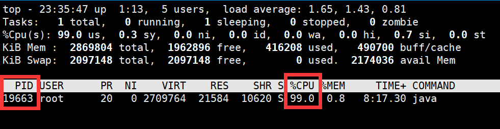
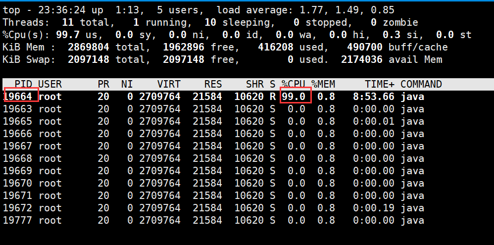
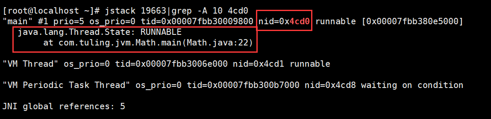

# 线上问题排查知识汇总
---


# 服务间通信超时问题怎么解决？

服务间通信超时问题是微服务架构中常见的挑战之一，以下是一些有效的解决方案：

简答：服务间通信超时问题首先要做的是定位问题，分析问题，让后根据情况采取如下方案：

**1**，优化服务性能**减少不必要的逻辑和数据库优化**

**2，**优化网络配置**调整超时时间设置和选择合适的通信协议**

**3，**采用容错机制**熔断器模式和重试机制**

**4，**进行服务降级**核心业务优先**

**5，**优化服务架构**异步通信和分批处理**

**6，**监控和预警**实时监控网络性能和预警机制**

****

**补充深入细节，附关键源码**

### 一、优化服务性能
+ **代码优化**
    - **减少不必要的逻辑** ：对服务的业务逻辑进行审查，去除冗余的计算步骤和复杂的业务流程。例如，如果一个服务在处理请求时进行了大量的数据转换，但其中有些转换对于后续的业务处理并没有实际意义，就可以将其移除。
    - **优化算法** ：使用更高效的算法来处理数据。比如，在进行数据排序时，将时间复杂度较高的冒泡排序替换为快速排序，可以显著减少处理时间。
+ **数据库优化**
    - **添加索引** ：为数据库中的查询字段添加索引，加快数据检索速度。例如，如果一个服务经常根据用户的手机号查询用户信息，那么在手机号字段上添加索引可以大大减少数据库查询时间。
    - **优化查询语句** ：避免使用复杂的嵌套查询和关联查询。例如，将多个表的关联查询拆分为多个简单的查询，然后在应用层进行数据整合。

### 二、优化网络配置
+ **调整超时时间设置**
    - **合理设置客户端超时时间** ：根据服务的实际响应时间和网络状况，设置合适的客户端超时时间。例如，对于一个通常响应时间为 200ms 的服务，可以将客户端超时时间设置为 500ms - 1000ms。

#### 一、优化服务性能
1. **代码优化**
    - **减少不必要的逻辑**
        * **问题**：服务中存在冗余的计算步骤。
        * **解决方案**：审查代码，移除不必要的逻辑。
        * **示例代码**：

```java
/**
 * @Autho:TianMing
 * @Description： TODO
 */
public User getUserInfo(String userId) {
    User user = userDao.findById(userId);
    // 冗余的数据转换
    user.convertData();
    return user;
}

// 优化后的代码
public User getUserInfo(String userId) {
    return userDao.findById(userId);
}
```

    - **优化算法**
        * **问题**：使用低效的排序算法。
        * **解决方案**：将冒泡排序替换为快速排序。
        * **示例代码**：

```java
/**
 * @Autho:TianMing
 * @Description： TODO
 */
// 原代码（冒泡排序）
public static void bubbleSort(int[] arr) {
    for (int i = 0; i  arr[j + 1]) {
                int temp = arr[j];
                arr[j] = arr[j + 1];
                arr[j + 1] = temp;
            }
        }
    }
}

// 优化后的代码（快速排序）
public static void quickSort(int[] arr, int low, int high) {
    if (low

```

2. **选择合适的通信协议**
    - **使用轻量级协议**
        * **问题**：使用重量级通信协议导致性能问题。
        * **解决方案**：使用HTTP/2或gRPC。
        * **示例代码（gRPC）**：

```java
/**
 * @Autho:TianMing
 * @Description： 定义服务接口
 * @Date:2020/6/16 20:30
 */
public interface UserService {
    void getUser(UserRequest request, StreamObserver responseObserver);
}

// 实现服务
public class UserServiceImpl extends UserServiceGrpc.UserServiceImplBase {
    @Override
    public void getUser(UserRequest request, StreamObserver responseObserver) {
        UserResponse response = UserResponse.newBuilder()
            .setId(request.getId())
            .setName("User Name")
            .build();
        responseObserver.onNext(response);
        responseObserver.onCompleted();
    }
}

// 客户端调用
public class UserClient {
    public static void main(String[] args) {
        ManagedChannel channel = ManagedChannelBuilder.forAddress("localhost", 50051)
            .usePlaintext()
            .build();
        UserServiceGrpc.UserServicesStub stub = UserServiceGrpc.newStub(channel);
        UserRequest request = UserRequest.newBuilder().setId(1).build();
        stub.getUser(request, new StreamObserver() {
            @Override
            public void onNext(UserResponse value) {
                System.out.println("User Name: " + value.getName());
            }

            @Override
            public void onError(Throwable t) {
                t.printStackTrace();
            }

            @Override
            public void onCompleted() {
                System.out.println("Completed");
            }
        });
    }
}
```

**3，能力足够的话可自定义消息协议**

**API工具包**

```java
/**
 * @Auth: TianMing
 * @Description： TODO
 * @Date:2020/6/16 20:31
 */
@Data
public class Header {
    //sessionId  , reqType , contextLen
    private long sessionId;
    private byte reqType;
    private int contextLen;
}
/**
 * @Auth: TianMing
 * @Description： TODO
 * @Date:2021/6/16 20:31
 */
@Data
public class MessageRecord {
    //Header  , Object  body
    private Header header;
    private Object body;
}
/**
 * @Auth: TianMing
 * @Description： TODO
 * @Date:2021/6/16 20:33
 */
public enum OpCode {
    REQ((byte)0),RES((byte)1),PING((byte)2),PONG((byte)3);
    private byte code;
    private OpCode(byte code) {
        this.code = code;
    }
    public byte code(){
        return  this.code;
    }
}

/**
 * @Auth: TianMing
 * @Description： TODO
 * @Date:2020/6/16 20:37
 */
//解码器
public class MessageRecordDecoder  extends ByteToMessageDecoder {
//    int length = 0;//拆包粘包解决方案3 定长读取
    @Override
    protected void decode(ChannelHandlerContext channelHandlerContext, ByteBuf byteBuf, List list) throws Exception {
        //长度不够，继续等待。超出长度交给下一个handler
//        if (byteBuf.readableBytes()>4){
//            if(length==0) length= byteBuf.readInt();
//            if(byteBuf.readableBytes()>>>>>>>>>>> 开始解码 >>>>>>>>>>>>");
        MessageRecord record = new MessageRecord();
        Header header = new Header();
        //按照消息协议的顺序
        header.setSessionId(byteBuf.readLong());//根据自定义的消息  long  byte
        header.setReqType(byteBuf.readByte());
        header.setContextLen(byteBuf.readInt());
        record.setHeader(header);
        if(header.getContextLen()>0) {
            byte[]contents = new byte[header.getContextLen()];
            byteBuf.readBytes(contents);
            ByteArrayInputStream bis = new ByteArrayInputStream(contents);
            ObjectInputStream ois = new ObjectInputStream(bis);
            record.setBody(ois.readObject());//反序列用的IO流
            System.out.println("反序列化的消息： "+record);
            list.add(record);
        }else{
            System.out.println("msg can't be null");
        }
    }
}

/**
 * @Auth: TianMing
 * @Description： TODO
 * @Date:2020/6/16 20:47
 */
public class MessageRecordEncoder extends MessageToByteEncoder {
    @Override
    protected void encode(ChannelHandlerContext channelHandlerContext, MessageRecord messageRecord, ByteBuf byteBuf) throws Exception {
        System.out.println(">>>>>>>>>开始编码>>>>>>>>");
        Header header = messageRecord.getHeader();
        byteBuf.writeLong(header.getSessionId());
        byteBuf.writeByte(header.getReqType());
        Object  body = messageRecord.getBody();
        if (body!=null) {
            ByteArrayOutputStream bos = new ByteArrayOutputStream();
            ObjectOutputStream oos = new ObjectOutputStream(bos);
            oos.writeObject(body);
            byte[]bytes = bos.toByteArray();
            byteBuf.writeInt(bytes.length);//解码器 读取 long 之后byte 之后就是这里的长度了
            byteBuf.writeBytes(bytes);
        }else{
            //消息体为空，则长度为0
            byteBuf.writeInt(0);
        }
    }
}

```

客户端：

```java
/**
 *  @Auth:TianMing
 * @Description： TODO
 * @Date:2020/6/16 21:16
 */
public class ClientHandler extends ChannelInboundHandlerAdapter {
    @Override
    public void channelRead(ChannelHandlerContext ctx, Object msg) throws Exception {
        MessageRecord record = (MessageRecord)msg;
        System.out.println("Client received msg : " + record.toString());
        super.channelRead(ctx, msg);
    }
}

/**
 * @Auth:TianMing
 * @Description： TODO
 * @Date:2020/6/16 21:09
 */
public class ProtocolClient {
    public static void main(String[] args) {
        EventLoopGroup worker = new NioEventLoopGroup();
        Bootstrap bootstrap = new  Bootstrap();
        bootstrap.group(worker).channel(NioSocketChannel.class)
                .handler(new ChannelInitializer() {
                    @Override
                    protected void initChannel(SocketChannel socketChannel) throws Exception {
                        socketChannel.pipeline().addLast(
                                new LengthFieldBasedFrameDecoder(1024*1024,9,4,0,0))
                                .addLast(new MessageRecordEncoder())
                                .addLast(new MessageRecordDecoder())
                                .addLast(new ClientHandler());//处理服务端的消息。
                    }
                });
        try {
            ChannelFuture future=  bootstrap.connect(new InetSocketAddress("localhost",8888)).sync();
            System.out.println("服务端连接成功。。。。。。。。。。");
            Channel channel = future.channel();

            //开始传输消息
            // for (int i=0 ;i() {
                    @Override
                    protected void initChannel(SocketChannel socketChannel) throws Exception {
                        //第一个handler是处理半包问题
                        socketChannel.pipeline().addLast(
                                new LengthFieldBasedFrameDecoder(1024*1024,9,4,0,0))
                                .addLast(new MessageRecordEncoder())
                                .addLast(new MessageRecordDecoder())
                                .addLast(new ServerHandler());//处理服务端的消息。
                    }
                });
        try {
           ChannelFuture channelFuture =  bootstrap.bind(8888).sync();
            System.out.println("我的服务已开启。。。。。。。。。");
            channelFuture.channel().closeFuture().sync();
        } catch (InterruptedException e) {
            e.printStackTrace();
        }finally {
            work.shutdownGracefully();
            boss.shutdownGracefully();
        }
    }
}
```

#### 三、采用容错机制
1. **熔断器模式**
    - **实现原理**
        * **问题**：服务调用出现故障导致级联失败。
        * **解决方案**：使用Hystrix实现熔断器。
        * **示例代码**：

```java
/**
 * @Autho:TianMing
 * @Description：
 */
@HystrixCommand(fallbackMethod = "fallbackGetUser")
public User getUser(String userId) {
    return restTemplate.getForObject("http://user-service/users/" + userId, User.class);
}

public User fallbackGetUser(String userId) {
    return new User(userId, "Fallback User");
}
```

2. **重试机制**
    - **合理设置重试次数和间隔**
        * **问题**：网络抖动导致服务调用失败。
        * **解决方案**：在客户端设置重试机制。
        * **示例代码（FeignClient）**：

```java
/**
 * @Autho:TianMing
 * @Description： 重试机制
 */
@FeignClient(name = "user-service", configuration = FeignConfig.class)
public interface UserClient {
    @GetMapping("/users/{userId}")
    User getUser(@PathVariable("userId") String userId);
}

@Configuration
public class FeignConfig {
    @Bean
    public Retryer feignRetryer() {
        return new Retryer.Default(1000, 3000, 3);
    }
}
```

#### 四、进行服务降级
1. **核心业务优先**
    - **剥离非核心功能**
        * **问题**：服务超时影响用户体验。
        * **解决方案**：剥离非核心功能。
        * **示例代码**：

```java
/**
 * @Autho:TianMing
 * @Description： 服务降级
 */
public class ProductService {
    public ProductResponse getProductInfo(String productId) {
        Product product = productDao.findById(productId);
        // 剥离非核心功能，不加载评论信息
        return new ProductResponse(product);
    }
}
```

    - **简化响应内容**
        * **问题**：响应内容过大导致传输时间长。
        * **解决方案**：返回简化的数据。
        * **示例代码**：

```java
public class NewsService {
    public List getNewsList() {
        // 返回简化的新闻列表
        return newsDao.findBriefNewsList();
    }
}
```

#### 五、优化服务架构
1. **异步通信**
    - **采用消息队列**
        * **问题**：服务间同步调用导致性能瓶颈。
        * **解决方案**：使用RabbitMQ实现异步处理。
        * **示例代码**：

```java
/**
 * @Autho:TianMing
 * @Description： 生产者
 */
@Service
public class OrderProducer {
    @Autowired
    private RabbitTemplate rabbitTemplate;

    public void sendOrder(Order order) {
        rabbitTemplate.convertAndSend("order-exchange", "order.routing.key", order);
    }
}

// 消费者
@Service
public class OrderConsumer {
    @RabbitListener(queues = "order-queue")
    public void processOrder(Order order) {
        // 处理订单逻辑
        System.out.println("Processing order: " + order.getId());
    }
}
```

    - **任务分批处理**
        * **问题**：批量处理任务耗时长。
        * **解决方案**：将任务拆分为多个小批次处理。
        * **示例代码**：

```java
/**
 * @Autho:TianMing
 * @Description： 分批处理
 */
public class DataProcessor {
    public void processData(List dataList) {
        int batchSize = 100;
        for (int i = 0; i  batch = dataList.subList(i, endIndex);
            processBatch(batch);
        }
    }

    private void processBatch(List batch) {
        // 处理一个批次的数据
        System.out.println("Processing batch of size: " + batch.size());
    }
}
```

#### 六、监控和预警
1. **实时监控**
    - **监控服务性能指标**
        * **问题**：无法实时掌握服务性能。
        * **解决方案**：使用Prometheus和Grafana进行监控。
        * **示例代码（Spring Boot Actuator）**：

```java
/**
 * @Autho:TianMing
 * @Description：实时监控
 */
@SpringBootApplication
@EnableHypermediaSupport(type = HypermediaType.HAL)
public class Application {
    public static void main(String[] args) {
        SpringApplication.run(Application.class, args);
    }
}

// application.properties
management.endpoints.web.exposure.include=*
management.metrics.export.prometheus.enabled=true
```

    - **监控网络状况**
        * **问题**：网络问题导致服务调用超时。
        * **解决方案**：使用网络监控工具。
        * **示例工具**：使用Wireshark或tcpdump监控网络流量。
2. **预警机制**
    - **设置合理的阈值**
        * **问题**：无法及时发现服务异常。
        * **解决方案**：设置合理的预警阈值。
        * **示例代码（Prometheus Alertmanager）**：

```yaml
# prometheus.yml
alert.rules:
  - alert: HighResponseTime
    expr: http_request_duration_seconds{quantile="0.5"} > 0.5
    for: 1m
    labels:
      severity: warning
    annotations:
      summary: "High response time"
      description: "HTTP request duration exceeds 500ms for 1 minute."
```

    - **及时响应预警**
        * **问题**：预警后无人处理。
        * **解决方案**：建立值班制度和自动化响应机制。
        * **示例工具**：使用PagerDuty或Opsgenie进行报警通知。


# OOM问题如何排查

当Java应用程序遇到OOM（OutOfMemoryError）错误时，通常意味着程序超出了可用的内存容量。这可能由于内存泄漏或配置不足导致。以下是详细的排查过程和示例，帮助诊断和解决这种问题。

### 排查步骤

#### 1. 确认OOM错误类型

首先，需要明确是哪种OOM：

* **java.lang.OutOfMemoryError: Java heap space**：堆内存不足。
* **java.lang.OutOfMemoryError: Metaspace**：元空间不足（JDK 8及以上）。
* **java.lang.OutOfMemoryError: GC overhead limit exceeded**：GC时间过长。

#### 2. 收集诊断信息

收集以下信息：

* **Error日志**：找到OOM发生时的日志片段。
* **Heap dump**：获取堆转储文件（可以使用-XX:+HeapDumpOnOutOfMemoryError来自动生成）。
* **GC日志**：启用GC日志以分析垃圾回收活动。

**示例JVM参数**：

```java
-XX:+HeapDumpOnOutOfMemoryError -XX:HeapDumpPath=/path/to/dump -Xlog:gc*:file=gc.log:time
```

#### 3. 分析Heap Dump

使用工具分析堆转储文件，找出内存泄漏的来源或占用最多空间的对象。

**工具**：Eclipse Memory Analyzer (MAT)

**分析步骤**：

1. **加载Heap Dump**：使用MAT打开生成的堆转储文件。
2. **查找大对象**：使用MAT的“Histogram”视图查看占用内存最大的对象类型。
3. **查找泄漏疑点**：使用“Leak Suspects Report”功能自动分析可能的内存泄漏点。

**示例分析**：\ 通过MAT发现java.util.ArrayList实例占用了大量的内存，并继续深入查看引用路径。

#### 4. 分析和识别问题代码

检查代码中可能导致OOM的地方。

* **大对象集合**：导致内存占用过大的大型集合（如List, Map等）。
* **长生命周期对象**：一些不必要的对象拥有比预期更长的生命周期。

**常见问题场景**：

* **缓存未清理**：使用自定义缓存，没有合适的过期或清理机制。
* **无限增长的数据结构**：例如，把无限的请求数据储存在集合中。

#### 5. 优化代码和配置

**解决方法**：

1. **优化数据结构**：使用合适的数据结构和集合类。
2. **清理长生命周期对象**：确保不再需要的对象能够被GC及时回收。
3. **调整JVM参数**：如果应用确实需要更多内存，适当调整堆大小。

**示例代码修复**：\ 假设原代码存在问题：

```java
List largeList = new ArrayList<>();

public void processData(List data) {
    largeList.addAll(data); // 增长无限制
}
```

修复后：

```java
private static final int MAX_SIZE = 10000;

public void processData(List data) {
    if (largeList.size() + data.size() > MAX_SIZE) {
        largeList.clear(); // 清理或采取措施避免无限增长
    }
    largeList.addAll(data);
}
```

**配置调优**：\ 增加堆大小以适应应用的需要（如果合理）。

```java
-Xmx4g -Xms2g
```

#### 6. 验证和监控

* 运行负载测试验证修改后的程序性能和内存使用。
* 持续进行内存使用监控，避免再次出现OOM。

### 示例全面讲解

**场景**：一个Java Web应用程序在高负载测试中抛出java.lang.OutOfMemoryError: Java heap space。

**步骤回顾**：

1. **配置JVM参数**以捕捉OOM：

```java
-XX:+HeapDumpOnOutOfMemoryError -XX:HeapDumpPath=/path/to/dump -Xlog:gc*:file=gc.log:time
```

2. **收集Heap Dump**在OOM发生时的转储文件。
3. **使用MAT分析**：
   * 打开堆转储，查看Histogram，发现Session对象占用了大量内存。
   * 通过Dominator Tree分析，发现Session没有及时失效。
4. **问题识别**：
   * 应用存在一个自定义Session管理模块，未能正确地释放过期的Session。
   * 永不过期的Session导致内存耗尽。
5. **代码优化**：
   * 实现Session超时机制。
   * 在每次请求后或固定的时间间隔清理过期的Session。

```java
public void cleanupSessions() {
    sessions.entrySet().removeIf(entry -> entry.getValue().isExpired());
}
```

1. **配置调整与测试**：
   * 增加堆内存配置（如从-Xmx512m增加到-Xmx1g）。
   * 执行负载测试，验证修复效果。
2. **监控和告警**：
   * 配置实时监控内存使用情况的工具。
   * 设置内存使用率告警，防止问题重现。

通过系统化地分析和优化内存管理，应用程序在高负载下运行稳定，未再出现内存溢出错误。此例展示了如何排查OOM问题，结合工具和编程实践，有效解决实际中的复杂问题。


# Java进程突然挂了如何排查

当Java进程突然挂掉时，可能是由于程序崩溃、资源限制、外部干扰等多种因素导致的。排查这些问题需要全面的分析，从日志、线程转储到系统资源监控。以下是一个详细的排查过程和步骤。

### 排查步骤

1. **日志分析**
2. **生成和分析Heap Dump**
3. **检查系统资源**
4. **分析代码和依赖**
5. **环境配置检查**
6. **监控和验证**

### 详细的排查过程

#### 1. 日志分析

* **应用日志**：查看应用程序日志（例如application.log），搜索异常、错误信息和未处理的异常。
* **系统日志**：检查操作系统日志（如/var/log/syslog或/var/log/messages）是否有突发事件记录。

**关键日志条目**：

* java.lang.OutOfMemoryError：内存不足。
* java.lang.StackOverflowError：栈溢出。
* java.lang.NoClassDefFoundError：类未找到。

#### 2. 生成和分析Heap Dump

* 在应用启动时设置JVM参数，在崩溃时生成Heap Dump：

```java
-XX:+HeapDumpOnOutOfMemoryError -XX:HeapDumpPath=/path/to/dump
```

* **分析工具**：使用Memory Analyzer Tool（MAT）分析Heap Dump，识别内存泄漏和占用最多内存的对象。

#### 3. 检查系统资源

* **CPU使用**：
  * 使用top或htop监控CPU负载，查看是否有异常的负载尖峰。
* **内存使用**：
  * 使用free -m或vmstat检查内存使用情况。
  * 确认系统是否有过度的内存消耗。
* **磁盘空间**：
  * 使用df -h检查磁盘空间，确认是否有磁盘写满的情况。

#### 4. 分析代码和依赖

* **代码审查**：检查最近的代码变更是否引入了错误。
* **外部库**：确定是否使用了不兼容或有漏洞的第三方库。

**常见问题场景**：

* 未关闭的文件句柄或数据库连接。
* 死锁或其他并发问题导致的资源占用。

#### 5. 环境配置检查

* **JVM参数**：确认启动参数是否合适，例如-Xmx（最大堆内存大小）和-Xms（初始堆内存大小）的设置。
* **环境依赖**：检查Java版本、操作系统版本及补丁更新等。

#### 6. 监控和验证

* **监控加强**：
  * 使用Prometheus、Grafana等工具对系统和应用进行实时监控。
  * 设置合适的报警阈值，在出现异常情况时及时获得通知。
* **验证修复**：
  * 针对识别问题进行修复后，在接近生产环境的测试环境中进行验证。
  * 通过自动化测试覆盖关键功能和场景。

### 具体示例

**问题描述**：一个Java Web应用在运行一段时间后突然挂掉。

**排查过程**：

1. **日志分析**：
   * 查看应用日志，发现出现java.lang.StackOverflowError错误和反复递归调用。
   * 系统日志中没有发现内存溢出记录，但有些CPU使用率高的记录。
2. **生成和分析Heap Dump**：
   * 配置了-XX:+HeapDumpOnOutOfMemoryError，未找到堆转储，排除内存不足。
3. **检查系统资源**：
   * 使用top检查时发现进程占用了100% CPU，疑似陷入死循环。
4. **分析代码和依赖**：
   * 发现递归函数中缺乏退出条件，导致无穷递归，从而导致栈溢出。

```java
public int computeFactorial(int n) {
// 缺少 n == 0 的退出条件
return n * computeFactorial(n - 1);
}
```

**修复**：添加递归基准条件。

```java
public int computeFactorial(int n) {
if (n == 0) return 1;
return n * computeFactorial(n - 1);
}
```

5. **环境配置检查**：
   * 确保JVM的内存参数-Xms4g -Xmx4g符合资源需求。
6. **监控和验证**：
   * 在测试环境中通过负载测试验证修复效果。
   * 增强Grafana监控和Prometheus报警机制对关键性能指标的实时监控。

### 总结

Java进程的突然挂掉可能由于多种原因，包括代码错误、资源限制、环境配置或外部依赖问题。通过全面的检查和分析，可以逐步识别和解决问题。使用现代化的监控和报警工具也可帮助提前预警和排查生产环境中潜在的问题。


# MySQL数据库连接池爆满如何排查

当Java应用程序面临MySQL数据库连接池爆满的问题时，通常会导致应用程序性能下降或请求被拒绝。解决这个问题需要深入分析程序的数据库连接管理。以下是具体的排查步骤和过程：

### 确认问题

首先，我们需要确认连接池确实爆满了。通常可以通过以下方式：

* 检查应用日志，查找与数据库连接相关的错误信息，如"无法获取连接"等。
* 查看数据库连接池的监控面板（如果有的话）。
* 使用数据库管理工具查看当前活跃连接数。

### 收集信息

收集以下信息：

* 连接池配置（最大连接数、最小连接数、超时时间等）
* 当前活跃连接数
* 数据库服务器资源使用情况（CPU、内存、磁盘I/O）
* 应用服务器资源使用情况
* 近期是否有代码变更或流量激增

### 分析连接使用情况

使用MySQL命令查看当前连接：

```java
SHOW PROCESSLIST;
```

这会显示所有当前连接，包括它们的状态、执行的查询等。

### 检查慢查询

查看是否有长时间运行的查询占用连接：

```java
SHOW FULL PROCESSLIST;
```

关注"Time"列，看是否有查询执行时间过长。

### 分析应用代码

检查应用代码中的连接使用方式：

* 是否正确关闭连接
* 是否有连接泄露
* 是否有不必要的长连接

例如，以下代码可能导致连接泄露：

```java
public void leakyMethod() {
    Connection conn = null;
    try {
        conn = dataSource.getConnection();
        // 使用连接进行操作
    } catch (SQLException e) {
        e.printStackTrace();
    }
    // 没有在 finally 块中关闭连接
}
```

正确的做法应该是：

```java
public void leakyMethod() {
    Connection conn = null;
    try {
        conn = dataSource.getConnection();
        // 使用连接进行操作
    } catch (SQLException e) {
        e.printStackTrace();
    }
    finally {
        conn.close();
    }
}
```

### 检查连接池配置

检查连接池的配置是否合理。以HikariCP为例：

```java
HikariConfig config = new HikariConfig();
config.setMaximumPoolSize(10);
config.setConnectionTimeout(30000);
config.setIdleTimeout(600000);
config.setMaxLifetime(1800000);
```

确保这些参数设置合理：

* maximumPoolSize：最大连接数
* connectionTimeout：等待连接的最大毫秒数
* idleTimeout：连接允许在池中闲置的最长时间
* maxLifetime：连接最长生命周期

### 使用监控工具

使用如JConsole或VisualVM等Java监控工具，观察连接池的使用情况。

### 数据库性能分析

使用MySQL的性能模式（Performance Schema）来分析数据库性能：

```java
SELECT * FROM performance_schema.events_waits_summary_global_by_event_name
WHERE event_name LIKE '%wait/synch/mutex/innodb/%'
ORDER BY sum_timer_wait DESC;
```

这可以帮助识别数据库层面的瓶颈。

### 解决方案

根据分析结果，可能的解决方案包括：

* 优化慢查询
* 增加连接池大小（如果服务器资源允许）
* 修复连接泄露的代码
* 使用读写分离或分库分表来分散负载
* 添加连接池监控和告警机制

### 实施和验证

实施解决方案后，持续监控连接池使用情况，确保问题得到解决。

示例：\ 假设我们发现了一个导致连接池爆满的问题，原因是某个查询长时间运行导致连接无法释放。

1. 首先，我们通过SHOW FULL PROCESSLIST发现了一个长时间运行的查询：

```java
+----+------+-----------------+------+---------+------+---------------+------------------+
| Id | User | Host            | db   | Command | Time | State         | Info             |
+----+------+-----------------+------+---------+------+---------------+------------------+
| 1  | root | localhost:3306  | mydb | Query   | 3600 | Sending data  | SELECT * FROM ... |
+----+------+-----------------+------+---------+------+---------------+------------------+
```

2. 分析该查询，发现是一个全表扫描的大查询：

```java
SELECT * FROM large_table WHERE non_indexed_column = 'some_value';
```

3. 优化这个查询：
   * 添加适当的索引
   * 限制返回的行数

```java
ALTER TABLE large_table ADD INDEX idx_non_indexed_column (non_indexed_column);
SELECT * FROM large_table WHERE non_indexed_column = 'some_value' LIMIT 1000;
```

4. 在应用代码中，我们发现了以下问题：

```java
public List fetchData(String value) {
Connection conn = dataSource.getConnection();
try {
    PreparedStatement stmt = conn.prepareStatement("SELECT * FROM large_table WHERE non_indexed_column = ?");
    stmt.setString(1, value);
    ResultSet rs = stmt.executeQuery();
    // 处理结果集
} catch (SQLException e) {
    e.printStackTrace();
}
// 连接未关闭
return dataList;
}
```

5. 修改代码以正确管理连接：

```java
public List fetchData(String value) {
List dataList = new ArrayList<>();
try {Connection conn = dataSource.getConnection();
     PreparedStatement stmt = conn.prepareStatement("SELECT * FROM large_table WHERE non_indexed_column = ? LIMIT 1000")) {
    stmt.setString(1, value);
    try (ResultSet rs = stmt.executeQuery()) {
        while (rs.next()) {
            // 处理结果集
            dataList.add(new Data(rs.getString("column1"), rs.getInt("column2")));
        }
    }
} catch (SQLException e) {
    logger.error("Error fetching data", e);
} finally{
    conn.close();
}
return dataList;
}
```

6. 调整连接池配置：

```java
HikariConfig config = new HikariConfig();
config.setMaximumPoolSize(20); // 增加最大连接数
config.setConnectionTimeout(30000);
config.setIdleTimeout(600000);
config.setMaxLifetime(1800000);
```

7. 添加监控：
   * 使用Spring Actuator或自定义监控来跟踪连接池使用情况
   * 设置告警，当连接使用率接近最大值时通知开发团队

通过这些步骤，我们解决了导致连接池爆满的主要问题，优化了数据库查询，修复了连接泄露，并增强了监控能力。在实施这些更改后，我们会持续监控系统，确保连接池使用正常，并在必要时进行进一步的优化。


# 慢SQL问题如何排查

在Java应用程序中，慢SQL查询是一个常见的性能瓶颈，可能导致应用响应缓慢。有效地排查慢SQL问题需要一个系统的过程，从识别问题到优化解决。下面是详细的排查过程和一个具体的示例：

### 详细的慢SQL排查过程

#### 1. 收集并识别慢SQL

**方法**：

* 使用数据库提供的慢查询日志功能。
* 在应用程序中添加SQL执行时间日志。
* 使用APM（应用性能管理）工具监控（如New Relic, Dynatrace）。

**示例**：开启MySQL慢查询日志

```java
SET GLOBAL slow_query_log = 'ON';
SET GLOBAL long_query_time = 2;  -- 设置慢查询阈值为2秒
```

#### 2. 分析慢SQL语句

**抓取SQL**：

* 从慢查询日志或应用日志中提取慢SQL语句。
* 收集执行计划和执行时间。

**示例查询**：

```java
SELECT orders.id, orders.date, customers.name FROM orders
JOIN customers ON orders.customer_id = customers.id
WHERE order.date BETWEEN '2023-01-01' AND '2023-12-31'
ORDER BY order.date DESC;
```

#### 3. 收集SQL执行计划

获取慢SQL的执行计划以了解数据库如何执行查询。

**分析工具**：

* MySQL：使用EXPLAIN命令。
* Oracle：使用AUTOTRACE或DBMS_XPLAN.
* Postgres：使用EXPLAIN ANALYZE.

**示例执行计划**：

```java
EXPLAIN SELECT orders.id, orders.date, customers.name FROM orders
JOIN customers ON orders.customer_id = customers.id
WHERE order.date BETWEEN '2023-01-01' AND '2023-12-31'
ORDER BY order.date DESC;
```

执行计划会显示表扫描类型（如全表扫描、索引扫描），以及各个操作的数量、时间和可能的改进点。

#### 4. 检查表和索引

* **确认索引使用情况**：确定慢SQL查询的过滤条件和连接条件是否已正确索引。
* **统计信息**：确保数据库拥有最新的统计信息，以优化查询计划。
* **检查数据量**：了解涉及表的数据量，以评估查询复杂性。

**索引配置示例**：

```java
CREATE INDEX idx_order_date ON orders(date);
CREATE INDEX idx_customer_id ON orders(customer_id);
```

#### 5. 优化SQL设计

* **重构复杂查询**：拆分复杂的多表查询，分阶段进行。
* **减少返回数据量**：仅查询必要的数据列，避免使用SELECT *。
* **使用合适的聚合**：如果使用聚合函数，确保有效使用索引，避免全表扫描。

**优化后的SQL**：

```java
SELECT o.id, o.date, c.name
FROM (SELECT id, date, customer_id FROM orders
      WHERE date BETWEEN '2023-01-01' AND '2023-12-31') AS o
JOIN customers c ON o.customer_id = c.id
ORDER BY o.date DESC;
```

#### 6. 配置和硬件观察

* **数据库参数**：调整内存缓存参数，连接池配置等以提升性能。
* **硬件资源**：检查CPU和内存使用是否是瓶颈。
* **负载分布**：了解负载峰值时间并进行优化（如数据分片、分区）。

#### 7. 验证和实现优化

* **数据库性能测试**：进行负载测试以验证优化效果。
* **监控持续执行情况**：持续观察SQL的执行性能，确保性能提升。

### 排查示例

**场景**：某电商平台的订单列表页面加载缓慢，主要依赖一个慢SQL查询。

**具体步骤**：

1. **收集日志**：通过慢查询日志确认问题SQL。

```java
SELECT * FROM orders WHERE order_date BETWEEN '2023-01-01' AND '2023-12-31';
```

2. **分析执行计划**：

```java
EXPLAIN SELECT * FROM orders ...
```

结果显示使用了全表扫描。

3. **检查索引**：发现order_date没有索引。创建索引：

```java
CREATE INDEX idx_order_date ON orders(order_date);
```

4. **优化查询结构：**
   * 重构SQL为：

```java
SELECT id, customer_id, order_date FROM orders
WHERE order_date BETWEEN '2023-01-01' AND '2023-12-31';
```

5. **使用执行计划验证优化**：
   * 使用EXPLAIN确认新索引被使用，扫描时间大幅减少。
6. **数据库配置检查**：
   * 调整缓存配置以提升读取效率。
7. **性能测试**：进行端到端性能测试，确认响应时间减少。
8. **部署和持续监控**：
   * 将优化后的代码部署到生产环境，并利用APM工具持续监控性能改进情况。

### 结论

通过系统化的步骤，快速识别并优化慢SQL，不仅提升了应用响应速度，同时改善了用户体验。每个步骤都有助于从不同角度发现潜在问题，并通过合适的方法进行解决。这样的流程在不同类型的数据库上可以适当调整，但核心原则是一致的。


# 文件导入导出导致内存溢出如何排查

在Java应用程序中，文件导入导出导致内存溢出（OutOfMemoryError）是一个常见的问题，特别是在处理大文件时。内存溢出通常是由于程序试图在堆内存中加载过多的数据，超过了JVM的内存限制。下面提供一个详细的排查和解决过程，以及一个具体的示例。

### 排查和优化步骤

#### 1. 确认内存溢出

* **日志检查**：确认应用日志中存在java.lang.OutOfMemoryError: Java heap space。
* **监控内存使用**：使用JVM监控工具（如JConsole、VisualVM）观察内存使用情况。

#### 2. 生成和分析Heap Dump

* 使用以下JVM参数配置生成Heap Dump：

```java
java -XX:+HeapDumpOnOutOfMemoryError -XX:HeapDumpPath=/path/to/your/dumpfile -jar your-application.jar
```

* 使用Memory Analyzer Tool（MAT）或Jvisualvm分析Heap Dump，查找内存使用热点，查看哪些对象占用了最多的内存。

#### 3. 代码检查

查看和分析导入导出代码，寻找加载过多数据到内存的地方。

**示例问题代码**：

```java
public void importData(File file) throws IOException {
    BufferedReader reader = new BufferedReader(new FileReader(file));
    String line;
    List data = new ArrayList<>();
    while ((line = reader.readLine()) != null) {
        data.add(line);  // 将所有文件内容加载到内存中
    }
    process(data);
    reader.close();
}
```

#### 4. 代码优化

针对文件处理逻辑进行优化，以减少内存占用：

**优化策略**：

1. **逐行处理**：
   * 而不是将整个文件加载到内存中，逐行读取并处理。
2. **合适的数据结构**：
   * 如果需要暂存数据，选择合适的、紧凑的数据结构。
3. **流处理**：
   * 使用Java 8 Streams或其他流处理工具。
4. **临时存储机制**：
   * 使用临时文件、数据库等外部存储来处理临时数据。

**优化后的代码**：

```java
public void importData(File file) throws IOException {
    try (BufferedReader reader = new BufferedReader(new FileReader(file))) {
        String line;
        while ((line = reader.readLine()) != null) {
            processLine(line);  // 逐行处理
        }
    }
}

private void processLine(String line) {
// 处理每一行的数据
}
```

#### 5. JVM和系统配置

* **增加堆内存**：调整JVM参数增加堆内存大小（根据服务器硬件条件评估）。

```java
-Xmx4096m  # 将最大内存调整为4GB
```

* **垃圾回收优化**：根据应用需求调整垃圾回收器参数。

#### 6. 验证解决方案

* **测试环境验证**：在开发或测试环境中使用较大文件进行验证测试。
* **性能和可靠性测试**：观察内存使用是否保持稳定。

#### 7. 部署和持续监控

* **实施改进后部署上线**。
* **使用APM工具**（如New Relic、Datadog）和JVM监控工具，跟踪内存使用和性能。

### 具体示例

**问题描述**：一个应用程序在导入大型CSV文件时抛出OutOfMemoryError，导致应用崩溃。

**具体步骤**：

1. **确认问题**：查看日志确定OutOfMemoryError发生。
2. **生成Heap Dump**：使用jmap命令生成堆转储，并使用MAT分析。
3. **分析结果**：MAT显示java.util.ArrayList使用大量内存，所有文件内容被加载到此集合中。
4. **代码审查与优化**：使用逐行处理替代整体加载，避免将文件的所有行保存在内存中。

```java
public void importData(File file) throws IOException {
    try (BufferedReader reader = new BufferedReader(new FileReader(file))) {
        String line;
        while ((line = reader.readLine()) != null) {
            processLine(line);
        }
    }
}

private void processLine(String line) {
// 处理或立即存储每一行的数据
}
```

5. **调整JVM设置**：在进行代码优化的同时，也通过增加-Xmx参数调整堆大小。
6. **验证和测试**：针对不同大小的文件进行测试，以确保内存使用情况稳定。
7. **上线和监控**：部署更新，同时配置监控警报，快速响应可能的内存问题。

### 总结

通过逐行处理文件、优化内存使用，以及调整JVM和系统内存设置，可以有效地解决文件导入导出导致的内存溢出问题。确保在开发阶段进行充分测试，并在生产环境中持续监控，以预防潜在的问题。采用现代化的流处理方式也能显著减缓内存压力。


# 线上系统突然响应缓慢如何排查

当线上系统突然响应缓慢时，快速而系统化的排查流程至关重要。以下是一个详细的步骤指南，帮助你快速定位并解决问题：

### 1. 问题确认

* **用户反馈**：收集具体的用户反馈信息，包括响应缓慢的表现和时间点。
* **初步验证**：尝试从不同的客户端访问系统，确认问题是否普遍存在。

### 2. 检查系统资源

* **CPU使用率**：使用工具如top或htop查看服务器的CPU使用情况。
* **内存使用率**：检查内存使用情况，确认是否存在内存泄漏或不足。
* **磁盘I/O**：利用iostat或dstat检查磁盘读写性能。
* **网络流量**：使用netstat、iftop等工具检查带宽使用情况，是否有流量异常。

### 3. 应用监控

* **APM工具**：使用New Relic、Datadog等APM工具，查看应用的性能监控数据。
* **关键路径分析**：检查关键请求路径的响应时间，找到响应缓慢的操作。
* **错误率分析**：检查应用程序的错误日志，判定是否存在异常。

### 4. 数据库性能

* **慢查询日志**：分析数据库慢查询日志，发现耗时的SQL操作。
* **连接池使用率**：检查数据库连接池状态，确认是否耗尽。
* **锁等待**：使用数据库管理工具（如MySQL Workbench）检查锁等待和交易阻塞情况。

### 5. 检查应用变更

* **代码变更**：查看最近的代码或配置变更记录，是否引入了性能问题。
* **部署记录**：确认是否在问题出现前进行了新的版本部署。

### 6. 线程和进程分析

* **线程转储**：获取Java线程转储（Thread Dump），分析线程状态是否存在死锁或阻塞。
* **GC分析**：检查垃圾回收日志（GC日志），确认是否频繁进行Full GC影响性能。

### 7. 网络分析

* **延迟和丢包**：使用ping或traceroute判定网络延迟和丢包情况。
* **DNS分辨**：检查DNS设置和解析时间。

### 8. 压力测试和负载

* **请求负载**：确认Current请求量是否超过系统设计能力。
* **模拟测试**：在测试环境重现实际负载，看是否复现性能问题。

### 9. 修复方案

* **问题定位后**：针对性地实施修复，如优化查询、增加资源、回滚变更等。
* **性能调优**：根据发现的瓶颈，进行代码和配置优化。

### 10. 验证和监控

* **问题修复后验证**：测试修复效果，并观察系统性能是否恢复正常。
* **持续监控**：继续监控系统性能指标，确保问题彻底解决。

### 实际案例

假设一个Web应用突然响应慢，问题排查如下：

1. **确认问题**：
   * 初步验证发现，首页加载时间从200ms增加到5s。
2. **检查系统资源**：
   * top命令发现CPU占用率接近100%，主要是Java进程占用。
3. **应用监控**：
   * 使用APM工具发现某API调用耗时过长，几乎占用大部分响应时间。
4. **数据库性能**：
   * 检查慢查询日志，发现一个复杂的JOIN操作SQL查询耗时过长。
5. **检查应用变更**：
   * 最近上线了一个新功能，涉及新增数据表但未建立索引。
6. **修复方案**：
   * 针对慢查询日志，分析并优化SQL查询，添加必要索引。
7. **验证和监控**：
   * 部署SQL优化后，重新测试系统，观察恢复正常的响应时间。

通过上面的步骤，可以快速定位并解决导致系统响应缓慢的原因，从而保证系统的稳定和高效运行。


# Java死锁问题如何排查

在Java应用程序中，死锁是一个经典的并发问题，它会导致线程永久阻塞，无法继续进行任何操作。排查Java死锁问题需要熟悉多线程调试技巧和工具。以下是一个详细的排查过程以及一个具体的示例。

### 排查步骤

1. **识别死锁现象**
2. **收集线程转储**
3. **分析线程转储**
4. **代码审查**
5. **重现问题**
6. **使用调试工具**
7. **优化和验证**

### 详细排查过程

#### 1. 识别死锁现象

通常，死锁会表现为应用程序挂起、不响应用户请求或CPU使用率下降。

#### 2. 收集线程转储

当应用出现不响应时，使用以下方法收集Java线程转储（Thread Dump）：

* **JVM命令**：在Linux或Mac上使用jstack，在Windows上使用Ctrl+Break。

```java
jstack -l  > threaddump.txt
```

* **IDE支持**：使用Eclipse或IntelliJ的调试功能来生成线程转储。

#### 3. 分析线程转储

从生成的线程转储中寻找"deadlock"相关信息。Java会在发现死锁时显示类似如下的信息：

```java
Found one Java-level deadlock:
=============================
"Thread-1":
waiting to lock monitor 0x000000000f8cba48 (object 0x00000000d66b4db0, a java.lang.Object),
which is held by "Thread-2"
"Thread-2":
waiting to lock monitor 0x000000000f8cba58 (object 0x00000000d66b4dc0, a java.lang.Object),
which is held by "Thread-1"

Java stack information for the threads listed above:
===================================================
"Thread-1":
at com.example.MyClass.methodA(MyClass.java:10)
                               - locked  (a java.lang.Object)
- waiting to lock  (a java.lang.Object)
"Thread-2":
at com.example.MyClass.methodB(MyClass.java:20)
- locked  (a java.lang.Object)
- waiting to lock  (a java.lang.Object)
```

#### 4. 代码审查

根据线程转储信息，对出现死锁的代码段进行详细审查。

**示例代码**：

```java
public class DeadlockExample {
    private final Object lock1 = new Object();
    private final Object lock2 = new Object();

    public void methodA() {
        synchronized (lock1) {
            System.out.println("Method A: Holding lock 1...");
            try { Thread.sleep(100); } catch (InterruptedException e) {}
            synchronized (lock2) {
                System.out.println("Method A: Holding lock 2...");
            }
        }
    }

    public void methodB() {
        synchronized (lock2) {
            System.out.println("Method B: Holding lock 2...");
            try { Thread.sleep(100); } catch (InterruptedException e) {}
            synchronized (lock1) {
                System.out.println("Method B: Holding lock 1...");
            }
        }
    }
}
```

* 问题：methodA 和 methodB 之间存在循环锁定。

#### 5. 重现问题

在测试环境中尝试重现死锁问题：

```java
public class DeadlockDemo {
    public static void main(String[] args) {
        DeadlockExample example = new DeadlockExample();

        Thread t1 = new Thread(() -> example.methodA(), "Thread-1");
        Thread t2 = new Thread(() -> example.methodB(), "Thread-2");

        t1.start();
        t2.start();
    }
}
```

#### 6. 使用调试工具

利用调试工具如Eclipse、IntelliJ的线程调试功能，进一步定位死锁位置。

#### 7. 优化和验证

**解决方案**：

* **锁排序**：确保所有线程以相同顺序申请锁。

```java
public void methodA() {
    synchronized (lock1) {
        synchronized (lock2) {
            // 操作
        }
    }
}

public void methodB() {
    synchronized (lock1) { // 调整顺序
        synchronized (lock2) {
            // 操作
        }
    }
}
```

* **使用****Lock****接口**：用显式锁代替内置同步。

```java
private final Lock lock1 = new ReentrantLock();
private final Lock lock2 = new ReentrantLock();

public void methodA() {
    lock1.lock();
    try {
        lock2.lock();
        try {
            // 操作
        } finally {
            lock2.unlock();
        }
    } finally {
        lock1.unlock();
    }
}

public void methodB() {
    lock1.lock(); // 确保同样顺序的锁定
    try {
        lock2.lock();
        try {
            // 操作
        } finally {
            lock2.unlock();
        }
    } finally {
        lock1.unlock();
    }
}
```

* **超时尝试**：利用tryLock的时间限制功能。

**验证**：

* 实施改动后，重新执行测试，确保死锁不再出现。
* 强化单元测试以覆盖多线程场景。

### 总结

排查Java死锁问题涉及识别现象、获取详细线程转储信息、分析代码、优化同步逻辑等步骤。在实践中，通过良好的设计可以避免大多数常见的死锁问题。使用高层次的并发工具（如java.util.concurrent包）也能显著简化并发编程，从而减少死锁的可能性。持续的监控和测试是确保应用稳定性的关键。


# 高并发线程安全问题如何排查

高并发环境下的线程安全问题排查是一个复杂的过程，需要结合多种工具和方法。以下是一个系统化的排查思路和步骤：

### 排查思路和步骤
1. **问题识别**
2. **代码审查**
3. **日志分析**
4. **性能分析**
5. **线程转储分析**
6. **模拟和重现**
7. **使用专业工具**
8. **修复和验证**

### 详细步骤
#### 1. 问题识别
+ **症状识别**：确定问题的具体表现，如数据不一致、死锁、性能下降等。
+ **影响范围**：评估问题影响的范围和严重程度。

#### 2. 代码审查
+ **并发控制检查**：检查是否正确使用了同步机制（如synchronized、volatile、Lock等）。
+ **共享资源访问**：审查共享资源的访问模式，确保线程安全。
+ **线程安全集合**：检查是否使用了合适的线程安全集合类。

#### 3. 日志分析
+ **错误日志**：查看系统日志中的错误和异常信息。
+ **自定义日志**：分析自定义的并发操作日志，追踪问题发生的上下文。

#### 4. 性能分析
+ **CPU分析**：使用工具如VisualVM或JProfiler分析CPU使用情况，找出热点方法。
+ **内存分析**：检查内存使用情况，是否存在内存泄漏或过度GC。

#### 5. 线程转储分析
+ **获取线程转储**：使用jstack命令或工具获取线程转储信息。
+ **分析线程状态**：检查线程状态，是否存在死锁、长时间等待等问题。

#### 6. 模拟和重现
+ **压力测试**：使用JMeter等工具模拟高并发场景。
+ **单元测试**：编写多线程单元测试，重现问题场景。

#### 7. 使用专业工具
+ **Java Flight Recorder (JFR)**：分析Java应用的运行时行为。
+ **Java Mission Control (JMC)**：分析JFR数据，发现性能问题和并发问题。
+ **FindBugs/SpotBugs**：静态代码分析工具，发现潜在的并发问题。

#### 8. 修复和验证
+ **实施修复**：根据分析结果，实施必要的代码修改。
+ **验证测试**：在模拟环境中进行充分的并发测试，验证修复效果。

### 实际案例
假设在一个高并发的订单处理系统中发现数据不一致问题：

1. **问题识别**：
    - 症状：订单状态不一致，有时显示已支付，有时显示未支付。
    - 影响：影响用户体验和系统可信度。
2. **代码审查**：
    - 发现订单状态更新方法没有proper同步机制。
3. **日志分析**：
    - 日志显示多个线程同时更新同一订单状态。
4. **性能分析**：
    - 使用VisualVM发现订单处理方法是CPU热点。
5. **线程转储分析**：
    - jstack显示多个线程同时在订单处理方法中。
6. **模拟和重现**：
    - 使用JMeter模拟高并发订单处理场景，成功重现问题。
7. **使用专业工具**：
    - 使用Java Flight Recorder捕获详细的线程行为。
8. **修复和验证**：
    - 修复：为订单状态更新添加适当的同步机制（如使用ReentrantLock）。
    - 验证：重新进行并发测试，确认数据一致性问题已解决。

```java
public class OrderService {
    private final ReentrantLock lock = new ReentrantLock();

    public void updateOrderStatus(Order order, String newStatus) {
        lock.lock();
        try {
            // 更新订单状态的逻辑
            order.setStatus(newStatus);
            // 保存到数据库
            orderRepository.save(order);
        } finally {
            lock.unlock();
        }
    }
}
```

### 总结
排查高并发线程安全问题需要综合运用多种技术和工具。关键在于:

1. 正确识别问题症状
2. 全面分析系统行为
3. 精准定位问题根源
4. 实施有效的修复措施

通过系统化的排查流程，结合适当的工具和方法，可以有效地解决高并发环境下的线程安全问题，提高系统的稳定性和可靠性。


# 线上问题的排查思路

线上系统问题的排查是一个常见且关键的任务。以下是一个系统化的排查思路和步骤：

### 1. 问题确认和信息收集

* **问题描述**：明确问题的具体表现，如系统响应慢、服务不可用、数据异常等。
* **影响范围**：确定问题影响的用户群体、功能模块或服务。
* **时间点**：确定问题发生的时间，是持续性还是间歇性。
* **环境信息**：收集系统环境信息，如服务器配置、JDK版本、应用版本等。

### 2. 快速响应

* **评估严重程度**：根据影响范围和业务重要性评估问题严重程度。
* **应急措施**：如果问题严重，考虑采取紧急措施，如服务降级、流量限制或回滚版本。

### 3. 日志分析

* **应用日志**：检查应用日志中的错误信息、异常堆栈等。
* **系统日志**：查看操作系统日志，如Linux的 /var/log/messages。
* **中间件日志**：检查数据库、缓存、消息队列等中间件的日志。

### 4. 监控数据分析

* **系统监控**：查看CPU、内存、磁盘I/O、网络等系统资源使用情况。
* **JVM监控**：分析GC日志、堆内存使用、线程状态等。
* **应用性能监控**：检查请求响应时间、吞吐量、错误率等指标。

### 5. 网络分析

* **网络连接**：检查网络连接状态，如防火墙设置、端口开放情况。
* **网络性能**：分析网络延迟、丢包率等指标。

### 6. 数据库分析

* **慢查询日志**：检查是否存在性能低下的SQL语句。
* **数据库状态**：查看数据库连接数、锁等待情况等。
* **执行计划**：分析关键SQL的执行计划是否合理。

### 7. 代码级别分析

* **线程转储**：获取Java线程转储（Thread Dump）分析线程状态。
* **堆转储**：必要时获取堆转储（Heap Dump）分析内存问题。
* **代码回顾**：检查最近的代码变更，是否引入了新的bug。

### 8. 性能分析与监控工具使用

* **Profiler**：使用Arthas、JProfiler等工具进行CPU和内存分析。
* **监控工具**：使用prometheus、grafana、skywalking等工具进行全链路跟踪。

### 9. 复现问题

* 在测试环境中尝试复现问题，以便更深入地分析。
* 模拟生产环境的负载和数据量。

### 10. 根因分析

* 基于收集到的所有信息，进行根因分析。

### 11. 解决方案

* 制定短期解决方案以快速修复问题。
* 规划长期优化方案以防止类似问题再次发生。

### 12. 验证和监控

* 在测试环境验证解决方案的有效性。
* 谨慎地将解决方案应用到生产环境。
* 持续监控系统，确保问题得到彻底解决。

### 13. 复盘和总结

* 编写详细的问题分析报告。
* 总结经验教训，更新相关文档和最佳实践。

### 实际案例

假设遇到一个Java应用响应变慢的问题：

1. **问题确认**：确认响应时间从原来的200ms增加到2000ms。
2. **日志分析**：应用日志显示大量GC警告。
3. **监控数据**：JVM监控显示老年代内存使用率高，Full GC频繁。
4. **线程分析**：Thread Dump显示多个线程在等待数据库连接。
5. **数据库分析**：发现数据库连接池耗尽，大量慢查询。
6. **代码审查**：最近的代码变更引入了一个无效的数据库连接释放。
7. **根因**：由于连接未正确释放，导致连接池耗尽，引发了大量等待，进而导致内存积压和频繁GC。
8. **解决方案**：修复连接释放的bug，优化相关SQL，增加连接池大小。
9. **验证和监控**：修复后，响应时间恢复正常，GC频率降低。

通过这种系统化的方法，我们能够有效地定位和解决线上问题，同时积累经验以预防未来可能出现的类似问题。


# 线上大规模故障时如何处理与恢复

当线上系统发生大规模故障时，恢复系统的正常运作需要迅速且有条理的行动。以下是处理和恢复大规模故障的步骤及指导原则：

### 处理与恢复步骤
1. **紧急响应**
2. **故障隔离**
3. **信息收集与初步分析**
4. **制定恢复计划**
5. **逐步恢复服务**
6. **监控与验证**
7. **全面复盘与改善**

### 详细指南
#### 1. 紧急响应
+ **组建应急小组**：立刻召集技术、运营等相关团队的核心成员组成应急小组。
+ **通报状况**：通过公司内部渠道（如Slack、邮件、电话）通报状况，停止一切与故障无关的操作。
+ **启动应急机制**：根据公司的应急响应计划，启动相关响应机制。

#### 2. 故障隔离
+ **隔离故障区域**：迅速识别并隔离故障区域/模块，防止故障蔓延。
+ **停用受影响服务**：必要时，临时停用受影响的服务，以防问题扩大。

#### 3. 信息收集与初步分析
+ **日志与监控数据**：迅速收集系统日志、错误日志和监控数据，以帮助分析故障原因。
+ **用户反馈**：查看用户反馈，理解问题的症状和影响范围。
+ **版本记录**：检查近期的代码和配置变更记录。

#### 4. 制定恢复计划
+ **短期修复方案**：根据初步分析，制定可快速实施的短期修复方案，优先恢复核心功能。
+ **沟通与审批**：与相关利益方（如业务团队）沟通方案，并获得必要的审批和授权。

#### 5. 逐步恢复服务
+ **恢复核心服务**：分阶段逐步恢复系统的核心服务，优先处理高优先级服务。
+ **实时监控**：在恢复过程中，实时监控系统性能和稳定性，确保恢复过程顺利。
+ **用户通知**：在适当的情况下，通知用户当前的进展和预计恢复时间。

#### 6. 监控与验证
+ **全面监控**：在系统恢复后，继续密切监控系统性能、资源使用和错误日志，确保问题不会再次发生。
+ **验证服务功能**：确认所有功能模块正常运作，并满足预期的性能标准。

#### 7. 全面复盘与改善
+ **事件复盘**：开展事件复盘会议，分析故障原因、响应过程中的问题，并总结经验教训。
+ **系统优化**：针对故障原因，进行系统优化和改进，更新应急响应计划。
+ **提高防御能力**：可能需要引入新的监控、备份和冗余策略，以防止类似问题再次发生。

### 实际案例
假设某电商平台发生大规模支付失败的故障：

1. **紧急响应**：
    - 迅速召集支付、数据库、网络等相关团队。
    - 通报问题并停止新的支付请求。
2. **故障隔离**：
    - 隔离支付系统的故障模块，防止影响订单处理等其他功能。
3. **信息收集与初步分析**：
    - 分析支付网关日志，发现与第三方支付服务的连接异常。
    - 初步判断可能是网络或第三方服务问题。
4. **制定恢复计划**：
    - 尝试重新建立与第三方的连接。
    - 与第三方服务提供商联系以确认服务状态。
5. **逐步恢复服务**：
    - 恢复与第三方支付的连接后，逐步开放支付功能。
    - 监控支付成功率，确保稳定后逐步通知用户恢复正常。
6. **监控与验证**：
    - 持续监控支付服务，确保没有再次出现错误。
    - 验证其他相关交易模块的正常性。
7. **全面复盘与改善**：
    - 在复盘会议中，确认网络条件是主要问题，调整负载均衡和路由策略。
    - 更新应急响应手册，增加与第三方沟通的指引。

通过这些步骤和原则，能够快速恢复系统的正常状态，并在事后进行反思和改进，以增强整体系统的鲁棒性和失败恢复能力。


# MySQL死锁问题如何排查

MySQL数据库死锁问题比较常见，接下来通过一个死锁排查过程的例子给大家讲解。这个例子将模拟一个实际的死锁场景,然后一步步展示如何识别、分析和解决这个死锁问题。

### 场景描述

假设我们有一个在线商店系统,包含以下两个表:

1. products (产品表)
2. orders (订单表)

两个并发事务试图更新这些表,导致了死锁。

### 步骤1: 复现死锁

首先,我们需要创建一个能够可靠复现死锁的场景。

```java
-- 创建表
CREATE TABLE products (
    id INT PRIMARY KEY,
    name VARCHAR(100),
stock INT
);

CREATE TABLE orders (
    id INT PRIMARY KEY,
product_id INT,
quantity INT
);

-- 插入初始数据
INSERT INTO products VALUES (1, 'Product A', 100);
INSERT INTO products VALUES (2, 'Product B', 200);
INSERT INTO orders VALUES (1, 1, 5);
INSERT INTO orders VALUES (2, 2, 10);
```

现在,我们模拟两个并发事务:

事务1:

```java
START TRANSACTION;
UPDATE products SET stock = stock - 5 WHERE id = 1;
-- 模拟延迟
DO SLEEP(2);
UPDATE orders SET quantity = quantity + 5 WHERE id = 1;
COMMIT;
```

事务2:

```java
START TRANSACTION;
UPDATE orders SET quantity = quantity - 5 WHERE id = 1;
-- 模拟延迟
DO SLEEP(2);
UPDATE products SET stock = stock + 5 WHERE id = 1;
COMMIT;
```

### 步骤2: 识别死锁

当死锁发生时,MySQL会自动检测并回滚其中一个事务。我们可以通过以下方式来识别死锁:

1. 检查应用程序日志,寻找类似 "Deadlock found when trying to get lock" 的错误消息。
2. 使用MySQL命令查看最近的死锁信息:

```java
SHOW ENGINE INNODB STATUS;
```

在输出中,找到 "LATEST DETECTED DEADLOCK" 部分。

### 步骤3: 分析死锁

从 SHOW ENGINE INNODB STATUS 的输出中,我们可以看到类似这样的信息:

```java
------------------------
LATEST DETECTED DEADLOCK
------------------------
*** (1) TRANSACTION:
TRANSACTION 8-131, ACTIVE 6 sec starting index read
mysql tables in use 1, locked 1
LOCK WAIT 3 lock struct(s), heap size 1136, 2 row lock(s)
                                                       MySQL thread id 8, OS thread handle 140286124944128, query id 57 localhost root updating
UPDATE products SET stock = stock - 5 WHERE id = 1

*** (2) TRANSACTION:
TRANSACTION 8-132, ACTIVE 4 sec starting index read
mysql tables in use 1, locked 1
3 lock struct(s), heap size 1136, 2 row lock(s)
                                             MySQL thread id 9, OS thread handle 140286124680960, query id 58 localhost root updating
UPDATE orders SET quantity = quantity - 5 WHERE id = 1

*** WE ROLL BACK TRANSACTION (1)
```

这个输出告诉我们:

* 事务1正在更新products表
* 事务2正在更新orders表
* MySQL选择回滚事务1来解决死锁

### 步骤4: 解决死锁

基于分析,我们可以采取以下措施来解决和预防死锁:

1. **保持一致的访问顺序**:\ 修改应用程序代码,确保所有事务按照相同的顺序访问表 (例如,总是先访问products,再访问orders)。
2. **减少事务范围**:\ 尽可能缩小事务范围,减少持有锁的时间。
3. **使用乐观锁**:\ 对于products表,可以使用版本号来实现乐观锁:

```java
ALTER TABLE products ADD COLUMN version INT DEFAULT 0;

-- 更新时检查版本号
UPDATE products
SET stock = stock - 5, version = version + 1
WHERE id = 1 AND version = 0;
```

1. **添加适当的索引**:\ 确保 products.id 和 orders.id 有合适的索引。
2. **使用行级锁而不是表级锁**:\ InnoDB默认使用行级锁,但确保不要使用会导致表级锁的操作(如LOCK TABLES)。

### 步骤5: 监控和预防

1. 设置死锁监控:

```java
SET GLOBAL innodb_print_all_deadlocks = 1;
```

这将把所有死锁信息记录到MySQL错误日志中。

2. 定期检查死锁情况:

```java
SELECT * FROM information_schema.INNODB_TRX;
```

这可以查看当前正在执行的事务。

3. 使用性能模式(Performance Schema)来监控锁等待:

```java
SELECT * FROM performance_schema.events_waits_current
WHERE EVENT_NAME LIKE 'wait/synch/mutex/innodb%';
```

### 结论

通过以上步骤,我们可以有效地识别、分析和解决MySQL中的死锁问题。记住,预防死锁的关键在于合理设计数据库结构和事务逻辑,以及持续的监控和优化。在实际应用中,可能需要根据具体情况调整这些步骤和解决方案。


# 线上大量错误日志如何排查

当线上系统出现大量错误日志时，需要迅速而有条理地进行排查，以定位问题根源并进行修复。以下是一个系统化的排查思路和步骤：

### 排查思路和步骤

1. **错误日志收集**
2. **错误分类和优先级排序**
3. **快速定位和分析**
4. **深入调查**
5. **解决问题**
6. **验证和监控**
7. **总结和优化**

### 详细步骤

#### 1. 错误日志收集

* **集中日志管理**：使用集中化的日志管理工具（如ELK Stack、Splunk）收集和存储日志。
* **日志格式化**：确保日志格式统一，包含时间戳、错误级别、错误信息、异常堆栈等信息。

#### 2. 错误分类和优先级排序

* **错误分类**：根据错误类型（如NullPointerException、SQLException、TimeoutException）进行分类。
* **优先级排序**：根据错误的影响范围和严重程度进行优先级排序，优先处理高优先级问题。

#### 3. 快速定位和分析

* **关键字搜索**：使用关键字在日志中搜索常见异常或错误信息。
* **时间窗口分析**：查看错误日志的时间分布，确定问题发生的时间点和频率。
* **上下文信息**：分析错误日志的上下文信息，了解错误发生时的系统状态。

#### 4. 深入调查

* **代码审查**：根据错误日志中的堆栈信息，定位相关代码段进行审查。
* **依赖检查**：检查外部依赖（如数据库、第三方服务）的状态和配置。
* **配置文件**：核对系统配置文件，确保配置正确无误。
* **环境差异**：检查生产环境与开发/测试环境的差异，可能导致特定环境下的问题。

#### 5. 解决问题

* **修复代码**：根据问题根因，修复代码中的bug。
* **配置调整**：调整系统配置，如超时设置、连接池大小等。
* **依赖更新**：更新有问题的库或组件到稳定版本。
* **临时措施**：必要时采取临时措施（如重启服务、流量限制）以缓解问题。

#### 6. 验证和监控

* **测试验证**：在测试环境中验证问题修复的有效性。
* **部署观察**：在生产环境中部署修复后，密切监控系统状态和日志。
* **用户反馈**：收集用户反馈，确认问题是否彻底解决。

#### 7. 总结和优化

* **问题总结**：记录问题的原因、解决方案和修复过程。
* **知识库更新**：将解决经验整理到知识库中，供团队参考。
* **系统优化**：根据问题暴露出的系统薄弱环节，进行长期优化。

### 实际案例

假设系统中出现大量的NullPointerException错误日志：

1. **错误收集**：使用ELK Stack收集所有NullPointerException日志。
2. **错误分类**：分析日志，发现大部分错误集中在某个模块。
3. **快速定位**：通过日志中的堆栈信息，定位到具体的代码行。
4. **深入调查**：检查代码，发现某个对象在特定条件下未正确初始化。
5. **解决问题**：修复代码，确保对象在使用前已正确初始化。
6. **验证和监控**：在测试环境中验证修复后，部署到生产环境并监控日志。
7. **总结和优化**：记录问题和解决方案，优化代码以防止类似问题再次发生。

通过系统化的排查和处理流程，可以有效地解决线上大量错误日志的问题，提升系统的稳定性和可靠性。


# 频繁FullGC问题如何排查

频繁的Full GC（完全垃圾收集）通常表明应用程序在内存管理方面存在问题，可能导致性能下降。以下是排查步骤和一个详细的示例：

### 排查步骤

1. **收集GC日志**
2. **分析GC日志**
3. **监控JVM内存使用情况**
4. **分析堆内存**
5. **检查代码中的内存使用**
6. **调整JVM参数**
7. **优化代码**
8. **验证改进**

### 详细示例

假设我们有一个大型电子商务网站，最近用户反馈系统响应变慢。运维团队发现服务器频繁出现Full GC，严重影响性能。

#### 1. 收集GC日志

首先，我们需要开启详细的GC日志。在JVM参数中添加：

```java
-XX:+PrintGCDetails -XX:+PrintGCDateStamps -Xloggc:/path/to/gc.log
```

#### 2. 分析GC日志

使用工具（如GCViewer）分析GC日志，我们发现：

* Full GC频率：每10分钟一次
* 每次Full GC耗时：平均3秒
* Old Gen使用情况：每次GC后仍然保持在80%以上

GC日志片段示例：

```java
2023-05-15T14:30:45.123+0800: [Full GC (Ergonomics) [PSYoungGen: 20M->0M(60M)] [ParOldGen: 180M->175M(200M)] 200M->175M(260M), [Metaspace: 30M->30M(1024M)], 3.2345678 secs] [Times: user=10.23 sys=0.25, real=3.23 secs]
```

#### 3. 监控JVM内存使用情况

使用工具如VisualVM或JConsole实时监控JVM内存使用。我们观察到：

* Eden区：频繁被填满后触发Minor GC
* Survivor区：经常接近满载
* Old Gen：持续增长，即使在Full GC后也难以下降

#### 4. 分析堆内存

使用jmap生成堆转储文件：

```java
jmap -dump:format=b,file=heap_dump.hprof
```

使用MAT（Memory Analyzer Tool）分析堆转储，发现：

* 大量的com.example.Order对象占用了Old Gen的大部分空间
* 这些Order对象中包含了大量历史订单数据

#### 5. 检查代码中的内存使用

审查相关代码，发现问题：

```java
public class OrderService {
    private static final List allOrders = new ArrayList<>();

    public void processOrder(Order order) {
        // 处理订单
        allOrders.add(order);  // 问题所在：持续添加订单到静态列表
    }

    // 其他方法...
}
```

#### 6. 调整JVM参数

临时调整JVM参数以缓解问题：

```java
-Xms4g -Xmx4g -XX:NewRatio=2 -XX:SurvivorRatio=8
```

#### 7. 优化代码

修改代码以解决根本问题：

```java
public class OrderService {
    private static final int MAX_ORDERS = 10000;
    private static final Queue recentOrders = new LinkedList<>();

    public void processOrder(Order order) {
        // 处理订单
        recentOrders.offer(order);
        if (recentOrders.size() > MAX_ORDERS) {
            recentOrders.poll();  // 移除最旧的订单
        }
    }

    // 其他方法...
}
```

同时，实现一个定时任务将处理过的订单数据持久化到数据库，并从内存中清除。

#### 8. 验证改进

* 重新部署优化后的应用
* 监控GC活动和内存使用
* 进行负载测试

结果：

* Full GC频率降低到每小时1-2次
* 每次Full GC耗时减少到1秒以内
* Old Gen使用率稳定在60%左右

### 总结

通过这个详细的排查过程，我们：

1. 使用GC日志和监控工具识别了问题
2. 通过堆内存分析找到了内存泄漏的根源
3. 优化了代码中的内存使用模式
4. 调整了JVM参数以更好地适应应用特性
5. 验证了优化效果

这个例子展示了如何系统地排查和解决频繁Full GC问题，涵盖了从问题发现、原因分析到解决方案实施的完整过程。在实际工作中，具体的问题可能更加复杂，但这个方法论可以作为一个基础框架来处理各种GC相关的性能问题。


# 线上系统接口响应很慢如何排查

当线上系统的接口响应变慢时，可以采取如下步骤进行排查和定位问题。这里我将结合Java技术和代码示例来说明：

### 1. 初步确认

#### 确认范围

* 识别受影响的接口（例如，通过用户反馈、监控报警）。
* 验证是所有用户、特定用户还是某个环境下出现的。

### 2. 系统资源检查

#### 检查系统资源

* 使用工具如top、htop、vmstat来检查CPU、内存和I/O使用情况。

### 3. 应用监控

#### 使用APM工具

* 采用Skywalking或Prometheus等APM工具查看接口响应时间、吞吐量和错误率。
* 查看具体请求的分布式追踪结果，识别耗时操作。

### 4. 日志分析

#### 添加并分析日志

* 在请求进入接口时记录开始时间和结束时间，计算接口的处理时长。

```java
@RestController
public class ExampleController {

    @GetMapping("/example")
    public ResponseEntity exampleEndpoint() {
        long startTime = System.currentTimeMillis();

        // Your business logic here
        simulateSlowOperation();

        long endTime = System.currentTimeMillis();
        long duration = endTime - startTime;

        // Log the duration
        Logger.getLogger(ExampleController.class.getName())
        .info("exampleEndpoint processed in " + duration + " ms");

        return ResponseEntity.ok("Response");
    }

    private void simulateSlowOperation() {
        try {
            Thread.sleep(3000); // Simulating a slow operation
        } catch (InterruptedException e) {
            Thread.currentThread().interrupt();
        }
    }
}
```

### 5. 数据库性能

#### 分析数据库查询

* 使用数据库慢查询日志来分析SQL性能。
* 检查索引是否缺失或者查询是否可以优化。

```java
-- Sample to check slow queries in MySQL
SHOW VARIABLES LIKE 'slow_query_log%';
SHOW VARIABLES LIKE 'long_query_time';
SHOW VARIABLES LIKE 'log_output';

-- Set for testing (not recommended for production without review)
SET GLOBAL slow_query_log = 'ON';
SET GLOBAL long_query_time = 1;  -- In seconds
```

### 6. 外部依赖分析

#### 监控外部API调用

* 对所有外部调用添加超时控制，并记录调用的开始时间和结束时间。

```java
public void callExternalAPI() {
    try {
        URL url = new URL("http://external-service/api");
        HttpURLConnection connection = (HttpURLConnection) url.openConnection();
        connection.setConnectTimeout(3000); // 3 seconds timeout
        connection.setReadTimeout(5000);    // 5 seconds timeout

        // Process the response
    } catch (IOException e) {
        Logger.getLogger(ExampleController.class.getName()).severe("External API call failed: " + e.getMessage());
    }
}
```

### 7. 调整应用程序

#### 线程池和资源

* 确保线程池大小合理，不要过小导致请求排队。
* 使用配置文件来调整线程池：

```java
import org.springframework.context.annotation.Bean;
import org.springframework.context.annotation.Configuration;
import org.springframework.scheduling.concurrent.ThreadPoolTaskExecutor;

import java.util.concurrent.Executor;

@Configuration
public class AsyncConfiguration {

    @Bean(name = "taskExecutor")
    public Executor taskExecutor() {
        ThreadPoolTaskExecutor executor = new ThreadPoolTaskExecutor();
        executor.setCorePoolSize(5);
        executor.setMaxPoolSize(10);
        executor.setQueueCapacity(500);
        executor.setThreadNamePrefix("CoreExecutor-");
        executor.initialize();
        return executor;
    }
}
```

### 8. 监控和验证

#### 验证修复后效果

* 使用压力测试工具如JMeter或者Gatling对修复后的接口进行测试。
* 确认响应时间符合预期，并且负载条件下也能正常运行。

### 9. 经验分享与知识积累

#### 整理与分享

* 将问题排查、分析和解决的过程记录下来，以便未来参考和分享给团队成员。
* 定期回顾线上问题处理流程，不断改进和提升。

通过这些步骤，结合具体的工具和代码实现，可以系统性地排查和解决接口响应慢的问题，提高应用的健壮性和性能。


# 线上偶发性问题如何处理和跟踪

处理和跟踪线上偶发性问题通常具有挑战性，因为这些问题往往难以预测和重现。以下是处理这类问题的系统化方法：

### 1. 问题识别
+ **收集信息**：记录问题发生的具体时间、频率、涉及的功能模块，以及用户反馈。
+ **症状描述**：确保对问题的表现有清晰的描述，比如错误信息、影响的用户群体、系统日志中的错误码等。

### 2. 日志收集与分析
+ **启用详细日志**：确保应用在问题发生的模块上有足够的日志记录以便于诊断。
+ **日志分析**：利用日志分析工具（如ELK Stack、Splunk）查看异常发生前后的日志记录。
+ **异常聚类**：分析日志中是否有共同的特征、模式或错误信息。

### 3. 监控与预警
+ **设置监控指标**：对于问题模块设置关键性能指标（KPI）的监控（如响应时间、错误率）。
+ **配置预警**：设定阈值，达到阈值时发送警报，以便及时响应偶发性问题。
+ **使用分布式跟踪**：采用Jaeger、Zipkin等分布式跟踪工具，监控问题请求的全路径。

### 4. 回溯分析
+ **回顾近期变更**：检查问题发生前后的代码、配置或者基础设施的变更记录，找出潜在关联。
+ **系统健康检查**：确保涉及模块的基础设施（如服务器、网络、数据库）无资源瓶颈或异常。

### 5. 重现问题
+ **收集线索**：根据已有的信息和日志尝试提炼出固定的重现步骤。
+ **模拟环境测试**：在测试环境中根据重现步骤进行验证，尽量模拟生产环境条件（如流量、数据）。

### 6. 根因分析
+ **深入分析**：借助调试和分析工具，对代码行为进行细粒度分析。
+ **团队讨论**：召集相关开发和运维人员集体分析，寻找不同的视角和想法。

### 7. 制定解决方案
+ **短期措施**：找出临时解决方案以缓解问题影响。
+ **长期解决方案**：一旦根因明确，制定彻底修复计划，可能包括代码更改、架构调整或配置优化。

### 8. 实施和验证
+ **实施修复**：在受控和安全的情况下实施修复。
+ **回归测试**：对修改的功能进行回归测试，确保修复没有引起新的问题。
+ **用户反馈**：进行阶段性的用户检查和反馈，确保问题解决。

### 9. 监控和跟踪
+ **持续监控**：在问题修复后，密切监视相关指标，防止问题反弹。
+ **建立跟踪文档**：记录问题的详细信息、分析过程和解决办法，作为知识库案例。

### 10. 复盘与经验总结
+ **故障复盘**：进行团队复盘会，总结问题发生的原因及应对措施。
+ **改进措施**：针对偶发性问题提出系统和流程上的改进建议，如提升监控、增强日志、改善预警机制。
+ **知识共享**：将复盘结果和经验教训分享给更广泛的团队成员。

通过以上步骤，不仅可以有效处理偶发性问题，还能为团队积累丰富的经验和知识，从而提高整个组织的应变和处理能力。关键在于不断总结经验教训，并将其转化为更完善的技术和流程改进。


# CPU飙高问题如何排查

线上系统CPU飙高问题可以按以下步骤排查：

1. **确定问题进程**

首先，使用top命令找出占用CPU较高的Java进程：

```plain
top
```

找到对应的进程ID (PID)。



2. **获取线程信息**

使用top -Hp 命令查看该进程内各个线程的CPU占用情况：

```plain
top -Hp
```

记录下占用CPU较高的线程ID。



3. **转换线程ID为十六进制**

使用printf命令将线程ID 19664 转换为十六进制，结果为 0x4cd0：

```java
printf "%x\n"
```

4. **获取线程堆栈**

使用jstack命令获取进程的线程堆栈信息：

```java
# 得到线程堆栈信息中 4cd0 这个线程所在行的后面10行，从堆栈中可以发现导致cpu飙高的调用方法
jstack 19663|grep -A 10 4cd0
```



5. **代码分析**

根据堆栈信息，查看相关的Java代码。以下是一些可能导致CPU飙高的代码示例：

示例1：死循环

```java
while (true) {
    // 耗CPU的操作
}
```

示例2：频繁的垃圾回收

```java
List list = new ArrayList<>();
while (true) {
    list.add(new Object());
    if (list.size() > 10000) {
        list.clear();
    }
}
```

示例3：不当的线程同步

```java
public class BadSynchronization {
    private static final Object lock1 = new Object();
    private static final Object lock2 = new Object();

    public static void method1() {
        synchronized (lock1) {
            synchronized (lock2) {
                // 操作
            }
        }
    }

    public static void method2() {
        synchronized (lock2) {
            synchronized (lock1) {
                // 操作
            }
        }
    }
}
```

示例4：密集的计算操作

```java
public long fibonacci(long n) {
if (n  1000
```

8. **检查系统资源**

使用vmstat、iostat等命令检查系统资源使用情况，排除是否为系统资源问题。

通过以上步骤，我们可以定位到导致CPU飙高的具体代码位置，然后进行相应的优化。常见的优化方法包括：优化算法、增加缓存、调整线程池参数、优化数据库查询等。在进行优化时，要注意进行充分的测试，以确保修改不会引入新的问题。

