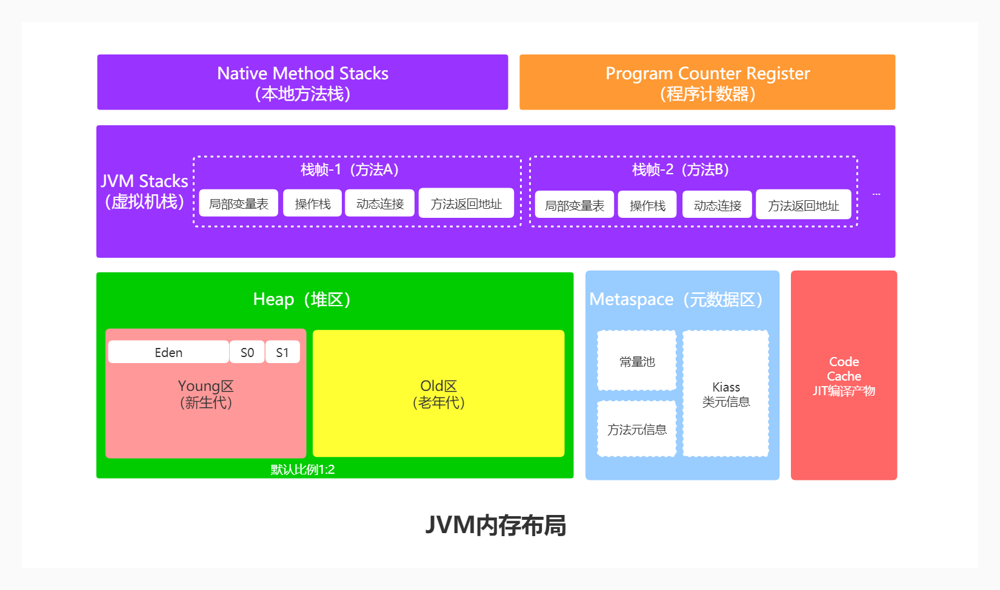
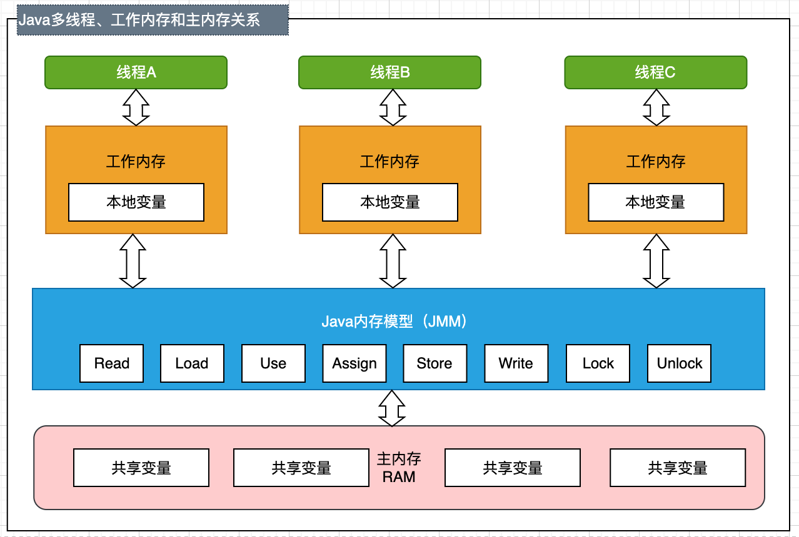
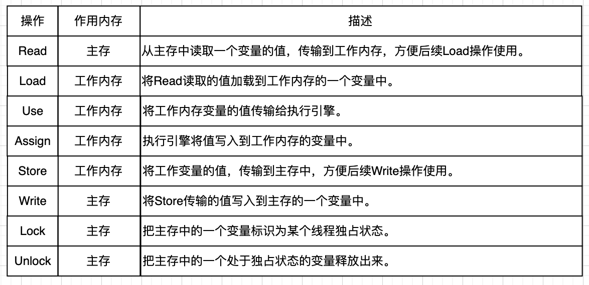
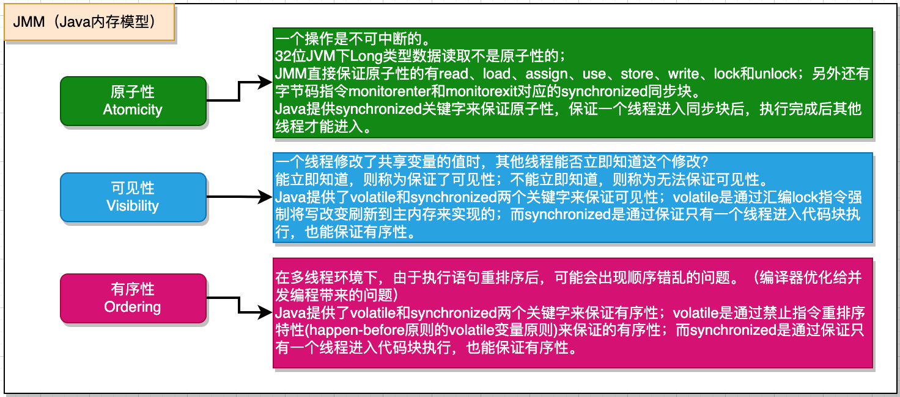
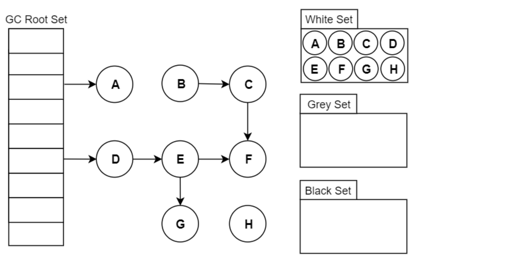
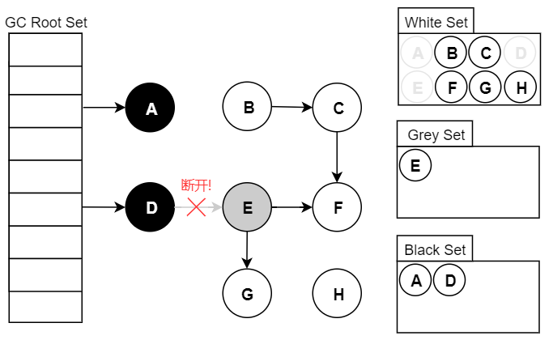
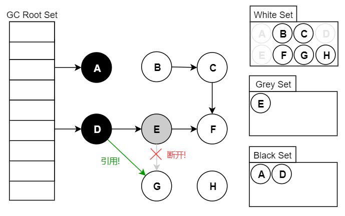
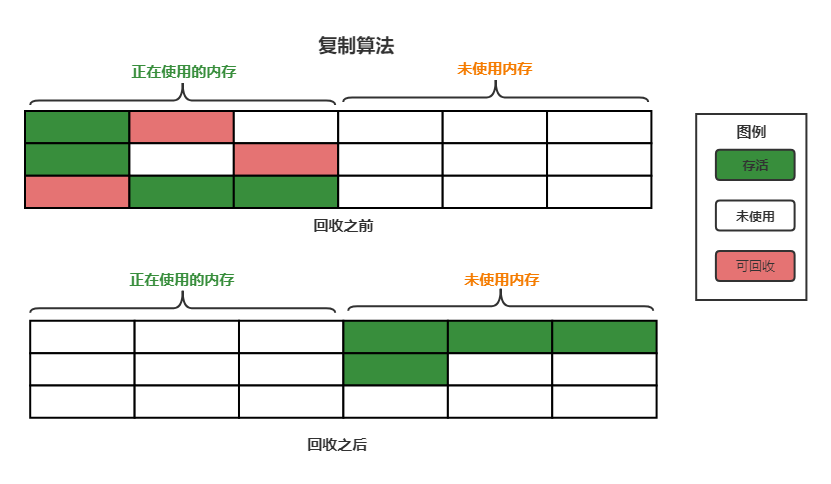
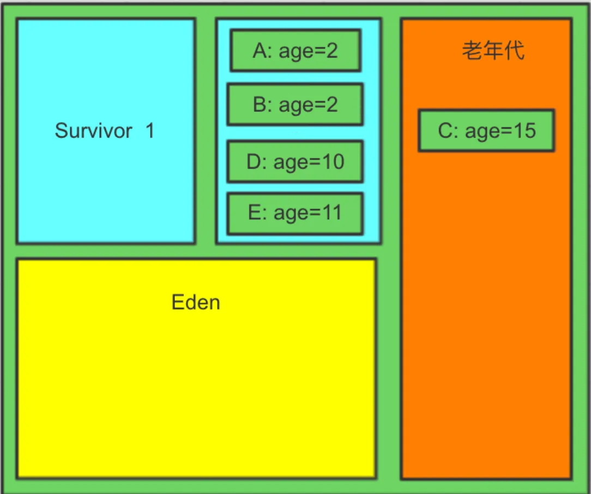
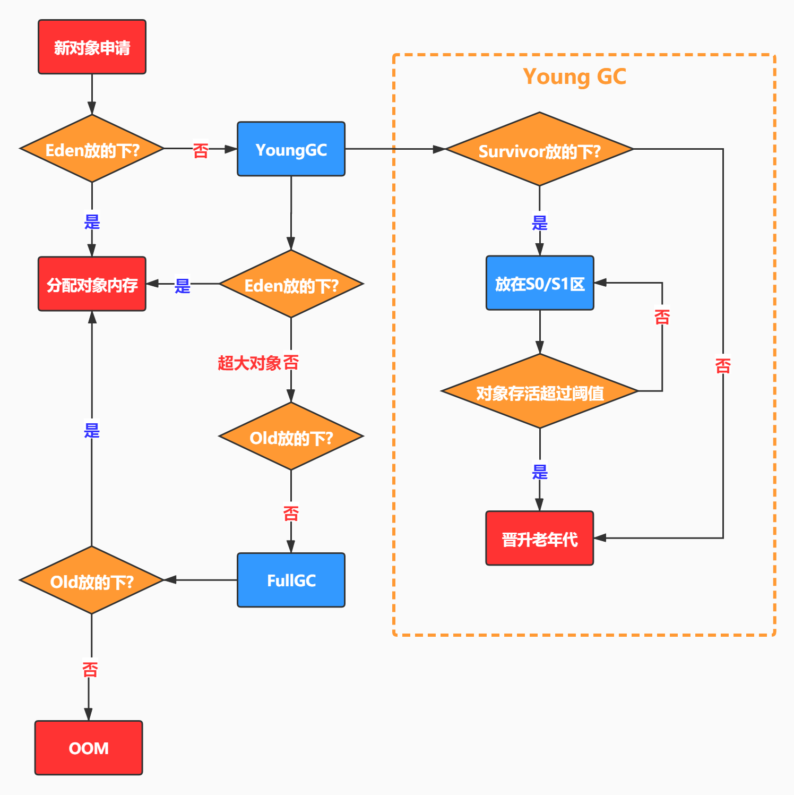

# JVM知识汇总

---

# JVM 内存模型与 JMM 内存模型

在 Java 中，**JVM 内存模型**和 **JMM（Java Memory Model）** 是两个容易混淆但完全不同的概念。

***

## 1. JVM 内存模型（运行时数据区）

**定义**：描述 JVM **物理内存的划分**，即程序运行时的内存区域。



| **内存区域** | **作用** | **线程隔离性** | **溢出错误** |
| :---: | :---: | :---: | :---: |
| **程序计数器** | 记录当前线程执行的字节码位置 | 私有 | 无溢出 |
| **虚拟机栈** | 存储方法调用的栈帧（局部变量、操作数栈等） | 私有 | StackOverflowError |
| **本地方法栈** | 支持 Native 方法（如 C/C++ 代码） | 私有 | StackOverflowError |
| **堆** | 存储对象实例和数组（GC 主战场） | 共享 | OutOfMemoryError |
| **元空间** | 存储类信息、常量、静态变量（JDK8 以前称为方法区，使用本地内存） | 共享 | OutOfMemoryError |

**关键点**：

* 堆是对象分配和垃圾回收的主要区域。
* 虚拟机栈的每个栈帧对应一个方法调用（局部变量、操作数栈、动态链接、返回地址）。

***

## 2. JMM（Java 内存模型）

**定义**：多线程环境下共享数据访问的规范，屏蔽了各种硬件和操作系统的访问差异，解决线程间的**可见性**、**原子性**和**有序性**问题。



| **机制** | **作用** |
| :---: | --- |
| **主内存与工作内存** | 每个线程有私有工作内存，共享变量存储在主内存中 |
| **内存交互操作** | read/load（读取到工作内存）、use/assign（使用和赋值）、store/write（写回主内存） |
| **happens-before** | 定义操作之间的顺序规则（如锁释放先于获取、volatile 写先于读等） |
| **volatile** | 保证变量的可见性和禁止指令重排序，但不保证原子性 |
| **synchronized** | 通过锁机制保证原子性、可见性和有序性 |

**关键点**：

* **可见性**：一个线程修改共享变量后，其他线程能立即看到最新值。
* **原子性**：一个操作不可被中断（例如 synchronized 代码块）。
* **有序性**：禁止指令重排序优化（例如 volatile 和 happens-before 规则）。

***

## 3. 核心区别

| **维度** | **JVM 内存模型** | **JMM（Java 内存模型）** |
| :---: | :---: | :---: |
| **定位** | 描述物理内存的划分（运行时数据区） | 定义多线程共享数据访问的规则 |
| **关注点** | 内存分配、垃圾回收、方法调用栈 | 线程间共享数据的可见性、原子性、有序性 |
| **线程共享性** | 堆和元空间共享，栈私有 | 主内存共享，工作内存私有 |
| **典型问题** | 内存溢出（OOM）、栈溢出（SOF） | 竞态条件、死锁、内存可见性问题 |
| **解决方案** | 调整堆大小（-Xmx）、优化代码逻辑 | volatile、synchronized、Lock 等 |

***

## 4. 实际场景示例

#### 场景 1：JVM 内存溢出（堆）

```java
// 不断创建大对象导致堆内存溢出
List<byte[]> list = new ArrayList<>();
while (true) {
    list.add(new byte[1024 * 1024]); // 每次分配 1MB
}
```

**解决**：增大堆内存（-Xmx4G）；检查代码是否存在内存泄漏。

#### 场景 2：JMM 可见性问题

```java
public class VisibilityIssue {
    private boolean flag = false; // 未使用 volatile

    public void start() {
        new Thread(() -> {
            while (!flag) {} // 可能永远无法退出循环
            System.out.println("Flag is true");
        }).start();

        new Thread(() -> {
            try { Thread.sleep(1000); }
            catch (InterruptedException e) {}
            flag = true; // 修改 flag，但其他线程可能看不到
        }).start();
    }
}
```

**解决**：将 flag 声明为 `private volatile boolean flag = false;`。

***

## 5. 二者的联系

* **底层实现依赖**：JMM 的规则（如 volatile 和 synchronized）需要 JVM 在内存操作层面支持。
* **协同工作**：
  * JVM 的堆存储共享对象，JMM 确保多线程正确访问这些对象。
  * JVM 的栈存储方法调用，JMM 解决栈中局部变量在多线程环境下的可见性问题（如果变量被共享）。

***

## 6. 总结

| **JVM 内存模型** | **JMM（Java 内存模型）** |
| :---: | :---: |
| 物理内存如何划分 | 逻辑上如何安全访问共享数据 |
| 关注内存分配和回收 | 关注线程间通信和数据同步 |
| 解决内存溢出、栈溢出问题 | 解决竞态条件、内存可见性问题 |

**一句话总结**：**JVM 内存模型**是"内存怎么用"，**JMM**是"多线程怎么安全地用内存"。

## 7. 补充

#### 7.1 JMM 操作指令含义



#### 7.2 JVM 三大特性



---

# JVM 面试题合集

## 如何判断对象可以被回收

对象是否可以被回收通常由垃圾回收器决定，使用"**可达性分析**"算法判断：如果一个对象无法从任何 **GC Roots** 直接或间接访问到，它就被认为是不可达的，可以被回收。GC Roots 是一组特殊引用，被认为是程序中可访问对象的**起始点**。

GC Roots 通常包括以下几种：

+ **局部变量引用**：方法中定义的局部变量（含参数），其引用指向对象实例。
+ **活动线程引用**：正在运行的线程的引用，线程本地存储中的对象也是如此。
+ **静态变量引用**：静态变量是类的一部分，存在于类加载器的内存中。
+ **JNI 引用**：通过 Java Native Interface 创建的本地代码引用，连接 Java 堆内存和本地代码内存。
+ **虚拟机引导类加载器**：虚拟机内部使用的类加载器引用，通常是核心类或库。

## 什么是三色标记

### 1. 前言

三色标记算法用于垃圾回收器升级，将 STW 变为并发标记。STW 即标记垃圾时必须暂停程序，而并发标记则是程序一边运行、一边标记垃圾。

### 2. 三色标记算法

#### 2.1 什么是三色

根据可达性分析，从 GC Roots 开始遍历访问，按"是否检查过"将对象标记成三种颜色：

+ **黑色**：对象已经检查过，且成员对象也被检查过了。若有其他对象引用指向黑色对象，无须重新检查。黑色对象不可能直接（不经过灰色对象）指向某个白色对象。
+ **灰色**：对象已经检查过，但成员还没全部检查完成。
+ **白色**：对象没有被检查。可达性分析刚开始时所有对象都是白色的，分析结束时仍是白色的对象即不可达。

#### 2.2 三色标记过程



假设有白、灰、黑三个集合，遍历访问过程为：

1. 初始时，所有对象都在【白色集合】中；
2. 将 GC Roots 直接引用到的对象挪到【灰色集合】中；
3. 从灰色集合中获取对象：
   1. 将本对象引用到的其他对象全部挪到【灰色集合】中；
   2. 将本对象挪到【黑色集合】里面。
4. 重复步骤 3，直至【灰色集合】为空时结束；
5. 结束后，仍在【白色集合】的对象即为 GC Roots 不可达，可以回收。

传统标记方式发生 Stop The World 时，对象间的引用不会变化，可以轻松完成标记。而并发标记期间应用线程还在继续跑，对象间的引用可能发生变化，就会出现错标和漏标的情况。

### 3. 存在的问题

#### 3.1 浮动垃圾：标记过不是垃圾的，变成了垃圾

并发标记过程中，若一个已被标记成黑色或灰色的对象突然变成垃圾，它不是白色不会被清除，重新标记也无法从 GC Root 中找到，就成为浮动垃圾。这种情况对系统影响不大，留给下一次 GC 处理即可。



#### 3.2 对象漏标问题：需要的对象被回收

并发标记过程中，业务线程将一个未被扫描过的白色对象断开引用成为垃圾（删除引用），同时黑色对象引用了该对象（增加引用）（两步可不分先后）。

因为黑色对象的属性都已被标记过，重新标记也不会从黑色对象中去找，导致该对象被程序需要却要被 GC 回收，会导致系统出现问题。



### 4. 总结

三色标记算法是根可达算法的一种实现方案，目的是找出所有可达对象。它会产生多标和漏标问题，其中漏标最严重，会导致本该存活的对象被回收，从而引发严重程序问题。

## 什么是 TLAB

TLAB 是 Java 虚拟机中的一种优化技术，用于提高对象分配效率。它是一种线程本地的内存分配缓冲区，每个线程在堆上都有自己独立的 TLAB。

对象的分配通常通过在堆上分配内存完成。为提升效率，JVM 引入 TLAB 机制：为每个线程预先分配一块内存空间，线程分配对象时从自己的 TLAB 中分配，而不是直接在堆上分配。

TLAB 的优点：

+ **减少线程同步**：每个线程有自己的 TLAB，无需线程同步操作，减少线程竞争和锁的开销。
+ **提高分配速度**：对象分配在 TLAB 中进行，减少分配开销。
+ **提高局部性**：减少对共享内存的访问，提高缓存命中率。

TLAB 的大小可以配置：过小可能导致频繁的垃圾回收，过大可能浪费内存空间。

## Java 虚拟机的年轻代为什么要划分两个 Survivor 区

年轻代（Young Generation）划分两个 Survivor 区（通常称为 S0 和 S1），是为了**优化垃圾回收的效率**，尤其是通过**复制算法**减少内存碎片、降低 GC 停顿时间，并高效管理对象的存活周期。

### 1. 复制算法



年轻代的设计目标是**快速回收短生命周期对象**。复制算法的核心思想：

+ **内存分为两块（如 S0 和 S1）**，每次 GC 只使用其中一块（例如 S0）。
+ 触发 Minor GC 时，存活对象从 Eden 区和当前使用的 Survivor 区（如 S0）**复制到另一个空闲的 Survivor 区（如 S1）**。
+ 复制完成后，直接清空原 Survivor 区（S0）和 Eden 区，避免内存碎片。

**优势**：

+ **内存无碎片**：每次复制后存活对象在目标 Survivor 区连续存放。
+ **快速回收**：仅需遍历存活对象并复制，时间复杂度为 O(存活对象数量)，而非 O(堆大小)。
+ **空间局部性**：存活对象连续存放，提高缓存命中率。

### 2. 对象年龄的渐进式晋升



JVM 通过**分代年龄（Age）**机制决定对象何时晋升到老年代：

+ 对象每在年轻代存活一次 Minor GC，年龄加 1。
+ 默认年龄达到阈值（如 15）时晋升到老年代。

**两个 Survivor 区的作用**：

+ **交替复制**：每次 Minor GC 时，存活对象在两个 Survivor 区之间复制，年龄逐步增加。
+ **过滤短期对象**：大部分对象在几次 Minor GC 后死亡，只有长期存活的对象才晋升到老年代，减少老年代 GC 压力。

### 3. 内存利用率优化

若仅使用一个 Survivor 区：

+ **内存浪费**：每次 GC 后存活对象需占用整个 Survivor 区。
+ **碎片问题**：多次 GC 后 Survivor 区可能产生碎片。

使用两个 Survivor 区：

+ **动态平衡**：每次 GC 后存活对象被压缩到另一个 Survivor 区，保证内存紧凑。
+ **利用率最大化**：两个 Survivor 区的总大小固定（如年轻代的 1/10），交替使用确保空间高效分配。

### 4. 具体流程示例



1. **对象分配**：新对象分配在 Eden 区；Eden 区满时触发 Minor GC。
2. **Minor GC 过程**：存活对象从 Eden 区和当前 Survivor 区（如 S0）复制到另一个 Survivor 区（S1）；对象年龄加 1，年龄达标（如 15）的对象晋升到老年代；清空 Eden 区和 S0。
3. **Survivor 区切换**：下次 GC 时存活对象从 Eden 和 S1 复制到 S0，循环往复。

### 5. 为什么不能只有一个 Survivor 区

+ **内存碎片**：多次 GC 后存活对象分散在 Survivor 区，产生碎片。
+ **复制效率低**：仅有一个 Survivor 区时需额外空间存放存活对象，导致内存浪费。
+ **晋升机制失效**：无法通过交替复制逐步增加对象年龄，可能提前晋升大量对象到老年代。

### 总结

划分两个 Survivor 区的核心目的：

1. **利用复制算法高效回收内存**，避免碎片。
2. **通过年龄分阶段筛选对象**，减少老年代 GC 压力。
3. **优化内存利用率**，平衡性能与资源消耗。

这种设计是 JVM 对"**弱分代假说**"的实践，即大部分对象生命周期短暂，通过年轻代的高效回收机制显著提升 GC 效率。

## 字符串常量池是如何实现的

Java 中的字符串常量池旨在优化内存使用，通过共享不可变字符串对象来避免重复创建相同的字符串。

```java
public class StringConstantPoolExample {
    public static void main(String[] args) {
        // 字符串字面量
        String str1 = "Hello";
        String str2 = "Hello";

        // 使用 new 关键字创建的字符串对象
        String str3 = new String("Hello");

        // 使用 intern 方法
        String str4 = str3.intern();

        // 比较内存地址
        System.out.println("str1 == str2: " + (str1 == str2)); // true
        System.out.println("str1 == str3: " + (str1 == str3)); // false
        System.out.println("str1 == str4: " + (str1 == str4)); // true

        // 字符串连接
        String str5 = "Hel" + "lo"; // 编译期优化，仍在常量池中
        System.out.println("str1 == str5: " + (str1 == str5)); // true

        // 非直接字符串连接
        String part1 = "Hel";
        String part2 = "lo";
        String str6 = part1 + part2; // 在运行时创建，不在常量池中
        System.out.println("str1 == str6: " + (str1 == str6)); // false
    }
}
```

### 代码解析

1. **字面量字符串**：`String str1 = "Hello";` 和 `String str2 = "Hello";` 会将 "Hello" 存储在字符串常量池中，两者引用同一个对象，因此 `str1 == str2` 为 true。
2. **new 关键字**：`String str3 = new String("Hello");` 在堆上分配一个新对象，即使值相同，也与常量池中的 "Hello" 不同，因此 `str1 == str3` 为 false。
3. **intern() 方法**：调用 `str3.intern()` 试图将 "Hello" 放入常量池，若已存在则返回池中的引用，因此 `str1 == str4` 为 true。
4. **编译时字符串连接**：`String str5 = "Hel" + "lo";` 被编译器优化成常量 "Hello" 放入常量池，因此 `str1 == str5` 为 true。
5. **运行时字符串连接**：`String str6 = part1 + part2;` 在运行时创建新对象，不在常量池中，因此 `str1 == str6` 为 false。

### 总结

通过该机制，字符串常量池有效减少了内存消耗并提高了性能。字面量字符串自动入驻常量池，而 `String.intern()` 提供主动控制字符串驻留池的方式。编译时优化和不可变性也是其高效运行的关键因素。

## 说下 JVM 中一次完整的 GC 流程

JVM 的垃圾回收机制是自动内存管理的一部分，负责回收不再被引用的对象所占用的内存空间。

### JVM 中的内存区域

* **堆（Heap）**：存放对象实例，GC 的主要工作区域。
* **栈（Stack）**：存放方法参数和局部变量，方法执行时创建销毁。
* **方法区（Method Area）**：存放类信息、常量、静态变量等。
* **程序计数器（PC Register）**：线程执行的字节码行号指示器。

### 垃圾回收的区域

垃圾回收主要在堆中进行，堆又分为年轻代（Young Generation）、老年代（Old Generation）和永久代（JDK 8 及以后的 Metaspace 取代了永久代）。

### 垃圾回收的步骤

1. **标记（Marking）**：找到所有活动对象。
2. **清除（Sweeping）**：清理未被标记的对象，从而释放内存。
3. **压缩（Compaction）**：整理内存，使活跃对象移动到一起，避免碎片化（并非所有算法都需要，如标记-清除算法不需要）。

### 垃圾回收算法

1. **标记-清除**：标记存活对象，然后清除未被标记的对象。
2. **标记-复制**：将存活对象复制到新的内存区域，适合于年轻代。
3. **标记-压缩**：标记后将活跃对象压缩到一起，清除后续无用区。

### 垃圾回收器示例

```java
public class GCDemo {
    public static void main(String[] args) throws InterruptedException {
        System.out.println("Starting GC Demo...");

        // 分配大量内存
        for (int i = 0; i < 10000; i++) {
            byte[] b = new byte[1024 * 1024]; // 每次分配 1MB
        }

        // 请求垃圾回收
        System.gc();
        System.out.println("GC requested...");
    }
}
```

* **分配内存**：在 main 方法中大量分配 `byte[]` 数组。
* **触发 GC**：通过 `System.gc()` 请求垃圾回收，这不是强制的，但 JVM 会尽量执行。
* **垃圾回收过程**：JVM 可能先尝试 Minor GC 回收年轻代；如果内存不足，可能触发 Major GC 或 Full GC，回收年轻代 + 老年代对象。
* **观察垃圾回收**：可在 JVM 参数中增加 `-verbose:gc` 或使用更详细的 GC 日志选项如 `-XX:+PrintGCDetails`：

```java
java -verbose:gc -XX:+PrintGCDetails GCDemo
```

### 总结

* **年轻代和老年代的区别**：年轻代是短生命周期对象的汇聚地，常被 Minor GC；老年代保存生命周期较长的对象，发生 Major 或 Full GC。
* **分代回收算法**：年轻代使用复制收集算法高效清理短命对象；老年代使用标记-整理算法处理长命对象。
* **优化 GC 性能**：通过调整堆大小和代大小，以及选择适合的垃圾收集器（如 G1、CMS、Parallel GC 等）来优化。

## 强引用、软引用、弱引用、虚引用的区别

这些引用类型主要用于测定垃圾回收何时可以收集对象。

### 1. 强引用

**特性**：默认使用的引用类型。只要强引用存在，垃圾收集器绝对不会回收被引用的对象。

**用法**：普通的对象引用就是强引用。

```java
Object strongReference = new Object();
```

只要 `strongReference` 还在使用中，对象就不会被回收。

### 2. 软引用

**特性**：软引用对象在内存不够用时才会被垃圾回收。内存充足时可能延续存在，适合实现缓存机制。

**用法**：通过 `SoftReference` 类定义。

```java
import java.lang.ref.SoftReference;

Object strongRef = new Object();
SoftReference<Object> softRef = new SoftReference<>(strongRef);
strongRef = null; // 删除强引用
```

如果对象只通过软引用可达，JVM 会在内存不足的情况下回收它。

### 3. 弱引用

**特性**：弱引用对象只要被垃圾收集器检测到即可回收，非常适合实现 Map 的缓存。

**用法**：通过 `WeakReference` 类定义。

```java
import java.lang.ref.WeakReference;

Object strongRef = new Object();
WeakReference<Object> weakRef = new WeakReference<>(strongRef);
strongRef = null; // 删除强引用
```

弱引用主要用于 `WeakHashMap`，它允许在不需要强保留对象的情况下维护对象到键的映射。

### 4. 虚引用

**特性**：虚引用并不决定对象的生命周期。当对象只持有虚引用时，垃圾收集时总是会回收。主要用于对象被回收时的清理工作。

**用法**：通过 `PhantomReference` 类实现，必须和引用队列（`ReferenceQueue`）一起使用。

```java
import java.lang.ref.PhantomReference;
import java.lang.ref.ReferenceQueue;

Object obj = new Object();
ReferenceQueue<Object> queue = new ReferenceQueue<>();
PhantomReference<Object> phantomRef = new PhantomReference<>(obj, queue);
obj = null; // 删除强引用
```

虚引用常用于跟踪对象何时被从内存中删除，如实现堆外内存回收，允许执行回收前的必要清理步骤。

### 总结

* **强引用**：最常见的引用类型，所引用对象不会被垃圾回收（除非置为 null）。
* **软引用**：内存不足时会被回收（适合缓存）。
* **弱引用**：GC 检测到即可回收（如 WeakHashMap）。
* **虚引用**：不支持访问引用对象，用于监测对象被回收前的清除（需配合 ReferenceQueue）。

## 项目中如何选择垃圾回收器

### 1. 串行收集器（Serial Collector）

+ **特点**：单线程进行垃圾回收，完全"Stop-The-World"（STW）。
+ **适用场景**：单线程环境或数据集较小（通常为单核 CPU 或内存受限）的情况。
+ **为何选择**：低内存消耗、简单、无线程交互复杂性，小应用中性能可接受。

```java
// 启用串行收集器
java -XX:+UseSerialGC -jar your-application.jar
```

### 2. 并行收集器（Parallel Collector）

+ **特点**：多线程收集器，对年轻代和老年代并行标记和清理。
+ **适用场景**：高吞吐量应用、后台批处理类型的应用程序。
+ **为何选择**：对响应时间要求不高，对吞吐量需求较高。

```java
// 启用并行收集器
java -XX:+UseParallelGC -jar your-application.jar
```

### 3. CMS 收集器（Concurrent Mark-Sweep）

+ **特点**：对老年代执行并发标记和清理。
+ **适用场景**：注重降低停顿时间的应用，如需要快速响应的交互式应用。
+ **为何选择**：适用于需要较短暂停时间的应用，如某些 Web 服务器。

```java
// 启用 CMS 收集器
java -XX:+UseConcMarkSweepGC -jar your-application.jar
```

### 4. G1 垃圾收集器（Garbage First）

+ **特点**：面向堆较大的多处理器机器，分区域管理内存，能均衡暂停时间。
+ **适用场景**：大堆（如几 GB~几十 GB）的应用，追求稳定的响应时间。
+ **为何选择**：比 CMS 更现代，针对大内存及多核心优化，具备可预测的暂停时间和更高的效率。

```java
// 启用 G1 收集器
java -XX:+UseG1GC -jar your-application.jar
```

### 5. Z 垃圾收集器（ZGC）

+ **特点**：极低的暂停时间（通常不到 10ms），适合大内存应用。
+ **适用场景**：对延迟敏感且使用大量内存（特别是大于几百 GB）的应用。
+ **为何选择**：相较于 G1 和 CMS，ZGC 在缩短暂停时间上表现更突出。

```java
// 启用 ZGC
java -XX:+UseZGC -jar your-application.jar
```

### 6. Shenandoah 垃圾收集器

+ **特点**：与 ZGC 类似，注重超低停顿时间。
+ **适用场景**：所需内存特别大，且希望将暂停时间最小化的应用。
+ **为何选择**：通过并发压缩缩短 GC 停顿时间，适合需要短暂停顿、高并发的场景。

```java
// 启用 Shenandoah 收集器
java -XX:+UseShenandoahGC -jar your-application.jar
```

### 选择垃圾回收器的考量因素

1. **应用类型**：Web 服务、后台服务、实时系统等。
2. **系统资源**：可用的 CPU 核心数、内存大小。
3. **响应时间要求**：是否需要极低的响应延迟。
4. **吞吐量要求**：是否需要最大化应用吞吐量。
5. **运行环境**：如容器化应用需考虑容器的限制和资源分配策略。

选择应基于应用的具体需求和使用环境，通常需通过实验和监测来优化配置。

## 常用的 JVM 启动参数有哪些

1. **-Xmx**：Java 堆内存的最大限制，如 `-Xmx512m` 表示最大堆内存 512MB。
2. **-Xms**：Java 堆内存的初始大小，如 `-Xms256m`。
3. **-Xss**：每个线程的堆栈大小，如 `-Xss256k`。
4. **-XX:MaxPermSize**（Java 7 及之前）或 **-XX:MaxMetaspaceSize**（Java 8 及以后）：永久代或元空间的最大大小。
5. **-XX:PermSize**（Java 7 及之前）或 **-XX:MetaspaceSize**（Java 8 及以后）：永久代或元空间的初始大小。
6. **-Xmn**：年轻代的大小，如 `-Xmn256m`。
7. **-XX:SurvivorRatio**：年轻代中 Eden 区与 Survivor 区的大小比例，如 `-XX:SurvivorRatio=8` 表示 8:1。
8. **-XX:NewRatio**：年轻代与老年代的大小比例，如 `-XX:NewRatio=2` 表示 1:2。
9. **-XX:MaxGCPauseMillis**：垃圾回收的最大暂停时间目标，如 `-XX:MaxGCPauseMillis=100`。
10. **-XX:ParallelGCThreads**：并行垃圾回收线程的数量，如 `-XX:ParallelGCThreads=4`。
11. **-XX:+UseConcMarkSweepGC**：启用并发标记清除垃圾回收器。
12. **-XX:+UseG1GC**：启用 G1 垃圾回收器。
13. **-Dproperty=value**：设置 Java 系统属性，可通过 `System.getProperty("property")` 获取。

这些参数可根据应用需求和性能调优目标调整，使用时需谨慎。不同 JVM 版本和供应商支持的参数有所不同，建议查阅相关文档。

## 什么是堆外内存

堆外内存（Off-Heap Memory）是指 Java 应用程序在堆内存之外的内存区域进行的内存分配。JVM 的堆内存用于大部分 Java 对象的分配，而堆外内存允许在 JVM 控制之外管理内存，通常通过操作系统的直接内存分配实现。

### 特点

1. **性能优势**：
   * 可减少垃圾回收带来的停顿时间，因为它不参与普通的 JVM 垃圾回收过程。
   * 提供更好的内存管理，减少 GC 造成的性能波动。
2. **使用局限**：
   * 手动管理导致更大复杂性：需显式释放堆外内存，避免内存泄露。
   * 不支持 GC，必须小心管理生命周期。
3. **应用场景**：大数据和分布式系统中处理大量数据；需要高性能、低延迟的应用（如游戏服务器或金融系统）；缓存系统（如 Memcached、Redis 等）。

### 如何使用堆外内存

常见方法是通过 NIO 中的 ByteBuffer 类实现：

1. **使用 `ByteBuffer.allocateDirect()` 方法**：分配一块堆外直接内存。
2. **读写数据**：和普通 ByteBuffer 用法相似，使用 put 和 get 方法。
3. **释放内存**：Java 不提供显式 API 释放直接内存，可通过设置映射的 ByteBuffer 对象为 null 并显式调用 `System.gc()` 提示清理。JDK 9 及以上使用 `sun.misc.Cleaner` 更加复杂，建议使用第三方库如 Netty 的 `PooledByteBufAllocator` 管理资源。

### 示例代码

```java
import java.nio.ByteBuffer;

public class OffHeapMemoryExample {
    public static void main(String[] args) {
        // 分配堆外内存
        ByteBuffer buffer = ByteBuffer.allocateDirect(1024); // 1KB 的直接内存

        // 写入数据
        buffer.put((byte) 'a');
        buffer.put((byte) 'b');

        // 翻转模式，将缓冲区从写模式切换到读模式
        buffer.flip();

        // 读取数据
        while (buffer.hasRemaining()) {
            System.out.print((char) buffer.get());
        }

        // 清除引用（帮助垃圾回收释放内存）
        buffer = null; // 切断引用
        System.gc();   // 提示 GC 回收，但不保证

        System.out.println("\nEnd of example");
    }
}
```

### 注意事项

* **尽量使用第三方库**：如 Netty 或 DirectMemory 来管理堆外内存，避免直接内存溢出或泄漏。
* **限制使用场景**：谨慎使用堆外内存，避免内存管理不当导致性能问题或内存泄漏。
* **性能监控**：监控直接内存的使用量（如使用 VisualVM），确保程序运行稳定性。

## 没有发生 OOM，但是老年代在缓慢增长，可能是什么原因

这道题主要考察对对象晋升老年代条件的了解。

### 一、对象进入老年代的条件


#### 1. 存活时间（年龄阈值）

* 新对象首先分配在 Eden 区，每经历一次 Minor GC，没被回收的对象会进入 Survivor 区（From/To）。
* 每在 Survivor 区经历一次 GC，年龄 +1；达到一定年龄阈值（如默认 15，可通过 `MaxTenuringThreshold` 调整）后晋升到老年代。

#### 2. Survivor 区放不下

* 若发生 Minor GC 时 Survivor 区无法容纳所有幸存对象，这些对象会被提前晋升到老年代，称为"空间分配担保"。

#### 3. 大对象直接进入老年代

* 一些大对象（如字节数组、巨型缓存）超过一定阈值（可通过 `PretenureSizeThreshold` 设置），会直接分配到老年代，避免新生代频繁 GC 造成复制开销。

#### 4. 动态年龄判断

* 若当前 Survivor 区中相同年龄的对象总大小超过一半，低于该年龄的对象也会整体晋升到老年代。

#### 5. 持有强引用并长时间未被回收

* 被强引用持有、长时间无法被 GC 释放的对象（如静态变量、全局集合等），会随时间不断晋升进入老年代。

***

### 二、结合进入机制分析老年代缓慢增长的原因

1. **大量长生命周期对象正常晋升**：如全局缓存、线程池、Session 数据或业务上确实需要持续存在的大对象，自然会"搬家"到老年代，GC 也无法主动回收。
2. **内存泄漏导致活动对象不断晋升**：如静态集合、缓存、Listener、ThreadLocal 等引用未及时清理，导致已不用的对象随 GC 不断晋升并长期存活。
3. **频繁出现大对象直接分配到老年代**：某些请求、场景会生产巨型数组、缓冲区，JVM 为避免频繁复制直接放到老年代，清理不及时会造成缓慢积压。
4. **Survivor 区太小，触发"空间分配担保"**：有很多短命对象但 Survivor 太小，只好提前把年轻对象搬到老年代，加速老年代堆积。
5. **GC 策略与参数不佳**：如 `MaxTenuringThreshold` 太低（晋升年龄低），大量对象还没"活够"就被迁移到老年代；或新生代、Survivor 比例过小，促使频繁提前晋升。

***

### 总结与建议

1. 老年代缓慢增长本质上就是"有越来越多无法被 GC 回收的对象不断晋升"。
2. 这些对象要么本来就是长命对象，要么被误引用，要么被 GC 策略误晋升。
3. **优先排查**：
   * 代码中缓存相关、全局静态变量、Listener 回收、线程池等实现。
   * Survivor 空间设置和最大晋升年龄等 JVM 参数。
   * 是否有大量大对象直接分配到老年代。
   * 通过 heap dump、MAT 等工具观察老年代增长的具体类型。

## 可以打破双亲委派机制吗

可以。双亲委派机制的默认加载逻辑是：当一个类加载器需要加载某个类时，先请求父类加载器加载，只有当父加载器找不到该类时，才尝试自己加载。

打破这一机制通常需要自定义类加载器，通过覆盖 `ClassLoader` 类的 `findClass` 方法实现自己的加载逻辑，可用于插件系统、运行时动态模块加载等领域。

### 自定义类加载器示例

```java
import java.io.File;
import java.io.FileInputStream;
import java.io.IOException;

public class CustomClassLoader extends ClassLoader {

    private String classPath;

    public CustomClassLoader(String classPath) {
        this.classPath = classPath;
    }

    @Override
    protected Class<?> findClass(String name) throws ClassNotFoundException {
        byte[] classData = getClassData(name);
        if (classData == null) {
            throw new ClassNotFoundException();
        } else {
            // 用自定义字节数组定义类，打破双亲委派
            return defineClass(name, classData, 0, classData.length);
        }
    }

    private byte[] getClassData(String className) {
        // 将包名转换为目录结构
        String path = classPath + File.separatorChar + className.replace('.', File.separatorChar) + ".class";

        try {
            FileInputStream inputStream = new FileInputStream(path);
            byte[] buffer = new byte[(int) new File(path).length()];
            inputStream.read(buffer);
            inputStream.close();
            return buffer;
        } catch (IOException e) {
            e.printStackTrace();
            return null;
        }
    }

    public static void main(String[] args) {
        String classPath = "path/to/classes";
        CustomClassLoader classLoader = new CustomClassLoader(classPath);

        try {
            Class<?> dynamicClass = classLoader.loadClass("DynamicClass");
            System.out.println("Class " + dynamicClass.getName() + " loaded successfully.");
        } catch (ClassNotFoundException e) {
            e.printStackTrace();
        }
    }
}
```

### 解释

1. **类加载路径**：`CustomClassLoader` 需要一个路径用于找到目标类文件。
2. **覆盖 findClass 方法**：重写 `findClass` 实现自定义加载行为，直接从文件系统读取字节码，打破双亲委派的默认行为。
3. **加载类过程**：在 `findClass` 中直接调用 `defineClass`，通过读取字节码并定义其为新类。

### 打破双亲委派机制的风险

* **安全性**：可能加载未经授权或恶意的代码，破坏应用程序安全性。
* **兼容性问题**：自定义类加载器与标准 Java 库可能存在兼容性问题。
* **维护负担**：复杂的类加载逻辑需要额外的代码维护和管理。

**使用建议**：仅在特定需求下才考虑打破该机制（如实现自定义插件系统或支持模块化运行时功能）。构建严肃应用时务必仔细考虑潜在的安全风险和兼容性问题。

## Java 进程占用的内存有哪些部分

1. **堆内存（Heap Memory）**：存储对象实例和数组，是自动内存管理的主要区域，GC 在此进行。可通过 `-Xms` 和 `-Xmx` 分别配置初始和最大堆大小。
2. **方法区（Method Area）**：存放类的元数据，包括类信息、常量、静态变量和即时编译器编译后代码。Java 8 之前称为永久代（PermGen），Java 8 及之后称为元空间（Metaspace）。
3. **栈内存（Stack Memory）**：用于线程生命周期中存储方法调用和局部变量，每个线程有自己的栈。栈内存自动分配和释放，不由 GC 管理。
4. **本地方法栈（Native Method Stack）**：容纳调用 Native 方法（如非 Java 代码 C/C++）的线程栈，与操作系统相关。
5. **程序计数器（Program Counter Register）**：每个线程都有自己的程序计数器，指示当前正在执行的字节码指令地址。
6. **直接内存（Direct Memory）**：Java 中使用 NIO 进行高性能 I/O 时使用，使用的是操作系统的内存，绕过 JVM 的堆。

### 示例代码

```java
import java.nio.ByteBuffer;

public class MemoryUsageExample {
    public static void main(String[] args) {
        // 堆内存使用：创建对象实例
        for (int i = 0; i < 100000; i++) {
            Person p = new Person("Name" + i);
        }

        // 栈内存使用：递归调用
        calculateFactorial(10);

        // 直接内存使用
        ByteBuffer directBuffer = ByteBuffer.allocateDirect(1024);
    }

    static class Person {
        String name;

        Person(String name) {
            this.name = name;
        }
    }

    private static long calculateFactorial(int n) {
        if (n == 0) {
            return 1;
        }
        return n * calculateFactorial(n - 1);
    }
}
```

* **栈内存**：`calculateFactorial` 方法递归调用，每次调用在栈上创建新的栈帧以存储局部变量和返回信息。
* **直接内存**：使用 `ByteBuffer.allocateDirect(1024)` 分配直接内存，通常用于高性能 I/O 操作。
* **方法区**：`Person` 类的信息、字符串 "Name" 等常量存储在方法区。
* **本地方法栈和程序计数器**：示例中没有演示本地方法栈的显式使用，但程序执行过程中 JVM 内部正在使用程序计数器。

### 总结

Java 进程的内存管理非常复杂和高效，通过不同区域的管理实现内存的高效使用和垃圾收集的管理。了解这些内存的分配和使用，是优化 Java 应用性能和调试内存问题的重要基础。

## 什么情况会导致 JVM 退出

1. **正常程序终止**：程序执行完 main 方法，包括所有非守护线程都终止时，JVM 将正常退出。
2. **调用 System.exit(int status)**：显式调用 `System.exit()`，以指定状态码终止当前运行的 Java 虚拟机。
3. **未捕获的异常或错误**：如果某个线程抛出的异常没有被捕获，并且传播到了主线程，JVM 可能会终止。
4. **Runtime.halt(int) 或崩溃**：
   * 直接调用 `Runtime.halt()` 会立即停止 Java 进程，类似于突然终止程序而不调用任何钩子。
   * JVM 的致命错误（如内存访问违规）也可能导致崩溃并退出。
5. **外部命令强制关闭**：例如通过操作系统的任务管理器或控制台命令（如 kill 命令）。

### 示例代码

```java
public class JVMExitExample {
    public static void main(String[] args) {
        // 情况 1：正常程序终止
        System.out.println("Program starts...");

        // 打开注释逐一尝试其他退出情况

        // 情况 2：显式调用 System.exit()
        // System.exit(0);

        // 情况 3：未捕获的异常
        // willCauseException();

        // 情况 4：调用 Runtime.halt()（高风险）
        // Runtime.getRuntime().halt(0);

        System.out.println("Program ends...");
    }

    private static void willCauseException() {
        // 产生一个未捕获的异常，导致 JVM 退出
        throw new RuntimeException("Unexpected Error!");
    }
}
```

### 解释

* **正常程序终止**：main 执行完毕后，所有非守护线程完成，程序正常退出。
* **System.exit()**：调用 `System.exit(0)` 立即终止 JVM。非零参数值通常用来指示异常终止。
* **未捕获的异常**：`willCauseException()` 故意抛出一个未捕获的 RuntimeException，导致程序退出。
* **Runtime.halt()**：强行终止虚拟机，不会调用 finalize 方法或执行任何待处理的关闭钩子。
* **外部强制关闭**：需通过操作系统进行操作。

每种退出机制的影响和使用场合都不同，开发者应根据程序需求谨慎选择合适的退出方式。特别是异常退出时，通常伴随可能尚未完成的重要资源清理工作，因此合理处理异常尤为重要。

## OOM 一定会导致 JVM 退出吗

不一定。是否退出取决于发生 OOM 错误的线程和错误处理逻辑。

### 情况分析

1. **主线程中未处理的 OOM**：如果在主线程中发生 OOM 且没有被捕获，JVM 通常会终止程序并退出，因为 JVM 中没有其他存活的非守护线程来保持程序运行。
2. **子线程中未处理的 OOM**：在非主线程中，OOM 发生且未被捕获时该线程会停止执行，但如果其他非守护线程仍在运行，JVM 不会退出。
3. **捕获并处理 OOM**：如果在代码中捕获并正确处理了 OOM 错误，JVM 则可以继续执行其余代码。合适的错误处理可能包括释放内存资源或提示用户进行适当的操作。

### 示例代码

```java
public class OOMExample {
    public static void main(String[] args) throws InterruptedException {
        // 子线程中发生 OOM 并及时处理
        Thread thread1 = new Thread(() -> {
            try {
                oomMethod();
            } catch (OutOfMemoryError e) {
                System.out.println("Handled OOM in thread. JVM will not exit.");
            }
        });

        // 子线程中发生 OOM 不处理
        Thread thread2 = new Thread(() -> {
            oomMethod();
        });

        thread1.start();
        Thread.sleep(3000);

        thread2.start();
        Thread.sleep(3000);
        // 主线程中发生 OOM 并且及时处理，JVM 不会退出
        try {
            oomMethod();
        } catch (OutOfMemoryError e) {
            System.out.println("Handled OOM in main. JVM will continue.");
        }

        // 主线程中发生 OOM 而未处理，JVM 会马上退出
        System.out.println("JVM退出前");
        oomMethod();
        System.out.println("JVM退出后");
    }

    public static void oomMethod() {
        int[] array = new int[Integer.MAX_VALUE]; // 试图分配过大的数组，触发 OOM
    }
}
```

输出结果：

```plain
Handled OOM in thread. JVM will not exit.
Exception in thread "Thread-1" java.lang.OutOfMemoryError: Requested array size exceeds VM limit
	at com.zhuge.controller.StockController.oomMethod(StockController.java:120)
	at com.zhuge.controller.StockController.lambda$main$1(StockController.java:98)
	at com.zhuge.controller.StockController$$Lambda$2/648129364.run(Unknown Source)
	at java.lang.Thread.run(Thread.java:745)
Handled OOM in main. JVM will continue.
JVM退出前
Exception in thread "main" java.lang.OutOfMemoryError: Requested array size exceeds VM limit
	at com.zhuge.controller.StockController.oomMethod(StockController.java:120)
	at com.zhuge.controller.StockController.main(StockController.java:115)
```

### 行为解释

* 主线程中未捕获的 OOM 发生后，程序将立即终止。
* 线程 thread1 中捕获了 OOM 并打印处理，即使发生 OOM 该子线程停止，但主线程继续执行；若未捕获，子线程停止，但 JVM 不会退出，因为主线程仍在运行。

### 注意事项

* 不建议频繁捕获 OOM 并继续执行程序，因为这样可能表明程序有严重的内存管理问题。
* 在关键路径中发生 OOM 时，通常应记录日志并考虑安全停机，因为无法保证系统在内存压力下的正确性。

## JVM 为什么使用元空间替换了永久代

Java 8 中用元空间（Metaspace）替代了永久代（PermGen），解决了一些持久性问题，提供了更多灵活性和稳定性。

### 1. 内存限制

* **永久代限制**：存在固定的内存大小限制，通常通过 `-XX:PermSize` 和 `-XX:MaxPermSize` 设置。但预测应用所需的永久代大小并不容易，固定大小可能导致 `OutOfMemoryError: PermGen space` 错误。
* **元空间优势**：不是堆的一部分，存放在本机内存（Native Memory）中，不受 JVM 堆大小限制，能更有效地利用内存资源。

### 2. 类和类加载器的生命周期管理

* **永久代问题**：类及其元数据由永久代持有，类加载器和类的动态卸载过程会受到永久代容量的约束。
* **元空间解决**：减少了对应用行为的依赖性，更好地管理类及其元数据的内存分配，使类加载器更可靠地执行类的动态卸载。

### 3. 性能和优化

* **性能问题**：在多环境或不同规模的应用中，优化和调优永久代（尤其调整大小）比较复杂，设置不当可能影响性能。
* **优化改进**：元空间利用操作系统的内存存储类元数据信息，使 JVM 在启动阶段和内存管理上更高效。

### 4. 减少 Full GC 问题

* **Full GC**：永久代的垃圾回收会触发 Full GC，非常耗时，在高负载系统中影响较大。
* **消除阻塞**：元空间独立于堆内存，大大减少了永久代相关的 Full GC 次数，减少了运行时长时间的中断。

### 5. 更好的监控和调优

* **监控复杂性**：永久代的大小不易调整和监控。
* **增强监控工具**：通过元空间，可更容易使用现代工具（如 jcmd 和 jconsole）监控和调优 Java 应用的内存使用。

### 总结

引入元空间使虚拟机层面对类元数据的存储和管理更有效率、灵活性更强，同时降低了调试和运维复杂度，提升了 JVM 的性能和稳定性，开发人员不再需要担心 PermGen 的调优及相应的内存管理问题。

## 内存泄漏和内存溢出的区别

### 内存泄漏（Memory Leak）

**定义**：程序未能释放已不再使用的对象或资源，导致内存浪费。在 Java 中，通常是由于对象的引用没有被正确清除，使得垃圾回收无法回收这些对象占用的内存。

**特点**：

* 不会立即导致程序崩溃，但会缓慢消耗内存，最终可能导致内存不足。
* 在 Java 应用中，常因集合类中保留了不再使用的对象引用而产生。

#### 示例代码

```java
import java.util.ArrayList;
import java.util.List;

public class MemoryLeakExample {
    public static void main(String[] args) {
        List<Object> list = new ArrayList<>();

        while (true) {
            Object obj = new Object();
            list.add(obj); // 不断新增对象到列表中

            // 假设以后不再需要 list 中的对象，但未清理它们引用
            // list.clear(); // 理想情况下应在不再需要时清除

            try {
                Thread.sleep(10); // 延时用于观察内存使用增长
            } catch (InterruptedException e) {
                e.printStackTrace();
            }
        }
    }
}
```

对象不断被添加到列表中，但列表内容未被清理，导致一直占用内存。

### 内存溢出（Out of Memory）

**定义**：程序在申请内存时没有足够的内存可用，导致无法正常分配，从而抛出 `OutOfMemoryError`。这是由于程序已使用的内存超过了 JVM 为其分配的最大内存限制。

**特点**：

* 通常会导致程序崩溃或终止。
* 因为未能限制内存使用而直接超过 JVM 配置的内存上限。

#### 示例代码

```java
public class MemoryOverflowExample {
    public static void main(String[] args) {
        int[] memoryFillIntVar = new int[Integer.MAX_VALUE]; // 尝试分配过大的数组
    }
}
```

程序试图分配一个巨大的数组，通常会导致 `java.lang.OutOfMemoryError: Requested array size exceeds VM limit` 错误。

### 区别总结

* **内存泄漏**：不再使用的对象无法被垃圾回收，持续消耗内存，引起资源浪费，但不一定马上导致程序崩溃。
* **内存溢出**：程序试图使用超过可用最大内存的资源，直接导致程序失败。

为避免这些问题，开发者应仔细管理对象的生命周期，适时释放不再需要的资源，并监测和调整应用的内存使用情况。

## 对象的结构是什么样的

一个 Java 对象在 JVM 中的基本结构包括以下组成部分：

1. **对象头（Object Header）**：
    - **Mark Word**：存储对象自身的运行时数据，如哈希码、GC 分代年龄、锁状态标志、线程持有的锁、偏向线程 ID 等。Mark Word 是动态定义的，随对象状态变化而改变。
    - **Class Pointer（类型指针）**：指向对象的类元数据，JVM 通过它确定该对象是哪个类的实例，并据此找到该类的方法区。
    - **数组长度（仅数组对象）**：如果对象是数组，还需要额外的空间存储数组长度。
2. **实例数据（Instance Data）**：
    - 存储实体类的实例字段内容，包括从父类继承下来的字段和自身定义的字段。
    - 数据存储顺序受字段声明顺序、字段类型、虚拟机分配策略（如内存对齐）影响。
3. **对齐填充（Padding）**：
    - JVM 要求对象的起始地址是 8 字节的整数倍，因此可能在对象结尾填充对齐字节。
    - 对齐填充对于 64 位虚拟机（如 HotSpot JVM）是在开启压缩指针（Compressed Oops）时对未对齐的对象添加的。

### 内存布局示例

假设一个简单的 Java 类：

```java
public class Example {
    int id;
    boolean isActive;
    Object reference;
}
```

该对象的内存布局大概如下：

+ **对象头**
    - Mark Word
    - Class Pointer
+ **实例数据**
    - int id
    - boolean isActive
    - Object reference
+ **对齐填充**
    - 根据需要进行对齐填充

### 64 位 JVM 中的优化

+ 在 64 位 JVM 中，为了减少内存占用，Java 会启用指针压缩（Compressed Oops），使用 32 位指针指向堆内存，减少指针大小。

### 总结

Java 对象的结构设计旨在高效支持内存管理、垃圾回收和对象操作。对象头包含运行时数据和类信息指针，实例数据存储成员变量值，对齐填充保证内存访问效率。整体设计兼顾灵活性和高效性，以适应 Java 的跨平台和多线程需求。

## 设置堆内存 Xmx 应该考虑哪些因素

1. **应用程序的内存需求**：包括数据量、并发用户数、对象创建频率等。
2. **应用程序的性能需求**：需要更高吞吐量和更低延迟时可能需要更多内存，但要避免浪费。
3. **可用物理内存**：将 `-Xmx` 设置为超过物理内存容量的值可能导致操作系统频繁进行内存交换，降低性能。
4. **垃圾回收的开销**：堆内存越大，垃圾回收开销通常也越大，可能需要更长的暂停时间。
5. **堆内存分代结构**：不同代的分配比例和大小会影响 `-Xmx` 设置，可根据应用特性调整。
6. **监控和调整**：使用 JVisualVM、JConsole 等工具观察堆内存使用情况，根据监控数据动态调整。
7. **应用程序设计**：避免内存泄漏和不必要的对象创建可降低内存需求。
8. **并发性需求**：多线程应用通常需要更多堆内存。
9. **JVM 版本和垃圾回收器**：不同版本和回收器对内存需求有不同影响。

需要综合这些因素，通过实际性能测试和监控确定合适的 `-Xmx` 值，并逐渐调整。没有一种大小适合所有情况的通用规则。

## Class 常量池和运行时常量池的区别

### Class 常量池（Class Constant Pool）

**定义**：Class 常量池是 Java 类文件的一部分，由编译器在编译 Java 源文件时生成，存储在 .class 文件中。它包含类或接口的字面量（如字符串、整数常量等）以及符号引用（类和接口的名字、字段和方法的名字及描述符）。

**特点**：

+ 位于每个类文件的开头，是描述类或接口在 Java 平台上运行所需信息的重要部分。
+ 静态的，包含类文件中的所有依赖项，以便类加载器在运行时解析。

### 运行时常量池（Runtime Constant Pool）

**定义**：

+ 运行时常量池是 Class 常量池在类加载到 JVM 后的一种表现形式，在类或接口被载入 JVM 时，Class 常量池的信息被载入运行时常量池。
+ 在类加载时被创建，是方法区的一部分（Java 8 后部分实现为元空间的一部分）。

**特点**：

+ 动态的，可在运行时扩展，不仅包含 Class 常量池的映射数据，还允许在运行时添加新常量（如通过字符串 interning）。
+ 用于解析类、方法、字段的引用，以及存储 JVM 执行所需的其他信息。

### 关系

+ **来源与转换**：
    - Class 常量池是 Java 编译器生成的静态数据结构，是 .class 文件的一部分。
    - 运行时常量池是 JVM 执行环境的一部分，是 Class 常量池在类加载时被解析、验证后存储的方法区中的数据结构。
+ **作用域与用途**：
    - Class 常量池是磁盘上文件级别的数据结构，定义了类的编译时依赖和信息。
    - 运行时常量池存在于内存中，在类加载期间被 JVM 转化和使用，维护符号引用的解析、动态链接和跨越生命周期的优化。
+ **使用与管理**：
    - 编译器生成 Class 常量池，它是只读的。
    - 运行时常量池在运行期间可以被动态更新，允许 JVM 对类执行管理和优化。

总结：Class 常量池是类文件的组成部分，而运行时常量池是 JVM 的执行环境结构，它将 Class 常量池的数据转换成 JVM 可以理解和使用的形式，并动态管理。

## GC 是任意时候都能进行的吗

GC 垃圾收集只能在**安全点**才能进行。**安全点（Safe Point）**是程序执行的某些特定位置，JVM 只能在安全点安全地暂停执行，从而进行垃圾回收等操作。安全点的设定确保了当线程暂停时程序状态是可知和一致的。

### 作用

1. **垃圾收集**：进行垃圾收集时，JVM 需要暂停所有应用程序线程（GC 暂停），以确保不会有线程在操作内存，同时状态快照是确定的。
2. **堆栈遍历**：执行线程转储等操作时，JVM 需要安全地遍历线程栈，这时也需要安全点。
3. **性能损耗最小化**：通过在最可能长时间运行的指令设置安全点（如循环末端、方法的调用与返回），JVM 可以减少程序暂停的频率。

### 安全点的触发条件

1. **方法调用**：每次方法调用都是一个潜在的安全点。
2. **循环回跳**：长时间循环中间会插入安全点检查。
3. **异常处理**：处理异常时也会检查是否到达安全点。

### 示例

```java
public class SafePointExample {
    public static void main(String[] args) {
        long sum = 0;
        System.out.println("Start calculation...");

        for (int i = 0; i < Integer.MAX_VALUE; i++) {
            sum += i;
            // 有可能成为安全点，因为这是一个明显的循环回跳
        }

        System.out.println("Sum: " + sum);
        // 方法结束的时候，这里可能成为一个安全点
    }
}
```

### 重要性

+ **最小化暂停时间**：通过仅在安全点暂停线程，可最大程度减少程序因 GC 等操作而暂停执行的时间。
+ **性能和一致性**：安全点设计能够确保为 GC 等需要程序一致性暂停的操作提供合适控制，同时尽可能保持程序性能。

总体来说，安全点是 JVM 优化执行环境的一部分，不同 JVM 实现可能有不同的安全点管理策略。

## 堆一定是线程共享的吗

在 JVM 中，堆内存区域通常是线程共享的，所有对象实例和数组都在共享的堆中分配，并可被多个线程访问。不过 JVM 也提供了机制来优化多线程环境下的堆使用。

### 主要原因和特点

1. **共享特性**：
    - **设计原则**：Java 为支持高效的多线程计算而设计，所有对象实例通常需要在多个线程间共享以实现同步和协作。
    - **便捷性**：将对象存储在共享堆中，多个线程之间可方便地互相传递对象。
2. **线程隔离优化**：
    - **TLAB**：尽管堆是共享的，TLAB 为每个线程分配了一个独立的内存块用于快速分配对象，减少了线程间的竞争。
    - **栈上分配（Scalar Replacement）和逃逸分析**：如果对象不会逃逸出线程的执行上下文，JVM 可能将其优化为栈上分配，而不使用堆。
3. **内存安全**：
    - **垃圾回收**：JVM 包含垃圾回收机制自动管理回收共享堆中的无用对象，为多线程应用提供有效释放共享资源的方式。
4. **堆的分代**：
    - **年轻代**：频繁分配短期存活的对象，通常采用复制算法，回收快速。
    - **老年代**：存储寿命较长的对象，通常采用标记-清除或标记-整理算法。
    - **元空间**：存储类元数据，与内存隔离。

### 总结

标准 JVM 实现中，堆通常是共享资源，以支持 Java 应用的多线程特性。但通过 TLAB 和其他优化技术，JVM 在逻辑上为线程提供了"局部"分配方式，在共享的物理堆上实现了逻辑上的线程隔离内存分配策略。

## 运行时常量池和字符串常量池的区别

### 运行时常量池（Runtime Constant Pool）

1. **关系**：是每个类或接口的常量池表的一部分，包含字符串字面量以及其他编译期常量。字符串常量池可视为运行时常量池的一个特殊部分，专门用于字符串字面量的存储和重用。
2. **存储位置**：属于方法区的一部分。Java 8 之前方法区是永久代的一部分；Java 8 及以后方法区被转移到元空间。

### 字符串常量池（String Constant Pool）

1. **关系**：用于存储字符串字面量。声明新的字符串字面量时，如果池中已存在该字符串，则不会创建新对象，而是返回已存在的引用。它是运行时常量池中专门用于字符串管理的部分。
2. **存储位置**：从 Java 7 开始移到堆内存中，有助于减少方法区的内存压力，也更好地支持垃圾回收。

### 关系总结

+ **运行时常量池**：用于存储类常量、方法和字段的引用，以及字符串字面量等。
+ **字符串常量池**：专注于优化字符串使用，通过在堆中存储唯一的字符串实例来减少内存消耗。
+ **位置差别**：运行时常量池位于方法区/元空间；字符串常量池位于堆内存中。

通过这个体系，Java 的内存管理在处理常量和字符串数据时变得高效而灵活。

## JVM 对象分配内存如何保证线程安全

在多线程环境下，多个线程可能会同时尝试创建对象，JVM 采用以下机制和技术保证内存分配的线程安全：

1. **TLAB（Thread Local Allocation Buffer）**：
    - **概念**：每个线程私有的内存区域，用于加速对象内存分配。
    - **作用**：为每个线程分配一个独立的小内存块，线程可在此块中直接分配对象，而不需要对共享堆进行同步。
    - **原理**：线程需要分配对象时，首先尝试在 TLAB 中分配；如果有足够空间，分配就是线程安全的。
    - **不足**：TLAB 空间不足时，线程需要请求新的 TLAB 或直接从共享堆分配，这个过程需要一定的同步机制。
2. **CAS（Compare-And-Swap）机制**：
    - **概念**：硬件提供的原子操作，用于无锁并发编程。
    - **作用**：JVM 在需要直接操作共享堆时，可用 CAS 原子性地更新内存分配指针。
    - **执行过程**：CAS 检查变量是否等于预期值，如果是则更新为新值，操作是原子的，避免了锁机制的开销。
    - **应用**：当 TLAB 耗尽或涉及跨线程的堆内存分配时，CAS 有效避免竞争条件。
3. **分代收集**：
    - **背景**：虽然不是直接用于线程安全，但分代收集使内存管理更高效，减少了直接竞争的机会。
    - **结合**：TLAB 一般对年轻代的内存分配进行优化，更局部化的内存管理有助于线程安全。

通过运用这些机制，JVM 能在多线程环境下高效而安全地进行内存分配，并最大限度减少同步操作带来的性能损耗。

## 对象的大小如何计算

对象的大小由对象头、实例数据和对齐填充组成。

1. **对象头（Object Header）大小**：
   + 32 位 JVM：8 字节。
   + 64 位 JVM：未开启指针压缩 16 字节；开启指针压缩 12 字节。
2. **实例数据（Instance Data）大小**：
   + 基本数据类型：boolean/byte 1 字节；char/short 2 字节；int/float 4 字节；long/double 8 字节。
   + 引用类型：32 位 JVM 4 字节；64 位 JVM 未压缩 8 字节；64 位 JVM 开启指针压缩 4 字节。
3. **对齐填充（Padding）**：
   + 对象大小必须是 8 字节的整数倍。
   + 如果对象头 + 实例数据的大小不是 8 的倍数，需要进行填充。

计算示例：

```java
class Example {
    private int a;    // 4字节
    private long b;   // 8字节
    private byte c;   // 1字节
}
```

在 64 位 JVM、开启指针压缩的情况下：

+ 对象头：12 字节
+ 实例数据：4 + 8 + 1 = 13 字节
+ 填充：3 字节（补齐到 8 的倍数）
+ 总大小：12 + 13 + 3 = 28 字节

注意事项：

1. 可使用 Java Agent 或 JOL（Java Object Layout）工具精确查看对象大小。
2. 不同 JVM 版本和实现可能存在差异。
3. JVM 参数配置会影响对象大小。
4. 继承关系中要包含父类的实例数据大小。

优化对象大小的方法：

1. 合理排序字段顺序，减少对齐浪费。
2. 使用基本数据类型替代包装类。
3. 考虑使用压缩指针。
4. 合理使用继承层次。

## JVM 内存为什么要分代

JVM 内存分代基于"分代假设"：大部分对象在内存中存活时间很短，少数存活时间长。根据该假设进行内存管理可以优化 GC 过程。具体理由包括：

1. **提高垃圾回收效率**：年轻代对象创建和销毁频繁，集中在一起 GC 可以更高效处理。Minor GC 通常采用复制算法，只扫描和处理一小部分存活对象。
2. **减少 GC 停顿时间**：短生命周期对象大多集中在年轻代，通过更频繁但快速的垃圾回收快速释放内存，减少每次 GC 停顿时间。老年代 GC 频率更低，对停顿影响较小。
3. **优化内存分配**：将短生命周期对象与长生命周期对象分开，能减少老年代的碎片化，避免过于频繁的垃圾回收。
4. **简化内存管理**：使 GC 算法可针对不同对象的生命周期优化内存利用。年轻代使用 Scavenge GC，老年代使用 CMS 或 G1 等更复杂的算法。
5. **适应实际应用场景**：大多数应用的对象生命周期符合分代假设，该内存管理方式能适配绝大多数应用的行为特征。
6. **分代算法的灵活性**：可根据对象不同的生命周期特点更灵活地选择垃圾回收策略。

通过内存分代，JVM 可以更高效、灵活、有针对性地进行垃圾回收，最大化利用内存资源，并降低对应用正常执行的影响。

## CPU 百分百问题如何排查

1. **查看系统负载**：使用系统监控工具（如 top）查看系统负载情况。
2. **确定是哪个进程导致 CPU 高占用**：查找 CPU 占用率高的进程或应用，注意子进程也可能引起高占用。
3. **查看日志文件**：检查应用日志，查找是否有异常或错误消息。
4. **检查代码**：检查代码是否存在死循环、低效算法、内存泄漏等性能问题，使用性能分析工具帮助确定瓶颈。
5. **查看数据库查询**：检查数据库的慢查询日志并优化查询。
6. **监控线程**：检查是否有某些线程占用了大量 CPU 资源，使用线程分析工具识别问题线程。
7. **查看网络连接**：查看是否有异常的网络连接或请求。
8. **使用性能分析工具**：使用专业工具检测瓶颈，如 Java 应用可使用 Arthas、VisualVM 等。
9. **应用程序优化**：根据排查结果优化应用，修复性能问题。

## 说说对象分配规则

对象分配规则确保内存的有效使用和对象的**正确初始化**：

1. **内存分配**：新对象通常在堆内存中分配内存空间。
2. **对象头**：分配内存后，JVM 会为对象分配一个**对象头**，包含对象的元信息，如哈希码、锁状态、垃圾回收信息等。
3. **零值初始化**：对象内存分配后，所有成员变量被初始化为零值（整数类型为 0，布尔类型为 false，对象引用为 null）。
4. **构造函数调用**：内存分配和零值初始化完成后，JVM 调用对象的构造函数。
5. **对象引用**：最后 **new** 关键字返回对象引用，将其分配给变量，以便后续访问对象的属性和方法。
6. **垃圾回收管理**：JVM 自动管理对象内存。如果对象不再被引用，会被标记为垃圾，并在适当时机由垃圾回收器回收。
