# Java基础知识汇总

# Java基础面试题合集

---

# 如何优雅的避免空指针异常

## 为什么要避免空指针

NPE是Java中最常见的运行时异常。常见原因：对象未初始化、方法返回null、外部数据缺失。

## 优雅避免NPE的几种方式

### 1. Optional

`Optional`是Java 8引入的容器类，用于显式表示值可能不存在。

```java
// 传统写法
String name = user.getName();
if (name != null) {
    System.out.println(name.length());
}

// Optional写法
Optional.ofNullable(user.getName())
        .ifPresent(name -> System.out.println(name.length()));

// 提供默认值
String name = Optional.ofNullable(user.getName()).orElse("unknown");

// 链式调用
int length = Optional.ofNullable(user)
        .map(User::getName)
        .map(String::length)
        .orElse(0);
```

### 2. Assert断言

Spring提供`Assert`类，用于参数校验：

```java
Assert.notNull(user, "user不能为null");
Assert.hasText(name, "name不能为空");
Assert.notEmpty(list, "list不能为空集合");
```

### 3. @Nullable / @NonNull注解

通过注解在编译期发现潜在NPE：

```java
public void process(@NonNull String input) { ... }

@Nullable
public String getName() { ... }
```

配合IDE检查（IDEA、FindBugs、Sonar）可在编译期发现风险。

### 4. 空对象模式

定义一个空对象代替null：

```java
public class NullUser extends User {
    public static final NullUser INSTANCE = new NullUser();
    @Override public String getName() { return ""; }
    @Override public boolean isNull() { return true; }
}
```

### 5. 其他技巧

- 集合返回空集合而非null：`Collections.emptyList()`
- 字符串比较常量在前：`"constant".equals(variable)`
- 使用`StringUtils.isNotEmpty()`等工具方法

---

# 什么是 CopyOnWriteArrayList

## 核心原理

`CopyOnWriteArrayList`是线程安全的List实现，写时复制：读操作无锁，写操作先复制一份新数组，修改新数组，再替换旧引用。

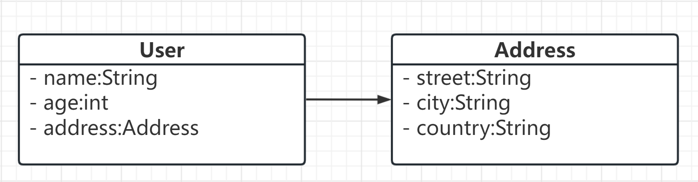


```java
public boolean add(E e) {
    synchronized (lock) {
        Object[] elements = getArray();
        Object[] newElements = Arrays.copyOf(elements, elements.length + 1);
        newElements[elements.length] = e;
        setArray(newElements);
        return true;
    }
}

public E get(int index) {
    return get(getArray(), index); // 无锁读
}
```

## 适用场景

- **读多写少**：读远多于写时性能好
- **弱一致性**：读操作读到的是创建时的快照，不反映后续修改
- **不适合频繁写**：每次写都复制整个数组，开销大

## 与synchronizedList对比

| 特性 | CopyOnWriteArrayList | Collections.synchronizedList |
|------|---------------------|---------------------------|
| 读性能 | 无锁，最快 | 需加锁 |
| 写性能 | 复制整个数组，慢 | 加锁，较快 |
| 迭代器 | 快照，无ConcurrentModificationException | 需加锁，抛CME |
| 适用场景 | 读多写少 | 读写均衡 |

---

# List操作的一些常见问题

## 1. Arrays.asList返回的List不能修改大小

```java
List<String> list = Arrays.asList("a", "b", "c");
list.add("d"); // UnsupportedOperationException
list.set(0, "x"); // 可以修改元素，但不能增删
```

`Arrays.asList`返回的是`Arrays$ArrayList`（内部类），不是`java.util.ArrayList`，底层是固定大小数组。

## 2. subList返回的是视图

```java
List<Integer> list = new ArrayList<>(Arrays.asList(1, 2, 3, 4, 5));
List<Integer> sub = list.subList(1, 4); // [2, 3, 4]
sub.set(0, 99); // list变为 [1, 99, 3, 4, 5]
```

`subList`返回原List的视图，修改subList会影响原List。如果原List结构被修改（增删），subList操作会抛`ConcurrentModificationException`。

## 3. 批量操作可能OOM

```java
// 大集合addAll可能导致OOM
List<Integer> big = IntStream.range(0, Integer.MAX_VALUE).boxed().collect(Collectors.toList());
list.addAll(big); // OOM
```

---

# 如何优雅的删除HashMap元素

## 五种方式

### 1. entrySet遍历 + iterator.remove

```java
Iterator<Map.Entry<String, Integer>> it = map.entrySet().iterator();
while (it.hasNext()) {
    Map.Entry<String, Integer> entry = it.next();
    if (entry.getValue() < 0) {
        it.remove(); // 安全删除
    }
}
```

### 2. keySet遍历 + iterator.remove

```java
Iterator<String> it = map.keySet().iterator();
while (it.hasNext()) {
    String key = it.next();
    if (map.get(key) < 0) {
        it.remove();
    }
}
```

### 3. Java 8 removeIf

```java
map.entrySet().removeIf(entry -> entry.getValue() < 0);
```

### 4. 收集key后批量删除

```java
List<String> toRemove = map.entrySet().stream()
        .filter(e -> e.getValue() < 0)
        .map(Map.Entry::getKey)
        .collect(Collectors.toList());
toRemove.forEach(map::remove);
```

### 5. 构建新Map

```java
Map<String, Integer> newMap = map.entrySet().stream()
        .filter(e -> e.getValue() >= 0)
        .collect(Collectors.toMap(Map.Entry::getKey, Map.Entry::getValue));
```

> **注意**：foreach遍历时直接调用`map.remove()`会抛`ConcurrentModificationException`。

---

# 使用BigDecimal注意的几个坑

## 1. new BigDecimal(double)精度问题

```java
BigDecimal a = new BigDecimal(0.1);
System.out.println(a); // 0.1000000000000000055511151231257827021181583404541015625

BigDecimal b = BigDecimal.valueOf(0.1);
System.out.println(b); // 0.1
```

`new BigDecimal(double)`会把double的二进制不精确值完整保留。应使用`BigDecimal.valueOf()`或`new BigDecimal(String)`。

## 2. 除法不指定精度抛异常

```java
BigDecimal a = BigDecimal.valueOf(1);
BigDecimal b = BigDecimal.valueOf(3);
a.divide(b); // ArithmeticException: Non-terminating decimal expansion
a.divide(b, 2, RoundingMode.HALF_UP); // 0.33
```

## 3. 比较用compareTo而非equals

```java
BigDecimal a = new BigDecimal("1.0");
BigDecimal b = new BigDecimal("1.00");
a.equals(b);   // false（scale不同）
a.compareTo(b) == 0; // true
```

## 4. BigDecimal不可变

每次运算返回新对象，不会修改原对象：

```java
BigDecimal a = BigDecimal.valueOf(1);
a.add(BigDecimal.valueOf(2)); // a仍为1
a = a.add(BigDecimal.valueOf(2)); // a变为3
```

---

# 鱼和熊掌不可兼得之CAP定理

## CAP三要素

- **Consistency（一致性）**：所有节点同一时刻看到相同数据
- **Availability（可用性）**：每个请求都能收到非错误响应（不保证是最新数据）
- **Partition Tolerance（分区容错性）**：网络分区时系统仍能运行

## CAP定理

分布式系统最多同时满足CAP中的两个。网络分区不可避免，因此实际选择是：

| 选择 | 特点 | 典型系统 |
|------|------|---------|
| CP | 强一致性，牺牲可用性 | Zookeeper、etcd、HBase |
| AP | 高可用性，牺牲强一致性 | Cassandra、Eureka、DynamoDB |
| CA | 单机系统，无分区问题 | 关系型数据库单机 |

## BASE理论

CAP的AP方案延伸：

- **Basically Available（基本可用）**：允许部分功能不可用
- **Soft State（软状态）**：允许中间状态存在
- **Eventually Consistent（最终一致性）**：不保证实时一致，但最终一致

---

# 为什么说BigDecimal适合数值计算

## 浮点数精度问题

```java
System.out.println(0.1 + 0.2); // 0.30000000000000004
System.out.println(1.0 - 0.9); // 0.09999999999999998
```

double/float采用IEEE 754标准，无法精确表示某些十进制小数。

## BigDecimal原理

BigDecimal内部用`intCompact`（long）或`BigInteger`存储未缩放值，用`scale`（int）记录小数位数：

```
值 = unscaledValue × 10^(-scale)
```

例如 `1.23` → unscaledValue=123, scale=2。

## 核心源码

```java
public class BigDecimal extends Number implements Comparable<BigDecimal> {
    private final BigInteger intVal;    // 未缩放值，超过long范围时使用
    private final int scale;            // 小数位数
    private final transient long intCompact; // 未缩放值，long范围内直接存
    private transient int precision;    // 有效位数
    private transient String stringCache; // 字符串缓存

    // 加法
    public BigDecimal add(BigDecimal augend) {
        if (this.intCompact != INFLATED && augend.intCompact != INFLATED) {
            long s = this.intCompact + augend.intCompact;
            if (s != INFLATED) return BigDecimal.valueOf(s, this.scale);
        }
        return addAugend(augend); // 大数走BigInteger路径
    }

    // 乘法
    public BigDecimal multiply(BigDecimal multiplicand) {
        int productScale = this.scale + multiplicand.scale;
        if (this.intCompact != INFLATED && multiplicand.intCompact != INFLATED) {
            long product = this.intCompact * multiplicand.intCompact;
            if (product != INFLATED)
                return createAndStripZerosToMatchScale(product, productScale, 0);
        }
        return multiplyBigInt(multiplicand);
    }

    // 除法（需指定精度和舍入模式）
    public BigDecimal divide(BigDecimal divisor, int scale, RoundingMode roundingMode) {
        // 核心逻辑：扩展被除数，做整数除法，按舍入模式处理余数
    }
}
```

## 舍入模式

| 模式 | 说明 |
|------|------|
| `UP` | 远离零方向舍入 |
| `DOWN` | 向零方向舍入 |
| `CEILING` | 向正无穷舍入 |
| `FLOOR` | 向负无穷舍入 |
| `HALF_UP` | 四舍五入（最常用） |
| `HALF_DOWN` | 五舍六入 |
| `HALF_EVEN` | 银行家舍入法（相邻偶数） |

## 性能对比

BigDecimal比double慢10-100倍，但金融场景必须用。优化建议：
1. 重用BigDecimal常量，避免重复创建
2. 优先用`BigDecimal.valueOf(long)`而非`new BigDecimal(String)`
3. 能用long（分）就不用BigDecimal（元）

---

# String能存储多少个字符

## 结论

- **String长度字段**：`int count`，理论最大 `2^31 - 1 = 2,147,483,647` 个字符
- **实际限制**：受JVM堆内存限制，`-Xmx`不够时抛OOM
- **数组限制**：JVM中数组最大长度为 `Integer.MAX_VALUE - 8`（部分JVM实现保留8字节header）

```java
// 理论上限
int max = Integer.MAX_VALUE; // 2147483647
// 实际能分配的取决于堆大小
char[] arr = new char[Integer.MAX_VALUE]; // 可能OOM
```

## 计算所需内存

一个char占2字节（Java 8），2,147,483,647 × 2 ≈ 4GB。JDK9后String底层用byte[]，Latin-1编码时1字节/字符，理论上限约2GB。

---

# JDK9为何要将String的底层实现由char[]改成了byte[]

## 改动内容

```java
// JDK8
public final class String {
    private final char value[];
}

// JDK9+
public final class String {
    private final byte[] value;
    private final byte coder; // 0=Latin-1, 1=UTF-16
}
```

## 原因

1. **节省内存**：大多数String只含Latin-1字符（ASCII），用byte[]每个字符1字节，比char[]（2字节）节省50%内存。JDK团队统计，堆中String对象约占25%内存，优化效果显著。
2. **性能提升**：减少内存占用意味着更少的GC、更高的缓存命中率。

## coder字段

- `LATIN1（0）`：所有字符 ≤ 0xFF，用1字节存储
- `UTF16（1）`：含非Latin-1字符，用2字节存储

String在构造时自动检测内容选择编码。相关方法根据coder选择不同的实现路径：

```java
public int length() {
    return value.length >> coder(); // Latin1: value.length, UTF16: value.length/2
}
```

---

# 有限内存如何实现读取超限数据并统计数字重复次数

## 问题

内存有限（如1GB），文件远超内存（如100GB），统计每个数字出现的次数。

## 方案一：分治 + 外排序

1. **分片**：读取文件，按hash分写到多个小文件（每片可装入内存）
2. **统计**：对每个小文件用HashMap统计
3. **合并**：相同数字的分片结果合并

```java
// 分片
List<BufferedWriter> writers = createWriters(100); // 100个分片
try (BufferedReader reader = new BufferedReader(new FileReader(bigFile))) {
    String line;
    while ((line = reader.readLine()) != null) {
        long num = Long.parseLong(line);
        int shard = (int) (num % 100);
        writers.get(shard).write(num + "\n");
    }
}

// 统计每个分片
Map<Long, Long> countMap = new HashMap<>();
Files.lines(shardFile).forEach(line -> {
    long num = Long.parseLong(line);
    countMap.merge(num, 1L, Long::sum);
});
```

## 方案二：位图（BitMap）

如果数字范围已知且密集，用位图统计：

```java
BitSet bitSet = new BitSet();
// 存在性统计
bitSet.set(num);
// 计数统计需用数组
int[] count = new int[MAX_VALUE + 1];
count[num]++;
```

## 方案三：Bloom Filter + 外部存储

如果只需判断是否出现过（不需精确计数），用Bloom Filter：

```java
BloomFilter<Long> filter = BloomFilter.create(Funnels.longFunnel(), expectedInsertions);
filter.put(num);
filter.mightContain(num); // 可能存在
```

---

# 2025最新突击学员面经

## 1. 说说你对Java异常体系的理解

Java异常分为`Error`和`Exception`两大类：

- **Error**：系统级错误，不应捕获（如`OutOfMemoryError`、`StackOverflowError`）
- **Exception**：
  - **受检异常（Checked Exception）**：编译期检查，必须try-catch或throws（如`IOException`、`SQLException`）
  - **非受检异常（RuntimeException）**：运行时异常，可不处理（如`NullPointerException`、`IllegalArgumentException`）

```java
try {
    // 可能抛异常的代码
} catch (SpecificException e) {
    // 具体异常处理
} catch (Exception e) {
    // 通用异常处理
} finally {
    // 必定执行（资源释放）
}
```

Java 7+ try-with-resources自动关闭实现了AutoCloseable的资源：

```java
try (BufferedReader reader = new BufferedReader(new FileReader(path))) {
    return reader.readLine();
} // 自动调用reader.close()
```

## 2. HashMap的put流程

1. 计算key的hash：`(h = key.hashCode()) ^ (h >>> 16)`（扰动，减少碰撞）
2. 确定桶位置：`(n - 1) & hash`（n为桶数，要求n为2的幂）
3. 桶为空 → 直接放入
4. 桶非空 → 判断首节点key是否相同（hash相等且equals为true）→ 替换value
5. 首节点是TreeNode → 走红黑树插入
6. 否则遍历链表，找到则替换，找不到则尾插（Java 8尾插，Java 7头插）
7. 链表长度 ≥ 8 且桶数 ≥ 64 → 树化
8. size > threshold → 扩容（2倍）

## 3. ConcurrentHashMap如何保证线程安全

**JDK7**：Segment分段锁，默认16段，每段一把锁，并发度=段数。

**JDK8**：CAS + synchronized锁单桶：

```java
// 简化版put
Node<K,V> f; int n, i, binCount;
if ((f = tabAt(tab, i = (n - 1) & hash)) == null) {
    // 桶为空，CAS插入
    if (casTabAt(tab, i, null, new Node<>(hash, key, value, null)))
        break;
} else {
    // 桶非空，synchronized锁住头节点
    synchronized (f) {
        // 链表或红黑树插入
    }
}
```

## 4. ThreadLocal原理

每个Thread对象持有一个`ThreadLocalMap`，key是ThreadLocal实例（弱引用），value是实际值：

```java
class Thread {
    ThreadLocal.ThreadLocalMap threadLocals;
}

class ThreadLocalMap {
    static class Entry extends WeakReference<ThreadLocal<?>> {
        Object value;
        Entry(ThreadLocal<?> k, Object v) { super(k); value = v; }
    }
}
```

- `set()`：获取当前线程的ThreadLocalMap，以this为key存入value
- `get()`：从当前线程的ThreadLocalMap中取this对应的value
- **内存泄漏**：key是弱引用，GC后key变null，但value仍被Entry强引用。需手动`remove()`。

## 5. volatile的作用

- **可见性**：写入后立即刷新到主内存，读取时从主内存加载（禁止CPU缓存）
- **有序性**：禁止指令重排序（插入内存屏障）
- **不保证原子性**：`i++`不是原子操作

```java
volatile boolean flag = true;
// 线程A
flag = false; // 对其他线程立即可见
// 线程B
while (flag) { ... } // 能看到flag变化
```

底层通过CPU的内存屏障实现：写后插入StoreLoad屏障，读前插入LoadLoad屏障。

## 6. synchronized和Lock的区别

| 特性 | synchronized | Lock（ReentrantLock） |
|------|-------------|---------------------|
| 实现 | JVM内置（monitorenter/monitorexit） | Java API（AQS） |
| 锁释放 | 自动释放 | 必须手动unlock（finally） |
| 可中断 | 不可 | `lockInterruptibly()`可中断 |
| 公平锁 | 非公平 | 可选公平/非公平 |
| 条件变量 | 一个wait/notify | 多个Condition |
| 尝试获取 | 不支持 | `tryLock()`支持 |
| 性能 | JDK6+优化后接近 | 灵活但开销略大 |

## 7. AQS原理

AQS（AbstractQueuedSynchronizer）是并发工具的基础框架：

- **state**：volatile int，表示同步状态
- **CLH队列**：双向链表，存放等待获取锁的线程
- **独占模式**：ReentrantLock、ReadWriteLock
- **共享模式**：CountDownLatch、Semaphore、CyclicBarrier

```java
// 简化版获取锁
public final void acquire(int arg) {
    if (!tryAcquire(arg) &&
        acquireQueued(addWaiter(Node.EXCLUSIVE), arg))
        selfInterrupt();
}
```

获取锁失败时，线程封装为Node入队，park阻塞；前驱节点释放锁后unpark后继节点。

## 8. 线程池核心参数

```java
new ThreadPoolExecutor(
    corePoolSize,      // 核心线程数
    maximumPoolSize,   // 最大线程数
    keepAliveTime,     // 非核心线程空闲存活时间
    unit,              // 时间单位
    workQueue,         // 任务队列
    threadFactory,     // 线程工厂
    handler            // 拒绝策略
);
```

执行流程：
1. 线程数 < corePoolSize → 新建核心线程执行
2. 线程数 ≥ corePoolSize → 入队
3. 队列满 + 线程数 < maximumPoolSize → 新建非核心线程执行
4. 队列满 + 线程数 = maximumPoolSize → 执行拒绝策略

拒绝策略：`AbortPolicy`（抛异常）、`CallerRunsPolicy`（调用者执行）、`DiscardPolicy`（丢弃）、`DiscardOldestPolicy`（丢弃最旧）。

## 9. GC Roots有哪些

- 虚拟机栈中引用的对象（局部变量、参数）
- 方法区中类静态属性引用的对象
- 方法区中常量引用的对象
- 本地方法栈中JNI引用的对象
- 同步锁synchronized持有的对象
- JVM内部引用（基本类型对应Class、常驻异常对象、ClassLoader）

## 10. CMS和G1的区别

| 特性 | CMS | G1 |
|------|-----|-----|
| 算法 | 标记-清除 | 标记-整理+复制 |
| 内存划分 | 连续新生代+老年代 | 多个Region（1-32MB） |
| 碎片 | 有内存碎片 | 无碎片 |
| 停顿 | 初始标记+重新标记STW | 可预测停顿（-XX:MaxGCPauseMillis） |
| 适用 | 老年代大、低延迟 | 大堆（>6GB）、低延迟 |
| 回收范围 | 仅老年代 | 新生代+老年代（混合回收） |

## 11. 如何排查线上CPU飙高

1. `top`找到CPU高的Java进程PID
2. `top -Hp PID`找到CPU高的线程TID
3. `printf "%x\n" TID`转十六进制
4. `jstack PID > stack.txt`导出线程栈
5. 在stack.txt中搜索十六进制TID，定位代码

或用`arthas`：`thread -n 3`直接看最忙线程。

## 12. 如何排查线上OOM

1. 添加JVM参数：`-XX:+HeapDumpOnOutOfMemoryError -XX:HeapDumpPath=/path/dump.hprof`
2. 用MAT或JProfiler分析hprof文件
3. 查看大对象、内存泄漏路径（GC Roots到对象的引用链）

## 13. MySQL索引失效场景

- 对索引列做函数/计算：`WHERE YEAR(date) = 2025`
- 隐式类型转换：字符串列`WHERE col = 123`
- 最左前缀不满足：联合索引`(a,b,c)`但只查`b`或`c`
- `LIKE`左模糊：`LIKE '%abc'`
- `OR`条件中有非索引列
- `!=`、`NOT IN`、`IS NOT NULL`（部分场景）

## 14. MySQL事务隔离级别

| 隔离级别 | 脏读 | 不可重复读 | 幻读 |
|---------|------|----------|------|
| READ UNCOMMITTED | ✓ | ✓ | ✓ |
| READ COMMITTED | ✗ | ✓ | ✓ |
| REPEATABLE READ（默认） | ✗ | ✗ | ✓（MVCC解决） |
| SERIALIZABLE | ✗ | ✗ | ✗ |

## 15. Redis持久化方式

- **RDB**：定时快照，全量数据，恢复快，可能丢数据
- **AOF**：追加写命令，可配置fsync策略（always/everysec/no），数据安全
- **混合持久化（4.0+）**：AOF前半段RDB + 后半段增量命令

## 16. Kafka如何保证消息不丢

- **生产者端**：`acks=all` + 重试 + 幂等
- **Broker端**：`min.insync.replicas ≥ 2` + `unclean.leader.election.enable=false`
- **消费者端**：关闭自动offset提交，处理完成后手动提交

## 17. 分布式锁实现方式

- **Redis**：`SET key value NX PX timeout`，释放用Lua保证原子性
- **Zookeeper**：创建临时节点，监听前一个节点删除事件（公平锁）
- **Redisson**：看门狗自动续期，可重入，支持RedLock

---

# JDK8提升代码优雅技巧

## Lambda与函数式接口

Java 8核心函数式接口：

| 接口 | 方法 | 说明 | 示例 |
|------|------|------|------|
| `Supplier<T>` | `T get()` | 无参有返回值 | `() -> new ArrayList<>()` |
| `Function<T,R>` | `R apply(T)` | 有参有返回值 | `s -> s.length()` |
| `Consumer<T>` | `void accept(T)` | 有参无返回值 | `s -> System.out.println(s)` |
| `Predicate<T>` | `boolean test(T)` | 有参返回boolean | `s -> s.isEmpty()` |
| `BiFunction<T,U,R>` | `R apply(T,U)` | 两参有返回值 | `(a,b) -> a+b` |

### Supplier

```java
Supplier<String> supplier = () -> "hello";
String result = supplier.get();

// 延迟初始化
Supplier<ExpensiveObject> lazy = ExpensiveObject::new;
ExpensiveObject obj = lazy.get(); // 首次调用时创建
```

### Function

```java
Function<String, Integer> toLength = String::length;
Function<Integer, String> toString = Object::toString;
Function<String, String> composed = toLength.andThen(toString);
String result = composed.apply("hello"); // "5"
```

### Consumer

```java
Consumer<String> printer = System.out::println;
Consumer<String> logger = s -> log.info(s);
Consumer<String> combined = printer.andThen(logger);
combined.accept("message"); // 先打印再记录日志
```

### Runnable

```java
Runnable task = () -> System.out.println("running");
new Thread(task).start();
```

## 使用小技巧

### 1. 处理抛出异常的if

```java
// 传统
if (obj == null) {
    throw new IllegalArgumentException("obj is null");
}

// 优雅
Objects.requireNonNull(obj, "obj is null");
// 或
Assert.notNull(obj, "obj is null");
```

### 2. 处理if分支操作

```java
// 传统
String result;
if (condition) {
    result = "A";
} else {
    result = "B";
}

// 优雅
String result = condition ? "A" : "B";
// 或
String result = Optional.of(condition).filter(c -> c).map(c -> "A").orElse("B");
```

### 3. 如果存在值执行消费操作

```java
// 传统
if (user != null && user.getName() != null) {
    System.out.println(user.getName());
}

// 优雅
Optional.ofNullable(user)
        .map(User::getName)
        .ifPresent(System.out::println);
```

---

# 怎么理解Java里面的双冒号"::"

## 方法引用

`::`是方法引用运算符，是Lambda的简写形式。当Lambda体只是调用一个已存在的方法时，可用方法引用替代。

### 四种形式

```java
// 1. 静态方法引用 ClassName::staticMethod
Function<String, Integer> parser = Integer::parseInt;

// 2. 实例方法引用（通过类名） ClassName::instanceMethod
Function<String, String> upper = String::toUpperCase;

// 3. 实例方法引用（通过对象） instance::method
String prefix = "Hello: ";
Consumer<String> printer = prefix::concat;

// 4. 构造方法引用 ClassName::new
Supplier<ArrayList<String>> factory = ArrayList::new;
Function<Integer, ArrayList<String>> sizedFactory = ArrayList::new;
```

### 与Lambda等价关系

```java
// 方法引用
Function<String, Integer> f1 = Integer::parseInt;
// 等价Lambda
Function<String, Integer> f2 = s -> Integer.parseInt(s);

// 构造引用
Supplier<String> s1 = String::new;
// 等价Lambda
Supplier<String> s2 = () -> new String();
```

---

# 提升编码效率的15种 Stream API

## 1. collect - 收集为集合

```java
List<String> list = stream.collect(Collectors.toList());
Set<String> set = stream.collect(Collectors.toSet());
Map<String, Integer> map = stream.collect(Collectors.toMap(User::getName, User::getAge));
```

## 2. filter - 过滤

```java
List<User> adults = users.stream().filter(u -> u.getAge() >= 18).collect(Collectors.toList());
```

## 3. map - 映射转换

```java
List<String> names = users.stream().map(User::getName).collect(Collectors.toList());
```

## 4. forEach - 遍历

```java
users.stream().forEach(System.out::println);
```

## 5. flatMap - 扁平化映射

```java
List<String> allTags = articles.stream()
        .flatMap(a -> a.getTags().stream())
        .distinct()
        .collect(Collectors.toList());
```

## 6. reduce - 归约

```java
int sum = numbers.stream().reduce(0, Integer::sum);
Optional<Integer> max = numbers.stream().reduce(Integer::max);
```

## 7. distinct - 去重

```java
List<Integer> unique = numbers.stream().distinct().collect(Collectors.toList());
```

## 8. sorted - 排序

```java
List<User> sorted = users.stream()
        .sorted(Comparator.comparing(User::getAge).reversed())
        .collect(Collectors.toList());
```

## 9. limit - 取前N个

```java
List<User> top3 = users.stream().sorted(...).limit(3).collect(Collectors.toList());
```

## 10. skip - 跳过前N个

```java
List<User> page = users.stream().skip(offset).limit(pageSize).collect(Collectors.toList());
```

## 11. anyMatch / allMatch / noneMatch - 匹配判断

```java
boolean hasAdult = users.stream().anyMatch(u -> u.getAge() >= 18);
boolean allAdult = users.stream().allMatch(u -> u.getAge() >= 18);
boolean noMinor = users.stream().noneMatch(u -> u.getAge() < 18);
```

## 12. findFirst / findAny - 查找

```java
Optional<User> first = users.stream().filter(u -> u.getAge() > 18).findFirst();
Optional<User> any = users.parallelStream().filter(u -> u.getAge() > 18).findAny();
```

## 13. min / max - 最值

```java
Optional<User> youngest = users.stream().min(Comparator.comparing(User::getAge));
Optional<User> oldest = users.stream().max(Comparator.comparing(User::getAge));
```

## 14. groupingBy - 分组

```java
Map<String, List<User>> byDept = users.stream()
        .collect(Collectors.groupingBy(User::getDepartment));

// 多级分组
Map<String, Map<String, List<User>>> byDeptAndLevel = users.stream()
        .collect(Collectors.groupingBy(User::getDepartment,
                Collectors.groupingBy(User::getLevel)));

// 分组并计数
Map<String, Long> countByDept = users.stream()
        .collect(Collectors.groupingBy(User::getDepartment, Collectors.counting()));
```

## 15. partitioningBy - 分区

```java
Map<Boolean, List<User>> partition = users.stream()
        .collect(Collectors.partitioningBy(u -> u.getAge() >= 18));
// {true=[成年用户], false=[未成年用户]}
```

---

# 提高生产力：这10个Lambda表达式必须掌握

## 1. 遍历集合

```java
list.forEach(item -> System.out.println(item));
list.forEach(System.out::println);
```

## 2. 创建匿名Runnable

```java
new Thread(() -> System.out.println("running")).start();
```

## 3. 集合排序

```java
list.sort((a, b) -> a.compareTo(b));
list.sort(Comparator.naturalOrder());
```

## 4. 自定义函数接口

```java
@FunctionalInterface
interface Converter<F, T> {
    T convert(F from);
}
Converter<String, Integer> converter = Integer::valueOf;
```

## 5. 过滤集合

```java
List<Integer> evens = numbers.stream().filter(n -> n % 2 == 0).collect(Collectors.toList());
```

## 6. 映射转换

```java
List<String> names = users.stream().map(User::getName).collect(Collectors.toList());
```

## 7. 归约计算

```java
int sum = numbers.stream().reduce(0, Integer::sum);
```

## 8. 分组统计

```java
Map<String, Long> count = items.stream()
        .collect(Collectors.groupingBy(Item::getCategory, Collectors.counting()));
```

## 9. 链式调用

```java
String result = users.stream()
        .filter(u -> u.getAge() > 18)
        .map(User::getName)
        .filter(n -> n.startsWith("A"))
        .findFirst()
        .orElse("none");
```

## 10. Optional组合

```java
String city = Optional.ofNullable(user)
        .map(User::getAddress)
        .map(Address::getCity)
        .orElse("unknown");
```

---

# 说说你对泛型的理解

## 泛型概述

泛型是JDK5引入的特性，本质是**参数化类型**，让代码适用于多种类型且编译期类型安全。

**好处**：
1. 类型安全：编译期检查，消除运行时ClassCastException
2. 消除强制转换
3. 代码复用

## 泛型类

```java
public class Box<T> {
    private T data;
    public T getData() { return data; }
    public void setData(T data) { this.data = data; }
}

Box<String> stringBox = new Box<>();
stringBox.setData("hello");
```

## 泛型方法

```java
public <T> T print(T item) {
    System.out.println(item);
    return item;
}

// 多类型参数
public <K, V> void print(K key, V value) {
    System.out.println(key + "=" + value);
}
```

## 泛型接口

```java
public interface Repository<T> {
    T findById(Long id);
    List<T> findAll();
    void save(T entity);
}

public class UserRepository implements Repository<User> {
    @Override public User findById(Long id) { ... }
    @Override public List<User> findAll() { ... }
    @Override public void save(User entity) { ... }
}
```

## 类型擦除

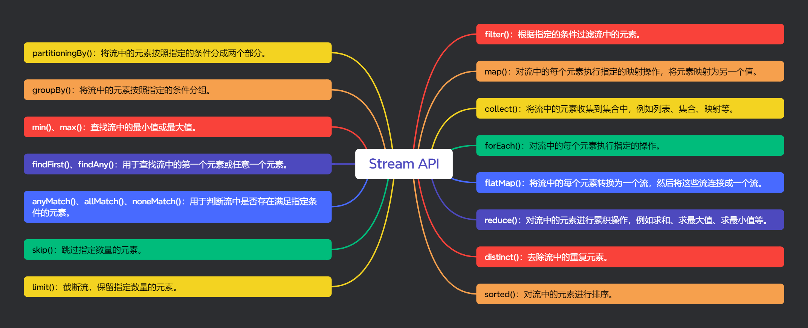

泛型只在编译期有效，运行时擦除类型参数：

```java
List<String> strings = new ArrayList<>();
List<Integer> integers = new ArrayList<>();
// 运行时两者都是ArrayList，类型参数被擦除
System.out.println(strings.getClass() == integers.getClass()); // true
```

擦除规则：
- 无限界类型参数`<T>` → 擦除为`Object`
- 限界类型参数`<T extends Number>` → 擦除为`Number`
- 编译器在需要处自动插入桥接方法和强制转换

## 泛型通配符

```java
// 无界通配符：任意类型
void print(List<?> list) { list.forEach(System.out::println); }

// 上界通配符（PECS: Producer Extends）
// List<? extends Number> 可以读不能写
double sum(List<? extends Number> list) {
    return list.stream().mapToDouble(Number::doubleValue).sum();
}

// 下界通配符（PECS: Consumer Super）
// List<? super Integer> 可以写不能读（读只能得Object）
void addNumbers(List<? super Integer> list) {
    for (int i = 1; i <= 10; i++) list.add(i);
}
```

**PECS原则**：
- 频繁读取用`<? extends T>`
- 频繁插入用`<? super T>`

---

# 谈谈你对反射的理解

## 什么是反射

反射是在运行时动态获取类信息、创建对象、调用方法、访问字段的机制。通过Class对象在运行时操作类。

## 获取Class对象的三种方式

```java
// 1. 类名.class
Class<String> clazz1 = String.class;

// 2. 对象.getClass()
String str = "hello";
Class<?> clazz2 = str.getClass();

// 3. Class.forName（最灵活，可动态加载）
Class<?> clazz3 = Class.forName("java.lang.String");
```

## 核心操作

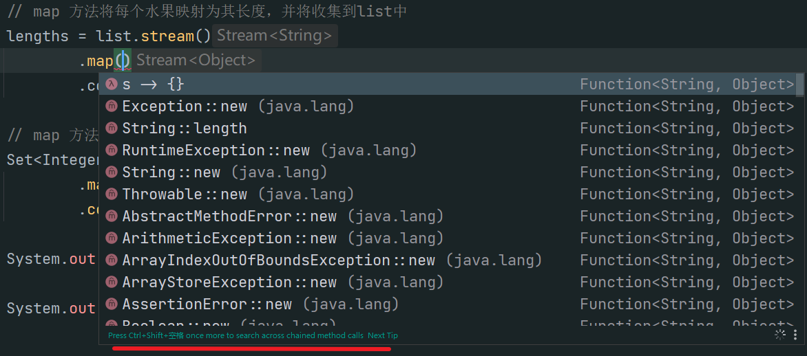

### 创建实例

```java
Class<?> clazz = Class.forName("com.example.User");
Object obj = clazz.getDeclaredConstructor().newInstance();
```

### 获取和调用方法

```java
Method method = clazz.getDeclaredMethod("setName", String.class);
method.setAccessible(true); // 访问私有方法
method.invoke(obj, "Alice");
```

### 获取和操作字段

```java
Field field = clazz.getDeclaredField("name");
field.setAccessible(true);
field.set(obj, "Bob");
Object value = field.get(obj);
```

### 获取构造器

```java
Constructor<?> constructor = clazz.getDeclaredConstructor(String.class, int.class);
Object obj2 = constructor.newInstance("Charlie", 25);
```

### 获取注解

```java
if (method.isAnnotationPresent(Override.class)) {
    Override annotation = method.getAnnotation(Override.class);
}
```

## 反射的应用场景

1. **Spring IoC**：通过反射创建Bean实例、注入依赖
2. **Spring AOP**：通过反射创建代理对象
3. **动态代理**：JDK动态代理基于反射调用目标方法
4. **JSON序列化**：通过反射读取对象字段生成JSON
5. **ORM框架**：MyBatis、Hibernate通过反射映射数据库字段到对象
6. **注解处理**：运行时读取注解并执行相应逻辑

## 反射的优缺点

**优点**：灵活、动态，框架的基础能力

**缺点**：
1. 性能开销：反射调用比直接调用慢数倍（JIT优化后差距缩小）
2. 破坏封装：可访问私有成员
3. 编译期丢失类型检查

## 反射在Spring中的应用

- **IoC**：`Class.forName()`加载类，`Constructor.newInstance()`创建Bean，`Field.set()`注入依赖
- **AOP**：JDK动态代理`Proxy.newProxyInstance()`，通过反射调用目标方法
- **MVC**：`Method.invoke()`处理请求，`@RequestMapping`通过反射扫描
- **事务**：通过反射判断方法是否有`@Transactional`注解

---

# 谈谈你对Java序列化的理解

## 什么是序列化

序列化是将对象转换为字节序列（可存储/传输）的过程；反序列化是逆向过程。

```java
// 序列化
ObjectOutputStream oos = new ObjectOutputStream(new FileOutputStream("obj.dat"));
oos.writeObject(user);
oos.close();

// 反序列化
ObjectInputStream ois = new ObjectInputStream(new FileInputStream("obj.dat"));
User user = (User) ois.readObject();
ois.close();
```

## Serializable接口

实现`Serializable`接口的类才能序列化，它是一个标记接口（无方法）：

```java
public class User implements Serializable {
    private static final long serialVersionUID = 1L;
    private String name;
    private transient String password; // transient修饰的字段不参与序列化
}
```

## serialVersionUID

每个可序列化类应显式声明`serialVersionUID`，用于版本控制。反序列化时JVM会比对序列化数据中的UID和类的UID，不一致则抛`InvalidClassException`。

不显式声明时，编译器根据类结构自动生成，类结构变化后UID变化，导致反序列化失败。

## transient关键字

`transient`修饰的字段不参与序列化：

```java
private transient String password; // 序列化后password为null
```

## 序列化的注意事项

1. **静态字段不序列化**：static属于类不属于对象
2. **父类序列化**：父类也需实现Serializable，否则父类字段不参与序列化
3. **引用类型**：被引用对象也需实现Serializable
4. **安全风险**：Java原生序列化存在反序列化漏洞（如Apache Commons Collections漏洞），推荐用JSON（Jackson、Gson）替代

## 替代方案

| 方式 | 特点 |
|------|------|
| Java原生序列化 | 兼容性好，但性能差、不安全、跨语言差 |
| JSON（Jackson/Gson） | 可读性好、跨语言、性能好 |
| Protobuf | 二进制、高性能、跨语言、需schema |
| Hessian | 二进制、跨语言、Dubbo默认使用 |

---

# 面试官：==和equals的区别？

## ==

`==`比较的是**栈内存中的值**：
- 基本类型：比较值本身
- 引用类型：比较内存地址（是否指向同一对象）

```java
int a = 1, b = 1;
a == b; // true，比较值

String s1 = new String("a");
String s2 = new String("a");
s1 == s2; // false，不同对象，地址不同
```

## equals

`equals`是Object方法，默认实现也是比较地址：

```java
// Object默认实现
public boolean equals(Object obj) {
    return this == obj;
}
```

很多类重写了equals来比较内容：

```java
String s1 = new String("a");
String s2 = new String("a");
s1.equals(s2); // true，String重写了equals比较字符内容
```

## Integer缓存池

```java
Integer a = 127, b = 127;
a == b; // true，IntegerCache缓存了-128~127

Integer c = 128, d = 128;
c == d; // false，超出缓存范围，new了不同对象
```

## String常量池

```java
String s1 = "ab";
String s2 = "ab";
s1 == s2; // true，常量池中同一引用

String s3 = new String("ab");
s1 == s3; // false，new创建了堆中新对象
s1.equals(s3); // true
```

## hashCode与equals的关系

重写equals必须同时重写hashCode，约定：equals相等的对象hashCode必须相等。否则HashMap/HashSet中会出现逻辑错误。

---

# HashMap底层原理常见面试题

## 数据结构

JDK8的HashMap是**数组 + 链表 + 红黑树**：

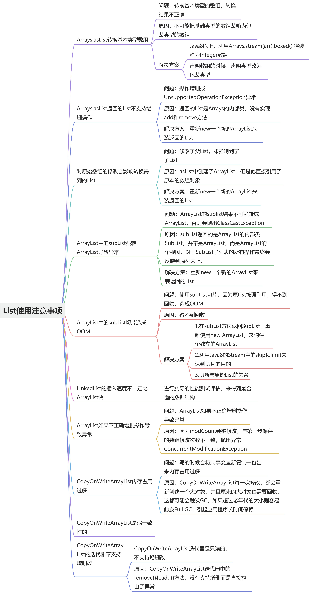

```
table[0] → null
table[1] → Node(k1,v1) → Node(k2,v2) → ...（链表，长度≥8转红黑树）
table[2] → TreeNode(...)（红黑树）
...
table[n-1] → null
```

```java
static class Node<K,V> implements Map.Entry<K,V> {
    final int hash;
    final K key;
    V value;
    Node<K,V> next;
}
```

## put流程

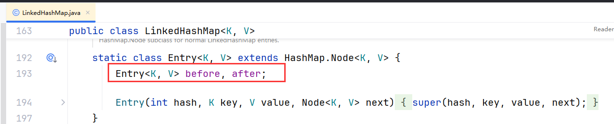

```java
public V put(K key, V value) {
    return putVal(hash(key), key, value, false, true);
}

static final int hash(Object key) {
    int h;
    return (key == null) ? 0 : (h = key.hashCode()) ^ (h >>> 16); // 扰动
}

final V putVal(int hash, K key, V value, boolean onlyIfAbsent, boolean evict) {
    Node<K,V>[] tab; Node<K,V> p; int n, i;
    if ((tab = table) == null || (n = tab.length) == 0)
        n = (tab = resize()).length;           // 初始化或扩容
    if ((p = tab[i = (n - 1) & hash]) == null)
        tab[i] = newNode(hash, key, value, null); // 桶为空，直接放
    else {
        Node<K,V> e; K k;
        if (p.hash == hash && ((k = p.key) == key || (key != null && key.equals(k))))
            e = p;                              // 首节点key相同
        else if (p instanceof TreeNode)
            e = ((TreeNode<K,V>)p).putTreeVal(this, tab, hash, key, value); // 红黑树
        else {
            for (int binCount = 0; ; ++binCount) {
                if ((e = p.next) == null) {
                    p.next = newNode(hash, key, value, null); // 尾插
                    if (binCount >= TREEIFY_THRESHOLD - 1)
                        treeifyBin(tab, hash);  // 链表≥8，树化
                    break;
                }
                if (e.hash == hash && ((k = e.key) == key || (key != null && key.equals(k))))
                    break;                      // 找到相同key
                p = e;
            }
        }
        if (e != null) {                        // 替换旧值
            V oldValue = e.value;
            if (!onlyIfAbsent || oldValue == null)
                e.value = value;
            return oldValue;
        }
    }
    ++modCount;
    if (++size > threshold)
        resize();                               // 超过阈值扩容
    return null;
}
```

## get流程

```java
public V get(Object key) {
    Node<K,V> e;
    return (e = getNode(hash(key), key)) == null ? null : e.value;
}

final Node<K,V> getNode(int hash, Object key) {
    Node<K,V>[] tab; Node<K,V> first, e; int n; K k;
    if ((tab = table) != null && (n = tab.length) > 0 &&
        (first = tab[(n - 1) & hash]) != null) {
        if (first.hash == hash && ((k = first.key) == key || (key != null && key.equals(k))))
            return first;                       // 首节点命中
        if ((e = first.next) != null) {
            if (first instanceof TreeNode)
                return ((TreeNode<K,V>)first).getTreeNode(hash, key); // 红黑树查找
            do {
                if (e.hash == hash && ((k = e.key) == key || (key != null && key.equals(k))))
                    return e;                   // 链表遍历
            } while ((e = e.next) != null);
        }
    }
    return null;
}
```

## resize扩容

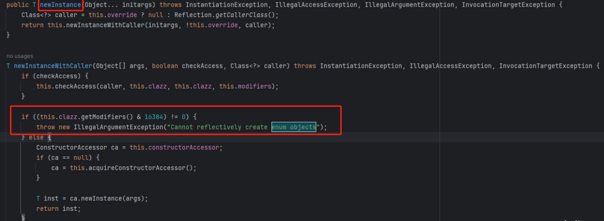

- 触发条件：`size > threshold`（threshold = capacity × loadFactor）
- 扩容为2倍，重新计算每个元素的位置
- JDK8优化：扩容后元素位置要么不变，要么原位置+旧容量（因为capacity是2的幂，hash & (2n-1)只多判断最高位）

## 核心参数

| 参数 | 默认值 | 说明 |
|------|--------|------|
| 初始容量 | 16 | 桶数组大小（2的幂） |
| 负载因子 | 0.75 | size > capacity × 0.75时扩容 |
| 树化阈值 | 8 | 链表长度≥8且桶数≥64时转红黑树 |
| 退化阈值 | 6 | 红黑树节点≤6时退化为链表 |

## 线程安全问题

HashMap非线程安全，多线程下：
- JDK7：扩容时头插法可能导致**链表成环**，get时死循环
- JDK8：尾插法不会成环，但仍可能**数据丢失**（两个线程同时put到同一桶）

多线程用`ConcurrentHashMap`。

---

# 阿里一面：说一说Java、Spring、Dubbo三者SPI机制的原理和区别

## Java SPI

Java SPI（Service Provider Interface）是服务发现机制，定义接口，由不同实现方提供实现，运行时自动发现。

**使用方式**：

1. 定义接口
2. 在`META-INF/services/`下创建文件，文件名为接口全限定名，内容为实现类全限定名
3. 用`ServiceLoader`加载

```java
public interface Serialization {
    byte[] serialize(Object obj);
}

// META-INF/services/com.example.Serialization 文件内容：
// com.example.JsonSerialization
// com.example.XmlSerialization

ServiceLoader<Serialization> loader = ServiceLoader.load(Serialization.class);
for (Serialization s : loader) {
    byte[] data = s.serialize(obj);
}
```

**缺点**：一次性加载所有实现，无法按需加载，无法获取单个实现。

## Spring SPI

Spring的`spring.factories`机制：

```properties
# META-INF/spring.factories
com.example.MyInterface=com.example.Impl1,com.example.Impl2
```

```java
List<MyInterface> impls = SpringFactoriesLoader.loadFactories(MyInterface.class, classLoader);
```

Spring Boot自动配置大量使用此机制：`EnableAutoConfiguration`的值就是所有自动配置类。

## Dubbo SPI

Dubbo增强了Java SPI，支持按需加载、IOC注入、AOP包装：

```properties
# META-INF/dubbo/com.example.Serialization 文件内容：
# json=com.example.JsonSerialization
# xml=com.example.XmlSerialization
```

```java
ExtensionLoader<Serialization> loader = ExtensionLoader.getExtensionLoader(Serialization.class);
Serialization json = loader.getExtension("json"); // 按key加载
Serialization adaptive = loader.getAdaptiveExtension(); // 自适应扩展
```

**Dubbo SPI特性**：
1. **按需加载**：通过key获取指定实现
2. **IOC**：扩展类中`@Adaptive`标注的方法参数决定使用哪个实现
3. **Wrapper**：实现类构造函数有同类型参数时自动包装（AOP）
4. **自适应扩展**：运行时根据URL参数动态选择实现

## 三者对比

| 特性 | Java SPI | Spring SPI | Dubbo SPI |
|------|---------|------------|-----------|
| 配置文件 | META-INF/services/ | META-INF/spring.factories | META-INF/dubbo/ |
| 加载方式 | 全部加载 | 全部加载 | 按key加载 |
| IOC注入 | ✗ | ✗ | ✓ |
| AOP包装 | ✗ | ✗ | ✓ |
| 自适应 | ✗ | ✗ | ✓ |

---

# 程序员必懂的权限模型：RBAC

## RBAC基础

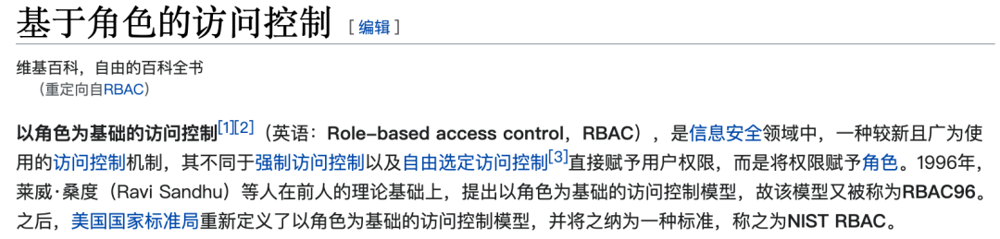

RBAC（Role-Based Access Control）基于角色的访问控制：用户关联角色，角色关联权限。

### RBAC0（基础模型）

```
用户(User) → 角色(Role) → 权限(Permission) → 资源(Resource)
```

```sql
CREATE TABLE user_role (user_id BIGINT, role_id BIGINT);
CREATE TABLE role_permission (role_id BIGINT, permission_id BIGINT);
CREATE TABLE permission (id BIGINT, name VARCHAR, resource VARCHAR, action VARCHAR);
```

### RBAC1（角色继承）

角色可以有继承关系，子角色继承父角色的所有权限：

```
管理员 → 编辑 → 普通用户
```

### RBAC2（角色约束）

增加角色约束：
- **互斥角色**：同一用户不能同时拥有互斥角色（如审批人和申请人）
- **基数约束**：一个角色最多N个用户
- **先决条件**：拥有角色A前必须先拥有角色B

### RBAC3（RBAC1 + RBAC2）

同时支持角色继承和约束。

## 用户组和权限组

实际系统中通常增加用户组和权限组简化管理：

```
用户组(UserGroup) → 用户(User)
权限组(PermissionGroup) → 权限(Permission)
角色(Role) → 权限组(PermissionGroup)
用户组(UserGroup) → 角色(Role)
```

## 功能权限与数据权限

- **功能权限**：控制能否访问某个菜单、按钮、API
- **数据权限**：控制能看到哪些数据（如只能看本部门数据）

数据权限实现：
1. **行级过滤**：SQL追加`WHERE dept_id = ?`
2. **列级过滤**：隐藏敏感字段
3. **基于规则**：配置数据范围规则

## 其他权限模型

| 模型 | 说明 | 适用场景 |
|------|------|---------|
| ACL | 访问控制列表，直接关联主体与资源 | 文件系统 |
| DAC | 自主访问控制，资源所有者决定访问权限 | Linux文件权限 |
| MAC | 强制访问控制，系统统一安全等级 | 军事、政府系统 |
| ABAC | 基于属性的访问控制，根据主体/资源/环境属性动态判断 | 复杂业务规则 |

---

# Java五种文件拷贝方式

## 1. 传统流拷贝

```java
try (InputStream in = new FileInputStream(src); OutputStream out = new FileOutputStream(dst)) {
    byte[] buffer = new byte[8192];
    int bytesRead;
    while ((bytesRead = in.read(buffer)) != -1) {
        out.write(buffer, 0, bytesRead);
    }
}
```

特点：简单，但逐字节（无buffer时）或按块拷贝，速度一般。

## 2. 缓冲流拷贝

```java
try (BufferedInputStream in = new BufferedInputStream(new FileInputStream(src));
     BufferedOutputStream out = new BufferedOutputStream(new FileOutputStream(dst))) {
    byte[] buffer = new byte[8192];
    int bytesRead;
    while ((bytesRead = in.read(buffer)) != -1) {
        out.write(buffer, 0, bytesRead);
    }
}
```

特点：内置缓冲区，减少系统调用，比传统流快。

## 3. NIO Files.copy

```java
Files.copy(Paths.get(src), Paths.get(dst), StandardCopyOption.REPLACE_EXISTING);
```

特点：最简洁，JDK7+，底层根据平台选择最优实现。

## 4. FileChannel拷贝

```java
try (FileChannel in = FileChannel.open(Paths.get(src), StandardOpenOption.READ);
     FileChannel out = FileChannel.open(Paths.get(dst), StandardOpenOption.WRITE, StandardOpenOption.CREATE)) {
    in.transferTo(0, in.size(), out); // 零拷贝
}
```

特点：利用操作系统零拷贝（sendfile），大文件性能最好。

## 5. MappedByteBuffer

```java
try (FileChannel in = FileChannel.open(Paths.get(src), StandardOpenOption.READ);
     FileChannel out = FileChannel.open(Paths.get(dst), StandardOpenOption.WRITE, StandardOpenOption.CREATE)) {
    MappedByteBuffer mapped = in.map(FileChannel.MapMode.READ_ONLY, 0, in.size());
    out.write(mapped);
}
```

特点：内存映射文件，将文件直接映射到内存，适合大文件随机读写。

## 性能对比

| 方式 | 小文件 | 大文件 | 代码复杂度 |
|------|--------|--------|-----------|
| 传统流 | 慢 | 慢 | 中 |
| 缓冲流 | 中 | 中 | 中 |
| Files.copy | 快 | 快 | 低 |
| FileChannel | 快 | 最快 | 中 |
| MappedByteBuffer | 快 | 快 | 高 |

---

# 缓存淘汰机制LRU和LFU的区别

## LRU（Least Recently Used）

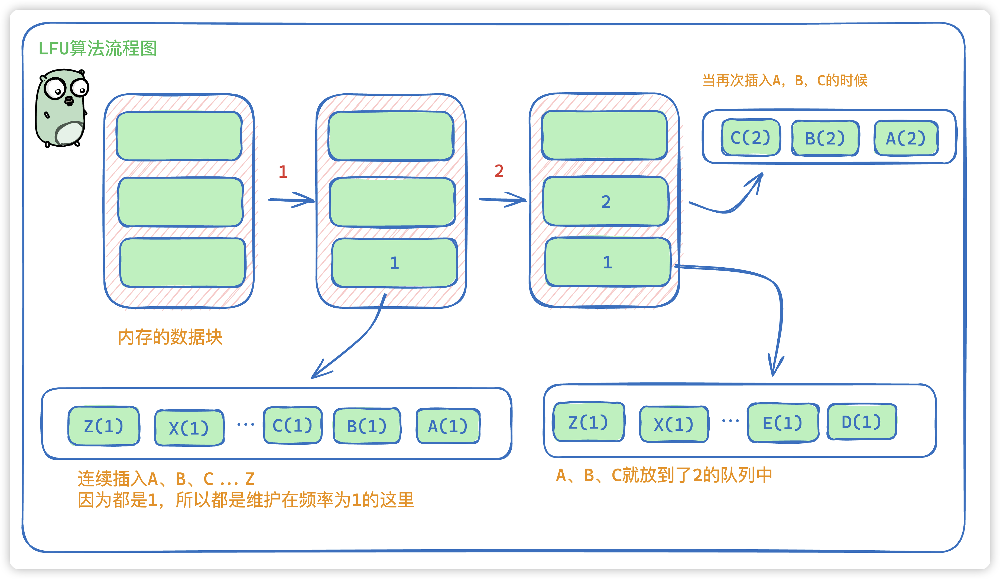

淘汰最长时间未被访问的数据。基于**访问时间**排序。

```java
public class LRUCache<K, V> extends LinkedHashMap<K, V> {
    private final int capacity;

    public LRUCache(int capacity) {
        super(capacity, 0.75f, true); // accessOrder=true
        this.capacity = capacity;
    }

    @Override
    protected boolean removeEldestEntry(Map.Entry<K, V> eldest) {
        return size() > capacity;
    }
}
```

## LFU（Least Frequently Used）

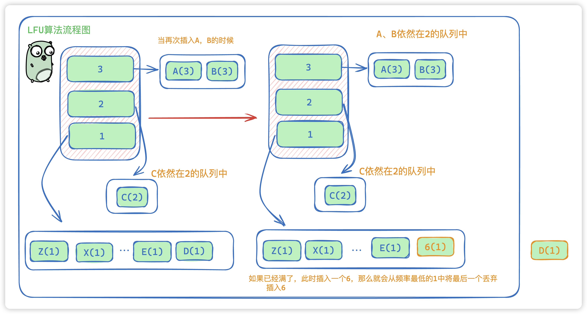

淘汰访问次数最少的数据。基于**访问频率**排序。

```java
public class LFUCache<K, V> {
    private final int capacity;
    private final Map<K, V> cache = new HashMap<>();
    private final Map<K, Integer> freq = new HashMap<>();
    private final Map<Integer, LinkedHashSet<K>> freqList = new HashMap<>();
    private int minFreq = 0;

    public V get(K key) {
        if (!cache.containsKey(key)) return null;
        increaseFreq(key);
        return cache.get(key);
    }

    public void put(K key, V value) {
        if (cache.containsKey(key)) {
            cache.put(key, value);
            increaseFreq(key);
            return;
        }
        if (cache.size() >= capacity) evict();
        cache.put(key, value);
        freq.put(key, 1);
        freqList.computeIfAbsent(1, k -> new LinkedHashSet<>()).add(key);
        minFreq = 1;
    }

    private void increaseFreq(K key) {
        int f = freq.get(key);
        freq.put(key, f + 1);
        freqList.get(f).remove(key);
        if (freqList.get(f).isEmpty()) {
            freqList.remove(f);
            if (minFreq == f) minFreq++;
        }
        freqList.computeIfAbsent(f + 1, k -> new LinkedHashSet<>()).add(key);
    }

    private void evict() {
        K evictKey = freqList.get(minFreq).iterator().next();
        freqList.get(minFreq).remove(evictKey);
        cache.remove(evictKey);
        freq.remove(evictKey);
    }
}
```

## 对比

| 特性 | LRU | LFU |
|------|-----|-----|
| 淘汰依据 | 最后访问时间 | 访问次数 |
| 优势 | 热点数据保持 | 避免偶发访问挤占 |
| 劣势 | 偶发访问可能挤掉热点 | 旧热点难淘汰（频率衰减慢） |
| 实现 | LinkedHashMap或双向链表+HashMap | 双HashMap+频率链表 |
| 适用 | 通用缓存、页面置换 | 静态热点数据 |

## 电商场景选择

- **商品详情缓存**：LRU（热点商品频繁访问保持，冷门商品淘汰）
- **搜索热词缓存**：LFU（避免偶发热词挤占长期热词）
- **混合策略**：LRU-K（最近K次访问时间综合判断）

---

# 说说你对内部类的理解

## 四种内部类

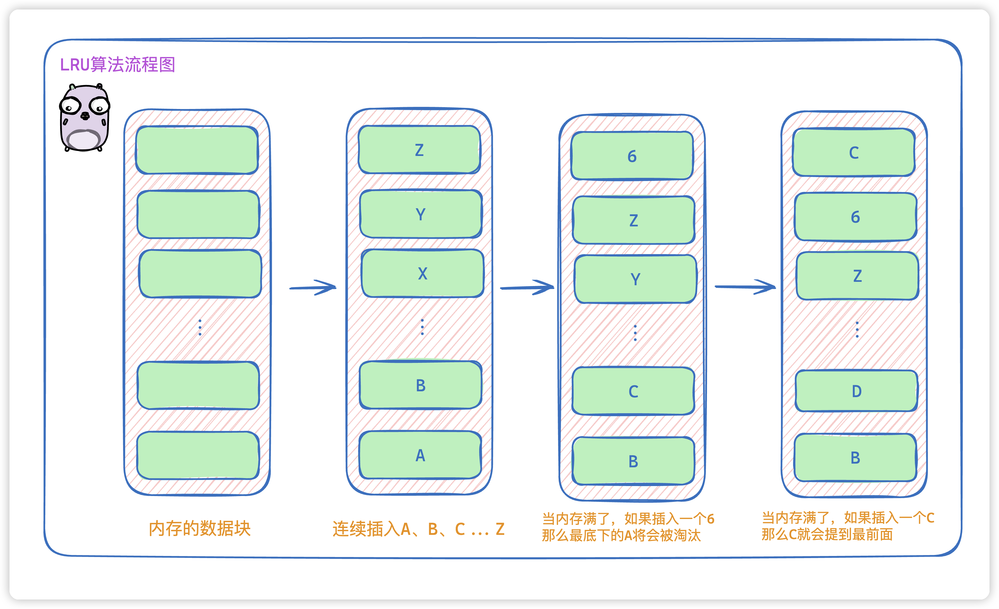

### 1. 成员内部类

定义在类内部、方法外部，可访问外部类所有成员（包括private）：

```java
public class Outer {
    private int x = 10;

    class Inner {
        void access() {
            System.out.println(x); // 可访问外部类private成员
        }
    }
}

Outer.Inner inner = new Outer().new Inner();
```

### 2. 静态内部类

用static修饰，只能访问外部类静态成员：

```java
public class Outer {
    private static int x = 10;
    private int y = 20;

    static class StaticInner {
        void access() {
            System.out.println(x); // 可访问静态成员
            // System.out.println(y); // 编译错误，不能访问非静态成员
        }
    }
}

Outer.StaticInner inner = new Outer.StaticInner();
```

### 3. 局部内部类

定义在方法内部，作用域限于方法：

```java
public class Outer {
    public void method() {
        class LocalInner {
            void access() { System.out.println("local"); }
        }
        new LocalInner().access();
    }
}
```

### 4. 匿名内部类

没有类名，直接实现接口或继承类：

```java
Runnable runnable = new Runnable() {
    @Override
    public void run() {
        System.out.println("running");
    }
};

// Java 8+ Lambda替代
Runnable runnable2 = () -> System.out.println("running");
```

## 内部类的作用

1. **封装**：内部类只被外部类使用，隐藏实现细节
2. **访问外部类成员**：方便访问外部类私有成员
3. **回调**：匿名内部类常用于回调（事件监听器）
4. **多继承**：通过多个内部类分别继承不同类，间接实现多继承

## 静态内部类 vs 非静态内部类

| 特性 | 静态内部类 | 非静态内部类 |
|------|-----------|-------------|
| 访问外部类成员 | 仅静态成员 | 所有成员 |
| 创建实例 | `new Outer.StaticInner()` | `new Outer().new Inner()` |
| 持有外部类引用 | 否 | 是 |
| 内存泄漏风险 | 无 | 有（持有外部类引用） |
| 典型应用 | Builder模式、Map.Entry | 迭代器、回调 |

> **建议**：优先用静态内部类，避免不必要的引用持有和内存泄漏。

---

# 说说你对lambda表达式的理解

## 语法

```java
(parameters) -> expression
(parameters) -> { statements; }

// 无参数
() -> System.out.println("hello")

// 单参数（类型推断，可省略类型）
x -> x * x

// 多参数
(x, y) -> x + y

// 多语句
(x, y) -> {
    int sum = x + y;
    return sum;
}
```

## 函数式接口

Lambda表达式需要函数式接口作为目标类型。函数式接口是**只有一个抽象方法**的接口（可包含多个default/static方法）：

```java
@FunctionalInterface
interface MyFunction<T, R> {
    R apply(T t);
    // 可以有default方法
    default <V> MyFunction<T, V> andThen(MyFunction<R, V> after) {
        return t -> after.apply(this.apply(t));
    }
}
```

## 变量捕获

Lambda可以访问外部局部变量，但要求是**final或effectively final**（不可修改）：

```java
int factor = 2; // effectively final
Function<Integer, Integer> multiply = x -> x * factor;
// factor = 3; // 编译错误，修改后lambda捕获会报错
```

原因：Lambda捕获的是变量的副本，如果变量可变，副本与原值可能不一致。

## 方法引用

Lambda的简写形式（见前文"双冒号"章节）。

## 性能

- Lambda通过`invokedynamic`指令实现，JVM在首次执行时生成实现类，后续调用有JIT优化
- 比匿名内部类性能更好（不生成额外的class文件）
- Stream中的Lambda注意避免装箱拆箱开销

## 限制

1. Lambda不能修改捕获的局部变量
2. Lambda不能抛出受检异常（除非函数式接口声明了）
3. Lambda没有`this`指向自身（`this`指向外部类）
4. 无法引用自身（递归需用方法引用或赋值给变量）

---

# 过滤器和拦截器有什么区别？

## 实现方式

### Filter（过滤器）

Servlet规范中的组件，基于函数回调：

```java
public class MyFilter implements Filter {
    @Override
    public void doFilter(ServletRequest request, ServletResponse response,
                         FilterChain chain) throws IOException, ServletException {
        // 前置处理
        chain.doFilter(request, response); // 放行
        // 后置处理
    }
}
```

### Interceptor（拦截器）

Spring MVC中的组件，基于Java反射（AOP）：

```java
public class MyInterceptor implements HandlerInterceptor {
    @Override
    public boolean preHandle(HttpServletRequest request, HttpServletResponse response,
                              Object handler) {
        return true; // 放行，false则中断
    }
    @Override
    public void postHandle(...) { }
    @Override
    public void afterCompletion(...) { }
}
```

## 五大区别

| 特性 | Filter | Interceptor |
|------|--------|-------------|
| 规范 | Servlet规范 | Spring MVC |
| 实现机制 | 函数回调 | Java反射（AOP） |
| 执行顺序 | 请求时Filter先于Interceptor | 响应时Interceptor先于Filter |
| 拦截范围 | 所有请求（包括静态资源） | 仅Controller请求 |
| 依赖 | 不依赖Spring | 依赖Spring MVC |

## 执行顺序

```
请求 → Filter1 → Filter2 → Interceptor1.preHandle → Interceptor2.preHandle → Controller
     → Interceptor2.postHandle → Interceptor1.postHandle
     → Interceptor2.afterCompletion → Interceptor1.afterCompletion
     → Filter2 → Filter1 → 响应
```

---

# Java中止线程的三种方式

## 1. 使用退出标志

线程run方法中使用volatile标志控制循环退出：

```java
public class Worker extends Thread {
    private volatile boolean running = true;

    public void shutdown() { running = false; }

    @Override
    public void run() {
        while (running) {
            // 执行任务
        }
    }
}
```

**推荐**：安全、可控，线程能完成当前工作后退出。

## 2. 使用interrupt

```java
Thread thread = new Thread(() -> {
    while (!Thread.currentThread().isInterrupted()) {
        try {
            Thread.sleep(1000);
        } catch (InterruptedException e) {
            Thread.currentThread().interrupt(); // 恢复中断标志
            break;
        }
    }
});
thread.start();
thread.interrupt(); // 中断线程
```

**注意**：`interrupt()`只是设置中断标志，不强制停止。如果线程在`sleep/wait/join`中被中断，会抛`InterruptedException`并清除中断标志。

## 3. 使用stop()（已废弃）

```java
thread.stop(); // 强制停止，已废弃
```

**不推荐**：`stop()`立即停止线程，可能导致：
- 锁未释放（死锁）
- 数据不一致（操作执行到一半被中断）

## 三种方式对比

| 方式 | 安全性 | 推荐度 | 说明 |
|------|--------|--------|------|
| 退出标志 | 安全 | ✓✓✓ | 优雅退出，完成当前工作 |
| interrupt | 安全 | ✓✓ | 标准方式，需正确处理InterruptedException |
| stop() | 不安全 | ✗ | 已废弃，可能导致死锁和数据不一致 |

---

# OOM类型

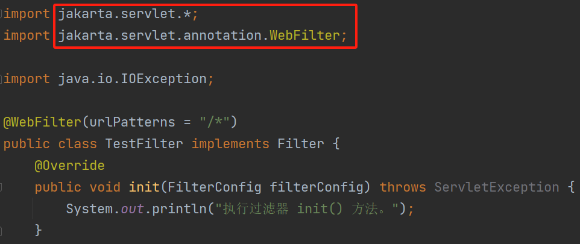

## 1. 堆内存OOM

```
java.lang.OutOfMemoryError: Java heap space
```

原因：堆内存不足，无法分配新对象。常见于内存泄漏或大对象。

解决：增大`-Xmx`，排查内存泄漏（MAT分析hprof）。

## 2. 栈内存OOM

```
java.lang.OutOfMemoryError: unable to create new native thread
```

原因：线程数超过系统限制或每个线程栈内存过大。

解决：减小`-Xss`，排查线程泄漏，调整系统`ulimit`。

## 3. 栈内存溢出

```
java.lang.StackOverflowError
```

原因：方法调用深度过大（递归未终止）。

解决：检查递归终止条件，增大`-Xss`（治标）。

## 4. 直接内存OOM

```
java.lang.OutOfMemoryError: Direct buffer memory
```

原因：NIO的DirectByteBuffer分配过多本地内存。

解决：增大`-XX:MaxDirectMemorySize`，检查NIO使用。

## 5. GC开销超限OOM

```
java.lang.OutOfMemoryError: GC overhead limit exceeded
```

原因：GC回收效率低，超过98%时间在做GC但只回收了不到2%堆内存。

解决：排查内存泄漏，增大堆内存。

## 6. 元空间OOM

```
java.lang.OutOfMemoryError: Metaspace
```

原因：元空间（JDK8+，替代永久代）不足，常因动态生成类过多（如CGLIB、Groovy）。

解决：增大`-XX:MaxMetaspaceSize`，排查类加载泄漏。

---

# 如何判断一个对象是否可以被回收

## 1. 引用计数法

每个对象维护一个引用计数，被引用时+1，引用失效时-1，为0时可回收。

**缺点**：无法处理循环引用（A引用B，B引用A，两者计数都不为0但实际已不可达）。

**应用**：Python、Objective-C使用引用计数（配合其他机制解决循环引用）。

## 2. 可达性分析算法（Java使用）

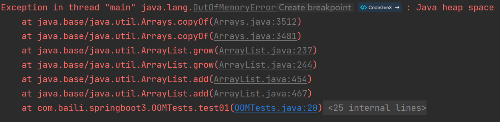

从**GC Roots**出发，沿引用链搜索，不可达的对象可回收。

```
GC Roots → A → B → C
              ↘ D → E

F → G（F不是GC Roots，F和G不可达，可回收）
```

**GC Roots**包括：
- 虚拟机栈中引用的对象（局部变量）
- 方法区静态属性引用的对象
- 方法区常量引用的对象
- 本地方法栈JNI引用的对象
- 同步锁持有的对象

## 3. 引用的分类

| 引用类型 | 回收时机 | 应用场景 |
|---------|---------|---------|
| 强引用（Strong） | 永不回收（即使OOM） | 普通对象引用 |
| 软引用（Soft） | 内存不足时回收 | 内存敏感缓存 |
| 弱引用（Weak） | 下次GC时回收 | ThreadLocalMap的key |
| 虚引用（Phantom） | 随时回收，get()总返回null | 跟踪对象被回收的时机 |

```java
SoftReference<byte[]> softRef = new SoftReference<>(new byte[1024*1024]);
WeakReference<Object> weakRef = new WeakReference<>(new Object());
```

## 4. finalize方法

对象被判定为可回收后，如果重写了`finalize()`且未执行过，会放入F-Queue，由Finalizer线程调用`finalize()`。如果在`finalize()`中重新被引用，对象可"自救"。

**不推荐使用**：finalize不可靠（不保证执行、执行时间不确定），Java 9已废弃。

---

# 金额到底用Long还是Bigdecimal

## 结论

| 场景 | 推荐类型 | 原因 |
|------|---------|------|
| 精确计算（金融、支付） | BigDecimal | 无精度丢失 |
| 精确计算（金额以分存储） | long | 整数运算无精度问题，性能好 |
| 非精确计算（统计、分析） | double | 性能最好，可接受微小误差 |

## Long方案（以分为单位）

```java
long price = 1999; // 19.99元，以分存储
long total = price * 3; // 5997分 = 59.97元
// 转换为元显示
String display = String.format("%.2f", total / 100.0);
```

**优点**：性能好、无精度问题、存储紧凑
**缺点**：需要自行管理小数位转换

## BigDecimal方案

```java
BigDecimal price = new BigDecimal("19.99");
BigDecimal total = price.multiply(new BigDecimal("3"));
String display = total.toString(); // 59.97
```

**优点**：精确、API丰富
**缺点**：性能差（10-100倍）、内存占用大

## 注意事项

1. **不要用double表示金额**：`0.1 + 0.2 != 0.3`
2. **数据库用DECIMAL类型**：`DECIMAL(10,2)`精确存储
3. **Long方案统一以最小单位（分）存储**，避免转换混乱
4. **BigDecimal用String构造**：`new BigDecimal("0.1")`而非`new BigDecimal(0.1)`

---

# 讲讲你对ThreadLocal的理解

## 基本使用

```java
ThreadLocal<String> threadLocal = new ThreadLocal<>();
threadLocal.set("value"); // 当前线程设置值
String value = threadLocal.get(); // 当前线程获取值
threadLocal.remove(); // 清除当前线程的值
```

## 实现原理

每个Thread对象持有一个`ThreadLocalMap`：

```java
class Thread {
    ThreadLocal.ThreadLocalMap threadLocals; // 每个线程独有
}
```

`ThreadLocalMap`的Entry是弱引用key + 强引用value：

```java
static class Entry extends WeakReference<ThreadLocal<?>> {
    Object value;
    Entry(ThreadLocal<?> k, Object v) { super(k); value = v; }
}
```

- `set(value)`：获取当前线程的ThreadLocalMap，以ThreadLocal实例为key存入value
- `get()`：从当前线程的ThreadLocalMap中取key对应的value
- 每个线程操作自己的ThreadLocalMap，互不干扰，无需同步

## 内存泄漏问题

Entry的key是弱引用，ThreadLocal实例被GC后key变null，但value仍被Entry强引用，无法回收：

```
Thread → ThreadLocalMap → Entry(key=null, value=Object) → value无法回收
```

**解决**：使用完后调用`remove()`清除Entry。

## InheritableThreadLocal

`ThreadLocal`子线程无法继承父线程的值。`InheritableThreadLocal`可以：

```java
InheritableThreadLocal<String> itl = new InheritableThreadLocal<>();
itl.set("parent");
new Thread(() -> System.out.println(itl.get())).start(); // 输出"parent"
```

原理：Thread创建时，如果父线程的`inheritableThreadLocals`非null，会拷贝到子线程。

## 应用场景

1. **用户上下文**：存储当前请求的User信息，避免参数层层传递
2. **数据库连接/事务**：每个线程独占连接
3. **SimpleDateFormat**：线程安全的日期格式化（SimpleDateFormat非线程安全）
4. **MDC**：日志链路追踪（traceId传递）

---

# String，Stringbuffer，StringBuilder的区别

| 特性 | String | StringBuffer | StringBuilder |
|------|--------|-------------|--------------|
| 可变性 | 不可变 | 可变 | 可变 |
| 线程安全 | 安全（不可变） | 安全（synchronized） | 不安全 |
| 性能 | 拼接差（创建新对象） | 中 | 最快 |
| 引入版本 | JDK1.0 | JDK1.0 | JDK5 |

## String不可变

```java
String s = "ab";
s = s + "c"; // 创建了新对象"abc"，原"ab"不变
```

String内部`final char[] value`（JDK9为`byte[]`），不可修改。每次拼接都创建新对象。

## StringBuffer/StringBuilder可变

```java
StringBuilder sb = new StringBuilder("ab");
sb.append("c"); // 在原对象上修改，不创建新对象
```

两者都继承`AbstractStringBuilder`，内部`char[] value`可扩容。StringBuffer的方法加了`synchronized`。

## 使用建议

- 少量拼接：用`String`（编译器优化为StringBuilder）
- 单线程大量拼接：用`StringBuilder`
- 多线程大量拼接：用`StringBuffer`（或避免共享StringBuilder）

---

# Java中变量和常量有什么区别

| 特性 | 变量 | 常量 |
|------|------|------|
| 修饰符 | 无特殊修饰 | `final` |
| 可修改 | 运行时可修改 | 不可修改 |
| 命名规范 | 小驼峰 | 全大写+下划线 |
| 存储位置 | 栈/堆 | 编译期常量在常量池 |

```java
int variable = 10;     // 变量
variable = 20;         // 可修改

final int CONSTANT = 100; // 常量
// CONSTANT = 200;          // 编译错误

// 类常量
public static final double PI = 3.14159;
```

---

# Java中的异常处理机制是怎样的

## 异常体系

```
Throwable
├── Error（系统错误，不应捕获）
│   ├── OutOfMemoryError
│   └── StackOverflowError
└── Exception
    ├── RuntimeException（非受检，可不处理）
    │   ├── NullPointerException
    │   ├── IllegalArgumentException
    │   └── ArrayIndexOutOfBoundsException
    └── 其他Exception（受检，必须处理）
        ├── IOException
        └── SQLException
```

## 处理方式

```java
try {
    // 可能抛异常
} catch (SpecificException e) {
    // 捕获具体异常
} catch (Exception e) {
    // 捕获通用异常
} finally {
    // 必定执行（资源释放）
}
```

Java 7+ try-with-resources：

```java
try (Resource r = new Resource()) {
    r.use();
} // 自动调用r.close()
```

Java 7+ multi-catch：

```java
try { ... }
catch (IOException | SQLException e) { ... }
```

## 自定义异常

```java
public class BusinessException extends RuntimeException {
    private int code;
    public BusinessException(int code, String message) {
        super(message);
        this.code = code;
    }
    public int getCode() { return code; }
}
```

---

# 讲讲你对CountDownLatch的理解

## 原理

`CountDownLatch`基于AQS共享模式，内部维护一个count计数：

- `await()`：count > 0时阻塞，count = 0时放行
- `countDown()`：count减1，减到0时唤醒所有等待线程

```java
CountDownLatch latch = new CountDownLatch(3);

// 三个工作线程
for (int i = 0; i < 3; i++) {
    new Thread(() -> {
        try { doWork(); }
        finally { latch.countDown(); }
    }).start();
}

latch.await(); // 等待三个线程都完成
System.out.println("all done");
```

## 应用场景

1. **主线程等待多个子线程完成**：并行计算后汇总结果
2. **多个线程同时开始**：初始化CountDownLatch(1)，所有子线程await，主线程countDown后同时开始
3. **资源初始化等待**：等待多个服务就绪

## 与CyclicBarrier的区别

| 特性 | CountDownLatch | CyclicBarrier |
|------|---------------|---------------|
| 可重用 | 不可（count减到0后失效） | 可（自动重置） |
| 计数方式 | 减法（countDown） | 加法（await到达） |
| 动作 | count=0时放行await | 所有线程到达时执行barrierAction |
| 基于 | AQS共享模式 | ReentrantLock + Condition |

---

# 抽象类和接口有什么区别

| 特性 | 抽象类 | 接口 |
|------|--------|------|
| 关键字 | `abstract class` | `interface` |
| 多继承 | 单继承 | 多实现 |
| 构造方法 | 有 | 无 |
| 字段 | 任意类型 | public static final |
| 方法 | 任意访问级别 | public（JDK9+支持private） |
| 默认方法 | 无 | JDK8+支持default方法 |
| 静态方法 | 支持 | JDK8+支持 |
| 设计语义 | "is-a"关系，定义共性 | "can-do"能力，定义规范 |

```java
// 抽象类
abstract class Animal {
    protected String name;
    abstract void eat();
    void breathe() { System.out.println("breathing"); }
}

// 接口
interface Flyable {
    void fly();
    default void hover() { System.out.println("hovering"); } // JDK8
}
```

**选择建议**：有共享代码和状态用抽象类，只定义行为规范用接口。

---

# 重载和重写的区别

| 特性 | 重载（Overload） | 重写（Override） |
|------|-----------------|-----------------|
| 范围 | 同类中 | 父子类间 |
| 方法名 | 相同 | 相同 |
| 参数列表 | 必须不同 | 必须相同 |
| 返回类型 | 无要求 | 相同或子类型（协变返回） |
| 访问级别 | 无要求 | 不能更严格 |
| 绑定时机 | 编译期（静态分派） | 运行期（动态分派） |

```java
// 重载
class Calculator {
    int add(int a, int b) { return a + b; }
    double add(double a, double b) { return a + b; }
}

// 重写
class Animal { void sound() { System.out.println("..."); } }
class Dog extends Animal { @Override void sound() { System.out.println("woof"); } }
```

---

# Comparator与Comparable有什么区别

| 特性 | Comparable | Comparator |
|------|-----------|------------|
| 所在包 | java.lang | java.util |
| 方法 | `compareTo(T)` | `compare(T, T)` |
| 语义 | 自然排序（内部定义） | 外部比较器 |
| 修改类 | 需修改被比较类 | 不需修改被比较类 |
| 灵活性 | 固定一种排序 | 可定义多种排序 |

```java
// Comparable：类自身定义自然排序
public class User implements Comparable<User> {
    private int age;
    @Override
    public int compareTo(User o) { return Integer.compare(this.age, o.age); }
}
Collections.sort(users);

// Comparator：外部定义比较规则
Comparator<User> byName = Comparator.comparing(User::getName);
Comparator<User> byAgeDesc = Comparator.comparing(User::getAge).reversed();
users.sort(byAgeDesc);
```

---

# synchronized的实现原理

## 基本用法

```java
// 同步代码块
synchronized(obj) { ... }

// 同步实例方法
public synchronized void method() { ... }

// 同步静态方法
public static synchronized void method() { ... }
```

## 底层原理

### 同步代码块

编译后生成`monitorenter`和`monitorexit`指令：

```
monitorenter  // 获取monitor锁
// 代码块内容
monitorexit   // 释放monitor锁
```

每个对象关联一个Monitor（ObjectMonitor）：

```
ObjectMonitor {
    _owner;       // 持有锁的线程
    _count;       // 重入计数
    _WaitSet;     // wait的线程
    _EntryList;   // 等待获取锁的线程
}
```

### 同步方法

方法的`ACC_SYNCHRONIZED`标志位标识为同步方法，JVM调用时自动加锁/释放。

## 锁升级过程（JDK6+）

```
无锁 → 偏向锁 → 轻量级锁 → 重量级锁
```

| 锁状态 | 原理 | 适用场景 |
|--------|------|---------|
| 偏向锁 | 在对象头记录线程ID，下次同线程无需CAS | 单线程重复访问 |
| 轻量级锁 | CAS自旋获取 | 多线程交替访问，无竞争 |
| 重量级锁 | Monitor互斥，未获取锁的线程阻塞 | 高竞争 |

锁升级不可逆（但偏向锁可被撤销）。

---

# 如何实现线程的同步

## 1. synchronized

```java
synchronized(lock) { /* 临界区 */ }
```

## 2. Lock（ReentrantLock）

```java
lock.lock();
try { /* 临界区 */ }
finally { lock.unlock(); }
```

## 3. volatile

保证可见性和有序性（不保证原子性），适合状态标志：

```java
volatile boolean running = true;
```

## 4. 原子类

```java
AtomicInteger count = new AtomicInteger(0);
count.incrementAndGet(); // 原子自增
```

## 5. 并发集合

```java
ConcurrentHashMap<K, V> map = new ConcurrentHashMap<>();
CopyOnWriteArrayList<T> list = new CopyOnWriteArrayList<>();
```

## 6. CountDownLatch / CyclicBarrier / Semaphore

```java
Semaphore semaphore = new Semaphore(3); // 最多3个线程同时访问
semaphore.acquire();
try { /* 临界区 */ }
finally { semaphore.release(); }
```

## 7. ThreadLocal

线程隔离，无需同步：

```java
ThreadLocal<SimpleDateFormat> tl = ThreadLocal.withInitial(() -> new SimpleDateFormat("yyyy-MM-dd"));
```

---

# ArrayList和LinkedList有什么区别

| 特性 | ArrayList | LinkedList |
|------|-----------|------------|
| 底层结构 | 动态数组 | 双向链表 |
| 随机访问 | O(1) | O(n) |
| 头部插入 | O(n) | O(1) |
| 尾部插入 | 均摊O(1) | O(1) |
| 中间插入 | O(n) | O(n)（查找O(n)+插入O(1)） |
| 内存占用 | 紧凑 | 每个节点多两个指针 |
| 实现接口 | List, RandomAccess | List, Deque |

```java
// ArrayList：数组扩容
// 初始容量10，扩容为1.5倍（newCapacity = oldCapacity + oldCapacity >> 1）

// LinkedList：双向链表
// Node { E item; Node prev; Node next; }
```

**选择**：随机访问多选ArrayList，频繁头插/尾插选LinkedList。大多数场景ArrayList更优（缓存友好）。

---

# Java中的集合框架有哪些核心接口

```
Collection
├── List（有序，可重复）
│   ├── ArrayList
│   ├── LinkedList
│   └── Vector（线程安全，已过时）
├── Set（无序，不重复）
│   ├── HashSet（基于HashMap）
│   ├── LinkedHashSet（保持插入顺序）
│   └── TreeSet（基于TreeMap，有序）
└── Queue（队列）
    ├── PriorityQueue（优先队列）
    ├── ArrayDeque（双端队列）
    └── LinkedList（也实现Deque）

Map（键值对）
├── HashMap
├── LinkedHashMap（保持插入顺序）
├── TreeMap（有序）
├── Hashtable（线程安全，已过时）
└── ConcurrentHashMap（线程安全）
```

---

# 两个对象hashCode()相同，则equals()是否也一定为true？

**不一定**。hashCode相同是hash碰撞，两个不同对象可能有相同hashCode但equals为false。

```java
String a = "Aa";
String b = "BB";
System.out.println(a.hashCode()); // 2112
System.out.println(b.hashCode()); // 2112
System.out.println(a.equals(b));  // false
```

**约定**（Object规范）：
- equals为true → hashCode必须相同
- hashCode相同 → equals不一定为true
- hashCode不同 → equals一定为false

---

# for-each与常规for循环的效率区别

| 场景 | for-each | 常规for |
|------|---------|---------|
| ArrayList | 略慢（迭代器） | 快（随机访问） |
| LinkedList | 快（迭代器顺序访问） | 慢（每次get从头遍历） |
| 数组 | 相同 | 相同 |

```java
// LinkedList中for-each比常规for快很多
List<Integer> list = new LinkedList<>();
// 常规for：O(n²)（每次list.get(i)是O(n)）
for (int i = 0; i < list.size(); i++) { list.get(i); }
// for-each：O(n)（迭代器顺序遍历）
for (int i : list) { }
```

for-each底层使用迭代器，对LinkedList友好。但for-each不能在遍历时修改集合（抛ConcurrentModificationException）。

---

# 设计模式是如何分类的

## 三大类

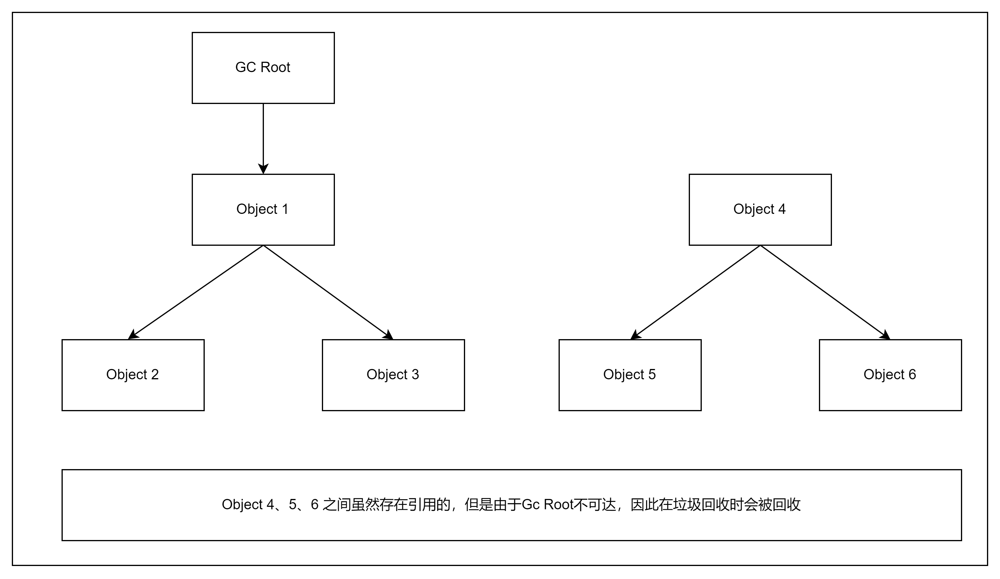

### 1. 创建型（5种）

关注对象创建方式，解耦创建与使用。

- **单例模式**（Singleton）：确保唯一实例
- **工厂方法模式**（Factory Method）：定义创建接口，子类决定实例化
- **抽象工厂模式**（Abstract Factory）：创建一系列相关对象
- **建造者模式**（Builder）：分步构建复杂对象
- **原型模式**（Prototype）：通过克隆创建对象

### 2. 结构型（7种）

关注类和对象的组合。

- **适配器模式**（Adapter）：转换接口
- **装饰器模式**（Decorator）：动态添加职责
- **代理模式**（Proxy）：控制访问
- **外观模式**（Facade）：简化子系统访问
- **桥接模式**（Bridge）：分离抽象与实现
- **组合模式**（Composite）：树形结构
- **享元模式**（Flyweight）：共享细粒度对象

### 3. 行为型（11种）

关注对象间的通信。

- **策略模式**（Strategy）：封装可互换的算法
- **模板方法模式**（Template Method）：定义骨架，子类实现步骤
- **观察者模式**（Observer）：一对多依赖通知
- **责任链模式**（Chain of Responsibility）：链式处理
- **命令模式**（Command）：封装请求
- **状态模式**（State）：状态驱动行为
- **迭代器模式**（Iterator）：顺序访问聚合元素
- **中介者模式**（Mediator）：集中交互
- **备忘录模式**（Memento）：保存恢复状态
- **访问者模式**（Visitor）：分离数据结构与操作
- **解释器模式**（Interpreter）：定义语言文法

---

# Java支持多继承么，为什么

**类不支持多继承，接口支持多实现。**

## 类不允许多继承的原因

1. **菱形问题（Diamond Problem）**：A有method()，B和C都继承A并重写method()，D同时继承B和C，调用D.method()时歧义

```
    A (method)
   / \
  B   C (都重写method)
   \ /
    D → D.method()调用B还是C的？
```

2. **构造顺序复杂**：多个父类的初始化顺序难以确定

## 接口允许多实现

接口只定义规范（JDK8前无实现），不存在菱形问题。JDK8引入default方法后，通过**规则**解决冲突：

```java
interface A { default void hello() { System.out.println("A"); } }
interface B { default void hello() { System.out.println("B"); } }

class C implements A, B {
    @Override
    public void hello() {
        A.super.hello(); // 显式指定调用哪个接口的default方法
    }
}
```

---

# 说说你对设计模式的理解

## 什么是设计模式

设计模式是面向对象软件设计中，对反复出现的问题的**可复用解决方案**。它不是可直接套用的代码，而是解决特定场景的思路和范式。

## 设计模式六大原则

1. **单一职责原则（SRP）**：一个类只负责一个功能
2. **开闭原则（OCP）**：对扩展开放，对修改关闭
3. **里氏替换原则（LSP）**：子类必须能替换父类
4. **接口隔离原则（ISP）**：客户端不应依赖不需要的接口
5. **依赖倒置原则（DIP）**：依赖抽象而非具体实现
6. **迪米特法则（LoD）**：最少知识原则，只与直接朋友通信

## 实际应用

| 模式 | 应用场景 | 框架实例 |
|------|---------|---------|
| 单例 | 全局唯一对象 | Spring Bean（默认单例）、Runtime |
| 工厂 | 对象创建解耦 | Spring BeanFactory、Calendar.getInstance |
| 代理 | AOP、远程调用 | Spring AOP、MyBatis Mapper代理 |
| 观察者 | 事件通知 | Spring ApplicationEvent |
| 模板方法 | 流程骨架 | Spring JdbcTemplate、RestTemplate |
| 策略 | 算法切换 | Spring Resource策略 |
| 装饰器 | 功能增强 | Java IO流（BufferedInputStream） |
| 责任链 | 请求处理链 | Spring FilterChain、Netty Pipeline |

---

# 什么是守护线程？与普通线程的区别

守护线程是为其他线程提供服务的后台线程，所有非守护线程结束时JVM退出，守护线程随之终止。

```java
Thread t = new Thread(() -> { while (true) { ... } });
t.setDaemon(true); // 必须在start前设置
t.start();
```

| 特性 | 守护线程 | 用户线程 |
|------|---------|---------|
| JVM退出 | 不阻止JVM退出 | JVM等待所有用户线程结束 |
| 生命周期 | 随JVM退出而终止 | 自行结束 |
| 典型应用 | GC、Finalizer、编译线程 | 业务线程 |
| setDaemon | 必须在start前调用 | 默认false |

> **注意**：守护线程被强制终止时不会执行finally块，不应在其中做资源释放等关键操作。

---

# 谈谈自定义注解的场景及实现

## 定义自定义注解

```java
@Target(ElementType.METHOD)          // 作用目标：方法
@Retention(RetentionPolicy.RUNTIME)  // 保留策略：运行时
@Documented                          // 生成javadoc时包含
public @interface MyAnnotation {
    String value() default "";
    int timeout() default 1000;
}
```

## 元注解

| 元注解 | 说明 |
|--------|------|
| `@Target` | 注解可用位置（TYPE, METHOD, FIELD, PARAMETER等） |
| `@Retention` | 保留策略（SOURCE, CLASS, RUNTIME） |
| `@Documented` | 是否包含在javadoc |
| `@Inherited` | 子类是否继承 |

## 使用场景

### 1. 接口参数校验

```java
@NotNull @Max(100)
private Integer age;
```

### 2. 权限控制

```java
@RequiresRole("admin")
public void deleteUser(Long id) { ... }
```

### 3. 日志记录

```java
@Log(action = "查询用户")
public User getUser(Long id) { ... }
```

### 4. 缓存

```java
@Cacheable(key = "user:#id", expire = 300)
public User getUser(Long id) { ... }
```

### 5. 定时任务

```java
@Scheduled(cron = "0 0 * * * ?")
public void cleanup() { ... }
```

## 运行时解析注解

```java
// 通过反射读取方法上的注解
Method method = clazz.getMethod("getUser", Long.class);
if (method.isAnnotationPresent(Log.class)) {
    Log log = method.getAnnotation(Log.class);
    System.out.println(log.action());
}
```

---

# synchronized锁优化

## 锁升级

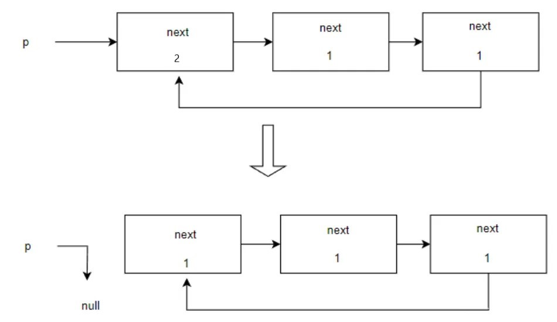

JDK6引入锁升级机制，减少重量级锁的性能开销：

```
无锁 → 偏向锁 → 轻量级锁 → 重量级锁
```

### 偏向锁

- 对象头Mark Word记录线程ID
- 同线程再次进入只需比较线程ID，无需CAS
- 适合：单线程反复获取同一锁
- JDK15后默认关闭（`-XX:-UseBiasedLocking`）

### 轻量级锁

- 偏向锁出现竞争时升级为轻量级锁
- 线程栈帧中创建Lock Record，CAS将对象头指向Lock Record
- 自旋等待，不阻塞线程
- 适合：多线程交替执行，竞争不激烈

### 重量级锁

- 自旋超过阈值（自适应自旋）仍未获取锁，升级为重量级锁
- 通过ObjectMonitor实现，未获取锁的线程进入EntryList阻塞
- 适合：高竞争场景

## 其他优化

| 优化 | 说明 |
|------|------|
| 自适应自旋 | 根据历史成功率动态调整自旋次数 |
| 锁消除 | JIT逃逸分析发现锁无竞争，自动消除 |
| 锁粗化 | 连续多次加锁同一对象，JIT合并为一次 |

---

# Strings与newString有什么区别

```java
String s1 = "abc";           // 字符串常量池
String s2 = "abc";           // 引用常量池同一对象
String s3 = new String("abc"); // 堆中新对象
String s4 = new String("abc"); // 堆中另一个新对象

s1 == s2;  // true（常量池同一引用）
s1 == s3;  // false（堆对象 vs 常量池对象）
s3 == s4;  // false（两个不同堆对象）
s1.equals(s3); // true（内容相同）
```

## 区别

| 方式 | 存储位置 | 创建对象数 |
|------|---------|-----------|
| `String s = "abc"` | 常量池 | 1（常量池已有则为0） |
| `new String("abc")` | 堆 + 常量池 | 1~2（堆对象 + 常量池可能创建） |

`new String("abc")`创建了堆中对象，同时"abc"作为字面量放入常量池（如果不存在）。

## intern方法

```java
String s3 = new String("abc");
String s5 = s3.intern(); // 返回常量池中的引用
s1 == s5; // true
```

JDK7+，intern()如果常量池没有，则存堆中对象的引用（而非复制到永久代）。

---

# ThreadLocal有哪些应用场景

1. **用户上下文传递**：存储当前登录用户信息，避免方法参数层层传递

```java
ThreadLocal<User> userHolder = new ThreadLocal<>();
userHolder.set(currentUser);
// 任意层获取
User user = userHolder.get();
```

2. **数据库连接管理**：每个线程独占连接，保证事务一致性

3. **SimpleDateFormat线程安全**：SimpleDateFormat非线程安全，用ThreadLocal每线程一个实例

```java
ThreadLocal<SimpleDateFormat> formatHolder = ThreadLocal.withInitial(
    () -> new SimpleDateFormat("yyyy-MM-dd HH:mm:ss"));
```

4. **MDC日志链路追踪**：传递traceId到日志框架

5. **请求上下文**：存储Request ID、租户ID等

6. **避免参数传递**：跨层调用时减少参数传递

---

# int和Integer的区别

| 特性 | int | Integer |
|------|-----|---------|
| 类型 | 基本类型 | 包装类 |
| 默认值 | 0 | null |
| 存储 | 栈 | 堆 |
| 比较 | ==比较值 | ==比较引用，equals比较值 |
| 自动装箱 | - | `Integer.valueOf(int)` |
| 自动拆箱 | - | `Integer.intValue()` |

## Integer缓存

```java
Integer a = 127, b = 127;
a == b;  // true（IntegerCache缓存-128~127）

Integer c = 128, d = 128;
c == d;  // false（超出缓存范围，new了不同对象）
```

```java
// IntegerCache源码
private static class IntegerCache {
    static final Integer[] cache;
    static {
        int low = -128, high = 127; // 可通过-XX:AutoBoxCacheMax调整上限
        cache = new Integer[high - low + 1];
        for (int k = 0; k < cache.length; k++)
            cache[k] = new Integer(low + k);
    }
}
```

## 自动装箱拆箱

```java
Integer i = 100;     // 自动装箱：Integer.valueOf(100)
int n = i;           // 自动拆箱：i.intValue()
```

频繁装箱拆箱有性能开销，注意`Integer + int`混合运算时的隐式拆箱。

---

# 抽象工厂和工厂方法模式的区别

| 特性 | 工厂方法 | 抽象工厂 |
|------|---------|---------|
| 产品 | 单一产品 | 产品族（多个相关产品） |
| 方法 | 一个工厂方法创建一个产品 | 多个工厂方法创建多个产品 |
| 扩展 | 新增产品只需新增工厂类 | 新增产品需修改抽象工厂接口 |
| 语义 | "创建一个产品" | "创建一族产品" |

```java
// 工厂方法：每个产品一个工厂
interface ButtonFactory { Button createButton(); }
class WindowsButtonFactory implements ButtonFactory {
    public Button createButton() { return new WindowsButton(); }
}

// 抽象工厂：一个工厂创建一族产品
interface UIFactory {
    Button createButton();
    TextField createTextField();
    Checkbox createCheckbox();
}
class WindowsUIFactory implements UIFactory {
    public Button createButton() { return new WindowsButton(); }
    public TextField createTextField() { return new WindowsTextField(); }
    public Checkbox createCheckbox() { return new WindowsCheckbox(); }
}
```

---

# 反射中，Class.forName和ClassLoader的区别

| 特性 | Class.forName | ClassLoader.loadClass |
|------|--------------|---------------------|
| 初始化 | 执行静态代码块 | 不执行（仅加载+链接） |
| 参数 | 类全名 | 类全名 |
| 返回 | Class对象 | Class对象 |
| 典型场景 | JDBC驱动加载 | 类延迟加载 |

```java
// Class.forName会执行静态初始化块
Class<?> clazz1 = Class.forName("com.example.MyClass");
// 等价于 Class.forName("com.example.MyClass", true, currentClassLoader)

// ClassLoader.loadClass不执行静态初始化
Class<?> clazz2 = ClassLoader.getSystemClassLoader().loadClass("com.example.MyClass");

// 手动初始化
clazz2.newInstance(); // 此时才执行静态块
```

```java
// Class.forName重载版本
// initialize=false时不执行静态块
Class.forName("com.example.MyClass", false, classLoader);
```

JDBC用`Class.forName("com.mysql.cj.jdbc.Driver")`加载驱动，因为Driver在静态块中注册到DriverManager。

---

# HashMap和Hashtable有什么区别

| 特性 | HashMap | Hashtable |
|------|---------|-----------|
| 线程安全 | 不安全 | 安全（方法synchronized） |
| null键值 | 允许1个null键，多个null值 | 不允许 |
| 初始容量 | 16 | 11 |
| 扩容 | 2倍 | 2倍+1 |
| 继承 | AbstractMap | Dictionary |
| 性能 | 快 | 慢（全方法加锁） |
| 推荐度 | 推荐 | 已过时，用ConcurrentHashMap |

---

# String类能被继承吗，为什么

**不能**。String类用`final`修饰：

```java
public final class String implements Serializable, Comparable<String>, CharSequence {
    ...
}
```

**原因**：
1. **安全性**：String被广泛用于核心类（ClassLoader、URL等），如果可继承，恶意子类可能改变行为，破坏安全性
2. **不可变性保证**：final确保String的不可变性不被子类破坏
3. **性能优化**：不可变使String可以安全共享（常量池）、缓存hashCode、JVM优化

---

# 静态内部类与非静态内部类有什么区别

| 特性 | 静态内部类 | 非静态内部类 |
|------|-----------|-------------|
| 修饰 | static | 无static |
| 访问外部类成员 | 仅静态成员 | 所有成员（含private） |
| 创建实例 | `new Outer.StaticInner()` | `new Outer().new Inner()` |
| 持有外部类引用 | 否 | 是 |
| 内存泄漏 | 无风险 | 有风险（隐式持有外部类） |
| 序列化 | 可安全序列化 | 不建议序列化 |

> **建议**：优先用静态内部类。Android中非静态内部类持有Activity引用是常见内存泄漏原因。

---

# char型变量能存贮一个中文汉字吗

**可以**。Java的char是16位Unicode字符（UTF-16编码单元），可以存储一个BMP（Basic Multilingual Plane）内的字符，包括中文汉字。

```java
char c = '中';
System.out.println(c); // 中
System.out.println((int) c); // 20013
```

**限制**：char只能存一个UTF-16编码单元。对于补充字符（如emoji，需要2个char/代理对），单个char无法存储：

```java
// emoji需要代理对
String emoji = "😀"; // U+1F600，需要2个char
System.out.println(emoji.length()); // 2
```

---

# equals与==区别

- **==**：基本类型比较值，引用类型比较内存地址
- **equals**：Object默认也是比较地址，但很多类重写为比较内容

```java
String a = new String("x");
String b = new String("x");
a == b;        // false（不同对象）
a.equals(b);  // true（内容相同）
```

---

# Java创建对象有几种方式

1. **new关键字**

```java
User user = new User();
```

2. **反射（Class.newInstance / Constructor.newInstance）**

```java
User user = User.class.getDeclaredConstructor().newInstance();
```

3. **clone（需实现Cloneable）**

```java
User user = (User) original.clone();
```

4. **反序列化**

```java
ObjectInputStream ois = new ObjectInputStream(new FileInputStream("user.dat"));
User user = (User) ois.readObject();
```

5. **Unsafe.allocateInstance**

```java
User user = (User) Unsafe.getUnsafe().allocateInstance(User.class); // 不调用构造方法
```

---

# 2个不相等的对象有可能具有相同hashCode吗

**可以**。这就是**hash碰撞**。hashCode是int（32位），对象数量远超2^32，根据鸽巢原理必然存在碰撞。

```java
String a = "Aa", b = "BB";
a.hashCode() == b.hashCode(); // true（都是2112）
a.equals(b); // false
```

HashMap中碰撞的元素存入同一桶的链表或红黑树。

---

# 构造器是否可被重写

**不能**。构造器不是普通方法，不参与继承，因此不能重写（Override）。但可以**重载**（Overload），即一个类可以有多个参数不同的构造器。

```java
public class User {
    public User() { }
    public User(String name) { }  // 重载
    public User(String name, int age) { }  // 重载
}
```

子类可以通过`super(...)`调用父类构造器，但不能重写父类构造器。

---

# 日期格式化用yyyy还是YYYY

**用`yyyy`**。

| 模式 | 含义 | 说明 |
|------|------|------|
| `yyyy` | calendar year | 自然年，1月1日到12月31日 |
| `YYYY` | week year | 周年，以本周所在年份为准 |

```java
// 2025年12月28日（周日），属于2026年第一周
LocalDate date = LocalDate.of(2025, 12, 28);
DateTimeFormatter f1 = DateTimeFormatter.ofPattern("yyyy-MM-dd");
DateTimeFormatter f2 = DateTimeFormatter.ofPattern("YYYY-MM-dd");
System.out.println(date.format(f1)); // 2025-12-28
System.out.println(date.format(f2)); // 2026-12-28 ← 错误！
```

`YYYY`在跨年周可能返回下一年，导致日期错误。绝大多数场景应用`yyyy`。

---

# Java中的基本数据类型有哪些？它们的大小是多少？

| 类型 | 大小 | 范围 | 默认值 |
|------|------|------|--------|
| `byte` | 1字节 | -128 ~ 127 | 0 |
| `short` | 2字节 | -32768 ~ 32767 | 0 |
| `int` | 4字节 | -2^31 ~ 2^31-1 | 0 |
| `long` | 8字节 | -2^63 ~ 2^63-1 | 0L |
| `float` | 4字节 | IEEE 754单精度 | 0.0f |
| `double` | 8字节 | IEEE 754双精度 | 0.0d |
| `char` | 2字节 | 0 ~ 65535（Unicode） | '\u0000' |
| `boolean` | 1字节（JVM规范未明确） | true / false | false |

> boolean在JVM中通常用int（4字节）实现，数组中用byte（1字节）。

---

# 有哪些常见的运行时异常

| 异常 | 说明 |
|------|------|
| `NullPointerException` | 空指针访问 |
| `ArrayIndexOutOfBoundsException` | 数组越界 |
| `ClassCastException` | 类型转换失败 |
| `NumberFormatException` | 数字格式错误 |
| `IllegalArgumentException` | 非法参数 |
| `IllegalStateException` | 非法状态 |
| `ArithmeticException` | 算术异常（如除零） |
| `ConcurrentModificationException` | 并发修改集合 |
| `StringIndexOutOfBoundsException` | 字符串索引越界 |
| `UnsupportedOperationException` | 不支持的操作 |

运行时异常（RuntimeException）是非受检异常，编译器不强制处理。

---

# 讲讲你对CyclicBarrier的理解

## 原理

`CyclicBarrier`让一组线程到达一个屏障后全部等待，直到所有线程都到达后才继续执行。可循环使用（Cyclic）。

```java
CyclicBarrier barrier = new CyclicBarrier(3, () -> {
    System.out.println("所有线程到达屏障");
});

for (int i = 0; i < 3; i++) {
    new Thread(() -> {
        System.out.println(Thread.currentThread().getName() + " 到达");
        barrier.await(); // 等待其他线程
        System.out.println(Thread.currentThread().getName() + " 继续");
    }).start();
}
```

## 与CountDownLatch的区别

| 特性 | CyclicBarrier | CountDownLatch |
|------|--------------|---------------|
| 可重用 | 可（reset） | 不可 |
| 等待方式 | 线程互相等待 | 线程等待计数器 |
| 计数 | 加法（await到达N） | 减法（countDown到0） |
| 屏障动作 | 支持barrierAction | 不支持 |
| 异常 | BrokenBarrierException | 无 |

## 应用场景

1. **多线程计算后汇总**：各线程计算部分结果，到屏障后合并
2. **并发测试**：所有线程同时开始压测
3. **分阶段处理**：多阶段任务，每阶段所有线程完成后进入下一阶段

---

# 说说你对懒汉模式和饿汉模式的理解

## 饿汉模式

类加载时即创建实例，线程安全：

```java
public class Singleton {
    private static final Singleton INSTANCE = new Singleton();
    private Singleton() {}
    public static Singleton getInstance() { return INSTANCE; }
}
```

**优点**：线程安全、简单
**缺点**：类加载即创建，可能未使用就占用资源

## 懒汉模式

首次使用时创建实例：

```java
// 线程不安全版
public class Singleton {
    private static Singleton instance;
    private Singleton() {}
    public static Singleton getInstance() {
        if (instance == null) instance = new Singleton();
        return instance;
    }
}

// 双重检查锁（DCL）版
public class Singleton {
    private static volatile Singleton instance;
    private Singleton() {}
    public static Singleton getInstance() {
        if (instance == null) {
            synchronized (Singleton.class) {
                if (instance == null) instance = new Singleton();
            }
        }
        return instance;
    }
}
```

**volatile作用**：防止指令重排序（`new Singleton()`非原子：分配内存→初始化→赋引用，重排后其他线程可能拿到未初始化对象）。

## 推荐方式：静态内部类

```java
public class Singleton {
    private Singleton() {}
    private static class Holder { static final Singleton INSTANCE = new Singleton(); }
    public static Singleton getInstance() { return Holder.INSTANCE; }
}
```

利用类加载机制保证线程安全和延迟初始化。

## 推荐方式：枚举

```java
public enum Singleton {
    INSTANCE;
}
```

最简洁、线程安全、防反射攻击、防序列化破坏。

---

# notify()和notifyAll()有什么区别

| 特性 | notify() | notifyAll() |
|------|---------|------------|
| 唤醒 | 随机一个等待线程 | 所有等待线程 |
| 竞争 | 被唤醒线程与活跃线程竞争 | 所有被唤醒线程竞争 |
| 风险 | 可能唤醒错误线程（如条件不同） | 多线程竞争开销 |
| 推荐 | 条件单一时可用 | 通常更安全 |

```java
synchronized (lock) {
    while (!condition) {  // 必须用while，不能用if
        lock.wait();
    }
    // 执行操作
    lock.notifyAll();  // 通常用notifyAll更安全
}
```

> **注意**：wait必须在synchronized块中调用，且用while循环检查条件（防止虚假唤醒）。

---

# 如何实现对象克隆

## 1. 实现Cloneable接口

```java
public class User implements Cloneable {
    private String name;
    private Address address;

    @Override
    protected Object clone() throws CloneNotSupportedException {
        User cloned = (User) super.clone();
        cloned.address = (Address) address.clone(); // 深拷贝
        return cloned;
    }
}

User copy = (User) original.clone();
```

- `Cloneable`是标记接口，`Object.clone()`是浅拷贝
- 深拷贝需手动克隆引用类型字段

## 2. 序列化/反序列化

```java
public <T> T deepCopy(T obj) throws Exception {
    ByteArrayOutputStream bos = new ByteArrayOutputStream();
    ObjectOutputStream oos = new ObjectOutputStream(bos);
    oos.writeObject(obj);

    ByteArrayInputStream bis = new ByteArrayInputStream(bos.toByteArray());
    ObjectInputStream ois = new ObjectInputStream(bis);
    return (T) ois.readObject();
}
```

需实现`Serializable`，简单但性能差。

## 3. 拷贝构造方法

```java
public class User {
    public User(User other) {
        this.name = other.name;
        this.address = new Address(other.address); // 深拷贝
    }
}
```

## 4. 工具类

```java
// Spring BeanUtils（浅拷贝）
BeanUtils.copyProperties(source, target);

// Apache Commons Lang SerializationUtils（深拷贝）
SerializationUtils.clone(obj);
```

## 浅拷贝 vs 深拷贝

| 特性 | 浅拷贝 | 深拷贝 |
|------|--------|--------|
| 基本类型 | 复制值 | 复制值 |
| 引用类型 | 复制引用（共享对象） | 递归复制（独立对象） |
| 实现 | `super.clone()` | 手动克隆引用字段或序列化 |
