# Kafka知识汇总

---

# Kafka面试题集合

## Kafka入门

### 什么是消息队列与Kafka简介

消息队列（MQ）是保存消息的容器，本质是个队列。消息是指在应用之间传送的数据。

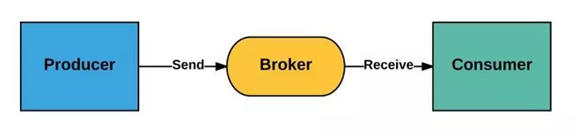

- **Producer**：消息生产者，发送消息到Broker
- **Broker**：消息处理中心，负责消息存储、确认、重试
- **Consumer**：消息消费者，从Broker获取消息并处理

#### 为什么需要消息队列？

1. **解耦**：发送方和接收方不需要直接了解对方
2. **异步**：消息堆积能力，削峰填谷
3. **复用**：一次发送多次消费
4. **可靠**：保证消息的传递，接收者不可用时消息队列保留消息
5. **路由**：发送者无需与接收者建立直接连接

#### 消息队列的优缺点

**优点**：解耦、异步、削峰

**缺点**：
- 系统可用性降低（外部依赖增多）
- 系统复杂度提高
- 一致性问题（部分执行成功，部分失败）

#### Kafka简介

Kafka是一个分布式流处理系统，支持publish/subscribe消息，提供容错性和并发处理。

### Kafka的优势和特点

- **高吞吐量**：单机每秒处理几十上百万消息
- **高性能**：单节点支持上千客户端，零停机零数据丢失
- **持久化**：消息持久化到磁盘，通过replica防止数据丢失
- **零拷贝**：减少数据拷贝，提高吞吐量
- **可靠性**：分布式、分区、复制和容错

核心特点：顺序读写、利用Linux页缓存、分布式易扩展、客户端状态维护、支持online/offline场景、多语言客户端。

### Kafka与传统消息队列的对比

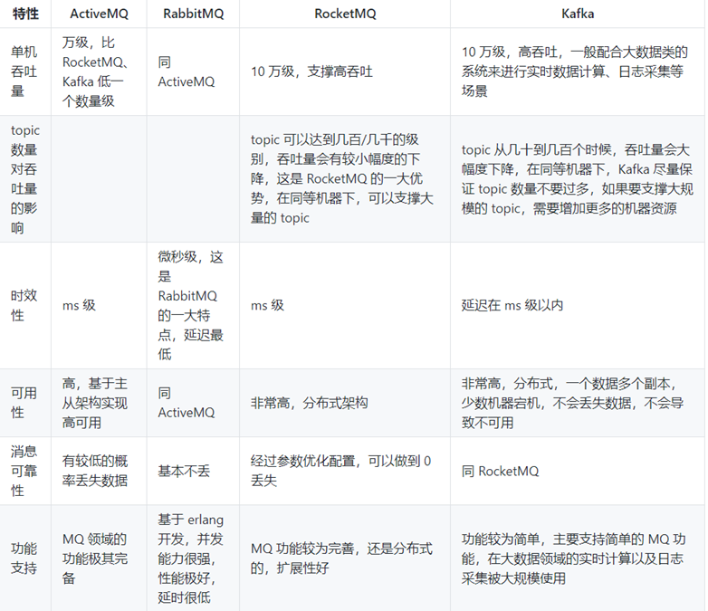

- **ActiveMQ**：未经过大规模验证，不推荐
- **RabbitMQ**：稳定，推荐中小型公司使用
- **RocketMQ**：阿里出品，经过双十一考验，强烈推荐
- **Kafka**：大数据领域实时计算、日志采集的行业标准

### Kafka的架构设计

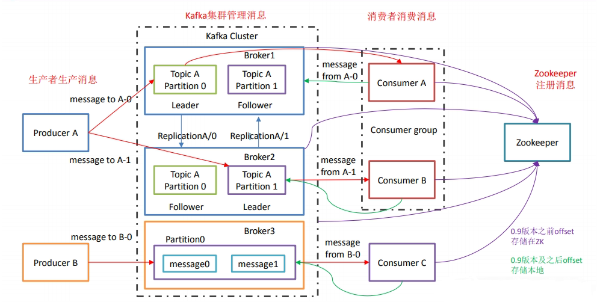

基本概念：
- **Producer**：向broker发消息的客户端
- **Consumer**：消息的使用方
- **Topic**：建立Producer和Consumer之间的订阅关系
- **Partition**：一个topic可分为多个partition，每个partition是有序队列，消息有唯一offset
- **Broker**：一台kafka服务器，一个集群由多个broker组成
- **Consumer Group**：归组同类消费者，每个分区只被组内一个消费者消费
- **Offset**：消息在partition中的偏移量

### 基本概念

#### 消息和批次

**消息**是Kafka里的数据单元，由字节数组组成，可包含键（用于分区选择）。**批次**是一组属于同一主题和分区的消息，分批传输减少网络开销。

#### 主题和分区

消息用**主题**分类，主题下分为若干**分区**。分区本质是提交日志文件，消息以追加方式写入。单个分区保证消息顺序，整个主题不保证。

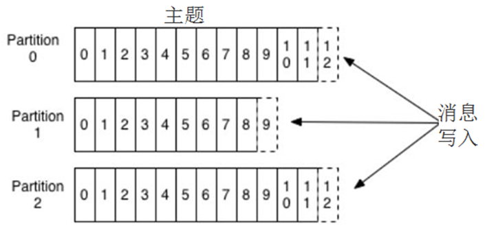

#### 生产者和消费者、偏移量、消费者群组

生产者默认均衡分布消息到所有分区，可通过消息键指定分区。消费者按顺序读取，通过偏移量区分已读消息。多个消费者构成消费者群组，群组保证每个分区只被一个消费者使用。

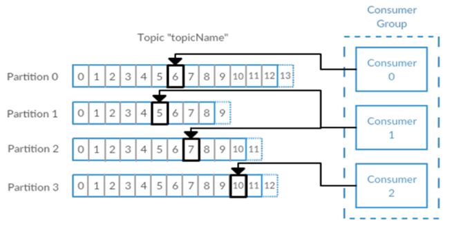

#### Broker和集群

单个broker可处理上千分区和每秒百万级消息。多个broker组成集群，选举集群控制器管理分区分配和broker监控。分区可复制到多个broker提供冗余。

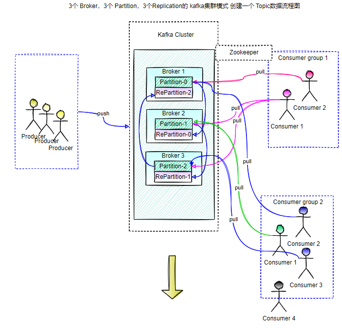

#### 保留消息

Kafka默认保留策略：保留一段时间（7天）或保留一定大小（1G）。每个主题可配置自己的保留策略。

### 工作流程

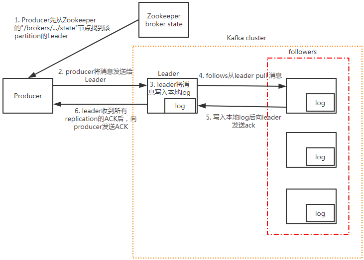

1. producer从zookeeper找到partition的leader
2. producer将消息发送给leader
3. leader将消息写入本地log
4. followers从leader pull消息
5. follower写入本地log后向leader发送ACK
6. leader收到所有ISR的ACK后，增加HW并向producer发送ACK

### Kafka的数据模型与消息存储机制

#### 消息存储结构

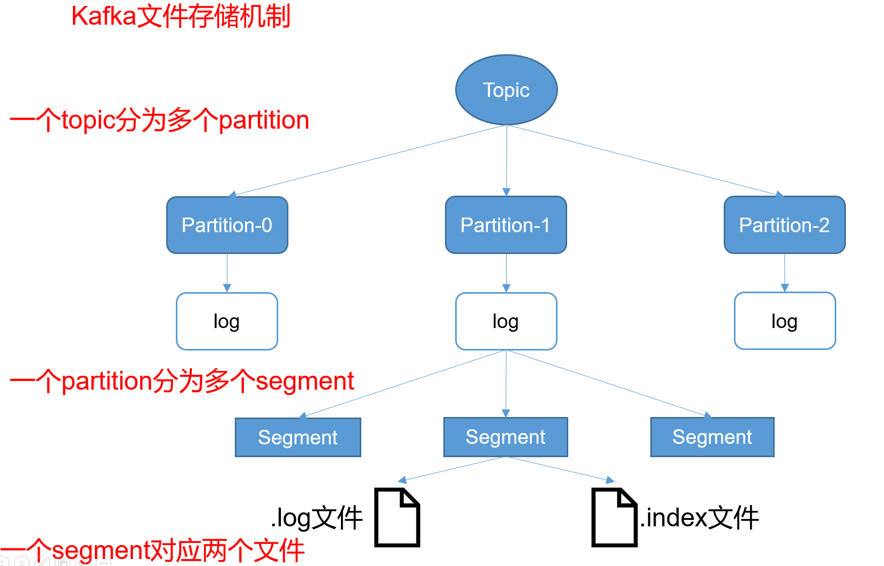

Topic + Partition对应一个文件夹。Kafka消息采用**Segment File**存储方式：将大文件拆分成小文件段，IO加载速度快。

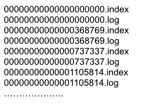

文件夹下分为**索引文件**（Index File）和**数据文件**（Data File）。索引文件帮助快速定位消息，数据文件存储具体消息内容。

#### 索引文件

索引文件名表示该文件存储的第一条消息的偏移量。格式为「N,Position」，N表示第几条消息，Position表示在数据文件中的物理偏移地址。


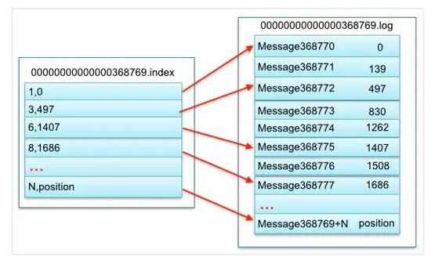

#### 数据文件

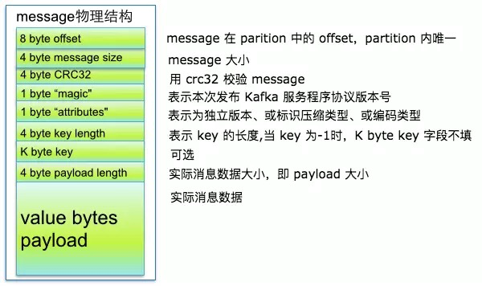

Kafka消息物理结构包含offset、大小、版本号等信息。

### Kafka文件存储优势

Kafka很少有大量读磁盘操作，主要是定期批量写磁盘。

- **写message**：消息从java堆转入page cache，异步线程刷盘
- **读message**：消息直接从page cache转入socket发送，未命中时从磁盘Load到page cache

### Kafka 副本同步机制

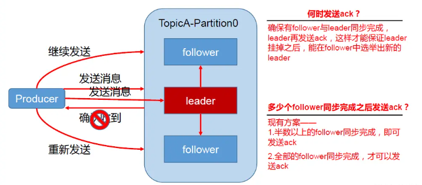

#### ACKS机制

- **acks=0**：生产者不等待确认，可能丢消息
- **acks=1**：等待Leader确认，Leader崩溃可能丢数据
- **acks=all/-1**：等待所有ISR副本确认，最安全

#### ISR机制

- **AR**（Assigned Replicas）：分区的所有副本
- **ISR**（In-Sync Replicas）：与leader保持同步的副本集合
- **OSR**（Out-Sync Replicas）：同步失效的副本集合
- AR = ISR + OSR

Leader维护ISR，follower超过`replica.lag.time.max.ms`未同步则被踢出ISR。Leader故障后从ISR选举新leader。

### Kafka选举机制

#### Controller leader

broker启动时创建KafkaController对象，在zookeeper路径下创建临时节点，第一个成功的成为leader。

#### Partition leader

由controller leader执行：从Zookeeper读取ISR，调用分区选择算法选举leader。

#### Zookeeper的作用

早期版本用zk做meta信息存储、consumer消费状态、group管理和offset。新版本逐渐弱化zookeeper（2.8.0+内置KRaft）。

#### LEO与HW

- **LEO**（Log End Offset）：下一条等待写入的消息的offset
- **HW**（High Watermark）：ISR中最小的LEO，消费者只能消费HW之前的消息

follower故障：被踢出ISR，恢复后读取本地HW，截取高于HW的部分，从HW开始向leader同步。

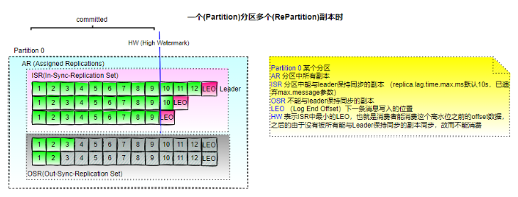

### Kafka 副本数据一致性

即使acks=all也可能出现不一致：leader挂掉时ISR中各follower同步进度不同。

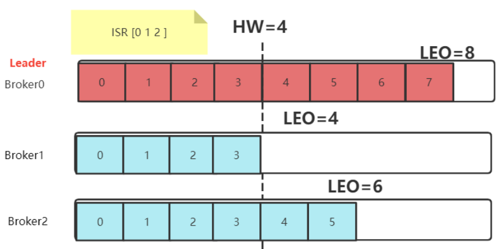

- **HW**：消费者只能拉取HW之前的消息，HW = ISR中最小LEO
- **LEO**：下一条消息的位移值

**Follower故障**：踢出ISR → 恢复后截取高于HW的部分 → 从HW同步 → LEO≥HW时重新加入ISR

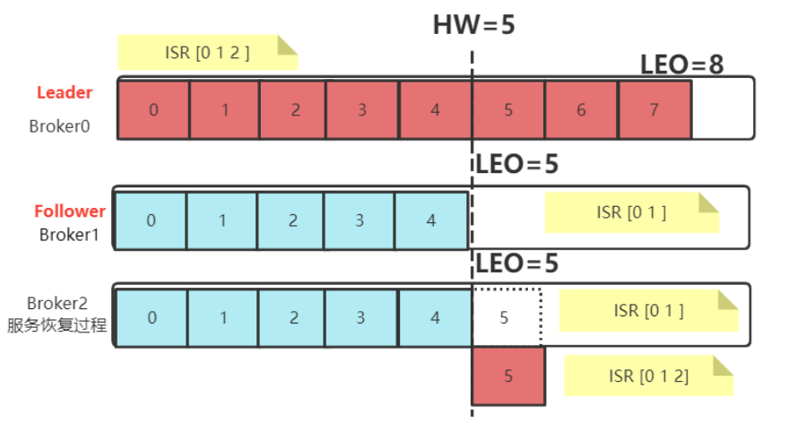

**Leader故障**：从ISR选举新Leader → 其他Follower截取高于HW的部分 → 从新Leader同步 → 旧Leader恢复后作为Follower

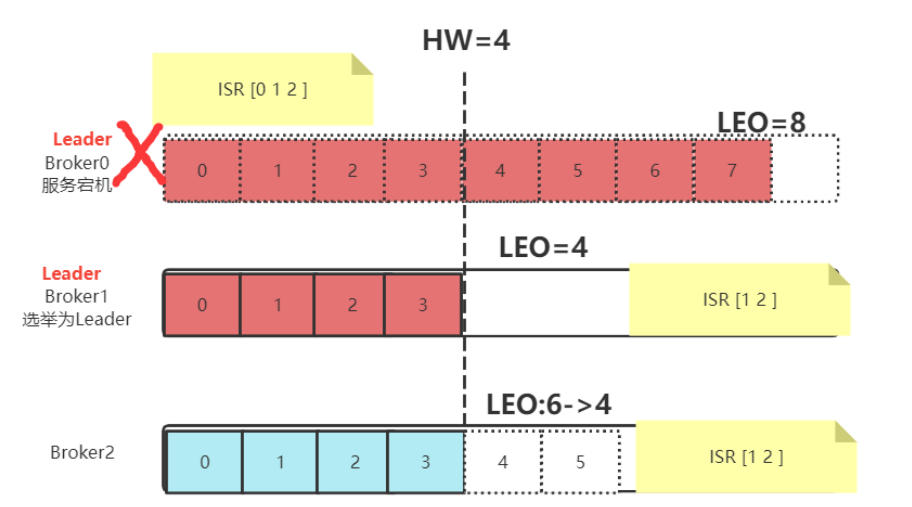

### 如何确保消息不丢失

#### Producer端

- **acks=0**：发送后自认成功，网络抖动会丢消息
- **acks=1**：Leader接收成功即成功，Leader崩溃时Follower未同步会丢数据
- **acks=all/-1**：等待ISR所有副本确认，可靠性最高，配合`min.insync.replicas`设置最小同步副本数

#### Broker端

异步批量刷盘策略，数据先存PageCache。配合acks=-1保证leader落盘还有ISR确认。

#### Consumer端

- 手动提交位移（`enable.auto.commit=false`）
- 位移重置策略（`auto.offset.reset=earliest`）
- 消费者组机制实现负载均衡

```java
// 同步提交offset
props.put(ConsumerConfig.ENABLE_AUTO_COMMIT_CONFIG, "false");
while (true) {
    ConsumerRecords records = consumer.poll(1000);
    for (ConsumerRecord record : records) {
        processMessage(record);
    }
    consumer.commitSync(); // 处理成功后手动提交
}
```

### 生产者消息发送流程

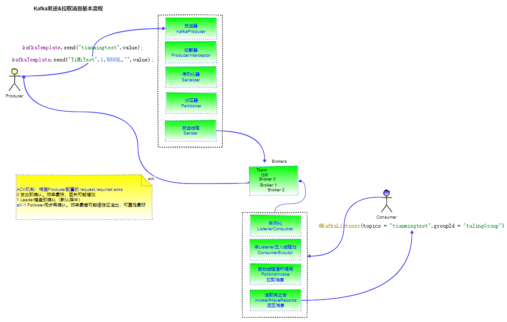

**核心步骤**（KafkaProducer.doSend）：
1. 确保topic元数据可用（waitOnMetadata）
2. 序列化key和value
3. 计算分区号（partition方法）
4. 估算序列化大小，确保有效
5. 追加到RecordAccumulator（accumulator.append）
6. batch满或新建batch时唤醒Sender线程
7. Sender线程通过NetworkClient.poll()发送（NIO）

**分区选择**（DefaultPartitioner）：
- 指定partition：直接使用
- key不为空：`Utils.toPositive(Utils.murmur2(keyBytes)) % numPartitions`
- key为空：轮询可用分区

```java
// 自定义分区器：实现Partitioner接口，配置partitioner.class
public int partition(String topic, Object key, byte[] keyBytes,
                     Object value, byte[] valueBytes, Cluster cluster) {
    List<PartitionInfo> partitions = cluster.partitionsForTopic(topic);
    int numPartitions = partitions.size();
    if (keyBytes == null) {
        // 无key：轮询
        int nextValue = nextValue(topic);
        return Utils.toPositive(nextValue) % numPartitions;
    } else {
        // 有key：hash取模
        return Utils.toPositive(Utils.murmur2(keyBytes)) % numPartitions;
    }
}
```

**RecordAccumulator**：每个主题分区拥有一个ProducerBatch双端队列。队尾batch满时封箱，新建batch放入队尾。

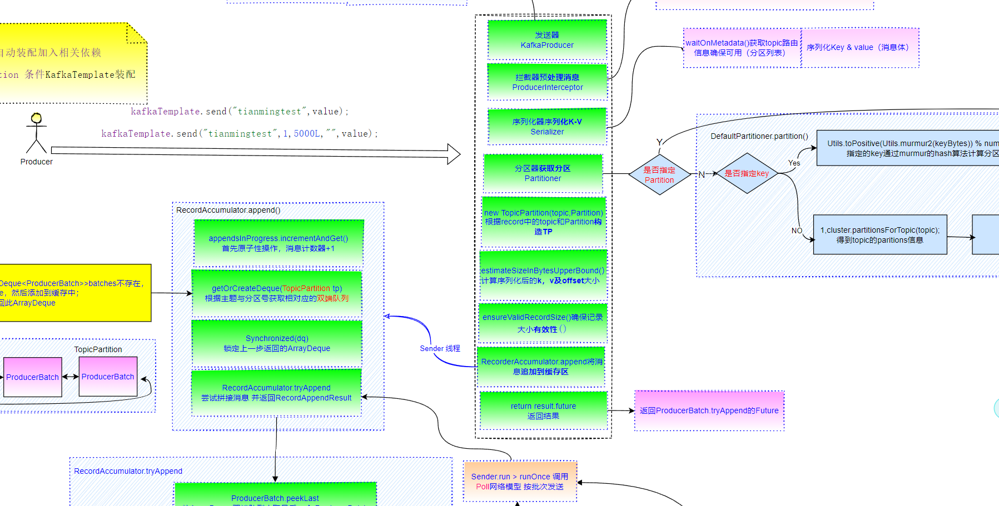

### 消费者消费消息流程

**核心流程**（Spring Kafka）：
1. `KafkaListenerAnnotationBeanPostProcessor`扫描`@KafkaListener`注解
2. 封装为`MethodKafkaListenerEndpoint`，注册到`KafkaListenerEndpointRegistry`
3. `KafkaMessageListenerContainer.doStart()`创建`ListenerConsumer`线程
4. `ListenerConsumer.run()`循环调用`pollAndInvoke()`
5. `poll`拉取多条消息 → `invokeIfHaveRecords` → `invokeListener`

```java
@KafkaListener(topics = "tianmingtest", groupId = "testgroup")
public void onMessage(String msg) {
    System.out.println("收到消息：" + msg);
}
```

**配置**：`concurrency`控制listener线程数，`max.poll.records`控制单次poll条数，`fetch.max.wait.ms`控制fetch等待时间。

```
# 两个@KafkaListener方法 + concurrency=3 → 2*3=6个Consumer线程，6个Listener线程
spring.kafka.listener.concurrency=3
```

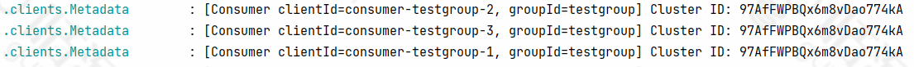

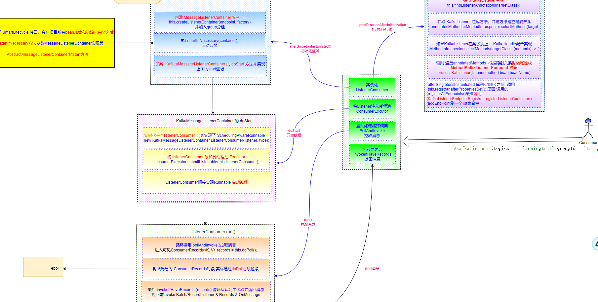

### 谁告诉你解决Kafka消息积压增加消费者数就可以了？

**并发度 = min(分区数, 消费者实例数)**

分区数是并发消费的上限。消费者数超过分区数时，多余消费者空闲。

**正确解决积压的姿势**：
1. 诊断瓶颈（消费者慢？分区不够？）
2. 优化消费逻辑（异步、批量、去慢SQL）
3. 检查分区数（分区太少限制并发）
4. 合理扩展消费者（分区数支撑前提下）
5. 监控Lag指标

---

# Kafka消费者分区策略

分区分配策略决定消费者如何获取分区、如何应对Rebalance。

## 1) 分区分配策略的核心概念

**分区分配策略**：当消费者组内消费者数量变化时，如何将Partition分配给消费者的算法。

**触发场景**：消费者加入/离开组、订阅的Topic变化、Topic增加分区。

**约束条件**：
1. 一个Partition同一时刻只能被一个消费者消费（保证顺序性）
2. 同一消费者组内可以分配多个Partition
3. Idle消费者不应分配分区

## 2) 内置分配策略详解

### RangeAssignor（范围分配）

按Topic依次分配，将每个Topic的分区按范围平均分配给消费者。

```
Topic A: 6分区, Topic B: 4分区, 3个消费者
C0: A[P0,P1,P2] + B[P0,P1] = 5个分区
C1: A[P3,P4] + B[P2] = 3个分区
C2: A[P5] + B[P3] = 2个分区
```

特点：实现简单，但分配可能不均，多Topic场景第一个消费者总是多分配。

### RoundRobinAssignor（轮询分配）

将所有Topic的所有Partition混合，轮询分配给消费者。

特点：分配更均匀，但消费者宕机时大量Partition需要转移。

### StickyAssignor（粘性分配，Kafka 0.11+默认）

尽可能保留现有分配，同时实现均衡。Rebalance时最小化Partition转移。

```
C2宕机时：
RangeAssignor: 移动4个Partition
StickyAssignor: 移动2个Partition（保留C0、C1原有分配）
```

特点：最小化Partition转移，降低Rebalance开销，保持消费连续性。**目前最推荐**。

### CooperativeStickyAssignor（合作型粘性分配）

在StickyAssignor基础上，分阶段Rebalance：
1. 第1阶段：只撤销必需的Partition
2. 第2阶段：分配新的Partition

消费者可继续消费未被撤销的Partition，Rebalance停顿时间极短（传统Stop-the-World需10+秒，合作型总停顿时间大幅缩短）。

## 3) Rebalance触发与分配过程

**完整流程**：
1. **JoinGroup**：所有消费者暂停消费，向Coordinator发送JoinGroup请求
2. **选举Leader**：从消费者中选出Leader，仅Leader执行分配算法
3. **分配**：Leader计算分配方案，通过SyncGroup发送给Coordinator，转发给所有消费者
4. **恢复消费**：消费者根据新分配开始消费

Rebalance总耗时通常5-20秒，期间消费完全停止。

## 4) 分配策略配置

```properties
# Kafka 2.4+ 推荐
partition.assignment.strategy=org.apache.kafka.clients.consumer.CooperativeStickyAssignor

# Kafka 0.11-2.3
partition.assignment.strategy=org.apache.kafka.clients.consumer.StickyAssignor

# Rebalance相关配置
session.timeout.ms=10000      # 会话超时时间
heartbeat.interval.ms=3000    # 心跳间隔
max.poll.interval.ms=300000   # 最大poll间隔
max.poll.records=500          # 单次poll最大消息数
```

## 5) 常见问题和解决方案

| 问题 | 原因 | 解决方案 |
|------|------|---------|
| 频繁Rebalance | 消费者处理慢超过max.poll.interval.ms | 增大max.poll.interval.ms或减小max.poll.records |
| 分配不均 | RangeAssignor多Topic场景 | 改用StickyAssignor |
| Rebalance停顿长 | Eager协议Stop-the-World | 用CooperativeStickyAssignor |
| 消费者空闲 | 消费者数>分区数 | 减少消费者或增加分区 |

## 6) 总结

- **单Topic简单场景**：RangeAssignor足够
- **多Topic场景**：StickyAssignor（减少Partition转移）
- **要求低延迟**：CooperativeStickyAssignor（增量Rebalance）
- **生产推荐**：CooperativeStickyAssignor（Kafka 2.4+）

---

# Kafka中的消息是如何存储的？

## 1) Kafka存储架构的整体视图

**三层存储结构**：Cluster → Broker → Topic → Partition → Replica → Segment → File

每个Segment包含：`.log`（消息文件）、`.index`（偏移量索引）、`.timeindex`（时间索引）。

## 2) 分区和日志文件的对应关系

```
/kafka-data/
├── topic-name-0/                    # Partition 0
│   ├── 00000000000000000000.log     # Segment 1 日志文件
│   ├── 00000000000000000000.index   # 偏移量索引
│   ├── 00000000000000000000.timeindex # 时间索引
│   ├── 00000000000000100000.log     # Segment 2
│   └── leader-epoch-checkpoint      # Leader Epoch记录
├── topic-name-1/                    # Partition 1
└── topic-name-2/                    # Partition 2
```

**文件命名规则**：文件名 = 该Segment中第一条消息的Offset（20位数字，左补零）。

**Segment的作用**：将日志分成多个有大小限制的段，便于删除旧数据、查询和管理。

## 3) 消息的存储格式

**消息Record结构**：
- Offset（8字节）：偏移量
- Size（4字节）：消息大小
- CRC（4字节）：校验和
- Magic（1字节）：版本号
- Attributes（1字节）：压缩类型等属性
- Timestamp（8字节）：时间戳
- Key Length + Key：消息键
- Value Length + Value：消息内容

总大小：26字节 + Key + Value

**消息压缩**：支持Gzip、Snappy、LZ4、Zstd。生产者端压缩，Broker端保持压缩传递，消费者端解压。

## 4) 日志文件的读写机制

**写入**：消息追加到当前活跃Segment的.log文件末尾，同时更新.index和.timeindex。

**读取**：根据offset → 二分查找.index文件定位物理位置 → 从.log文件读取消息。

**索引机制**：稀疏索引，每隔一定消息数记录一条索引项，大幅降低索引文件大小。

## 5) Page Cache和存储优化

Kafka依赖操作系统Page Cache而非JVM堆内存：
- 写入：消息先入Page Cache，OS异步刷盘
- 读取：优先从Page Cache读取，未命中才读磁盘
- 消费者读取通常命中Page Cache（最近写入的数据）

**优势**：利用OS的缓存管理，避免JVM GC开销，重启后缓存仍有效。

## 6) Segment生命周期管理

- **创建**：当前Segment达到`log.segment.bytes`（默认1GB）或`log.roll.hours`时创建新Segment
- **删除**：按保留策略（`log.retention.hours`/`log.retention.bytes`）删除过期Segment
- **压缩**：Log Compaction保留每个key的最新value

## 7) 日志压缩（Log Compaction）

不同于按时间/大小删除，Log Compaction对每个key只保留最新值。适合存储状态变更（如用户当前状态）。

配置：`cleanup.policy=compact`（可同时`delete,compact`）

## 8) 存储配置优化

```properties
# 高吞吐量场景
log.segment.bytes=1073741824    # 1GB segment
log.retention.hours=168         # 7天保留
log.flush.interval.messages=10000  # 每1万条刷盘

# 低延迟场景
log.flush.interval.ms=1000      # 1秒刷盘

# 归档场景
log.retention.hours=-1          # 永久保留
compression.type=lz4            # LZ4压缩
```

## 9) 存储配置检查清单

- `log.dirs`：多磁盘分散IO
- `log.flush.interval.messages`/`log.flush.interval.ms`：刷盘策略
- `log.retention.hours`/`log.retention.bytes`：保留策略
- `log.segment.bytes`：Segment大小
- `compression.type`：压缩算法
- `num.recovery.threads.per.data.dir`：启动恢复线程数

---

# 什么是"零拷贝"？有什么作用？

## 1) 什么是零拷贝？

**零拷贝**：在数据传输过程中，避免数据在内存中的多次拷贝，尤其是避免内核态和用户态之间的数据拷贝。

- 不是真正的零次拷贝，而是减少不必要的内存拷贝
- 主要目标：降低CPU消耗，提升I/O性能，减少上下文切换

## 2) 传统数据传输的问题

传统方式（文件→网络）需要**4次拷贝**：
1. 磁盘 → 内核缓冲区（DMA）
2. 内核缓冲区 → 用户缓冲区（read系统调用）
3. 用户缓冲区 → Socket内核缓冲区（write系统调用）
4. Socket内核缓冲区 → 网卡（DMA）

**问题**：4次拷贝（2次不必要）+ 频繁上下文切换 + CPU浪费。

## 3) 零拷贝的实现方式

### 方式1：mmap（内存映射文件）

使用`mmap()`将磁盘文件映射到用户进程虚拟地址空间，应用可直接访问内核缓冲区数据，无需read拷贝。

- 3次拷贝（减少1次）
- 适合大文件处理

### 方式2：sendfile（最高效）

Linux 2.4+提供`sendfile()`系统调用，数据始终在内核空间流动：
1. DMA从磁盘读取到内核缓冲区
2. 内核内部拷贝到Socket缓冲区
3. DMA从Socket缓冲区发送到网卡

- 3次拷贝，但无用户态参与
- 最少上下文切换，最高性能
- 只能用于文件→网络传输

### 方式3：splice

使用内核管道作为中介，只转移数据指针而非实际拷贝。比sendfile更通用，但仅Linux支持。

## 4) 零拷贝与Java NIO

Java NIO提供`FileChannel.transferTo()`和`transferFrom()`，内部使用sendfile系统调用。

```java
// 零拷贝传输：FileChannel.transferTo
fileChannel.transferTo(position, count, socketChannel);

// Kafka中应用：FileRecords.writeTo方法使用transferTo
// 消费者拉取消息时，Broker直接从磁盘文件传输到网卡，零拷贝
```

## 5) Kafka中的零拷贝应用

- **Consumer Fetch**：Broker使用`FileRecords.transferTo`将日志文件直接发送到网卡（sendfile）
- **Producer Write**：使用mmap将日志文件映射到内存（MemoryRecords）
- **Page Cache**：配合零拷贝，数据在OS缓存中，直接DMA发送

**性能对比**：传统方式 vs 零拷贝 → 吞吐量提升约2-3倍，CPU使用率大幅降低。

## 6) 零拷贝最佳实践

- 大文件传输优先用sendfile（transferTo）
- 需要修改数据时不能用零拷贝（数据不经过用户态）
- 配合Page Cache效果最佳
- Kafka默认启用零拷贝，无需额外配置

---

# Kafka如何保证消息可靠？

## 1. 什么是消息可靠性？

- **不丢失（At-least-once）**：消息至少被成功投递一次
- **不重复（At-most-once）**：消息至多被投递一次
- **精确一次（Exactly-once）**：不丢不重
- **有序性（Ordering）**：同分区内按发送顺序存储和消费

## 2. 生产者如何保证消息不丢失与不重复

### acks参数

| acks | 含义 | 可靠性 | 性能 |
|------|------|--------|------|
| 0 | 不等待确认 | 最低 | 最高 |
| 1 | 等待Leader确认 | 中等 | 中等 |
| all/-1 | 等待所有ISR确认 | 最高 | 最低 |

```java
props.put(ProducerConfig.ACKS_CONFIG, "all");
props.put(ProducerConfig.RETRIES_CONFIG, 3);
```

### retries参数

发送失败时重试次数。不开启幂等性时重试可能导致重复。

### 幂等生产者（Idempotent Producer）

Kafka 0.11+引入，保证重试不重复：
- 为每个生产者分配**PID**（Producer ID）
- 每条消息携带单调递增的**Sequence Number**
- Broker根据PID+SeqNum去重

```java
props.put(ProducerConfig.ENABLE_IDEMPOTENCE_CONFIG, "true");
// 开启后acks自动设为all，retries自动设为MAX_VALUE
```

### 事务（Transactions）

Kafka 0.11+支持跨分区事务，实现Exactly-once：

```java
props.put(ProducerConfig.TRANSACTIONAL_ID_CONFIG, "my-transactional-id");
producer.initTransactions();
producer.beginTransaction();
producer.send(record1);
producer.send(record2);
producer.commitTransaction();
```

## 3. Broker端如何存储和复制消息

### 副本机制（replication.factor）

每个分区复制多份存于不同Broker（1 Leader + N Followers），建议设为3。

### ISR（In-Sync Replicas）

与Leader保持同步的副本集合。Follower超过`replica.lag.time.max.ms`未同步则被踢出ISR。

### Leader选举

Leader故障时从ISR选举新Leader。`unclean.leader.election.enable=false`（默认）保证数据一致性。

### 消息持久化

消息先入Page Cache，OS异步刷盘。可通过`log.flush.interval.messages`/`log.flush.interval.ms`配置刷盘策略。

## 4. 消费者如何确保消息被正确处理

### Offset管理

- **自动提交**：`enable.auto.commit=true`，可能重复消费或丢失
- **手动提交**：`enable.auto.commit=false`，处理成功后`commitSync()`/`commitAsync()`

### 消费者组Rebalance

消费者加入/离开触发Rebalance，分区重新分配。`CooperativeStickyAssignor`可减少停顿。

## 5. 端到端Exactly-Once语义

**三种实现方式**：

1. **消费者端幂等**：业务逻辑自身幂等（如唯一键约束）
2. **事务API**：consume-transform-produce闭环
3. **存储offset与业务数据在同一事务**：将offset存入数据库事务中

```java
// consume-transform-produce Exactly-Once
props.put(ConsumerConfig.ISOLATION_LEVEL_CONFIG, "read_committed"); // 只读已提交事务消息
props.put(ProducerConfig.TRANSACTIONAL_ID_CONFIG, "my-tx-id");
props.put(ConsumerConfig.ENABLE_AUTO_COMMIT_CONFIG, "false"); // 手动提交

// 在事务中处理
producer.initTransactions();
while (true) {
    ConsumerRecords records = consumer.poll(Duration.ofMillis(1000));
    producer.beginTransaction();
    for (ConsumerRecord record : records) {
        // 处理并发送新消息
        producer.send(new ProducerRecord<>("output-topic", process(record)));
    }
    // 将消费offset作为事务的一部分提交
    producer.sendOffsetsToTransaction(offsets, consumerGroupId);
    producer.commitTransaction();
}
```

## 6. 总结

| 环节 | 配置 | 作用 |
|------|------|------|
| Producer | `acks=all`, `retries>0`, `enable.idempotence=true` | 不丢不重 |
| Broker | `replication.factor=3`, `min.insync.replicas=2`, `unclean.leader.election.enable=false` | 副本冗余 |
| Consumer | `enable.auto.commit=false`, 手动提交 | 不丢不重 |
| 端到端 | 事务API + `isolation.level=read_committed` | Exactly-Once |

---

# Kafka中的消息如何分配给不同的消费者？

## 1) 核心概念

- **Consumer Group**：多个消费者组成一个组，共同消费一个Topic
- **分区分配**：每个分区只被组内一个消费者消费
- **并发度** = min(分区数, 消费者数)

## 2) 为什么需要消费者组？

- **负载均衡**：多个消费者分担消费压力
- **弹性扩展**：增减消费者自动调整分配
- **故障恢复**：消费者宕机后分区自动转移

## 3) Consumer Group内部分配机制

1. 消费者加入组，向**Group Coordinator**（Broker）发送JoinGroup请求
2. Coordinator选举一个消费者作为**Group Leader**
3. Group Leader执行分配策略，计算分配方案
4. 通过SyncGroup将方案同步给所有消费者
5. 各消费者按分配方案消费对应分区

## 4) Rebalance触发机制

**触发条件**：
- 消费者加入/离开组
- 消费者心跳超时（`session.timeout.ms`）
- 消费者poll间隔超时（`max.poll.interval.ms`）
- Topic新增分区

## 5) Rebalance详细流程

```
1. 触发事件 → 消费者发现变化
2. JoinGroup → 所有消费者暂停，向Coordinator发送JoinGroup
3. 选举Group Leader → Leader执行分配算法
4. SyncGroup → Leader将分配方案通过Coordinator转发
5. 恢复消费 → 各消费者按新分配消费
```

总耗时通常5-20秒，期间消费停止。

## 6) 三种内置分配策略对比

| 策略 | 原理 | 优点 | 缺点 |
|------|------|------|------|
| RangeAssignor | 按Topic范围分配 | 简单 | 不均匀，转移多 |
| RoundRobinAssignor | 轮询所有分区 | 均匀 | 转移多 |
| StickyAssignor | 保留现有分配 | 转移少 | 算法复杂 |
| CooperativeStickyAssignor | 增量Rebalance | 停顿短 | 需Kafka 2.4+ |

## 7) 关键配置

```properties
# 分配策略（推荐）
partition.assignment.strategy=org.apache.kafka.clients.consumer.CooperativeStickyAssignor

# Rebalance相关
session.timeout.ms=10000        # 会话超时
heartbeat.interval.ms=3000      # 心跳间隔（<session.timeout.ms）
max.poll.interval.ms=300000     # 最大poll间隔
max.poll.records=500            # 单次poll最大记录数

# 消费相关
auto.offset.reset=earliest      # 无offset时从最早开始
enable.auto.commit=false        # 手动提交offset
```

## 8) Rebalance问题与解决方案

| 问题 | 原因 | 解决 |
|------|------|------|
| 频繁Rebalance | 处理慢超过max.poll.interval.ms | 增大max.poll.interval.ms，减小max.poll.records |
| Rebalance停顿长 | Eager协议STW | 用CooperativeStickyAssignor |
| 消息积压 | 消费者数<分区数 | 增加消费者（不超过分区数） |
| 消费不均 | 分配策略不当 | 改用StickyAssignor |

## 9) 实际案例：电商订单处理

```
Topic: order-events, 12个分区
Consumer Group: order-processors, 4个消费者
每个消费者分配3个分区

消费者扩容到12个 → 每个消费者1个分区 → 并发度最大化
消费者扩容到15个 → 3个空闲 → 无意义
```

**关键原则**：消费者数 ≤ 分区数，否则浪费资源。

## 10) 总结与最佳实践

1. **分区数规划**：根据并发需求设置，消费者数上限
2. **分配策略**：生产环境用CooperativeStickyAssignor
3. **Rebalance优化**：合理设置max.poll.interval.ms和max.poll.records
4. **监控Lag**：及时发现积压
5. **消费者数≤分区数**：避免空闲消费者

