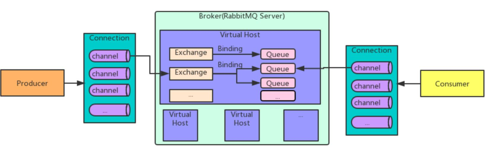
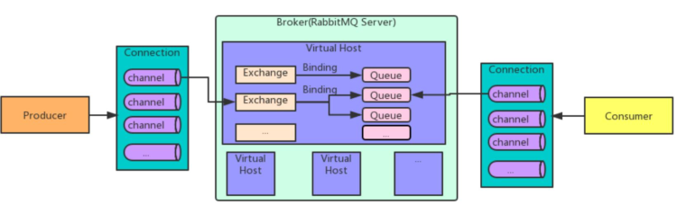

# RabbitMQ知识汇总

## 一、交换机类型

### direct（直连交换机）

作为**默认**交换机，路由键与队列名完全匹配。消息发送到 exchange 时，根据消息的 RoutingKey 进行匹配，只将消息发送到完全匹配该 RoutingKey 的队列。

例如：一个队列绑定到交换机要求路由键为 `key`，则只转发 RoutingKey 为 `key` 的消息，不会转发 `key1`，也不会转发 `key.1`。它是完全匹配、单播的模式。

同一个 key 可以绑定多个 queue；当匹配到 key1 时，queue1 和 queue2 都能收到消息。

### fanout（扇型交换机，广播）

扇出类型交换机将消息分发给所有绑定此交换机的队列，此时 RoutingKey 参数无效。发送一条消息，无论 RoutingKey 是什么，都直接**广播**，queue1、queue2、queue3、queue4 都能收到。

### topic（主题交换机）

与 Direct 类似，也是通过 routingkey 匹配分发，区别在于 Topic 支持模糊匹配，Direct 是完全匹配。

1. routingkey 通过 `.` 分为多个部分。
2. `*`：代表一个部分。
3. `#`：代表 0 个或多个部分（绑定的路由键为 `#` 时接受所有消息）。

例如发送 routingkey 为 `key1.key2.key3.key4` 的消息，按 `.` 分为 4 个部分，将匹配：

1. `key1.key2.key3.*`：成功，`*` 代表一个部分。
2. `key1.#`：成功，`#` 代表 0 或多个部分。
3. `*.key2.*.key4`：成功，第一、三部分分别为 key1、key3，且为 4 个部分，刚好匹配。
4. `#.key3.key4`：成功，`#` 代表多个部分，匹配中 key1 和 key2。

若发送 routingkey 为 `key1`，则只能匹配 `key1.#`（`#` 可代表 0 个部分）。

### headers（头部交换机）

匹配 AMQP 消息的 header 而不是路由键。与 direct 交换器完全一致，但性能差很多，目前几乎用不到。

消费方指定的 headers 中必须包含一个 `x-match` 键，取值有两种：

1. `x-match = all`：所有键值对都匹配才能接收消息。
2. `x-match = any`：只要有键值对匹配就能接收消息。

例如发送消息时参数为 `{ "name":"TianMingXX", "sex":"男" }`，queue2 的 x-match 是 any，只需一个键值对匹配即可收到消息；queue1 的 x-match 是 all，需所有键值对都匹配，故收不到消息。

## 二、RabbitMQ 架构设计

RabbitMQ 是一个开源的消息中间件，采用 AMQP（高级消息队列协议）进行消息传递，允许应用程序之间异步通信，提供高效、可扩展、可靠的消息传递机制。



1. **生产者（Producer）：** 消息的发送方，产生并发送消息到 RabbitMQ，通常发送到交换机。
2. **交换机（Exchange）：** 消息的分发中心，负责将接收到的消息路由到一个或多个队列，定义了消息的传递规则。
    - **直连交换机（Direct Exchange）：** 将消息路由到与消息中路由键完全匹配的队列。
    - **主题交换机（Topic Exchange）：** 根据通配符匹配路由键，将消息路由到一个或多个队列。
    - **扇出交换机（Fanout Exchange）：** 将消息广播到所有与交换机绑定的队列，忽略路由键。
    - **头部交换机（Headers Exchange）：** 根据消息头中的属性进行匹配，路由到匹配的队列。
3. **队列（Queue）：** 消息的存储区，消息最终会被消费者取出并处理。每个队列有名称，可绑定到一个或多个交换机。
4. **消费者（Consumer）：** 消息的接收方，从队列中获取消息并处理，通过订阅队列接收消息。
5. **绑定（Binding）：** 交换机和队列之间的关联关系，队列通过绑定与交换机关联从而接收消息。
6. **虚拟主机（Virtual Host）：** RabbitMQ 的基本工作单元，每个虚拟主机拥有独立的用户、权限、交换机、队列等资源，完全隔离。
7. **连接（Connection）：** 生产者、消费者与 RabbitMQ 之间的网络连接，每个连接可包含多个信道（Channel），每个信道是独立的会话通道。
8. **消息：** 生产者和消费者之间传递的数据单元，通常包含消息体和可选属性（如路由键）。

通过灵活配置交换机和队列，可实现多种消息传递模式，满足不同场景需求。

## 三、如何保证消息不丢失

### 丢失原因分析



消息从生产者到达消费者，经过两次网络传输，并在 RabbitMQ 服务器中进行路由，可能出现三种丢失场景：

- **生产者到 RabbitMQ 服务器**：网络波动未收到消息，或服务器宕机。
- **RabbitMQ 服务器持久化**：消息未能及时完成持久化，服务器宕机重启导致丢失。
- **消费者拉取及处理**：拉取时网络波动导致丢失；拿到消息后未能正常消费（处理异常或宕机）导致丢失。

对应的解决方案：confirm 消息确认机制（生产者）、消息持久化机制（RabbitMQ 服务）、ACK 事务机制（消费者）。

### 解决方案

#### confirm 消息确认机制（生产者）

Confirm 模式是 RabbitMQ 提供的消息可靠性保障机制。生产者通过 Confirm 模式发送消息时，会等待 RabbitMQ 的确认，确保消息已正确投递到指定的 Exchange。

- 消息正确投递到 queue 时，返回 ack。
- 消息没有正确投递到 queue 时，返回 nack。如果 exchange 没有绑定 queue，也会出现消息丢失。

**使用方法：**

- 生产者通过 `confirm.select` 方法将 Channel 设置为 Confirm 模式。
- 发送消息后，通过 `add_confirm_listener` 方法监听消息的确认状态。

```java
// 1.开启消息确认机制
spring:
  rabbitmq:
    # 开启消息确认机制
    publisher-confirms: true
    # 消息在未被队列收到的情况下返回
    #publisher-returns: true
    #publisher-confirm-type: correlated

// 2.消息未接收时调用ReturnCallback
rabbitTemplate.setMandatory(true);

// 3.生产者投递消息
@Service
public class ConfirmProvider implements RabbitTemplate.ConfirmCallback, RabbitTemplate.ReturnCallback {
    @Autowired
    RabbitTemplate rabbitTemplate;

    @PostConstruct
    public void init() {
        rabbitTemplate.setReturnCallback(this);
        rabbitTemplate.setConfirmCallback(this);
    }

    @Override
    public void confirm(CorrelationData correlationData, boolean ack, String cause) {
        if (ack) {
            System.out.println("确认了这条消息：" + correlationData);
        } else {
            System.out.println("确认失败了：" + correlationData + "；出现异常：" + cause);
        }
    }

    @Override
    public void returnedMessage(Message message, int replyCode, String replyText, String exchange, String routingKey) {
        System.out.println("这条消息发送失败了" + message + ",请处理");
    }

    public void publisMessage(String message) {
        rabbitTemplate.setMandatory(true);
        rabbitTemplate.convertAndSend("javatrip", message);
    }
}

// 4.消息确认失败后可进行消息补偿，即重试机制。未收到确认信息时重新投递，配置如下
spring:
  rabbitmq:
    # 支持消息发送失败后重返队列
    publisher-returns: true
    # 开启消息确认机制
    # publisher-confirm-type: correlated
    listener:
      simple:
        retry:
          # 开启重试
          enabled: true
          # 最大重试次数
          max-attempts: 5
          # 重试时间间隔
```

#### 消息持久化机制（RabbitMQ 服务）

持久化机制将消息存储到磁盘，以保证 RabbitMQ 服务器宕机或重启时消息不丢失。

**使用方法：**

- 生产者将消息的 `delivery_mode` 属性设置为 2（SpringBoot 中默认 `MessageDeliveryMode.PERSISTENT` 等于 2），标记消息为持久化。
- 队列也需持久化，确保服务器重启后队列仍存在：将 `durable` 设为 true，且需配合 `autoDelete` 设为 false。

**注意事项：** 持久化会影响性能，在需要确保消息不丢失的场景下使用。

```java
@Queue(value = "TianMingQ", durable = "true", autoDelete = "false") // 或者注入时
return new Queue("TianMingQ", true, false, false, map);
```

#### ACK 事务机制（消费者）

ACK 事务机制确保消息被正确消费。消费者成功处理消息后发送确认（ACK）给 RabbitMQ，告知消息可被移除。该过程默认自动处理，也可关闭后进行手工 ACK。

**使用方法：**

- ACK 机制默认开启，消息被消费者接收后立即从队列中删除，除非消费者发生异常。
- 可手动开启，将 `auto_ack` 参数设为 `False`（`acknowledge-mode: manual`）。

**注意事项：** ACK 机制可确保消息不被重复处理，但若消费者发生异常或未发送 ACK，消息可能被重复投递。

```java
// 1.修改yml为手动签收模式
spring:
  rabbitmq:
    listener:
      simple:
        # 手动签收模式
        acknowledge-mode: manual
        # 每次签收一条消息
        prefetch: 1

// 2.消费者手动签收
@Component
@RabbitListener(queuesToDeclare = @Queue(value = "TianMingQ", durable = "true"))
public class SecondConsumer {
    @RabbitHandler
    public void receive(String message, @Headers Map headers, Channel channel) throws Exception {
        System.out.println(message);
        // 唯一的消息ID
        Long deliverTag = (Long) headers.get(AmqpHeaders.DELIVERY_TAG);
        // 确认该条消息
        if (...) {
            channel.basicAck(deliverTag, false);
        } else {
            // 消费失败，消息重返队列
            channel.basicNack(deliverTag, false, true);
        }
    }
}
```

保证不丢失会自动重试，可能造成重复消费，具体处理见第五点。

## 四、如何解决消息堆积问题

### 消息堆积原因

（消费者处理慢、队列容量小、网络故障、消费者故障、队列配置不当、消息过大、业务逻辑耗时、生产速度大于消费速度等）

### 解决方案

1. **消费者处理消息太慢**
    - **增加消费者数量**：水平扩展，提高处理能力。
    - **优化消费者性能**：优化代码、增加资源。
    - **消息预取限制（prefetch count）**：调整预取数量，避免一次处理过多消息。
2. **队列容量太小**
    - **增加队列容量**：调整队列设置以允许更多消息存储。
3. **网络故障**
    - **监控和告警**：监控网络状况并设置告警，快速发现问题。
    - **持久化和高可用性**：确保消息和队列持久化，使用镜像队列提高可用性。
4. **消费者故障**
    - **使用死信队列**：将无法处理的消息转移到死信队列，防止堵塞主队列。
    - **容错机制**：实现消费者的自动重启和错误处理逻辑。
5. **队列配置不当**
    - **优化队列配置**：检查并优化消息确认模式、队列长度限制等配置。
6. **消息大小**
    - **消息分片**：将大型消息分割成小片段，加快处理速度。
7. **业务逻辑复杂或耗时**
    - **优化业务逻辑**：简化消费者中的业务逻辑，减少每条消息的处理时间。
8. **消息产生速度快于消费速度**
    - **使用消息限流**：控制生产速度，不超过消费者的处理能力。
    - **负载均衡**：确保消息在消费者之间公平分配，避免个别消费者过载。
9. **其他配置优化**
    - **消息优先级**：使用优先级确保高优先级消息优先处理。
    - **调整 RabbitMQ 配置**：优化文件描述符限制、内存使用限制等。

## 五、如何保证消息不被重复消费

### 什么情况会导致消息被重复消费

1. **生产者**：可能重复推送一条数据到 MQ，比如 Controller 接口被重复调用 2 次，未做接口幂等性。
2. **MQ**：消费者消费完准备响应 ack 时 MQ 突然挂了，MQ 以为消费者未消费该数据，恢复后再次推送。
3. **消费者**：消费者已消费完消息，正准备响应 ack 时消费者挂了，服务重启后 MQ 以为消费者还没消费，再次推送。

### 解决方案

**使用数据库唯一键约束**

缺点：局限性很大，**仅适用于数据新增场景**，性能也比较低。

**使用乐观锁**

假设更新订单状态，**发送消息时带上修改字段的版本号**。

缺点：若更新字段较多、更新场景较多，可能导致数据库字段增加；且可能多条消息同时在队列中、版本号一致，排在后续的消息无法被消费。

**简单的消息去重，插入消费记录，增加数据库判断**

优点：很多场景下确实能起到不错的效果。

缺点：

1. 消费者代码执行需要 1 秒，重复消息在执行期间（假设 100 毫秒）内到达（如生产者快速重发、Broker 重启等），校验处仍无数据（上一条消息还没消费完，没有记录）。
2. 会穿透检查的挡板，导致重复消息进入非幂等安全的业务代码，引发重复消费。

**并发消息去重基于消息幂等表**

- 缺点：若第一次消息投递异常未消费成功，且未将消息状态置为成功或未删除消息表记录，则延时消费每次执行都处于消费中，最终被视作消费失败投递到死信 Topic。
- 方案：插入的消息表必须带一个最长消费过期时间，例如 10 分钟。

上述方案只需一个存储中心媒介，可选择更灵活的 Redis：

- 性能损耗更低。
- 超时时间可直接利用 Redis 本身的 ttl 实现。

### 总结

1. 利用数据库唯一键约束。
2. 利用乐观锁。
3. 插入消费记录。

不丢和不重（在分布式场景下）是矛盾的，开发者根据业务实际需求选择相应方式即可。

## 六、常见面试题

### RabbitMQ 有哪几种交换机类型？

1. **Direct Exchange**：根据路由键将消息发送到与之完全匹配的队列，只有当消息的路由键与队列绑定时指定的路由键完全相同时才路由到队列。适用于点对点通信。
2. **Topic Exchange**：根据路由键与绑定模式（通配符）的匹配程度，将消息路由到一个或多个队列。路由键可使用通配符 `*`（匹配一个单词）和 `#`（匹配零个或多个单词），用于发布/订阅模式和复杂的消息路由。
3. **Headers Exchange**：根据消息的标头信息（Headers）决定路由，而不是路由键。绑定规则根据标头键值对定义，只有当消息标头与绑定规则完全匹配时才路由到队列。适用于需要复杂消息匹配的场景。
4. **Fanout Exchange**：将消息广播到与之绑定的所有队列，无论路由键是什么。用于发布/订阅模式。
5. **Default Exchange**：RabbitMQ 默认实现的交换机，无需手动创建。消息发布到默认交换机时，路由键被解释为队列名称，消息路由到同名队列。通常用于点对点通信，不支持复杂路由策略。

### 什么是 RabbitMQ？有什么显著特点？

RabbitMQ 是一个开源的消息中间件，使用 Erlang 语言开发，天生适合分布式场景，非常适用于在分布式应用程序之间传递消息。显著特点：

1. **消息传递模式**：支持发布/订阅、点对点、工作队列等，灵活适用于各种场景。
2. **消息路由和交换机**：引入交换机（Exchange），根据消息内容、标签或路由键进行灵活路由。
3. **消息确认机制**：支持消费者确认已成功处理消息，确保消息不会被重复消费。
4. **可扩展性**：可通过添加节点和集群增加吞吐量和可用性，适用于大规模分布式系统。
5. **多种编程语言支持**：提供多种客户端库和插件，支持 Java、Python、Ruby、Node.js 等。
6. **消息持久性**：允许消息和队列持久化，确保重启后不丢失。
7. **灵活的插件系统**：可扩展管理、数据复制、分布式部署等功能。
8. **管理界面**：提供易用的 Web 管理界面，监视和管理队列、交换机、连接、用户权限等。

### 常用的 RabbitMQ 插件

1. **Management Plugin**：提供 Web 管理界面，监控和管理服务器，查看队列、交换机、连接、通道状态并配置操作。
2. **Shovel Plugin**：将消息从一个 RabbitMQ 服务器传递到另一个，实现消息复制和跨集群通信，可用于数据复制、故障恢复、数据中心间同步。
3. **Federation Plugin**：允许不同 RabbitMQ 集群之间建立联合，实现消息跨集群传递，适合分布式系统和跨地理位置传递。
4. **STOMP Plugin**：允许使用 STOMP 协议与 RabbitMQ 通信，适合非 AMQP 协议客户端（如 WebSocket 应用）。
5. **Prometheus Plugin**：将性能指标导出到 Prometheus 监控系统，便于性能监控和警报。
6. **Delayed Message Plugin**：允许发布延迟交付的消息，适合定时任务、延迟重试等场景。

### RabbitMQ 如何构建集群？

支持两种主要集群类型：

- **普通集群（Classic Cluster）**：使用 Erlang 天生具备的集群方式搭建。各节点之间只有相同的元数据（队列结构），消息不冗余，只存在一个节点中。消费时，如果消费的不是存有数据的节点，RabbitMQ 会临时在节点之间传输数据。这种模式消息可靠性不高：某节点宕机后其数据无法消费，需等节点恢复，而消费者端已消费过的消息可能给不了正确应答，恢复后会再次消费这些消息，造成重复消费。另外，消息未持久化则重启会丢失；不支持高可用，节点挂了需手动重启才能保证这部分消息正常消费。只适合对消息安全性要求不高的场景。使用时消费者应尽量连接每一个节点，减少消息在集群中的传输。
- **镜像集群（Mirrored Cluster）**：在普通集群基础上增强，是 RabbitMQ 官方 HA 高可用方案，需在普通集群之上补充搭建。本质区别在于会在镜像节点间主动同步消息，而不是客户端拉取时临时同步；集群内部有算法选举产生 master 和 slave，master 挂了会自动选出新的，提供高可用能力。消息可靠性更高（每个节点都存全量消息），弊端是同步通讯会大量消耗集群内部网络带宽，降低整体性能，队列数量最好不要过多。

总的来说，普通集群适用于对性能要求高、可接受数据丢失的情况；镜像集群适用于对数据持久性和可用性要求更高、并愿付出性能代价的场景。

### RabbitMQ 的核心组件有哪些？

1. **Broker**：RabbitMQ 服务器，负责接收和分发消息。
2. **Virtual Host**：虚拟主机，逻辑容器，用于隔离不同环境或应用程序的信息流，每个虚拟主机有自己的队列、交换机等设置。
3. **Connection 连接**：管理和维护与 RabbitMQ 服务器的 TCP 连接。
4. **Channel 通道**：在 Connection 内创建的轻量级通信通道，用于消息传输和交互，一个 Connection 可建立多个 Channel。
5. **Exchange 交换机**：消息的中转站，接收生产者消息并路由到一个或多个队列。
6. **Queue 队列**：消息的存储位置，每个队列有唯一名称，消息从交换机路由到队列后等待消费者获取处理。
7. **Binding 绑定关系**：Exchange 和 Queue 之间的关联规则，定义消息如何从交换机路由到特定队列。

此外，生产者负责发送消息到 Exchange 或 Queue，消费者负责从 Queue 订阅和处理消息。

### RabbitMQ 中如何进行事务处理？

RabbitMQ 提供事务处理机制，通过通道（Channel）实现，可将生产者的发送操作包装在一个事务中以确保可靠传递：

1. **开启事务**：调用 Channel 的 `tx_select` 方法开启事务，后续消息发布操作都在该事务内。
2. **发送消息**：在事务中正常发送消息，若发送失败事务会自动回滚。
3. **提交事务**：所有消息发送成功后，调用 Channel 的 `tx_commit` 方法提交。
4. **处理异常**：事务过程中发生异常，用 try/catch 捕获，并调用 Channel 的 `tx_rollback` 方法回滚。

需要注意的是，事务处理基于存储过程，可保证操作要么全部成功要么全部失败；但 RabbitMQ 是异步消息队列系统，事务处理可能影响性能，需根据具体场景权衡是否使用及如何使用。

### RabbitMQ 支持哪些消息模式？

- **workQueue 工作序列机制**：Producer 将消息发送到 queue，多个 Consumer 同时消费，消息均匀分配给多个 Consumer。
- **Publish/Subscribe 订阅发布机制**：Producer 只负责将消息发送到 exchange，Exchange 将消息转发到所有订阅的 Queue，由对应 Consumer 消费。
- **Routing 基于内容路由机制**：在订阅发布基础上增加 routingKey，根据 routingKey 判断 Exchange 将消息转发到哪些 Queue。
- **Topic 基于话题路由机制**：在基于内容路由基础上，对 routingKey 增加模糊匹配功能。

此外还支持双向同步的 RPC 机制，不过一般用得较少。

### RabbitMQ 和 AMQP 是什么关系？

两者关系密切，但属于完全不同的概念：

- **AMQP**：不是具体的消息中间件产品，而是一个协议规范，是开放的应用层标准协议，为面向消息的中间件设计，提供统一的消息服务，使不同程序之间可通过消息队列通信。SpringBoot 默认提供对 AMQP 协议的支持。
- **RabbitMQ**：一个开源的消息中间件，是具体的软件产品。它使用 AMQP 协议实现消息传递标准，也支持其他协议（如 STOMP 和 MQTT）。

AMQP 本质上是一个开放标准，不光可被 RabbitMQ 实现，也可被其他产品实现，通过该标准可在不同消息中间件系统之间灵活传递消息。只不过目前实现该标准的产品不多，RabbitMQ 是最有影响力的一个，成了 AMQP 协议事实上的代表。SpringBoot 默认提供的 AMQP 协议支持底层也是基于 RabbitMQ 实现的。

### RabbitMQ 是如何实现死信队列的？

死信队列是 RabbitMQ 提供的一种特殊序列，处理无法被正常消费的消息。三种情况会产生死信：

- 消息被消费者明确拒绝。
- 消息达到预设过期时间仍没有消费者消费。
- 消息由于队列达到最大长度限制而被丢弃。

实现死信队列只需给正常队列增加三个核心参数：

1. `dead-letter-exchange`：指定当前队列对应的死信队列。
2. `dead-letter-routing-key`：指定消息转入死信队列时的路由键。
3. `message-ttl`：消息在队列中的过期时间。

之后往正常队列发送消息，若满足某些条件就会成为死信，被重新发送到对应的死信队列。此时 RabbitMQ 会在消息头部添加与死信相关的补充信息（如时间、成为死信的原因、原队列等），应用程序可按需处理。最后，死信队列中的消息都是正常业务处理失败的消息，应用程序需创建消费者专门处理这些被遗漏的消息（如记录日志、发送警报等），以保证业务数据完整性。

### RabbitMQ 如何实现消息的持久化？

1. **消息持久化**：发送消息时将 `delivery_mode` 属性设置为 2，将消息标记为持久化。
2. **队列持久化**：声明队列时可将队列声明为持久化。队列分为经典队列、仲裁队列和流式队列：经典队列需将 `durable` 属性设为 true，仲裁队列和流式队列默认必须持久化保存。
3. **交换机持久化**：声明交换机时将 `durable` 属性设为 true，将交换机标记为持久化。

持久化机制会影响性能，需根据具体业务场景权衡是否需要持久化以及使用哪种类型的持久化。
