# Redis知识汇总

# Redis数据类型及实现原理

Redis常用5种数据结构：String、Hash、List、Set、ZSet，以及高级类型Bitmaps、HyperLogLog、GEO。

## String

字符串是Redis最基础的数据结构，其他结构都建立在它之上。值可以是字符串、数字、二进制，最大512MB。

**常用命令：** `set key value [ex seconds] [px milliseconds] [nx|xx]`、`get`、`mset`/`mget`（批量，减少网络往返）、`incr`/`decr`/`incrby`（原子计数）、`append`、`strlen`、`getset`、`setrange`、`getrange`。

- `nx`：键不存在才设置成功（分布式锁常用）；`xx`：键存在才设置成功
- `setnx` 可作为分布式锁的简单实现（单线程命令处理机制保证只有一个客户端设置成功）
- 批量操作：n次get = n次网络时间+n次命令时间；1次mget = 1次网络时间+n次命令时间

**编码：** int（8字节长整型）、embstr（≤44字节，一次内存分配，连续存储）、raw（>44字节，两次内存分配）。embstr修改后升级为raw且不可逆。

**SDS（简单动态字符串）：** 不用C字符串的原因——快速获取长度、支持动态扩容、减少内存分配次数、二进制安全（不以\0为结束标志）。内存预分配：新字符串<1M则翻倍，>1M则+1M。

**使用场景：** 缓存、计数、共享Session、限速、分布式锁。

## Hash

field-value映射关系，类似HashMap。命令前加h：`hset`/`hget`/`hdel`/`hlen`/`hmset`/`hmget`/`hexists`/`hkeys`/`hvals`/`hgetall`/`hincrby`。

- `hgetall`元素多时阻塞，可用`hscan`渐进式遍历
- 最大存储2^32-1个field

**存储结构：** Dict字典+HashTable哈希桶+DictEntry哈希节点，两个哈希桶方便rehash。

**渐进式rehash：** 每次CRUD检测rehashidx，附加移动一部分到ht[1]，新增插入ht[1]，其余操作两个ht顺序进行。

**Dict扩容：** loadFactor>=1（无bgsave/bgrewriteaof）或>=5时触发，扩容到比(used+1)大的最小2^n。

## List

## Set

## ZSet

## Bitmaps

位图，每位表示一个用户，1亿用户仅需约12MB。命令：`setbit`/`getbit`/`bitcount`。适合统计UV，节省内存32倍。缺点：用户稀疏时反而更占内存。

## HyperLogLog

基数评估算法，实际类型为字符串。极小内存（每个key仅12KB）完成独立总数统计，标准误差0.81%。命令：`pfadd`/`pfcount`/`pfmerge`。

**原理：** 基于伯努利试验+极大似然估算，n=2^(k_max)。分桶平均（16384桶）+调和平均数过滤不健康值。每个桶6位存储，16384*6/8/1024=12KB。

适合UV统计（105w和106w区别不大），不适合需要精确查询指定用户的场景。


## GEO

Redis 3.2+提供，基于GeoHash算法将二维经纬度映射到一维52位整数，底层用zset存储。命令：`geoadd`/`geopos`/`geodist`/`georadius`/`georadiusbymember`/`geohash`。删除用`zrem`。


# Redis面试题集合

# 全面解析Redis-RDB与AOF持久化机制

Redis数据在内存中，宕机即丢失。持久化机制：RDB（内存快照）、AOF（增量日志）、混合持久化。

## RDB持久化

在指定时间间隔将内存数据集快照写入磁盘，二进制序列化形式，全量备份。

**流程：** fork子进程写入临时文件，完成后替换旧RDB文件，主进程不参与IO。

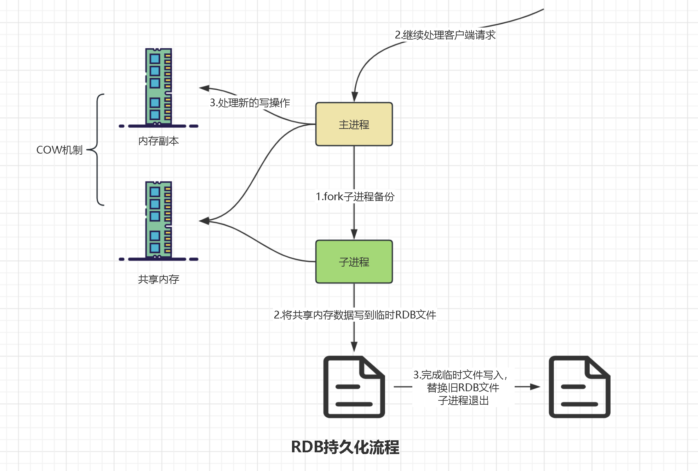


**触发方式：**
- 手动：`save`（阻塞主线程，不建议）、`bgsave`（fork子进程，微秒级阻塞）
- 自动：配置`save m n`（m秒内n次修改触发）、shutdown、flushall

**优点：** 文件紧凑、恢复速度快、适合备份。
**缺点：** 无法实时持久化，宕机丢失最近数据；fork重量级操作。

## AOF持久化

记录每个写命令到追加日志，重启时重新执行恢复数据。

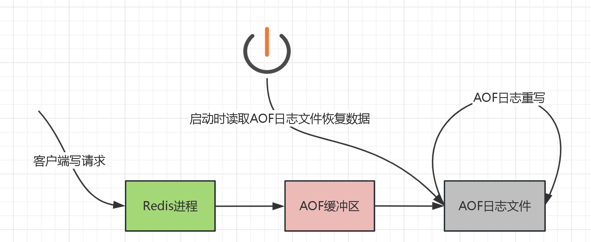


**开启：** `appendonly yes`

**同步策略：**
- `always`：每次写都刷盘，性能差，数据最安全
- `everysec`（默认）：每秒刷盘，兼顾性能与安全，最多丢1秒数据
- `no`：交由OS决定，性能好但安全性低

**重写：** 压缩冗余指令（过期数据不写入、无效命令去除、多条合并）。自动触发阈值：`auto-aof-rewrite-percentage 100` + `auto-aof-rewrite-min-size 64mb`。手动：`bgrewriteaof`。

**修复：** `redis-check-aof --fix`

**优点：** 数据更可靠、保留写命令历史。
**缺点：** 文件较大、恢复速度慢。

## 混合持久化

Redis 4.0+，`aof-use-rdb-preamble yes`默认开启。RDB做全量基准+AOF做增量，兼顾加载速度和数据安全。

## 总结

- 推荐RDB+AOF均开启
- 数据不敏感可单独用RDB
- 不建议单独用AOF
- 纯内存缓存可都不用


# Redis的过期策略

Redis同时使用**惰性删除**和**定期删除**：

- **惰性删除**：访问key时检查是否过期，过期则删除。节省CPU，但对内存不友好。
- **定期删除**：每隔100ms（hz=10）随机抽取一部分设置了过期时间的key检查删除。如果过期key比例>25%则继续，直到降到25%以下或耗时超过25ms。

两者结合：定期删除漏掉的过期key，在访问时由惰性删除清理。若仍积压过多，由内存淘汰策略处理。

## 定期过期详解

- 每秒10次检查（`hz 10`，范围1-500，建议<100）
- 按hash桶维度拿，最多20个元素/400个桶
- 删除过期数据，若未拿到或过期比例>10%则继续
- 最多16次循环，检查是否超时25ms
- `dynamic-hz yes`自适应频率

## lazyfree

Redis 4.0+引入，将删除操作放后台线程执行，避免阻塞。`unlink`指令异步回收内存。配置项：`lazyfree-lazy-eviction`、`lazyfree-lazy-expire`、`lazyfree-lazy-server-del`、`slave-lazy-flush`。


# Redis的内存淘汰策略

内存不足时主动删除键释放空间。8种策略（4.0+）：

| 策略 | 说明 |
|------|------|
| noeviction | 不淘汰，写入返回错误（默认） |
| volatile-lru | 设置过期时间的key中LRU |
| volatile-ttl | 设置过期时间的key中按TTL |
| volatile-random | 设置过期时间的key中随机 |
| volatile-lfu | 设置过期时间的key中LFU |
| allkeys-lru | 所有key中LRU |
| allkeys-random | 所有key中随机 |
| allkeys-lfu | 所有key中LFU |

## LRU和LFU源码解析

**LRU：** redisObject.lru字段24bit记录访问时间秒。`estimateObjectIdleTime`计算空闲时间，越大越易淘汰。伪LRU，不排序，随机采样淘汰。

**LFU：** 将24bit拆成16bit时间+8bit次数counter。
- counter不是简单+1，越大越慢（与`lfu-log-factor`相关）
- 新key初始counter=5（`LFU_INIT_VAL`），避免被立即淘汰
- 衰减：根据`lfu-decay-time`（默认1），每分钟没访问减少1次
- counter上限255

LFU解决LRU时效性问题：老数据访问次数高但已过时，LFU通过衰减降低其counter。

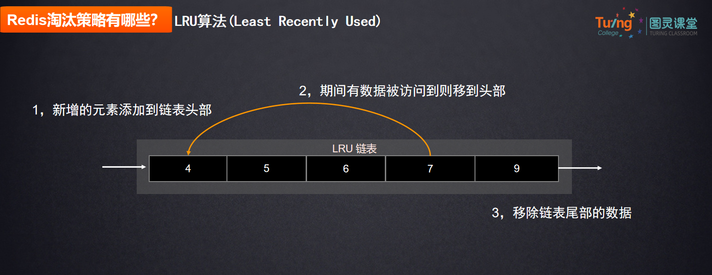


# 缓存击穿、缓存穿透、缓存雪崩

## 缓存击穿

热点数据失效瞬间，大量请求直接打到数据库。

**解决：** 热点数据永不过期/长过期；互斥锁保证只有一个线程查库更新缓存。

## 缓存雪崩

大量缓存同时失效或缓存宕机，请求涌入数据库。

**解决：** 过期时间加随机值分散；多级缓存；互斥锁；Redis高可用（主从/集群）。

## 缓存穿透

查询不存在于缓存和数据库中的数据，每次都打到数据库。

**解决：** 缓存空对象（短TTL）；参数校验；布隆过滤器。


# Redis哨兵机制

主从复制无法自动故障转移，哨兵（Sentinel）解决高可用问题。

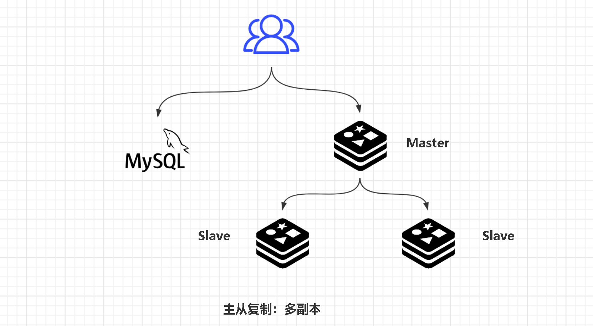


**原理：** 独立进程监控主从节点，发现故障自动转移。

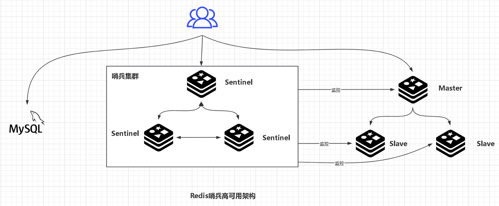


**工作流程：**
1. **监控**：周期性检查主从健康状态
2. **主观下线**：单个哨兵认为master不可用
3. **客观下线**：超过quorum个哨兵同意，确认master下线
4. **选举leader哨兵**：票数>=num(sentinels)/2+1
5. **故障转移**：选从节点（优先级最高→复制偏移量最大→runid最小）升级为新主
6. **客户端重定向**：通知新master位置

**哨兵作用：** 监控主从运行；master故障自动切换从为主。


# 数据库和缓存一致性问题

读写并发导致缓存与数据库不一致。

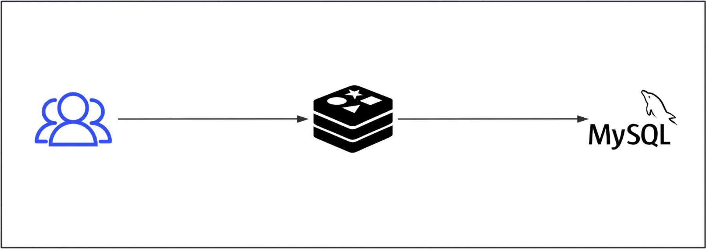


**方案：**
1. **延时双删**：先删缓存→更新DB→延迟几百ms再删缓存
2. **队列+重试**：删除失败发MQ，消费重试直到成功
3. **异步更新（binlog）**：用canal订阅MySQL binlog，异步更新Redis，类似主从备份机制


# Redis实现分布式锁的6种方案

分布式锁特征：互斥性、锁超时释放、可重入性、高性能高可用、安全性。

## 方案一：SETNX + EXPIRE

```java
if (jedis.setnx(key, value) == 1) {
    expire(key, 100); // 非原子，可能死锁
    try { /* 业务 */ } finally { jedis.del(key); }
}
```

**缺陷：** 加锁与设置过期非原子，异常导致锁不释放。

## 方案二：SETNX + value(系统时间+过期时间)

将过期时间存入value，加锁失败时校验是否已过期。

## 方案三：Lua脚本(SETNX+EXPIRE原子化)

## 方案四：SET EX PX NX

```java
if (jedis.set(key, requestId, "NX", "EX", 100) == 1) {
    try { /* 业务 */ } finally {
        // Lua脚本保证判断+删除原子性
        if (redis.call('get',KEYS[1])==ARGV[1]) then return redis.call('del',KEYS[1]) else return 0 end
    }
}
```

**问题：** 锁过期释放但业务未完成；锁被误删（用唯一requestId解决）。

## 方案五：Redisson框架

加锁成功后启动watch dog看门狗，每隔10秒检查并续期，解决锁过期释放问题。

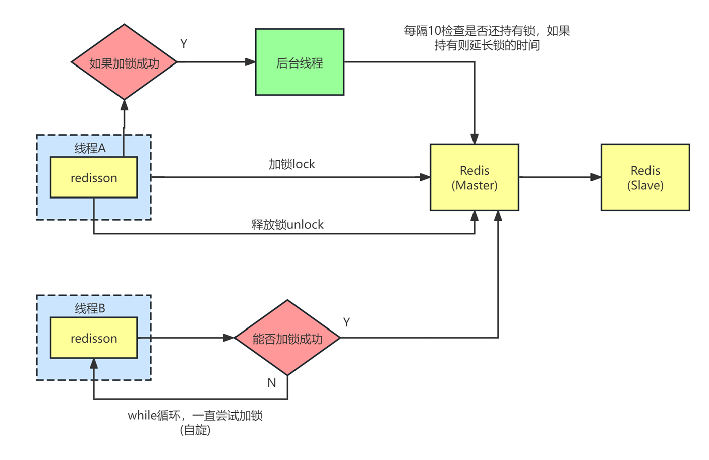


## 方案六：Redlock+Redisson（多机）

向N个独立Redis master请求加锁，超过半数（N/2+1）成功且总耗时<锁有效期，则加锁成功。失败则向所有节点解锁。

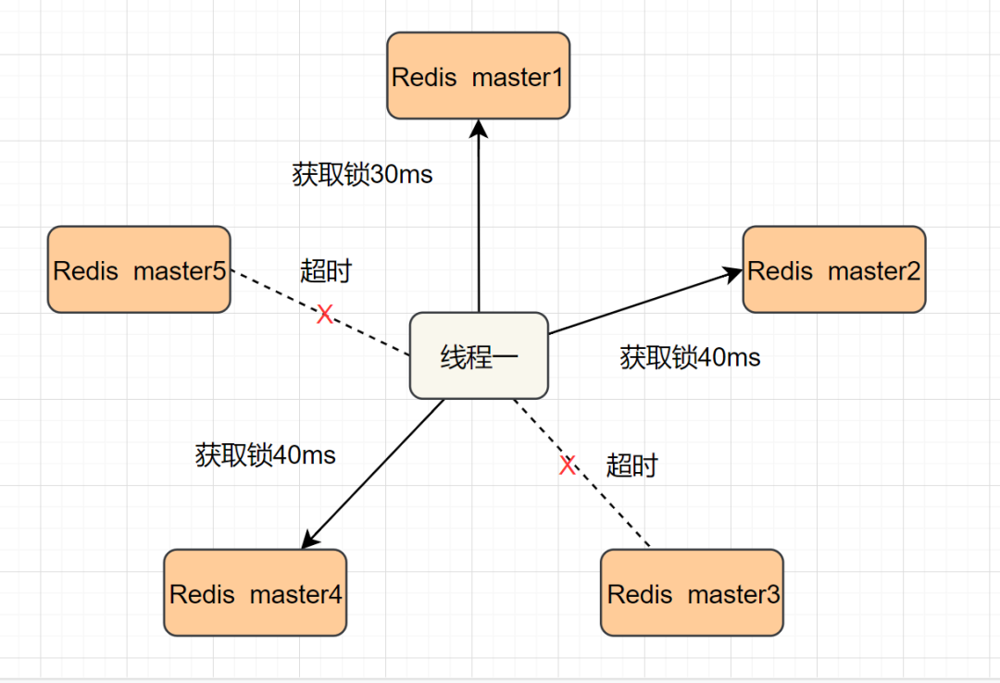

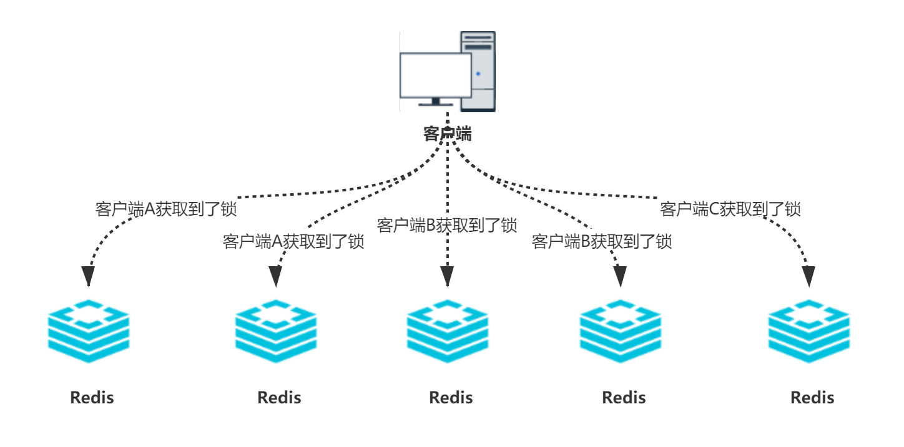


**局限性：** 依赖时钟、网络延迟影响一致性、实现复杂、非强一致性（强一致性建议ZooKeeper）。


# Redis大Key问题

## 定义

- String类型value达5MB
- ZSet成员数1万+
- Hash成员数1千但value总大小100MB

## 引发问题

内存占用过高、性能下降、阻塞其他操作（DEL大key）、网络拥塞、持久化困难、集群数据倾斜。

## 排查方法

1. **SCAN命令**：渐进式遍历+STRLEN/LLEN/SCARD/HLEN
2. **redis-cli --bigkeys**：扫描每种类型最大key
3. **Redis RDB Tools**：分析RDB文件
4. **memory usage key**：4.0+，精确估算内存占用
5. **debug object key**：查看key详细信息

## 优化方案

1. 拆分成多个小key（mget批量读取）
2. 优化数据结构（Hash压缩列表、压缩算法）
3. 设置合理过期时间
4. 启用内存淘汰策略
5. 数据分片（Redis Cluster）
6. UNLINK替代DEL（异步删除）
7. 增加内存容量


# Redis到底支不支持事务

**支持事务，但与传统关系型数据库不同。**

**命令：** `multi`（开启）、`exec`（执行）、`discard`（放弃）、`watch key`（乐观锁监控）。

**三阶段：** 开启(multi)→入队→执行(exec)。

**特点：**
- 命令串行化执行，不被其他命令插入
- 无隔离级别概念
- **不保证原子性**：命令执行错误不回滚，继续执行后续命令
- 语法错误：放弃所有命令
- WATCH：监控key被修改则事务打断（乐观锁）


# Redis相比memcached有哪些优势

- 数据结构丰富（string/hash/list/set/zset vs 仅string）
- 单value最大512M vs 1M
- 支持持久化
- 支持Lua脚本（原子执行）


# Redis真的是单线程吗

网络IO和键值对读写是单线程。持久化、异步删除、集群同步等用多线程。

单线程原因：瓶颈不在CPU而在内存和网络IO；避免锁竞争和上下文切换；IO多路复用处理并发连接。


# Redis6为何引入多线程

针对网络IO模块多线程改造，解决高并发下网络IO瓶颈。命令执行仍单线程，避免并发问题。get/set性能提升近一倍。


# Redis如何解决Hash冲突

链式hash（拉链法）+渐进式rehash。rehash分散到多次请求，避免阻塞。


# MySQL 2000w数据Redis只存20w如何保证热点数据

使用LFU淘汰策略（在LRU基础上增加请求数统计，更精准代表热点数据）。


# 高并发场景保证幂等性

- 数据库唯一主键（分布式ID）
- 乐观锁（版本号）
- 分布式锁
- Token机制（获取Token→存Redis→请求带Token→校验删除）


# Redis事务支持ACID吗

- **原子性**：不保证，命令失败不回滚
- **一致性**：保证
- **隔离性**：单独的隔离操作，无隔离级别概念
- **持久性**：RDB/AOF保证


# Redis性能调优详解

## 确认Redis是否变慢

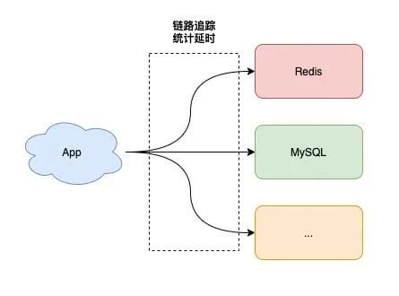

1. 在Redis服务器上测试基准性能：`redis-cli --intrinsic-latency 60`
2. 对比可能变慢实例的基准性能
3. 延迟达2倍以上即认为变慢

## 使用复杂度过高的命令

查看慢日志：`CONFIG SET slowlog-log-slower-than 5000`，`SLOWLOG get 5`。

避免O(N)以上命令（SORT、SUNION等），O(N)命令保证N尽量小。聚合操作放客户端。

## bigkey

写入/删除大key耗时。`redis-cli --bigkeys -i 0.01`扫描。解决：避免写入bigkey；4.0+用UNLINK替代DEL；6.0+开启lazy-free。

## 集中过期

大量key集中过期导致延迟变大（主动过期在主线程执行）。

**解决：** 过期时间加随机值打散；4.0+开启lazy-free。监控`expired_keys`指标。

## 实例内存达到上限

每次写入前需淘汰数据，增加延迟。

**解决：** 避免bigkey；随机淘汰比LRU快；拆分实例；开启lazy-free（`lazyfree-lazy-eviction yes`）。

## fork耗时严重

RDB/AOF rewrite时fork拷贝内存页表，实例越大越耗时。查看`latest_fork_usec`。

**解决：** 实例内存控制在10G以下；slave节点执行RDB；物理机部署；调大`repl-backlog-size`。

## 开启内存大页

COW时以2MB为单位申请内存，增加写延迟。

**解决：** `echo never > /sys/kernel/mm/transparent_hugepage/enabled`

## AOF

`appendfsync everysec`下，后台线程fsync阻塞时主线程write也会阻塞。

**解决：** `no-appendfsync-on-rewrite yes`（rewrite期间不fsync）；SSD磁盘。

## 绑定CPU

绑定单逻辑核时子进程争抢CPU。6.0+可分别绑定：`server_cpulist`、`bio_cpulist`、`aof_rewrite_cpulist`。

## 使用Swap

内存数据换到磁盘，访问慢几百倍。查看`/proc/$pid/smaps`。解决：增加内存、释放Swap。

## 碎片整理

`mem_fragmentation_ratio > 1.5`需整理。4.0+`activedefrag yes`自动整理（主线程执行，注意影响）。

## 网络带宽过载

监控网络流量，及时扩容或迁移实例。

## 其他

避免频繁短连接；完善监控；Redis机器专项专用。

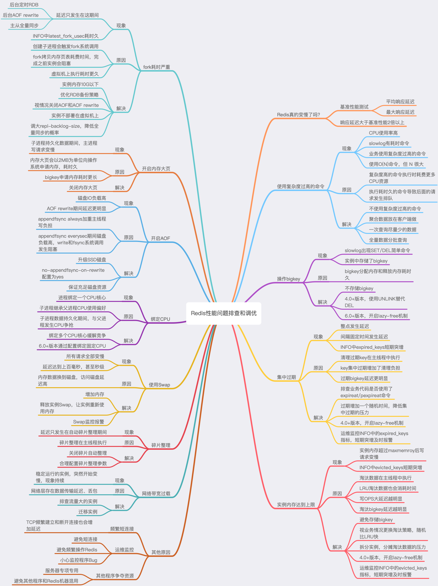


# 说说Redis的持久化机制

## RDB

**触发：** 配置`save m n`；命令`save`（阻塞）/`bgsave`（子进程）；shutdown（未开AOF时）。

**bgsave流程：** fork子进程→COW写时复制→子进程写RDB→主线程正常处理请求。

**文件：** LZF压缩，`redis-check-rdb`检测修复。

**优点：** 紧凑、恢复快、适合备份。
**缺点：** 非实时、fork开销、版本兼容问题。

## AOF

**流程：** 命令写入(append)→文件同步(sync)→重写(rewrite)→重启加载(load)。

**同步策略：** always（每次刷盘）/everysec（每秒，默认）/no（OS决定）。

**重写：** 压缩冗余命令，手动`bgrewriteaof`或自动触发。

**重启加载：** AOF优先于RDB。

**文件校验：** `redis-check-aof --fix`；`aof-load-truncated`兼容尾部不完整。

## RDB-AOF混合持久化

`aof-use-rdb-preamble yes`，RDB全量+AOF增量。

## 相关问题

- **主从复制用RDB不用AOF**：二进制IO效率高、恢复快
- **fork耗时**：与内存量成正比，建议实例<10GB


# 说说Redis的过期策略

惰性删除+定期删除+定期淘汰（4.0+）。

**定期过期源码（expire.c activeExpireCycle）：** 循环DB→按hash桶拿20个key→删除过期→过期比例>10%继续→16次检查超时25ms。

**惰性过期源码（db.c expireIfNeeded）：** 访问时检查→主节点删除（异步或同步）→从节点不操作。


# Redis的内存淘汰策略详解

（见前文，8种策略+LRU/LFU源码解析）


# Redis实例抖动问题诊断与解决方案

**常见抖动原因：** 内存压力（>70%）、网络问题、持久化压力、命令复杂度。

**诊断：** 性能监控（INFO）、慢查询分析、大Key检测。

**优化：** 合理maxmemory+淘汰策略、避免O(n)命令、Pipeline批量、调整持久化频率、完善监控预警。


# 领导：谁再用Redis处理过期订单，立马走人

## 不推荐方案

1. **Redis过期监听**：过期事件在删除key时生成而非TTL到达时，延迟大，"发送即忘"不保证送达

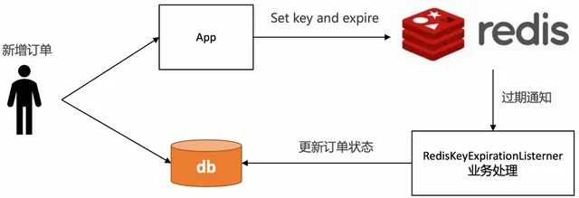


2. **RabbitMQ死信队列**：不保证投递时间
3. **时间轮**：纯内存无持久化，进程崩溃任务丢失

## 推荐方案

- **RocketMQ/Pulsar**：专业消息队列，可靠延时投递
- **Redisson DelayedQueue**：基于ZSet，Redis稳定时有效，需设计补偿机制

**结论：** 永远不要用Redis过期监听实现定时任务。


# Redis如何高效安全遍历所有key

使用SCAN命令：非阻塞、增量式、内存友好。

```java
String cursor = ScanParams.SCAN_POINTER_START;
ScanParams scanParams = new ScanParams().match("*").count(10);
do {
    ScanResult scanResult = jedis.scan(cursor, scanParams);
    // 处理结果
    cursor = scanResult.getCursor();
} while (!cursor.equals(ScanParams.SCAN_POINTER_START));
```


# Redisson续锁失败怎么办

**原因：** 连接断开、客户端宕机、网络抖动。


**后果：** 锁提前释放→并发访问→数据不一致→可能死锁。

**应对：**
1. 设置合理过期时间（不完全依赖看门狗）
2. 增加容错/补偿机制
3. 监控锁状态（TTL）
4. Redis高可用部署（Sentinel/Cluster）
5. 优化JVM和线程池
6. 设计锁竞争策略（退避重试）


# 什么是缓存击穿、缓存穿透、缓存雪崩

（见前文，含Java示例代码）


# Redis线上操作最佳实践

1. 优化数据结构，减少大Key
2. 设置合理TTL
3. RDB+AOF结合，定期备份
4. 实时监控+告警（INFO、慢查询、Prometheus/Grafana）
5. 集群模式+Sentinel高可用
6. 规范命名空间，避免热Key
7. 批量操作减少网络往返
8. 参数调优（maxmemory、maxclients等）
9. 合理重试+熔断
10. 密码+ACL访问控制


# 阿里面试：Redis缓存穿透怎么解决

**三层防护体系：**

1. **参数校验拦截**：网关/应用入口校验请求合法性
2. **布隆过滤器**：判断不存在则一定不存在，直接拦截；判断存在才放行

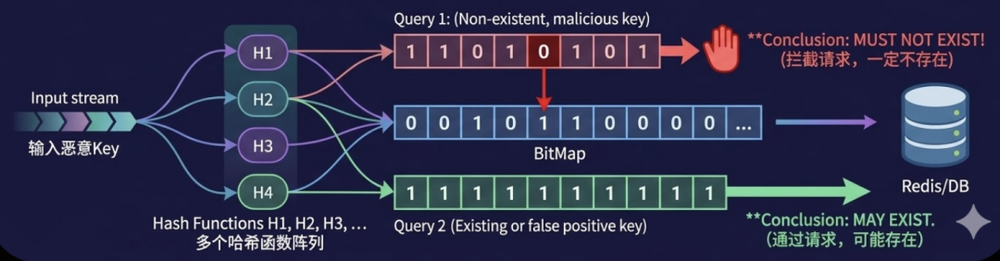


3. **缓存空值+短过期**：兜底防线，TTL设3-5分钟

**生产避坑：** 调大布隆过滤器容量/Hash函数数降低误判；用Redis Bitmap实现分布式布隆过滤器；监控空值缓存命中频率。


# Redis的Key和Value设计原则

## Key设计

1. **短小精炼**：不超过256字节，含义明确
2. **命名空间**：冒号分隔，如`user:1001:profile`
3. **避免热Key**：分布均匀，必要时分片
4. **全局唯一**：使用业务标识（用户ID、产品ID）

## Value设计

1. **选择合适数据结构**：避免存储过大对象
2. **限制单个Value大小**：分片存储，Blob放外部存储
3. **利用压缩**：减少内存占用
4. **合理设置TTL**：控制数据生命周期

## 通用建议

预估容量并发、多环境测试、性能监控。


# Redis集群下主节点挂了会导致超卖吗

**会。** 核心风险：异步同步机制+分布式锁局限性。

1. **主从异步同步**：主节点写入未同步到从节点即宕机，新主节点含旧数据
2. **分布式锁失效**：锁未同步到从节点，新主节点不含该锁

**解决：** RedLock算法（半数以上节点加锁）、原子操作/Lua脚本、乐观锁（CAS）、消息队列削峰。


# 缓存与数据库双写不一致如何解决

1. **Cache Aside模式**：读先查缓存→未命中查DB→写入缓存；写先更新DB→删除缓存
2. **分布式锁**：更新操作加锁
3. **canal异步更新**：订阅binlog异步更新缓存
4. **TTL**：设置合理过期时间兜底


# 如何用Redis统计用户访问量

## 1. Hash

`HSET {URI:Date} {UserID} 1`，`HLEN`统计。简单准确，但内存占用大。

## 2. Bitmaps

`SETBIT`标记用户，`BITCOUNT`统计。1亿用户约12MB。节省内存，稀疏时反而更大。

## 3. HyperLogLog

`PFADD`/`PFCOUNT`。每个key仅12KB，误差0.81%。适合超大规模不要求精确的UV统计。


# Redis为什么这么快

1. **内存存储**：读写速度快
2. **单线程模型**：避免锁竞争和上下文切换
3. **高效数据结构**：哈希表、跳表等
4. **异步IO/IO多路复用**：高效处理并发连接
5. **事件驱动架构**

Redis瓶颈不在CPU，直接内存操作+网络传输。单线程对高频小操作效率更高。

**Redis不用B+树：** 数据量没MySQL大；内存操作万倍快于磁盘，多跳几次问题不大。


# Redis中key过期了一定会立即删除吗

不会。采用惰性删除+定期删除结合：
- **惰性删除**：访问时检查，过期才删除
- **定期删除**：每100ms随机抽取部分key检查删除

极端情况下过期key可能短时间继续占用内存，直到被访问或后台任务删除。


# Redis到底支不支持事务

（见前文）支持，但不同于关系型数据库：无回滚、无隔离级别、WATCH乐观锁。


# Redis的热Key问题如何解决

1. **本地缓存**：Caffeine等缓存热Key，减少Redis访问
2. **请求分摊**：热Key拆分成多个子Key，分摊读请求
3. **限流**：RateLimiter控制访问频率
4. **监控报警**：热点探测系统，定期上报key调用次数，检测热key后通知各节点构建本地缓存


# Redis6为什么引入了多线程

提高网络IO效率。之前纯单线程网络IO成为瓶颈，多线程并行处理网络数据读写，提升带宽利用率和吞吐量。命令执行仍单线程，避免数据一致性问题。


# REDIS集群什么情况会导致整个集群不可用

1. 多个主节点同时故障且从节点无法升级
2. 集群管理节点故障
3. 网络分区导致脑裂
4. 配置错误
5. 内存不足

**措施：** 主从复制+故障转移、多管理节点、监控配置一致性、网络分区容忍策略、内存监控扩容。


# REDIS集群的原理

数据分片+主从复制。16384个哈希槽分配到多个节点，每个槽一个主节点+多个从节点。

- 主节点处理读写，从节点冗余备份
- 主节点故障自动选举从节点升级
- 客户端根据键哈希值路由到对应节点


# 什么是Redis哨兵机制

（见前文）监控主从、自动故障转移、保证高可用。关键进程：sentinel、monitor、judge、failover。


# Redis为什么把所有数据放内存

1. **高速读写**：内存访问远快于磁盘
2. **简单数据结构**：直接映射内存，无需复杂转换
3. **支持持久化**：RDB/AOF保证数据安全

通过过期策略、淘汰策略、maxmemory、集群分片管理内存。


# 说说你对Redis操作原子性的理解

每个命令单线程执行，不可中断。复杂操作（事务、Lua脚本）将多个操作打包成原子操作。

1. 单线程模型避免竞争条件
2. 事务/Lua脚本支持多操作原子执行


# 为什么Redis单线程模型效率也那么高

1. **非阻塞IO**：事件驱动，不阻塞主线程
2. **内存操作**：指针操作快速读写，无需数据同步
3. **避免多线程开销**：无上下文切换、锁竞争


# 怎么实现Redis的高可用

1. **主从复制**：读写分离，故障转移
2. **哨兵机制**：自动监控+故障转移
3. **集群模式**：数据分片+自动故障恢复


# 使用Redis有哪些好处

缓存功能、高性能、多样化数据类型、支持持久化、支持分布式、简单易用。


# REDIS集群会有写操作丢失吗

会。异步复制机制下，主节点写后未同步即故障，未复制的写操作丢失。

**减少丢失：** 监控集群状态、合理持久化策略、应用层确认机制。


# Redis有哪些常用应用场景

缓存、分布式会话管理、消息队列、实时排行榜/计数器、地理位置存储查询、实时数据分析。


# 一个REDIS实例最多能存放多少KEYS

约2^32-1（42亿）。由哈希表32位索引决定。实际中键过多会性能下降，建议用集群分片扩展。


# Redis是单线程还是多线程

键值存储服务主流程（网络IO+数据读写）单线程。持久化、异步删除、集群同步等用额外线程。严格说不是完全单线程。


# 说说你对PIPELINE的理解

将多个命令打包发送，减少网络往返次数，提升吞吐量。适用于连续执行多个命令或批量操作的场景。
