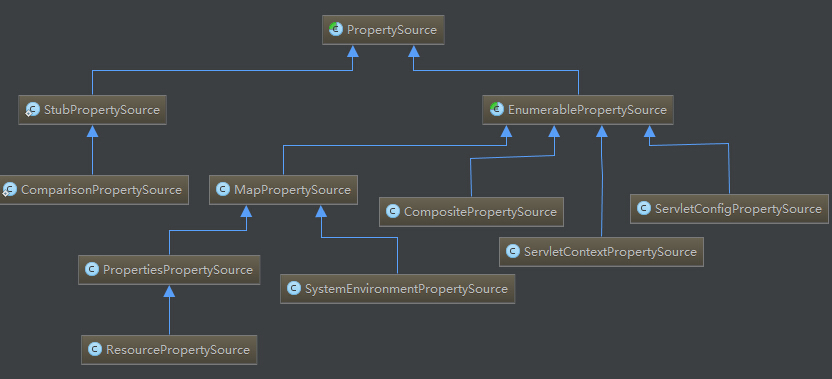
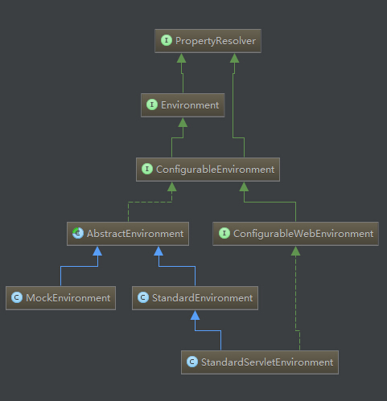
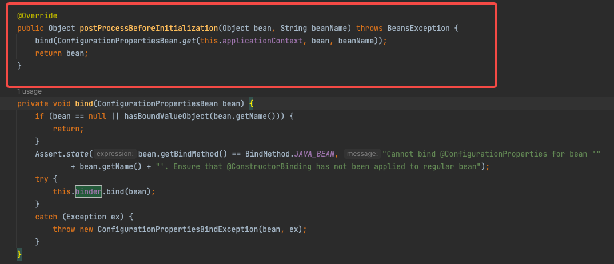
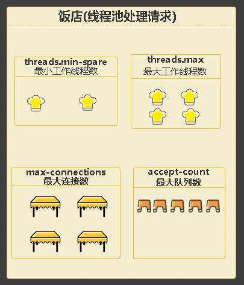
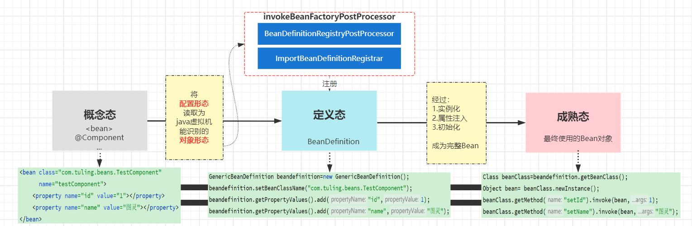
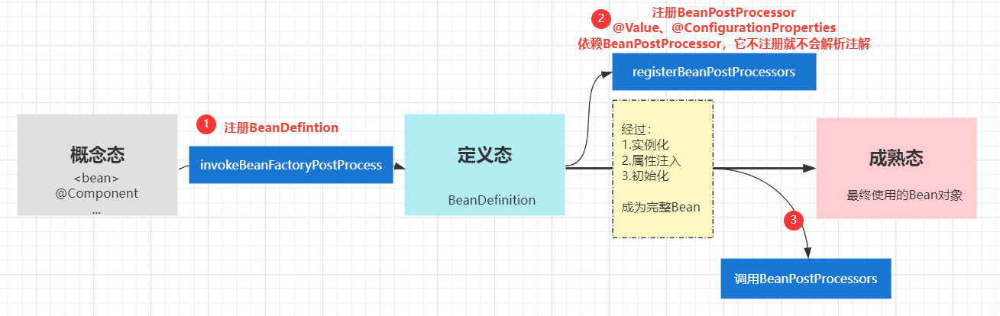
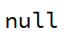
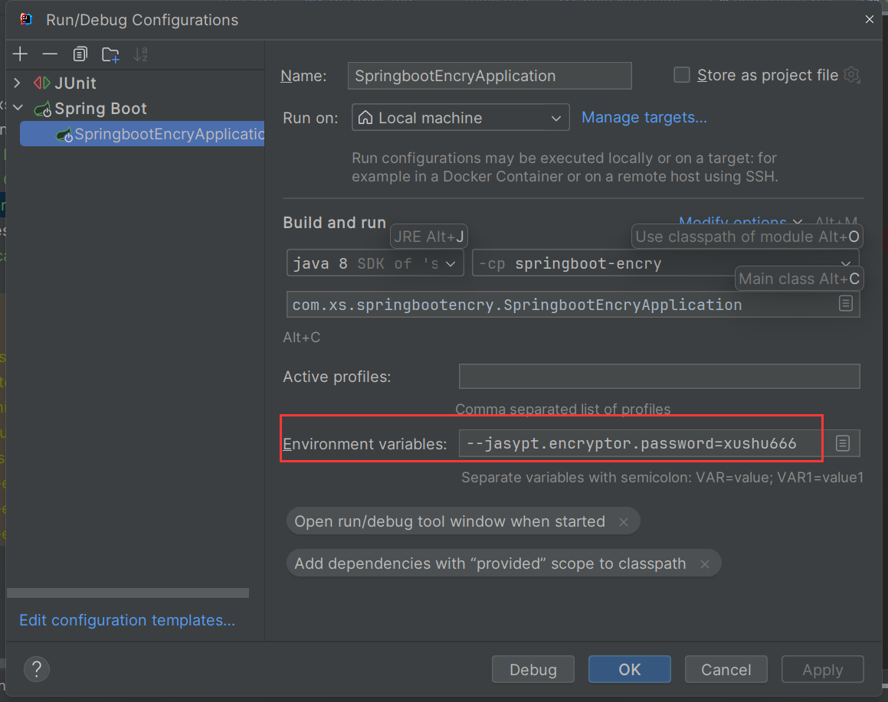

# SpringBoot知识汇总

# SpringBoot面试题集合

## SpringBoot 使用 Validation 进行参数校验并统一返回校验异常

后端不能相信前端传入的参数，需要在后端对参数进行校验。

### 引入依赖

```xml
<dependency>
    <groupId>org.springframework.boot</groupId>
    <artifactId>spring-boot-starter-validation</artifactId>
</dependency>
```

`spring-boot-starter-validation` 本质使用 Hibernate Validator，它本身没有实现。

### Validation 基本校验注解

| **注解** | **描述** |
| :--- | :--- |
| **@Null** | 验证对象是否为 null |
| **@NotNull** | 验证对象是否不为 null，无法检查长度为 0 的字符串 |
| **@NotBlank** | 检查字符串是否为 null，且 Trim 后长度是否大于 0，只适用于字符串，会去掉前后空格 |
| **@NotEmpty** | 检查约束元素是否为 NULL 或 EMPTY |
| **@AssertTrue** | 验证 Boolean 对象是否为 true |
| **@AssertFalse** | 验证 Boolean 对象是否为 false |
| **@Size(min=, max=)** | 验证对象（Array、Collection、Map、String）长度是否在给定范围内 |
| **@Length(min=, max=)** | 验证元素值长度是否在 min 和 max 区间内 |
| **@Past** | 验证 Date 和 Calendar 对象是否在当前时间之前 |
| **@Future** | 验证 Date 和 Calendar 对象是否在当前时间之后 |
| **@Pattern** | 验证 String 对象是否符合正则表达式规则 |
| **@Min** | 验证 Number 和 String 对象是否大于等于指定值 |
| **@Max** | 验证 Number 和 String 对象是否小于等于指定值 |
| **@DecimalMax** | 被标注的值必须不大于约束中指定的最大值，参数为通过 BigDecimal 定义的最大值的字符串表示，小数存在精度 |
| **@DecimalMin** | 被标注的值必须不小于约束中指定的最小值，参数为通过 BigDecimal 定义的最小值的字符串表示，小数存在精度 |
| **@Digits** | 验证 Number 和 String 的构成是否合法 |
| **@Digits(integer=,fraction=)** | 验证字符串是否符合指定格式的数字，**integer** 指定整数精度，**fraction** 指定小数精度 |
| **@Range(min=, max=)** | 验证元素值在最小值和最大值之间 |
| **@Range(min=10000,max=50000,message="range.bean.wage")** | 验证元素值在 10000 和 50000 之间，自定义错误信息为 "range.bean.wage" |
| **@Valid** | 写在方法参数前，递归地对该对象进行校验；若关联对象是集合或数组，则对其中元素递归校验；若是 map，则对其值部分校验 |
| **@CreditCardNumber** | 信用卡验证 |
| **@Email** | 验证是否是邮件地址，为 null 时不进行验证，算通过 |
| **@ScriptAssert(lang= ,script=, alias=)** | 自定义脚本验证 |
| **@URL(protocol=,host=, port=,regexp=, flags=)** | 验证 URL 格式是否正确，可指定协议 |

### 添加参数校验

#### 在 DTO 属性上添加校验

```java
import com.fasterxml.jackson.annotation.JsonIgnore;
import lombok.AllArgsConstructor;
import lombok.Data;
import lombok.NoArgsConstructor;
import org.hibernate.validator.constraints.Length;

import javax.validation.constraints.Email;
import javax.validation.constraints.Max;
import javax.validation.constraints.Min;
import javax.validation.constraints.NotBlank;
import java.util.UUID;

@Data
@AllArgsConstructor
@NoArgsConstructor
public class registryUserDto {
    @NotBlank(message = "用户名不能为空")
    private String username;
    @NotBlank(message = "密码不能为空")
    @Length(min = 6, max = 20, message = "密码长度在6-20之间")
    private String password;
    @Min(value = 0, message = "年龄最小为0")
    @Max(value = 200, message = "年龄最大为200")
    private Integer age;
    @NotBlank(message = "邮箱不能为空")
    @Email(message = "邮箱格式不正确")
    private String email;
    @JsonIgnore
    private String salt = UUID.randomUUID().toString().replaceAll("-", "");
    private Boolean admin;
}
```

#### 在 Controller 对应的 DTO 添加 @Valid 或 @Validated

```java
@PostMapping("/registry")
public ResponseResult registryUser(@RequestBody @Valid registryUserDto registryUserDto) {
    return ResponseResult.okResult(registryUserDto);
}
```

添加后即可对参数实现校验，校验失败时接口返回 500 异常和相应异常信息。

#### 复杂 String 校验可用正则

```java
@Pattern(regexp = "^1(3|4|5|7|8)\\d{9}$", message = "手机号码格式错误")
@NotBlank(message = "手机号码不能为空")
private String phone;
```

对于单个参数（未用 DTO 接收）也可校验：先在 Controller 类上添加 `@Validated`，再在参数前加校验注解。

```java
@RestController
@RequestMapping("/user")
@Validated
public class UserController {
    @PostMapping("/registry")
    public ResponseResult registryUser(@NotBlank(message = "name不能为空") String name) {
        return ResponseResult.okResult(name);
    }
}
```

### 自定义校验注解

#### 新建自定义注解

```java
import org.beiming.validator.StatusValidator;

import javax.validation.Constraint;
import javax.validation.Payload;
import java.lang.annotation.*;

@Target({ElementType.FIELD, ElementType.PARAMETER})
@Retention(RetentionPolicy.RUNTIME)
@Documented
@Constraint(validatedBy = {StatusValidator.class})
public @interface Status {

    String[] statusType() default {};

    String message() default "状态传递有误";

    Class<?>[] groups() default {};

    Class<? extends Payload>[] payload() default {};

}
```

#### 实现相应的校验

```java
import org.beiming.annotation.validator.Status;

import javax.validation.ConstraintValidator;
import javax.validation.ConstraintValidatorContext;
import java.util.Arrays;
import java.util.List;

public class StatusValidator implements ConstraintValidator<Status, Integer> {

    private List<String> typeStatus;

    @Override
    public void initialize(Status constraintAnnotation) {
        typeStatus = Arrays.asList(constraintAnnotation.statusType());
        ConstraintValidator.super.initialize(constraintAnnotation);
    }

    @Override
    public boolean isValid(Integer value, ConstraintValidatorContext constraintValidatorContext) {
        if (value != null) {
            if (!typeStatus.contains(String.valueOf(value))) {
                return false;
            }
        }
        return true;
    }
}
```

#### 自定义注解的使用

```java
@Status(statusType = {"1", "2"})
private Integer status;
```

### 校验失败统一异常处理

上面校验失败的响应 msg 非常不友好，在统一异常处理中添加 BindException 的处理：

```java
import org.beiming.enums.AppHttpCodeEnum;
import org.beiming.exception.SystemException;
import org.beiming.domain.vo.ResponseResult;
import lombok.extern.slf4j.Slf4j;
import org.springframework.validation.BindException;
import org.springframework.web.bind.annotation.ExceptionHandler;
import org.springframework.web.bind.annotation.RestControllerAdvice;

@RestControllerAdvice
@Slf4j
public class GlobalExceptionHandler {
    @ExceptionHandler(SystemException.class)
    public ResponseResult systemExceptionHandler(SystemException e) {
        log.error("出现了异常! {}", e);
        return ResponseResult.errorResult(e.getCode(), e.getMsg());
    }

    @ExceptionHandler(Exception.class)
    public ResponseResult exceptionHandler(Exception e) {
        log.error("出现了异常! {}", e);
        return ResponseResult.errorResult(AppHttpCodeEnum.SYSTEM_ERROR.getCode(), e.getMessage());
    }

    /* 添加校验参数异常处理 */
    @ExceptionHandler(BindException.class)
    public ResponseResult bindExceptionHandler(BindException e) {
        log.error("出现了异常! {}", e);
        return ResponseResult.errorResult(AppHttpCodeEnum.SYSTEM_ERROR,
                e.getBindingResult().getAllErrors().get(0).getDefaultMessage());
    }
}
```

这样异常信息非常友好，方便前端弹出消息框提示。

## 如何理解 SpringBoot 的自动配置

1. **约定大于配置**：Spring Boot 使用一系列约定推断应用程序的配置需求，减少显式配置。绝大多数情况下无需手动指定很多配置，框架会根据项目结构和依赖自动完成配置。
2. **自动扫描和类路径**：应用启动时自动扫描类路径上的组件和配置，根据发现的组件和类自动装配（自动配置）应用程序各部分，如数据源、Web 容器等。
3. **条件化配置**：配置仅在特定条件满足时才生效。例如，只有类路径上存在特定库时，与该库相关的配置才会被自动应用。
4. **自定义配置**：可通过提供自己的配置覆盖默认的自动配置，或通过属性配置文件修改自动配置行为。
5. **启动器（Starters）**：一种依赖关系管理机制，可简化项目依赖管理，同时自动配置特定类型的应用程序。引入适当的启动器即可一次性引入一组相关依赖和自动配置，快速搭建特定类型的应用（如 Web 应用、数据访问应用等）。
6. **自动配置类**：自动配置通过自动配置类实现，这些类通常位于 `org.springframework.boot.autoconfigure` 包下，使用注解和条件化逻辑配置应用程序各组件。

## 如何理解 SpringBoot 的 Starter 机制

1. **提供预配置的依赖**：Starters 是一组预配置的依赖项集合，用于启用特定类型的功能。例如 `spring-boot-starter-web` 启用 Web 应用相关功能（内嵌 Web 服务器、Spring MVC、Jackson 等），只需引入这个 Starter，无需单独处理每个依赖项的版本和配置。
2. **简化依赖管理**：引入适当的 Starter 后无需手动指定每个相关依赖项，Spring Boot 会自动处理版本兼容性和配置，避免版本冲突和配置错误。
3. **自动配置**：Starters 包含与功能相关的自动配置类，根据应用依赖和配置自动配置必要的组件和设置。
4. **遵循约定**：遵循约定大于配置的原则，约定如何将依赖和配置组合在一起，使开发更加一致高效。
5. **自定义扩展**：尽管提供了默认依赖和配置，仍可根据需要自定义扩展，覆盖默认配置、添加额外依赖项或通过属性配置文件修改行为。

## SpringBoot 启动过程有哪些步骤

1. **加载启动类**：入口是一个带 main 方法的 Java 类，在其中创建并启动 Spring Boot 应用上下文，加载 Spring Boot 的基础设置。
2. **构建应用程序上下文**：main 方法通常使用 `SpringApplication.run()` 构建 Spring 应用上下文，启动应用并加载各种配置和组件。
3. **自动配置**：构建上下文过程中，Spring Boot 自动扫描类路径上的组件、配置文件和类，并根据条件自动配置，包括自动装配、属性值填充等。
4. **加载外部属性**：加载 `application.properties` 或 `application.yml` 等外部属性文件，其中的配置信息可在应用中使用，控制不同组件的行为。
5. **创建 Bean 实例**：使用 Spring IoC 容器管理应用中的各种 Bean 实例，在上下文构建过程中创建和管理这些 Bean。
6. **启动内嵌服务器**：若为 Web 应用，启动过程中自动配置并启动内嵌 Web 服务器（如 Tomcat、Jetty 或 Undertow），使应用可直接通过浏览器或客户端访问。
7. **执行初始化和回调**：上下文构建完成后，执行各种初始化和回调操作，例如调用 `ApplicationRunner` 或 `CommandLineRunner` 实现类的方法。
8. **应用程序运行**：上下文构建完成、Web 服务器启动并监听请求后，应用开始运行，等待客户端请求。

## 如何理解 SpringBoot 条件注解

条件注解通过检查一组预定义条件来判断是否满足某个条件：条件成立则相应组件或配置启用，否则忽略。这让开发人员能根据环境、依赖和配置动态调整应用行为。常见条件注解：

1. **@ConditionalOnClass**：当指定类位于类路径上时才启用被注解的组件或配置。
2. **@ConditionalOnMissingClass**：当指定类不在类路径上时才启用，可用于某些类不可用时应用备用实现。
3. **@ConditionalOnBean**：当指定 Bean 在应用上下文中存在时才启用。
4. **@ConditionalOnMissingBean**：当指定 Bean 在应用上下文中不存在时才启用，可用于提供默认实现或避免重复创建 Bean。
5. **@ConditionalOnProperty**：当指定属性满足条件时才启用，可基于配置属性的值决定是否启用特定功能。
6. **@ConditionalOnExpression**：当指定 SpEL 表达式计算结果为 true 时才启用，可用于更复杂的条件判断。

条件注解是 Spring Boot 自动化配置的核心机制之一。

## SpringBoot 的 jar 为什么可以直接运行

1. **内嵌的 Web 服务器**：支持内嵌 Web 服务器（如 Tomcat、Jetty 或 Undertow），无需外部 Web 服务器，直接运行 JAR 即可启动 Web 应用。
2. **可执行 JAR**：JAR 文件是可执行的，其中包含一个 main 方法作为入口点，可像运行普通 Java 程序一样运行。
3. **类路径管理**：使用特殊的类加载机制从 JAR 文件中加载类和资源，类路径管理更灵活。
4. **自动配置和依赖管理**：自动配置机制使应用的依赖和配置可封装在 JAR 中，无需手动处理复杂的依赖管理和配置文件问题。
5. **Spring Boot Maven 插件**：提供 Maven 插件方便地将应用打包为可执行 JAR，插件会处理必要设置使 JAR 正确运行。
6. **运行时环境**：JAR 中嵌入了运行时环境的必要组件（如 Web 服务器和 Spring 框架等），可在自包含环境中运行。

## SpringBoot 的配置优先级是怎样的

配置优先级通过不同来源的配置属性值进行合并和覆盖来确定：

1. **应用默认值（Default Values）**：Spring Boot 提供的许多内置默认属性值，用于定义框架和组件的默认行为。
2. **内部配置文件（Application Properties and YAML）**：在 `application.properties` 或 `application.yml` 中设置的属性值，会被加载到应用上下文中。
3. **外部属性文件（External Properties）**：通过命令行参数、环境变量或配置文件等方式传递的属性值。
4. **命令行参数（Command Line Arguments）**：可覆盖应用配置属性，如 `java -jar myapp.jar --my.property=value`。
5. **系统环境变量（System Environment Variables）**：会被自动映射到应用上下文中的属性。
6. **属性配置顺序**：配置属性按上述顺序逐层覆盖合并，命令行参数和系统环境变量优先级最高，会覆盖应用默认值、内部配置文件和外部属性文件中的值。

## 如何理解 spring.factories 文件的作用

`spring.factories` 用于在类路径下自动发现和加载扩展点，作用类似 Java 的 SPI 机制，允许第三方库或模块注册自己的实现，从而扩展或定制 Spring 框架行为。

1. **扩展点的自动发现**：Spring 框架内部会在类路径下搜索并加载 `spring.factories` 文件，根据文件配置自动发现扩展点，这些扩展点可以是自定义的类、接口或配置类。
2. **解耦和可插拔性**：类似插件机制，允许将自定义实现集成到 Spring 框架中而无需修改 Spring 源代码，提高解耦性和可维护性。
3. **多模块项目的模块发现**：多模块项目中每个模块可有自己的 `spring.factories` 文件，注册各自的扩展点，实现松耦合和灵活性。
4. **实现框架的定制和扩展**：Spring 框架本身也使用 `spring.factories` 实现定制和扩展，可通过自定义文件覆盖或替代 Spring 默认行为。

示例内容：

```plain
# Sample META-INF/spring.factories file
org.springframework.context.ApplicationContextInitializer=com.example.MyInitializer
```

上例声明了一个 `ApplicationContextInitializer` 扩展点的实现类 `com.example.MyInitializer`，会在应用上下文初始化时被调用。

## SpringBoot 为什么默认使用 Cglib 动态代理

1. **性能和速度**：Cglib 动态代理在性能上通常比 JDK 动态代理更快。它直接通过字节码生成子类实现代理，避免了一些反射操作，在方法调用等方面更高效。
2. **无需接口**：JDK 动态代理要求目标类必须实现接口，而 Cglib 不需要，更适用于没有接口的类，扩展了动态代理的适用范围。
3. **无侵入性**：类无需实现任何接口或继承特定类，减少了对源代码的侵入性，对集成第三方库或需要代理的现有类特别有用。
4. **方便集成**：Spring Boot 默认提供了 Cglib 相关依赖，使用非常方便。

## 如何理解 SpringBoot 的 @SpringBootApplication 注解

`@SpringBootApplication` 是 Spring Boot 的核心注解，用于标识一个主要的 Spring Boot 应用程序类。

1. **组合注解**：它实际是一个组合注解，包含以下三个注解的功能：
   * `@SpringBootConfiguration`：标识该类为 Spring Boot 配置类，类似传统 Spring 的 `@Configuration`。
   * `@EnableAutoConfiguration`：启用自动配置，让 Spring Boot 根据类路径中的依赖自动配置应用程序各组件。
   * `@ComponentScan`：扫描当前包及其子包，查找带有 Spring 相关注解（如 `@Component`、`@Service`、`@Controller` 等）的类，注册为 Spring Bean。
2. **主程序入口**：通常标注在包含 main 方法的主类上，是应用程序的入口点。
3. **约定大于配置**：默认启用自动配置，扫描并注册需要的组件，使配置过程简单，能快速搭建功能完备的应用。
4. **配置扩展**：尽管包含许多默认配置，仍可添加自己的配置类、自定义 Bean 和其他组件进一步定制和扩展应用行为。

示例：

```java
import org.springframework.boot.SpringApplication;
import org.springframework.boot.autoconfigure.SpringBootApplication;

@SpringBootApplication
public class MySpringBootApplication {

    public static void main(String[] args) {
        SpringApplication.run(MySpringBootApplication.class, args);
    }
}
```

## SpringBoot 读配置的 6 种方式

以下示例源码 Spring Boot 版本均为 2.7.6。

### 一、Environment

注入 `Environment` 类并调用 `getProperty(属性key)` 即可获取配置属性值。

```java
@Slf4j
@SpringBootTest
public class EnvironmentTest {

    @Resource
    private Environment env;

    @Test
    public void var1Test() {
        String var1 = env.getProperty("env101.var1");
        log.info("Environment 配置获取 {}", var1);
    }
}
```

**什么是 Environment？** 它是 Spring Boot 核心的环境配置接口，提供简单方法访问应用程序属性，包括系统属性、操作系统环境变量、命令行参数、和应用程序配置文件中定义的属性等。

#### 配置初始化

Spring Boot 程序启动加载流程里，会执行 `SpringApplication.run` 中的 `prepareEnvironment()` 方法进行配置初始化：

```java
private ConfigurableEnvironment prepareEnvironment(SpringApplicationRunListeners listeners,
   DefaultBootstrapContext bootstrapContext, ApplicationArguments applicationArguments) {
      // 1、创建 ConfigurableEnvironment 对象用于存储环境参数
      ConfigurableEnvironment environment = getOrCreateEnvironment();
      // 2、解析并加载用户指定的配置文件，封装为 PropertySource 添加到环境对象中
      configureEnvironment(environment, applicationArguments.getSourceArgs());
      // 3、加载所有的系统属性，并将它们添加到 ConfigurableEnvironment 对象中
      ConfigurationPropertySources.attach(environment);
      // 4、通知监听器环境参数已经准备就绪
      listeners.environmentPrepared(bootstrapContext, environment);
      // 5、将默认属性源中的所有属性值移到环境对象的队列末尾，避免用户无意中覆盖 Spring Boot 默认属性
      DefaultPropertiesPropertySource.moveToEnd(environment);
      Assert.state(!environment.containsProperty("spring.main.environment-prefix"),
          "Environment prefix cannot be set via properties.");
      // 6、将 Spring Boot 应用程序的属性绑定到环境对象上
      bindToSpringApplication(environment);
      // 7、如果没有自定义的环境类型，则转换为标准的环境类型
      if (!this.isCustomEnvironment) {
        EnvironmentConverter environmentConverter = new EnvironmentConverter(getClassLoader());
        environment = environmentConverter.convertEnvironmentIfNecessary(environment, deduceEnvironmentClass());
      }
      // 8、再次加载系统配置，以防止被其他配置覆盖
      ConfigurationPropertySources.attach(environment);
      return environment;
}
```

配置加载流程步骤：

* 创建**环境对象** `ConfigurableEnvironment` 用于存储环境参数；
* `configureEnvironment` 加载默认的 `application.properties` 和 `application.yml` 配置文件及用户指定的配置文件，封装为 **PropertySource** 添加到环境对象中；
* `attach()`：加载所有系统属性并添加到环境对象中；
* `listeners.environmentPrepared()`：发送环境参数配置已准备就绪的监听通知；
* `moveToEnd()`：将**系统默认**属性源中的所有属性值移到环境对象的队列末尾，使自定义属性值可覆盖默认值；
* `bindToSpringApplication`：将应用程序属性绑定到 Bean 对象上；
* `attach()`：再次加载系统配置，防止被其他配置覆盖。

配置属性会封装成抽象数据结构 PropertySource（key-value 形式）：

```java
public abstract class PropertySource<T> {
    protected final String name; // 属性源名称
    protected final T source; // 属性源值（一个泛型，比如 Map，Property）
    public String getName();  // 获取属性源的名字
    public T getSource(); // 获取属性源值
    public boolean containsProperty(String name);  // 是否包含某个属性
    public abstract Object getProperty(String name);   // 得到属性名对应的属性值
}
```

PropertySource 有诸多实现类用于管理配置属性，可从不同来源获取配置，例如：



* **MapPropertySource**：Map 键值对对象转换为 PropertySource 对象的适配器；
* **PropertiesPropertySource**：Properties 对象中的所有配置属性转换为 Spring 环境中的属性值；
* **ResourcePropertySource**：从文件系统或 classpath 中加载配置属性，封装成 PropertySource 对象；
* **ServletConfigPropertySource**：Servlet 配置中读取配置属性；
* **ServletContextPropertySource**：Servlet 上下文中读取配置属性；
* **StubPropertySource**：空的实现类，仅作为 CompositePropertySource 的默认父级属性源，以避免空指针异常；
* **CompositePropertySource**：复合型实现类，内部维护 PropertySource 集合队列，可将多个 PropertySource 合并；
* **SystemEnvironmentPropertySource**：操作系统环境变量中读取配置属性。

各类配置初始化生成的 PropertySource 对象会被维护到集合队列中：

```java
List<PropertySource<?>> sources = new ArrayList<>();
```

配置初始化完毕，应用上下文 `AbstractApplicationContext` 会加载配置，程序运行时即可随时获取配置信息。

```java
private void prepareContext(DefaultBootstrapContext bootstrapContext, ConfigurableApplicationContext context,
   ConfigurableEnvironment environment, SpringApplicationRunListeners listeners,
   ApplicationArguments applicationArguments, Banner printedBanner) {
    // 应用上下文加载环境对象
  context.setEnvironment(environment);
  postProcessApplicationContext(context);
    // .........
  }
```

#### 读取配置

读取配置即遍历队列里的 PropertySource，用属性名称 name 匹配对应的属性值 source。

`PropertyResolver` 是获取配置的关键类，内部提供操作 PropertySource 队列的方法，核心方法 `getProperty(key)` 获取配置值，`Environment` 是它的子类。



因此直接用 PropertyResolver 获取配置属性也可以：

```java
@Slf4j
@SpringBootTest
public class EnvironmentTest {

    @Resource
    private PropertyResolver env;

    @Test
    public void var1Test() {
        String var1 = env.getProperty("env101.var1");
        log.info("Environment 配置获取 {}", var1);
    }
}
```

### 二、@Value 注解

`@Value` 是 Spring 框架提供的用于注入配置属性值的注解，可用于类的成员变量、方法参数和构造函数参数上。

应用启动时，使用 `@Value` 的 Bean 会被实例化，所有使用了 `@Value` 的 Bean 会被加入到 `PropertySourcesPlaceholderConfigurer` 的后置处理器集合中。当后置处理器执行时，它会读取 Bean 中所有 `@Value` 注解所标注的值，并通过反射将解析后的属性值赋值给对应成员变量、方法参数和构造函数参数。使用时需确保注入的属性值已加载到 Spring 容器中，否则会导致注入失败。

#### 如何使用

在 `application.yml` 中添加属性：

```plain
env101:
  var1: var1-公众号：程序员小富
```

在变量上加注解 `@Value("${env101.var1}")`：

```plain
@Slf4j
@SpringBootTest
public class EnvVariablesTest {

    @Value("${env101.var1}")
    private String var1;

    @Test
    public void var1Test(){
        log.info("配置文件属性: {}",var1);
    }
}
```

#### 缺失配置

若代码中引用变量但配置文件中未配值，会出现错误。可给变量赋默认值，确保未正确配值时程序仍能正常运行。

```plain
@Value("${env101.var1:我是小富}")
private String var1;
```

#### 静态变量（static）赋值

将 `@Value` 加到静态变量上无法获取属性值。静态变量是类的属性，不属于对象，而 Spring 基于对象属性进行依赖注入；类在应用启动时静态变量就已初始化，此时 Bean 还未实例化，因此无法通过 `@Value` 注入属性值。

```plain
@Slf4j
@SpringBootTest
public class EnvVariablesTest {

    @Value("${env101.var1}")
    private static String var1;

    @Test
    public void var1Test(){
        log.info("配置文件属性: {}",var1);
    }
}
```

虽然 `@Value` 无法直接用在静态变量上，但可以先通过 `@Value` 将属性值注入到普通 Bean 中，再获取该 Bean 对应的属性值赋给静态变量。

```plain
@Slf4j
@SpringBootTest
public class EnvVariablesTest {

    private static String var3;

    private static String var4;

    @Value("${env101.var3}")
    public void setVar3(String var3) {
        EnvVariablesTest.var3 = var3;
    }

    EnvVariablesTest(@Value("${env101.var4}") String var4){
        EnvVariablesTest.var4 = var4;
    }

    public static String getVar4() {
        return var4;
    }

    public static String getVar3() {
        return var3;
    }
}
```

#### 常量（final）赋值

`@Value` 加到 final 关键字上同样无法获取属性值。final 变量必须在构造方法中初始化，一旦赋值便不能更改；而 `@Value` 是在 bean 实例化之后才进行属性注入，因此无法在构造方法中初始化 final 变量。但可通过构造方法注入（`@Autowired` 构造函数 + `@Value` 参数）为 final 变量赋值。

```plain
@Slf4j
@SpringBootTest
public class EnvVariables2Test {

    private final String var6;

    @Autowired
    EnvVariables2Test(@Value("${env101.var6}") String var6) {
        this.var6 = var6;
    }

    /**
     * @value注解 final 获取
     */
    @Test
    public void var1Test() {
        log.info("final 注入: {}", var6);
    }
}
```

#### 非注册的类中使用

只有标注了 `@Component`、`@Service`、`@Controller`、`@Repository` 或 `@Configuration` 等**容器管理**注解、由 Spring 管理的 bean 中使用 `@Value` 才会生效；普通 POJO 类无法使用 `@Value` 进行属性注入。

```plain
/**
 * @value注解 非注册的类中使用
 * 需在 `@Component`、`@Service`、`@Controller`、`@Repository` 或 `@Configuration` 等
 * 容器管理注解的类中使用 @Value注解才会生效
 */
@Data
@Slf4j
@Component
public class TestService {

    @Value("${env101.var7}")
    private String var7;

    public String getVar7(){
       return this.var7;
    }
}
```

#### 引用方式不对

要获取 TestService 类中某个变量的属性值，需使用依赖注入的方式，而不能使用 new 的方式。依赖注入创建对象时，Spring 会将对象所需的属性值注入到其中。

```plain
/**
   * @value注解 引用方式不对
   */
  @Test
  public void var7_1Test() {

      TestService testService = new TestService();
      log.info("引用方式不对 注入: {}", testService.getVar7());
  }
```

总结：**@Value 注解要在 Bean 的生命周期内使用才能生效。**

### 三、@ConfigurationProperties 注解

`@ConfigurationProperties` 是 Spring Boot 提供的一种更便捷地处理配置文件属性值的方式，可通过自动绑定和类型转换等机制，将指定前缀的属性集合自动绑定到一个 Bean 对象上。

#### 加载原理

在 Spring Boot 启动流程加载配置的 `prepareEnvironment()` 方法中，有一个重要步骤 `bindToSpringApplication(environment)`，作用是将配置文件中的属性值绑定到被 `@ConfigurationProperties` 标记的 Bean 对象中。但此时这些对象还没有被 Spring 容器管理，因此无法完成属性的自动注入。

这些 Bean 对象在 `ConfigurationPropertiesBindingPostProcessor` 类（Bean 后置处理器）中被注册到 Spring 容器：它扫描容器中所有被 `@ConfigurationProperties` 标记的 Bean 对象，找到后使用 Binder 组件将外部属性的值绑定到它们身上，从而实现自动注入。



* `bindToSpringApplication` 主要是将属性值绑定到 Bean 对象中；
* `ConfigurationPropertiesBindingPostProcessor` 负责在 Spring 容器启动时将注解标记的 Bean 对象注册到容器中，并完成后续的属性注入操作。

#### 如何使用

在 `application.yml` 中添加配置项：

```plain
env101:
  var1: var1-公众号：程序员小富
  var2: var2-公众号：程序员小富
```

创建 `MyConf` 类承载所有前缀为 `env101` 的配置属性：

```plain
@Data
@Configuration
@ConfigurationProperties(prefix = "env101")
public class MyConf {

    private String var1;

    private String var2;
}
```

在需要使用 var1、var2 的地方将 MyConf 对象注入即可：

```plain
@Slf4j
@SpringBootTest
public class ConfTest {

    @Resource
    private MyConf myConf;

    @Test
    public void myConfTest() {
        log.info("@ConfigurationProperties注解 配置获取 {}", JSON.toJSONString(myConf));
    }
}
```

### 四、@PropertySources 注解

除系统默认的 `application.yml` 或 `application.properties` 外，还可能需要自定义配置文件实现更灵活的配置。与默认配置文件不同，自定义配置文件无法被自动加载，需手动指定。

`@PropertySources` 的实现原理较简单：应用启动时扫描所有被该注解标注的类，获取注解中指定自定义配置文件的路径，将配置文件内容加载到 Environment 中，之后即可通过 `@Value` 或 `Environment.getProperty()` 获取。

#### 如何使用

在 `src/main/resources/` 下创建 `xiaofu.properties`，增加两个属性：

```plain
env101.var9=var9-程序员小富
env101.var10=var10-程序员小富
```

在需要使用自定义配置文件的类上添加 `@PropertySources`，`value` 属性中指定自定义配置文件路径，可指定多个路径（逗号隔开）：

```plain
@Data
@Configuration
@PropertySources({
        @PropertySource(value = "classpath:xiaofu.properties", encoding = "utf-8"),
        @PropertySource(value = "classpath:xiaofu.properties", encoding = "utf-8")
})
public class PropertySourcesConf {

    @Value("${env101.var10}")
    private String var10;

    @Value("${env101.var9}")
    private String var9;
}
```

但 `@PropertySources` 只内置了 `PropertySourceFactory` 适配器，即只能加载 `.properties` 文件。若要加载 `.yaml` 文件，需自行实现 yaml 适配器 `YamlPropertySourceFactory`：

```plain
public class YamlPropertySourceFactory implements PropertySourceFactory {

    @Override
    public PropertySource<?> createPropertySource(String name, EncodedResource encodedResource) throws IOException {
        YamlPropertiesFactoryBean factory = new YamlPropertiesFactoryBean();
        factory.setResources(encodedResource.getResource());

        Properties properties = factory.getObject();

        return new PropertiesPropertySource(encodedResource.getResource().getFilename(), properties);
    }
}
```

加载配置时显式指定使用 `YamlPropertySourceFactory` 适配器即可加载 yaml 文件：

```plain
@Data
@Configuration
@PropertySources({
        @PropertySource(value = "classpath:xiaofu.yaml", encoding = "utf-8", factory = YamlPropertySourceFactory.class)
})
public class PropertySourcesConf2 {

    @Value("${env101.var10}")
    private String var10;

    @Value("${env101.var9}")
    private String var9;
}
```

### 五、YamlPropertiesFactoryBean 加载 YAML 文件

可使用 `YamlPropertiesFactoryBean` 将 YAML 配置文件中的属性值注入到 Bean 中。

```plain
@Configuration
public class MyYamlConfig {

    @Bean
    public static PropertySourcesPlaceholderConfigurer yamlConfigurer() {
        PropertySourcesPlaceholderConfigurer configurer = new PropertySourcesPlaceholderConfigurer();
        YamlPropertiesFactoryBean yaml = new YamlPropertiesFactoryBean();
        yaml.setResources(new ClassPathResource("xiaofu.yml"));
        configurer.setProperties(Objects.requireNonNull(yaml.getObject()));
        return configurer;
    }
}
```

可通过 `@Value` 或 `Environment.getProperty()` 获取其中定义的属性值：

```plain
@Slf4j
@SpringBootTest
public class YamlTest {

    @Value("${env101.var11}")
    private String var11;

    @Test
    public void  myYamlTest() {
        log.info("Yaml 配置获取 {}", var11);
    }
}
```

### 六、Java 原生读取

也可直接注入 PropertySources 获取所有属性的配置队列，自行实现读取逻辑。

```plain
@Slf4j
@SpringBootTest
public class CustomTest {

    @Test
    public void customTest() {
        Properties props = new Properties();
        try {
            InputStreamReader inputStreamReader = new InputStreamReader(
                    this.getClass().getClassLoader().getResourceAsStream("xushu.properties"),
                    StandardCharsets.UTF_8);
            props.load(inputStreamReader);
        } catch (IOException e1) {
            System.out.println(e1);
        }
        System.out.println("Properties Name：" + props.getProperty("zhouyu.name"));
    }
}
```

### 总结

可通过 `@Value`、`Environment` 类、`@ConfigurationProperties`、`@PropertySource` 等获取配置信息。其中 `@Value` 适用于单个值的注入，其他几种方式适用于批量配置的注入。不同方式在效率、灵活性、易用性等方面存在差异，选择时还需考虑个人编程习惯和业务需求：重视代码可读性和可维护性可选 `@ConfigurationProperties`；更注重运行效率可选 `Environment` 类。

## SpringBoot 可以同时处理多少请求

### 前言

Spring Boot 默认的内嵌容器是 Tomcat，程序实际运行在 Tomcat 里。所以与其说 Spring Boot 可以处理多少请求，不如说 Tomcat 可以处理多少请求。Tomcat 的默认配置都在 `spring-configuration-metadata.json` 文件中，对应的配置类是 `org.springframework.boot.autoconfigure.web.ServerProperties`。

### 线程池 4 大参数

```json
{
  "name": "server.tomcat.threads.min-spare",
  "type": "java.lang.Integer",
  "description": "Minimum amount of worker threads.",
  "sourceType": "org.springframework.boot.autoconfigure.web.ServerProperties$Tomcat$Threads",
  "defaultValue": 10
},
{
  "name": "server.tomcat.max-threads",
  "type": "java.lang.Integer",
  "sourceType": "org.springframework.boot.autoconfigure.web.ServerProperties$Tomcat",
  "deprecated": true,
  "deprecation": {
    "replacement": "server.tomcat.threads.max"
  }
},
{
  "name": "server.tomcat.max-connections",
  "type": "java.lang.Integer",
  "description": "Maximum number of connections that the server accepts and processes at any given time. Once the limit has been reached, the operating system may still accept connections based on the \"acceptCount\" property.",
  "sourceType": "org.springframework.boot.autoconfigure.web.ServerProperties$Tomcat",
  "defaultValue": 8192
},
{
  "name": "server.tomcat.accept-count",
  "type": "java.lang.Integer",
  "description": "Maximum queue length for incoming connection requests when all possible request processing threads are in use.",
  "sourceType": "org.springframework.boot.autoconfigure.web.ServerProperties$Tomcat",
  "defaultValue": 100
},
```

* **server.tomcat.threads.min-spare**：最少的工作线程数，默认 10。
  * 对于绝大部分场景，将它设置的和最大线程数相等即可。
  * 将最小线程数设置小于最大线程数初衷是节省资源，因为每多创建一个线程都会耗费一定资源（尤其线程栈所需资源）。但选定最大线程数后表示系统总会利用这些线程，不如一开始就让线程池把需要的线程准备好。该影响一般很小，通常察觉不到差异。
  * 批处理程序中最小线程数是否等于最大线程数并不重要，因为线程最后总需要被创建，程序运行时间几乎相同。对服务器程序而言影响也不大，但线程池中的线程在"热身"阶段就应被创建，所以建议将最小线程数设置为等于最大线程数。
  * 一些场景需要不同的最小线程数。比如一个系统最大需同时处理 2000 个任务，而平均任务数量只有 20 个，就需将最小线程数设置为 20 而非 2000。否则闲置线程（Idle Thread）占用的资源较可观，尤其使用了 ThreadLocal 类型变量时。
* **server.tomcat.threads.max**：最多的工作线程数，默认 200。
  * 每次 HTTP 请求到达 Web 服务，Tomcat 都会创建一个线程处理该请求，最大线程数决定了 Web 服务容器可同时处理多少个请求。默认 200 建议增加。但增加线程有成本：更多线程不仅带来更多上下文切换成本，还意味着更多内存消耗。JVM 默认创建新线程时分配 1M 线程栈，所以更多线程意味着需要更多内存。线程数经验值为：1 核 2G 内存为 200；4 核 8G 内存为 800。
* **server.tomcat.max-connections**：最大连接数，默认 8192。

  官方文档说明：

> 该参数指在同一时间 Tomcat 能够接受的最大连接数。对于 Java 阻塞式 BIO，默认值是 maxthreads 的值；若在 BIO 模式使用定制的 Executor 执行器，默认值将是执行器中 maxthreads 的值。对于 Java 新的 NIO 模式，maxConnections 默认值是 10000。
> 对于 Windows 上 APR/native IO 模式，maxConnections 默认值为 8192，这是出于性能原因；如果配置的值不是 1024 的倍数，maxConnections 的实际值将减少到 1024 的最大倍数。
> 例如，把 maxConnections 设置为 5000，Tomcat 在运行时会自动将其调整为 4096（1024 的最大倍数）。可理解为：在 APR/native IO 模式下，Tomcat 为保证性能强制要求 maxConnections 必须是 1024 的倍数，若设置了非 1024 倍数的值，Tomcat 会自动调整 maxConnections 为 1024 的最大倍数。
> 如果设置为 -1，则禁用 maxConnections 功能，表示不限制 Tomcat 容器的连接数。
> maxConnections 和 accept-count 的关系：当连接数达到最大值 maxConnections 后，系统会继续接收连接，但不会超过 acceptCount 的值。

* **server.tomcat.accept-count**：等待队列的长度，默认 100。

  官方文档说明：

> 当所有的请求处理线程都在使用时，所能接收的连接请求的队列的最大长度。当队列已满时，任何连接请求都将被拒绝。accept-count 默认值为 100。
> 详细来说：当 HTTP 请求数达到 Tomcat 的最大线程数时，还有新的 HTTP 请求到来，Tomcat 会将该请求放在等待队列中，acceptCount 就是能够接受的最大等待数，默认 100。如果等待队列也被放满，新的请求就会被 Tomcat 拒绝（connection refused）。

### 图解



可用火锅店比喻 Tomcat 的最大线程数（maxThreads）、最大等待数（acceptCount）和最大连接数（maxConnections）三者关系：

**（1）acceptCount 最大等待数**：类比火锅店的排号处能容纳排号的最大数量；排号数量不是无限制的，到了一定数量后服务往往会说"已经客满"。
**（2）maxConnections 最大连接数**：类比火锅店大堂的餐桌数量，即可以就餐的桌数。如果所有桌子都坐满，则餐厅已满，不能再有顾客进入。
**（3）maxThreads 最大线程数**：类比厨师的个数。每个厨师同一时刻只能给一张餐桌炒菜，就像 JVM 中的一条线程。

#### 整个就餐流程大致如下

（1）**取号**：如果 maxConnections 连接数没有满，就不需要取号，因为还有空余餐桌，直接被大堂服务员领上餐桌点菜就餐即可。如果 maxConnections 连接数满了但取号人数没有达到 acceptCount，则取号成功；如果取号人数已达到 acceptCount，则拿号失败，会得到 Tomcat 的 Connection refused connect 回复信息。
（2）**上桌**：如果有餐桌空出来，表示 maxConnections 连接数没有满，排队的人可以进入大堂上桌就餐。
（3）**就餐**：就餐需要厨师炒菜。厨师数量比顾客数量少，一个厨师需要给多张餐桌炒菜，就餐的人越多厨师越忙不过来。此时可增加厨师，增加到上限 maxThreads 的值；如果还是不够，只能拖慢每一张餐桌的上菜速度，即"上一道菜吃光了，下一道菜还没有上"的尴尬场景。

### 代码示例

在 `application.yml` 里配置这几个参数（默认数量太大不好测试，配小一点）：

```yaml
server:
  tomcat:
    threads:
      # 最少线程数
      min-spare: 10
      # 最多线程数
      max: 30
    # 最大连接数
    max-connections: 30
    # 最大等待数
    accept-count: 10
```

写一个简单接口：

```java
 @GetMapping("/test")
     public String test(HttpServletRequest request) throws Exception {
          log.info("线程:{}", Thread.currentThread().getName());
          Thread.sleep(2000);
          return "success";
 }
```

### 怎么配置才能让服务效率更高

首先这和 Tomcat 使用的 IO 模式有关。关于 Java IO 模式以及 IO 处理的线程模型等基础通信框架知识，是 Java 程序员的重要内功。

## SpringBoot 根据配置文件动态创建 Bean

需求：根据配置信息动态控制是否创建任意 Bean。

配置 `application.yml`（根据 `enabled` 控制下面的 `bean-class` 是否创建）：

```yaml
com:
  tuling:
    bean:
      enbaled: true  #业务需求：根据enbaled控制下面bean-class是否创建
      bean-class: com.tuling.beans.TestComponent
      properties:
        id: 1
        name: xushu
```

该需求可拆成**获取配置信息**和**动态创建 Bean**两部分。

### 获取配置信息的几种方式

#### @Value

通过 `@Value` 单个获取，一个个设置太麻烦。

```java
@Value("${com.tuling.bean.bean-class}")
private Class<?> beanClass;

// Todo... 一个个获取
```

#### @ConfigurationProperties

通过 `@ConfigurationProperties(prefix = "com.tuling")` 可以批量获取，比较方便。

```java
@ConfigurationProperties("com.tuling.bean")
@Component   // 如果是自动配置类，请通过@EnableConfigurationProperties启用
@Data
public class BeanProperties {
    private Boolean enbaled;
    private Class<?> beanClass;
    private Map<String, Object> properties;
}
```

#### EnvironmentAware

Spring 提供很多 XXXAware 接口，其中 `EnvironmentAware` 接口可通过其提供的 Environment 动态获取。

* **第一步**：实现 `EnvironmentAware` 接口

```java
@Component
public class TestEnvironmentAware implements EnvironmentAware {
    @Override
    public void setEnvironment(Environment environment) {
        // Todo 绑定配置信息...
    }
}
```

* **第二步**：获取/绑定配置，提供两种方式：

  方式一：单个获取

```java
public void setEnvironment(Environment environment) {
         environment.getProperty("com.tuling.bean.bean-class");
         // ToDo： 一个个获取更多配置信息..
}
```

  方式二：通过 Binder 绑定到 properties 对象

```java
@Override
public void setEnvironment(Environment environment) {
    BindResult<BeanProperties> bindResult = Binder.get(environment).bind("com.tuling.bean", BeanProperties.class);
    BeanProperties beanProperties = bindResult.get();
}
```

### 动态创建 Bean 的几种方式

这里需要的是**动态**——在运行过程中经过逻辑代码创建 Bean，而不是通过配置、`@Component` 这种不能自由控制业务逻辑的方式。

想动态创建 Bean，先了解 Bean 创建的大概过程：



想动态注册 Bean，可先动态注册 BeanDefinition。Spring 提供了动态注册 BeanDefinition 的接口：

#### ImportBeanDefinitionRegistrar

**第一步**：创建实现 `ImportBeanDefinitionRegistrar` 接口的类，演示一个 BeanDefinition 的注册

```java
public class MyImportBeanDefinitionRegistrar implements ImportBeanDefinitionRegistrar {
    @Override
    public void registerBeanDefinitions(AnnotationMetadata importingClassMetadata, BeanDefinitionRegistry registry, BeanNameGenerator importBeanNameGenerator) {
        GenericBeanDefinition beandefinition = new GenericBeanDefinition();
        beandefinition.setBeanClassName("com.tuling.beans.TestComponent");
        beandefinition.getPropertyValues().add("id", 1);
        beandefinition.getPropertyValues().add("name", "图灵");

        registry.registerBeanDefinition("testComponent", beandefinition);
    }
}
```

**第二步**：结合 `@Import` 让它生效

```java
@Import(MyImportBeanDefinitionRegistrar.class)
```

#### BeanDefinitionRegistryPostProcessor

创建实现 `BeanDefinitionRegistryPostProcessor` 接口的类，演示一个 BeanDefinition 的注册

```java
public class MyBeanDefinitionRegistryPostProcessor implements BeanDefinitionRegistryPostProcessor {
    @Override
    public void postProcessBeanDefinitionRegistry(BeanDefinitionRegistry registry) throws BeansException {
        GenericBeanDefinition beandefinition = new GenericBeanDefinition();
        beandefinition.setBeanClassName("com.tuling.beans.TestComponent");
        beandefinition.getPropertyValues().add("id", 1);
        beandefinition.getPropertyValues().add("name", "图灵");

        registry.registerBeanDefinition("testComponent", beandefinition);
    }
}
```

#### 通过 BeanFactoryPostProcessor

`BeanFactoryPostProcessor` 也可以，但其责任不如 `BeanDefinitionRegistryPostProcessor` 明确（后者专门用于注册），其他方式不再演示。

### 根据配置信息动态创建 Bean

读取信息和动态创建 Bean 都学会了，结合即可：

1. `EnvironmentAware`（获取配置）+ `ImportBeanDefinitionRegistrar`（创建 Bean）
2. `EnvironmentAware`（获取配置）+ `BeanDefinitionRegistryPostProcessor`（创建 Bean）

为什么不能用 `@Value` 和 `@ConfigurationProperties` 注解方式获取配置？因为顺序原因：`@Value` 和 `@ConfigurationProperties` 注解依赖 **BeanPostProcessor** 解析，要调用 BeanPostProcessor 就**要先注册**，而 BeanPostProcessor 的注册是在 BeanDefinition 注册之后的。所以在注册 BeanDefinition 时获取不到注解绑定的配置信息。



#### 实现

**EnvironmentAware（获取配置）+ BeanDefinitionRegistryPostProcessor（创建 Bean）**

```java
@Component
public class MyBeanDefinitionRegistryPostProcessor implements
        BeanDefinitionRegistryPostProcessor,
        EnvironmentAware {

    BeanProperties beanProperties;

    // 根据配置信息进行逻辑控制，动态注册 BeanDefinition 从而创建 Bean
    @Override
    public void postProcessBeanDefinitionRegistry(BeanDefinitionRegistry registry) throws BeansException {
        GenericBeanDefinition beandefinition = new GenericBeanDefinition();
        beandefinition.setBeanClass(beanProperties.getBeanClass());
        Map<String, Object> properties = beanProperties.getProperties();
        for (String propertyName : properties.keySet()) {
            beandefinition.getPropertyValues().add(propertyName, properties.get(propertyName));
        }
        registry.registerBeanDefinition(beandefinition.getBeanClass().getName(), beandefinition);
    }

    // 绑定配置信息
    @Override
    public void setEnvironment(Environment environment) {
        BindResult<BeanProperties> bindResult = Binder.get(environment).bind("com.tuling.bean", BeanProperties.class);
        beanProperties = bindResult.get();
    }

    @Override
    public void postProcessBeanFactory(ConfigurableListableBeanFactory beanFactory) throws BeansException {

    }
}
```

#### 测试

```java
@Bean
public CommandLineRunner runner(
        @Autowired(required = false) TestComponent testComponent) {
    return new CommandLineRunner() {
        @Override
        public void run(String... args) throws Exception {
            System.out.println(testComponent);
        }
    };
}
```

* 当 `com.tuling.bean.enbaled` 为 true 时，输出：


* 当 `com.tuling.bean.enbaled` 为 false 时，输出：



通过这种方式即可实现根据配置信息自由启用、禁用某些业务的实现，实际开发中可非常灵活，如通过配置创建多个 bean、通过更复杂的业务逻辑进行控制等。

## 如何对 SpringBoot 配置文件和代码加密

### 如何对配置文件进行加密

为不暴露数据库账号密码等敏感信息，需要对配置文件中的敏感信息进行加密。

```yaml
# 数据源
spring:
  datasource:
    username: root
    password: 123456
    url: jdbc:p6spy:mysql://localhost:3306/springboot_mybatis?characterEncoding=utf8&useSSL=false&serverTimezone=UTC&
    driver-class-name: com.mysql.cj.jdbc.Driver
```

采用 jasypt 进行加密。

#### 依赖引入

```xml
<dependency>
    <groupId>com.github.ulisesbocchio</groupId>
    <artifactId>jasypt-spring-boot-starter</artifactId>
    <version>3.0.3</version>
</dependency>
<dependency>
    <groupId>com.github.ulisesbocchio</groupId>
    <artifactId>jasypt-maven-plugin</artifactId>
    <version>3.0.5</version>
</dependency>
```

#### 通过命令生成密文

依次生成数据库用户名、密码、url：

```xml
mvn jasypt:encrypt-value -Djasypt.encryptor.password="123456" -Djasypt.plugin.value="123456"
```

加密后：

```yaml
# 数据源
spring:
  datasource:
    username: ENC(yLMoH1EzdXgPCO42AbAeeatL2YNcfRpJ57GrWnT2CxJ/RnsyxmBK9TLOsOL/HceC)
    password: ENC(a2LlxUkUa0pFS59UqMrzlL/Yq+guIZw5hhL+bwtNplyGf5yIKuwz118Q+gK04dQU)
    url: ENC(vdlMzpRnsFrJH9le+nhJGMMz0VSaDJpRbEMPecqIGZFtYBaSYhudIEDWOooBhbvIeMshRXsXFQDgpF6B5wgGXTCWVxIGuhKD75g6VcS+S0FrciNQaKMQp9nk0yvQRV9ZwTZNrD9txsV/QvyjpPLk4k3e6wP/m2VztteJgUfMzVaIri75BQQLQOZFdEg+tKUr)
    driver-class-name: com.mysql.cj.jdbc.Driver
```

#### 运行程序解密



#### 部署 jar 包解密

```powershell
java -jar springboot-encry-xs-1.0.0.jar --jasypt.encryptor.password=xushu666
```

### 如何防止 SpringBoot 的 jar 反编译

#### 场景

项目要求部署到其他公司的服务器上，又不想泄露源码，需要对正式环境的启动包进行安全性处理，防止客户直接通过反编译工具将代码反编译出来。

#### 方案

**第一种方案：代码混淆**

采用 proguard-maven-plugin 插件。在单模块中此方案还算简单，但项目一般是多模块，一个模块依赖多个公共模块，使用此方案比较麻烦，配置复杂、文档难懂，各模块之间的调用在是否混淆时极易出错。

**第二种方案：代码加密**

采用 classfinal-maven-plugin 插件。相比上面方案简单许多，直接配置一个插件即可实现源码安全性保护，并可对 yml、properties 配置文件以及 lib 目录下的 maven 依赖进行加密处理。若想指定机器启动，支持绑定机器，项目加密后只能在特定机器运行。

[ClassFinal 项目源码地址](https://gitee.com/roseboy/classfinal)

#### 项目操作

只需在启动类的 `pom.xml` 文件中加如下插件即可，注意该插件要放到 `spring-boot-maven-plugin` 插件后面，否则不起作用。

```xml
<plugin>
    <groupId>net.roseboy</groupId>
    <artifactId>classfinal-maven-plugin</artifactId>
    <version>1.2.1</version>
    <configuration>
        <!-- 加密的密码，启动时需带密码 -->
        <password>xxxx</password>
        <!-- 需要加密的包名（不含配置文件） -->
        <packages>org.spring</packages>
        <!-- 需要加密的配置文件 -->
        <cfgfiles>application.yml,application-dev.yml</cfgfiles>
        <!-- 需要加密的 maven 依赖 jar 包 -->
        <libjars>hutool-all.jar</libjars>
        <excludes>${groupId}</excludes>
    </configuration>
    <executions>
        <execution>
            <phase>package</phase>
            <goals>
                <goal>classFinal</goal>
            </goals>
        </execution>
    </executions>
</plugin>
```

#### 启动方式

无密码启动：

```powershell
java -javaagent:xxx-encrypted.jar -jar xxx-encrypted.jar
```

有密码启动：

```powershell
java -javaagent:xxx-encrypted.jar='-pwd=密码'-jar xxx-encrypted.jar
```


## SpringBoot 如何自定义 Starter

1. **创建项目结构**：创建 Maven 或 Gradle 项目，确保项目结构符合标准约定。通常包括 `src/main/java` 用于存放 Java 代码和 `src/main/resources` 用于存放资源文件。
2. **编写自动配置类**：创建自动配置类负责配置自定义 Starter 的功能，在其上使用 `@Configuration` 注解，并通过 `@ConditionalOnClass`、`@ConditionalOnProperty` 等定义条件，确保只有在满足特定条件时才应用配置。
3. **提供属性配置**：若 Starter 需要配置属性，可在 `application.properties` 或 `application.yml` 中定义，并在自动配置类中使用 `@Value` 注入。
4. **创建 META-INF/spring.factories 文件**：在资源目录中创建该文件，注册自动配置类，以便 Spring Boot 自动识别和加载。
5. **定义 Starter 依赖**：在 `pom.xml` 中定义 Spring Boot 核心依赖以及 Starter 所依赖的其他库。
6. **测试和文档**：编写单元测试和集成测试确保功能正确，同时提供详细的文档和示例。
7. **发布到仓库**：打包并发布到 Maven 中央仓库或私有仓库，以便其他项目引入使用。

其中创建 `META-INF/spring.factories` 文件是关键，因为它告诉 Spring Boot 如何自动装配功能。

## 为什么 SpringBoot 的 jar 可以直接运行

1. **第一个关键点**：Spring Boot 提供了 Maven 插件（`spring-boot-maven-plugin`），用于将应用打包成可执行的 JAR 文件，执行 `mvn clean package` 等命令即可生成。
2. **第二个关键点**：打包生成的 JAR 通常是"Fat JAR"或"Uber JAR"，包含应用的所有依赖项（含第三方库和 Spring Boot 框架本身），成为自包含的单一文件。
3. **第三个关键点**：JAR 包含一个名为 `MANIFEST.MF` 的清单文件，其中包含关于 JAR 的元数据信息，主要信息是 `Main-Class`，指定了启动应用的主类。
4. **第四个关键点**：可执行 JAR 通常由 `JarLauncher` 类启动，它负责创建一个类加载器（`LaunchedURLClassLoader`），加载 `boot-lib` 目录下的 JAR 文件（包括 Spring Boot loader 相关的类），然后在新线程中启动应用程序的 Main 方法。
5. **第五个关键点**：执行 Main 方法最终会加载 Spring 容器，进而创建内嵌 Tomcat 进行阻塞线程，使 JAR 包完成 Web 应用的启动。

## SpringBoot 的启动原理

1. **运行 Main 方法**：应用启动始于 Main 方法执行，其中创建了一个 `SpringApplication` 实例用于引导应用启动。同时 `SpringApplication` 会根据 `spring.factories` 文件加载并注册监听器、`ApplicationContextInitializer` 等扩展接口实现。
2. **运行 run 方法**：运行 `SpringApplication` 的 `run` 方法是应用启动的入口，这一步 Spring Boot 会启动 Spring 进而创建内置 Tomcat，进入 run 方法后还做了很多其他事。
3. Spring Boot 会读取和解析环境变量、配置文件（如 `application.properties` 或 `application.yml`）等，以获取应用的配置信息。
4. **之后再创建 ApplicationContext**（即我们熟知的 Spring 上下文）：Spring Boot 会根据应用类型（例如 Web 应用）创建相应的 ApplicationContext。对于 Web 应用，通常创建的是 `ServletWebServerApplicationContext`。
5. **预初始化上下文**：将启动类作为配置类，读取并注册为 BeanDefinition，使 Spring 容器可识别应用的配置。
6. **调用 refresh**：调用 `refresh` 方法加载和初始化 Spring 容器，过程中会执行一系列操作，包括解析 `@Import` 注解以加载自动配置类、创建和注册 BeanDefinition 等。
7. **创建内置 servlet 容器**：若为 Web 应用，这一步创建内置 servlet 容器（例如 Tomcat），以便应用可以接受 HTTP 请求。该容器会被 Spring Boot 自动配置，并可通过配置自定义。
8. **监听器和扩展点**：整个启动过程中，Spring Boot 会调用各种监听器和扩展点，用于对应用进行扩展和定制，例如使用监听器处理启动和关闭事件，或使用 `ApplicationContextInitializer` 自定义 ApplicationContext 的初始化。

总的来说，Spring Boot 的启动过程是一个复杂流程，从 Main 方法开始，经过一系列步骤初始化 Spring 容器和启动内置 Tomcat。

## 谈谈你对 SpringBoot 的理解

1. **内置 Starter 和自动配置**：提供了丰富的内置 Starter（预定义依赖集合），可轻松集成各种主流框架和技术；通过自动配置大大减少繁琐的配置工作，让开发人员开箱即用。
2. **零 XML 配置**：采用 JavaConfig 方式开发，不需要编写大量 XML 配置文件，让开发更简洁可读，同时提高可维护性。
3. **内置 Web 容器**：内置 Tomcat、Jetty、Undertow 等多个 Web 容器，无需外部 Web 服务器，可将应用打包成可执行 JAR 直接运行，简化部署过程。
4. **微服务支持**：与 Spring Cloud 结合可轻松快速构建和部署微服务架构。
5. **依赖版本管理**：帮助管理常用第三方依赖的版本，防止版本冲突问题，让开发人员更专注于业务逻辑。
6. **监控和管理**：自带监控功能，包括应用运行状况监控、内存使用情况、线程池状态、HTTP 请求统计等；还提供优雅关闭应用的方式。

Spring Boot 旨在提供一个快速、高效、开箱即用的开发环境，设计理念是"约定优于配置"。

## Spring 和 SpringBoot 的关系和区别

**关系：**

1. **Spring 是框架，Spring Boot 是脚手架**：Spring 是一个全功能的 Java 应用框架，旨在帮助开发人员构建各种类型的应用（Web 应用、企业级应用、批处理应用等），提供大量组件和功能，但需要开发人员进行详细配置和集成。Spring Boot 则是一个**脚手架**工具，基于 Spring 框架，旨在简化 Spring 应用的初始配置和开发过程，提供自动化配置和约定优于配置的特性。
2. **Spring Boot 构建在 Spring 之上**：Spring Boot 不是独立框架，而是建立在 Spring 框架之上的工具，使用了 Spring 的核心功能（如依赖注入、面向切面编程、事务管理等）。因此 Spring Boot 项目可充分利用 Spring 框架的功能，但更容易启动和运行。

**区别：**

1. **配置方式**：Spring 通常需要大量 XML 配置或 Java 注解定义应用配置；Spring Boot 采用"约定优于配置"原则，大部分配置可通过默认值和自动配置完成，减少配置复杂性。
2. **开发速度**：Spring Boot 降低学习曲线，提供内置 Starter 和自动配置，开发更快速高效；Spring 需要更多手动配置和集成工作。
3. **内置 Web 容器**：Spring Boot 内置多个内嵌式 Web 容器（Tomcat、Jetty、Undertow 等），可轻松创建独立的可执行 JAR 或 WAR 文件，无需外部 Web 服务器；Spring 通常需要外部 Web 服务器部署。

总的来说，Spring 是全功能的 Java 应用框架，Spring Boot 是用于简化 Spring 应用开发的工具，特别适用于微服务和快速原型开发。

## SpringBoot 的自动配置原理

1. **引入 @EnableAutoConfiguration**：在主配置类（通常是带 `@SpringBootApplication` 注解的类）中引入 `@EnableAutoConfiguration` 注解，负责启动自动配置功能。
2. **@EnableAutoConfiguration 引入了 @Import**：`@EnableAutoConfiguration` 实际通过 `@Import` 注解引入，会导入其他配置类，这些配置类包含 Spring Boot 自动配置的逻辑。
3. **解析 @Import 注解**：Spring 容器启动时解析 `@Import` 注解，并加载相应的配置。
4. **DeferredImportSelector**：通过 `@Import` 导入的配置类中可能包含一个 `DeferredImportSelector`，作用是确保 Spring Boot 的自动配置类在最后加载，以便方便扩展和覆盖。
5. **读取 META-INF/spring.factories 文件**：Spring Boot 通过 SPI 机制读取类路径下的 `META-INF/spring.factories` 文件，该文件包含各种自动配置类的配置。
6. **过滤出 AutoConfigurationClass**：从 `spring.factories` 文件中过滤出所有 `AutoConfigurationClass` 类型的类，这些类包含自动配置的具体实现。
7. **条件化加载**：Spring Boot 根据条件（`@ConditionalXXX` 注解）排除或包含特定的自动配置类，条件会根据应用的环境和配置动态生效。

总结：Spring Boot 的自动配置原理是通过 `@EnableAutoConfiguration` 注解引入自动配置逻辑，解析 `@Import` 注解，加载各种配置类（包括 `DeferredImportSelector` 和自动配置类）；通过 SPI 机制读取 `spring.factories` 文件，过滤出自动配置类，并根据条件化配置动态加载，从而实现自动配置。该机制使应用可根据环境和需求自动配置，极大简化了开发和部署工作。

## SpringBoot 可以同时处理多少请求

Spring Boot 默认的内嵌容器是 Tomcat，程序实际运行在 Tomcat 里，所以与其说 Spring Boot 可以处理多少请求，不如说 Tomcat 可以处理多少请求。相关参数有四个：

+ **server.tomcat.threads.min-spare**：最少的工作线程数，默认 10。相当于长期工，如果并发请求数量达不到 10，就依次使用这几个线程处理请求。
+ **server.tomcat.threads.max**：最多的工作线程数，默认 200。相当于临时工，如果并发请求数量在 10 到 200 之间，就使用这些临时工线程处理。
+ **server.tomcat.max-connections**：最大连接数，默认 8192。表示 Tomcat 可以处理的最大请求数量，超过 8192 的请求会被放入等待队列。
+ **server.tomcat.accept-count**：等待队列的长度，默认 100。

把 Tomcat 比作饭店的话，一个请求相当于一位客人。min-spare 是厨师（长期工）；max 是厨师总数（长期工 + 临时工）；max-connections 是饭店里的座位数量；accept-count 是门口小板凳的数量。来的客人优先坐到饭店里面，厨师开始忙活：长期工干得完就让长期工干，干不完再让临时工干。若图中厨师共 15 人、饭店有 30 个座位，则来了 20 个客人时会有 5 人先在饭店里等着；来了 35 人时饭店坐不下，会让 5 人先到门口坐；来了 50 人时，饭店座位 + 门口小板凳共 40 个，会有 10 人离开。

也就是说，Spring Boot 同时所能处理的最大请求数量是 max-connections + accept-count，超过该数量的请求直接就会被丢掉。
