# SpringCloud知识汇总

# 微服务面试合集

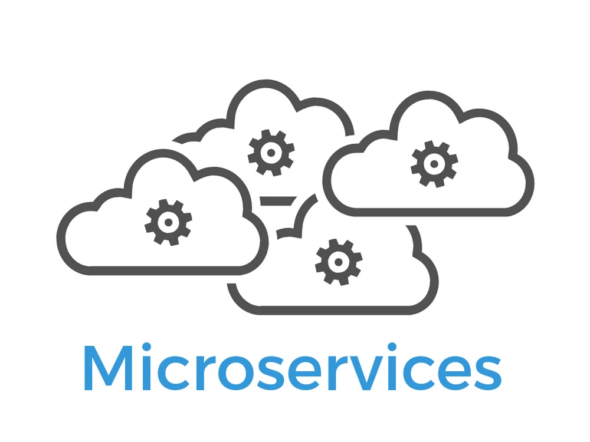

## 概念

### 1. 微服务有什么好处？

讨论微服务的好处，通常要拿它和单体项目比较。

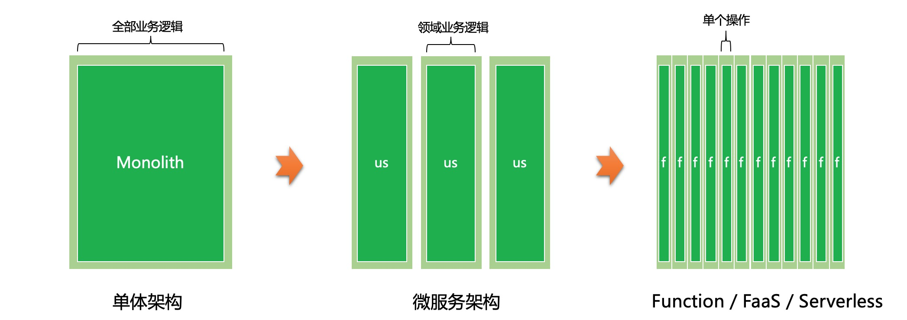

**单体的缺点：**

1. 可扩展性受限：整体一起扩展，即使只有一个组件需要更多资源也得全量扩容，浪费资源。
2. 难维护更新：系统日益庞大复杂，每次修改都可能引发意外影响。
3. 高风险：一处小错误或故障就可能拖垮整个应用。
4. 技术栈受限：所有组件只能用同一套技术栈。
5. 协作复杂：所有组件共用一个代码库，团队间冲突多。

**微服务的优点：**

1. 可扩展性：可按需独立扩展单个服务。
2. 灵活、开发快：各团队独立设计、开发、部署，更快交付新功能。
3. 故障隔离、容错：单个服务故障通常不影响其他服务，故障更易定位处理。
4. 技术多样：每个服务可选最合适的技术栈。
5. 独立部署维护：降低风险，修复更新更快。
6. 团队协作：不同团队负责不同服务，自治性更强、冲突更少。

微服务以更高的可扩展性、灵活性和容错性，以及更易管理的部署维护，弥补了单体架构的诸多限制；但也引入了更多管理与监控的复杂度。选型取决于项目实际需求。

### 2. 微服务带来了哪些挑战？

1. **成本**：基础设施（服务器、容器、负载均衡）投入增加；多服务的开发、测试、部署、维护需要更多人力。
2. **复杂性**：分布式系统涉及网络通信、故障处理、事务管理；服务发现、注册、版本控制、路由需要服务网格或 API 网关。
3. **部署**：需要自动化部署流程；多版本管理与回滚变得复杂。
4. **一致性**：数据分散在各服务，需分布式事务或事件驱动保证一致；跨服务事务的一致性与隔离性实现困难。
5. **监控与排障**：问题可能横跨多个服务，需要强大的监控和诊断工具才能快速定位恢复。

微服务不是万金油，而是应对海量用户、业务复杂、需求频繁变更场景的一种架构风格。“好的架构是演化出来的，而不是设计出来的”，引入任何架构都有利弊两面，关键在平衡。

### 3. 现在有哪些流行的微服务解决方案？

主流开源方案有三种：

1. **Dubbo**：高性能、轻量级 Java 微服务框架，阿里 2011 年开源，提供注册发现、负载均衡、容错、分布式调用等；曾一度停更，近两年重新迭代并推出 Dubbo3。基于 RPC 通信模型，支持多种传输协议（TCP、HTTP、Redis）与序列化方式（JSON、Hessian、Protobuf）。它更偏向高性能 RPC 框架，部分服务治理依赖 ZooKeeper、Apollo 等第三方组件。

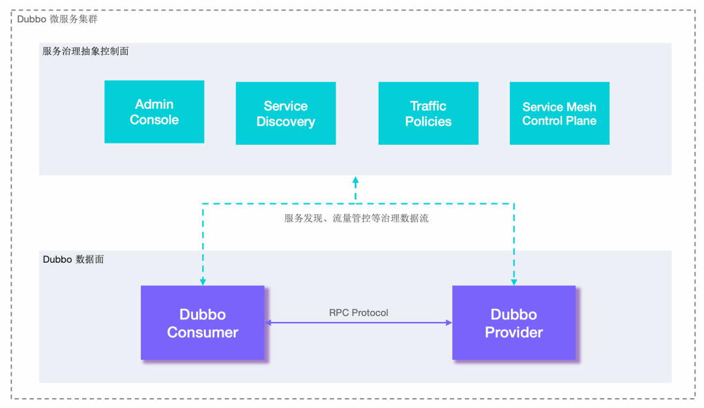

Dubbo 工作原理图（来源官网）

2. **Spring Cloud Netflix**：Spring Cloud 子项目，整合了 Netflix 开源组件。Netflix 自 2018 年起停止维护 Eureka、Hystrix 等 OSS 项目，该项目随之进入维护模式。包含 Eureka（注册发现）、Ribbon（客户端负载均衡）、Hystrix（断路器）、Zuul（网关）等经大规模实践验证的组件。
3. **Spring Cloud Alibaba**：Spring Cloud 子项目，提供与阿里生态集成的整套方案，包含 Nacos（注册发现、配置管理）、Sentinel（流控、熔断降级）、RocketMQ（消息队列）等，并集成阿里云，为基于 Spring Cloud 的微服务提供丰富选项。

**三种方案的区别：**

| 特点 | Dubbo | Spring Cloud Netflix | Spring Cloud Alibaba |
| :--- | :--- | :--- | :--- |
| 开发语言 | Java | Java | Java |
| 服务治理 | 完整 | 部分 | 完整 |
| 服务注册与发现 | ZooKeeper/Nacos | Eureka/Consul | Nacos |
| 负载均衡 | 自带策略 | Ribbon | Ribbon/Dubbo 策略 |
| 服务调用 | RPC | RestTemplate/Feign | Feign/RestTemplate/Dubbo |
| 熔断器 | Sentinel | Hystrix | Sentinel/Resilience4j |
| 配置中心 | Apollo | Spring Cloud Config | Nacos Config |
| API 网关 | Higress/APISIX | Zuul/Gateway | Spring Cloud Gateway |
| 分布式事务 | Seata | 不支持 | Seata |
| 限流和降级 | Sentinel | Hystrix | Sentinel |
| 分布式追踪与监控 | SkyWalking | Sleuth + Zipkin | SkyWalking/Sentinel Dashboard |
| 微服务网格 | Dubbo Mesh | 不支持 | Service Mesh（Nacos+Dubbo Mesh） |
| 社区活跃度 | 较高 | 较低 | 较高 |
| 孵化和成熟度 | 早、成熟度高 | 成熟度高 | 较新但发展快 |

面试中微服务主要讨论 Spring Cloud Netflix，其次是 Spring Cloud Alibaba；Dubbo 更多作为 RPC 框架被问到。

### 4. 微服务有哪些组件？

微服务带来了服务调用复杂、分布式事务、服务动态管理等问题，各类治理组件应运而生。

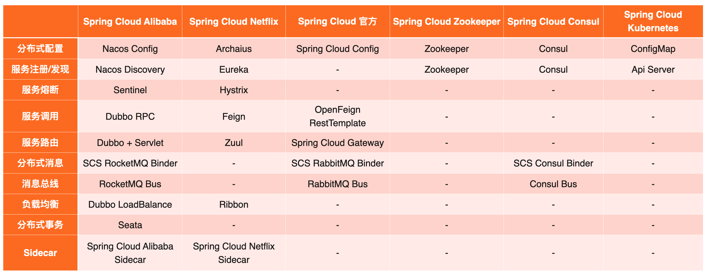

微服务组件示意图

1. **注册中心**：服务的注册与发现，管理服务地址。Netflix 系：Eureka、Consul；Alibaba 系：Nacos。
2. **配置中心**：集中管理配置，支持动态修改而无需重启。Netflix 系：Spring Cloud Config；Alibaba 系：Nacos Config。
3. **远程调用**：服务间通信。RESTful（RestTemplate、Feign）、RPC（Dubbo、gRPC）。
4. **API 网关**：架构入口，统一暴露服务，提供路由、负载均衡、安全认证等。Netflix 系：Zuul、Gateway；Alibaba 系：Gateway、APISIX 等。
5. **分布式事务**：保证跨服务的一致性与原子性。Alibaba 系：Seata。
6. **熔断器**：防止故障扩散，提高容错。Netflix 系：Hystrix；Alibaba 系：Sentinel、Resilience4j。
7. **限流和降级**：防止过载，限制并降级请求。Netflix 系：Hystrix；Alibaba 系：Sentinel。
8. **分布式追踪与监控**：跟踪请求流程与性能指标。Netflix 系：Sleuth + Zipkin；Alibaba 系：SkyWalking、Sentinel Dashboard。

## 注册中心

### 5. 注册中心是用来干什么的？

注册中心用于管理和维护分布式系统中各服务的地址与元数据，主要实现服务发现和服务注册。

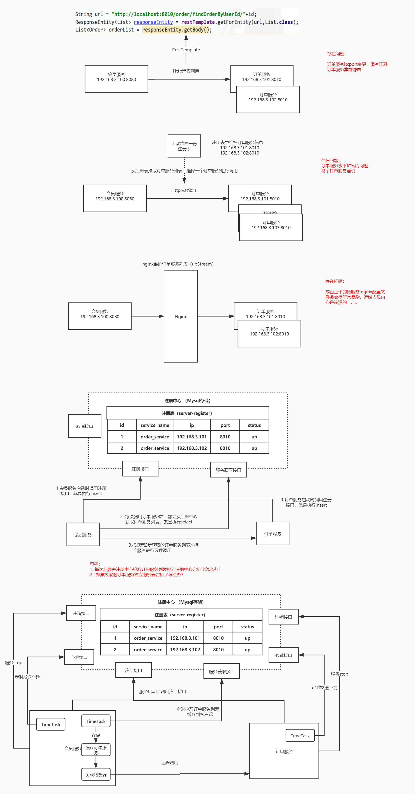

注册中心示意图

1. **服务注册**：服务启动时向注册中心注册自己的网络地址、实例信息和元数据，供其他服务查询。
2. **服务发现**：客户端查询服务信息，获得可用实例列表，按需选择调用，实现服务间解耦。
3. **负载均衡**：对同一服务的多个实例做负载均衡，提升整体性能与可用性。
4. **故障恢复**：监测服务状态，实例故障或下线时及时更新注册信息。
5. **服务治理**：支持配置管理、动态扩缩容、服务路由、灰度发布等。

### 6. SpringCloud 可以选择哪些注册中心？

1. **Eureka**：Netflix 开源的服务发现框架，高可用、弹性、可扩展，与 Spring Cloud 集成良好，**已闭源**。AP。
2. **Consul**：HashiCorp 的分布式服务发现与配置管理系统，提供服务注册、发现、健康检查、KV 存储，支持多数据中心。CP/AP。
3. **ZooKeeper**：Apache 开源的分布式协调服务，可作注册中心，高可用、一致、可靠。CP。
4. **Nacos**：阿里开源的动态服务发现、配置和服务管理平台，支持服务注册发现、配置管理、动态 DNS。AP。
5. **etcd**：CoreOS 开源的分布式键值存储，可作注册中心，高可用、强一致、分布式复制。CP。

### 7. Eureka、ZooKeeper、Nacos 的区别？

| 特性 | Eureka | ZooKeeper | Nacos |
| :--- | :--- | :--- | :--- |
| 开发公司 | Netflix | Apache 基金会 | 阿里巴巴 |
| CAP | AP | CP | 既支持 AP，也支持 CP |
| 功能 | 服务注册与发现 | 分布式协调、配置管理、分布式锁 | 服务注册与发现、配置管理、服务管理 |
| 定位 | 基于 HTTP 的微服务架构 | 通用分布式协调服务框架 | 微服务和云原生应用 |
| 访问协议 | HTTP | TCP | HTTP/DNS |
| 自我保护 | 支持 | - | 支持 |
| 数据存储 | 内嵌数据库、多实例集群 | ACID 的分布式文件系统、ZAB 协议 | 内嵌数据库、MySQL 等 |
| 健康检查 | Client Beat | Keep Alive | TCP/HTTP/MySQL/Client Beat |
| 特点 | 简单易用、自我保护 | 高性能、强一致 | 动态配置、流量管理、灰度发布等 |

最大区别在于：Eureka 支持 AP，ZooKeeper 支持 CP，Nacos 两者皆支持。

### 8. Eureka 实现原理了解吗？

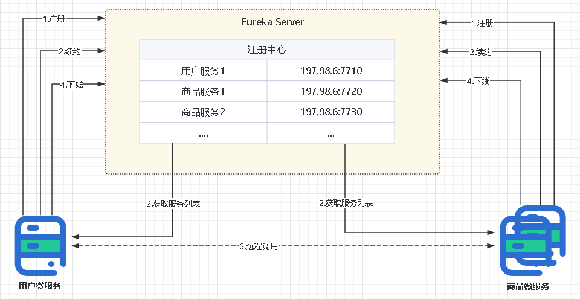

Eureka 原理示意图

1. **服务注册与发现**：实例启动时向 Eureka Server 发送注册请求，Server 将信息保存在内存并提供 REST 接口。消费者查询实例列表，获得可用的服务提供者。
2. **服务健康检查**：通过心跳（续约）检测实例健康状态。一定时间内未收到心跳，则标记为不可用并从服务列表移除。
3. **服务负载均衡**：客户端调用其他服务时先从本地缓存获取注册信息，缓存未命中再向 Server 查询，Server 返回可用实例列表，客户端用负载均衡算法选一个调用。

其他注册中心（Nacos、Consul 等）在注册与发现上的实现原理大同小异。

### 9. Eureka Server 怎么保证高可用？

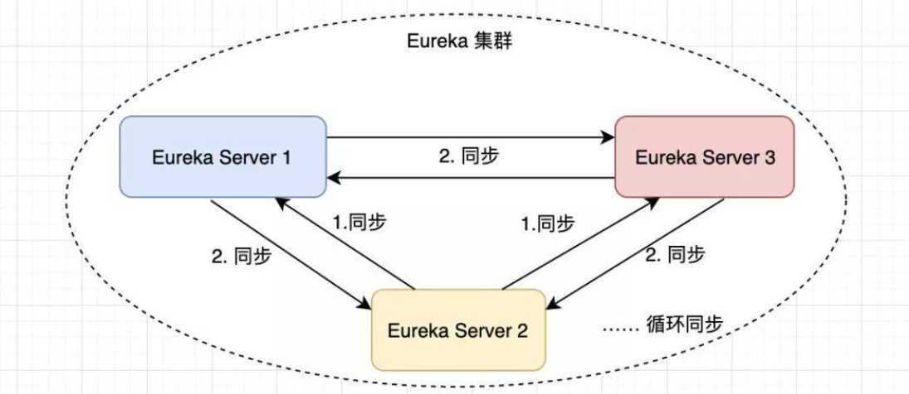

1. **多实例部署**：多个实例部署在不同节点，某实例故障时其余实例仍可提供服务并保持一致。
2. **注册信息复制**：实例注册时各 Server 互相复制注册信息以保持一致，某实例故障时其余实例可接管其工作。
3. **自我保护机制**：一定时间内未收到心跳时进入自我保护模式，不再剔除注册表中的实例，防止网络抖动导致误剔除，进一步提高稳定性。

## 配置中心

### 10. 为什么微服务需要配置中心？

每个服务通常都需要数据库地址、端口、日志级别等配置，这些配置可能因环境、实例或运行时而调整。微服务实例数量庞大，逐个维护成本极高，因此需要集中化的配置中心统一管理。

### 11. SpringCloud 可以选择哪些配置中心？

1. **Spring Cloud Config**：官方推荐，支持将配置存于 Git、SVN 等版本控制系统，并提供 RESTful API 访问管理。
2. **ZooKeeper**：开源分布式协调服务，可作配置中心，高可用、一致、有通知机制。
3. **Consul**：开源分布式服务发现与配置管理工具，可作配置中心，支持多种格式，提供健康检查、故障转移、动态变更。
4. **etcd**：分布式键值存储，基于 Raft 保证一致性。
5. **Apollo**：携程开源，支持多语言框架，提供细粒度权限管理、变更通知、灰度发布及可视化界面。
6. **Nacos**：阿里开源的服务发现、配置管理与服务管理平台，支持注册发现、动态配置、健康监测、动态 DNS。

### 12. Nacos 配置中心的原理了解吗？

配置中心本质就是配置信息的 CRUD。

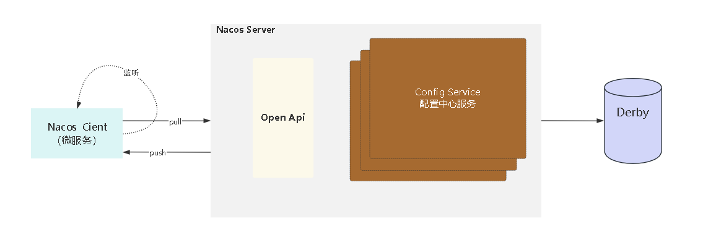

配置中心

1. **配置信息存储**：默认用内嵌 Derby，也可用 MySQL 等关系型数据库。
2. **注册配置信息**：服务启动时，Nacos Client 向 Server 注册配置，即写入存储并生成版本号。
3. **获取配置信息**：运行时 Client 通过 API 从 Server 拉取配置，Server 按键查找并返回。
4. **监听配置变化**：Client 注册监听器，配置变化时 Server 通知监听器并触发回调。

### 13. Nacos 配置中心长轮询机制？

客户端与服务端交互分推（Push）和拉（Pull）两种；Nacos 在 Pull 基础上采用长轮询实现配置的动态刷新。客户端定时发起请求检查配置是否变更，无变更时服务端"hold"住请求（暂不返回），直到配置变化或超时。

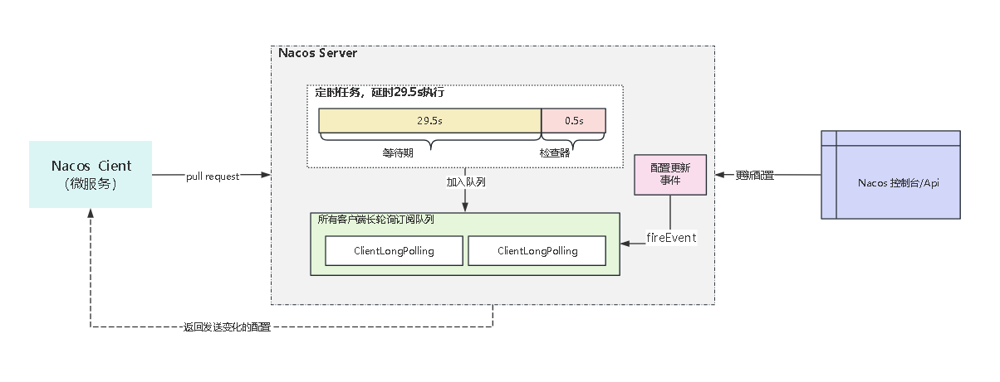

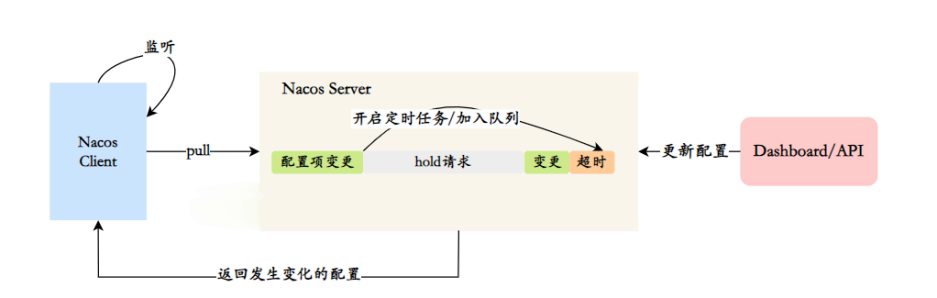

Nacos 长轮询

- 客户端发起 **Pull** 请求，服务端先检查配置是否变更：
  - **有变更**：返回变更配置；
  - **无变更**：设置定时任务延期 29.5s 执行，把当前长轮询连接加入 allSubs 队列；
- 这 29.5s 内的配置变化：
  - **无变化**：等待 29.5s 后触发自动检查，返回配置；
  - **有变化**：任意时刻配置变化会触发事件，监听任务遍历 allSubs 队列，找到变更配置对应的 ClientLongPolling 任务，通过其连接返回变更数据，相当于完成一次 **PUSH**；
- 长轮询结合了 **Pull** 与 **Push** 的优点。

长轮询让客户端能实时感知配置变化并及时获取最新配置，同时降低服务端压力，避免大量长连接占用内存。

## 远程调用

### 14. HTTP 和 RPC 的区别？

严格来讲二者不在同一层面：

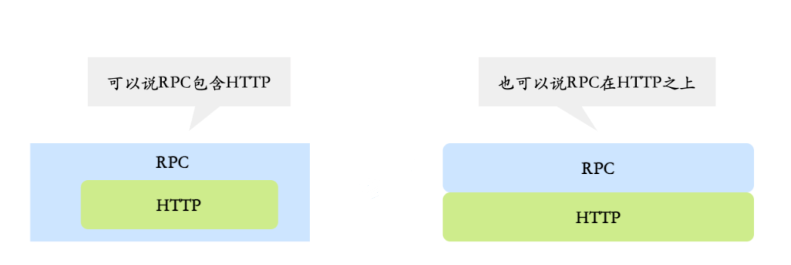

HTTP 和 RPC

- HTTP（Hypertext Transfer Protocol）是应用层协议，强调网络通信；
- RPC（Remote Procedure Call，远程过程调用）是分布式系统间的通信协议，强调服务间的远程调用。

一些 RPC 框架如 gRPC 底层也用 HTTP/2，Dubbo3 也兼容 gRPC，使用 HTTP/2 作为传输层协议。硬要比较的话：

| HTTP | RPC |
| :--- | :--- |
| HTTP 是用于传输超文本的协议 | RPC 是用于分布式系统节点间通信的协议 |
| 基于请求-响应模型，客户端发请求、服务器返回响应 | 基于方法调用模型，客户端调用远程方法并等待结果 |
| 基于 TCP，可用 TLS/SSL 加密 | 可用 TCP、UDP 等多种传输协议 |
| 基于文本，常用 JSON、XML | 可用二进制、JSON、Protobuf 等 |
| 用 RESTful 风格接口定义（GET/POST/PUT/DELETE 等） | 用 IDL 定义接口（Protobuf、Thrift 等） |
| 支持跨语言 | 支持跨语言（IDL 生成各语言代码） |
| 更灵活，适用于 Web 开发、API 调用 | 更高效，适用于高性能、低延迟的分布式系统 |

微服务体系中，基于 HTTP 的远程调用通常用 Feign，基于 RPC 的通常用 Dubbo。

### 15. Feign 和 Dubbo 的区别？

这两个才适合拿来比较：

| | Feign | Dubbo |
| :--- | :--- | :--- |
| 定义 | 声明式 Web 服务客户端，简化 HTTP API 调用 | 分布式服务框架，构建面向服务的微服务架构 |
| 通信方式 | 基于 HTTP，使用 RESTful 风格接口 | 基于 RPC，支持 gRPC、Hessian 等多种序列化 |
| 服务发现 | 通常结合注册中心（Eureka、Consul） | 通过 ZooKeeper、Nacos 等注册发现并提供负载均衡 |
| 服务治理 | 不直接提供，需结合其他组件 | 提供注册发现、负载均衡、容错、降级等 |
| 跨语言性 | 支持，可用 HTTP 实现 | 支持，通过 IDL 生成各语言代码 |
| 生态系统 | 集成 Spring Cloud 生态，与 Spring Boot 无缝集成 | 完整生态，含注册、配置、监控中心等 |
| 适用场景 | RESTful 风格的微服务调用 | 面向服务的微服务架构，治理与容错更全面 |

二者并不互斥：Dubbo 可用 HTTP 通信，Feign 也能集成 RPC。选型取决于具体业务需求和技术栈。

### 服务端负载均衡器和客户端负载均衡器的区别

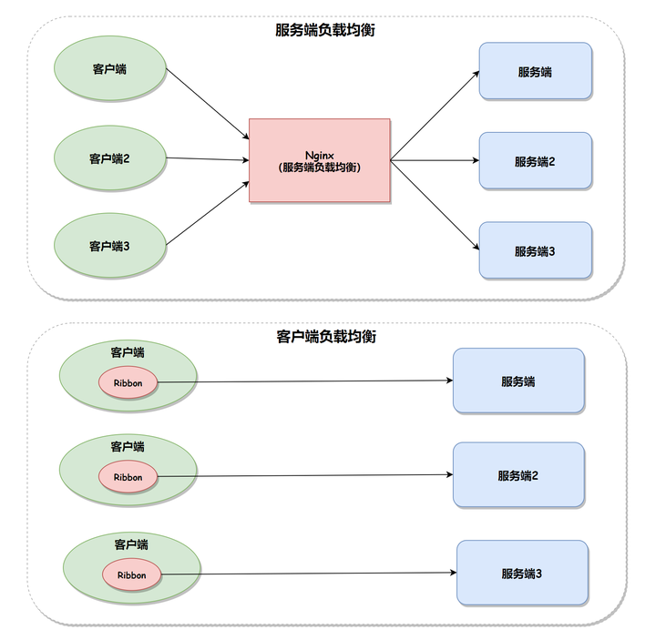

客户端负载均衡器通过注册中心（如 Nacos）将可用服务列表拉取到本地，再由客户端负载均衡器按策略获取某个服务器的 IP 与端口，然后通过 HTTP 框架请求服务并得到结果。

### 16. 说一下 Feign？

Feign 是一个声明式的 Web 服务客户端，简化了基于 HTTP 的远程服务开发。它在 RestTemplate 和 Ribbon 基础上进一步封装：用 RestTemplate 实现 HTTP 调用，用 Ribbon 实现负载均衡。

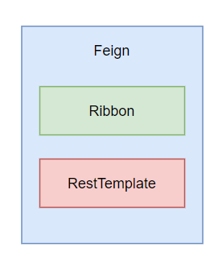

Feign 封装

1. **声明式 API**：用简单注解定义对远程服务的访问，指定 URL、HTTP 方法、请求参数、请求头等，直观易懂。

```java
@FeignClient(name = "example", url = "https://api.example.com")
public interface ExampleService {
    @GetMapping("/endpoint")
    String getEndpointData();
}
```

2. **集成负载均衡**：集成 Ribbon，根据服务名和可用实例动态路由、分发请求，提高可用性和可伸缩性。
3. **容错机制**：可集成 Hystrix，在远程服务不可用或响应过慢时快速失败并返回预设结果，避免级联故障。

### 17. 为什么 Feign 第一次调用耗时很长？

主要是 Ribbon 的懒加载机制：首次调用会触发 Ribbon 加载，包括从注册中心获取服务列表、建立连接池等，增加了首调耗时。

```yaml
ribbon:
  eager-load:
    enabled: true
    clients: service-1
```

解决办法是在应用启动时预热 Feign 客户端，自动触发一次无关紧要的调用，提前加载 Ribbon 及相关组件，相当于提前完成第一次调用。

### 18. Feign 怎么实现认证传递？

常见做法是用拦截器传递认证信息：实现 RequestInterceptor 接口定义拦截器，把认证信息加入请求头，并注册到 Feign 配置中。

```java
@Configuration
public class FeignClientConfig {

    @Bean
    public RequestInterceptor requestInterceptor() {
        return new RequestInterceptor() {
            @Override
            public void apply(RequestTemplate template) {
                // 添加认证信息到请求头中
                template.header("Authorization", "Bearer " + getToken());
            }
        };
    }

    private String getToken() {
        // 从 SecurityContext 或其他地方获取认证信息
        return "your_token";
    }
}
```

### 19. Feign 怎么做负载均衡？Ribbon？

Feign 通过集成 Ribbon 实现负载均衡。Ribbon 是 Netflix 开源的客户端负载均衡器，可与 Feign 无缝集成。

Ribbon 在发起请求前从"服务中心"获取服务列表，再按一定策略发起请求。它自身维护"服务提供者"清单的有效性，发现提供者不可用时重新从服务中心获取有效清单及时更新。

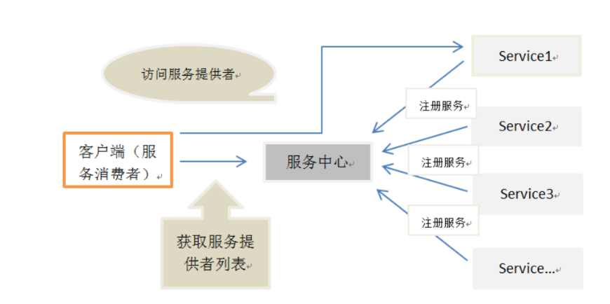

客户端负载均衡

### 20. 有哪些负载均衡算法？

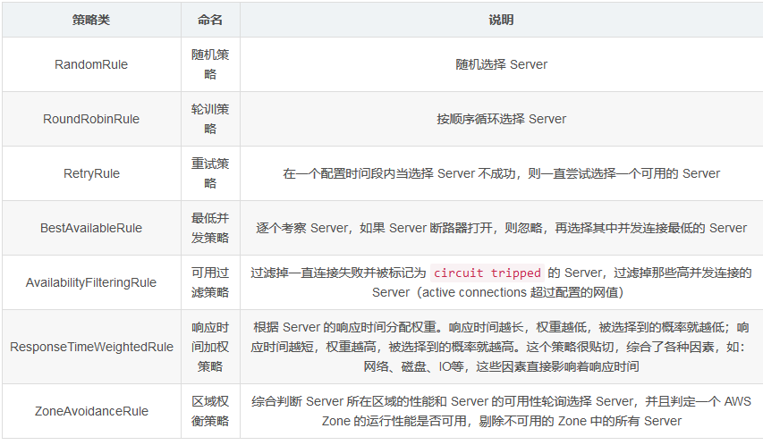

常见负载均衡算法

1. **轮询**：按顺序依次分配给每个后端服务器，循环往复。适用于处理能力和性能相同的服务器。
2. **加权轮询**：在轮询基础上引入权重，权重越高被选中概率越大，可按处理能力调整分配比例。
3. **随机**：将请求随机分配给后端服务器，各服务器被选中概率相等。简单快速，适用于性能相近的场景。
4. **加权随机**：在随机基础上引入权重，权重越高被选中概率越大。
5. **最少连接**：选择当前连接数最少的服务器，适用于处理能力或请求处理时间不同的场景。
6. **哈希**：按请求的某个属性（如客户端 IP、URL）计算哈希值选择服务器。

常见的负载均衡器（Ribbon、Gateway 等）基本都支持这些算法。

## 服务容灾

### 21. 什么是服务雪崩？

微服务中，若一个或多个服务出现故障，而依赖方仍不断发起请求或重试，压力会不断在下游堆积，导致下游负载急剧增加，可能进一步加剧故障、引发级联失败甚至整个系统崩溃，这就是服务雪崩。

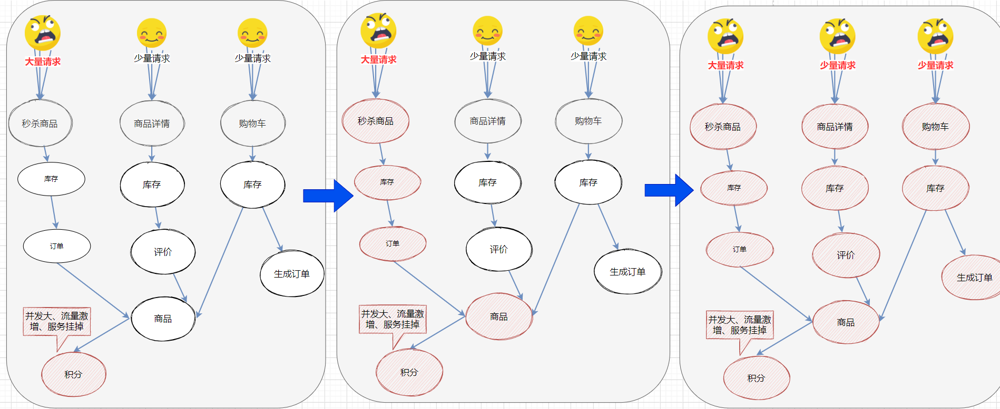

服务雪崩

防止服务雪崩的常见措施：

1. **服务高可用部署**：冗余部署、故障转移，减少单点故障影响。
2. **限流和熔断**：对服务间请求限流和熔断，防止过多请求涌入导致后端不可用。
3. **缓存和降级**：合理使用缓存减轻后端压力，必要时服务降级，保证核心功能可用。

### 22. 什么是服务熔断？什么是服务降级？

**服务熔断**是一种容错机制，用于保护系统免受服务故障或异常影响：监控调用情况，当错误率或响应时间超过阈值时触发熔断，后续请求返回默认值或错误信息，避免资源浪费和系统崩溃。熔断还支持自动恢复，服务恢复后重新尝试请求。

**服务降级**也是一种容错机制，用于在资源紧张或服务故障时保证核心功能可用：主动屏蔽非核心或可选功能，只提供最基本功能，通过减少资源依赖保证可用性和性能。可根据业务和系统状况制定策略，如替换耗时操作、返回默认响应、返回静态错误页等。

**常见的熔断降级方案：**

| 框架 | 实现方案 | 特点 |
| :--- | :--- | :--- |
| Spring Cloud | Netflix Hystrix | 提供线程隔离、服务降级、请求缓存、请求合并等；与 Spring Cloud 无缝集成；官方已停止维护，推荐用 Resilience4j 替代 |
| Spring Cloud | Resilience4j | 轻量级熔断库；功能类似 Hystrix；性能更好、API 更简洁；可与 Spring Cloud 无缝集成 |
| Spring Cloud Alibaba | Sentinel | 阿里开源的流控与熔断降级组件；提供实时监控、流量控制、熔断降级等；与 Alibaba 生态紧密集成 |
| Dubbo | 自带熔断降级 | 框架自带，配置即可实现熔断降级，与 RPC 框架紧密集成 |

### 23. Hystrix 怎么实现服务容错？

Hystrix 虽已停更，但仍是经典的服务容错库，提供六大机制：

1. **服务熔断**：监控错误率或响应时间，超过阈值则打开熔断器，后续请求不再发往实际服务，而返回预设值或错误信息，快速隔离故障、防止扩散。
2. **服务降级**：熔断打开时提供备用降级方法或默认值，如返回缓存数据、执行简化逻辑或调用其他可靠服务，保证有限但可用的功能。

```java
import com.netflix.hystrix.contrib.javanica.annotation.HystrixCommand;

/**
 * 服务降级示例
 */
@Service
public class MyService {

    @HystrixCommand(fallbackMethod = "fallbackMethod")
    public String myServiceMethod() {
        // 实际的服务调用逻辑
    }

    public String fallbackMethod() {
        // 服务调用失败时执行，可返回默认值或备用逻辑
    }
}
```

3. **请求缓存**：缓存对同一请求的响应，下次请求相同数据时直接取缓存，避免重复网络请求。
4. **请求合并**：将多个并发请求合并为一个批量请求，减少网络开销和资源占用。
5. **实时监控和度量**：提供错误率、响应时间、并发量等指标的实时监控统计，便于及时发现故障。
6. **线程池隔离**：每个依赖服务的请求都在独立线程池执行，避免单个服务故障耗尽整个系统的线程资源。

### 24. Sentinel 怎么实现限流的？

Sentinel 通过动态管理限流规则对请求进行限流控制：

1. **定义资源**：资源可以是 URL、方法等，用于标识需要限流的请求。

```java
// 原本的业务方法
@SentinelResource(blockHandler = "blockHandlerForGetUser")
public User getUserById(String id) {
    throw new RuntimeException("getUserById command failed");
}

// 被限流/降级/系统保护时调用
public User blockHandlerForGetUser(String id, BlockException ex) {
    return new User("admin");
}
```

2. **配置限流规则**：定义资源名称、阈值、限流模式（令牌桶或漏桶）等。

```java
private static void initFlowQpsRule() {
    List<FlowRule> rules = new ArrayList<>();
    FlowRule rule1 = new FlowRule();                 // 创建一个流控规则
    rule1.setResource(resource);                     // 资源名称
    rule1.setCount(20);                              // 最大 QPS 为 20
    rule1.setGrade(RuleConstant.FLOW_GRADE_QPS);     // 限流维度为 QPS
    rule1.setLimitApp("default");                    // 限制的应用名称
    rules.add(rule1);
    FlowRuleManager.loadRules(rules);                // 使规则生效
}
```

3. **监控流量**：监控每个资源的 QPS、线程数、响应时间等。

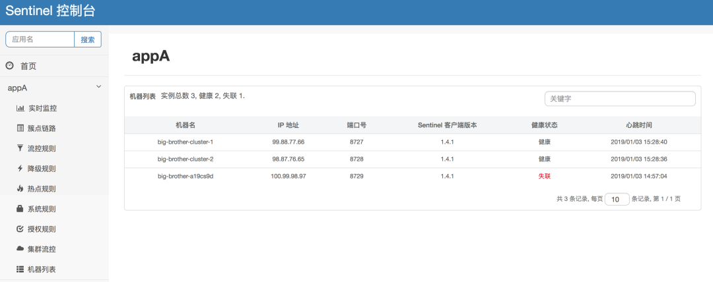

Sentinel 控制台

4. **限流控制**：请求到达时按规则判断是否需要限流，超过阈值则限制、拒绝或做其他降级处理。

**Sentinel 采用什么限流算法？**

使用滑动窗口限流算法：将一段时间划分为多个窗口，在每个窗口内统计请求数，通过动态调整窗口大小和滑动步长更精确地控制请求通过速率。

**Sentinel 怎么实现集群限流？**

利用 Token Server 和 Token Client 机制：开启集群限流后，Client 向 Token Server 发送请求，Token Server 根据配置的规则决定是否限流。

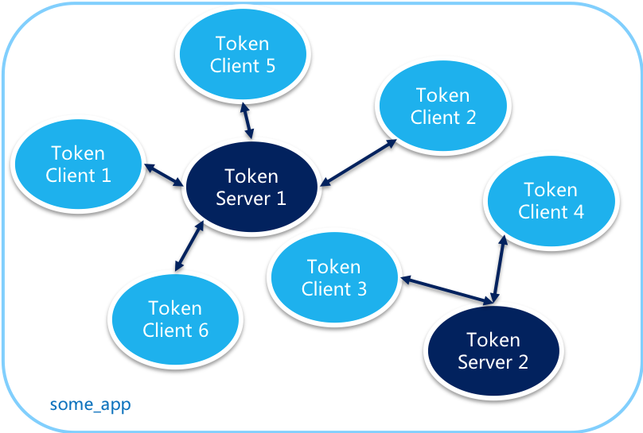

Token Server 和 Client

## 服务网关

### 25. 什么是 API 网关？

API 网关是中间层服务器，用于集中管理、保护和路由对后端服务的访问，充当客户端与后端服务之间的入口点，提供统一接口来管理和控制 API 访问。

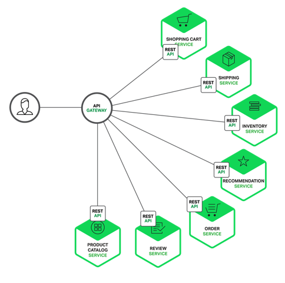

网关示意图

主要功能：

1. **路由转发**：按 URL 路径或其他标识将请求路由到相应的后端服务。
2. **负载均衡**：在后端服务间分发请求，提高吞吐量和可扩展性。
3. **安全认证与授权**：集中处理身份验证和授权，可与 OAuth、OpenID Connect 等集成。
4. **缓存**：缓存后端响应，减少请求次数。
5. **监控与日志**：收集请求指标和日志，提供实时监控分析，便于排障和优化。
6. **数据与协议转换**：在客户端与后端之间转换数据格式和协议（如 HTTP 转 WebSocket）。
7. **API 版本管理**：管理多个 API 版本并按路由规则转发到对应版本。

网关简化了前后端交互，提供统一接口和安全保障，也便于服务治理与监控。

### 26. SpringCloud 可以选择哪些 API 网关？

1. **Netflix Zuul（已停更）**：早期默认网关，基于 Servlet 技术栈，支持路由、过滤、负载均衡。2020 年 12 月起 Netflix 停止维护 Zuul 1。
2. **Spring Cloud Gateway**：官方推荐，取代 Zuul。基于非阻塞 WebFlux，充分利用响应式编程，提供路由、过滤、断路器、限流等特性，并可与服务发现、负载均衡等组件集成。
3. **Kong**：独立的云原生 API 网关与服务管理平台，基于 Nginx，提供强大的路由、认证、授权、监控和扩展能力，支持多种插件。
4. **APISIX**：基于 Nginx 和 Lua，具有路由、流量控制、插件扩展等能力，配置灵活，支持动态路由、负载均衡和限流。

### 27. Spring Cloud Gateway 核心概念？

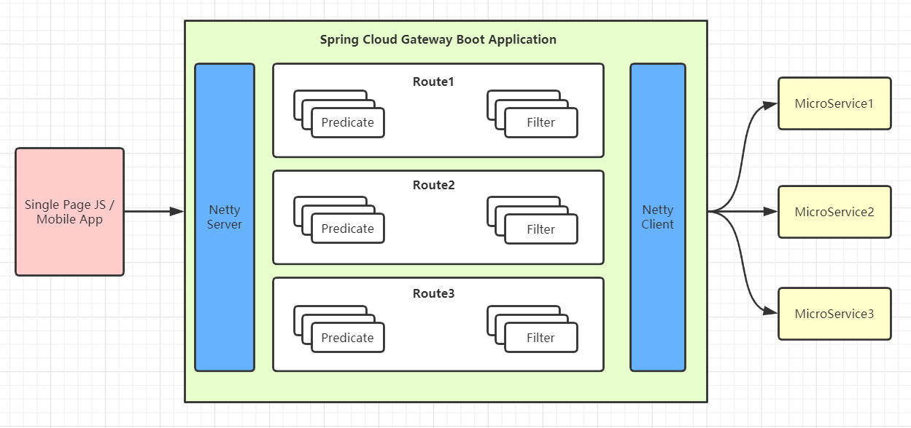

Gateway 原理

三个关键组件：

- **Route（路由）**：基本构建块，定义请求的匹配规则和转发目标，可按路径、方法、请求头等匹配并指定目标 URI。
- **Predicate（断言）**：用于匹配请求条件，满足则应用所配置的过滤器。内置 Path、Method、Header 等，也支持自定义。
- **Filter（过滤器）**：对请求进行处理和转换，可修改请求、响应或执行自定义逻辑。内置请求转发、重试、限流等，也支持自定义。

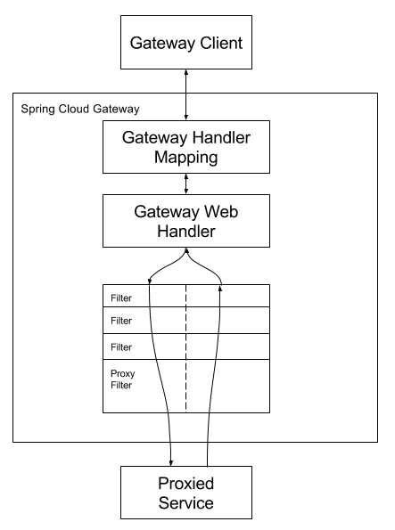

SpringCloud 工作流程图（来源官方文档）

另有两个重要概念：

- **Gateway Handler（网关处理器）**：核心组件，根据路由配置和断言条件进行路由匹配，选合适的路由转发，并依次应用过滤器链。
- **Gateway Filter Chain（网关过滤器链）**：一系列过滤器按配置顺序依次执行，可在请求前、请求后或出错时处理。

## 链路追踪

### 28. 为什么要用微服务链路追踪？

微服务中上下游可能有十几个服务，某一环出问题排查非常困难，因此需要链路追踪帮助排查。

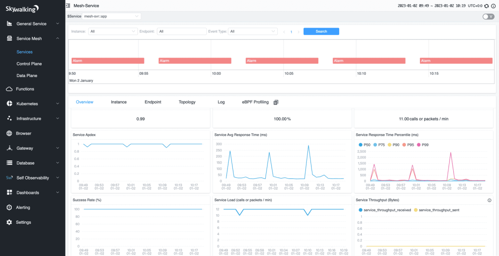

SkyWalking 界面

链路追踪可可视化地追踪请求从一个微服务到另一个微服务的调用情况，除排查问题外，还能帮助优化性能、可视化依赖关系、服务监控和告警。

### 29. SpringCloud 可以选择哪些微服务链路追踪方案？

1. **Zipkin**：Twitter 开源的分布式实时追踪系统，Spring Cloud Sleuth 提供集成，可将追踪信息发送到 Zipkin 服务器并通过其 UI 可视化查询。

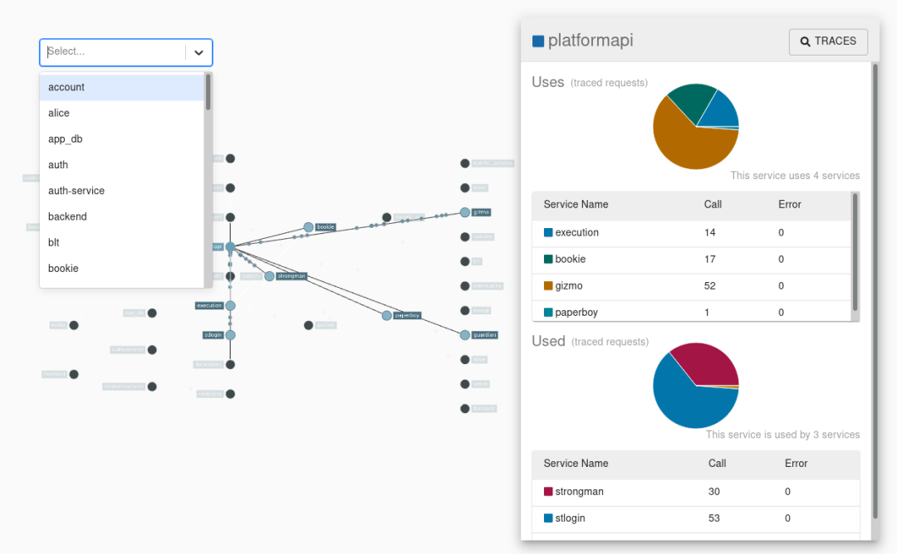

Zipkin 界面

2. **Jaeger**：Uber 开源的分布式追踪系统，已纳入 CNCF，可通过 Sleuth 和 Jaeger 客户端库发送追踪信息并可视化查询。
3. **SkyWalking**：Apache 开源的应用性能监控与分析系统，支持 Java、.NET、Node.js 等，可与 Sleuth 集成，将数据发送到 SkyWalking 服务器可视化分析。

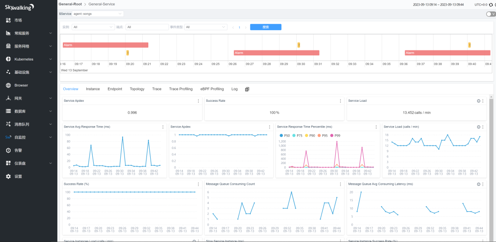

SkyWalking 示例界面

4. **Pinpoint**：Naver 开源的分布式应用性能监控系统，支持 Java 和 .NET，可与 Sleuth 集成，将数据发送到 Pinpoint 服务器分析监控。

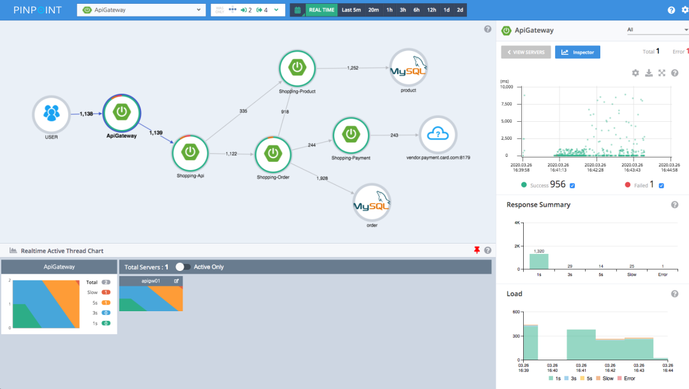

Pinpoint 示意图

这些方案都可与 Spring Cloud Sleuth 集成，后者提供了微服务调用时生成追踪信息的能力。

## 分布式事务

分布式事务可查看前面的分布式基础篇。

### 30. Seata 支持哪些模式的分布式事务？

1. **AT 模式**：默认支持、最常用的模式之一。通过在业务代码中嵌入事务上下文实现分布式事务管理，拦截并解析 SQL，对数据库连接进行拦截和代理实现管理与协调。

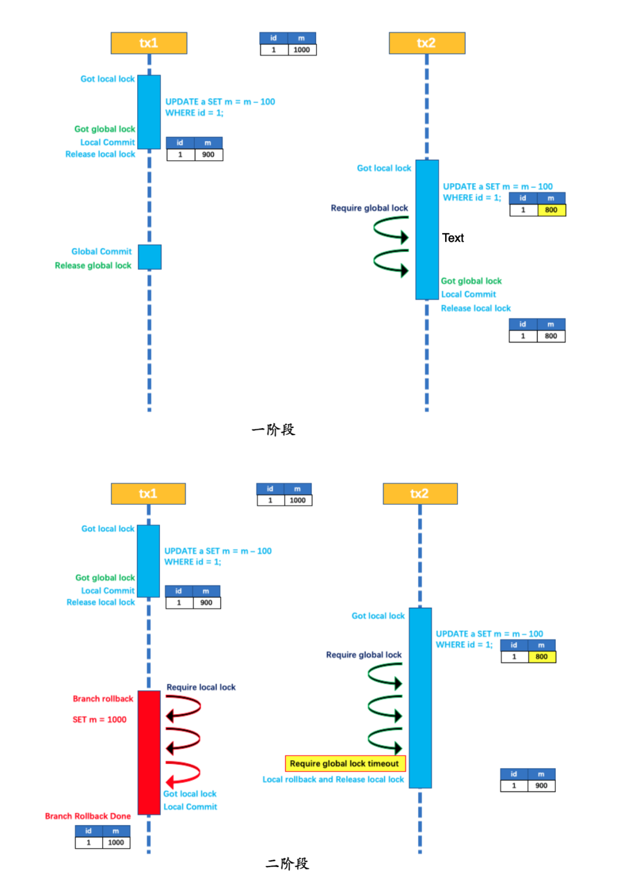

AT 模式示意图

2. **TCC 模式**：基于补偿机制。业务逻辑需实现 Try、Confirm、Cancel 三个阶段，Seata 通过调用这三个方法并记录操作日志实现一致性。


Seata TCC 模式

3. **SAGA 模式**：基于事件驱动。每个服务可发布和订阅事件，通过事件传递和处理实现一致性。Seata 提供与 SAGA 兼容的 Saga 框架来管理各阶段。

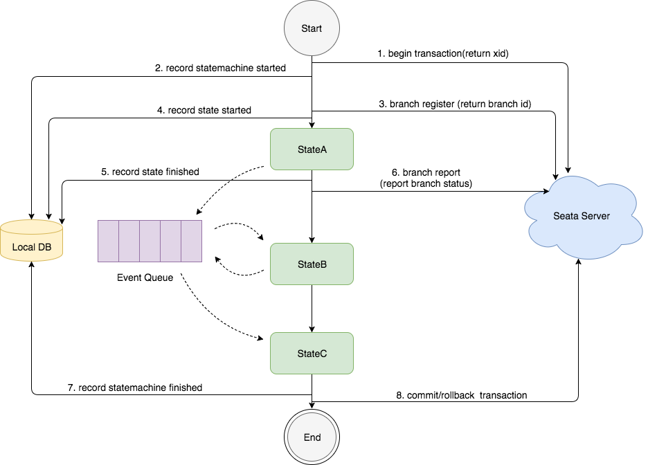

SAGA 模式状态机引擎

4. **XA 模式**：基于两阶段提交协议。通过与数据库的 XA 协议交互实现管理协调，需数据库支持 XA 事务并在应用中配置 XA 数据源。

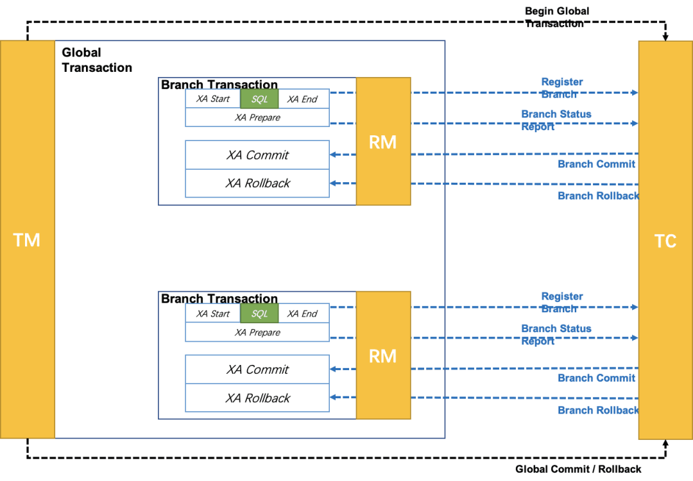

XA 模式示意图

### 31. 了解 Seata 的实现原理吗？

Seata 的实现原理主要包括三个核心组件：

- **事务协调器（TC）**：协调管理分布式事务的全过程，接收开始和结束请求并按状态协调处理，记录和管理全局事务 ID（XID）与分支事务 ID。
- **事务管理器（TM）**：负责全局事务的管理和控制，协调各分支事务的提交或回滚，保证一致性和隔离性，并与 TC 通信、持久化状态变更。
- **资源管理器（RM）**：管理和控制各参与者的事务操作，与 TM 通信并按指令执行提交和回滚。

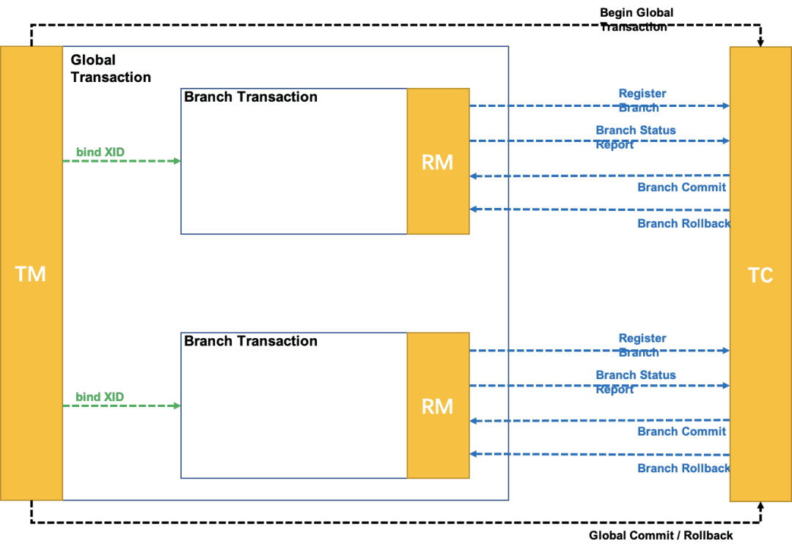

Seata 领域模型

其原理基于**两阶段提交协议**：

1. **一阶段**：预提交。TC 向各 RM 发送预提交请求，RM 执行事务操作并返回结果。此阶段业务数据和回滚日志在同一本地事务中提交，并释放本地锁和连接资源。
2. **二阶段**：包括提交异步化和回滚反向补偿两步：
   - 提交异步化：TC 发出真正的提交请求，各 RM 执行最终提交，操作极快以保证提交效率。
   - 回滚反向补偿：若一阶段有 RM 返回失败，TC 发出回滚请求，各 RM 利用一阶段的回滚日志进行反向补偿。

**Seata 的事务执行流程？**

1. 事务发起方发起全局事务，向 TC 发送开始请求，生成全局事务 ID。
2. TC 创建全局事务记录，生成分支事务 ID。
3. 发起方将全局事务 ID 和分支事务 ID 发给各参与者，参与者将分支事务 ID 注册到本地事务管理器并反馈执行结果。
4. 各参与者在事务上下文中执行各自的本地事务。
5. 发起方向 TC 发送预提交请求，TC 转发给各参与者。
6. 参与者执行本地事务确认并反馈结果。
7. TC 根据反馈判断：全部成功则发送真正提交请求；有任一失败则发送回滚请求。
8. TC 根据结果更新全局事务状态，并通知发起方最终结果。

**全局事务 ID 和分支事务 ID 怎么传递？**

通过上下文传递，常见方式包括参数传递、线程上下文传递和消息中间件传递，可按业务场景和技术选型选择。

**事务回滚怎么实现？**

通过回滚日志实现：每个参与者执行本地事务时生成回滚日志记录数据修改；需要回滚时 TC 向参与者发送回滚请求，参与者据回滚日志撤销操作，将数据恢复到事务开始前的状态。回滚日志的管理和存储是 Seata 的核心机制，可选择不同存储介质，通过持久化和恢复保证事务一致性和可恢复性。

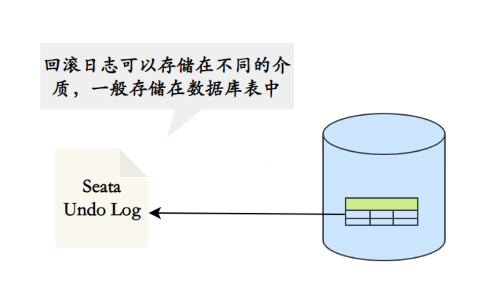

事务日志记录

## 服务监控

### 32. 你们的服务怎么做监控和告警？

使用 Prometheus 和 Grafana 实现整个微服务集群的监控和告警：

1. **Prometheus**：开源的监控系统，数据模型灵活、查询语言强大，能收集和存储时间序列数据，可通过 HTTP 定期拉取微服务指标。
2. **Grafana**：开源的可视化仪表板工具，与 Prometheus 结合创建实时和历史数据仪表板，提供丰富图表，便于分析微服务性能与状态。

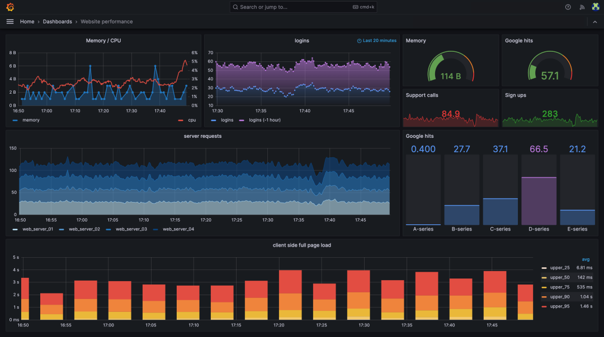

Dashboard

### 33. 你们的服务怎么做日志收集？

我们用的是 ELK：

- **Elasticsearch**：分布式搜索和分析引擎，存储和索引日志数据，提供快速搜索和聚合能力。
- **Logstash**：收集、过滤和转发日志数据，支持多种来源，处理后发送到 Elasticsearch。
- **Kibana**：日志数据可视化分析工具，提供图表、仪表盘和搜索功能，实时监控和分析日志。

简言之，Elasticsearch 负责存储和检索，Logstash 负责收集日志到 ES，Kibana 负责可视化分析。一般流程：

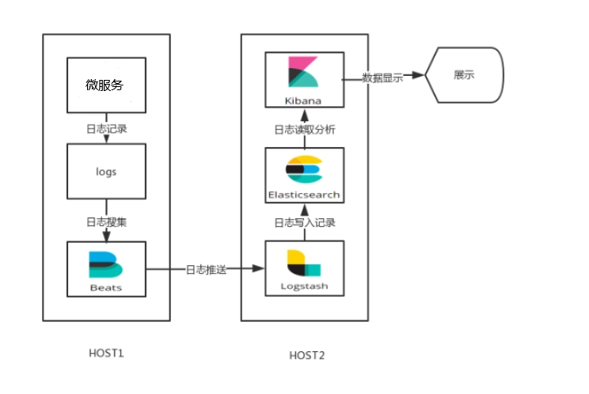

ELK 流程

1. 在每个微服务中配置日志输出到标准输出或日志文件。
2. 用 Logstash 收集器监听日志输出并过滤处理。
3. 通过 Logstash 输出插件将处理后的日志发送到 Elasticsearch 存储和索引。
4. 用 Kibana 连接 Elasticsearch，创建仪表盘、图表和查询，实时监控分析。

除 ELK 外，还有 Fluentd、Graylog、Loki、Filebeat，以及阿里云 SLS 等云厂商付费方案。

## OAuth2 授权模式

### 前言

传统的客户端-服务器身份验证模型中，客户端用资源所有者的凭据向服务器认证，以请求受保护资源。为了让第三方应用能访问受限资源，资源所有者需与第三方共享凭据，这存在以下问题：

- 第三方通常需**明文存储**资源所有者的凭据（通常是密码）。
- 服务器需支持密码认证，而密码认证存在**安全弱点**。
- 第三方可能获得过宽的**访问权限**，资源所有者无法限制访问时长或资源子集。
- 资源所有者无法单独撤销对个别第三方的访问，只能靠改密码来影响所有第三方。
- 任一第三方被攻破，都将导致用户密码及其保护的所有数据**泄露**。

### 什么是 OAuth 2.0

OAuth 2.0 是用于授权的开放标准，允许用户让第三方应用访问其在某网站存储的私有资源，而无需把用户名和密码交给第三方。它是 OAuth 协议的升级版，授权流程更简化灵活。

其中的主要角色：

1. **资源所有者（Resource Owner）**：即用户，拥有受保护资源，授权第三方应用访问其资源。
2. **客户端（Client）**：即第三方应用，需要访问资源所有者的受保护资源。
3. **授权服务器（Authorization Server）**：验证资源所有者并颁发访问令牌，可与资源服务器是同一或不同服务。
4. **资源服务器（Resource Server）**：存储受保护资源，通过访问令牌验证并提供资源。

OAuth 2.0 定义了多种授权方式（授权码、隐式、密码、客户端凭证等），客户端与授权服务器交互获取访问令牌，再用令牌访问受保护资源。

### OAuth2 四种授权模式

#### 授权码模式

授权码模式适用于客户端需要访问用户资源、但不能直接使用用户凭证的场景。

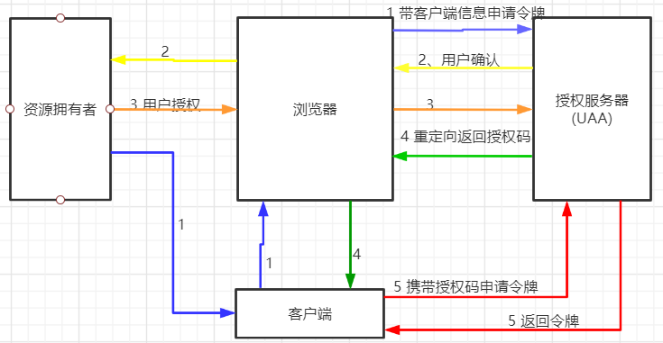

1. **客户端请求授权**：把用户导向授权服务器，参数包括 `response_type=code`、`client_id`、`redirect_uri`、`scope`。
2. **用户同意授权**：用户在授权服务器登录并同意授权请求。
3. **授权服务器发放授权码**：验证身份与授权请求后向客户端发放授权码。
4. **客户端获取访问令牌**：客户端后端将授权码和客户端凭证发送到授权服务器，参数包括 `grant_type=authorization_code`、`code`、`redirect_uri`（须与第 1 步一致）、`client_id`、`client_secret`（可选）。
5. **授权服务器发放访问令牌**：验证授权码和客户端凭证，有效则发放令牌。
6. **客户端使用访问令牌**：用令牌访问用户的受保护资源。

授权码模式相对更安全，因为客户端不直接接触用户凭证，且授权码交换可走安全的后端通信。

#### 隐式授权模式（简化模式）

隐式授权模式通常用于移动应用或纯前端应用。

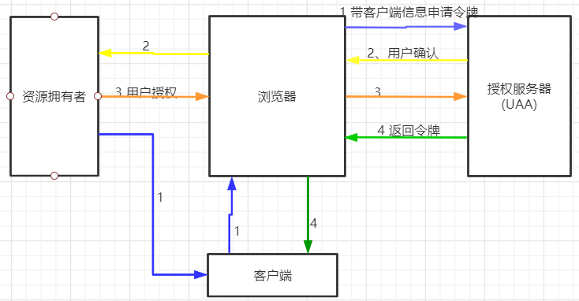

1. **发起认证请求**：客户端（浏览器或移动应用）向授权服务器发送请求，`response_type` 设为 "token"，并带 `client_id`、`redirect_uri`。
2. **用户身份验证和授权**：用户在授权服务器验证身份并同意授权，服务器生成访问令牌。
3. **生成令牌**：令牌直接包含在重定向 URI 中，作为 URI 片段的一部分。
4. **重定向到客户端**：授权服务器将含令牌的重定向 URI 返回，令牌可通过前端 JavaScript 访问。
5. **客户端使用令牌**：从 URI 中提取令牌，访问资源服务器上的受保护资源。

隐式模式不涉及客户端后端，直接在浏览器中处理，适用于前端应用，但安全性需特别注意，可能时应优先选择授权码模式。

#### 密码模式

密码模式允许客户端用用户的用户名和密码直接向授权服务器请求访问令牌，通常用于受信任的客户端直接与资源所有者的服务通信。

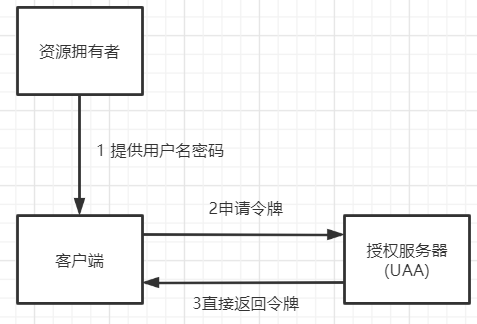

1. **客户端向授权服务器发送请求**：参数包括 `grant_type=password`、`client_id`、`client_secret`（如有）、`username`、`password`、`scope`（可选）。
2. **授权服务器验证用户身份**：验证客户端与用户身份，成功则生成访问令牌和可能的刷新令牌。
3. **授权服务器响应**：以 JSON 格式返回访问令牌和刷新令牌。

该模式需客户端直接存储用户密码，因此主要适用于受信任的客户端（如后端服务器），使用时须确保通过 HTTPS 等安全通道通信。

#### 客户端凭证模式

客户端凭证模式适用于无需用户参与、客户端访问自身拥有权限资源的情况。

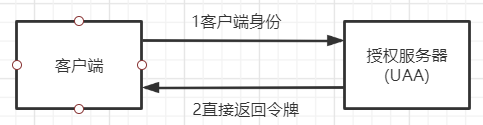

1. **客户端向授权服务器发送请求**：参数包括 `grant_type=client_credentials`、`client_id`、`client_secret`。
2. **授权服务器验证客户端身份**：确保客户端合法且有权限使用此模式。
3. **授权服务器响应**：以 JSON 格式返回访问令牌及有效期等信息。

该模式适用于不涉及用户、客户端访问自身资源的情况（如后端服务间通信），同样需保障传输安全并限制凭证使用范围。

# 你是怎么理解微服务的？

在 Java 后端面试中，"你是怎么理解微服务的？"出现率极高。多数候选人只答"把单体拆成多个独立小服务，各自独立部署，通过 RPC 或 RESTful 调用"——这只是微服务的**"形"**（怎么做），没看透它的**"神"**（为什么做、代价是什么）。

## 一、破除迷信：微服务不是银弹，是"毒药"

微服务不是单纯的技术升级，而是一场"有损交易"：用 **运维的复杂度** 和 **系统的强一致性**，换取 **业务的敏捷性** 和 **团队的独立性**。只谈好处不谈代价，说明没在生产环境踩过坑。

## 二、维度一：算得清"性能账"

单体下的方法调用是**本地调用**（纳秒级）；拆成微服务后变成**网络 RPC**（毫秒级）。若把一个紧密耦合的流程强行拆成 A→B→C→D 四个服务，网络开销会翻成千上万倍。拆分必须有边界，不能为拆而拆，否则吞吐量直线下降。

## 三、维度二：搞得定"数据一致性"

单体时代靠数据库 ACID，一个 `@Transactional` 就能保证全成功或全回滚。微服务下数据分散，服务 A 扣款成功、B 发货失败、C 积分未加，就失去了 ACID，迎来"分布式事务"噩梦。初级理解是上 Seata 用 AT 模式强保一致；**高手理解是尽量避免分布式事务**——强一致（CP）是性能杀手，能异步的就用 **MQ 做最终一致性（BASE 理论）**，只有极少数核心链路（如支付转账）才考虑强一致。

## 四、维度三：扛得住"运维复杂度"

单体出问题 `grep` 日志即可；几百个服务实例在 K8s 里飘忽不定，就不能再靠 `grep`。没有完善的可观测性（Observability）基建，微服务就是灾难，必须提到"三驾马车"：

1. **Logging（日志）**：ELK/EFK 做日志聚合。
2. **Tracing（链路追踪）**：SkyWalking/Zipkin 串联 Trace ID，定位请求挂在哪。
3. **Metrics（监控指标）**：Prometheus + Grafana 监控系统水位。

## 五、维度四：看得见"组织架构"（康威定律）

**康威定律**指出：系统架构的设计最终会反映出组织的沟通结构。微服务不仅是技术架构，更是**组织架构**。若团队人少、还用瀑布流开发，没有 DevOps 文化、自动化 CI/CD 流水线、K8s 容器底座，硬上微服务就是找死——基础设施决定上层建筑。

## 六、满分回答范例（建议背诵）

"我认为微服务本质上是一种**架构层面的权衡（Trade-off）**。

**第一，微服务是有代价的。** 它用运维复杂度（几百个服务的治理）和数据一致性（牺牲 ACID），换取业务敏捷性和团队独立性。业务规模不到那个程度，强行拆分只会带来 RPC 性能损耗和分布式事务的噩梦。

**第二，微服务极其依赖治理能力。** 拆分谁都会，治理才是关键：为解决雪崩，需要熔断、降级、限流的护城河（如 Sentinel）；为解决数据一致性，我更倾向用 **MQ 实现最终一致性**，而不是盲目引入强一致框架降低性能；为解决排查难，必须建立完整可观测性体系（ELK+SkyWalking+Prometheus）。

**第三，微服务需要组织架构的匹配。** 基于康威定律，它要求具备 DevOps 文化和自动化运维基建（CI/CD、K8s），否则只会沦为"分布式单体"。

所以我的理解是：**它不是银弹，而是解决特定规模下复杂问题的一种手段。懂权衡，才是架构师的职责。**"

# 阿里的 Sentinel 底层是如何实现限流的？超过限流数的请求如何处理？直接丢弃吗？

## 一、底层限流实现机制

**核心思想**：主要采用**滑动时间窗口结合计数器**统计流量并判断限流，也融合了令牌桶、漏桶思想，目标是单位时间内只放行限定请求数。

**滑动窗口结构**：

- **时间窗口划分**：把统计时间（如 1 秒）切成多个格子（如每格 100ms），每格记录当前格子的请求数。
- **窗口滑动**：请求进来时按时间戳判断属于哪个格子并刷新计数，多个格子累加得出单位时间的总请求数。
- **核心数据结构**：底层常用 **LeapArray** 循环队列管理时间窗口，保证高并发下的效率与准确度。

**阈值判断**：新请求进来时计算当前窗口累计请求数，超过阈值则进入限流逻辑。

## 二、超过限流数的请求如何处理？

通过配置 FlowRule 的 controlBehavior 参数决定处理策略：

| controlBehavior | 处理方式 | 说明 |
| --- | --- | --- |
| 0（默认） | 直接拒绝 | 超过阈值的请求立即被拒绝，返回异常 |
| 1 | 匀速排队（漏桶） | 超过阈值的请求以固定速率排队等待 |
| 2 | 预热 | 刚启动时先低速放行，通过预热逐步上升 |

- **默认行为——直接拒绝**：未特殊配置时，Sentinel **直接丢弃（快速失败）** 超过阈值的请求并返回限流异常（如 BlockException），下游不会因过量流量被压垮。
- **匀速排队模式（漏桶思想）**：超过阈值的请求短暂排队处理，超时再丢弃。
- **预热模式**：常用于服务刚启动的流量缓升，避免冷启动雪崩。

## 三、配置与适用场景

通过流控规则（FlowRule）灵活选择策略：高频接口建议用直接拒绝（0）以免耗尽资源；能容忍等待的请求可用匀速排队（1）。所有策略都能通过 Sentinel Dashboard 动态配置和变更。

**总结**：底层主要采用**滑动窗口+计数器**限流，部分场景引入令牌桶/漏桶；超限请求**默认直接拒绝**，可配置为排队或预热；具体取决于业务容忍度和实际需求。

# 什么是 Seata？谈谈你对 Seata 的理解

Seata 是阿里开源的高性能分布式事务解决方案，核心目标是在微服务架构下提供简单易用的事务服务。它提供 **AT、TCC、Saga、XA** 四种模式，其中 AT 模式最常用、也是最大的创新点。对 AT 模式的理解可概括为"**一个优化，两个阶段，三处防线**"：

1. **一个优化（核心竞争力）**：相比传统 XA（2PC），AT 模式最大的改进是**一阶段直接提交本地事务**，不长时间占用数据库连接资源，极大提升高并发下的性能。
2. **两个阶段（工作机制）**：
   - **一阶段**：执行业务 SQL，同时记录 **Undo Log（回滚日志）**（含前镜像和后镜像），然后提交本地事务。
   - **二阶段**：顺利提交则异步删除 Undo Log（效率高）；需要回滚则根据 Undo Log 的"前镜像"生成反向 SQL 还原数据。
3. **三处防线（最大的坑）**：一阶段释放了锁，会带来**脏写（Dirty Write）**问题，Seata 引入 **TC 侧的全局锁（Global Lock）** 保证隔离性：
   - **写隔离**：提交本地事务前必须先拿全局锁，拿不到就重试。
   - **读隔离**：默认读未提交（脏读）；如需读已提交，须在 Select 上加 `@GlobalLock` 或 `FOR UPDATE` 申请检查全局锁。

## 原理与代码层面

**1. Undo Log 怎么生成？**

以 `update account set money = money - 10 where id = 1`（原 money=100）为例，Seata 代理执行流程：

1. 解析 SQL：识别为 Update 操作。
2. 查询前镜像：`select * from account where id = 1`，记录 money=100。
3. 执行业务 SQL：money 变为 90。
4. 查询后镜像：再查一次，记录 money=90。
5. 构建 Undo Log：将前后镜像封装成 JSON 存入 `undo_log` 表。

```json
{
  "beforeImage": { "id": 1, "money": 100 },
  "afterImage": { "id": 1, "money": 90 }
}
```

6. 提交：业务数据和 Undo Log 在同一个本地事务中提交。

**2. 脏写问题与全局锁**

没有全局锁时，两个分布式事务同时改同一行会出问题：

- **T1**：把 money 从 100 改成 90，**本地提交了**。
- **T2**：紧接着把 money 从 90 改成 80，**也本地提交了**。
- **T1 回滚**：T1 拿着前镜像（100）还原，直接把 money 改回 100。**结果 T2 的更新（80）丢失了**，这就是脏写。

Seata 的解法：

```java
// Seata 代理数据源在 Commit 前会执行类似逻辑：
while (true) {
    // 尝试向 TC 申请 id=1 这行记录的全局锁
    boolean lock = tc.acquireGlobalLock(xid, "account", pk=1);
    if (lock) {
        doLocalCommit(); // 拿到全局锁才提交本地事务
        break;
    } else {
        throw new LockConflictException(); // 拿不到则回滚或重试
    }
}
```

## 深度解析

**1. 没走 Seata 代理的"野路子"线程（全局锁失效）**：这是严重的生产事故隐患。AT 模式强依赖全局锁，若某定时任务或老接口没加 `@GlobalTransactional`、也没走 DataSourceProxy，直接更新数据库，它**完全不会检查 TC 的全局锁**。若此时有正经的 Seata 事务要回滚，Seata 会校验当前值（80）与后镜像（90）是否一致，发现不一致即说明被脏写，会抛出无法回滚的异常，需人工介入修数据。**解决**：涉及全局事务的表禁止裸写，或给"野路子"加 `@GlobalLock` 强制检查锁。

**2. AT vs TCC 的权衡**：没有最好的模式，只有最适合的场景。

- **AT 模式**：开发友好型，代码零侵入，像写本地事务一样写分布式事务。适合业务逻辑不复杂、非核心高并发的链路。
- **TCC 模式**：性能极致型，不依赖数据库行锁，把资源预留（Try）、确认（Confirm）、取消（Cancel）都在业务层实现。适合核心支付交易链路或并发量极高的场景，但要防空回滚、防悬挂，开发成本极高。

# 使用 OAuth2 时，如何存储和传输敏感信息，例如用户名和密码

OAuth2 的核心设计理念是**让客户端永远不要接触用户的密码**。可从三个层面回答：

1. **传输层面**：
   - **HTTPS 是底线**：所有交互（重定向、Token 交换、API 调用）必须全链路强制 HTTPS（TLS 1.2+），否则任何加密手段在中间人攻击面前都是裸奔。
   - **拒绝 ROPC 模式**：坚决废弃"密码模式"，它会让客户端接触用户密码，极不安全。
   - **推荐流程**：使用**授权码模式**配合 **PKCE**，输入密码的动作在授权服务器页面上完成，客户端连密码的影子都看不到。
2. **存储层面**：
   - **密码不存明文**：授权服务器端密码绝不能明文或双向加密存储，必须用**加盐哈希**（如 **BCrypt**、**Argon2**）。
   - **Token 不存敏感信息**：JWT 默认只是 Base64 编码（JWS），谁都能解开，不要塞手机号、身份证等；非要存必须用 **JWE** 加密。
3. **客户端防护**：
   - 浏览器端（SPA/H5）尽量不把 Access Token 存进 LocalStorage，易被 XSS 偷走。
   - **最佳实践**：采用 **BFF（Backend for Frontend）** 架构，Token 存在后端 Session，前端只拿一个 `HttpOnly Cookie`。

## 场景与代码

**1. 错误的传输方式（ROPC 密码模式，反例）**

```http
POST /oauth/token HTTP/1.1
Host: auth-server.com
Content-Type: application/x-www-form-urlencoded

grant_type=password&username=fox&password=123456&client_id=app
```

客户端直接持有了密码。若 Client 是第三方 App，等于把密码交了出去，这叫信任崩塌。

**2. 正确的存储方式（BCrypt 哈希）**

```java
// Spring Security 示例
public class PasswordStorageDemo {
    public static void main(String[] args) {
        // 1. 强哈希算法（带自适应 Salt）
        PasswordEncoder encoder = new BCryptPasswordEncoder(10);

        String rawPassword = "my_secret_password";

        // 2. 存入数据库的是这个 hash，类似 $2a$10$dXJ3SW6G7P50lGmMkkmwe.20cQQubK3.HZVzG3ADICo6pUC8LF6.2
        String encodedPassword = encoder.encode(rawPassword);

        // 3. 验证时只能比对，无法还原
        boolean isMatch = encoder.matches("my_secret_password", encodedPassword);
    }
}
```

## 深度解析

**若 Access Token 被截获，岂不是和密码泄露一样？** 两者有本质区别，这正是要用 OAuth2 的原因：

1. **时效性**：密码永久有效（除非改密）；Access Token 是短命的（通常 30 分钟–2 小时），黑客可利用窗口期很短。
2. **权限范围（Scope）**：密码代表"上帝权限"；Token 是受限的，只开通 `read:profile` 就只能看头像，不能转账。
3. **撤销机制**：密码泄露需通知用户改密，体验极差；Token 泄露可在后台吊销对应 Token 或让 Refresh Token 失效，攻击立即停止。
4. **Token Rotation（令牌轮转）**：用 Refresh Token 换新 Access Token 时**强制更换 Refresh Token**。若黑客偷了 Refresh Token 抢先使用，合法用户再来刷新时服务器会发现旧 Token 已被用过，判定被盗并**强制该用户下线**，从而具备侦测盗用的能力。

**总结**：密码是"核武器"，必须锁死在授权服务器的数据库里；Token 是"临时通行证"，靠 HTTPS、BFF 和轮转机制降低风险，这才是分布式安全的精髓。

# 说下你对 DDD 的理解

DDD 不是一套框架，而是一种**处理高度复杂业务的思维方式**，可分为"战略设计"和"战术设计"两个层面：

1. **战略设计（架构师的战场）**：核心是**划定边界**。通过**通用语言（Ubiquitous Language）**与业务专家对齐认知，识别**核心域、支撑域、通用域**；最重要的是划分**限界上下文（Bounded Context）**——在微服务架构中一个限界上下文通常对应一个微服务，解决了"微服务怎么拆"的难题。
2. **战术设计（程序员的战场）**：核心是**保证业务逻辑高内聚**。定义**聚合（Aggregate）**和**聚合根（Aggregate Root）**保证一致性边界，区分**实体（Entity）**和**值对象（Value Object）**；最关键的是摒弃**贫血模型**，转向**充血模型**，把业务逻辑封装在领域对象内部，而非散落在 Service 层。

一句话总结：DDD 的本质是**让软件架构与业务领域保持高度一致**，从而控制业务复杂度。

## 核心原理与代码

**1. 贫血模型 vs 充血模型**

- **贫血模型（传统 Spring 开发模式）**：User 对象只有 `@Data`（Getter/Setter），业务逻辑全在 `UserService` 里。这是"披着对象外衣的面向过程"，Service 臃肿，Entity 沦为数据载体。
- **充血模型（DDD 模式）**：User 对象拥有业务行为。

```java
// 贫血模型写法（反例）
userService.changePassword(userId, oldPwd, newPwd);
// 逻辑全在 Service 里，User 只是个数据包

// DDD 充血模型写法（正例）
public class User {
    // 状态和行为在一起
    public void changePassword(String oldPwd, String newPwd) {
        if (!this.password.equals(encrypt(oldPwd))) {
            throw new BizException("旧密码错误");
        }
        this.password = encrypt(newPwd);
        addDomainEvent(new PasswordChangedEvent(this.id)); // 发布领域事件
    }
}

// Service 层变得极薄
public void changePasswordAppService(String userId, ...) {
    User user = userRepository.find(userId);
    user.changePassword(old, new); // 调用领域对象行为
    userRepository.save(user);
}
```

**2. 值对象（Value Object）的妙用**

以地址（Address）为例：它没有 ID，只有属性（省、市、区），两个属性完全一样的地址即相等。在 DDD 中，修改地址**不是** `user.setProvince("xx")`，而是直接**替换**整个对象：`user.changeAddress(new Address("北京", "海淀", ...))`。

## 深度解析

**1. DDD 落地难的真相**：最大阻力不是技术，而是**认知成本和团队能力**。DDD 要求开发成为业务专家，但很多开发只关心"表怎么建"；若团队还在"数据库驱动开发"（先建表再写代码），推行 DDD 必死。DDD 是**领域优先**，最后才考虑数据库怎么存（Repository 只是接口）。

**2. 聚合设计的铁律**：核心不是"大"，而是**一致性边界**——一个事务中只应修改一个聚合。把"订单"和"用户"塞进同一聚合、想在一个事务里既改订单状态又扣余额是错的；订单、用户各自成聚合，通过**领域事件**做最终一致性解耦，这才是分布式系统的玩法。

**3. 总结**：DDD 是屠龙刀，用来对付"复杂业务"这条恶龙。若系统只是简单 CRUD（如后台管理），**千万别用 DDD**，那是杀鸡用牛刀、纯属过度设计。**架构师的价值，在于知道什么时候该用 DDD，什么时候该用 CRUD。**

# 在微服务架构中，网关的作用是什么

网关的本质是微服务架构中的**统一门面（Facade Pattern）**，可概括为"**一个入口，四个核心职责**"：

1. **一个入口（Unified Entry）**：是所有客户端（App、Web、小程序）与后端微服务之间的**唯一入口**。客户端无需知道后端几百个服务的具体 IP 和端口，只需找网关，实现客户端与服务端的解耦。
2. **四个核心职责**：
   - **统一鉴权**："保安"角色。鉴权逻辑上移到网关，校验通过后把用户信息（User ID）塞进 Header 传给下游，避免在每个微服务里重复校验。
   - **动态路由**："调度员"角色。按请求路径（`/order/**`、`/user/**`）转发给 Nacos/Eureka 中注册的对应实例。
   - **限流熔断**："大坝"角色。流量洪峰时用 Sentinel 或 Redis 令牌桶在入口拦住多余请求，保护后端不被压垮。
   - **协议转换**："翻译官"角色。对外暴露 RESTful（HTTP/JSON），对内可能是性能更好的 RPC（Dubbo/gRPC），由网关完成转换。

## 核心原理与场景

**1. 统一鉴权的架构演进**

- 没有网关时（反例）：每个 Service 都校验 Token，一旦鉴权逻辑变了（如 JWT 换 OAuth2），要改几十个服务代码——这是架构设计的耻辱。
- 有网关时（正例）：`Client -> Gateway（校验 Token -> 解析 UserID -> Header.add("X-User-Id", id)）-> Service A`。Service A 不用懂 JWT，只需从 Header 取 `X-User-Id`，这叫关注点分离。

**2. BFF 模式（Backend for Frontend）**

手机屏小只需 3 个字段，PC 屏大需要 10 个字段，共用一个接口手机端会浪费流量（Over-fetching）。可针对不同客户端建立不同网关或路由聚合逻辑，把 Service A 和 B 的数据**聚合**后裁剪成手机端需要的格式返回，这就是"为前端服务的后端"。

## 深度解析

**网关这么多好处，有什么坏处？Spring Cloud Gateway 和 Nginx 怎么选？**

**1. 架构的权衡**：网关并非万能。

- **性能瓶颈风险**：所有流量都走网关，它就是全链路的**咽喉**，网关挂则全站瘫痪（SPOF）。**解决**：生产环境必须**高可用（HA）**部署，通常为 `VIP (Keepalived) -> Nginx 集群(L4/L7) -> Gateway 集群(业务网关)`。
- **网络延迟**：多了一次网络跳转（Hop），但内网环境下几毫秒通常可接受。

**2. 选型鄙视链**：

- **Nginx/OpenResty（Kong、APISIX）**：C/Lua，基于 Epoll，性能王炸，单机几万甚至十万 QPS，适合做**流量网关**（最外层，只做转发和简单鉴权）。
- **Spring Cloud Gateway**：Java，基于 Netty+WebFlux（Reactor），生态无敌，与 Spring Cloud、Sentinel、Nacos 无缝集成。性能虽不及 Nginx，但在**业务网关**（复杂业务逻辑、鉴权、聚合）场景下是首选，易二次开发。
- **Zuul 1.x**：基于阻塞 IO（Servlet 2.5），已过时，别写进简历。

**总结**：对外抗流量用 Nginx/Kong，对内搞业务用 Spring Cloud Gateway，这是云原生时代的黄金搭档。

# Sentinel 与 Hystrix 的区别是什么

Hystrix 是微服务熔断界的鼻祖，但已**停止维护**；Sentinel 是阿里的当红组件。区别可概括为"**一个核心差异，三个维度碾压**"：

1. **核心差异（隔离策略）**：
   - **Hystrix**：强依赖**线程池隔离**，为每个依赖服务建独立线程池。优点是隔离彻底、支持异步；缺点是**线程上下文切换开销大**，影响吞吐量。
   - **Sentinel**：默认用**信号量隔离**（计数器）。优点是**轻量、性能极致**（几乎无损耗）；缺点是不支持异步（但大多数 RPC 场景同步等待才是常态）。
2. **维度一：流量整形的丰富度**：Hystrix 流控很弱，基本只基于 QPS 阈值；Sentinel 是全维度的，支持 QPS、线程数、**冷启动预热**、**匀速排队**，甚至**热点参数限流**（如只限 id=1 的商品请求）。
3. **维度二：熔断降级的灵活度**：Hystrix 主要看异常比率或响应时间；Sentinel 还支持异常数，恢复策略更智能。
4. **维度三：系统自适应保护**：Sentinel 独有 **System Adaptive Protection**，能根据系统负载、CPU 使用率自动限流，Hystrix 完全不具备。

## 核心原理（代码与机制）

**Hystrix 的线程池隔离**：如同去银行办业务要先取号、再去柜台（线程池）办理，柜台满了就得等，柜员换班（线程切换）还很浪费时间。海量并发下 Hystrix 制造成千上万线程，CPU 光忙于**线程切换**就累死了。

**Sentinel 的信号量隔离**：

```java
// Sentinel 内部：AtomicInteger count = 0;
if (count.incrementAndGet() > limit) {
    throw new FlowException(); // 超过阈值，直接拒绝
}
try {
    doBusiness(); // 直接在当前线程执行，没有切换
} finally {
    count.decrementAndGet();
}
```

就像门口保安手拿计数器，人满就拦住，没满就放行，**没有线程切换，只有原子操作**，性能自然快。

## 深度解析（选型策略）

**1. 坑在于生态和维护**：Hystrix 已"死"（Netflix 不再开发新功能），若项目是新起的 Spring Cloud Alibaba 架构，强行用 Hystrix 就是"49 年入国军"。Sentinel 背靠阿里、生态无敌，适配 Dubbo、Spring Cloud，还能与 Nacos 完美联动、动态下发流控规则而无需重启；Hystrix 虽配合 Turbine 也能做，但配置极其复杂。

**2. 热点参数限流（Sentinel 的王炸）**：Hystrix 无法区分参数。例如"秒杀商品 A"和"冷门商品 B"用同一接口 `/buy/{id}`，Hystrix 一旦 QPS 爆了会把 A 和 B **一起熔断**，卖不出去的商品 B 也要陪葬；Sentinel 可配置热点参数规则，自动识别 `id=A` 请求 QPS 超高而只对 A 限流，`id=B` 依然畅通。这就是技术的业务价值。

**3. 总结**：Hystrix 是熔断器的先驱，值得尊敬；但 Sentinel 才是云原生时代的统治者，在高性能、微服务生态集成和精细化流控上是降维打击。

# Nacos 中的 Namespace 是什么？如何使用它来组织和管理微服务

Namespace 是 Nacos 中最粗粒度的资源隔离维度。数据模型层级为：**Namespace > Group > Service/DataId**。

1. **核心定义**：Namespace（命名空间）主要用于实现**环境隔离**。默认有一个保留的 Namespace 叫 `public`，但生产中绝不会把所有配置都堆在 `public`，那是灾难现场。
2. **使用场景**：通常用 Namespace 区分**开发（Dev）、测试（Test）、生产（Prod）**环境：Dev 的微服务只读 Dev Namespace 下的配置，Prod 只读 Prod 的配置，从物理层面保证配置安全，避免"测试环境改配置把生产搞挂"这类事故。

## 实战层面（配置与代码）

**1. 配置文件的差异**

- **错误示范**：什么都不配，默认使用 `public`，好比把卧室、厕所、厨房的东西全堆在客厅。
- **正确示范**：在 `bootstrap.properties` 或 `bootstrap.yml` 中显式指定 Namespace 的 **ID**（注意填 ID，不是名称）。

```yaml
# bootstrap.yml
spring:
  application:
    name: order-service
  cloud:
    nacos:
      config:
        server-addr: 127.0.0.1:8848
        file-extension: yaml
        # 指定 Namespace ID（通常是一串 UUID）
        namespace: 53268903-8205-4c07-b649-1456728080a1
        # Group 默认 DEFAULT_GROUP，可按需修改
        group: ORDER_GROUP
```

**2. 控制台的视觉隔离**：打开 Nacos 控制台应看到干净清爽的标签页"Dev"、"Test"、"Prod"；不切 Namespace 甚至搜不到别的环境的配置，这就是物理隔离带来的安全感。

## 深度解析

**Namespace 和 Group 都能做隔离，有什么区别？怎么配合使用？**

**1. 设计哲学的区别**：两者的维度不同。

- **Namespace**：**纵向**切分，代表"不同的世界"，如北京机房 vs 上海机房、租户 A vs 租户 B、Dev vs Prod，它们之间老死不相往来。
- **Group**：**横向**切分，代表"同一个世界里的不同模块"，如 Prod 环境下的"双 11 大促版"（Group=DOUBLE_11）与"日常版"（Group=DAILY），或把订单中心放 ORDER_GROUP、用户中心放 USER_GROUP；它们隔离但同处一个环境。

**2. 最佳实践（架构师的铁律）**：

1. **Namespace = 环境**：严禁混用，必须创建 `dev`、`test`、`uat`、`prod` 四个独立 Namespace。理由：ID 填错服务就启动报错、拉不到配置，这就是 **Fail-Fast（快速失败）**，防止配置串味。
2. **Group = 业务域/项目**：默认用 `DEFAULT_GROUP` 也没问题；微服务特别多（几百个）时建议按业务线分组，如 `TRADE_GROUP`（交易线）、`LOGISTICS_GROUP`（物流线）。
3. **DataId = 服务名 + Profile**：标准格式 `{service-name}-{profile}.{file-extension}`，如 `order-service-prod.yaml`。

**总结**：Namespace 定乾坤（环境），Group 分天下（业务），DataId 锁目标（具体配置）。搞懂这个三元组，微服务配置管理才算入门。

# 在分布式系统中，如何确定哪些服务或组件导致了性能瓶颈？SkyWalking 提供了哪些工具和技术来帮助我们进行故障排查？

在微服务架构中，只靠"翻日志"或"盯 CPU 监控"是"瞎子摸象"。可以**从宏观到微观，三步走**——SkyWalking 不只是链路追踪，而是完整的 APM（应用性能监控）系统，提供三个核心维度：

1. **宏观维度（上帝视角）——拓扑图（Topology）**：解决"谁调谁慢"。自动发现服务间依赖关系，节点或连线变红（响应时间过长）处即瓶颈源头；不仅看服务，还能监控 Database、Redis、MQ 等中间件的耗时。
2. **微观维度（显微镜）——链路追踪（Tracing）**：解决"慢在哪里"。通过 **Trace ID** 串联全链路，用**甘特图**找出耗时最长的 Span，关键要区分是**网络传输耗时**还是**自身代码逻辑耗时（Self Duration）**。
3. **代码维度（X 光机）——性能剖析（Profiling）**：解决"哪行代码慢"，这是 SkyWalking 的杀手锏。当 Trace 只能定位到某 API 慢、但不知慢在 SQL 还是计算时，Profile 能通过线程采样生成**火焰图**，精确到代码行数，且无需改代码或重启服务。

## 实战层面的体现

**1. 宏观定位——拓扑图红点分析**：用户反馈"下单慢"，不必查代码，直接看拓扑图。

- **现象**：拓扑图中"订单服务"指向"库存服务"的连线变**红**，平均耗时 3000ms。
- **结论**：瓶颈不在订单服务，而在库存服务或两者间的网络波动。
- **细节**：SkyWalking 还能识别**虚拟节点**（如外部第三方支付接口），若该节点红，说明是第三方拖累。

**2. 微观分析——Trace 甘特图抓"长条"**：找到嫌疑服务后点进去看 Trace。

- **操作**：在 Trace 列表按 Duration 倒序，找最慢的那条。
- **分析**：这是"找长条"的游戏。若一个紫色 Span 特别长且是**数据库操作**，说明是**慢 SQL**；若一个 Span 很长却没有子 Span，说明耗时消耗在**当前服务的业务逻辑**里（如复杂循环计算）。

## 深度解析（Profile 性能剖析）

**若某方法耗时 2 秒，但既没调数据库也没调 RPC，纯粹是代码逻辑，怎么知道哪一行卡住？**

这是普通链路追踪工具（如 Zipkin）与 SkyWalking 的分水岭，需用 **Profile**：Trace 只能告诉你"这个方法慢"，Profile 能告诉你"为什么慢"，其原理是**基于线程快照采样**。

1. **动态下发任务**：在控制台对该端点下发 Profile 任务，如采样 10 分钟。
2. **低开销采样**：Agent 定期（如每 10ms）Dump 一次目标线程的堆栈。
3. **生成火焰图**：采样结束后聚合堆栈生成**火焰图**，最宽的那一块（平顶）代表在 CPU 上停留时间最长。结果可直接看到是 `OrderService.java` 第 108 行 `calculateDiscount()` 占了 80% 时间。

**总结**：以前定位这类问题要去服务器打 `jstack` 抓瞎，现在坐在控制台前就能零帧起手、精准狙击代码瓶颈。

# 微服务设计的 9 种设计模式

下图是微软团队建议如何在微服务架构中使用这些模式：

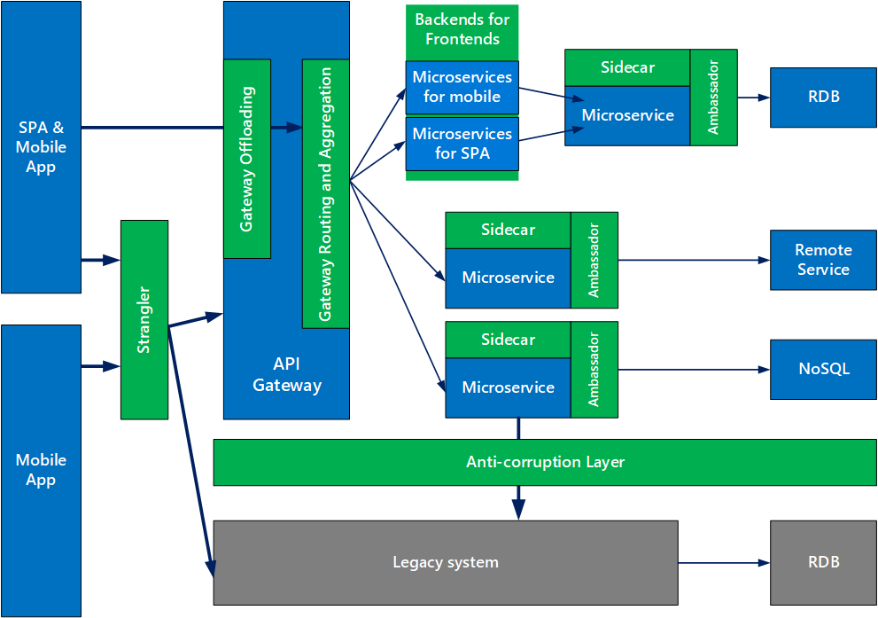

9 个模式：外交官（Ambassador）、防腐层（Anti-corruption layer）、后端服务前端（Backends for Frontends）、舱壁（Bulkhead）、网关聚合（Gateway Aggregation）、网关卸载（Gateway Offloading）、网关路由（Gateway Routing）、挎斗（Sidecar）、绞杀者（Strangler）。它们大多也是业界常用模式，如：

- 外交官模式：以与语言无关的方式处理常见的客户端连接任务，如监视、日志、路由和安全（如 TLS）。
- 防腐层：介于新应用与遗留应用之间，确保新应用的设计不受遗留应用限制。
- 后端服务前端：为不同类型客户端（如桌面和移动）创建单独的后端服务，使单个后端服务无需处理各类客户端的冲突请求，通过分离客户端特定关注点保持微服务的简单性。
- 舱壁模式：隔离每个工作负载或服务的关键资源（连接池、内存、CPU），避免单个工作负载耗尽所有资源而拖垮其他服务，主要靠防止级联故障来增强系统弹性。
- 网关聚合：将多个微服务的请求聚合成单个请求，减少消费者与服务之间过多的请求。
- 挎斗模式：将应用的辅助组件部署为单独的容器或进程，以提供隔离和封装。

设计模式是针对某一问题域的解决方案，其出现也代表了工程化的可能。随着微服务实践的广泛开展，该领域将走向成熟稳定。可参考微软的[微服务设计模式](https://azure.microsoft.com/en-us/blog/design-patterns-for-microservices/)与 [Azure 架构中心](https://docs.microsoft.com/en-us/azure/architecture/)。

# 如何处理 OAuth2 的刷新令牌

使用 OAuth2 时，若访问令牌过期，客户端可用刷新令牌从授权服务器获取新的访问令牌。刷新令牌是特殊令牌，允许在不重新输入凭据的情况下重新获得访问权限，应在安全环境中存储，不应暴露给未授权的用户或应用。最佳实践：

1. **存储**：存在安全环境，如客户端应用的服务器端或受信任的安全存储；不要存在客户端应用本身，以免安全漏洞。
2. **生命周期**：应有有限的生命周期并定期更新，保证系统安全、减少未授权访问风险。
3. **保密性**：应保密，不暴露给未授权的用户或应用；一旦泄露，攻击者可能借此获取访问权限。
4. **安全传输**：传输时使用 HTTPS 等安全协议，防止信息被拦截或篡改。
5. **撤销**：泄露或不再需要时，应能撤销它。

总之，应遵循上述实践，确保刷新令牌在安全环境中存储、传输和使用，并具备有限生命周期和可撤销机制。

# SkyWalking 中的数据是如何收集和传输的

1. **数据采集**：探针（probe）与应用程序集成，获取请求响应时间、调用链路、系统资源使用情况等运行时数据，发送到数据收集器（backend）。
2. **数据传输**：收集器接收后做必要处理（清洗、过滤、汇总等），处理后的数据存储到数据存储组件（配置文件中称为 database）。
3. **数据消费**：存储组件既可在本地存储，也可将数据发给其他系统进一步处理消费，如发给可视化组件（UI）在图形界面监控性能数据，或发给告警系统在性能问题发生时通知相关人员。

传输过程可能使用 gRPC 等高效协议；消费阶段支持多种处理方式，可在配置中设置。

# Sentinel 是什么？它是如何工作的？

Sentinel 是阿里开源的分布式服务架构轻量级流量控制产品，以流量为切入点，从流量控制、熔断降级、系统负载保护等维度保护服务稳定性。

基本概念包括资源、规则和处理器：资源是 Sentinel 的关键概念，可以是 Java 应用中的任何内容（应用提供的服务、调用的其他应用服务，甚至一段代码）；规则围绕资源的实时状态设定，包括流量控制、熔断降级、系统保护规则，且均可动态实时调整。

主要功能：

1. **流量控制**：控制每个服务或接口的并发请求数量，避免并发过多导致崩溃。
2. **熔断降级**：某服务或接口不可用时自动触发熔断，避免单点故障导致整个系统瘫痪。
3. **系统负载保护**：通过控制系统整体负载，避免过载导致性能下降甚至崩溃。

工作原理分三步：

1. **数据采集**：通过代理模式采集流量数据并清洗整合。
2. **策略计算**：根据预设规则和算法，判断是否需要控制流量、熔断降级或保护负载。
3. **结果执行**：根据计算结果对流量进行控制、熔断降级或负载保护。

Sentinel 轻量，适用于各种分布式服务架构，能有效保护服务稳定性、提高可用性和容错性。

# OAuth2 有哪几种授权模式

1. **授权码模式**：最常用且安全性最高。在具有后端服务器的 Web 客户端中，token 保存在客户端后端，对资源服务器的访问也在后端完成，可有效避免 token 泄露。
2. **隐式授权模式/简化模式**：用户的授权码直接返回到客户端，而不是在后端保存；实际应用中安全性较高。
3. **密码模式**：用户向客户端提供密码，客户端用密码获取访问令牌。实现最简单，但存在安全问题，因为密码可能被泄露。
4. **客户端凭证模式**：客户端以自己的身份访问资源服务器，实现较简单，同样存在安全问题。

具体选择哪种模式需根据实际应用场景和安全需求决定。

# 使用 OAuth2 有什么优点和缺点

**优点：**

1. **安全性**：客户端不接触用户密码，且认证和授权信息集中在服务器端，更易集中保护用户信息。
2. **广泛使用**：作为广泛应用的认证标准，被众多公司组织采用，便于与其他系统集成。
3. **令牌短寿命和封装**：使用短寿命访问令牌，减少泄露和攻击风险，并提供灵活的令牌封装机制。
4. **资源服务器与授权服务器解耦**：两者分离，结构清晰，便于系统间集成。
5. **集中式授权**：通过专门服务授权认证，简化客户端处理，客户端只需与该授权服务器交互。

**缺点：**

1. **对接流程长**：需理解并实现许多概念，对接相对复杂耗时。
2. **使用不当可能造成安全漏洞**：协议本身安全，但令牌管理不善或授权过大都可能导致漏洞。
3. **兼容性问题**：不同公司组织按协议实现的认证系统可能有差异，导致系统间兼容性问题。

# 什么是限流算法，网关如何实现限流

限流算法用于限制单位时间内服务的请求数量，防止服务被过高请求压力击垮。常见算法包括**计数器、滑动窗口、漏桶、令牌桶**。

网关实现限流的方式：

1. **利用限流算法插件/模块**：集成限流插件并配置参数（如令牌桶大小、令牌生成速率）。例如 Spring Cloud Gateway 可用 Redis 的 RateLimiter 插件实现限流。
2. **自定义限流逻辑**：以编程方式实现，如在每个服务的网关层（Nacos、Eureka 等）实现，或使用限流 SDK（如 Sentinel）。
3. **利用云平台提供的限流功能**：如 AWS CloudWatch、Azure Application Insights 等。

# 什么情况下需要用到分布式事务

分布式事务用于在多个网络节点或服务之间进行数据一致性处理。常见场景：

1. **微服务之间通过远程调用完成事务操作**：如电商的订单服务和库存服务需通过远程调用保证库存与订单同步更新，避免超卖或缺货。
2. **单体系统访问多个数据库实例**：如用户信息和订单信息分别存在两个数据库实例，需分布式事务保证一致性。
3. **多服务访问同一个数据库实例**：如订单和库存微服务访问同一个数据库，跨 JVM 进程的多个服务同时持有不同连接操作数据库，可能出现数据不一致。

常用方案包括 2PC、3PC、TCC、Saga、本地消息表等。其中 2PC、3PC 基于锁机制，TCC、Saga、本地消息表基于业务逻辑；选择取决于业务需求、系统复杂性和性能等因素。

# Seata 是什么？它的工作原理是什么？

Seata 是开源的分布式事务解决方案，提供简单、高性能、易用的分布式事务服务。其原理基于两阶段提交协议的演变：把业务数据和回滚日志记录在同一个本地事务中提交，释放本地锁和连接资源，再通过异步提交快速完成事务；回滚阶段则通过一阶段的回滚日志进行反向补偿。Seata 提供 AT、TCC、Saga、XA 多种事务模式以适应不同场景。

核心组件包括全局事务管理器（GTM）和分支事务管理器（BTM）：GTM 负责协调管理全局事务，BTM 负责管理分支事务。分布式环境中每个应用节点都与 GTM、BTM 交互，确保全局事务和数据的一致性。

具体来说，应用启动全局事务时，GTM 分配全局事务 ID 并发送给所有应用节点；每个节点执行本地事务时把全局事务 ID 与本地事务绑定，并将执行结果发给 BTM。若某节点故障，BTM 向 GTM 申请回滚全局事务，否则 GTM 向所有节点广播提交指令。

# 谈谈 Ribbon 和 Feign 区别

Ribbon 和 Feign 都是 Netflix 开发的 Java 库。

- **Ribbon 是客户端负载均衡器**：在多个微服务实例间分发请求，提升可用性和性能，可与 RestTemplate 等 HTTP 客户端配合使用来发送请求并做负载均衡。
- **Feign 是声明式 HTTP 客户端**：通过编写接口和注解定义对远程微服务的需求，用注解和模板方法简化远程调用，运行时生成实现类执行实际的 HTTP 请求。

两者的用途、编程模型和集成方式不同：Ribbon 更注重负载均衡，需配合 RestTemplate 等发送 HTTP 请求，并提供自定义负载均衡策略的能力；Feign 采用声明式编程模型，通常与 Ribbon 一起使用以实现负载均衡。若需要更多控制和自定义负载均衡策略可选 Ribbon；若更喜欢简洁的声明式编程模型可选 Feign。

# 单体应用、SOA 和微服务架构有什么区别

- **单体应用**：像一个整体，所有功能打包在一个应用中。容易部署和测试，但随着规模扩大，灵活性和可维护性降低。
- **SOA**：面向服务的架构风格，将系统划分为多个独立服务，可通过网络调用，跨平台、跨语言交互。优点是提供跨系统的服务复用和松散耦合；但实现需投入大量工作（服务定义、接口选择、协议制定等）。
- **微服务**：进一步将系统划分为多个小型、独立的服务，每个都是单独应用，可独立部署、运行和扩展。灵活性和可维护性更高，适用于复杂的大型系统，强调服务自治和独立；但同样需大量投入（服务定义、通信机制选择、服务管理等）。

# 说下 Hystrix 与 Sentinel 的区别

两者都是服务熔断器，用于提高分布式系统弹性，区别在实现方式、适用场景和资源模型设计。

- **Hystrix**：基于命令模式，将外部资源调用封装在命令对象中，通过线程池或信号量实现隔离；提供丰富的配置选项（线程池大小、超时时间等），更适用于需要高并发、快速响应的场景，可快速隔离和恢复故障。
- **Sentinel**：基于流量控制和熔断降级思想，可与 Spring Cloud、gRPC、Dubbo 等集成，通过定义资源规则和应用策略控制资源，更适用于需要流量控制和熔断降级的场景，可根据系统负载和响应时间自动熔断和降级。

具体选择取决于系统的具体需求和场景。

# Nacos、Eureka、Zookeeper 注册中心的区别

- **Nacos**：除注册中心外还提供配置管理、服务发现、事件通知等。默认采用 AP 架构保证可用性，CP 架构底层用 Raft 保证一致性。适合作为微服务的注册中心和配置管理中心。
- **Eureka**：只提供注册中心功能，设计理念是 AP，保证可用性、不保证一致性。各节点相互注册，只要有一台 Eureka 节点存在，整个微服务就可通讯。
- **Zookeeper**：除注册中心外还提供分布式协调服务（通知、公告、配置管理等）。采用 CP 设计，保证数据一致性但牺牲部分可用性，适用于需要分布式协调服务的场景（配置管理、命名服务等）。

# 说说 Seata 的执行流程

整体设计为两阶段提交。

**第一阶段**：所有 RM（Resource Manager，资源管理者，业务代码中被远程调用的部分）执行自己的本地事务。执行时 Seata 使用数据源代理，在执行 SQL 前解析 SQL，生成前置镜像和后置镜像，同时向 undo log 插入一条数据以便后期异常时回滚，然后向 TC（Transaction Coordinator，事务协调器）注册分支事务、提交本地事务，最后向 TC 提交分支事务状态。

**第二阶段**：

1. 所有 RM 本地事务执行成功：TM（Transaction Manager，事务管理器）向 TC 发起全局事务提交，TC 立即释放全局锁，然后异步驱动所有 RM 提交分支事务。
2. 存在一个 RM 本地事务不成功：TM 向 TC 发起全局事务回滚，TC 驱动所有 RM 回滚，等所有 RM 回滚成功后再释放全局锁。

# 你对微服务是怎么理解的

微服务是一种架构思想，将应用拆分为一系列小型、独立的服务，每个服务负责一项特定业务功能，特点是**服务之间松散耦合、独立部署和运行**。它让开发人员能更专注于单个服务的开发与测试，降低系统复杂性，提高可维护性和可扩展性；每个服务可按业务需求选择合适的语言和工具。服务间通过轻量级通信机制（如 RPC、HTTP）通信，可独立部署、扩展和升级，从而提高可靠性和可用性。总体而言，微服务让应用更灵活、可维护、可扩展，为构建高效可靠的大型应用提供支持。

# 什么是降级熔断？为什么要进行熔断？

熔断降级是分布式系统的保护机制，用于应对服务不稳定或不可用。

- **熔断**：当某服务的调用失败次数或异常比例达到阈值时，自动切断对该服务的调用，让请求快速失败，避免影响其他服务而引发雪崩。熔断后一段时间内不再调用该服务，直到其恢复正常或超过最大等待时间。
- **降级**：当某服务不可用或响应缓慢时，提供备用处理逻辑（如返回默认值、缓存值、错误提示），以保证可用性和容错性。降级可在熔断时触发，也可在系统负载过高、资源紧张等情况下触发。

目的是保护系统的稳定性和可用性，防止故障扩散蔓延，提高用户体验和信任度。

# 请解释什么是 SkyWalking，以及它为什么重要

SkyWalking 是面向分布式系统的应用性能监控（APM）与可观测性分析平台，提供简便的方式清晰观测分布式系统，甚至可观测横跨不同云的系统。它可收集、分析、聚合和可视化分布式系统数据，包括分布式拓扑图、应用性能指标、Trace 和日志等。使用 SkyWalking 可提高分布式系统的可靠性和性能，帮助开发和运维团队快速定位、解决问题；还能设置告警规则，出现异常时及时通知相关人员，减少故障时间、提高可用性。因此它对分布式系统的监控和管理非常重要。

# Nacos 的服务注册表结构是怎样的？

Nacos 采用数据的分级存储模型：最外层是 Namespace（隔离环境），然后是 Group（服务分组），接下来是服务（Service）——一个服务包含多个可能处于不同机房的实例，因此 Service 下有多个集群（Cluster），Cluster 下是不同的实例（Instance）。

对应到 Java 代码中，Nacos 用一个多层 Map 表示，结构形如 `Map<String, Map<String, Service>>`：最外层 Map 的 key 是 namespaceId，值是一个 Map；内层 Map 的 key 是 group 拼接 serviceName，值是 Service 对象。Service 内部又是一个 Map，key 是集群名称、值是 Cluster 对象，Cluster 内部则维护了 Instance 的集合。

# 如果 Sentinel 的异常处理规则不满足需求，应该怎么办？

可以自定义异常处理规则：通过自定义实现 BlockedExceptionHandler 接口，将自定义的异常处理器对象交给 Spring 容器管理。

可根据实际业务需求定制异常处理策略，如全局兜底处理、日志打印、空指针检查等；还可在处理器中加入自定义业务逻辑，如对异常进行分类、统计和反馈，从而灵活扩展 Sentinel 的异常处理能力。

## OAuth2 授权模式

### 前言

传统的客户端-服务器身份验证模型中，客户端用资源所有者的凭据向服务器认证，以请求受保护资源。为了让第三方应用能访问受限资源，资源所有者需与第三方共享凭据，这存在以下问题：

- 第三方通常需**明文存储**资源所有者的凭据（通常是密码）。
- 服务器需支持密码认证，而密码认证存在**安全弱点**。
- 第三方可能获得过宽的**访问权限**，资源所有者无法限制访问时长或资源子集。
- 资源所有者无法单独撤销对个别第三方的访问，只能靠改密码来影响所有第三方。
- 任一第三方被攻破，都将导致用户密码及其保护的所有数据**泄露**。

### 什么是 OAuth 2.0

OAuth 2.0 是用于授权的开放标准，允许用户让第三方应用访问其在某网站存储的私有资源，而无需把用户名和密码交给第三方。它是 OAuth 协议的升级版，授权流程更简化灵活。

其中的主要角色：

1. **资源所有者（Resource Owner）**：即用户，拥有受保护资源，授权第三方应用访问其资源。
2. **客户端（Client）**：即第三方应用，需要访问资源所有者的受保护资源。
3. **授权服务器（Authorization Server）**：验证资源所有者并颁发访问令牌，可与资源服务器是同一或不同服务。
4. **资源服务器（Resource Server）**：存储受保护资源，通过访问令牌验证并提供资源。

OAuth 2.0 定义了多种授权方式（授权码、隐式、密码、客户端凭证等），客户端与授权服务器交互获取访问令牌，再用令牌访问受保护资源。

### OAuth2 四种授权模式

#### 授权码模式

授权码模式适用于客户端需要访问用户资源、但不能直接使用用户凭证的场景。


1. **客户端请求授权**：把用户导向授权服务器，参数包括 `response_type=code`、`client_id`、`redirect_uri`、`scope`。
2. **用户同意授权**：用户在授权服务器登录并同意授权请求。
3. **授权服务器发放授权码**：验证身份与授权请求后向客户端发放授权码。
4. **客户端获取访问令牌**：客户端后端将授权码和客户端凭证发送到授权服务器，参数包括 `grant_type=authorization_code`、`code`、`redirect_uri`（须与第 1 步一致）、`client_id`、`client_secret`（可选）。
5. **授权服务器发放访问令牌**：验证授权码和客户端凭证，有效则发放令牌。
6. **客户端使用访问令牌**：用令牌访问用户的受保护资源。

授权码模式相对更安全，因为客户端不直接接触用户凭证，且授权码交换可走安全的后端通信。

#### 隐式授权模式（简化模式）

隐式授权模式通常用于移动应用或纯前端应用。


1. **发起认证请求**：客户端（浏览器或移动应用）向授权服务器发送请求，`response_type` 设为 "token"，并带 `client_id`、`redirect_uri`。
2. **用户身份验证和授权**：用户在授权服务器验证身份并同意授权，服务器生成访问令牌。
3. **生成令牌**：令牌直接包含在重定向 URI 中，作为 URI 片段的一部分。
4. **重定向到客户端**：授权服务器将含令牌的重定向 URI 返回，令牌可通过前端 JavaScript 访问。
5. **客户端使用令牌**：从 URI 中提取令牌，访问资源服务器上的受保护资源。

隐式模式不涉及客户端后端，直接在浏览器中处理，适用于前端应用，但安全性需特别注意，可能时应优先选择授权码模式。

#### 密码模式

密码模式允许客户端用用户的用户名和密码直接向授权服务器请求访问令牌，通常用于受信任的客户端直接与资源所有者的服务通信。


1. **客户端向授权服务器发送请求**：参数包括 `grant_type=password`、`client_id`、`client_secret`（如有）、`username`、`password`、`scope`（可选）。
2. **授权服务器验证用户身份**：验证客户端与用户身份，成功则生成访问令牌和可能的刷新令牌。
3. **授权服务器响应**：以 JSON 格式返回访问令牌和刷新令牌。

该模式需客户端直接存储用户密码，因此主要适用于受信任的客户端（如后端服务器），使用时须确保通过 HTTPS 等安全通道通信。

#### 客户端凭证模式

客户端凭证模式适用于无需用户参与、客户端访问自身拥有权限资源的情况。


1. **客户端向授权服务器发送请求**：参数包括 `grant_type=client_credentials`、`client_id`、`client_secret`。
2. **授权服务器验证客户端身份**：确保客户端合法且有权限使用此模式。
3. **授权服务器响应**：以 JSON 格式返回访问令牌及有效期等信息。

该模式适用于不涉及用户、客户端访问自身资源的情况（如后端服务间通信），同样需保障传输安全并限制凭证使用范围。

# 你是怎么理解微服务的？

在 Java 后端面试中，"你是怎么理解微服务的？"出现率极高。多数候选人只答"把单体拆成多个独立小服务，各自独立部署，通过 RPC 或 RESTful 调用"——这只是微服务的**"形"**（怎么做），没看透它的**"神"**（为什么做、代价是什么）。

## 一、破除迷信：微服务不是银弹，是"毒药"

微服务不是单纯的技术升级，而是一场"有损交易"：用 **运维的复杂度** 和 **系统的强一致性**，换取 **业务的敏捷性** 和 **团队的独立性**。只谈好处不谈代价，说明没在生产环境踩过坑。

## 二、维度一：算得清"性能账"

单体下的方法调用是**本地调用**（纳秒级）；拆成微服务后变成**网络 RPC**（毫秒级）。若把一个紧密耦合的流程强行拆成 A→B→C→D 四个服务，网络开销会翻成千上万倍。拆分必须有边界，不能为拆而拆，否则吞吐量直线下降。

## 三、维度二：搞得定"数据一致性"

单体时代靠数据库 ACID，一个 `@Transactional` 就能保证全成功或全回滚。微服务下数据分散，服务 A 扣款成功、B 发货失败、C 积分未加，就失去了 ACID，迎来"分布式事务"噩梦。初级理解是上 Seata 用 AT 模式强保一致；**高手理解是尽量避免分布式事务**——强一致（CP）是性能杀手，能异步的就用 **MQ 做最终一致性（BASE 理论）**，只有极少数核心链路（如支付转账）才考虑强一致。

## 四、维度三：扛得住"运维复杂度"

单体出问题 `grep` 日志即可；几百个服务实例在 K8s 里飘忽不定，就不能再靠 `grep`。没有完善的可观测性（Observability）基建，微服务就是灾难，必须提到"三驾马车"：

1. **Logging（日志）**：ELK/EFK 做日志聚合。
2. **Tracing（链路追踪）**：SkyWalking/Zipkin 串联 Trace ID，定位请求挂在哪。
3. **Metrics（监控指标）**：Prometheus + Grafana 监控系统水位。

## 五、维度四：看得见"组织架构"（康威定律）

**康威定律**指出：系统架构的设计最终会反映出组织的沟通结构。微服务不仅是技术架构，更是**组织架构**。若团队人少、还用瀑布流开发，没有 DevOps 文化、自动化 CI/CD 流水线、K8s 容器底座，硬上微服务就是找死——基础设施决定上层建筑。

## 六、满分回答范例（建议背诵）

"我认为微服务本质上是一种**架构层面的权衡（Trade-off）**。

**第一，微服务是有代价的。** 它用运维复杂度（几百个服务的治理）和数据一致性（牺牲 ACID），换取业务敏捷性和团队独立性。业务规模不到那个程度，强行拆分只会带来 RPC 性能损耗和分布式事务的噩梦。

**第二，微服务极其依赖治理能力。** 拆分谁都会，治理才是关键：为解决雪崩，需要熔断、降级、限流的护城河（如 Sentinel）；为解决数据一致性，我更倾向用 **MQ 实现最终一致性**，而不是盲目引入强一致框架降低性能；为解决排查难，必须建立完整可观测性体系（ELK+SkyWalking+Prometheus）。

**第三，微服务需要组织架构的匹配。** 基于康威定律，它要求具备 DevOps 文化和自动化运维基建（CI/CD、K8s），否则只会沦为"分布式单体"。

所以我的理解是：**它不是银弹，而是解决特定规模下复杂问题的一种手段。懂权衡，才是架构师的职责。**"

# 阿里的 Sentinel 底层是如何实现限流的？超过限流数的请求如何处理？直接丢弃吗？

## 一、底层限流实现机制

**核心思想**：主要采用**滑动时间窗口结合计数器**统计流量并判断限流，也融合了令牌桶、漏桶思想，目标是单位时间内只放行限定请求数。

**滑动窗口结构**：

- **时间窗口划分**：把统计时间（如 1 秒）切成多个格子（如每格 100ms），每格记录当前格子的请求数。
- **窗口滑动**：请求进来时按时间戳判断属于哪个格子并刷新计数，多个格子累加得出单位时间的总请求数。
- **核心数据结构**：底层常用 **LeapArray** 循环队列管理时间窗口，保证高并发下的效率与准确度。

**阈值判断**：新请求进来时计算当前窗口累计请求数，超过阈值则进入限流逻辑。

## 二、超过限流数的请求如何处理？

通过配置 FlowRule 的 controlBehavior 参数决定处理策略：

| controlBehavior | 处理方式 | 说明 |
| --- | --- | --- |
| 0（默认） | 直接拒绝 | 超过阈值的请求立即被拒绝，返回异常 |
| 1 | 匀速排队（漏桶） | 超过阈值的请求以固定速率排队等待 |
| 2 | 预热 | 刚启动时先低速放行，通过预热逐步上升 |

- **默认行为——直接拒绝**：未特殊配置时，Sentinel **直接丢弃（快速失败）** 超过阈值的请求并返回限流异常（如 BlockException），下游不会因过量流量被压垮。
- **匀速排队模式（漏桶思想）**：超过阈值的请求短暂排队处理，超时再丢弃。
- **预热模式**：常用于服务刚启动的流量缓升，避免冷启动雪崩。

## 三、配置与适用场景

通过流控规则（FlowRule）灵活选择策略：高频接口建议用直接拒绝（0）以免耗尽资源；能容忍等待的请求可用匀速排队（1）。所有策略都能通过 Sentinel Dashboard 动态配置和变更。

**总结**：底层主要采用**滑动窗口+计数器**限流，部分场景引入令牌桶/漏桶；超限请求**默认直接拒绝**，可配置为排队或预热；具体取决于业务容忍度和实际需求。

# 什么是 Seata？谈谈你对 Seata 的理解

Seata 是阿里开源的高性能分布式事务解决方案，核心目标是在微服务架构下提供简单易用的事务服务。它提供 **AT、TCC、Saga、XA** 四种模式，其中 AT 模式最常用、也是最大的创新点。对 AT 模式的理解可概括为"**一个优化，两个阶段，三处防线**"：

1. **一个优化（核心竞争力）**：相比传统 XA（2PC），AT 模式最大的改进是**一阶段直接提交本地事务**，不长时间占用数据库连接资源，极大提升高并发下的性能。
2. **两个阶段（工作机制）**：
   - **一阶段**：执行业务 SQL，同时记录 **Undo Log（回滚日志）**（含前镜像和后镜像），然后提交本地事务。
   - **二阶段**：顺利提交则异步删除 Undo Log（效率高）；需要回滚则根据 Undo Log 的"前镜像"生成反向 SQL 还原数据。
3. **三处防线（最大的坑）**：一阶段释放了锁，会带来**脏写（Dirty Write）**问题，Seata 引入 **TC 侧的全局锁（Global Lock）** 保证隔离性：
   - **写隔离**：提交本地事务前必须先拿全局锁，拿不到就重试。
   - **读隔离**：默认读未提交（脏读）；如需读已提交，须在 Select 上加 `@GlobalLock` 或 `FOR UPDATE` 申请检查全局锁。

## 原理与代码层面

**1. Undo Log 怎么生成？**

以 `update account set money = money - 10 where id = 1`（原 money=100）为例，Seata 代理执行流程：

1. 解析 SQL：识别为 Update 操作。
2. 查询前镜像：`select * from account where id = 1`，记录 money=100。
3. 执行业务 SQL：money 变为 90。
4. 查询后镜像：再查一次，记录 money=90。
5. 构建 Undo Log：将前后镜像封装成 JSON 存入 `undo_log` 表。

```json
{
  "beforeImage": { "id": 1, "money": 100 },
  "afterImage": { "id": 1, "money": 90 }
}
```

6. 提交：业务数据和 Undo Log 在同一个本地事务中提交。

**2. 脏写问题与全局锁**

没有全局锁时，两个分布式事务同时改同一行会出问题：

- **T1**：把 money 从 100 改成 90，**本地提交了**。
- **T2**：紧接着把 money 从 90 改成 80，**也本地提交了**。
- **T1 回滚**：T1 拿着前镜像（100）还原，直接把 money 改回 100。**结果 T2 的更新（80）丢失了**，这就是脏写。

Seata 的解法：

```java
// Seata 代理数据源在 Commit 前会执行类似逻辑：
while (true) {
    // 尝试向 TC 申请 id=1 这行记录的全局锁
    boolean lock = tc.acquireGlobalLock(xid, "account", pk=1);
    if (lock) {
        doLocalCommit(); // 拿到全局锁才提交本地事务
        break;
    } else {
        throw new LockConflictException(); // 拿不到则回滚或重试
    }
}
```

## 深度解析

**1. 没走 Seata 代理的"野路子"线程（全局锁失效）**：这是严重的生产事故隐患。AT 模式强依赖全局锁，若某定时任务或老接口没加 `@GlobalTransactional`、也没走 DataSourceProxy，直接更新数据库，它**完全不会检查 TC 的全局锁**。若此时有正经的 Seata 事务要回滚，Seata 会校验当前值（80）与后镜像（90）是否一致，发现不一致即说明被脏写，会抛出无法回滚的异常，需人工介入修数据。**解决**：涉及全局事务的表禁止裸写，或给"野路子"加 `@GlobalLock` 强制检查锁。

**2. AT vs TCC 的权衡**：没有最好的模式，只有最适合的场景。

- **AT 模式**：开发友好型，代码零侵入，像写本地事务一样写分布式事务。适合业务逻辑不复杂、非核心高并发的链路。
- **TCC 模式**：性能极致型，不依赖数据库行锁，把资源预留（Try）、确认（Confirm）、取消（Cancel）都在业务层实现。适合核心支付交易链路或并发量极高的场景，但要防空回滚、防悬挂，开发成本极高。

# 使用 OAuth2 时，如何存储和传输敏感信息，例如用户名和密码

OAuth2 的核心设计理念是**让客户端永远不要接触用户的密码**。可从三个层面回答：

1. **传输层面**：
   - **HTTPS 是底线**：所有交互（重定向、Token 交换、API 调用）必须全链路强制 HTTPS（TLS 1.2+），否则任何加密手段在中间人攻击面前都是裸奔。
   - **拒绝 ROPC 模式**：坚决废弃"密码模式"，它会让客户端接触用户密码，极不安全。
   - **推荐流程**：使用**授权码模式**配合 **PKCE**，输入密码的动作在授权服务器页面上完成，客户端连密码的影子都看不到。
2. **存储层面**：
   - **密码不存明文**：授权服务器端密码绝不能明文或双向加密存储，必须用**加盐哈希**（如 **BCrypt**、**Argon2**）。
   - **Token 不存敏感信息**：JWT 默认只是 Base64 编码（JWS），谁都能解开，不要塞手机号、身份证等；非要存必须用 **JWE** 加密。
3. **客户端防护**：
   - 浏览器端（SPA/H5）尽量不把 Access Token 存进 LocalStorage，易被 XSS 偷走。
   - **最佳实践**：采用 **BFF（Backend for Frontend）** 架构，Token 存在后端 Session，前端只拿一个 `HttpOnly Cookie`。

## 场景与代码

**1. 错误的传输方式（ROPC 密码模式，反例）**

```http
POST /oauth/token HTTP/1.1
Host: auth-server.com
Content-Type: application/x-www-form-urlencoded

grant_type=password&username=fox&password=123456&client_id=app
```

客户端直接持有了密码。若 Client 是第三方 App，等于把密码交了出去，这叫信任崩塌。

**2. 正确的存储方式（BCrypt 哈希）**

```java
// Spring Security 示例
public class PasswordStorageDemo {
    public static void main(String[] args) {
        // 1. 强哈希算法（带自适应 Salt）
        PasswordEncoder encoder = new BCryptPasswordEncoder(10);

        String rawPassword = "my_secret_password";

        // 2. 存入数据库的是这个 hash，类似 $2a$10$dXJ3SW6G7P50lGmMkkmwe.20cQQubK3.HZVzG3ADICo6pUC8LF6.2
        String encodedPassword = encoder.encode(rawPassword);

        // 3. 验证时只能比对，无法还原
        boolean isMatch = encoder.matches("my_secret_password", encodedPassword);
    }
}
```

## 深度解析

**若 Access Token 被截获，岂不是和密码泄露一样？** 两者有本质区别，这正是要用 OAuth2 的原因：

1. **时效性**：密码永久有效（除非改密）；Access Token 是短命的（通常 30 分钟–2 小时），黑客可利用窗口期很短。
2. **权限范围（Scope）**：密码代表"上帝权限"；Token 是受限的，只开通 `read:profile` 就只能看头像，不能转账。
3. **撤销机制**：密码泄露需通知用户改密，体验极差；Token 泄露可在后台吊销对应 Token 或让 Refresh Token 失效，攻击立即停止。
4. **Token Rotation（令牌轮转）**：用 Refresh Token 换新 Access Token 时**强制更换 Refresh Token**。若黑客偷了 Refresh Token 抢先使用，合法用户再来刷新时服务器会发现旧 Token 已被用过，判定被盗并**强制该用户下线**，从而具备侦测盗用的能力。

**总结**：密码是"核武器"，必须锁死在授权服务器的数据库里；Token 是"临时通行证"，靠 HTTPS、BFF 和轮转机制降低风险，这才是分布式安全的精髓。

# 说下你对 DDD 的理解

DDD 不是一套框架，而是一种**处理高度复杂业务的思维方式**，可分为"战略设计"和"战术设计"两个层面：

1. **战略设计（架构师的战场）**：核心是**划定边界**。通过**通用语言（Ubiquitous Language）**与业务专家对齐认知，识别**核心域、支撑域、通用域**；最重要的是划分**限界上下文（Bounded Context）**——在微服务架构中一个限界上下文通常对应一个微服务，解决了"微服务怎么拆"的难题。
2. **战术设计（程序员的战场）**：核心是**保证业务逻辑高内聚**。定义**聚合（Aggregate）**和**聚合根（Aggregate Root）**保证一致性边界，区分**实体（Entity）**和**值对象（Value Object）**；最关键的是摒弃**贫血模型**，转向**充血模型**，把业务逻辑封装在领域对象内部，而非散落在 Service 层。

一句话总结：DDD 的本质是**让软件架构与业务领域保持高度一致**，从而控制业务复杂度。

## 核心原理与代码

**1. 贫血模型 vs 充血模型**

- **贫血模型（传统 Spring 开发模式）**：User 对象只有 `@Data`（Getter/Setter），业务逻辑全在 `UserService` 里。这是"披着对象外衣的面向过程"，Service 臃肿，Entity 沦为数据载体。
- **充血模型（DDD 模式）**：User 对象拥有业务行为。

```java
// 贫血模型写法（反例）
userService.changePassword(userId, oldPwd, newPwd);
// 逻辑全在 Service 里，User 只是个数据包

// DDD 充血模型写法（正例）
public class User {
    // 状态和行为在一起
    public void changePassword(String oldPwd, String newPwd) {
        if (!this.password.equals(encrypt(oldPwd))) {
            throw new BizException("旧密码错误");
        }
        this.password = encrypt(newPwd);
        addDomainEvent(new PasswordChangedEvent(this.id)); // 发布领域事件
    }
}

// Service 层变得极薄
public void changePasswordAppService(String userId, ...) {
    User user = userRepository.find(userId);
    user.changePassword(old, new); // 调用领域对象行为
    userRepository.save(user);
}
```

**2. 值对象（Value Object）的妙用**

以地址（Address）为例：它没有 ID，只有属性（省、市、区），两个属性完全一样的地址即相等。在 DDD 中，修改地址**不是** `user.setProvince("xx")`，而是直接**替换**整个对象：`user.changeAddress(new Address("北京", "海淀", ...))`。

## 深度解析

**1. DDD 落地难的真相**：最大阻力不是技术，而是**认知成本和团队能力**。DDD 要求开发成为业务专家，但很多开发只关心"表怎么建"；若团队还在"数据库驱动开发"（先建表再写代码），推行 DDD 必死。DDD 是**领域优先**，最后才考虑数据库怎么存（Repository 只是接口）。

**2. 聚合设计的铁律**：核心不是"大"，而是**一致性边界**——一个事务中只应修改一个聚合。把"订单"和"用户"塞进同一聚合、想在一个事务里既改订单状态又扣余额是错的；订单、用户各自成聚合，通过**领域事件**做最终一致性解耦，这才是分布式系统的玩法。

**3. 总结**：DDD 是屠龙刀，用来对付"复杂业务"这条恶龙。若系统只是简单 CRUD（如后台管理），**千万别用 DDD**，那是杀鸡用牛刀、纯属过度设计。**架构师的价值，在于知道什么时候该用 DDD，什么时候该用 CRUD。**

# 在微服务架构中，网关的作用是什么

网关的本质是微服务架构中的**统一门面（Facade Pattern）**，可概括为"**一个入口，四个核心职责**"：

1. **一个入口（Unified Entry）**：是所有客户端（App、Web、小程序）与后端微服务之间的**唯一入口**。客户端无需知道后端几百个服务的具体 IP 和端口，只需找网关，实现客户端与服务端的解耦。
2. **四个核心职责**：
   - **统一鉴权**："保安"角色。鉴权逻辑上移到网关，校验通过后把用户信息（User ID）塞进 Header 传给下游，避免在每个微服务里重复校验。
   - **动态路由**："调度员"角色。按请求路径（`/order/**`、`/user/**`）转发给 Nacos/Eureka 中注册的对应实例。
   - **限流熔断**："大坝"角色。流量洪峰时用 Sentinel 或 Redis 令牌桶在入口拦住多余请求，保护后端不被压垮。
   - **协议转换**："翻译官"角色。对外暴露 RESTful（HTTP/JSON），对内可能是性能更好的 RPC（Dubbo/gRPC），由网关完成转换。

## 核心原理与场景

**1. 统一鉴权的架构演进**

- 没有网关时（反例）：每个 Service 都校验 Token，一旦鉴权逻辑变了（如 JWT 换 OAuth2），要改几十个服务代码——这是架构设计的耻辱。
- 有网关时（正例）：`Client -> Gateway（校验 Token -> 解析 UserID -> Header.add("X-User-Id", id)）-> Service A`。Service A 不用懂 JWT，只需从 Header 取 `X-User-Id`，这叫关注点分离。

**2. BFF 模式（Backend for Frontend）**

手机屏小只需 3 个字段，PC 屏大需要 10 个字段，共用一个接口手机端会浪费流量（Over-fetching）。可针对不同客户端建立不同网关或路由聚合逻辑，把 Service A 和 B 的数据**聚合**后裁剪成手机端需要的格式返回，这就是"为前端服务的后端"。

## 深度解析

**网关这么多好处，有什么坏处？Spring Cloud Gateway 和 Nginx 怎么选？**

**1. 架构的权衡**：网关并非万能。

- **性能瓶颈风险**：所有流量都走网关，它就是全链路的**咽喉**，网关挂则全站瘫痪（SPOF）。**解决**：生产环境必须**高可用（HA）**部署，通常为 `VIP (Keepalived) -> Nginx 集群(L4/L7) -> Gateway 集群(业务网关)`。
- **网络延迟**：多了一次网络跳转（Hop），但内网环境下几毫秒通常可接受。

**2. 选型鄙视链**：

- **Nginx/OpenResty（Kong、APISIX）**：C/Lua，基于 Epoll，性能王炸，单机几万甚至十万 QPS，适合做**流量网关**（最外层，只做转发和简单鉴权）。
- **Spring Cloud Gateway**：Java，基于 Netty+WebFlux（Reactor），生态无敌，与 Spring Cloud、Sentinel、Nacos 无缝集成。性能虽不及 Nginx，但在**业务网关**（复杂业务逻辑、鉴权、聚合）场景下是首选，易二次开发。
- **Zuul 1.x**：基于阻塞 IO（Servlet 2.5），已过时，别写进简历。

**总结**：对外抗流量用 Nginx/Kong，对内搞业务用 Spring Cloud Gateway，这是云原生时代的黄金搭档。

# Sentinel 与 Hystrix 的区别是什么

Hystrix 是微服务熔断界的鼻祖，但已**停止维护**；Sentinel 是阿里的当红组件。区别可概括为"**一个核心差异，三个维度碾压**"：

1. **核心差异（隔离策略）**：
   - **Hystrix**：强依赖**线程池隔离**，为每个依赖服务建独立线程池。优点是隔离彻底、支持异步；缺点是**线程上下文切换开销大**，影响吞吐量。
   - **Sentinel**：默认用**信号量隔离**（计数器）。优点是**轻量、性能极致**（几乎无损耗）；缺点是不支持异步（但大多数 RPC 场景同步等待才是常态）。
2. **维度一：流量整形的丰富度**：Hystrix 流控很弱，基本只基于 QPS 阈值；Sentinel 是全维度的，支持 QPS、线程数、**冷启动预热**、**匀速排队**，甚至**热点参数限流**（如只限 id=1 的商品请求）。
3. **维度二：熔断降级的灵活度**：Hystrix 主要看异常比率或响应时间；Sentinel 还支持异常数，恢复策略更智能。
4. **维度三：系统自适应保护**：Sentinel 独有 **System Adaptive Protection**，能根据系统负载、CPU 使用率自动限流，Hystrix 完全不具备。

## 核心原理（代码与机制）

**Hystrix 的线程池隔离**：如同去银行办业务要先取号、再去柜台（线程池）办理，柜台满了就得等，柜员换班（线程切换）还很浪费时间。海量并发下 Hystrix 制造成千上万线程，CPU 光忙于**线程切换**就累死了。

**Sentinel 的信号量隔离**：

```java
// Sentinel 内部：AtomicInteger count = 0;
if (count.incrementAndGet() > limit) {
    throw new FlowException(); // 超过阈值，直接拒绝
}
try {
    doBusiness(); // 直接在当前线程执行，没有切换
} finally {
    count.decrementAndGet();
}
```

就像门口保安手拿计数器，人满就拦住，没满就放行，**没有线程切换，只有原子操作**，性能自然快。

## 深度解析（选型策略）

**1. 坑在于生态和维护**：Hystrix 已"死"（Netflix 不再开发新功能），若项目是新起的 Spring Cloud Alibaba 架构，强行用 Hystrix 就是"49 年入国军"。Sentinel 背靠阿里、生态无敌，适配 Dubbo、Spring Cloud，还能与 Nacos 完美联动、动态下发流控规则而无需重启；Hystrix 虽配合 Turbine 也能做，但配置极其复杂。

**2. 热点参数限流（Sentinel 的王炸）**：Hystrix 无法区分参数。例如"秒杀商品 A"和"冷门商品 B"用同一接口 `/buy/{id}`，Hystrix 一旦 QPS 爆了会把 A 和 B **一起熔断**，卖不出去的商品 B 也要陪葬；Sentinel 可配置热点参数规则，自动识别 `id=A` 请求 QPS 超高而只对 A 限流，`id=B` 依然畅通。这就是技术的业务价值。

**3. 总结**：Hystrix 是熔断器的先驱，值得尊敬；但 Sentinel 才是云原生时代的统治者，在高性能、微服务生态集成和精细化流控上是降维打击。

# Nacos 中的 Namespace 是什么？如何使用它来组织和管理微服务

Namespace 是 Nacos 中最粗粒度的资源隔离维度。数据模型层级为：**Namespace > Group > Service/DataId**。

1. **核心定义**：Namespace（命名空间）主要用于实现**环境隔离**。默认有一个保留的 Namespace 叫 `public`，但生产中绝不会把所有配置都堆在 `public`，那是灾难现场。
2. **使用场景**：通常用 Namespace 区分**开发（Dev）、测试（Test）、生产（Prod）**环境：Dev 的微服务只读 Dev Namespace 下的配置，Prod 只读 Prod 的配置，从物理层面保证配置安全，避免"测试环境改配置把生产搞挂"这类事故。

## 实战层面（配置与代码）

**1. 配置文件的差异**

- **错误示范**：什么都不配，默认使用 `public`，好比把卧室、厕所、厨房的东西全堆在客厅。
- **正确示范**：在 `bootstrap.properties` 或 `bootstrap.yml` 中显式指定 Namespace 的 **ID**（注意填 ID，不是名称）。

```yaml
# bootstrap.yml
spring:
  application:
    name: order-service
  cloud:
    nacos:
      config:
        server-addr: 127.0.0.1:8848
        file-extension: yaml
        # 指定 Namespace ID（通常是一串 UUID）
        namespace: 53268903-8205-4c07-b649-1456728080a1
        # Group 默认 DEFAULT_GROUP，可按需修改
        group: ORDER_GROUP
```

**2. 控制台的视觉隔离**：打开 Nacos 控制台应看到干净清爽的标签页"Dev"、"Test"、"Prod"；不切 Namespace 甚至搜不到别的环境的配置，这就是物理隔离带来的安全感。

## 深度解析

**Namespace 和 Group 都能做隔离，有什么区别？怎么配合使用？**

**1. 设计哲学的区别**：两者的维度不同。

- **Namespace**：**纵向**切分，代表"不同的世界"，如北京机房 vs 上海机房、租户 A vs 租户 B、Dev vs Prod，它们之间老死不相往来。
- **Group**：**横向**切分，代表"同一个世界里的不同模块"，如 Prod 环境下的"双 11 大促版"（Group=DOUBLE_11）与"日常版"（Group=DAILY），或把订单中心放 ORDER_GROUP、用户中心放 USER_GROUP；它们隔离但同处一个环境。

**2. 最佳实践（架构师的铁律）**：

1. **Namespace = 环境**：严禁混用，必须创建 `dev`、`test`、`uat`、`prod` 四个独立 Namespace。理由：ID 填错服务就启动报错、拉不到配置，这就是 **Fail-Fast（快速失败）**，防止配置串味。
2. **Group = 业务域/项目**：默认用 `DEFAULT_GROUP` 也没问题；微服务特别多（几百个）时建议按业务线分组，如 `TRADE_GROUP`（交易线）、`LOGISTICS_GROUP`（物流线）。
3. **DataId = 服务名 + Profile**：标准格式 `{service-name}-{profile}.{file-extension}`，如 `order-service-prod.yaml`。

**总结**：Namespace 定乾坤（环境），Group 分天下（业务），DataId 锁目标（具体配置）。搞懂这个三元组，微服务配置管理才算入门。

# 在分布式系统中，如何确定哪些服务或组件导致了性能瓶颈？SkyWalking 提供了哪些工具和技术来帮助我们进行故障排查？

在微服务架构中，只靠"翻日志"或"盯 CPU 监控"是"瞎子摸象"。可以**从宏观到微观，三步走**——SkyWalking 不只是链路追踪，而是完整的 APM（应用性能监控）系统，提供三个核心维度：

1. **宏观维度（上帝视角）——拓扑图（Topology）**：解决"谁调谁慢"。自动发现服务间依赖关系，节点或连线变红（响应时间过长）处即瓶颈源头；不仅看服务，还能监控 Database、Redis、MQ 等中间件的耗时。
2. **微观维度（显微镜）——链路追踪（Tracing）**：解决"慢在哪里"。通过 **Trace ID** 串联全链路，用**甘特图**找出耗时最长的 Span，关键要区分是**网络传输耗时**还是**自身代码逻辑耗时（Self Duration）**。
3. **代码维度（X 光机）——性能剖析（Profiling）**：解决"哪行代码慢"，这是 SkyWalking 的杀手锏。当 Trace 只能定位到某 API 慢、但不知慢在 SQL 还是计算时，Profile 能通过线程采样生成**火焰图**，精确到代码行数，且无需改代码或重启服务。

## 实战层面的体现

**1. 宏观定位——拓扑图红点分析**：用户反馈"下单慢"，不必查代码，直接看拓扑图。

- **现象**：拓扑图中"订单服务"指向"库存服务"的连线变**红**，平均耗时 3000ms。
- **结论**：瓶颈不在订单服务，而在库存服务或两者间的网络波动。
- **细节**：SkyWalking 还能识别**虚拟节点**（如外部第三方支付接口），若该节点红，说明是第三方拖累。

**2. 微观分析——Trace 甘特图抓"长条"**：找到嫌疑服务后点进去看 Trace。

- **操作**：在 Trace 列表按 Duration 倒序，找最慢的那条。
- **分析**：这是"找长条"的游戏。若一个紫色 Span 特别长且是**数据库操作**，说明是**慢 SQL**；若一个 Span 很长却没有子 Span，说明耗时消耗在**当前服务的业务逻辑**里（如复杂循环计算）。

## 深度解析（Profile 性能剖析）

**若某方法耗时 2 秒，但既没调数据库也没调 RPC，纯粹是代码逻辑，怎么知道哪一行卡住？**

这是普通链路追踪工具（如 Zipkin）与 SkyWalking 的分水岭，需用 **Profile**：Trace 只能告诉你"这个方法慢"，Profile 能告诉你"为什么慢"，其原理是**基于线程快照采样**。

1. **动态下发任务**：在控制台对该端点下发 Profile 任务，如采样 10 分钟。
2. **低开销采样**：Agent 定期（如每 10ms）Dump 一次目标线程的堆栈。
3. **生成火焰图**：采样结束后聚合堆栈生成**火焰图**，最宽的那一块（平顶）代表在 CPU 上停留时间最长。结果可直接看到是 `OrderService.java` 第 108 行 `calculateDiscount()` 占了 80% 时间。

**总结**：以前定位这类问题要去服务器打 `jstack` 抓瞎，现在坐在控制台前就能零帧起手、精准狙击代码瓶颈。

# 微服务设计的 9 种设计模式

下图是微软团队建议如何在微服务架构中使用这些模式：


9 个模式：外交官（Ambassador）、防腐层（Anti-corruption layer）、后端服务前端（Backends for Frontends）、舱壁（Bulkhead）、网关聚合（Gateway Aggregation）、网关卸载（Gateway Offloading）、网关路由（Gateway Routing）、挎斗（Sidecar）、绞杀者（Strangler）。它们大多也是业界常用模式，如：

- 外交官模式：以与语言无关的方式处理常见的客户端连接任务，如监视、日志、路由和安全（如 TLS）。
- 防腐层：介于新应用与遗留应用之间，确保新应用的设计不受遗留应用限制。
- 后端服务前端：为不同类型客户端（如桌面和移动）创建单独的后端服务，使单个后端服务无需处理各类客户端的冲突请求，通过分离客户端特定关注点保持微服务的简单性。
- 舱壁模式：隔离每个工作负载或服务的关键资源（连接池、内存、CPU），避免单个工作负载耗尽所有资源而拖垮其他服务，主要靠防止级联故障来增强系统弹性。
- 网关聚合：将多个微服务的请求聚合成单个请求，减少消费者与服务之间过多的请求。
- 挎斗模式：将应用的辅助组件部署为单独的容器或进程，以提供隔离和封装。

设计模式是针对某一问题域的解决方案，其出现也代表了工程化的可能。随着微服务实践的广泛开展，该领域将走向成熟稳定。可参考微软的[微服务设计模式](https://azure.microsoft.com/en-us/blog/design-patterns-for-microservices/)与 [Azure 架构中心](https://docs.microsoft.com/en-us/azure/architecture/)。

# 如何处理 OAuth2 的刷新令牌

使用 OAuth2 时，若访问令牌过期，客户端可用刷新令牌从授权服务器获取新的访问令牌。刷新令牌是特殊令牌，允许在不重新输入凭据的情况下重新获得访问权限，应在安全环境中存储，不应暴露给未授权的用户或应用。最佳实践：

1. **存储**：存在安全环境，如客户端应用的服务器端或受信任的安全存储；不要存在客户端应用本身，以免安全漏洞。
2. **生命周期**：应有有限的生命周期并定期更新，保证系统安全、减少未授权访问风险。
3. **保密性**：应保密，不暴露给未授权的用户或应用；一旦泄露，攻击者可能借此获取访问权限。
4. **安全传输**：传输时使用 HTTPS 等安全协议，防止信息被拦截或篡改。
5. **撤销**：泄露或不再需要时，应能撤销它。

总之，应遵循上述实践，确保刷新令牌在安全环境中存储、传输和使用，并具备有限生命周期和可撤销机制。

# SkyWalking 中的数据是如何收集和传输的

1. **数据采集**：探针（probe）与应用程序集成，获取请求响应时间、调用链路、系统资源使用情况等运行时数据，发送到数据收集器（backend）。
2. **数据传输**：收集器接收后做必要处理（清洗、过滤、汇总等），处理后的数据存储到数据存储组件（配置文件中称为 database）。
3. **数据消费**：存储组件既可在本地存储，也可将数据发给其他系统进一步处理消费，如发给可视化组件（UI）在图形界面监控性能数据，或发给告警系统在性能问题发生时通知相关人员。

传输过程可能使用 gRPC 等高效协议；消费阶段支持多种处理方式，可在配置中设置。

# Sentinel 是什么？它是如何工作的？

Sentinel 是阿里开源的分布式服务架构轻量级流量控制产品，以流量为切入点，从流量控制、熔断降级、系统负载保护等维度保护服务稳定性。

基本概念包括资源、规则和处理器：资源是 Sentinel 的关键概念，可以是 Java 应用中的任何内容（应用提供的服务、调用的其他应用服务，甚至一段代码）；规则围绕资源的实时状态设定，包括流量控制、熔断降级、系统保护规则，且均可动态实时调整。

主要功能：

1. **流量控制**：控制每个服务或接口的并发请求数量，避免并发过多导致崩溃。
2. **熔断降级**：某服务或接口不可用时自动触发熔断，避免单点故障导致整个系统瘫痪。
3. **系统负载保护**：通过控制系统整体负载，避免过载导致性能下降甚至崩溃。

工作原理分三步：

1. **数据采集**：通过代理模式采集流量数据并清洗整合。
2. **策略计算**：根据预设规则和算法，判断是否需要控制流量、熔断降级或保护负载。
3. **结果执行**：根据计算结果对流量进行控制、熔断降级或负载保护。

Sentinel 轻量，适用于各种分布式服务架构，能有效保护服务稳定性、提高可用性和容错性。

# OAuth2 有哪几种授权模式

1. **授权码模式**：最常用且安全性最高。在具有后端服务器的 Web 客户端中，token 保存在客户端后端，对资源服务器的访问也在后端完成，可有效避免 token 泄露。
2. **隐式授权模式/简化模式**：用户的授权码直接返回到客户端，而不是在后端保存；实际应用中安全性较高。
3. **密码模式**：用户向客户端提供密码，客户端用密码获取访问令牌。实现最简单，但存在安全问题，因为密码可能被泄露。
4. **客户端凭证模式**：客户端以自己的身份访问资源服务器，实现较简单，同样存在安全问题。

具体选择哪种模式需根据实际应用场景和安全需求决定。

# 使用 OAuth2 有什么优点和缺点

**优点：**

1. **安全性**：客户端不接触用户密码，且认证和授权信息集中在服务器端，更易集中保护用户信息。
2. **广泛使用**：作为广泛应用的认证标准，被众多公司组织采用，便于与其他系统集成。
3. **令牌短寿命和封装**：使用短寿命访问令牌，减少泄露和攻击风险，并提供灵活的令牌封装机制。
4. **资源服务器与授权服务器解耦**：两者分离，结构清晰，便于系统间集成。
5. **集中式授权**：通过专门服务授权认证，简化客户端处理，客户端只需与该授权服务器交互。

**缺点：**

1. **对接流程长**：需理解并实现许多概念，对接相对复杂耗时。
2. **使用不当可能造成安全漏洞**：协议本身安全，但令牌管理不善或授权过大都可能导致漏洞。
3. **兼容性问题**：不同公司组织按协议实现的认证系统可能有差异，导致系统间兼容性问题。

# 什么是限流算法，网关如何实现限流

限流算法用于限制单位时间内服务的请求数量，防止服务被过高请求压力击垮。常见算法包括**计数器、滑动窗口、漏桶、令牌桶**。

网关实现限流的方式：

1. **利用限流算法插件/模块**：集成限流插件并配置参数（如令牌桶大小、令牌生成速率）。例如 Spring Cloud Gateway 可用 Redis 的 RateLimiter 插件实现限流。
2. **自定义限流逻辑**：以编程方式实现，如在每个服务的网关层（Nacos、Eureka 等）实现，或使用限流 SDK（如 Sentinel）。
3. **利用云平台提供的限流功能**：如 AWS CloudWatch、Azure Application Insights 等。

# 什么情况下需要用到分布式事务

分布式事务用于在多个网络节点或服务之间进行数据一致性处理。常见场景：

1. **微服务之间通过远程调用完成事务操作**：如电商的订单服务和库存服务需通过远程调用保证库存与订单同步更新，避免超卖或缺货。
2. **单体系统访问多个数据库实例**：如用户信息和订单信息分别存在两个数据库实例，需分布式事务保证一致性。
3. **多服务访问同一个数据库实例**：如订单和库存微服务访问同一个数据库，跨 JVM 进程的多个服务同时持有不同连接操作数据库，可能出现数据不一致。

常用方案包括 2PC、3PC、TCC、Saga、本地消息表等。其中 2PC、3PC 基于锁机制，TCC、Saga、本地消息表基于业务逻辑；选择取决于业务需求、系统复杂性和性能等因素。

# Seata 是什么？它的工作原理是什么？

Seata 是开源的分布式事务解决方案，提供简单、高性能、易用的分布式事务服务。其原理基于两阶段提交协议的演变：把业务数据和回滚日志记录在同一个本地事务中提交，释放本地锁和连接资源，再通过异步提交快速完成事务；回滚阶段则通过一阶段的回滚日志进行反向补偿。Seata 提供 AT、TCC、Saga、XA 多种事务模式以适应不同场景。

核心组件包括全局事务管理器（GTM）和分支事务管理器（BTM）：GTM 负责协调管理全局事务，BTM 负责管理分支事务。分布式环境中每个应用节点都与 GTM、BTM 交互，确保全局事务和数据的一致性。

具体来说，应用启动全局事务时，GTM 分配全局事务 ID 并发送给所有应用节点；每个节点执行本地事务时把全局事务 ID 与本地事务绑定，并将执行结果发给 BTM。若某节点故障，BTM 向 GTM 申请回滚全局事务，否则 GTM 向所有节点广播提交指令。

# 谈谈 Ribbon 和 Feign 区别

Ribbon 和 Feign 都是 Netflix 开发的 Java 库。

- **Ribbon 是客户端负载均衡器**：在多个微服务实例间分发请求，提升可用性和性能，可与 RestTemplate 等 HTTP 客户端配合使用来发送请求并做负载均衡。
- **Feign 是声明式 HTTP 客户端**：通过编写接口和注解定义对远程微服务的需求，用注解和模板方法简化远程调用，运行时生成实现类执行实际的 HTTP 请求。

两者的用途、编程模型和集成方式不同：Ribbon 更注重负载均衡，需配合 RestTemplate 等发送 HTTP 请求，并提供自定义负载均衡策略的能力；Feign 采用声明式编程模型，通常与 Ribbon 一起使用以实现负载均衡。若需要更多控制和自定义负载均衡策略可选 Ribbon；若更喜欢简洁的声明式编程模型可选 Feign。

# 单体应用、SOA 和微服务架构有什么区别

- **单体应用**：像一个整体，所有功能打包在一个应用中。容易部署和测试，但随着规模扩大，灵活性和可维护性降低。
- **SOA**：面向服务的架构风格，将系统划分为多个独立服务，可通过网络调用，跨平台、跨语言交互。优点是提供跨系统的服务复用和松散耦合；但实现需投入大量工作（服务定义、接口选择、协议制定等）。
- **微服务**：进一步将系统划分为多个小型、独立的服务，每个都是单独应用，可独立部署、运行和扩展。灵活性和可维护性更高，适用于复杂的大型系统，强调服务自治和独立；但同样需大量投入（服务定义、通信机制选择、服务管理等）。

# 说下 Hystrix 与 Sentinel 的区别

两者都是服务熔断器，用于提高分布式系统弹性，区别在实现方式、适用场景和资源模型设计。

- **Hystrix**：基于命令模式，将外部资源调用封装在命令对象中，通过线程池或信号量实现隔离；提供丰富的配置选项（线程池大小、超时时间等），更适用于需要高并发、快速响应的场景，可快速隔离和恢复故障。
- **Sentinel**：基于流量控制和熔断降级思想，可与 Spring Cloud、gRPC、Dubbo 等集成，通过定义资源规则和应用策略控制资源，更适用于需要流量控制和熔断降级的场景，可根据系统负载和响应时间自动熔断和降级。

具体选择取决于系统的具体需求和场景。

# Nacos、Eureka、Zookeeper 注册中心的区别

- **Nacos**：除注册中心外还提供配置管理、服务发现、事件通知等。默认采用 AP 架构保证可用性，CP 架构底层用 Raft 保证一致性。适合作为微服务的注册中心和配置管理中心。
- **Eureka**：只提供注册中心功能，设计理念是 AP，保证可用性、不保证一致性。各节点相互注册，只要有一台 Eureka 节点存在，整个微服务就可通讯。
- **Zookeeper**：除注册中心外还提供分布式协调服务（通知、公告、配置管理等）。采用 CP 设计，保证数据一致性但牺牲部分可用性，适用于需要分布式协调服务的场景（配置管理、命名服务等）。

# 说说 Seata 的执行流程

整体设计为两阶段提交。

**第一阶段**：所有 RM（Resource Manager，资源管理者，业务代码中被远程调用的部分）执行自己的本地事务。执行时 Seata 使用数据源代理，在执行 SQL 前解析 SQL，生成前置镜像和后置镜像，同时向 undo log 插入一条数据以便后期异常时回滚，然后向 TC（Transaction Coordinator，事务协调器）注册分支事务、提交本地事务，最后向 TC 提交分支事务状态。

**第二阶段**：

1. 所有 RM 本地事务执行成功：TM（Transaction Manager，事务管理器）向 TC 发起全局事务提交，TC 立即释放全局锁，然后异步驱动所有 RM 提交分支事务。
2. 存在一个 RM 本地事务不成功：TM 向 TC 发起全局事务回滚，TC 驱动所有 RM 回滚，等所有 RM 回滚成功后再释放全局锁。

# 你对微服务是怎么理解的

微服务是一种架构思想，将应用拆分为一系列小型、独立的服务，每个服务负责一项特定业务功能，特点是**服务之间松散耦合、独立部署和运行**。它让开发人员能更专注于单个服务的开发与测试，降低系统复杂性，提高可维护性和可扩展性；每个服务可按业务需求选择合适的语言和工具。服务间通过轻量级通信机制（如 RPC、HTTP）通信，可独立部署、扩展和升级，从而提高可靠性和可用性。总体而言，微服务让应用更灵活、可维护、可扩展，为构建高效可靠的大型应用提供支持。

# 什么是降级熔断？为什么要进行熔断？

熔断降级是分布式系统的保护机制，用于应对服务不稳定或不可用。

- **熔断**：当某服务的调用失败次数或异常比例达到阈值时，自动切断对该服务的调用，让请求快速失败，避免影响其他服务而引发雪崩。熔断后一段时间内不再调用该服务，直到其恢复正常或超过最大等待时间。
- **降级**：当某服务不可用或响应缓慢时，提供备用处理逻辑（如返回默认值、缓存值、错误提示），以保证可用性和容错性。降级可在熔断时触发，也可在系统负载过高、资源紧张等情况下触发。

目的是保护系统的稳定性和可用性，防止故障扩散蔓延，提高用户体验和信任度。

# 请解释什么是 SkyWalking，以及它为什么重要

SkyWalking 是面向分布式系统的应用性能监控（APM）与可观测性分析平台，提供简便的方式清晰观测分布式系统，甚至可观测横跨不同云的系统。它可收集、分析、聚合和可视化分布式系统数据，包括分布式拓扑图、应用性能指标、Trace 和日志等。使用 SkyWalking 可提高分布式系统的可靠性和性能，帮助开发和运维团队快速定位、解决问题；还能设置告警规则，出现异常时及时通知相关人员，减少故障时间、提高可用性。因此它对分布式系统的监控和管理非常重要。

# Nacos 的服务注册表结构是怎样的？

Nacos 采用数据的分级存储模型：最外层是 Namespace（隔离环境），然后是 Group（服务分组），接下来是服务（Service）——一个服务包含多个可能处于不同机房的实例，因此 Service 下有多个集群（Cluster），Cluster 下是不同的实例（Instance）。

对应到 Java 代码中，Nacos 用一个多层 Map 表示，结构形如 `Map<String, Map<String, Service>>`：最外层 Map 的 key 是 namespaceId，值是一个 Map；内层 Map 的 key 是 group 拼接 serviceName，值是 Service 对象。Service 内部又是一个 Map，key 是集群名称、值是 Cluster 对象，Cluster 内部则维护了 Instance 的集合。

# 如果 Sentinel 的异常处理规则不满足需求，应该怎么办？

可以自定义异常处理规则：通过自定义实现 BlockedExceptionHandler 接口，将自定义的异常处理器对象交给 Spring 容器管理。

可根据实际业务需求定制异常处理策略，如全局兜底处理、日志打印、空指针检查等；还可在处理器中加入自定义业务逻辑，如对异常进行分类、统计和反馈，从而灵活扩展 Sentinel 的异常处理能力。
