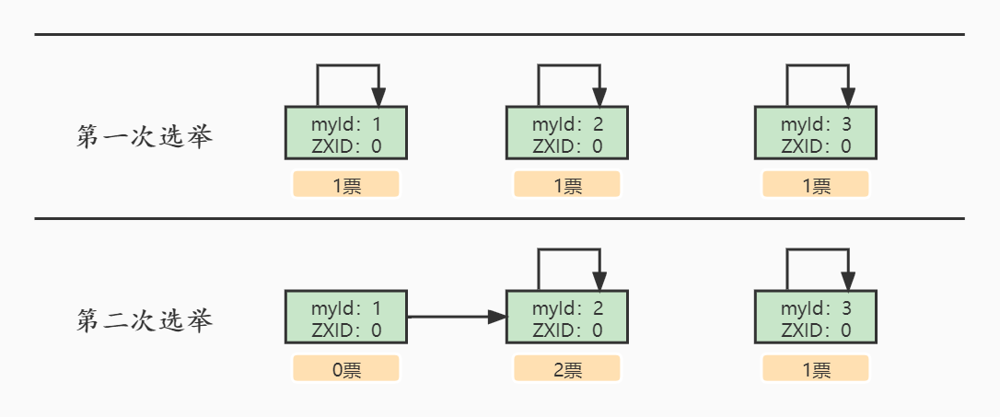
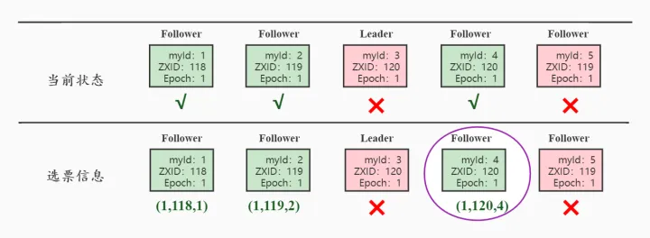

# Zookeeper知识汇总

## Zookeeper集群中是怎样选举leader的

### Zookeeper集群中服务器被划分为以下四种状态

* LOOKING：寻找 Leader 状态。**处于该状态的服务器会认为集群中没有 Leader，需要进行 Leader 选举**。
* FOLLOWING：跟随者状态，说明当前服务器角色为 Follower。
* LEADING：领导者状态，表明当前服务器角色为 Leader。
* OBSERVING：观察者状态，表明当前服务器角色为 Observer。

### Leader选举的触发时机

* 集群启动，需要选举出新的 Leader。
* Leader 服务器宕机。

### 第一次启动Leader选举

假设现有三台机器搭建集群：

1. **每个 Server 发出一个投票投给自己。** Server1 启动时为 LOOKING 状态，myid 记为 1、ZXID 为 0，先投自己一票，投票为 (1, 0)，然后把选票发给集群中的其他机器。
2. Server2 此时也启动，同样为 LOOKING 状态，先投自己一票 (2, 0)，再发给集群中的其他机器。
3. **接收来自各个服务器的投票。** 集群的每个服务器收到投票后，首先判断该投票是否有效，如检查是否属于本轮投票、是否来自 LOOKING 状态的服务器。
4. **处理投票。** 针对每一个投票，服务器都需要将别人的投票和自己的投票进行 PK，PK 规则如下：
   * **优先检查 ZXID。** ZXID 较大的服务器优先作为 Leader。
   * **如果 ZXID 相同，则比较 myid。** myid 较大的服务器作为 Leader。

   对于 Server1 而言，它的投票是 (1, 0)，收到 Server2 的投票 (2, 0)：两者 ZXID 均为 0，再比较 myid，Server2 的 myid 更大，**于是 Server1 更新自己的投票为 (2, 0) 并重新投票；Server2 则无须更新，只需再次向集群中所有机器发出上一次的投票信息即可。**

5. **统计投票。** 每次投票后，服务器都会统计投票信息，判断是否已有过半机器接收到相同的投票信息。对 Server1、Server2 而言，都统计出集群中已有两台机器接受了 (2, 0) 的投票信息，此时便认为已经选出了 Leader。
6. **改变服务器状态。** 一旦确定 Leader，每个服务器都会更新状态：Follower 变更为 FOLLOWING，Leader 变更为 LEADING。
7. Server3 此时启动，发现集群中已有 Leader，便建立连接并把状态置为 FOLLOWING。

### 非第一次启动Leader选举

在 Zookeeper 运行期间，即便有新服务器加入，也不会影响 Leader——**新加入的服务器会将原有的 Leader 视为 Leader 并同步数据。但一旦 Leader 宕机，整个集群将暂停对外服务，进行新一轮 Leader 选举**，其过程与启动时期基本一致。假设集群有 Server1~Server5 五台服务器，原本的 Leader 是 Server3，某一时刻 Server3 和 Server5 都宕机，选举过程如下：

1. **变更状态。** Leader 宕机后，余下的非 Observer 服务器都会将状态变更为 LOOKING，然后开始 Leader 选举流程。
2. **每个 Server 会发出一个投票。** 需要生成投票信息 (EPOCH, ZXID, myid)，对应的 Server1、Server2、Server4 选票信息如上图。Leader 选举规则是：
   * EPOCH 大的直接胜出；
   * EPOCH 相同，ZXID 大的胜出；
   * ZXID 相同，服务器 ID（myid）大的胜出。
3. 之后各个 LOOKING 状态的服务器会交换信息，最终多数选举 Server4，即更改为 (1, 120, 4) 的选票信息。
4. **接收来自各个服务器的投票。** 与启动时过程相同。
5. **处理投票。**
6. **统计投票。**
7. **改变服务器状态。** 此时 Server4 成为新的 Leader。

## 描述一下ZAB协议

ZAB 协议（Zookeeper Atomic Broadcast）是 Zookeeper 中用于实现分布式一致性的协议，旨在确保分布式系统中的数据一致性和可靠性，具有以下特点：

1. **支持崩溃恢复：** 当 Leader 节点崩溃或因其他原因导致 Leader 缺失时，ZAB 协议能自动进入崩溃恢复模式，重新选举一个新的 Leader，并确保所有 Follower 节点的状态与新 Leader 保持一致，之后继续消息广播。
2. **原子性保证：** 确保每个事务请求的原子性，即每个事务要么被所有节点成功执行，要么在所有节点上失败回滚，不会出现部分成功。这是通过两阶段提交过程实现的。
3. **一致性保证：** 通过多副本同步和消息广播机制，确保集群中所有节点的数据副本最终一致。即使在 Leader 崩溃或网络分区等异常情况下，也能通过崩溃恢复机制恢复一致性。

ZAB 协议的执行过程包括三个阶段：

1. **准备阶段（Prepare）：** Leader 节点准备数据（即一个事务提案），并为其分配唯一的事务 ID（zxid），然后通知所有 Follower 节点。
2. **提议阶段（Proposal）：** Follower 节点接收 Leader 发送的提案和 zxid，将其写入本地日志并准备相应服务状态（如更新内存状态等），然后回复一个确认消息（Ack）给 Leader，表示已接收并处理该提案。注意，这里的"确认"是指 Follower 已准备好处理该提案，而非提案已被提交。
3. **提交阶段（Commit）：** 在收到足够数量（通常超过半数）Follower 的确认消息后，Leader 会广播一个提交消息（Commit）给所有 Follower，表示该提案已被大多数节点接受，并正式提交到各自的内存树中执行。

如果在确认/提议阶段，Follower 久久收不到 Leader 的任何消息（包括提案和可能的超时通知），且无法与 Leader 建立通信，那么这些 Follower 可能会认为 Leader 已失效，并可能触发崩溃恢复模式。

不过，崩溃恢复模式通常不是由单个 Follower 单独触发的。实际上，ZooKeeper 集群中的节点会通过"选举算法"共同决定何时进入崩溃恢复模式，并选举出新的 Leader。

## ZAB和Paxos算法的联系与区别

ZAB（ZooKeeper Atomic Broadcast）算法和 Paxos 算法都是分布式系统中用于实现数据一致性的算法。

两者主要的联系在于都采用了类似的领导者选举机制，通过多数派投票保证系统稳定性。在 ZAB 中，这体现在它使用了一种类似于 Paxos 的领导者选举过程：有一个 Leader 协调多个 Follower 的操作。而在 Paxos 中，一个提案需要被大多数进程接受并返回结果，才能被确定。

两者的区别在于目标和实现方式不同：

1. **目标：** ZAB 算法用于构建高可用的分布式数据主备系统（如 ZooKeeper），而 Paxos 算法用于构建分布式一致性状态机系统。
2. **实现方式：** ZAB 使用消息广播实现分布式系统的协调，要求每个消息都必须得到大多数节点的反馈才能确认，从而确保消息一致性；同时引入了 epoch 概念，用于在领导者出现故障时正确选择新的领导者。Paxos 则更通用，可以处理更广泛的一致性问题，而不仅是消息广播；但其实现较为复杂，需要处理领导者故障、消息丢失等多种情况。

综上所述，ZAB 和 Paxos 的联系在于采用了领导者选举机制和多数派投票原则，区别在于目标和实现方式不同。

## ZooKeeper集群中服务器之间是怎样通信的

ZooKeeper 集群中的服务器之间使用 TCP 协议进行通信，主要包括以下关键部分：

1. **Leader 和 Follower：** 集群中有一个服务器被选为领导者（Leader），其余成为跟随者（Follower）。Leader 负责处理所有客户端请求，Followers 主要用于接收 Leader 的数据更新。
2. **通信机制：** 每个服务器创建 TCP 连接，使用 LearnerHandler 实体处理与其他服务器的网络通信。LearnerHandler 的主要职责是接收来自其他服务器的数据更新，并将其传递给应用程序。
3. **客户端请求：** 客户端通过 ZooKeeper 客户端库连接到集群中的任一服务器并发送请求，该服务器会将请求传递给 Leader 或直接处理。
4. **数据同步：** Leader 负责处理客户端请求，并将数据更新广播给所有 Followers；Followers 应用这些更新以保持数据一致性。
5. **故障处理：** 如果 Leader 服务器发生故障，ZooKeeper 使用选举机制选举新的 Leader，以确保集群高可用。

总之，ZooKeeper 的通信原理基于客户端/服务器模型：客户端发送请求，服务器接收、处理并返回响应，从而确保集群中数据的一致性和高可用性。

## Zookeeper对节点的watch监听通知是永久的吗

**在 ZooKeeper 中，节点监视（watch）通知不是永久的，而是一次性触发**。当客户端注册一个监视事件（如监视节点的数据变化或子节点变化）后，如果相应的节点状态发生变化，ZooKeeper 会通知客户端并触发监视事件。一旦监视事件被触发，它会从客户端的监视列表中删除，客户端需要再次显式设置监视，才能继续监视节点状态变化。这种一次性机制有助于避免客户端在不再需要监视时浪费资源。若需持续监视，客户端必须在每次触发监视后重新设置。

值得注意的是，**从 ZooKeeper 3.5.0 开始引入了永久监听（persistent watch）的支持**。这意味着监听事件一旦触发，除非客户端显式取消监听，否则 ZooKeeper 会持续向客户端发送通知，而不仅触发一次。这对需要持续监视节点状态的场景非常有用，客户端无需反复设置监视即可持续接收状态变化通知。

这一改进提高了 ZooKeeper 的灵活性和适用性，允许开发人员更精细地控制监视行为，以满足不同应用场景的需求。

## 讲一下ZooKeeper的持久化机制

Zookeeper 的持久化机制主要涉及两种数据存储方式：内存存储和磁盘存储。

1. **内存存储：** Zookeeper 默认的数据存储方式，将所有数据保存在内存中。当 Zookeeper 关闭或发生故障时，内存中的数据会丢失。为提高性能，Zookeeper 采用了延迟写盘策略，即先把数据写入内存，再异步写入磁盘，以减少磁盘 I/O、提高响应速度。
2. **磁盘存储：** 为解决内存存储数据丢失的问题，Zookeeper 提供了磁盘持久化方式，将数据保存在磁盘上，并在启动时从磁盘加载。为提高写入性能，Zookeeper 采用了两种机制：**快照（snapshot）**和**事务日志（transaction log）**。快照是 Zookeeper 数据树的一个完整拷贝，事务日志记录所有的数据更改操作；通过这两种机制，Zookeeper 可以在系统故障时恢复数据。

Zookeeper 的持久化机制可根据实际需求选择和配置：需要高可用性和实时性的场景可选择内存存储；需要更高可靠性和可恢复性的场景可选择磁盘存储。

## 说说Zookeeper的CAP问题上做的取舍

Zookeeper 在 CAP 问题上选择了 CP，即在一致性和可用性之间选择了强一致性。

Zookeeper 是一个分布式协调服务，主要职责是维护整个系统的状态并提供一致性的服务。为保证数据一致性，Zookeeper 必须确保分布式节点之间同步时不出现不一致。这意味着，在出现网络故障或消息丢失时，为保证一致性，Zookeeper 会牺牲部分可用性——少数派分区将无法提供服务，而不是让不同分区各自为政、返回不一致的数据。

然而，这并不意味着 Zookeeper 完全牺牲了可用性。尽管它一致性优先，但仍通过一些机制尽可能提高可用性：例如允许客户端在多个服务器之间进行备份，防止单个服务器故障导致服务不可用；还提供实时性和持久性的选择，以满足不同应用场景的需求。

总的来说，Zookeeper 在 CAP 问题上的取舍是为了保证数据一致性，虽然在一定程度上牺牲了可用性，但通过一些机制尽可能地提高了服务的可用性。

## Zookeeper是如何解决脑裂问题的

Zookeeper 通过**过半机制**来避免脑裂问题。

具体来说，在 Zookeeper 的领导者选举过程中，如果某台 Zookeeper Server 获得超过半数的选票，它就可以成为 Leader。例如集群中有 5 台 Zookeeper Server，过半数就是 2.5，即至少要有 3 台投票给同一个 Server，才会选出 Leader。

过半机制要求票数**严格大于**集群总数的一半（">"，而非 "≥"）。这样，任意两个分区不可能同时满足过半条件（2 × 过半 > 总数），从而保证同一时刻最多只有一个 Leader，避免脑裂。

因此，Zookeeper 通过过半机制保证在发生网络分区时，集群仍能正常工作，避免因脑裂导致集群失效。

## Zookeeper脑裂是什么原因导致的

Zookeeper 脑裂是指一个集群环境中出现了多个 Master 节点，导致数据不一致和数据问题。这种情况通常发生在网络故障导致集群中部分节点失去与 Master 节点连接时，这些节点认为 Master 已失效，从而选举新的 Master，过程中可能出现多个 Master。

脑裂问题的主要原因是网络环境不稳定和假死现象。例如，当集群中的部分节点因网络原因无法连接到 Master 时，这些节点会认为 Master 已失效并发起新的选举；而如果网络不稳定，Master 可能重新进入集群，导致出现多个 Master。

解决 Zookeeper 脑裂问题的方法包括：

1. 增加网络稳定性，避免网络故障导致的问题。
2. 调整 Zookeeper 集群的选举机制和超时设置，使其更适应网络环境和集群架构。
3. 及时发现并处理多个 Master 节点，避免数据不一致和其他问题。

## zk集群数据是如何同步的

Zookeeper 集群的数据同步过程如下：

1. 集群启动时，先进行领导者选举，确定哪个节点是 Leader，哪些节点是 Follower 和 Observer。
2. Leader 会和其他节点进行数据同步，采用发送快照和发送 Diff 日志的方式。
3. 集群在工作过程中，所有写请求都交给 Leader 处理，从节点只能处理读请求。
4. Leader 收到写请求时，会通过两阶段提交机制来处理。
5. Leader 将该写请求对应的日志发送给其他 Follower 节点，并等待 Follower 持久化日志成功。
6. Follower 收到日志后持久化，持久化成功则发送一个 Ack 给 Leader。
7. Leader 收到半数以上的 Ack 后开始提交，先更新 Leader 本地的内存数据。
8. 然后发送 commit 命令给 Follower 节点，Follower 收到后也更新本地内存中的数据。

这样，Zookeeper 集群的数据同步就完成了。

## Zookeeper分布式锁如何实现

ZooKeeper 实现分布式锁的主要思路，是利用临时顺序节点的唯一性和顺序性。具体实现步骤：

1. 创建一个 ZooKeeper 节点作为锁的根节点，例如 `/locks`。
2. 当某个线程需要获取锁时，在锁的根节点下创建一个临时顺序节点，例如 `/locks/lock-0001`，并尝试获取锁。
3. 线程获取锁的过程是：检查自己创建的节点是否是锁节点下最小的节点，如果是，则表示该线程获得了锁；否则监听自己创建节点的前一个节点，等待前一个节点释放。
4. 当线程释放锁时，删除自己创建的节点。

这种方式实现的分布式锁具有一定的可靠性和性能，但需要确保 ZooKeeper 集群的可用性和性能足够好，并处理连接断开、会话过期等异常情况，以保证分布式锁的正确性。此外，还可以使用 ZooKeeper 的超时机制来处理死锁等问题。

## Zookeeper是如何保证事务的顺序一致性的

Zookeeper 通过两个机制保证事务的顺序一致性：事务的严格串行化和锁定机制。

1. **事务的严格串行化：** 在 Zookeeper 中，所有写操作都必须经过一个称为"提交"（commit）的阶段。在一个事务被提交之前，任何客户端都无法读取该事务。这种机制确保所有事务按严格顺序执行，保证了事务的顺序一致性。
2. **锁定机制：** 当不同事务需要访问同一个资源时，需要使用锁定机制来协调访问。Zookeeper 提供了两种类型的锁：共享锁和排他锁。共享锁允许多个事务同时访问同一资源，排他锁则阻止其他事务访问该资源。

通过以上两个机制，Zookeeper 确保了事务的顺序一致性，从而保证了数据的一致性和系统的可靠性。

## 为什么Zookeeper集群的数目一般为奇数个

Zookeeper 集群的数目一般为奇数个，主要出于以下两方面考虑：

1. **防止脑裂：** 若节点数为偶数，脑裂时可能均分成两个对等子集群，谁都无法获得超过半数的票，导致整个集群瘫痪；而奇数个节点在脑裂时必然有一个子集群占多数，仍可正常工作。
2. **性价比更高、便于选举：** 奇数与相邻的偶数（如 3 与 4）容错能力相同，都最多容忍 1 台故障，但奇数集群少一台机器、成本更低；同时在选举时更容易形成明确多数，保证选举顺利进行。

因此，为确保 Zookeeper 集群的稳定性和可用性，通常采用奇数个节点。

## Zookeeper的典型应用场景

Zookeeper 的典型应用场景包括：

1. **数据发布与订阅：** 发布者将数据发布到 ZooKeeper 节点上，供订阅者动态获取，实现配置信息的集中式管理和动态更新。
2. **分布式锁：** 利用 ZooKeeper 节点的唯一性和顺序性，保证多个线程在尝试获取锁时按一定顺序进行。
3. **集群管理：** 为分布式系统提供集群管理功能，包括节点监控、异常处理、状态同步等。
4. **分布式协调：** 为分布式系统中的各个参与者提供一个协调器，处理任务分配、等待与通知等协调操作。
5. **命名服务：** 作为分布式命名服务，为网络中的对象提供唯一的名称。

## Zookeeper的通知机制是什么

Zookeeper 可以感知某些事件的发生，并将这些事件通知给客户端。这种通知机制是异步的：事件发生时，Zookeeper 会以某种方式将事件通知给客户端，而不需要等待客户端的回应。

具体来说，Zookeeper 允许客户端向服务端的某个 Znode 注册一个 Watcher 监听。当该 Znode 的指定事件（如数据改变、节点删除、子节点状态变更等）发生时，Zookeeper 就会通知客户端。这种 Watcher 机制使 Zookeeper 能够实现分布式锁、发布订阅等功能。

此外，Zookeeper 允许客户端在每个 Znode 节点上设置一个观察（Watch）：如果被观察的 Znode 有变更，该观察就会被触发，Zookeeper 随后向该观察所属的客户端发送一个通知包，告知节点发生了何种事件。

## zk节点宕机如何处理

Zookeeper 必须集群部署，推荐配置不少于 3 个节点，且自身要保证当一个节点宕机时其他节点能继续提供服务。

1. 如果是一个 **Follower** 宕机，还有 2 台服务器提供访问；因为 Zookeeper 上的数据有多个副本，数据不会丢失。
2. 如果是一个 **Leader** 宕机，Zookeeper 会选举出新的 Leader。

因此，Zookeeper 可以容忍一部分节点宕机，但前提是超过一半的节点正常工作。此时集群仍可正常提供服务；如果节点挂得太多，只剩一半或不到一半能工作，集群就会失效。
