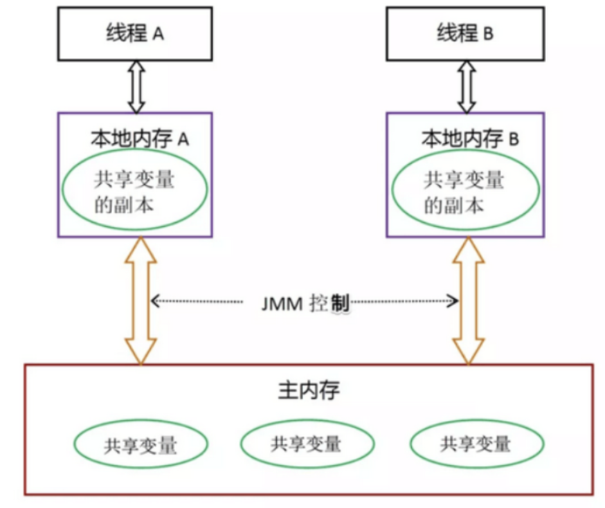
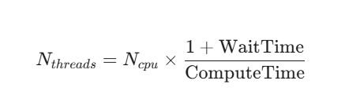
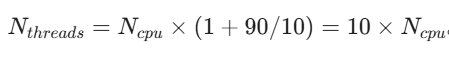

# 并发编程知识汇总



## 1. 线程与进程

**进程**：程序在执行时分配的独立内存空间，是资源分配的最小单位。

**线程**：进程内的执行单元，是CPU调度的最小单位。一个进程可包含多个线程，共享进程的内存空间。

**区别**：
- 进程间内存独立，线程间共享内存（堆、方法区）
- 线程上下文切换开销远小于进程
- 线程间通信更简单（直接读写共享变量），但需要同步控制

## 2. 并发与并行

- **并发（Concurrency）**：多个任务在同一时间段内交替执行，宏观上同时进行，微观上串行。单核CPU通过时间片轮转实现。
- **并行（Parallelism）**：多个任务在同一时刻真正同时执行，需要多核CPU支持。

## 3. 线程的创建方式

1. **继承Thread类**：重写`run()`方法，调用`start()`启动。
2. **实现Runnable接口**：更灵活，避免单继承限制。
3. **实现Callable接口**：可以有返回值和抛出异常，配合`FutureTask`使用。
4. **线程池**：`ExecutorService`，复用线程，避免频繁创建销毁。

```java
// 方式1：继承Thread
class MyThread extends Thread {
    public void run() { System.out.println("继承Thread"); }
}

// 方式2：实现Runnable
class MyRunnable implements Runnable {
    public void run() { System.out.println("实现Runnable"); }
}

// 方式3：实现Callable
class MyCallable implements Callable<Integer> {
    public Integer call() { return 42; }
}

// 方式4：线程池
ExecutorService pool = Executors.newFixedThreadPool(10);
pool.submit(() -> System.out.println("线程池执行"));
```

**注意**：`start()`方法会创建新线程并调用`run()`；直接调用`run()`只是普通方法调用，不会创建新线程。一个线程对象只能调用一次`start()`，第二次会抛`IllegalThreadStateException`。

## 4. 线程的生命周期

Java线程有6种状态（`Thread.State`枚举）：

| 状态 | 说明 |
|------|------|
| **NEW** | 已创建但未调用`start()` |
| **RUNNABLE** | 已调用`start()`，正在运行或等待CPU调度 |
| **BLOCKED** | 等待获取`synchronized`锁 |
| **WAITING** | 无限等待（`wait()`、`join()`、`LockSupport.park()`） |
| **TIMED_WAITING** | 限时等待（`sleep(n)`、`wait(n)`、`join(n)`） |
| **TERMINATED** | 线程执行完毕 |

**关键区分**：
- `synchronized`拿不到锁 → **BLOCKED**
- JUC的`ReentrantLock`拿不到锁 → **WAITING**（底层用`LockSupport.park()`）
- `sleep()` → **TIMED_WAITING**（不释放锁）
- `wait()` → **WAITING**（释放锁）

## 5. 线程调度

Java采用**抢占式优先级调度**，线程1:1映射到OS内核线程，由OS决定时间片分配。

- `Thread.setPriority(1~10)`只是给OS的建议，不保证生效
- `Thread.yield()`暗示让出CPU，但不强制
- JDK 21+虚拟线程由JVM内部调度器（基于`ForkJoinPool`）进行**协作式调度**

## 6. 守护线程

- **用户线程**：执行业务逻辑，JVM会等待所有用户线程结束才退出
- **守护线程**：后台服务（如GC），当所有用户线程结束时JVM直接退出，不等待守护线程

```java
Thread daemon = new Thread(() -> { while(true) { /* ... */ } });
daemon.setDaemon(true); // 必须在start()之前设置
daemon.start();
```

**注意**：守护线程的`finally`块可能不执行，**不能用于I/O操作或关键资源释放**。

## 7. 线程安全

确保线程安全的4种方案：

1. **互斥同步（悲观锁）**：`synchronized`或`ReentrantLock`，保证原子性和可见性
2. **非阻塞同步（CAS）**：`AtomicInteger`等原子类，适合竞争不激烈场景
3. **线程隔离**：局部变量（栈封闭）或`ThreadLocal`
4. **不可变对象**：`final`修饰，`String`、`Integer`等，天生线程安全

**注意**：使用线程安全集合（如`ConcurrentHashMap`）不等于代码线程安全——**复合操作**（如check-then-act）仍需额外同步，应使用`putIfAbsent()`等原子方法。

## 8. JMM（Java内存模型）

JMM定义了线程和主内存之间的抽象关系：

- 每个线程有自己的**本地内存**（工作内存），存储共享变量的副本
- 线程对变量的所有操作都在本地内存中进行，不能直接读写主内存
- 线程间变量传递需通过主内存完成

**三个特性**：
- **可见性**：一个线程修改了共享变量，其他线程能立即看到。`volatile`、`synchronized`、`final`保证可见性。
- **原子性**：操作不可分割。`synchronized`、`Lock`、`Atomic*`类保证原子性。
- **有序性**：指令执行顺序。`volatile`禁止指令重排序，`synchronized`保证有序性。

**指令重排序**：编译器和处理器为优化性能可能重排指令，`volatile`通过**内存屏障**禁止重排序。

## 9. volatile关键字

`volatile`保证**可见性**和**有序性**，但不保证**原子性**。

- **适用场景**：状态标志位（如`boolean stop`）、DCL单例（配合`volatile`防止指令重排序）
- **不适用**：`i++`等复合操作（需要`synchronized`或`AtomicInteger`）

```java
// DCL单例
public class Singleton {
    private static volatile Singleton instance; // volatile防止指令重排序
    public static Singleton getInstance() {
        if (instance == null) {
            synchronized (Singleton.class) {
                if (instance == null) {
                    instance = new Singleton();
                }
            }
        }
        return instance;
    }
}
```

## 10. synchronized关键字

`synchronized`是JVM层面的内置锁，可修饰方法或代码块。

**锁类型（JDK 6+优化）**：
1. **偏向锁**：假设同一线程重复获取，CAS记录线程ID
2. **轻量级锁**：多线程交替执行，CAS自旋
3. **重量级锁**：竞争激烈，OS层面的互斥量，线程阻塞

**特点**：
- 可重入、不可中断、非公平
- 修饰实例方法→锁`this`；修饰静态方法→锁`Class`对象；修饰代码块→锁指定对象

## 11. ReentrantLock

`ReentrantLock`是JUC提供的显式锁，基于AQS实现。

```java
Lock lock = new ReentrantLock(); // 默认非公平
lock.lock();
try {
    // 临界区
} finally {
    lock.unlock(); // 必须在finally释放
}
```

**与synchronized对比**：

| 特性 | synchronized | ReentrantLock |
|------|-------------|---------------|
| 实现层面 | JVM内置 | API层（AQS） |
| 公平性 | 仅非公平 | 可选公平/非公平 |
| 可中断 | 不可 | `lockInterruptibly()` |
| 超时获取 | 不可 | `tryLock(timeout)` |
| 条件变量 | 单个`wait/notify` | 多个`Condition` |
| 锁释放 | 自动 | 手动`unlock()` |

**tryLock() vs lock()**：`tryLock()`立即返回（拿不到锁不阻塞），`lock()`会阻塞等待。

## 12. CAS与原子类

**CAS（Compare-And-Swap）**：无锁乐观策略，比较当前值与期望值，相同则更新。

```java
AtomicInteger ai = new AtomicInteger(0);
ai.compareAndSet(0, 1); // 期望0，更新为1
ai.getAndIncrement(); // 原子自增
```

**ABA问题**：值从A→B→A，CAS无法感知。用`AtomicStampedReference`加版本号解决。

**自旋开销**：竞争激烈时CAS自旋浪费CPU，适合低竞争场景。

## 13. ThreadLocal

`ThreadLocal`为每个线程提供独立的变量副本，以空间换时间。

```java
ThreadLocal<String> tl = new ThreadLocal<>();
tl.set("thread-specific-value");
String val = tl.get(); // 每个线程获取自己的副本
```

**底层原理**：每个`Thread`对象持有`ThreadLocalMap`，key是`ThreadLocal`对象（弱引用），value是实际值。

**内存泄漏**：`ThreadLocalMap`的key是弱引用，value是强引用。`ThreadLocal`对象被回收后key变null，但value仍存在。**解决方案**：用完后显式调用`remove()`。

**父子线程传值**：用`InheritableThreadLocal`，子线程创建时继承父线程的值。

## 14. 线程池



### 核心参数

```java
ThreadPoolExecutor pool = new ThreadPoolExecutor(
    2,                      // corePoolSize 核心线程数
    4,                      // maximumPoolSize 最大线程数
    60L, TimeUnit.SECONDS,  // keepAliveTime 空闲存活时间
    new LinkedBlockingQueue<>(10), // workQueue 任务队列
    Executors.defaultThreadFactory(), // threadFactory 线程工厂
    new ThreadPoolExecutor.AbortPolicy() // 拒绝策略
);
```

### 任务提交流程

1. 线程数 < corePoolSize → 创建新线程执行
2. 线程数 >= corePoolSize → 放入任务队列
3. 队列满 + 线程数 < maximumPoolSize → 创建非核心线程执行
4. 队列满 + 线程数 = maximumPoolSize → 执行拒绝策略

### 拒绝策略

| 策略 | 行为 |
|------|------|
| `AbortPolicy`（默认） | 抛`RejectedExecutionException` |
| `CallerRunsPolicy` | 由提交任务的线程执行 |
| `DiscardPolicy` | 静默丢弃 |
| `DiscardOldestPolicy` | 丢弃队列最老任务，重试提交 |

### 线程池状态

| 状态 | 说明 |
|------|------|
| `RUNNING` | 接收新任务，处理队列任务 |
| `SHUTDOWN` | 不接收新任务，处理队列任务（`shutdown()`） |
| `STOP` | 不接收新任务，不处理队列任务，中断进行中任务（`shutdownNow()`） |
| `TIDYING` | 所有任务终止，线程数为0 |
| `TERMINATED` | `terminated()`执行完毕 |

### 核心线程数设置



- **CPU密集型**：`N + 1`（N=CPU核心数）
- **IO密集型**：`2N` 或 `N * (1 + 等待时间/计算时间)`

### 线程池任务完成检测

- `Future.get()`：阻塞等待完成
- `CompletableFuture`：异步编排，`allOf()`/`anyOf()`等待多个任务
- `CountDownLatch`：计数器归零后放行
- `CyclicBarrier`：所有线程到达屏障点后同时放行

### 线程池异常处理

- `execute()`提交：异常直接抛出，线程终止并创建新线程替代
- `submit()`提交：异常被封装在`Future`中，线程不终止、不替换
- 两种方式都不影响线程池中其他线程

```java
// 自定义异常处理
pool.setUncaughtExceptionHandler((t, e) -> {
    System.out.println(t.getName() + "异常: " + e.getMessage());
});
```

### 线程池线程复用

线程池中的线程通过**Worker**内部类实现复用：每个Worker持有一个线程，不断从任务队列`poll`任务执行。线程执行完一个任务后不会销毁，而是循环获取下一个任务，直到线程池关闭或空闲超时（非核心线程）。

## 15. 阻塞队列

| 队列 | 特点 |
|------|------|
| `ArrayBlockingQueue` | 有界数组，一把锁 |
| `LinkedBlockingQueue` | 可选有界链表，两把锁（put/take分离） |
| `SynchronousQueue` | 不存储元素，直接传递 |
| `PriorityBlockingQueue` | 无界，优先级排序 |
| `DelayQueue` | 延迟获取元素 |

## 16. 锁优化

- **锁消除**：JIT检测到不可能共享的锁，自动消除（如局部变量的`StringBuffer`）
- **锁粗化**：连续对同一对象加锁，JIT合并为一次
- **减小锁粒度**：如`ConcurrentHashMap`分段锁（JDK 8改为CAS+synchronized）
- **读写分离**：`ReadWriteLock`/`StampedLock`，读读不互斥

## 17. 读写锁

```java
ReadWriteLock rwLock = new ReentrantReadWriteLock();
Lock readLock = rwLock.readLock();   // 多线程可同时读
Lock writeLock = rwLock.writeLock(); // 写独占，读写互斥
```

**StampedLock**（JDK 8+）：支持乐观读，性能更好，但不支持重入。

## 18. Condition

`Condition`配合`Lock`使用，替代`wait/notify`，支持多个等待队列。

```java
Lock lock = new ReentrantLock();
Condition notEmpty = lock.newCondition();
Condition notFull = lock.newCondition();
// notEmpty.await() / notEmpty.signal()
```

## 19. AQS（AbstractQueuedSynchronizer）

AQS是JUC锁和同步器的基础框架：

- 核心是一个`volatile int state`表示同步状态
- 内部维护一个**CLH双向等待队列**（FIFO）
- 独占模式（`ReentrantLock`）和共享模式（`Semaphore`、`CountDownLatch`）
- 模板方法模式，子类重写`tryAcquire`/`tryRelease`等

## 20. 并发工具类

### CountDownLatch

计数器，`await()`阻塞直到计数归零，`countDown()`减1。不可重置。

```java
CountDownLatch latch = new CountDownLatch(3);
for (int i = 0; i < 3; i++) {
    new Thread(() -> { /* do work */ latch.countDown(); }).start();
}
latch.await(); // 等待3个线程完成
```

### CyclicBarrier

屏障，所有线程到达屏障点后同时放行，可重置（`reset()`）。

### Semaphore

信号量，控制同时访问的线程数（限流）。

```java
Semaphore sem = new Semaphore(3); // 最多3个线程同时访问
sem.acquire(); // 获取许可
try { /* ... */ } finally { sem.release(); }
```

## 21. 并发容器

| 容器 | 特点 |
|------|------|
| `ConcurrentHashMap` | 分段锁(JDK7)/CAS+synchronized(JDK8) |
| `CopyOnWriteArrayList` | 写时复制，读无锁，适合读多写少 |
| `ConcurrentSkipListMap` | 跳表实现的并发SortedMap |
| `ConcurrentLinkedQueue` | CAS无锁并发队列 |
| `BlockingQueue`系列 | 阻塞队列，用于生产者-消费者 |

## 22. Fork/Join框架

分而治之的并行计算框架，基于`ForkJoinPool`（工作窃取算法）。

```java
class MyTask extends RecursiveTask<Integer> {
    protected Integer compute() {
        if (任务足够小) return 直接计算;
        MyTask left = new MyTask(...); left.fork();
        MyTask right = new MyTask(...); right.fork();
        return left.join() + right.join();
    }
}
ForkJoinPool pool = new ForkJoinPool();
pool.invoke(new MyTask(...));
```

**工作窃取**：空闲线程从其他线程队列尾部窃取任务，提高利用率。

## 23. 死锁

**死锁条件**（4个必要条件）：
1. 互斥
2. 持有并等待
3. 不可剥夺
4. 循环等待

**避免**：
- 固定加锁顺序
- 使用`tryLock()`超时获取
- 减小锁粒度

**检测**：`jstack`查看线程栈，或`ThreadMXBean.findDeadlockedThreads()`

**死锁 vs 活锁 vs 饥饿**：
- 死锁：线程互相等待，都不动
- 活锁：线程互相谦让，都在动但无法推进
- 饥饿：线程长期得不到资源（如非公平锁）

## 24. 伪共享

CPU缓存行通常64字节，多个变量在同一缓存行时，一个线程修改变量会导致其他线程缓存行失效。

**解决**：`@Contended`注解（JDK 8+）填充缓存行，或手动填充。

```java
@Contended
class PaddedAtomicLong {
    volatile long value;
}
```

## 25. final关键字

`final`保证**初始化安全性**：其他线程看到final字段时，必定是已构造完成的值（不需要额外同步）。

- `final`字段：构造完成后对其他线程可见
- `final`引用：引用不可变，但引用对象内部状态可变

## 26. 不可变对象

不可变对象天生线程安全。创建原则：
1. 所有字段`final`
2. 不提供setter
3. 类声明`final`（或构造私有+工厂方法）
4. 若持有可变对象引用，确保不对外暴露

`String`、`Integer`、`LocalDate`等都是不可变对象。

## 27. HashMap（JDK 7 vs JDK 8）

| 特性 | JDK 7 | JDK 8 |
|------|-------|-------|
| 结构 | 数组+链表 | 数组+链表+红黑树 |
| 链表插入 | 头插法（并发可能成环） | 尾插法 |
| 链表→树 | 无 | 长度≥8且数组≥64 |
| 扩容 | 重新计算位置 | 高低位拆分 |

**注意**：HashMap线程不安全，多线程用`ConcurrentHashMap`。

## 28. 虚拟线程（JDK 21+）

虚拟线程是轻量级线程，由JVM调度，不绑定OS线程。

```java
// 创建虚拟线程
Thread vt = Thread.startVirtualThread(() -> { /* ... */ });

// 虚拟线程执行器
try (var executor = Executors.newVirtualThreadPerTaskExecutor()) {
    IntStream.range(0, 10000).forEach(i ->
        executor.submit(() -> { /* IO密集任务 */ }));
}
```

**特点**：
- 极低创建开销，可创建百万级
- 适合IO密集型任务，不适合CPU密集型
- 阻塞时自动卸载（unmount），不占用OS线程
- 不要池化虚拟线程，用完即弃

---

# Java并发面试题合集

# 1.线程池的完成检测

## 标准回答

线程池任务完成检测的几种方式：

1. **Future.get()**：阻塞等待单个任务完成
2. **CompletableFuture.allOf()**：等待多个任务全部完成
3. **CountDownLatch**：手动计数
4. **线程池getCompletedTaskCount()**：返回已完成任务数（不精确）
5. **重写afterExecute()**：在`ThreadPoolExecutor`子类中钩子方法感知每个任务完成

```java
// 方式2：CompletableFuture
List<CompletableFuture<Void>> futures = tasks.stream()
    .map(task -> CompletableFuture.runAsync(task, pool))
    .collect(Collectors.toList());
CompletableFuture.allOf(futures.toArray(new CompletableFuture[0])).join();

// 方式5：重写afterExecute
class MyPool extends ThreadPoolExecutor {
    @Override
    protected void afterExecute(Runnable r, Throwable t) {
        super.afterExecute(r, t);
        System.out.println("任务完成");
    }
}
```

# 2.阻塞与非阻塞、同步与异步

## 标准回答

- **阻塞**：调用后线程挂起等待结果，期间无法做其他事
- **非阻塞**：调用立即返回，不等待结果（通过轮询或回调获取）
- **同步**：调用者主动等待结果（阻塞或轮询）
- **异步**：调用者不等待，结果通过回调/事件通知

| | 同步 | 异步 |
|---|---|---|
| **阻塞** | 同步阻塞（如`Future.get()`） | — |
| **非阻塞** | 同步非阻塞（轮询`Future.isDone()`） | 异步非阻塞（`CompletableFuture.thenApply()`） |

# 3.虚拟线程

## 标准回答

JDK 21引入的轻量级线程，由JVM调度（基于`ForkJoinPool`），不1:1映射OS线程。

**核心优势**：以接近普通线程的API，实现极高并发度（百万级），适合IO密集型场景。

**与平台线程对比**：

| 特性 | 平台线程 | 虚拟线程 |
|------|---------|---------|
| 实现 | 1:1映射OS线程 | JVM调度，复用载体线程 |
| 创建开销 | 大（~1MB栈） | 极小（~KB级） |
| 数量上限 | 千级 | 百万级 |
| 阻塞 | 占用OS线程 | 自动卸载，释放载体线程 |
| 适用场景 | CPU密集型 | IO密集型 |

**SpringBoot使用虚拟线程**：

```java
@Bean
public TomcatProtocolHandlerCustomizer<?> protocolHandlerVirtualThreadExecutorCustomizer() {
    return protocolHandler -> {
        protocolHandler.setExecutor(Executors.newVirtualThreadPerTaskExecutor());
    };
}
```

**注意**：虚拟线程不要池化（用完即弃）；`synchronized`块内阻塞会pin住载体线程（JDK 21），建议用`ReentrantLock`替代。

# 4.如何停止正在运行的线程

## 标准回答

**不要用**`stop()`（已废弃，可能导致数据不一致）和`suspend()`/`resume()`（已废弃，易死锁）。

正确方式：

1. **volatile标志位**：适合无阻塞的任务
2. **interrupt()**：可中断阻塞操作（`sleep`、`wait`、`IO`等）

```java
// 方式1：volatile标志位
class MyTask implements Runnable {
    private volatile boolean stop = false;
    public void run() {
        while (!stop) { /* do work */ }
    }
    public void stop() { stop = true; }
}

// 方式2：interrupt（推荐）
Thread t = new Thread(() -> {
    while (!Thread.currentThread().isInterrupted()) {
        try {
            Thread.sleep(100);
        } catch (InterruptedException e) {
            break; // sleep被中断会抛异常并清除中断标志
        }
    }
});
t.start();
t.interrupt(); // 请求中断
```

**注意**：`interrupt()`只是设置中断标志，是否响应由线程自己决定。`InterruptedException`被捕获后中断标志会被清除，需要时需重新`interrupt()`。

# 5.三个线程T1、T2、T3顺序执行

## 标准回答

```java
// 方式1：join()
t1.start(); t1.join();
t2.start(); t2.join();
t3.start(); t3.join();

// 方式2：CompletableFuture
CompletableFuture.runAsync(t1)
    .thenRunAsync(t2)
    .thenRunAsync(t3)
    .join();

// 方式3：单线程线程池
ExecutorService pool = Executors.newSingleThreadExecutor();
pool.submit(t1); pool.submit(t2); pool.submit(t3);
pool.shutdown();

// 方式4：CountDownLatch（链式）
```

# 6.ThreadLocal内存泄漏

## 标准回答

`ThreadLocalMap`中key为`ThreadLocal`的弱引用，value为强引用。当`ThreadLocal`对象被GC回收后，key变null，但value仍被`Entry`强引用，导致value无法回收 → 内存泄漏。

**发生条件**：`ThreadLocal`对象被回收 + 线程长期存活（如线程池）+ 未调用`remove()`。

**解决方案**：每次用完后在`finally`中调用`remove()`。

```java
ThreadLocal<String> tl = new ThreadLocal<>();
try {
    tl.set("value");
    // use tl
} finally {
    tl.remove(); // 必须清理
}
```

# 7.CompletableFuture

## 标准回答

`CompletableFuture`是JDK 8引入的异步编排工具，支持链式调用、组合多个异步任务。

```java
CompletableFuture<String> cf = CompletableFuture
    .supplyAsync(() -> "hello")           // 异步执行
    .thenApply(s -> s + " world")         // 转换
    .thenCompose(s -> CompletableFuture.supplyAsync(() -> s + "!")) // 组合
    .exceptionally(e -> "fallback");      // 异常处理

String result = cf.join(); // "hello world!"
```

**常用方法**：
- `thenApply`/`thenApplyAsync`：转换结果
- `thenAccept`/`thenRun`：消费结果，无返回值
- `thenCombine`：合并两个独立future
- `allOf`/`anyOf`：等待全部/任一完成
- `exceptionally`/`handle`/`whenComplete`：异常处理

**注意**：默认使用`ForkJoinPool.commonPool()`，生产环境建议传入自定义线程池避免资源竞争。

# 8.线程池提交任务流程

## 标准回答

1. 线程数 < `corePoolSize` → 创建新核心线程执行
2. 线程数 >= `corePoolSize` → 尝试放入`workQueue`
3. 队列满 + 线程数 < `maximumPoolSize` → 创建非核心线程执行
4. 队列满 + 线程数 = `maximumPoolSize` → 执行拒绝策略

**注意**：使用无界队列（如`LinkedBlockingQueue`无参构造）时，`maximumPoolSize`永远不会生效。

# 9.线程池的状态

## 标准回答

| 状态 | 值 | 说明 |
|------|---|------|
| RUNNING | -1 | 接收新任务，处理队列任务 |
| SHUTDOWN | 0 | 不接收新任务，处理队列任务 |
| STOP | 1 | 不接收不处理，中断进行中任务 |
| TIDYING | 2 | 任务终止，线程数为0 |
| TERMINATED | 3 | terminated()完成 |

状态转换：`RUNNING` → `SHUTDOWN`（`shutdown()`）→ `TIDYING` → `TERMINATED`
`RUNNING` → `STOP`（`shutdownNow()`）→ `TIDYING` → `TERMINATED`

# 10.如何优雅的停止线程

## 标准回答

1. **`shutdown()`**：不再接收新任务，等待已提交任务（含队列中）执行完毕
2. **`shutdownNow()`**：立即停止，返回未执行任务列表，中断正在执行的任务
3. **`awaitTermination(timeout)`**：等待终止，配合超时

```java
pool.shutdown(); // 优雅关闭
if (!pool.awaitTermination(60, TimeUnit.SECONDS)) {
    pool.shutdownNow(); // 超时强制关闭
}
```

# 11.Tomcat自定义线程池

## 标准回答

Tomcat线程池与JUC线程池的区别：Tomcat重写了任务提交流程，**先扩容到maxThreads，再入队列**（JUC是先入队列再扩容），更适合突发流量。

```java
// 自定义Tomcat线程池
@Configuration
public class TomcatConfig {
    @Bean
    public WebServerFactoryCustomizer<TomcatServletWebServerFactory> customizer() {
        return factory -> factory.addConnectorCustomizers(connector -> {
            ProtocolHandler handler = connector.getProtocolHandler();
            if (handler instanceof AbstractProtocol) {
                AbstractProtocol<?> p = (AbstractProtocol<?>) handler;
                p.setCoreThreads(200);
                p.setMaxThreads(500);
                p.setAcceptCount(100);
            }
        });
    }
}
```

# 12.可见性、原子性、有序性

## 标准回答

- **可见性**：一个线程修改共享变量，其他线程能立即看到。`volatile`、`synchronized`、`final`保证。
- **原子性**：操作不可分割。`synchronized`、`Lock`、`Atomic*`保证。
- **有序性**：指令执行顺序符合预期，防止重排序。`volatile`（内存屏障）、`synchronized`保证。

**volatile保证可见性和有序性，不保证原子性**（如`i++`不是原子的）。

# 13.Condition的等待队列

## 标准回答

`Condition`是`Lock`提供的条件变量，替代`Object.wait/notify`，支持多个等待队列。

```java
Lock lock = new ReentrantLock();
Condition condition = lock.newCondition();

// 等待
lock.lock();
try {
    while (条件不满足) {
        condition.await(); // 释放锁，进入等待队列
    }
    // 执行
} finally {
    lock.unlock();
}

// 唤醒
lock.lock();
try {
    condition.signal(); // 唤醒一个等待线程
} finally {
    lock.unlock();
}
```

**与wait/notify对比**：
- `Condition`可创建多个等待队列，`wait/notify`只有一个
- `Condition`必须配合`Lock`使用，`wait/notify`配合`synchronized`
- `Condition`支持超时等待、不可中断等待等

**底层**：每个`Condition`维护一个独立的AQS等待队列，`await()`时将节点从同步队列移到等待队列，`signal()`时反向移动。

# 14.守护线程

## 标准回答

- **用户线程**：执行业务逻辑，JVM等待所有用户线程结束才退出
- **守护线程**：后台服务（GC、心跳检测），所有用户线程结束后JVM直接退出，不等待守护线程

```java
Thread daemon = new Thread(() -> { while(true) { /* ... */ } });
daemon.setDaemon(true); // 必须在start()之前设置
daemon.start();
```

**注意**：守护线程的`finally`块可能不执行，**不能用于I/O操作或关键资源释放**。

# 15.ThreadLocal底层原理

## 标准回答

每个`Thread`对象持有`ThreadLocal.ThreadLocalMap`，key是`ThreadLocal`对象（弱引用），value是实际值（强引用）。

```java
// Thread类中
ThreadLocal.ThreadLocalMap threadLocals = null;

// ThreadLocalMap.Entry
static class Entry extends WeakReference<ThreadLocal<?>> {
    Object value;
    Entry(ThreadLocal<?> k, Object v) { super(k); value = v; }
}
```

**set()**：获取当前线程的`ThreadLocalMap`，以`this`（ThreadLocal对象）为key存入value。
**get()**：从当前线程的`ThreadLocalMap`中取key为`this`的value。
**remove()**：删除对应Entry，防止内存泄漏。

**Hash冲突**：采用开放定址法（线性探测），不是HashMap的链表法。

# 16.死锁的避免

## 标准回答

**4个必要条件**：互斥、持有并等待、不可剥夺、循环等待。

**避免策略**：
1. **固定加锁顺序**：所有线程按相同顺序获取锁
2. **使用tryLock超时**：`lock.tryLock(timeout)`拿不到就释放已有锁
3. **一次性获取所有锁**：避免持有并等待
4. **减小锁粒度**：减少锁的持有时间

```java
// 固定顺序加锁
public void transfer(Account from, Account to, int amount) {
    Account first = from.getId() < to.getId() ? from : to;
    Account second = from.getId() < to.getId() ? to : from;
    synchronized (first) {
        synchronized (second) {
            // 转账
        }
    }
}
```

# 17.ReentrantLock的公平锁与非公平锁

## 标准回答

- **公平锁**：按FIFO顺序获取锁，新线程先检查队列是否有等待线程。不会饥饿，但吞吐量低。
- **非公平锁（默认）**：新线程直接尝试CAS获取锁，失败再入队。吞吐量高，但可能饥饿。

```java
ReentrantLock fairLock = new ReentrantLock(true);    // 公平
ReentrantLock unfairLock = new ReentrantLock(false); // 非公平（默认）
```

**非公平锁优势**：刚释放锁的线程可能立即重新获取（无需上下文切换），减少线程切换开销。

# 18.tryLock()和lock()的区别是什么？

## 标准回答

- **`lock()`**：阻塞等待获取锁，不可中断（除非`lockInterruptibly()`）
- **`tryLock()`**：立即返回，拿到锁返回true，否则返回false，不阻塞
- **`tryLock(timeout, unit)`**：等待指定时间，超时返回false

```java
if (lock.tryLock(3, TimeUnit.SECONDS)) {
    try {
        // 拿到锁
    } finally {
        lock.unlock();
    }
} else {
    // 没拿到锁，做其他处理
}
```

**应用**：`tryLock()`适合避免死锁（拿不到就释放已有锁重试），`lock()`适合必须获取锁的场景。

# 19.CountDownLatch和Semaphore

## 标准回答

| 特性 | CountDownLatch | CyclicBarrier | Semaphore |
|------|---------------|---------------|-----------|
| 作用 | 等待N个事件完成 | N个线程互相等待 | 控制并发访问数 |
| 计数方向 | 递减到0 | 递增到N | 获取/释放许可 |
| 重置 | 不可 | 可（`reset()`） | — |
| 释放点 | 计数归零 | 所有线程到达屏障 | 释放许可 |

```java
// CountDownLatch：等待初始化完成
CountDownLatch latch = new CountDownLatch(3);
new Thread(() -> { init1(); latch.countDown(); }).start();
new Thread(() -> { init2(); latch.countDown(); }).start();
new Thread(() -> { init3(); latch.countDown(); }).start();
latch.await(); // 等待3个初始化完成

// Semaphore：限流
Semaphore sem = new Semaphore(5); // 最多5个并发
sem.acquire();
try { /* 访问资源 */ } finally { sem.release(); }
```

# 20.Synchronized的锁类型

## 标准回答

JDK 6+对`synchronized`的优化，锁会根据竞争情况**升级**（不可降级）：

1. **无锁**：对象刚创建
2. **偏向锁**：假设同一线程重复获取，对象头记录线程ID。无竞争时只需一次CAS。
3. **轻量级锁**：多线程交替执行（无真正竞争），CAS自旋获取，避免系统调用。
4. **重量级锁**：竞争激烈，自旋失败后膨胀为OS互斥量，线程阻塞/唤醒。

**注意**：JDK 15开始偏向锁被废弃（`-XX:-UseBiasedLocking`）。

# 21.Synchronized和ReentrantLock

## 标准回答

| 特性 | synchronized | ReentrantLock |
|------|-------------|---------------|
| 实现 | JVM内置（monitorenter/monitorexit） | API层（AQS） |
| 可重入 | 是 | 是 |
| 公平性 | 仅非公平 | 可选 |
| 可中断 | 不可 | `lockInterruptibly()` |
| 超时获取 | 不可 | `tryLock(timeout)` |
| 多条件 | 单wait/notify | 多Condition |
| 锁释放 | 自动（出代码块） | 手动（finally中unlock） |
| 性能 | JDK6+优化后接近 | 竞争激烈时略优 |

**选择**：简单场景用`synchronized`，需要高级功能（公平、可中断、多条件、超时）用`ReentrantLock`。

# 22.并发编程的三个特性

## 标准回答

- **可见性**：线程修改共享变量后，其他线程能立即看到。`volatile`、`synchronized`、`final`保证。
- **原子性**：操作不可分割，不被中断。`synchronized`、`Lock`、`Atomic*`保证。
- **有序性**：防止指令重排序。`volatile`（内存屏障）、`synchronized`保证。

** Happens-Before规则**（JMM定义的偏序关系）：
1. 程序顺序规则：同一线程内，前面的操作happens-before后面的
2. 监视器锁规则：unlock happens-before后续lock
3. volatile规则：写happens-before后续读
4. 传递性：A→B, B→C 则 A→C
5. 线程启动规则：`start()` happens-before线程内所有操作
6. 线程终止规则：线程内操作happens-before`join()`返回

# 23.CompletableFuture优化及坑

## 标准回答

**常见坑**：

1. **默认线程池**：`ForkJoinPool.commonPool()`线程数为CPU核心数-1，IO密集任务会瓶颈。**解决**：传入自定义线程池。

```java
// 错误：用默认线程池
CompletableFuture.supplyAsync(() -> httpCall());

// 正确：传入自定义线程池
CompletableFuture.supplyAsync(() -> httpCall(), customPool);
```

2. **异常被吞**：`thenApply`等链式方法中抛异常不会传播到`join()`，需用`exceptionally`/`handle`处理。

3. **thenApply vs thenApplyAsync**：`thenApply`可能由前一步的线程执行（同线程），`thenApplyAsync`提交到线程池（异步）。注意线程切换开销。

4. **allOf不返回结果**：`CompletableFuture.allOf()`返回`CompletableFuture<Void>`，需单独`join()`各future获取结果。

# 24.ConcurrentSkipList

## 标准回答

`ConcurrentSkipListMap`是并发安全的有序Map，基于**跳表（SkipList）**实现。

**跳表原理**：在有序链表上建立多级索引，查找时从最高层开始，逐层缩小范围，时间复杂度O(logN)。

**与TreeMap对比**：
- `TreeMap`：红黑树，非线程安全
- `ConcurrentSkipListMap`：跳表+CAS，线程安全，并发性能好

**跳表优势**：实现比红黑树简单，并发友好（CAS无锁），范围查询高效。

# 25.Future和CompletableFuture

## 标准回答

| 特性 | Future | CompletableFuture |
|------|--------|-------------------|
| 获取结果 | `get()`阻塞 | `join()`/回调 |
| 取消 | `cancel()` | 不支持取消 |
| 链式调用 | 不支持 | `thenApply`等 |
| 组合 | 不支持 | `thenCombine`/`allOf` |
| 异常处理 | `get()`抛异常 | `exceptionally`/`handle` |
| 手动完成 | 不支持 | `complete()`/`completeExceptionally()` |

`CompletableFuture`是`Future`的增强版，支持异步编排、回调、组合，是异步编程的首选。

# 26.拒绝策略

## 标准回答

线程池队列满且线程数达max时的处理策略：

| 策略 | 行为 | 适用场景 |
|------|------|---------|
| `AbortPolicy`（默认） | 抛`RejectedExecutionException` | 严格不丢任务 |
| `CallerRunsPolicy` | 提交线程自己执行 | 不丢任务+反压 |
| `DiscardPolicy` | 静默丢弃新任务 | 允许丢 |
| `DiscardOldestPolicy` | 丢弃队列最老任务，重试提交 | 保留最新 |

**自定义拒绝策略**：实现`RejectedExecutionHandler`接口。

# 27.伪共享

## 标准回答

CPU缓存以缓存行（通常64字节）为单位加载。多个线程修改同一缓存行中的不同变量时，会互相导致对方缓存行失效（MESI协议），大幅降低性能。

**解决**：
1. `@Contended`注解（JDK 8+，需`-XX:-RestrictContended`）
2. 手动填充（padding字段）

```java
// 手动填充
class PaddedLong {
    volatile long p1, p2, p3, p4, p5, p6; // padding
    volatile long value;
    volatile long q1, q2, q3, q4, q5, q6; // padding
}
```

**应用**：`LongAdder`、`RingBuffer`（Disruptor）等高性能并发组件都用了缓存行填充。

# 28.Synchronized的String锁

## 标准回答

**不要用String作为synchronized锁对象**！

原因：`String`有**字符串常量池**，相同内容的String可能是同一对象。不同代码块锁同一个String会意外互斥，导致性能问题甚至死锁。

```java
// 危险！不同地方可能锁同一个String常量池对象
synchronized ("lock") { /* ... */ }

// 安全：用new Object()或专用锁对象
private final Object lock = new Object();
synchronized (lock) { /* ... */ }
```

同理，`Integer.valueOf()`对小整数（-128~127）也使用缓存，不适合做锁。

# 29.Synchronized实现线程同步

## 标准回答

`synchronized`基于JVM的`monitorenter`和`monitorexit`指令实现：

- `monitorenter`：获取对象监视器锁，计数器+1
- `monitorexit`：释放锁，计数器-1，为0时释放

**锁存储**：对象头中的Mark Word记录锁状态（无锁/偏向/轻量级/重量级）。

**可重入**：同一线程可多次获取同一把锁，计数器累加，退出时递减。

# 30.读写锁

## 标准回答

`ReadWriteLock`将读写分离，提高读多写少场景的并发度。

```java
ReadWriteLock rwLock = new ReentrantReadWriteLock();
Lock readLock = rwLock.readLock();
Lock writeLock = rwLock.writeLock();

// 读：多线程可同时读
readLock.lock();
try { /* read */ } finally { readLock.unlock(); }

// 写：独占，读写互斥
writeLock.lock();
try { /* write */ } finally { writeLock.unlock(); }
```

**StampedLock**（JDK 8+）：支持乐观读（无锁），性能更好，但不支持重入，适合读远多于写的场景。

```java
StampedLock sl = new StampedLock();
long stamp = sl.tryOptimisticRead(); // 乐观读
// read...
if (!sl.validate(stamp)) { // 乐观读失败
    stamp = sl.readLock(); // 升级为悲观读
    try { /* re-read */ } finally { sl.unlockRead(stamp); }
}
```

# 31.锁优化

## 标准回答

JDK 6+对锁的优化：

1. **偏向锁**：单线程重复获取，记录线程ID，无CAS开销
2. **轻量级锁**：CAS自旋，避免系统调用
3. **锁消除**：JIT逃逸分析，消除不可能共享的锁
4. **锁粗化**：连续同对象加锁合并为一次

**应用层优化**：
- 减小锁粒度（`ConcurrentHashMap`分段锁）
- 读写分离（`ReadWriteLock`）
- 缩小同步范围（只锁必要代码）
- 无锁设计（CAS、`ThreadLocal`）

# 32.线程池参数

## 标准回答

```java
ThreadPoolExecutor pool = new ThreadPoolExecutor(
    corePoolSize,        // 核心线程数（即使空闲也不回收，除非allowCoreThreadTimeOut）
    maximumPoolSize,     // 最大线程数
    keepAliveTime,       // 非核心线程空闲存活时间
    unit,                // 时间单位
    workQueue,           // 任务队列
    threadFactory,       // 线程工厂（可自定义命名、守护属性等）
    handler              // 拒绝策略
);
```

**参数设置建议**：
- **CPU密集型**：corePoolSize = N+1（N=CPU核心数）
- **IO密集型**：corePoolSize = 2N 或 N*(1+等待/计算)
- **队列**：有界队列（如`ArrayBlockingQueue`）防止OOM
- **命名**：自定义ThreadFactory设置有意义的线程名，便于排查

# 33.线程池底层原理

## 标准回答

`ThreadPoolExecutor`核心组成：

- **ctl**：`AtomicInteger`，高3位存线程池状态，低29位存线程数
- **workers**：`HashSet<Worker>`，持有所有工作线程
- **workQueue**：阻塞队列，存放待执行任务
- **Worker**：内部类，继承AQS，持有Thread和firstTask

**Worker.run()**：循环从队列`getTask()`取任务执行，取不到（返回null）时线程退出。`getTask()`根据线程池状态和keepAliveTime决定是否超时等待。

**execute()流程**：
1. workerCount < corePoolSize → `addWorker(null, false)`创建核心线程
2. 入队列`workQueue.offer(command)`
3. 入队失败 → `addWorker(command, false)`创建非核心线程
4. 失败 → `reject(command)`执行拒绝策略

# 34.阻塞队列

## 标准回答

| 队列 | 有界 | 特点 | 适用 |
|------|------|------|------|
| `ArrayBlockingQueue` | 是 | 数组实现，一把ReentrantLock | 生产者-消费者 |
| `LinkedBlockingQueue` | 可选 | 链表实现，put/take两把锁 | 默认无界，注意OOM |
| `SynchronousQueue` | 是(容量0) | 不存储，直接传递 | 直接交接 |
| `PriorityBlockingQueue` | 否 | 堆排序 | 优先级任务 |
| `DelayQueue` | 否 | 延迟获取 | 定时任务 |

**核心方法**：
- 抛异常：`add`/`remove`/`element`
- 返回特殊值：`offer`/`poll`/`peek`
- 阻塞：`put`/`take`
- 超时：`offer(timeout)`/`poll(timeout)`

# 35.死锁的解决

## 标准回答

**检测**：
1. `jstack`打印线程栈，找`Found one Java-level deadlock`
2. `ThreadMXBean.findDeadlockedThreads()`（编程方式）
3. Arthas的`thread -b`命令

**解决**：
1. 重启应用（临时）
2. 固定加锁顺序（根本）
3. 使用`tryLock(timeout)`替代`lock()`（超时避免死锁）
4. 减小锁粒度

```java
// 编程检测死锁
ThreadMXBean bean = ManagementFactory.getThreadMXBean();
long[] ids = bean.findDeadlockedThreads();
if (ids != null) {
    // 有死锁，记录日志、告警
}
```

# 36.CAS

## 标准回答

**CAS（Compare-And-Swap）**：原子操作，比较当前值与期望值，相同则更新为新值，返回是否成功。底层靠CPU的`cmpxchg`指令保证原子性。

```java
// AtomicInteger底层
public final boolean compareAndSet(int expect, int update) {
    return unsafe.compareAndSwapInt(this, valueOffset, expect, update);
}
```

**优点**：无锁，无阻塞，竞争小时性能高。
**缺点**：
1. **ABA问题**：值A→B→A，CAS无法感知。用`AtomicStampedReference`加版本号。
2. **自旋开销**：竞争激烈时CAS失败重试浪费CPU。
3. **只能保证单个变量原子**：多个变量需`AtomicReference`封装为对象。

# 37.如何安全的停止线程

## 标准回答

**正确方式**：`interrupt()` + 响应中断检查。

```java
Thread t = new Thread(() -> {
    while (!Thread.currentThread().isInterrupted()) {
        try {
            // 业务逻辑
            Thread.sleep(100);
        } catch (InterruptedException e) {
            // sleep/wait/join被中断会抛异常并清除中断标志
            Thread.currentThread().interrupt(); // 重新设置中断标志
            break;
        }
    }
});
t.interrupt();
```

**注意**：
- 捕获`InterruptedException`后中断标志被清除，需要时需重新`interrupt()`
- `stop()`已废弃：可能导致锁未释放、数据不一致
- `suspend()`/`resume()`已废弃：易死锁

# 38.Synchronized和ReentrantLock

## 标准回答

（与第21题相同，此处补充选择建议）

**用synchronized**：
- 简单同步，不需要高级功能
- 锁释放自动化（不怕忘记unlock）
- JDK 6+优化后性能与ReentrantLock接近

**用ReentrantLock**：
- 需要公平锁
- 需要可中断（`lockInterruptibly()`）
- 需要超时获取（`tryLock(timeout)`）
- 需要多个条件变量（`Condition`）
- 需要非阻塞获取（`tryLock()`）

# 39.线程调用start()两次

## 标准回答

**不能**。一个线程对象只能调用一次`start()`，第二次会抛`IllegalThreadStateException`。

```java
Thread t = new Thread(() -> { /* ... */ });
t.start(); // OK
t.start(); // 抛 IllegalThreadStateException
```

**原因**：`start()`内部检查线程状态，非NEW状态直接抛异常。线程执行完毕后状态为TERMINATED，不会回到NEW。

**如需重复执行**：创建新的Thread对象，或使用线程池`submit()`。

# 40.Fork/Join框架

## 标准回答

Fork/Join是分而治之的并行计算框架，核心是`ForkJoinPool`和`RecursiveTask`/`RecursiveAction`。

```java
class SumTask extends RecursiveTask<Long> {
    private long[] array;
    private int start, end;
    private static final int THRESHOLD = 10000;

    protected Long compute() {
        if (end - start <= THRESHOLD) {
            long sum = 0;
            for (int i = start; i < end; i++) sum += array[i];
            return sum;
        }
        int mid = (start + end) / 2;
        SumTask left = new SumTask(array, start, mid);
        SumTask right = new SumTask(array, mid, end);
        left.fork(); // 异步执行左半
        return right.compute() + left.join(); // 同步右半+等待左半
    }
}

ForkJoinPool pool = new ForkJoinPool();
long result = pool.invoke(new SumTask(array, 0, array.length));
```

**工作窃取算法**：每个线程有双端队列，自己push/pop（LIFO），空闲时从其他线程队列尾部窃取（FIFO）。提高负载均衡。

# 41.唤醒阻塞线程

## 标准回答

不同阻塞场景的唤醒方式：

| 阻塞方式 | 唤醒方式 |
|---------|---------|
| `sleep(n)` | 超时自动 / `interrupt()`抛异常 |
| `wait()` | `notify()`/`notifyAll()` / `interrupt()` |
| `join()` | 目标线程结束 / `interrupt()` |
| `LockSupport.park()` | `LockSupport.unpark(thread)` |
| `ReentrantLock.lock()` | `unlock()` / `interrupt()` |
| IO阻塞 | `interrupt()`（部分支持）/ 关闭流 |

**注意**：`interrupt()`不是强制中断，只是设置中断标志，由线程自行决定是否响应。

# 42.死锁、活锁、饥饿

## 标准回答

- **死锁**：线程互相等待对方释放资源，都不推进。4个必要条件：互斥、持有并等待、不可剥夺、循环等待。
- **活锁**：线程互相谦让（如重试时都退避），都在执行但无法推进。解决：引入随机性。
- **饥饿**：线程长期得不到资源（如非公平锁中低优先级线程）。解决：公平锁。

# 43.JDK21虚拟线程

## 标准回答

JDK 21正式引入虚拟线程（`Thread.ofVirtual()`），轻量级线程由JVM调度。

```java
// 创建方式
Thread vt = Thread.ofVirtual().start(() -> { /* ... */ });

// 虚拟线程执行器
try (var executor = Executors.newVirtualThreadPerTaskExecutor()) {
    IntStream.range(0, 1_000_000).forEach(i ->
        executor.submit(() -> handleRequest(i)));
}
```

**核心机制**：
- 虚拟线程挂载在载体线程（carrier thread，ForkJoinPool）上执行
- 遇到阻塞（IO、`wait`等）时自动**卸载**（unmount），释放载体线程给其他虚拟线程
- 阻塞结束后重新**挂载**（mount）到载体线程继续执行

**限制**：
- `synchronized`块内阻塞会pin住载体线程（JDK 21，JDK 24修复），建议用`ReentrantLock`
- 不要池化虚拟线程
- 不适合CPU密集型（无法卸载）

# 44.JMM内存模型

## 标准回答

JMM（Java Memory Model）定义线程和主内存的交互规则：

- 每个线程有**本地内存**（CPU缓存抽象），存储共享变量副本
- 线程不能直接读写主内存，需通过本地内存中转
- JMM规定何时将本地内存刷新到主内存，何时从主内存同步

**主内存与本地内存交互操作**：

| 操作 | 作用于 | 说明 |
|------|--------|------|
| read | 主内存→本地 | 读取变量 |
| load | 本地 | 放入工作内存 |
| use | 本地 | 执行引擎使用 |
| assign | 本地 | 执行引擎赋值 |
| store | 本地→主内存 | 存储到主内存 |
| write | 主内存 | 写入主内存 |

**Happens-Before**：定义操作间的可见性保证。A happens-before B → A的结果对B可见。

**volatile语义**：
- 写：刷新本地内存到主内存
- 读：丢弃本地内存旧值，从主内存重新读取

# 45.HashMap的JDK7和JDK8

## 标准回答

| 特性 | JDK 7 | JDK 8 |
|------|-------|-------|
| 结构 | 数组+链表 | 数组+链表+红黑树 |
| 链表插入 | 头插法 | 尾插法 |
| 并发问题 | 头插法可能成环→CPU 100% | 尾插法不会成环但丢数据 |
| 链表→树 | 无 | 长度≥8且数组长度≥64 |
| 树→链表 | 无 | 树节点≤6 |
| 扩容 | 重新计算hash位置 | 原位置或原位置+oldCap |

**注意**：HashMap线程不安全，多线程用`ConcurrentHashMap`。

# 46.final关键字

## 标准回答

`final`的线程安全保证（**初始化安全性**）：

- `final`字段在构造函数完成后，对所有线程可见（不需要额外同步）
- `final`引用字段：引用不可变，但被引用对象的状态可变（需额外同步）

```java
class SafePublication {
    private final int x;
    private final List<String> list;

    public SafePublication() {
        this.x = 42;
        this.list = new ArrayList<>(Arrays.asList("a", "b"));
        // 构造完成后，x和list对其他线程可见
    }
}
```

**注意**：非final字段在构造期间可能对其他线程不可见（指令重排序），这是DCL单例需要`volatile`的原因。

# 47.volatile的应用场景

## 标准回答

`volatile`保证可见性和有序性（禁止重排序），不保证原子性。

**适用场景**：

1. **状态标志位**：
```java
private volatile boolean running = true;
public void stop() { running = false; }
public void run() { while (running) { /* ... */ } }
```

2. **DCL单例**（防止指令重排序）：
```java
private static volatile Singleton instance;
```

3. **双重检查的延迟初始化**

**不适用**：`i++`等复合操作（读-改-写非原子），需`synchronized`或`AtomicInteger`。

# 48.不可变对象

## 标准回答

不可变对象天生线程安全，无需同步。

**创建原则**：
1. 所有字段`final`
2. 不提供setter方法
3. 类声明`final`（防止子类破坏不可变性）
4. 若持有可变对象引用，不对外暴露（返回防御性拷贝）

```java
public final class ImmutablePoint {
    private final int x;
    private final int y;

    public ImmutablePoint(int x, int y) { this.x = x; this.y = y; }
    public int getX() { return x; }
    public int getY() { return y; }
    // 无setter
}
```

**示例**：`String`、`Integer`、`LocalDate`、`BigDecimal`

# 49.线程数量

## 标准回答

线程数设置公式：

- **CPU密集型**：`线程数 = N + 1`（N=CPU核心数，+1应对偶发阻塞）
- **IO密集型**：`线程数 = N * (1 + 等待时间/计算时间)` 或简单设为 `2N`

**过多线程的问题**：上下文切换开销、内存占用（每线程约1MB栈）、GC压力。
**过少线程的问题**：CPU利用率不足、吞吐量低。

**实际调优**：先按公式估算，再通过压测调整，监控CPU利用率、线程池队列长度、响应时间。

# 50.进程与线程

## 标准回答

| 特性 | 进程 | 线程 |
|------|------|------|
| 定义 | 资源分配最小单位 | CPU调度最小单位 |
| 内存 | 独立地址空间 | 共享进程内存 |
| 通信 | 管道/消息队列/共享内存 | 直接读写共享变量 |
| 开销 | 创建/切换大 | 创建/切换小 |
| 安全 | 进程间互不影响 | 线程崩溃可能影响整个进程 |

# 51.wait/notify为什么要在synchronized代码块中

## 标准回答

`wait()`/`notify()`必须在`synchronized`块内调用，否则抛`IllegalMonitorStateException`。

**原因**：`wait()`的核心语义是**释放锁并等待**，`notify()`是**唤醒等待者并交出锁**。没有锁就谈不上"释放"和"交出"。

**底层**：`wait()`调用前会检查当前线程是否持有对象监视器，未持有则抛异常。`wait()`执行时释放锁，被唤醒后重新竞争锁。

# 52.核心线程数

## 标准回答

- **CPU密集型**：`N + 1`（N=CPU核心数）
- **IO密集型**：`2N` 或 `N * (1 + IO等待时间/CPU计算时间)`

```java
int cpuCores = Runtime.getRuntime().availableProcessors();
// CPU密集型
int cpuPoolSize = cpuCores + 1;
// IO密集型
int ioPoolSize = cpuCores * 2;
```

**注意**：实际需结合压测调整，监控CPU利用率、队列积压、响应时间。

# 53.父子线程数据共享

## 标准回答

- **`InheritableThreadLocal`**：子线程创建时继承父线程的值（仅在线程创建时拷贝，后续修改不同步）
- **`ThreadLocal`**：不继承，父子线程各自独立
- **显式传参**：最可靠，无副作用

```java
InheritableThreadLocal<String> itl = new InheritableThreadLocal<>();
itl.set("parent-value");
new Thread(() -> {
    System.out.println(itl.get()); // "parent-value"
}).start();
```

**注意**：线程池中线程复用，`InheritableThreadLocal`只在首次创建时继承，后续复用不会更新。需用`TransmittableThreadLocal`（阿里开源）解决。

# 54.线程调度器与时间片

## 标准回答

- **线程调度器**：OS内核组件，决定哪个线程获得CPU
- **时间片**：每个线程分配的CPU时间（通常10-100ms），用完后被强制切换
- **上下文切换**：保存当前线程状态（寄存器、PC、栈指针），加载下一个线程状态

**Java线程调度**：委托给OS，采用抢占式优先级调度。`Thread.setPriority()`只是建议，OS不一定采纳。

# 55.线程池中线程复用

## 标准回答

线程池通过`Worker`内部类实现线程复用：

```java
// Worker.run() 简化逻辑
while ((task = getTask()) != null) {
    task.run(); // 执行任务
}
// getTask()返回null时线程退出
```

线程执行完一个任务后不销毁，而是循环从队列取下一个任务。`getTask()`根据线程池状态和`keepAliveTime`决定：
- 核心线程：`take()`无限等待（除非`allowCoreThreadTimeOut`）
- 非核心线程：`poll(keepAliveTime)`超时等待，超时返回null→线程退出

# 56.并发与并行

## 标准回答

- **并发（Concurrency）**：多任务在同一时间段内交替执行，单核CPU通过时间片轮转实现。强调"同时处理"的能力。
- **并行（Parallelism）**：多任务在同一时刻真正同时执行，需要多核CPU。强调"同时执行"的能力。

**关系**：并行是并发的特例。单核CPU只能并发不能并行，多核CPU可以既并发又并行。

# 57.WAITING状态

## 标准回答

线程进入**WAITING**状态的场景：

| 方法 | 说明 |
|------|------|
| `Object.wait()` | 等待`notify`/`notifyAll` |
| `Thread.join()` | 等待目标线程结束 |
| `LockSupport.park()` | 等待`unpark` |
| `Lock.await()` | 等待`signal` |

**关键区分**：
- `synchronized`等锁 → **BLOCKED**（被动争抢）
- JUC的`ReentrantLock`等锁 → **WAITING**（`LockSupport.park()`）
- `sleep(n)` → **TIMED_WAITING**（有超时）

```java
// WAITING状态示例
Thread t = new Thread(() -> {
    LockSupport.park(); // WAITING
}, "park-thread");
t.start();
Thread.sleep(100);
System.out.println(t.getState()); // WAITING
LockSupport.unpark(t);
```

# JAVA中用到的线程调度算法是什么

## 标准回答

Java采用**抢占式优先级调度**，线程1:1映射OS内核线程，由OS决定时间片分配。

- `Thread.setPriority(1~10)`只是给OS的建议，不保证生效
- `Thread.yield()`暗示让出CPU，但不强制
- JDK 21+虚拟线程由JVM内部调度器（基于`ForkJoinPool`）进行**协作式调度**

**为什么不用协同式调度**：线程不主动让出CPU会导致整个系统卡死。抢占式由OS控制，通过时间片轮转保证公平性。

# JAVA守护线程和本地线程的区别

## 标准回答

- **用户线程**：执行业务逻辑，JVM等待所有用户线程结束才退出
- **守护线程**：后台服务（GC、心跳检测），所有用户线程结束后JVM直接退出

```java
Thread daemon = new Thread(() -> { while(true) { /* ... */ } });
daemon.setDaemon(true); // 必须在start()之前设置
daemon.start();
```

**注意**：守护线程的`finally`块可能不执行，**不能用于I/O操作或关键资源释放**（如写文件、事务回滚）。

# 如何确保线程安全

## 标准回答

4种方案：

1. **互斥同步（悲观锁）**：`synchronized`或`ReentrantLock`
2. **非阻塞同步（CAS）**：`AtomicInteger`等原子类
3. **线程隔离**：局部变量或`ThreadLocal`
4. **不可变对象**：`final`修饰

**注意**：使用线程安全集合不等于代码线程安全——**复合操作**（如check-then-act）仍需额外同步。

```java
// 复合操作不安全！
if (!map.containsKey(key)) { map.put(key, value); }
// 应使用原子方法
map.putIfAbsent(key, value);
```

# 线程池中线程异常后：销毁还是复用？

## 标准回答

- **`execute()`提交**：异常抛出 → 线程终止销毁 → 创建新线程替代
- **`submit()`提交**：异常被封装在`Future`中 → 线程不终止、不替换

两种方式都不影响线程池中其他线程的正常执行。

# CompletableFuture异步编排

视频：[bilibili](https://player.bilibili.com/player.html?bvid=BV13u4m1F7VK&autoplay=0)

脑图：[CompletableFuture的使用 | ProcessOn](https://www.processon.com/view/link/6638e5d996857d67d2e3e998?cid=6618dbe5c04c1e02ff4f0754)

