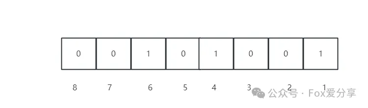
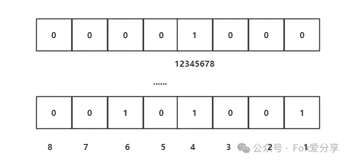

# 数据结构与算法知识汇总

---

## 实现归并排序算法

归并排序（Merge Sort）基于分治法：将数组分成两个子数组分别排序，再合并。时间复杂度 O(n log n)，是稳定排序。

**思路**：将数组分成两半，递归排序每一半，再合并两个有序子数组。

```java
public class MergeSortExample {
    // 归并排序主方法
    public static void mergeSort(int[] arr, int left, int right) {
        if (left < right) {
            int mid = left + (right - left) / 2;
            mergeSort(arr, left, mid);      // 排序左半部分
            mergeSort(arr, mid + 1, right); // 排序右半部分
            merge(arr, left, mid, right);   // 合并两个子数组
        }
    }

    // 合并两个已排序的子数组
    private static void merge(int[] arr, int left, int mid, int right) {
        int n1 = mid - left + 1;
        int n2 = right - mid;
        int[] L = new int[n1];
        int[] R = new int[n2];

        // 复制数据到临时数组
        for (int i = 0; i < n1; i++) L[i] = arr[left + i];
        for (int j = 0; j < n2; j++) R[j] = arr[mid + 1 + j];

        int i = 0, j = 0, k = left;
        while (i < n1 && j < n2) {
            if (L[i] <= R[j]) {
                arr[k++] = L[i++];
            } else {
                arr[k++] = R[j++];
            }
        }
        // 复制剩余元素
        while (i < n1) arr[k++] = L[i++];
        while (j < n2) arr[k++] = R[j++];
    }

    public static void main(String[] args) {
        int[] arr = {38, 27, 43, 3, 9, 82, 10};
        mergeSort(arr, 0, arr.length - 1);
        for (int num : arr) {
            System.out.print(num + " ");
        }
    }
}
```

**要点**

- `mergeSort`：`arr` 待排序数组，`left`/`right` 为起始/结束索引；`left < right` 时继续递归，计算 `mid`，分别排序左右两半后调用 `merge`。
- `merge`：创建临时数组 `L`、`R` 存储左右子数组；用索引 `i`、`j` 比较 `L[i]` 与 `R[j]`，较小者放回原数组；最后复制未耗尽的剩余元素。
- `main`：创建未排序数组，调用 `mergeSort`，打印排序前后结果。

---

## 实现一个LRU（最近最少使用）缓存

用 HashMap + 双向链表实现：HashMap 负责 O(1) 查找，双向链表维护使用顺序——最近使用的放头部，最少使用的放尾部；容量满时移除尾部。

```java
import java.util.HashMap;

class LRUCache {
    private class Node {
        int key;
        int value;
        Node prev;
        Node next;

        Node(int key, int value) {
            this.key = key;
            this.value = value;
        }
    }

    private final int capacity;
    private final HashMap<Integer, Node> map;
    private final Node head; // 哨兵节点，头部
    private final Node tail; // 哨兵节点，尾部

    public LRUCache(int capacity) {
        this.capacity = capacity;
        this.map = new HashMap<>();
        this.head = new Node(0, 0);
        this.tail = new Node(0, 0);
        head.next = tail;
        tail.prev = head;
    }

    public int get(int key) {
        Node node = map.get(key);
        if (node == null) {
            return -1;
        }
        moveToHead(node);
        return node.value;
    }

    public void put(int key, int value) {
        Node node = map.get(key);
        if (node == null) {
            Node newNode = new Node(key, value);
            map.put(key, newNode);
            addNode(newNode);
            if (map.size() > capacity) {
                Node tail = popTail();
                map.remove(tail.key);
            }
        } else {
            node.value = value;
            moveToHead(node);
        }
    }

    private void addNode(Node node) {
        node.prev = head;
        node.next = head.next;
        head.next.prev = node;
        head.next = node;
    }

    private void removeNode(Node node) {
        Node prev = node.prev;
        Node next = node.next;
        prev.next = next;
        next.prev = prev;
    }

    private void moveToHead(Node node) {
        removeNode(node);
        addNode(node);
    }

    private Node popTail() {
        Node res = tail.prev;
        removeNode(res);
        return res;
    }

    public static void main(String[] args) {
        LRUCache cache = new LRUCache(2);

        cache.put(1, 1);
        cache.put(2, 2);
        System.out.println(cache.get(1)); // 返回 1

        cache.put(3, 3); // 该操作会使得键 2 作废
        System.out.println(cache.get(2)); // 返回 -1 (未找到)

        cache.put(4, 4); // 该操作会使得键 1 作废
        System.out.println(cache.get(1)); // 返回 -1 (未找到)
        System.out.println(cache.get(3)); // 返回 3
        System.out.println(cache.get(4)); // 返回 4
    }
}
```

**要点**

- **Node**：存储 `key`、`value` 及 `prev`/`next` 指针。
- **LRUCache**：`capacity` 为容量；`map` 存储键到节点的映射；`head`/`tail` 为哨兵节点。
- **get**：从 `map` 取节点，不存在返回 -1；存在则移到头部并返回值。
- **put**：键不存在时创建新节点加入头部，超出容量则移除尾部；键存在时更新值并移到头部。
- **辅助方法**：`addNode` 头插、`removeNode` 删除、`moveToHead` 移到头部、`popTail` 移除并返回尾部节点。

`get` 和 `put` 时间复杂度均为 O(1)。

---

## 腾讯面试：40亿QQ号，给你1G内存，怎么去重？

**题目**：40 亿个 QQ 号，相同号码仅保留一个，内存限制 1G，如何实现？

这是经典的**海量数据去重问题**。

### 1. 理解题目

QQ 号是 4 字节无符号正整数（32 位），最大值接近 43 亿。若直接存储 40 亿个 QQ 号：

```plain
4000000000 * 4 / 1024 / 1024 / 1024 ≈ 15GB
```

需要约 15GB，远超 1GB 限制，必须换思路。问题本质是**在内存非常有限时高效去重**。主流方案有两种：BitMap 和布隆过滤器；本题用 BitMap 更合适。

### 2. 用 BitMap 化繁为简

#### 2.1 什么是BitMap？

位图（BitMap）就是一个 bit 数组，每个位置取值 0 或 1，像一本超级节省空间的“登记簿”：QQ 号存在则对应格子标记为 1，不存在则为 0。

例如记录 QQ 号 1、4、6：传统方法用 3 个整型变量共 12 字节；BitMap 只需 1 个字节（8 位），把第 1、4、6 位置为 1 即可，节省约 12 倍空间。



BitMap 最大的优势是用**极小的存储空间**表示**巨大的数值范围**，且支持快速查询、去重，特别适合“有或没有”的问题。

#### 2.2 如何使用BitMap进行40亿个QQ号去重？

**1）申请一个 40 亿 bit 的 BitMap：**

```plain
4000000000 * 1 / 8 / 1024 / 1024 = 476M
```

只需不到 500MB。

**2）遍历 40 亿 QQ 号**，把每个号码映射到 BitMap 对应位置并置为 1。例如 QQ 号 `12345678` 映射到第 `12345678` 个位置，置 1 表示已出现。



**3）遍历 BitMap**，所有值为 1 的位置即为去重后的 QQ 号。

这样用 BitMap 完成 40 亿 QQ 号去重，最大内存消耗不到 500MB。

#### 2.3 BitMap的优缺点

**优点**

- **超级节省内存**：相比直接存储数据，内存消耗约为其八分之一甚至更少。
- **操作快**：插入、查询、去重时间复杂度都是 O(1)。
- **易于实现**：算法简单，只依赖一个数组。

**缺点**

- **只能表示“有或没有”**：无法存储更复杂的数据（如具体值或出现次数）。
- **需要确定值域范围**：只能操作固定范围的数据，超出范围无法标记。

### 3. 总结

BitMap 用不到 500MB 完成了 40 亿 QQ 号去重，其思路广泛应用于：大规模数据去重、数据快速排序、集合运算（交并差）、布隆过滤器底层实现等。

---

## 找出两个单链表的交点

用双指针法：`pA`、`pB` 分别遍历两个链表，到达末尾后重定位到另一链表头部；若相交则在交点相遇，不相交则同时到达 null。

```java
class ListNode {
    int val;
    ListNode next;

    ListNode(int val) {
        this.val = val;
        this.next = null;
    }
}

public class LinkedListIntersection {
    public static ListNode getIntersectionNode(ListNode headA, ListNode headB) {
        if (headA == null || headB == null) {
            return null; // 任一链表为空则不可能有交点
        }

        ListNode pA = headA;
        ListNode pB = headB;

        while (pA != pB) {
            pA = (pA == null) ? headB : pA.next;
            pB = (pB == null) ? headA : pB.next;
        }

        return pA; // 交点节点或 null
    }

    public static void main(String[] args) {
        // 链表A: 1 -> 2 -> 3
        ListNode headA = new ListNode(1);
        headA.next = new ListNode(2);
        headA.next.next = new ListNode(3);

        // 链表B: 6 -> 7
        ListNode headB = new ListNode(6);
        headB.next = new ListNode(7);

        // 交点: 8 -> 9
        ListNode intersection = new ListNode(8);
        intersection.next = new ListNode(9);

        headA.next.next.next = intersection;
        headB.next.next = intersection;

        ListNode intersectNode = getIntersectionNode(headA, headB);
        if (intersectNode != null) {
            System.out.println("The intersection node's value is: " + intersectNode.val);
        } else {
            System.out.println("The two linked lists do not intersect.");
        }
    }
}
```

**要点**

- `getIntersectionNode`：任一链表为空直接返回 null；`pA`、`pB` 初始化为两链表头节点；循环直到两指针相等，中途任一指针到达末尾则重定位到另一链表头部；最终返回交点或 null。
- 时间复杂度 O(n + m)，空间复杂度 O(1)。

---

## 检测单链表中是否有环

用“快慢指针”（龟兔赛跑）：`slow` 每次走一步，`fast` 每次走两步；有环则相遇，无环则 `fast` 到达末尾。

```java
class ListNode {
    int val;
    ListNode next;

    ListNode(int val) {
        this.val = val;
        this.next = null;
    }
}

public class LinkedListCycleDetection {
    public static boolean hasCycle(ListNode head) {
        if (head == null || head.next == null) {
            return false; // 空链表或只有一个节点，不可能有环
        }

        ListNode slow = head;
        ListNode fast = head;

        while (fast != null && fast.next != null) {
            slow = slow.next;       // 慢指针走一步
            fast = fast.next.next;  // 快指针走两步

            if (slow == fast) {
                return true; // 相遇则有环
            }
        }

        return false; // 快指针到达末尾则无环
    }

    public static void main(String[] args) {
        // 链表 1 -> 2 -> 3 -> 4 -> 5
        ListNode head = new ListNode(1);
        head.next = new ListNode(2);
        head.next.next = new ListNode(3);
        head.next.next.next = new ListNode(4);
        head.next.next.next.next = new ListNode(5);

        // 创建环：5 -> 3
        head.next.next.next.next.next = head.next.next;

        if (hasCycle(head)) {
            System.out.println("The linked list has a cycle.");
        } else {
            System.out.println("The linked list does not have a cycle.");
        }
    }
}
```

**要点**

- `hasCycle`：空链表或单节点直接返回 false；`slow`、`fast` 均初始化为头节点；循环条件 `fast != null && fast.next != null`；相遇返回 true，否则返回 false。
- 时间复杂度 O(n)，空间复杂度 O(1)。

---

## 实现快速排序算法

快速排序采用分治策略：选一个基准元素，一趟排序将序列分为两部分（一部分都比基准小，另一部分都比基准大），再递归排序两部分。

```java
public class QuickSortExample {
    public static void quickSort(int[] arr, int low, int high) {
        if (low < high) {
            int pi = partition(arr, low, high); // 分区索引
            quickSort(arr, low, pi - 1);        // 排序左子数组
            quickSort(arr, pi + 1, high);       // 排序右子数组
        }
    }

    private static int partition(int[] arr, int low, int high) {
        int pivot = arr[high]; // 选择最后一个元素作为基准
        int i = low - 1;       // 标记小于基准的元素的索引

        for (int j = low; j < high; j++) {
            if (arr[j] <= pivot) {
                i++;
                int temp = arr[i];
                arr[i] = arr[j];
                arr[j] = temp;
            }
        }
        // 将基准元素放到正确位置
        int temp = arr[i + 1];
        arr[i + 1] = arr[high];
        arr[high] = temp;
        return i + 1;
    }

    public static void main(String[] args) {
        int[] arr = {10, 7, 8, 9, 1, 5};
        quickSort(arr, 0, arr.length - 1);
        for (int num : arr) {
            System.out.print(num + " ");
        }
    }
}
```

**要点**

- `quickSort`：`low < high` 时继续；调用 `partition` 获取分区索引 `pi`；分别递归排序 `[low, pi-1]` 与 `[pi+1, high]`。
- `partition`：选最后一个元素为基准；`i = low - 1` 标记小于基准的元素索引；遍历 `low ~ high-1`，元素 ≤ 基准则 `i++` 并交换；最后将基准与 `arr[i+1]` 交换并返回 `i + 1`。

平均时间复杂度 O(n log n)。

---

## 给定一个字符串，找出其中最长的回文子串

用中心扩展法：以每个字符（及相邻字符间隙）为中心向两边扩展寻找回文，记录最长者。

```java
public class LongestPalindromicSubstring {
    public static String longestPalindrome(String s) {
        if (s == null || s.length() < 1) {
            return "";
        }
        int start = 0, end = 0; // 最长回文子串的起止索引

        for (int i = 0; i < s.length(); i++) {
            int len1 = expandAroundCenter(s, i, i);     // 单字符中心
            int len2 = expandAroundCenter(s, i, i + 1); // 双字符中心
            int len = Math.max(len1, len2);

            if (len > end - start) {
                start = i - (len - 1) / 2;
                end = i + len / 2;
            }
        }
        return s.substring(start, end + 1);
    }

    // 中心扩展法
    private static int expandAroundCenter(String s, int left, int right) {
        while (left >= 0 && right < s.length() && s.charAt(left) == s.charAt(right)) {
            left--;
            right++;
        }
        return right - left - 1;
    }

    public static void main(String[] args) {
        String s = "babad";
        System.out.println(longestPalindrome(s));
    }
}
```

**要点**

- `longestPalindrome`：空串或长度小于 1 返回空字符串；遍历每个字符，分别以单字符和双字符为中心扩展，取较长者；若大于已记录长度则更新起止索引；返回 `s.substring(start, end + 1)`。
- `expandAroundCenter`：左右字符相等且索引有效时持续扩展，返回回文长度 `right - left - 1`。

时间复杂度 O(n²)。

---

## 实现一个基本的图数据结构，并实现深度优先搜索（DFS）和广度优先搜索（BFS）

用邻接表表示图：一个 Map，键为节点，值为相邻节点列表。

```java
import java.util.*;

public class Graph {
    private Map<Integer, List<Integer>> adjList; // 邻接表

    public Graph() {
        adjList = new HashMap<>();
    }

    // 添加边
    public void addEdge(int source, int destination) {
        adjList.computeIfAbsent(source, k -> new ArrayList<>()).add(destination);
        adjList.computeIfAbsent(destination, k -> new ArrayList<>()).add(source); // 无向图
    }

    // 深度优先搜索
    public void dfs(int start) {
        Set<Integer> visited = new HashSet<>();
        dfsUtil(start, visited);
    }

    private void dfsUtil(int node, Set<Integer> visited) {
        visited.add(node);
        System.out.print(node + " ");

        for (int neighbor : adjList.getOrDefault(node, new ArrayList<>())) {
            if (!visited.contains(neighbor)) {
                dfsUtil(neighbor, visited);
            }
        }
    }

    // 广度优先搜索
    public void bfs(int start) {
        Set<Integer> visited = new HashSet<>();
        Queue<Integer> queue = new LinkedList<>();

        visited.add(start);
        queue.add(start);

        while (!queue.isEmpty()) {
            int node = queue.poll();
            System.out.print(node + " ");

            for (int neighbor : adjList.getOrDefault(node, new ArrayList<>())) {
                if (!visited.contains(neighbor)) {
                    visited.add(neighbor);
                    queue.add(neighbor);
                }
            }
        }
    }

    public static void main(String[] args) {
        Graph graph = new Graph();
        graph.addEdge(0, 1);
        graph.addEdge(0, 2);
        graph.addEdge(1, 2);
        graph.addEdge(2, 3);
        graph.addEdge(3, 4);

        System.out.println("Depth First Search starting from node 0:");
        graph.dfs(0);

        System.out.println("\nBreadth First Search starting from node 0:");
        graph.bfs(0);
    }
}
```

**要点**

- `addEdge`：用 `computeIfAbsent` 确保每个节点都有列表；无向图添加双向边。
- **DFS**：`dfs` 初始化 `visited` 集合后调用 `dfsUtil`；`dfsUtil` 递归访问节点，标记已访问并打印，再递归访问未访问邻居。
- **BFS**：用队列实现，起始节点入队；迭代取出队首打印，并将未访问邻居入队。

---

## 判断一棵二叉树是否是平衡二叉树

平衡二叉树定义：每个节点的左右子树高度差不超过 1。用递归计算高度并在过程中检查高度差。

```java
// 定义二叉树节点类
class TreeNode {
    int val;
    TreeNode left;
    TreeNode right;

    TreeNode(int val) {
        this.val = val;
        this.left = null;
        this.right = null;
    }
}

public class BalancedBinaryTree {
    public static boolean isBalanced(TreeNode root) {
        return checkHeight(root) != -1;
    }

    private static int checkHeight(TreeNode node) {
        if (node == null) {
            return 0; // 空节点高度为 0
        }

        int leftHeight = checkHeight(node.left);
        if (leftHeight == -1) {
            return -1; // 左子树不平衡
        }

        int rightHeight = checkHeight(node.right);
        if (rightHeight == -1) {
            return -1; // 右子树不平衡
        }

        if (Math.abs(leftHeight - rightHeight) > 1) {
            return -1; // 高度差超过 1
        }

        return Math.max(leftHeight, rightHeight) + 1; // 返回当前节点高度
    }

    public static void main(String[] args) {
        // 平衡二叉树
        TreeNode root = new TreeNode(1);
        root.left = new TreeNode(2);
        root.right = new TreeNode(3);
        root.left.left = new TreeNode(4);
        root.left.right = new TreeNode(5);
        root.right.left = new TreeNode(6);
        root.right.right = new TreeNode(7);
        System.out.println("Is the tree balanced? " + isBalanced(root)); // true

        // 不平衡二叉树
        TreeNode unbalancedRoot = new TreeNode(1);
        unbalancedRoot.left = new TreeNode(2);
        unbalancedRoot.left.left = new TreeNode(3);
        System.out.println("Is the tree balanced? " + isBalanced(unbalancedRoot)); // false
    }
}
```

**要点**

- `isBalanced`：`checkHeight` 返回 -1 表示不平衡，返回 false；否则 true。
- `checkHeight`：空节点返回 0；递归计算左右子树高度，任一为 -1 则直接返回 -1；高度差超过 1 返回 -1；否则返回左右最大高度加 1。

时间复杂度 O(n)。

---

## 实现一个简单的哈希表

用链地址法处理哈希冲突：数组每个槽位存一个链表。提供插入、删除、查找操作。

```java
import java.util.LinkedList;

public class SimpleHashTable<K, V> {
    private static class HashNode<K, V> {
        K key;
        V value;
        HashNode<K, V> next;

        public HashNode(K key, V value) {
            this.key = key;
            this.value = value;
        }
    }

    private LinkedList<HashNode<K, V>>[] table; // 哈希表数组
    private int capacity; // 容量
    private int size;     // 元素数量

    @SuppressWarnings("unchecked")
    public SimpleHashTable(int capacity) {
        this.capacity = capacity;
        this.table = new LinkedList[capacity];
        this.size = 0;
    }

    // 计算哈希值
    private int hash(K key) {
        return Math.abs(key.hashCode()) % capacity;
    }

    // 插入键值对
    public void put(K key, V value) {
        int index = hash(key);
        if (table[index] == null) {
            table[index] = new LinkedList<>();
        }

        for (HashNode<K, V> node : table[index]) {
            if (node.key.equals(key)) {
                node.value = value; // 更新现有键的值
                return;
            }
        }

        table[index].add(new HashNode<>(key, value));
        size++;
    }

    // 获取值
    public V get(K key) {
        int index = hash(key);
        LinkedList<HashNode<K, V>> chain = table[index];

        if (chain != null) {
            for (HashNode<K, V> node : chain) {
                if (node.key.equals(key)) {
                    return node.value;
                }
            }
        }
        return null; // 键不存在
    }

    // 删除键值对
    public V remove(K key) {
        int index = hash(key);
        LinkedList<HashNode<K, V>> chain = table[index];

        if (chain != null) {
            for (HashNode<K, V> node : chain) {
                if (node.key.equals(key)) {
                    V value = node.value;
                    chain.remove(node);
                    size--;
                    return value;
                }
            }
        }
        return null; // 键不存在
    }

    public int size() {
        return size;
    }

    public static void main(String[] args) {
        SimpleHashTable<String, Integer> hashTable = new SimpleHashTable<>(10);
        hashTable.put("apple", 1);
        hashTable.put("banana", 2);
        hashTable.put("orange", 3);

        System.out.println("Value for 'apple': " + hashTable.get("apple"));
        System.out.println("Value for 'banana': " + hashTable.get("banana"));
        System.out.println("Removing 'banana': " + hashTable.remove("banana"));
        System.out.println("Value for 'banana' after removal: " + hashTable.get("banana"));
        System.out.println("Current size of hash table: " + hashTable.size());
    }
}
```

**要点**

- **HashNode**：包含键、值和指向下一个节点的引用。
- **成员变量**：`table` 存储链表的数组、`capacity` 容量、`size` 元素数量。
- `hash`：计算键的哈希值并映射到数组索引。
- `put`：冲突时遍历链表，键存在则更新，否则头插并 `size++`。
- `get`/`remove`：按索引取链表并查找键；`remove` 删除后 `size--` 并返回旧值。

---

## 给定一个数组，找出其中的最大子数组和

用 Kadane 算法（动态规划思想），线性时间 O(n)。

```java
public class MaximumSubarraySum {
    public static int maxSubArray(int[] nums) {
        if (nums == null || nums.length == 0) {
            throw new IllegalArgumentException("Array is empty or null");
        }

        int maxSoFar = nums[0];      // 全局最大子数组和
        int maxEndingHere = nums[0]; // 当前子数组的最大和

        for (int i = 1; i < nums.length; i++) {
            // 选择当前元素，或将其加入当前子数组
            maxEndingHere = Math.max(nums[i], maxEndingHere + nums[i]);
            // 更新全局最大值
            maxSoFar = Math.max(maxSoFar, maxEndingHere);
        }
        return maxSoFar;
    }

    public static void main(String[] args) {
        int[] nums = {-2, 1, -3, 4, -1, 2, 1, -5, 4};
        System.out.println("Maximum subarray sum: " + maxSubArray(nums)); // 6
    }
}
```

**要点**

- 数组为空或长度为 0 抛出异常。
- `maxSoFar` 与 `maxEndingHere` 均初始化为第一个元素。
- 遍历时更新 `maxEndingHere = max(nums[i], maxEndingHere + nums[i])`，再更新 `maxSoFar`。

时间复杂度 O(n)。

---

## 给定一个二叉树，实现层序遍历

层序遍历（广度优先遍历）按从上到下、从左到右访问每层节点，用队列实现。

```java
import java.util.LinkedList;
import java.util.Queue;

class TreeNode {
    int val;
    TreeNode left;
    TreeNode right;

    TreeNode(int val) {
        this.val = val;
        this.left = null;
        this.right = null;
    }
}

public class BinaryTreeLevelOrderTraversal {
    public static void levelOrderTraversal(TreeNode root) {
        if (root == null) {
            return;
        }

        Queue<TreeNode> queue = new LinkedList<>();
        queue.add(root); // 根节点入队

        while (!queue.isEmpty()) {
            TreeNode currentNode = queue.poll(); // 取出队首
            System.out.print(currentNode.val + " ");

            if (currentNode.left != null) {
                queue.add(currentNode.left);
            }
            if (currentNode.right != null) {
                queue.add(currentNode.right);
            }
        }
    }

    public static void main(String[] args) {
        TreeNode root = new TreeNode(1);
        root.left = new TreeNode(2);
        root.right = new TreeNode(3);
        root.left.left = new TreeNode(4);
        root.left.right = new TreeNode(5);
        root.right.left = new TreeNode(6);
        root.right.right = new TreeNode(7);

        System.out.println("Level Order Traversal:");
        levelOrderTraversal(root);
    }
}
```

**要点**

- 树为空直接返回；根节点入队。
- 队列不为空时取出队首并访问，左右子节点非空则入队。

时间复杂度 O(n)。

---

## 实现一个简单的字符串匹配算法

用朴素（暴力）匹配：从目标串每个位置起尝试匹配模式串。

```java
public class NaiveStringMatching {
    public static int naiveStringMatch(String text, String pattern) {
        int n = text.length();    // 目标串长度
        int m = pattern.length(); // 模式串长度

        // 遍历目标串每个可能的起始位置
        for (int i = 0; i <= n - m; i++) {
            int j;
            for (j = 0; j < m; j++) {
                if (text.charAt(i + j) != pattern.charAt(j)) {
                    break; // 当前字符不匹配
                }
            }
            if (j == m) {
                return i; // 完全匹配，返回起始位置
            }
        }
        return -1; // 未找到匹配
    }

    public static void main(String[] args) {
        String text = "hello world";
        String pattern = "world";
        int index = naiveStringMatch(text, pattern);
        if (index != -1) {
            System.out.println("Pattern found at index: " + index);
        } else {
            System.out.println("Pattern not found.");
        }
    }
}
```

**要点**

- 计算目标串长度 `n` 与模式串长度 `m`。
- 外层遍历起始位置 `i`，内层逐字符比较，不匹配则跳出。
- `j == m` 表示完全匹配，返回 `i`；否则返回 -1。

时间复杂度 O(n × m)。

---

## 给定一个数组，找出其中和为特定值的两个数

用哈希表一次遍历解决，时间复杂度 O(n)。

```java
import java.util.HashMap;
import java.util.Map;

public class TwoSumExample {
    public static int[] twoSum(int[] nums, int target) {
        // 存储数值和索引
        Map<Integer, Integer> map = new HashMap<>();

        for (int i = 0; i < nums.length; i++) {
            int complement = target - nums[i];
            // 检查差值是否已存在
            if (map.containsKey(complement)) {
                return new int[]{map.get(complement), i};
            }
            // 存储当前元素及其索引
            map.put(nums[i], i);
        }
        return new int[]{}; // 未找到
    }

    public static void main(String[] args) {
        int[] nums = {2, 7, 11, 15};
        int target = 9;
        int[] result = twoSum(nums, target);
        if (result.length == 2) {
            System.out.println("Indices: " + result[0] + ", " + result[1]);
        } else {
            System.out.println("No two numbers found.");
        }
    }
}
```

**要点**

- `map` 存储数组元素及其索引。
- 对每个元素计算差值 `complement = target - nums[i]`，若已在 `map` 中则返回两个索引；否则存入 `map`。
- 未找到返回空数组。

---

## 实现二叉树的前序、中序和后序遍历（递归和非递归方式）

### 二叉树节点类

```java
class TreeNode {
    int val;
    TreeNode left;
    TreeNode right;

    TreeNode(int val) {
        this.val = val;
        this.left = null;
        this.right = null;
    }
}
```

### 递归方式

```java
// 前序遍历：根 -> 左 -> 右
public static void preorderTraversalRecursive(TreeNode node) {
    if (node == null) {
        return;
    }
    System.out.print(node.val + " ");
    preorderTraversalRecursive(node.left);
    preorderTraversalRecursive(node.right);
}

// 中序遍历：左 -> 根 -> 右
public static void inorderTraversalRecursive(TreeNode node) {
    if (node == null) {
        return;
    }
    inorderTraversalRecursive(node.left);
    System.out.print(node.val + " ");
    inorderTraversalRecursive(node.right);
}

// 后序遍历：左 -> 右 -> 根
public static void postorderTraversalRecursive(TreeNode node) {
    if (node == null) {
        return;
    }
    postorderTraversalRecursive(node.left);
    postorderTraversalRecursive(node.right);
    System.out.print(node.val + " ");
}
```

### 非递归方式

```java
import java.util.Stack;

// 前序遍历（非递归）
public static void preorderTraversalIterative(TreeNode root) {
    if (root == null) {
        return;
    }
    Stack<TreeNode> stack = new Stack<>();
    stack.push(root);

    while (!stack.isEmpty()) {
        TreeNode node = stack.pop();
        System.out.print(node.val + " ");

        if (node.right != null) {
            stack.push(node.right); // 先压右子节点
        }
        if (node.left != null) {
            stack.push(node.left); // 再压左子节点
        }
    }
}

// 中序遍历（非递归）
public static void inorderTraversalIterative(TreeNode root) {
    Stack<TreeNode> stack = new Stack<>();
    TreeNode current = root;

    while (current != null || !stack.isEmpty()) {
        while (current != null) {
            stack.push(current);
            current = current.left;
        }
        current = stack.pop();
        System.out.print(current.val + " ");
        current = current.right;
    }
}

// 后序遍历（非递归）：两个栈
public static void postorderTraversalIterative(TreeNode root) {
    if (root == null) {
        return;
    }
    Stack<TreeNode> stack = new Stack<>();
    Stack<TreeNode> output = new Stack<>();
    stack.push(root);

    while (!stack.isEmpty()) {
        TreeNode node = stack.pop();
        output.push(node);

        if (node.left != null) {
            stack.push(node.left);
        }
        if (node.right != null) {
            stack.push(node.right);
        }
    }

    while (!output.isEmpty()) {
        System.out.print(output.pop().val + " ");
    }
}
```

**要点**

- **递归**：前序访问根再递归左右；中序递归左、访问根、递归右；后序递归左右再访问根。
- **非递归**：前序用栈，先压右再压左；中序用栈，先一路压左，访问根后转向右；后序用两个栈，一个遍历、一个存储访问顺序，最后逆序输出。

---

## 实现一个基于优先队列的最小堆

Java 的 `PriorityQueue` 默认就是最小堆。

```java
import java.util.PriorityQueue;

public class MinHeapExample {
    public static void main(String[] args) {
        // 创建优先队列，默认是最小堆
        PriorityQueue<Integer> minHeap = new PriorityQueue<>();

        minHeap.add(10);
        minHeap.add(5);
        minHeap.add(20);
        minHeap.add(3);

        System.out.println("MinHeap elements:");
        for (Integer element : minHeap) {
            System.out.print(element + " ");
        }
        System.out.println();

        System.out.println("Removed element: " + minHeap.poll()); // 输出 3
        System.out.println("Peek element: " + minHeap.peek());    // 输出 5

        System.out.println("MinHeap elements after removal:");
        for (Integer element : minHeap) {
            System.out.print(element + " ");
        }
        System.out.println();
    }
}
```

**要点**

- `PriorityQueue` 默认最小堆，每次访问或移除的元素都是最小的。
- `add` 添加元素；`poll` 获取并移除最小元素；`peek` 获取最小元素但不移除。

---

## 在一个排序数组中查找一个数，如果不存在，返回它应该插入的位置

用二分查找，时间复杂度 O(log n)。

```java
public class SearchInsertPosition {
    public static int searchInsert(int[] nums, int target) {
        int left = 0;
        int right = nums.length - 1;

        while (left <= right) {
            int mid = left + (right - left) / 2; // 防止整数溢出

            if (nums[mid] == target) {
                return mid;
            } else if (nums[mid] < target) {
                left = mid + 1; // 目标在右半部分
            } else {
                right = mid - 1; // 目标在左半部分
            }
        }
        // 循环结束时 left 即为应插入的位置
        return left;
    }

    public static void main(String[] args) {
        int[] nums = {1, 3, 5, 6};
        System.out.println(searchInsert(nums, 5)); // 2
        System.out.println(searchInsert(nums, 2)); // 1
        System.out.println(searchInsert(nums, 7)); // 4
    }
}
```

**要点**

- 左指针 `left = 0`，右指针 `right = nums.length - 1`。
- `left <= right` 时循环，`mid` 用 `left + (right - left) / 2` 计算防止溢出；等于目标返回 `mid`，小于则 `left = mid + 1`，大于则 `right = mid - 1`。
- 循环结束时 `left` 即插入位置。

---

## 实现一个基于数组的栈（Stack）

```java
public class ArrayStack {
    private int[] stack;
    private int top;
    private int capacity;

    public ArrayStack(int capacity) {
        this.capacity = capacity;
        stack = new int[capacity];
        top = -1; // 栈为空时 top 为 -1
    }

    // 入栈
    public void push(int value) {
        if (isFull()) {
            throw new StackOverflowError("Stack is full");
        }
        stack[++top] = value;
    }

    // 出栈
    public int pop() {
        if (isEmpty()) {
            throw new IllegalStateException("Stack is empty");
        }
        return stack[top--];
    }

    // 查看栈顶元素
    public int peek() {
        if (isEmpty()) {
            throw new IllegalStateException("Stack is empty");
        }
        return stack[top];
    }

    public boolean isEmpty() {
        return top == -1;
    }

    public boolean isFull() {
        return top == capacity - 1;
    }

    public int size() {
        return top + 1;
    }

    public static void main(String[] args) {
        ArrayStack stack = new ArrayStack(5);

        stack.push(10);
        stack.push(20);
        stack.push(30);

        System.out.println("Top element is: " + stack.peek());
        System.out.println("Stack size is: " + stack.size());

        System.out.println("Popped element is: " + stack.pop());
        System.out.println("Stack size after pop is: " + stack.size());
    }
}
```

**要点**

- **初始化**：构造函数初始化容量与数组，`top = -1`。
- **push**：栈满抛异常，否则 `stack[++top] = value`。
- **pop**：栈空抛异常，否则返回 `stack[top--]`。
- **peek**：返回栈顶但不移除。
- **isEmpty/isFull**：分别判断 `top == -1` 与 `top == capacity - 1`。
- **size**：返回 `top + 1`。

基于数组实现简单高效，但有容量限制；需动态扩容可用 ArrayList 或链表。

---

## 使用两个队列实现一个栈

用两个队列模拟栈的“后进先出”：push 在非空队列进行，pop/peek 通过把元素转移到另一队列、直到剩最后一个实现。

```java
import java.util.LinkedList;
import java.util.Queue;

public class StackUsingQueues {
    private Queue<Integer> queue1;
    private Queue<Integer> queue2;

    public StackUsingQueues() {
        queue1 = new LinkedList<>();
        queue2 = new LinkedList<>();
    }

    // 入栈：始终在非空队列中操作
    public void push(int value) {
        if (!queue1.isEmpty()) {
            queue1.offer(value);
        } else {
            queue2.offer(value);
        }
    }

    // 出栈
    public int pop() {
        if (isEmpty()) {
            throw new IllegalStateException("Stack is empty");
        }

        if (!queue1.isEmpty()) {
            while (queue1.size() > 1) {
                queue2.offer(queue1.poll());
            }
            return queue1.poll();
        } else {
            while (queue2.size() > 1) {
                queue1.offer(queue2.poll());
            }
            return queue2.poll();
        }
    }

    // 查看栈顶元素
    public int peek() {
        if (isEmpty()) {
            throw new IllegalStateException("Stack is empty");
        }

        int topElement = 0;
        if (!queue1.isEmpty()) {
            while (!queue1.isEmpty()) {
                topElement = queue1.poll();
                queue2.offer(topElement);
            }
        } else {
            while (!queue2.isEmpty()) {
                topElement = queue2.poll();
                queue1.offer(topElement);
            }
        }
        return topElement;
    }

    public boolean isEmpty() {
        return queue1.isEmpty() && queue2.isEmpty();
    }

    public static void main(String[] args) {
        StackUsingQueues stack = new StackUsingQueues();

        stack.push(10);
        stack.push(20);
        stack.push(30);

        System.out.println("Top element is: " + stack.peek());
        System.out.println("Popped element is: " + stack.pop());
        System.out.println("Top element after pop is: " + stack.peek());
    }
}
```

**要点**

- **push**：元素加入非空队列。
- **pop**：把元素从一个队列转移到另一个，直到剩最后一个即为栈顶，移除并返回。
- **peek**：类似 pop，但把最后一个元素也转移并返回其值。
- **isEmpty**：两个队列都为空则为空。

该方式操作复杂度较高，主要用于演示用队列实现栈。

---

## 反转一个单链表

用三个指针 `prev`、`current`、`next` 逐个反转节点指向。

```java
class ListNode {
    int val;
    ListNode next;

    ListNode(int val) {
        this.val = val;
        this.next = null;
    }
}

public class LinkedListReversal {
    public static ListNode reverseList(ListNode head) {
        ListNode prev = null;
        ListNode current = head;
        ListNode next = null;

        while (current != null) {
            next = current.next;   // 保存下一个节点
            current.next = prev;   // 反转当前节点的指针
            prev = current;        // 移动指针
            current = next;
        }
        return prev; // prev 是新的头节点
    }

    public static void printList(ListNode head) {
        ListNode current = head;
        while (current != null) {
            System.out.print(current.val + " ");
            current = current.next;
        }
        System.out.println();
    }

    public static void main(String[] args) {
        // 链表 1 -> 2 -> 3 -> 4 -> 5
        ListNode head = new ListNode(1);
        head.next = new ListNode(2);
        head.next.next = new ListNode(3);
        head.next.next.next = new ListNode(4);
        head.next.next.next.next = new ListNode(5);

        System.out.println("Original List:");
        printList(head);

        ListNode reversedHead = reverseList(head);

        System.out.println("Reversed List:");
        printList(reversedHead);
    }
}
```

**要点**

- `prev` 初始为 null，`current` 指向头节点。
- 遍历时保存 `next`，把 `current.next` 指向 `prev`，再前移 `prev`、`current`。
- 结束时 `prev` 即新头节点。

时间复杂度 O(n)，空间复杂度 O(1)。

---

## 讲讲你对线性表-数组和矩阵的理解

**数组（Array）**：有序的元素集合，可通过索引访问，是最基础的数据结构之一。特点：

- **连续存储**：元素在内存中连续存放，可通过计算偏移量快速定位。
- **相同类型**：所有元素必须是相同数据类型。
- **固定大小**：创建时需指定大小，无法动态扩展。

数组索引从 0 开始，访问时间复杂度 O(1)；但插入、删除需移动其他元素以保持连续，时间复杂度 O(n)。

**矩阵（Matrix）**：二维线性表，由行和列组成，用于表示和处理二维数据。特点：

- **行和列**：每个元素由行号、列号唯一标识。
- **索引定位**：类似数组，可通过索引访问和修改。
- **二维结构**：方便表示和处理二维数据。

矩阵广泛应用于图像处理、机器学习和科学计算。m 行 n 列矩阵访问单个元素时间复杂度 O(1)；矩阵相加、相乘等运算的时间复杂度取决于具体算法。

---

## 说说你对排序-插入排序的理解

插入排序将数组分为已排序和未排序两部分，初始已排序部分只有一个元素；从未排序部分取元素插入已排序部分的正确位置。

**步骤**：从第二个元素开始作为待插入元素；与已排序部分元素比较找到合适位置；将大于当前元素的元素后移一位腾出空间，插入当前元素；重复直到遍历完所有未排序元素。

时间复杂度 O(n²)。最坏情况（数组逆序）性能较差；数组接近有序时效率高。插入排序是**稳定**排序，不改变相同元素的相对顺序。虽然复杂度较高，但在小规模或部分有序场景仍有优势，实现简单，可作为其他排序算法的辅助。

---

## 说说你对分布式算法-ZAB算法的理解

ZAB 是用于分布式系统原子广播的核心算法，广泛应用于 ZooKeeper。它包含两个阶段：**崩溃恢复阶段**和**消息广播阶段**。

- **崩溃恢复阶段**：ZooKeeper 节点启动或领导者崩溃重启时进入。节点通过互相通信选举新领导者，并将最新数据状态发送给所有跟随者以确保一致性。
- **消息广播阶段**：领导者接收客户端请求并转化为 ZooKeeper 事务，通过 ZAB 以广播形式发送给所有节点；每个节点按顺序执行并回送确认；领导者收到大多数节点确认后即认为事务已提交；最后将已提交消息广播给所有节点，保证按相同顺序执行，实现一致性与原子性。

关键在于领导者选举和消息广播：选举通过节点间投票达成共识；广播采用基于多数投票的确认机制，超过半数节点确认才提交。

---

## 说说你对分布式算法-雪花算法的理解

雪花算法用于生成全局唯一 ID。核心思想是把 ID 分为不同部分，通常由 3 部分组成：

1. **时间戳**：占高位，精确到毫秒，可据此推测生成时间。
2. **机器节点ID**：标识生成 ID 的机器节点，防止分布式环境下冲突，通常用机器 IP 或其他唯一标识。
3. **序列号**：标识同一毫秒内多次生成 ID 的序号，保证同一节点同一时刻 ID 唯一。

优点是简单高效，生成 ID 不依赖网络或外部资源，只需本地生成；且 ID 递增，便于按时间排序。

局限性：

- 对系统时钟要求高，机器节点需保持时钟准确。
- 机器节点 ID 需在分布式环境中保持唯一，需可靠方式分配和管理。
- 高并发下可能出现序列号用完的情况，需合理配置节点数量和序列号位数。

---

## 说说你对安全算法-摘要算法的理解

摘要算法将任意长度的数据转换为固定长度的字节串，特点和应用如下：

- **固定长度且唯一**：无论输入多长，摘要值始终固定长度；数据稍有改变，摘要值即大不相同，用于验证数据完整性和一致性。
- **单向**：无法从摘要值推导出原始数据，保证数据安全；相同输入得到的摘要值相同，可认为原始数据相同。
- **抗碰撞**：好的摘要算法即使输入非常相似，摘要值也应不同，避免不同输入生成相同摘要值。
- **高效**：能在较短时间内生成摘要值，满足大量数据快速计算需求。
- **隐私保护**：存储用户密码时不存明文，而是存摘要值用于验证，即使数据库泄露也无法获得原始密码。

常见摘要算法有 MD5、SHA-1、SHA-256 等，广泛用于数据校验、密码存储、数字签名等领域。

---

## 说说你对分布式算法-一致性Hash算法的理解

一致性哈希用于解决数据分布和负载均衡问题，通过将数据和节点映射到哈希环上，实现数据均匀分布和最小化数据迁移。

核心思想：将数据和节点都映射到哈希环上，每个节点在环上有一个按哈希值排序的位置；存储或查找时，用哈希函数找到数据在环上的位置，顺时针找到最近的节点存储数据。

优势：节点增删时只有相邻节点之间的数据受影响，最小化数据迁移，提高稳定性与性能；数据在环上均匀分布，负载更均衡，节点数变化只需重新映射部分数据。

缺点：节点较少时可能负载不均衡；热点数据仍可能集中在少数节点，无法完全解决数据倾斜。

---

## 说说你对算法思想-贪心算法的理解

贪心算法通过每一步的局部最优选择，希望最终达到全局最优解。

核心思想：求解过程中做出当前情况下的最优选择，并相信它对全局也最优；不考虑子问题解决过程，只关注当前状态下的最优解，因此通常简单高效。

步骤：确定贪心策略（每步如何选局部最优）；每步确定局部最优解并更新问题状态；根据问题要求或约束确定终止条件。

优点是简单高效、易实现理解，适用于能通过局部最优达到全局最优的问题，通常能快速得到次优或近似最优解。缺点是不能保证最优解，因为只关注当前局部最优、没有回溯和修正，应用前需仔细分析问题特点和约束。

---

## 说说你对树-前缀树的理解

前缀树（字典树）是用于高效存储和检索字符串的数据结构。

基本思想：将每个字符串拆分为字符序列，用树形结构存储；根节点为空，每个字符对应一个节点，从根到叶子的路径表示一个完整字符串。

构建时逐字符插入：若字符在当前节点子节点中不存在，则创建新子节点。这样能有效存储大量字符串，并支持快速插入和查找。

重要特点：每个节点存储的字符序列是从根到该节点路径上的字符集合，因此查找以给定前缀开头的字符串非常高效——从根开始按前缀依次遍历子节点，直到遍历完前缀或无法匹配。

应用广泛：自动补全（按前缀快速匹配后续字符或单词）、搜索引擎关键词索引、字典与拼写检查等。

---

## 讲讲你对线性表(散列)-哈希表的理解

哈希表基于散列思想，通过哈希函数将关键字映射到表中位置，实现高效的插入、删除和查找。

特点：

1. **哈希函数**：将关键字映射为哈希值并确定元素位置；好的哈希函数能最大程度减少冲突。
2. **数组存储**：用数组作为底层存储，每个位置称为哈希桶，可存储一个或多个元素以解决冲突。
3. **冲突处理**：不同关键字可能映射到同一哈希值，常见方法有：
   - **链地址法**：每个桶维护一个链表，哈希值相同的元素通过链表连接。
   - **开放地址法**：冲突时探测下一个可用桶，直到找到空闲位置或遍历完所有桶。

插入、删除、查找的平均时间复杂度为 O(1)。哈希函数设计和冲突解决方法对性能有重要影响。

---

## 说说你对树-哈夫曼树的理解

哈夫曼树是用于数据压缩的树形结构，通过构建最优二叉树实现高效编码和解码。

构建过程：先统计待编码数据中每个字符的出现频率；将每个字符及其频率创建为叶子节点组成节点集合；反复从集合中选择权重最小的两个节点作为左右子节点创建新父节点（权重为两者之和）并放回集合，直到只剩一个节点即根节点。

在哈夫曼树中，频率越高的节点越靠近根部，从而获得较短编码，频率低的字符编码较长。编码方式：从根开始，向左子树走加 0，向右子树走加 1，每个叶子节点对应一个二进制编码串。

哈夫曼编码采用前缀编码（任一字符编码都不是另一字符编码的前缀），使解码能唯一确定。用哈夫曼编码表示数据可有效减小存储空间、提高传输效率。

---

## 说说你对排序-快速排序的理解

快速排序基于分治思想：选择基准元素，将数组划分为两个子数组（一个都小于基准、一个都大于基准），再递归排序两个子数组，最终整体有序。

**实现步骤**：选择基准元素作为比较目标；用双指针从数组两端扫描——左指针寻找大于等于基准的数，右指针寻找小于等于基准的数，找到则交换；重复直到两指针相遇；划分完成后将基准放到合适位置，使左边都小于基准、右边都大于基准；再对左右子数组递归执行，直到子数组长度为 1 或 0。

时间复杂度 O(n log n)，平均性能高，适用于各种规模数据集；是原地排序算法，不需要额外空间。

---

## 说说你对树-二叉搜索树的理解

二叉搜索树特点：

1. 每个节点最多有两个子节点（左、右）。
2. 对任意节点，其左子树所有节点均小于该节点，右子树所有节点均大于该节点。
3. 每个节点的左右子树也都是二叉搜索树。

特性：

1. **高效查找**：节点按大小顺序排列，通过比较目标值与节点值决定往左或往右搜索，时间复杂度 O(log n)。
2. **高效插入和删除**：通过递归比较目标值与当前节点值找到合适位置，时间复杂度同样为 O(log n)。

注意：若左子树或右子树过于极端，会导致树的深度过大，降低查找和操作效率。

---

## 讲讲你对线性表-栈和队列的理解

**栈**采用后进先出（LIFO）原则，最后插入的元素第一个被删除或访问。主要有入栈和出栈两个操作：入栈将元素添加到栈顶，出栈从栈顶移除并返回该元素。栈广泛应用于函数调用与递归、括号匹配、浏览器前进后退等。例如函数调用和递归中，每个函数的参数、局部变量和返回地址都保存在栈中，使函数能正确返回。

**队列**采用先进先出（FIFO）原则，最先插入的元素第一个被删除或访问。主要有入队和出队两个操作：入队将元素添加到队尾，出队从队头移除并返回该元素。队列广泛应用于广度优先搜索、缓冲区管理、线程池任务调度等。例如广度优先搜索中通过队列实现按层级遍历，常用于寻找最短路径。

---

## 说说你对安全算法-国密算法的理解

国密算法是中国自主研发的密码算法体系，包括**对称加密算法**、**非对称加密算法**和**哈希算法**：SM4 为对称加密算法，SM2 为非对称加密算法，SM3 为哈希算法。它是我国信息安全自主可控的重要支撑之一。

优势在于安全性、自主可控性和适应中国国情：

- **SM4**：高效安全的分组密码算法，适用于数据传输、存储保护等加密场景。
- **SM2**：提供公钥加密、数字签名和密钥协商，高强度、高效率、自主可控，广泛用于证书、签名、加密通信等。
- **SM3**：安全性高、抗碰撞能力强，用于数据完整性校验、数字签名、安全存储等。

注意：国密算法在国际上的认可程度还有待提高；随着技术和攻击手段演进，需不断研究改进以应对新挑战。

---

## 说说你对图-拓扑排序的理解

拓扑排序是对有向无环图（DAG）进行排序的算法：节点表示任务或事件，有向边表示依赖关系；排序可确定任务执行顺序，使所有依赖关系得到满足且无循环依赖。

基本思想：先找到没有前驱节点的节点加入结果序列，移除该节点及其出边，再继续找没有前驱节点的节点，重复直到所有节点被访问。

应用：项目管理中确定任务执行顺序以避免冲突和循环依赖；编译器中确定源代码函数/变量的依赖关系以正确编译；任务调度中确定任务优先级和顺序。

注意：拓扑排序只适用于有向无环图，存在环路则无法进行。

---

## 说说你对排序-冒泡排序的理解

冒泡排序通过多次遍历数组，每次比较相邻两个元素，若前者大于后者则交换。每趟遍历都会将当前未排序部分的最大元素“冒泡”到末尾，重复直到整个数组有序。

时间复杂度 O(n²)，效率相对较低，但实现简单、易理解调试、不需额外空间，因此在小规模或特殊场合仍被使用。对大规模数据，效率远不如快速排序、归并排序等。实际中常用于少量数据排序，或已几乎有序的小规模数据集。优势是简单易懂、易实现、不需过多系统资源；缺点是时间复杂度高，难以用于大规模数据。

---

## 说说你对安全算法-加密算法的理解

加密算法将数据进行加密转换，以保证数据的保密性和安全性，具有保密性、对称/非对称加密、密钥管理、数据完整性和认证等特点。

加密算法分为两类：

- **对称加密**：使用同一密钥进行加密和解密，速度较快，但需安全传递密钥。
- **非对称加密**：使用公钥和私钥进行加密和解密，相对安全，但速度较慢。

加密算法不仅能实现数据保密性，还可通过数字签名等技术确保数据完整性和认证性。注意：加密算法并非绝对安全，需持续研究发展新算法并结合其他安全措施应对演进的安全挑战；使用还需遵守相关法律法规和安全规范。

---

## 说说你对算法思想-回溯算法的理解

回溯算法通过回溯和递归解决问题：从问题初始状态开始，根据限制和约束条件选择可行路径搜索；若路径不满足条件则返回上一步重新选择，直到找到解或确定无解。

适用于有多个选择路径、需依次尝试并验证每个选择的问题，如组合问题、排列问题、棋盘问题等。

回溯通过递归实现，递归函数尝试每个选择并在每个选择后调用自身继续搜索；搜索过程中需**剪枝**，剪掉已不可能得到正确解的部分，减少不必要的计算。

回溯算法时间复杂度较高，通常为指数级别；实际应用需优化，避免不必要的搜索和重复计算。

---

## 说说你对图-遍历的理解

图由点（节点/顶点）和连接这些点的线（边/权重）组成。遍历是对图进行搜索的过程，可访问所有节点并按一定顺序处理。

图遍历分为两种：

- **深度优先搜索（DFS）**：先访问一个节点及其相邻未访问节点，直到无法继续，然后回溯到上一个节点继续访问其他子节点。
- **广度优先搜索（BFS）**：从起始节点开始，先遍历所有直接相邻节点，再遍历与这些节点相邻且尚未访问的节点，重复直到所有节点被访问。

图遍历应用广泛，如寻找连通分量、检测环、寻找最短路径等。DFS 常用于找到图中所有路径，BFS 更适合查找最短路径或解决迷宫问题。

---

## 说说你对图-最小生成树的理解

最小生成树是连通图的一棵生成树，使树上所有边的权重之和最小。经典求解方法是普里姆算法和克鲁斯卡尔算法。

- **普里姆算法**：从任意节点开始逐步扩展生成树，每次选择与当前生成树连接的权重最小且未被选过的边，不断添加边并将相关节点加入生成树，最终得到最小生成树。
- **克鲁斯卡尔算法**：按边权重从小到大逐步添加边，确保不形成环路；用并查集判断节点是否在同一连通分量，若不在则可将该边加入生成树。

应用：网络设计中用最小生成树选择最优通信链路，实现最低成本连通；电力网络中帮助选择最佳输电线路，满足能源传输需求。

---

## 说说你对算法思想-动态规划算法的理解

动态规划通过将问题划分为若干子问题并保存子问题的解，在高效解决问题的同时降低时间复杂度。

基本思想：将原问题分解为若干重叠子问题并存储其解，通过定义状态和状态转移方程逐步构建最优解。

关键步骤：定义问题状态、定义状态转移方程、确定初始状态、递推求解、按需存储。适用于具有最优子结构和重叠子问题性质的问题。

优点是能充分利用计算资源、方便并行化处理，同时节省空间和时间。使用需满足一定条件，如具有最优子结构和重叠子问题性质，或可通过转化得到这些性质。

---

## 说说你对算法思想-二分法的理解

二分法通过将待查找的数据集合逐渐缩小一半来快速查找目标值或满足条件的解，比线性搜索**时间复杂度更低**，是处理大规模数据的必备技巧。

核心步骤：确定搜索范围、计算中间值、与目标值比较，根据结果更新搜索范围，循环执行直到找到目标值或满足条件的解。每次范围缩小一半，时间复杂度通常为 O(log N)，处理大规模数据时效率高、收敛快。

主要应用于有序数据集合中的查找和判定，如在有序数组中查找目标值位置，或在某函数定义域内寻找满足条件的解；广泛用于搜索算法、排序算法和数值计算等领域。

---

## 说说你对树-平衡二叉树的理解

平衡二叉树是特殊的二叉搜索树，通过限制左右子树高度差不超过一个常数保持平衡，使插入、删除和查找的时间复杂度维持在较小范围。

常见的有 AVL 树和红黑树：

- **AVL树**：维护每个节点的平衡因子（左子树高度减右子树高度），超过阈值时通过旋转调整结构。
- **红黑树**：在每个节点增加颜色属性（红或黑），通过变换和重新着色调整结构。

优点是树高相对较小，提高数据存储和检索效率；相比普通二叉搜索树，操作时间复杂度更稳定，最坏情况也能达到 O(log n)。

---

## 说说你对分布式算法-Paxos算法的理解

Paxos 用于分布式系统中实现一致性，通过引入提议者、接受者和学习者三个角色，在网络故障和节点故障下使系统就某个值达成一致。

核心是通过多轮消息交互达成共识：提议者向接受者发送提议请求，接受者投票（接受或拒绝）；若有足够多接受者接受，提议者将该提议确定为最终值并通知学习者学习。

Paxos 克服了网络和节点故障带来的不确定性：出现故障时可通过选举新的议员继续达成共识，确保系统可用性和一致性。

挑战：过程较复杂，实现和理解相对困难；多轮消息交互可能导致性能问题，因为需等待接受者的投票结果。

---

## 说说你对分布式算法-Raft算法的理解

Raft 用于分布式系统一致性，比 Paxos 更易理解和实现。它引入领导者、跟随者和候选人角色，通过心跳机制和选举过程保持一致。

节点有三种状态：领导者处理客户端请求并发送心跳；跟随者接受并响应心跳；候选人发起选举，获得多数票即成为新领导者。

Raft 解决日志复制和一致性问题：节点通过记录操作到日志达到一致性，并通过心跳和选举进行日志复制与同步。

相比 Paxos，Raft 更易理解和实现，因为角色和概念划分更清晰、算法描述可读性更好。但仍需处理网络故障、节点故障和切换领导者等情况。

---

## 说说你对算法思想-分治算法的理解

分治算法将复杂问题划分为规模较小的子问题，递归解决后合并为原问题的解。关键步骤：分解、解决、合并。

通过将大问题分解为小问题，每个小问题可独立求解，再将解合并，最终得到原问题的解。适用于具有重叠子问题性质的问题，能降低问题复杂度。

优点是能充分利用计算资源、方便并行化处理。使用需满足条件：子问题独立且相互类似，原问题能通过子问题的解合并得到，子问题规模足够小。

---

## 说说你对树-红黑树的理解

红黑树是自平衡的二叉搜索树，在普通二叉搜索树基础上通过颜色属性和特定规则维持平衡。

特性：

1. 每个节点标记为红色或黑色。
2. 根节点始终为黑色，是确保整棵树平衡的起点。
3. 叶子节点是特殊的空节点，标记为黑色。
4. 没有两个相邻的红色节点，确保没有连续的红色路径。
5. 从任意节点到其每个叶子节点的简单路径都包含相同数目的黑色节点（黑色平衡），确保整体高度相对平衡。

红黑树通过这些特性保持平衡，避免最坏情况下的退化；插入、删除和查找具有稳定时间复杂度，通常为 O(log n)，适用于需要高效动态数据结构的场景。

---

## 讲讲你对线性表-链表的理解

链表是常见的线性表，与数组不同，元素在内存中不是连续存储的。

链表由节点（Node）组成，每个节点包含数据元素和一个指向下一个节点的指针。链表具有动态大小和灵活插入、删除的特点，因为节点间通过指针连接，无需移动其他元素。

常见类型有**单向链表**、**双向链表**和**循环链表**。链表在频繁插入和删除时表现更高效，但访问时间复杂度较高。
