# SpringBoot+Spring AI Alibaba接入RAG应用实战，让你的微服务应用具备智能化能力，小白也能快速上手

<font style="color:rgb(53, 56, 65);">Spring AI Alibaba 开源项目基于 Spring AI 构建，是阿里云通义系列模型及服务在 Java AI 应用开发领域的最佳实践，提供高层次的 AI API 抽象与云原生基础设施集成方案，帮助开发者快速构建 AI 应用。</font>

<font style="color:rgb(53, 56, 65);">阿里云百炼是一款可视化 AI 智能体应用开发平台，它提供了三种大模型应用开发模式：智能体、工作流与智能体编排，支持知识库检索、互联网搜索、工作流设计及智能体协作等功能。百炼平台上提供了 0 代码基础就能创建 RAG 应用的方案，你只需要关注私有领域知识库的维护即可使用。</font>

<font style="color:rgb(53, 56, 65);">本文会演示如何使用百炼</font>**<font style="color:rgb(53, 56, 65);">零代码构建</font>**<font style="color:rgb(53, 56, 65);">一款简单的</font>**<font style="color:rgb(53, 56, 65);">智能体应用</font>**<font style="color:rgb(53, 56, 65);">，随后会演示如何将一个普通的 </font>**<font style="color:rgb(53, 56, 65);">Spring Boot 微服务应用接入智能体</font>**<font style="color:rgb(53, 56, 65);">，让普通应用具备智能化能力。</font>

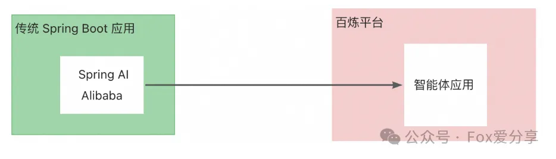

## <font style="color:rgba(0, 0, 0, 0.9);">一、基于阿里云百炼平台0代码构建RAG应用</font>

# **<font style="color:rgba(0, 0, 0, 0.9);">1.背景知识：什么是RAG</font>**

<font style="color:rgba(0, 0, 0, 0.9);">就像你无法回答一个陌生领域的问题一样，大模型也无法回答预训练阶段没有准确掌握的知识。但是我们可以在大模型直接回答私有领域问题之前，给大模型一些参考，让大模型结合参考来回答问题。这一技术被称为</font>**<font style="color:rgba(0, 0, 0, 0.9);">检索增强生成（Retrieval-Augmented Generation，RAG）</font>**<font style="color:rgba(0, 0, 0, 0.9);">，非常适合于在私域知识问答场景中消除大模型幻觉（编造答案）。</font>

<font style="color:rgba(0, 0, 0, 0.9);">  
</font>

**<font style="color:rgba(0, 0, 0, 0.9);">RAG 应用有两个关键过程：</font>**

* **<font style="color:rgba(0, 0, 0, 0.9);">建立索引：</font>**<font style="color:rgba(0, 0, 0, 0.9);">这一阶段你需要将私有领域知识的文档（如 PDF、Word 等格式）存储起来并建立索引。这一过程包含：将文档中的文字提取加载出来、切分成小的分块（chunk）以避免超过大模型提示词长度限制、将文本 chunk 向量化后存储到向量数据库中以便于后续检索。</font>
* **<font style="color:rgba(0, 0, 0, 0.9);">检索和生成</font>**<font style="color:rgba(0, 0, 0, 0.9);">：当你为私有知识建立好索引，并完成相关流程开发后，用户就可以进行提问。你的 RAG 应用收到用户问题后，会去向量数据库中检索和问题相关的 chunk，然后将相关的 chunk 组合到提示词中给到大模型。大模型会结合参考信息给出回答。</font>

<font style="color:rgba(0, 0, 0, 0.9);">以下是常见的 RAG 应用流程图：</font>

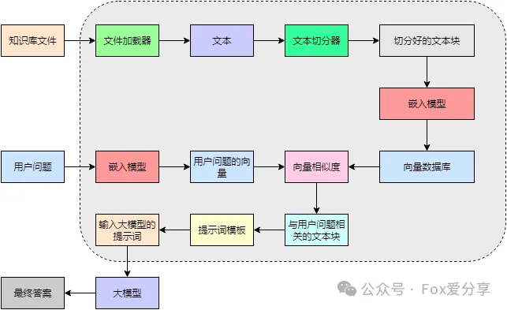

<font style="color:rgba(0, 0, 0, 0.9);">开发一个 RAG 应用需要你具备一定的代码能力和算法基础，并且也会耗费一些时间。</font>

<font style="color:rgba(0, 0, 0, 0.9);">  
</font>

**<font style="color:rgba(0, 0, 0, 0.9);">2.开通阿里云百炼</font>**

<font style="color:rgba(0, 0, 0, 0.55);">https://bailian.console.aliyun.com/</font>


<font style="color:rgba(0, 0, 0, 0.9);">百炼平台会为首次开通服务的用户提供免费试用额度。</font>

**<font style="color:rgba(0, 0, 0, 0.9);">开通之后进行模型体验</font>**

<font style="color:rgba(0, 0, 0, 0.9);">在左侧导航栏中，选择</font><font style="color:rgba(0, 0, 0, 0.9);">模型体验>文本模型>文本对话>通义千问-MAX</font><font style="color:rgba(0, 0, 0, 0.9);">，在下方的输入框中输入你想问的问题。</font>

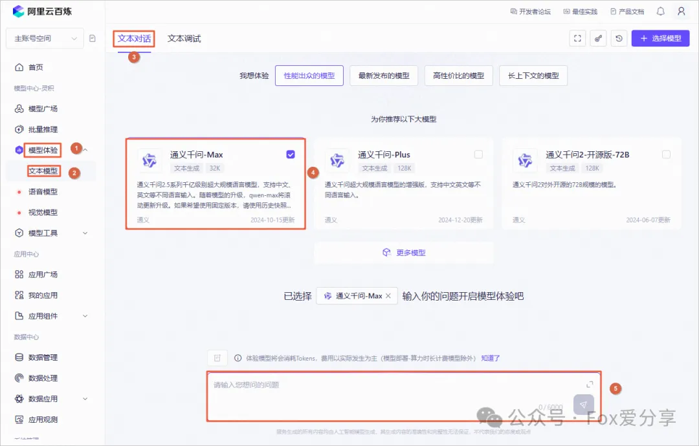

<font style="color:rgba(0, 0, 0, 0.9);">  
</font>

<font style="color:rgba(0, 0, 0, 0.9);">在正式搭建 RAG 应用之前，我们可以先测试一个问题「</font>**<font style="color:rgba(0, 0, 0, 0.9);">西红市实验十小一年二班的班主任是谁？</font>**<font style="color:rgba(0, 0, 0, 0.9);">」来看下大模型的回答效果</font>


<font style="color:rgba(0, 0, 0, 0.9);">  
</font>

<font style="color:rgba(0, 0, 0, 0.9);">你可能会看到这样的回答：</font>

<font style="color:rgba(0, 0, 0, 0.9);">  
</font>

<font style="color:rgba(0, 0, 0, 0.9);">因为“西红市实验十小”这个学校是我们虚构的，大模型无法回答这个私有领域的问题。</font>

<font style="color:rgba(0, 0, 0, 0.9);">  
</font>

**<font style="color:rgba(0, 0, 0, 0.9);">3. 创建知识库</font>**

<font style="color:rgba(0, 0, 0, 0.9);">为了能够回答前一步骤的问题，我们需要创建一个知识库，并维护一些私有领域的知识文档。</font>

<font style="color:rgba(0, 0, 0, 0.9);">你可以参考如下步骤完成：</font>

<font style="color:rgba(0, 0, 0, 0.9);">1）下载我们提前准备好的示例知识库文件：</font>

<font style="color:rgb(0, 56, 132);background-color:rgb(243, 243, 243);">示例知识库.doc</font>

<font style="color:rgba(0, 0, 0, 0.9);">2）单击左侧菜单栏中的</font>**<font style="color:rgba(0, 0, 0, 0.9);">数据管理</font>**<font style="color:rgba(0, 0, 0, 0.9);">，在</font>**<font style="color:rgba(0, 0, 0, 0.9);">默认类目</font>**<font style="color:rgba(0, 0, 0, 0.9);">下，单击</font>**<font style="color:rgba(0, 0, 0, 0.9);">导入数据</font>**<font style="color:rgba(0, 0, 0, 0.9);">。</font>

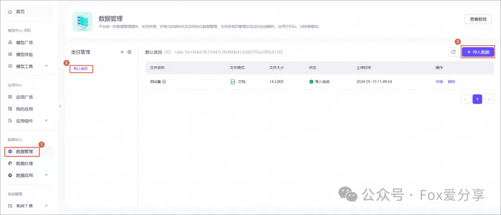

<font style="color:rgba(0, 0, 0, 0.9);">  
</font>

<font style="color:rgba(0, 0, 0, 0.9);">3）在导入数据界面，单击</font>**<font style="color:rgba(0, 0, 0, 0.9);">本地上传</font>**<font style="color:rgba(0, 0, 0, 0.9);">，上传知识库文件（本实验使用的是示例数据），上传完成后单击</font>**<font style="color:rgba(0, 0, 0, 0.9);">确认</font>**<font style="color:rgba(0, 0, 0, 0.9);">。文档解析需要花费一段时间，请耐心等待，可以主动刷新页面。</font>

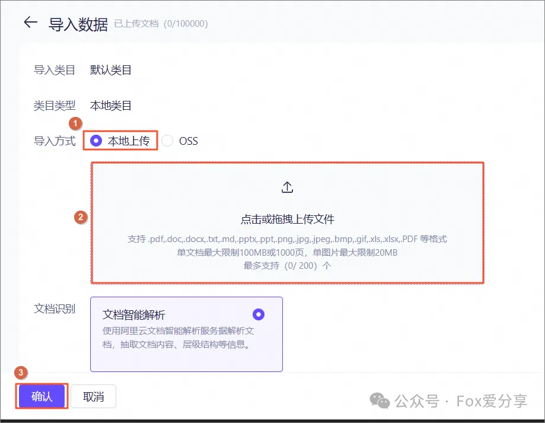

<font style="color:rgba(0, 0, 0, 0.9);">  
</font>

<font style="color:rgba(0, 0, 0, 0.9);">4）单击左侧菜单栏中的</font>**<font style="color:rgba(0, 0, 0, 0.9);">数据应用-知识索引</font>**<font style="color:rgba(0, 0, 0, 0.9);">，单击</font>**<font style="color:rgba(0, 0, 0, 0.9);">创建知识库</font>**<font style="color:rgba(0, 0, 0, 0.9);">。</font>

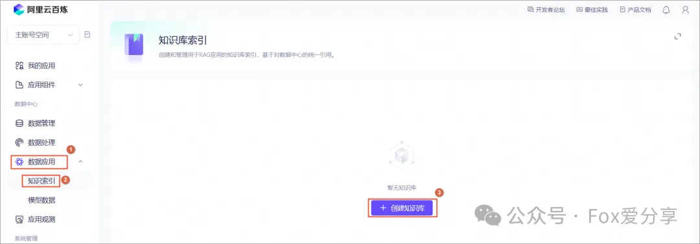

<font style="color:rgba(0, 0, 0, 0.9);">  
</font>

<font style="color:rgba(0, 0, 0, 0.9);">5）填写</font>**<font style="color:rgba(0, 0, 0, 0.9);">知识库名称：学校信息库</font>**<font style="color:rgba(0, 0, 0, 0.9);">，其它参数保持</font>**<font style="color:rgba(0, 0, 0, 0.9);">默认</font>**<font style="color:rgba(0, 0, 0, 0.9);">即可，单击</font>**<font style="color:rgba(0, 0, 0, 0.9);">下一步</font>**<font style="color:rgba(0, 0, 0, 0.9);">。为了更好地区分不同的知识库，建议填写知识库描述；选择推荐配置；相似度阈值越高，模型可以从知识库中获取到的知识越精确，但是可能会丢失部分信息，相似度阈值越低，模型可以从知识库中获取的知识越多，但是可能会引入无用的知识，对模型生成的回复造成干扰，建议使用默认的阈值。</font>


<font style="color:rgba(0, 0, 0, 0.9);">  
</font>

<font style="color:rgba(0, 0, 0, 0.9);">6）单击</font>**<font style="color:rgba(0, 0, 0, 0.9);">选择文件</font>**<font style="color:rgba(0, 0, 0, 0.9);">，在</font>**<font style="color:rgba(0, 0, 0, 0.9);">默认类目</font>**<font style="color:rgba(0, 0, 0, 0.9);">中选中上传的</font>**<font style="color:rgba(0, 0, 0, 0.9);">示例文档</font>**<font style="color:rgba(0, 0, 0, 0.9);">，若有多个知识库文档，可以进行多选，单击</font>**<font style="color:rgba(0, 0, 0, 0.9);">下一步</font>**<font style="color:rgba(0, 0, 0, 0.9);">。在</font>**<font style="color:rgba(0, 0, 0, 0.9);">数据处理</font>**<font style="color:rgba(0, 0, 0, 0.9);">区域选择</font>**<font style="color:rgba(0, 0, 0, 0.9);">智能切分</font>**<font style="color:rgba(0, 0, 0, 0.9);">，单击</font>**<font style="color:rgba(0, 0, 0, 0.9);">导入完成</font>**<font style="color:rgba(0, 0, 0, 0.9);">。</font>

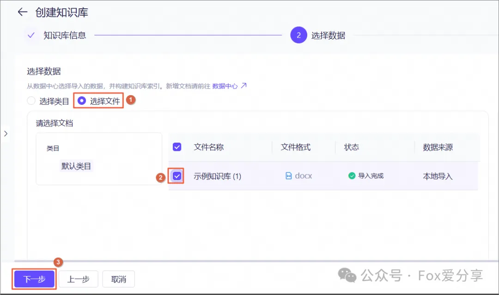

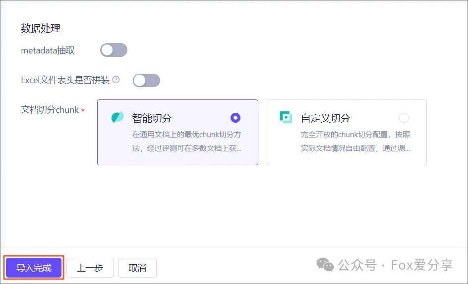

<font style="color:rgba(0, 0, 0, 0.9);">  
</font>

<font style="color:rgba(0, 0, 0, 0.9);">7）当看到状态为</font>**<font style="color:rgba(0, 0, 0, 0.9);">解析完成</font>**<font style="color:rgba(0, 0, 0, 0.9);">时，表示知识库创建完成；单击右侧的</font>**<font style="color:rgba(0, 0, 0, 0.9);">查看切片</font>**<font style="color:rgba(0, 0, 0, 0.9);">即可查看切分完成的文本块。</font>

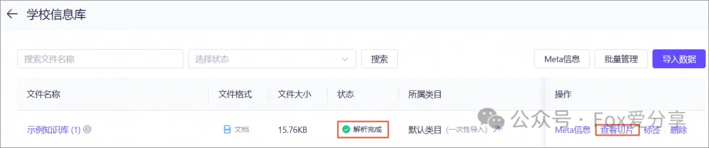

<font style="color:rgb(0, 56, 132);background-color:rgb(243, 243, 243);">  
</font>

**<font style="color:rgba(0, 0, 0, 0.9);">4.创建RAG应用</font>**

<font style="color:rgba(0, 0, 0, 0.9);">完成知识库的创建后，我们可以创建一个 RAG 应用，用于回答私有知识：</font>

<font style="color:rgba(0, 0, 0, 0.9);">1）单击左侧边栏的</font>**<font style="color:rgba(0, 0, 0, 0.9);">应用中心-我的应用</font>**<font style="color:rgba(0, 0, 0, 0.9);">，单击</font>**<font style="color:rgba(0, 0, 0, 0.9);">新增应用>直接创建</font>**<font style="color:rgba(0, 0, 0, 0.9);">。</font>

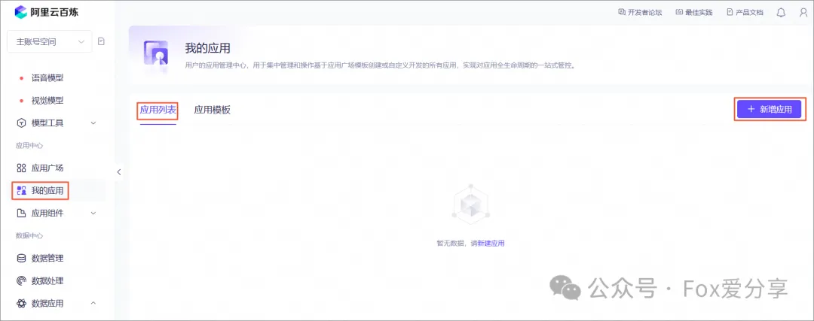


<font style="color:rgba(0, 0, 0, 0.9);">  
</font>

<font style="color:rgba(0, 0, 0, 0.9);">2）应用信息如下，配置好后点击单击</font>

* <font style="color:rgba(0, 0, 0, 0.9);">应用名称：示例名称-</font><font style="color:rgba(0, 0, 0, 0.9);">学校信息答疑机器人</font>
* <font style="color:rgba(0, 0, 0, 0.9);">模型：在模型下拉列表可以查看并选择</font><font style="color:rgba(0, 0, 0, 0.9);">通义千问系列模型</font>
* <font style="color:rgba(0, 0, 0, 0.9);">知识检索增强：</font><font style="color:rgba(0, 0, 0, 0.9);">开启</font><font style="color:rgba(0, 0, 0, 0.9);">，Prompt栏中会自动填充内容</font>
* <font style="color:rgba(0, 0, 0, 0.9);">选择知识库：选择创建好的知识库（</font><font style="color:rgba(0, 0, 0, 0.9);">学校信息库</font><font style="color:rgba(0, 0, 0, 0.9);">）</font>

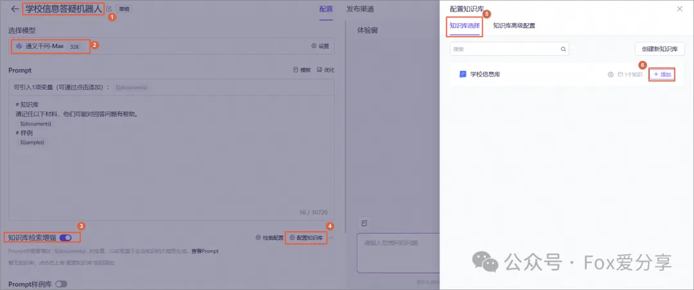

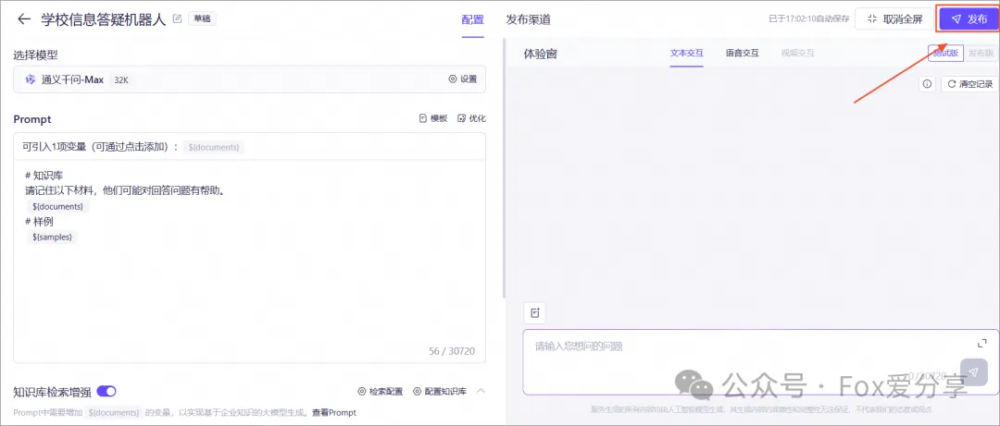

<font style="color:rgba(0, 0, 0, 0.9);">  
</font>

**<font style="color:rgba(0, 0, 0, 0.9);">5. 测试RAG应用</font>**

<font style="color:rgba(0, 0, 0, 0.9);">创建好 RAG 应用后，我们可以再次尝试提问，看看现在大模型是否能正确回答这个问题【</font>**<font style="color:rgba(0, 0, 0, 0.9);">西红市实验十小一年二班的班主任是谁？</font>**<font style="color:rgba(0, 0, 0, 0.9);">】</font><font style="color:rgba(0, 0, 0, 0.9);">。</font>

<font style="color:rgba(0, 0, 0, 0.9);">1）在右侧边栏体验窗区域</font><font style="color:rgba(0, 0, 0, 0.9);">，切换为</font>**<font style="color:rgba(0, 0, 0, 0.9);">发布版</font>**<font style="color:rgba(0, 0, 0, 0.9);">。在输入框进行提问 </font>**<font style="color:rgba(0, 0, 0, 0.9);">西红市实验十小一年二班的班主任是谁？</font>**

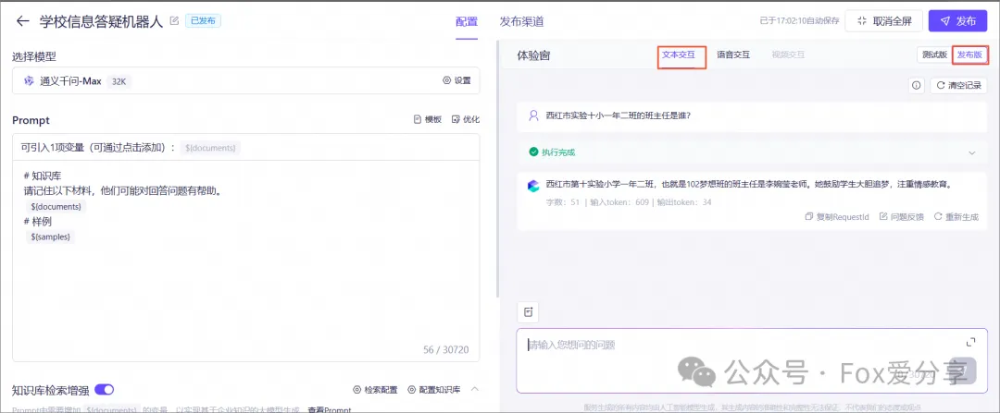

<font style="color:rgba(0, 0, 0, 0.9);">可以看到，开启知识检索增强的应用已经能够成功回答该问题了。</font>

<font style="color:rgba(0, 0, 0, 0.9);">  
</font>

**<font style="color:rgba(0, 0, 0, 0.9);">6.发布RAG应用</font>**

<font style="color:rgba(0, 0, 0, 0.9);">点击页面右上角的 “发布” 按钮，将智能体正式发布出去。</font>


<font style="color:rgba(0, 0, 0, 0.9);">发布完成后，我们就可以通过通过 API 与这个智能体应用进行对话了。接下来我们演示如何在 Spring Boot 应用中快速访问这个智能体应用。</font>

<font style="color:rgba(0, 0, 0, 0.9);">  
</font>

<font style="color:rgba(0, 0, 0, 0.9);">  
</font>

**<font style="color:rgba(0, 0, 0, 0.9);">二、SpringBoot+Spring AI Alibaba接入RAG应用</font>**

<font style="color:rgb(53, 56, 65);">为了让 Spring Boot 应用访问百炼中发布的智能体应用，首先我们为应用加入 Spring AI Alibaba 依赖：</font>

<font style="color:rgb(51, 51, 51);background-color:rgba(0, 0, 0, 0.03);"><dependency>    <groupId>com.alibaba.cloud.ai</groupId>    <artifactId>spring-ai-alibaba-starter</artifactId>    <version>${spring-ai-alibaba.version}</version></dependency></font>

<font style="color:rgb(53, 56, 65);">其次，需要在百炼平台获取应用标识、模型apikey等信息：</font>

<font style="color:rgb(51, 51, 51);background-color:rgba(0, 0, 0, 0.03);">spring:  ai:    dashscope:      agent:        app-id: put-your-app-id-here      api-key: ${AI\_DASHSCOPE\_API\_KEY}</font>

* <font style="color:rgba(0, 0, 0, 0.9);">api-key，必填，访问模型服务的 key。</font>
* <font style="color:rgba(0, 0, 0, 0.9);">app-id，必填，每个百炼应用都有一个 id，用户唯一标识这个应用。</font>
* <font style="color:rgba(0, 0, 0, 0.9);">workspace-id，选填，默认使用默认业务空间，如果是在独立业务空间创建的应用则需要指定。</font>

**<font style="color:rgba(0, 0, 0, 0.9);">应用id</font>**

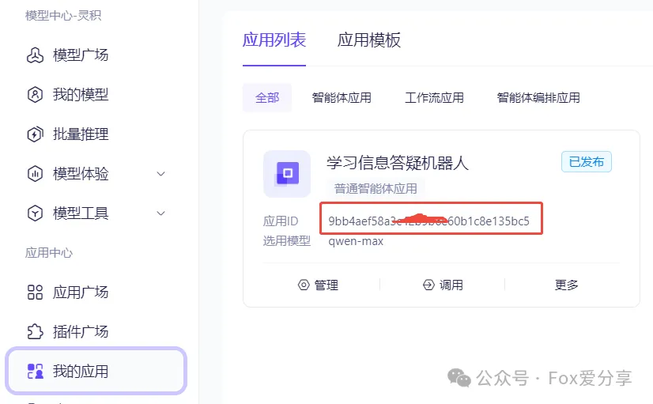

**<font style="color:rgba(0, 0, 0, 0.9);">业务空间</font>**

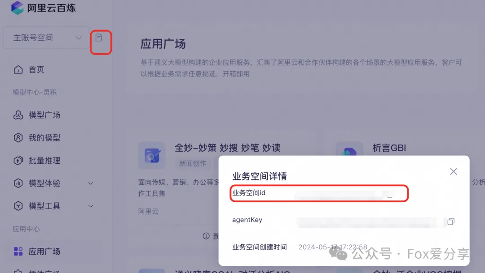

**<font style="color:rgba(0, 0, 0, 0.9);">Spring AI Alibaba 使用 </font>**<code>**<font style="color:rgba(0, 0, 0, 0.9);">DashScopeAgent</font>**</code>**<font style="color:rgba(0, 0, 0, 0.9);"> 访问</font>**

<font style="color:rgba(0, 0, 0, 0.9);">示例代码：</font>

```plain
```

**<font style="color:rgba(0, 0, 0, 0.9);">测试效果</font>**

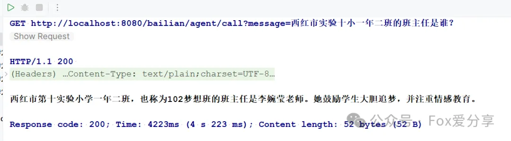
