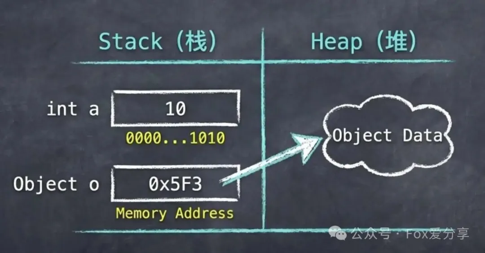
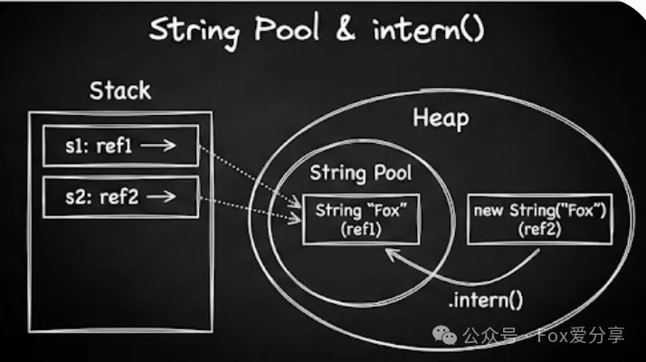
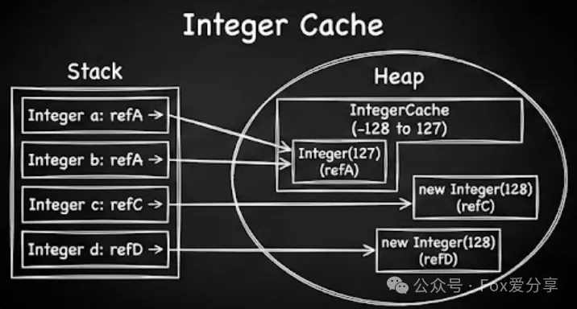
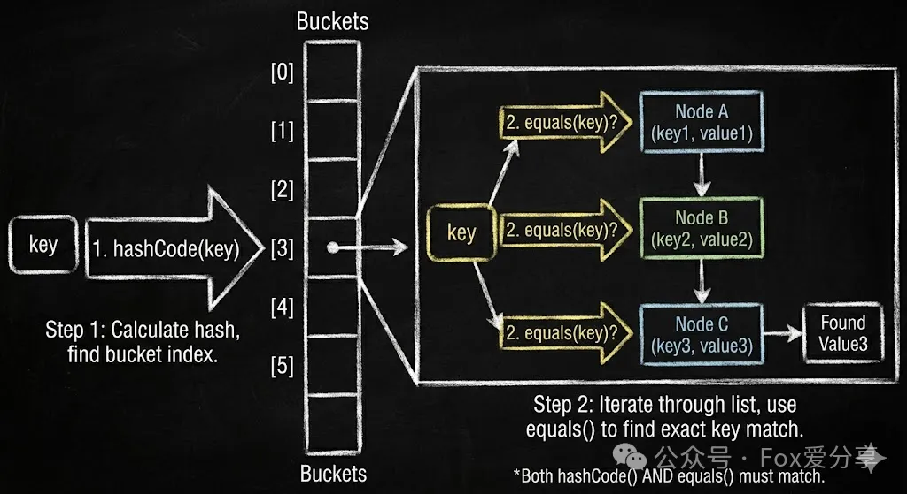

# 面试官：==和equals的区别？答“地址和内容”的，出门右转！

## \*\*<font style="color:rgb(130, 127, 196);">

写在开头</font>\*\* <font style="color:rgb(0, 0, 0);">一位 </font>**<font style="color:rgb(130, 127, 196);">1 年经验</font>**<font style="color:rgb(0, 0, 0);"> 的兄弟找我复盘，说面试挂得有点“冤”，心态崩了。 面试官刚开始为了缓解气氛，</font>**<font style="color:rgb(130, 127, 196);">暖场</font>**<font style="color:rgb(0, 0, 0);">问了一个入门级的</font>**<font style="color:rgb(130, 127, 196);">送分题</font>**<font style="color:rgb(0, 0, 0);">：“Java 里 </font><code><font style="color:rgb(130, 127, 196);">==</font></code><font style="color:rgb(0, 0, 0);"> 和 </font><code><font style="color:rgb(130, 127, 196);">equals</font></code><font style="color:rgb(0, 0, 0);"> 有什么区别？”</font>

<font style="color:rgb(0, 0, 0);">这哥们心想这还不简单，自信满满地背诵：“</font><code><font style="color:rgb(130, 127, 196);">==</font></code><font style="color:rgb(0, 0, 0);"> 比较地址，</font><code><font style="color:rgb(130, 127, 196);">equals</font></code><font style="color:rgb(0, 0, 0);"> 比较内容。”</font>

<font style="color:rgb(0, 0, 0);">没想到面试官听完，笑着连问了三个问题：</font>

1. **<font style="color:rgb(130, 127, 196);">“</font>**<code>**<font style="color:rgb(130, 127, 196);">Integer a = 1000</font>**</code>**<font style="color:rgb(130, 127, 196);">，</font>**<code>**<font style="color:rgb(130, 127, 196);">Integer b = 1000</font>**</code>**<font style="color:rgb(130, 127, 196);">，用 </font>**<code>**<font style="color:rgb(130, 127, 196);">==</font>**</code>**<font style="color:rgb(130, 127, 196);"> 比较结果是什么？如果是 </font>**<code>**<font style="color:rgb(130, 127, 196);">127</font>**</code>**<font style="color:rgb(130, 127, 196);"> 呢？这个范围能改吗？”</font>**
2. **<font style="color:rgb(130, 127, 196);">“</font>**<code>**<font style="color:rgb(130, 127, 196);">double d1 = 0.0</font>**</code>**<font style="color:rgb(130, 127, 196);">，</font>**<code>**<font style="color:rgb(130, 127, 196);">double d2 = -0.0</font>**</code>**<font style="color:rgb(130, 127, 196);">，它们二进制位一样吗？</font>**<code>**<font style="color:rgb(130, 127, 196);">==</font>**</code>**<font style="color:rgb(130, 127, 196);"> 结果又是啥？”</font>**
3. **<font style="color:rgb(130, 127, 196);">“重写 </font>**<code>**<font style="color:rgb(130, 127, 196);">equals</font>**</code>**<font style="color:rgb(130, 127, 196);"> 必须重写 </font>**<code>**<font style="color:rgb(130, 127, 196);">hashCode</font>**</code>**<font style="color:rgb(130, 127, 196);"> 吗？如果不重写，HashMap 取数据时第一步会发生什么？”</font>**

<font style="color:rgb(0, 0, 0);">他瞬间懵了，支支吾吾答不上来，</font>**<font style="color:rgb(130, 127, 196);">原本的暖场题直接变成了“送命题”</font>**<font style="color:rgb(0, 0, 0);">。</font>

<font style="color:rgb(0, 0, 0);">其实，这道题看似简单，实则是考你对 </font>**<font style="color:rgb(130, 127, 196);">JVM 内存模型</font>**<font style="color:rgb(0, 0, 0);">、</font>**<font style="color:rgb(130, 127, 196);">IEEE 754 标准</font>**<font style="color:rgb(0, 0, 0);"> 和 </font>**<font style="color:rgb(130, 127, 196);">JDK 源码</font>**<font style="color:rgb(0, 0, 0);"> 的理解深度。只背八股文，连源码都没翻过，面试官一挖你就倒。</font>

<font style="color:rgb(0, 0, 0);">今天Fox带你彻底拆解这道</font>**<font style="color:rgb(130, 127, 196);">“最熟悉的陌生题”</font>**<font style="color:rgb(0, 0, 0);">，最后给你一套无懈可击的面试模板。</font>

# **<font style="color:rgb(255, 255, 255);background-color:#585A5A;">一、 为什么“==比地址”的说法不严谨？</font>**

<font style="color:rgb(0, 0, 0);">很多老教材喜欢教一句口诀：“基本类型比值，引用类型比地址”。 </font>**<font style="color:rgb(130, 127, 196);">这句话没错，但它只看到了表象，没看到 JVM 的底层真相。</font>**<font style="color:rgb(0, 0, 0);"> 如果你只记住了这就去面试，遇到“浮点数”或者“装箱拆箱”的题，照样会挂。</font>

**<font style="color:rgb(130, 127, 196);">在 JVM 的眼里，根本没有“值”和“地址”的区别，它只认“二进制”。</font>**

<font style="color:rgb(0, 0, 0);">我们知道，Java 的变量都存在 </font>**<font style="color:rgb(130, 127, 196);">栈（Stack）</font>**<font style="color:rgb(0, 0, 0);"> 里：</font>

* **<font style="color:rgb(130, 127, 196);">基本类型（int a = 10）：</font>**<font style="color:rgb(0, 0, 0);"> 栈里直接存的是 </font>**<font style="color:rgb(130, 127, 196);">10 的二进制</font>**<font style="color:rgb(0, 0, 0);">。</font>
* **<font style="color:rgb(130, 127, 196);">引用类型（Object o = new Object()）：</font>**<font style="color:rgb(0, 0, 0);"> 栈里存的是 </font>**<font style="color:rgb(130, 127, 196);">堆中对象的内存地址（如 0x5F3）的二进制</font>**<font style="color:rgb(0, 0, 0);">。</font>



<code>**<font style="color:rgb(130, 127, 196);">==</font>**</code>**<font style="color:rgb(130, 127, 196);"> 操作符的本质</font>**<font style="color:rgb(0, 0, 0);">，就是比较这该死的槽位里的二进制位是否完全一样！</font>

<font style="color:rgb(0, 0, 0);">让我们看一眼字节码，写一段简单的代码：</font>

```plain
int a = 100;
int b = 100;
Object obj1 = new Object();
Object obj2 = obj1;
```

<font style="color:rgb(0, 0, 0);">通过 </font>**<font style="color:rgb(130, 127, 196);">javap -c 反编译</font>**<font style="color:rgb(0, 0, 0);">，你会发现 JVM 处理 == 时用了不同的指令：</font>

* <font style="color:rgb(0, 0, 0);">比较 int 时，用的是 </font>**<font style="color:rgb(130, 127, 196);">if\_icmpeq</font>**<font style="color:rgb(0, 0, 0);">（比较整数栈顶值）。</font>
* <font style="color:rgb(0, 0, 0);">比较 Object 时，用的是 </font>**<font style="color:rgb(130, 127, 196);">if\_acmpeq</font>**<font style="color:rgb(0, 0, 0);">（比较引用地址）。</font>

**<font style="color:rgb(130, 127, 196);">结论：</font>**<font style="color:rgb(0, 0, 0);"> == 根本不关心对象里存了什么。 它只关心：你栈里存的那串数字（无论是值还是地址），是不是一模一样。</font>

**<font style="color:rgb(130, 127, 196);">这里有个极端的反例（加分项）：</font>**

<font style="color:rgb(0, 0, 0);">如果你能答出 </font>**<font style="color:rgb(130, 127, 196);">浮点数（float/double）</font>**<font style="color:rgb(0, 0, 0);"> 的特殊性，面试官绝对会对你刮目相看：</font>

* <code><font style="color:rgb(130, 127, 196);">NaN</font></code><font style="color:rgb(0, 0, 0);">（Not a Number）：虽然它的二进制位和自己一样，但 </font><code><font style="color:rgb(130, 127, 196);">Double.NaN == Double.NaN</font></code><font style="color:rgb(0, 0, 0);"> 结果是 </font>**<font style="color:rgb(130, 127, 196);">false</font>**<font style="color:rgb(0, 0, 0);">。</font>
* <code><font style="color:rgb(130, 127, 196);">0.0</font></code><font style="color:rgb(0, 0, 0);"> 和 </font><code><font style="color:rgb(130, 127, 196);">-0.0</font></code><font style="color:rgb(0, 0, 0);">：在内存里符号位不同（二进制不一样），但 </font><code><font style="color:rgb(130, 127, 196);">0.0 == -0.0</font></code><font style="color:rgb(0, 0, 0);"> 结果是 </font>**<font style="color:rgb(130, 127, 196);">true</font>**<font style="color:rgb(0, 0, 0);">。</font>

**<font style="color:rgb(130, 127, 196);">结论：</font>**<font style="color:rgb(0, 0, 0);"> 除了浮点数这种奇葩，</font><code><font style="color:rgb(130, 127, 196);">==</font></code><font style="color:rgb(0, 0, 0);"> 永远是在比“栈帧局部变量表中 Slot 的二进制位同一性”。</font>

# **<font style="color:rgb(255, 255, 255);background-color:#585A5A;">二、 equals 的原罪：它默认就是“==”</font>**

<font style="color:rgb(0, 0, 0);">很多同学以为 </font><code><font style="color:rgb(130, 127, 196);">equals</font></code><font style="color:rgb(0, 0, 0);"> 天生就是用来比内容的。 </font>**<font style="color:rgb(130, 127, 196);">大错特错！</font>**<font style="color:rgb(0, 0, 0);"> 让我们扒开 JDK 的祖宗类 </font><code><font style="color:rgb(130, 127, 196);">java.lang.Object</font></code><font style="color:rgb(0, 0, 0);"> 的源码看看：</font>

```plain
// JDK 源码：Object.java
public boolean equals(Object obj) {
    return (this == obj);
}
```

<font style="color:rgb(0, 0, 0);">看到没有？</font>**<font style="color:rgb(130, 127, 196);">在 Object 类里，equals 就是 </font>**<code>**<font style="color:rgb(130, 127, 196);">==</font>**</code>**<font style="color:rgb(130, 127, 196);">！</font>**<font style="color:rgb(0, 0, 0);"> 如果你定义了一个 </font><code><font style="color:rgb(130, 127, 196);">User</font></code><font style="color:rgb(0, 0, 0);"> 类，却没有重写 </font><code><font style="color:rgb(130, 127, 196);">equals</font></code><font style="color:rgb(0, 0, 0);"> 方法，那你写 </font><code><font style="color:rgb(130, 127, 196);">user1.equals(user2)</font></code><font style="color:rgb(0, 0, 0);">，和写 </font><code><font style="color:rgb(130, 127, 196);">user1 == user2</font></code><font style="color:rgb(0, 0, 0);"> 没有任何区别，比的还是地址。</font>

# **<font style="color:rgb(255, 255, 255);">三、 核心进阶：源码里的两个“大坑”</font>**

<font style="color:rgb(0, 0, 0);">面试官最喜欢问的“坑”，通常藏在 </font><code><font style="color:rgb(130, 127, 196);">String</font></code><font style="color:rgb(0, 0, 0);"> 和 </font><code><font style="color:rgb(130, 127, 196);">Integer</font></code><font style="color:rgb(0, 0, 0);"> 的源码里。</font>

## **<font style="color:rgb(130, 127, 196);">坑位 1：String 的“双标”与 intern()</font>**

<code><font style="color:rgb(130, 127, 196);">String</font></code><font style="color:rgb(0, 0, 0);"> 是个叛徒，它重写了 </font><code><font style="color:rgb(130, 127, 196);">equals</font></code><font style="color:rgb(0, 0, 0);">，变成了比较字符数组的内容。 我们看 String 的源码（JDK 8）：</font>

```plain
public boolean equals(Object anObject) {
    // 1. 先判断地址，如果是同一个对象，直接返回 true（性能优化）
    if (this == anObject) {
        return true;
    }
    // 2. 如果是 String 类型，再逐个字符比较内容
    if (anObject instanceof String) {
        ... // 循环比较 char[] 数组
    }
    return false;
}
```

<font style="color:rgb(0, 0, 0);">但这里有个经典面试题：</font>

```plain
String s1 = "Fox";
String s2 = new String("Fox");

System.out.println(s1 == s2); // false
System.out.println(s1 == s2.intern()); // true
```

**<font style="color:rgb(130, 127, 196);">深度解析：</font>**

* <code><font style="color:rgb(130, 127, 196);">s1</font></code><font style="color:rgb(0, 0, 0);"> 指向 </font>**<font style="color:rgb(130, 127, 196);">字符串常量池（String Pool）</font>**<font style="color:rgb(0, 0, 0);">。</font>
* <code><font style="color:rgb(130, 127, 196);">s2</font></code><font style="color:rgb(0, 0, 0);"> 指向 </font>**<font style="color:rgb(130, 127, 196);">堆内存</font>**<font style="color:rgb(0, 0, 0);">（因为用了 </font><code><font style="color:rgb(130, 127, 196);">new</font></code><font style="color:rgb(0, 0, 0);">）。</font>
* <code>**<font style="color:rgb(130, 127, 196);">intern()</font>**</code>**<font style="color:rgb(130, 127, 196);">的作用：</font>**<font style="color:rgb(0, 0, 0);"> 这是一个 native 方法，它会尝试把堆里的字符串“塞回”常量池。如果池子里有了，就返回池里的地址。所以 </font><code><font style="color:rgb(130, 127, 196);">s2.intern()</font></code><font style="color:rgb(0, 0, 0);"> 返回的地址和 </font><code><font style="color:rgb(130, 127, 196);">s1</font></code><font style="color:rgb(0, 0, 0);"> 是一样的！</font>



## **<font style="color:rgb(130, 127, 196);">坑位 2：Integer 的 128 陷阱与 JVM 调优</font>**

<font style="color:rgb(0, 0, 0);">回到开头面试官的问题：</font>

```plain
Integer a = 127, b = 127;
System.out.println(a == b); // true

Integer c = 128, d = 128;
System.out.println(c == d); // false
```

<font style="color:rgb(0, 0, 0);">为什么 127 行，128 就不行？ 这涉及到了 Java 的 </font>**<font style="color:rgb(130, 127, 196);">自动装箱（Auto-boxing）机制</font>**<font style="color:rgb(0, 0, 0);">。当你写 Integer a = 127 时，编译器自动转成了 Integer.valueOf(127)。</font>

<font style="color:rgb(0, 0, 0);">让我们钻进 Integer.java 源码：</font>

```plain
public static Integer valueOf(int i) {
    // IntegerCache.low = -128
    // IntegerCache.high = 127 (默认)
    if (i >= IntegerCache.low && i <= IntegerCache.high)
        // 命中缓存！直接返回缓存数组里的对象引用
        return IntegerCache.cache[i + (-IntegerCache.low)];
    
    // 没命中，老老实实 new 一个新对象
    return new Integer(i);
}
```

**<font style="color:rgb(130, 127, 196);">真相大白：</font>**<font style="color:rgb(0, 0, 0);"> Java 为了性能，默认缓存了 </font>**<font style="color:rgb(130, 127, 196);">\[-128, 127]</font>**<font style="color:rgb(0, 0, 0);"> 之间的整数对象（</font><code><font style="color:rgb(130, 127, 196);">IntegerCache</font></code><font style="color:rgb(0, 0, 0);">）。</font>

* **<font style="color:rgb(130, 127, 196);">127</font>**<font style="color:rgb(1, 1, 1);"> 命中缓存，大家拿到的都是缓存池里同一个对象的引用。</font>
* **<font style="color:rgb(130, 127, 196);">128</font>**<font style="color:rgb(1, 1, 1);"> 超出缓存，每次都 </font><code><font style="color:rgb(1, 1, 1);">new</font></code><font style="color:rgb(1, 1, 1);"> 一个新对象。</font>



**<font style="color:rgb(130, 127, 196);">大神加分项：</font>**

<font style="color:rgb(0, 0, 0);">面试官问：“128 就一定不相等吗？”</font>

<font style="color:rgb(0, 0, 0);">你可以淡定地回答：“不一定。这个上限 </font><code><font style="color:rgb(130, 127, 196);">127</font></code><font style="color:rgb(0, 0, 0);"> 是可以通过 JVM 参数 </font><code><font style="color:rgb(130, 127, 196);">-XX:AutoBoxCacheMax=<size></font></code><font style="color:rgb(0, 0, 0);"> 来修改的。如果我看某个应用全是 200 左右的 ID 操作，我完全可以把缓存调大来优化 GC。” </font>**<font style="color:rgb(130, 127, 196);">这一句说出来，面试官就知道你是读过源码且懂调优的。</font>**

# **<font style="color:rgb(255, 255, 255);background-color:#585A5A;">四、 最后的“必杀技”：HashCode 的契约</font>**

<font style="color:rgb(0, 0, 0);">如果面试官问：“</font>**<font style="color:rgb(130, 127, 196);">我重写了 equals，但不重写 hashCode 会怎样？</font>**<font style="color:rgb(0, 0, 0);">”</font>

**<font style="color:rgb(130, 127, 196);">答：会导致 HashMap/HashSet 丢数据。</font>**

**<font style="color:rgb(130, 127, 196);">原理拆解：</font>**<font style="color:rgb(0, 0, 0);"> HashMap 在 </font><code><font style="color:rgb(130, 127, 196);">get(key)</font></code><font style="color:rgb(0, 0, 0);"> 的时候，是有“两道门禁”的：</font>

1. **<font style="color:rgb(130, 127, 196);">第一道门禁（Hash）：</font>**<font style="color:rgb(0, 0, 0);"> 先算 key 的 </font><code><font style="color:rgb(130, 127, 196);">hashCode()</font></code><font style="color:rgb(0, 0, 0);">。如果哈希值不一样，HashMap 直接判定“找不到”，连 </font><code><font style="color:rgb(130, 127, 196);">equals</font></code><font style="color:rgb(0, 0, 0);"> 都懒得调。</font>
2. **<font style="color:rgb(130, 127, 196);">第二道门禁（Equals）：</font>**<font style="color:rgb(0, 0, 0);"> 只有哈希值一样（Hash冲突）且桶里有数据时，才会调用 </font><code><font style="color:rgb(130, 127, 196);">equals</font></code><font style="color:rgb(0, 0, 0);"> 进行最终确认。</font>



<font style="color:rgb(0, 0, 0);">如果你重写了 </font><code><font style="color:rgb(130, 127, 196);">equals</font></code><font style="color:rgb(0, 0, 0);"> 让两个对象“逻辑相等”，却没重写 </font><code><font style="color:rgb(130, 127, 196);">hashCode</font></code><font style="color:rgb(0, 0, 0);">： HashMap 第一步算出来的哈希值就不同，直接返回 </font><code><font style="color:rgb(130, 127, 196);">null</font></code><font style="color:rgb(0, 0, 0);">。 这就是经典的 </font>**<font style="color:rgb(130, 127, 196);">内存泄漏</font>**<font style="color:rgb(0, 0, 0);"> 或 </font>**<font style="color:rgb(130, 127, 196);">逻辑诡异</font>**<font style="color:rgb(0, 0, 0);"> bug。</font>

# **<font style="color:rgb(255, 255, 255);background-color:#585A5A;">五、 面试标准答案模板（直接背诵）</font>**

<font style="color:rgb(0, 0, 0);">下次被问到这个问题，请按这个逻辑输出，秒杀全场：</font>

<font style="color:rgb(0, 0, 0);">“</font><code><font style="color:rgb(130, 127, 196);">==</font></code><font style="color:rgb(0, 0, 0);"> 和 </font><code><font style="color:rgb(130, 127, 196);">equals</font></code><font style="color:rgb(0, 0, 0);"> 的区别主要体现在 </font>**<font style="color:rgb(130, 127, 196);">底层原理</font>**<font style="color:rgb(0, 0, 0);"> 和 </font>**<font style="color:rgb(130, 127, 196);">设计契约</font>**<font style="color:rgb(0, 0, 0);"> 上：</font>

1. <code>**<font style="color:rgb(130, 127, 196);">==</font>**</code>**<font style="color:rgb(130, 127, 196);"> 的本质：</font>**
   * <font style="color:rgb(1, 1, 1);">它是 CPU 指令级的操作符。对于基本类型，它比较</font>**<font style="color:rgb(130, 127, 196);">栈中的值</font>**<font style="color:rgb(1, 1, 1);">（注意浮点数 IEEE 754 的 NaN 和 -0.0 特例）；对于引用类型，它比较</font>**<font style="color:rgb(130, 127, 196);">堆内存地址</font>**<font style="color:rgb(1, 1, 1);">。</font>
2. <code>**<font style="color:rgb(130, 127, 196);">equals</font>**</code>**<font style="color:rgb(130, 127, 196);"> 的本质：</font>**
   * <font style="color:rgb(1, 1, 1);">它是 Object 类的方法。默认实现就是 </font><code><font style="color:rgb(1, 1, 1);">==</font></code><font style="color:rgb(1, 1, 1);">。</font>
   * <font style="color:rgb(1, 1, 1);">但像 String、Integer 等类重写了它，将其定义为</font>**<font style="color:rgb(130, 127, 196);">逻辑相等</font>**<font style="color:rgb(1, 1, 1);">（比较内部 value）。</font>
3. **<font style="color:rgb(130, 127, 196);">避坑与调优：</font>**
   * <font style="color:rgb(1, 1, 1);">使用 </font><code><font style="color:rgb(1, 1, 1);">==</font></code><font style="color:rgb(1, 1, 1);"> 比较 Integer 时要注意 </font>**<font style="color:rgb(130, 127, 196);">-128 到 127 的缓存池</font>**<font style="color:rgb(1, 1, 1);">，这个范围甚至可以通过 </font><code><font style="color:rgb(1, 1, 1);">-XX:AutoBoxCacheMax</font></code><font style="color:rgb(1, 1, 1);"> 调整。</font>
   * **<font style="color:rgb(130, 127, 196);">核心契约：</font>**<font style="color:rgb(1, 1, 1);"> 重写 equals </font>**<font style="color:rgb(130, 127, 196);">必须</font>**<font style="color:rgb(1, 1, 1);"> 重写 hashCode。这是为了配合 HashMap 等散列集合的高效查询，否则会导致哈希定位失败，引发 Bug。”</font>

## **<font style="color:rgb(130, 127, 196);">写在最后</font>**

<font style="color:rgb(0, 0, 0);">技术面试考的从来不是死记硬背，而是你对 </font>**<font style="color:rgb(130, 127, 196);">底层原理的敬畏</font>**<font style="color:rgb(0, 0, 0);">。 能提到 </font><code><font style="color:rgb(130, 127, 196);">intern()</font></code><font style="color:rgb(0, 0, 0);">、</font><code><font style="color:rgb(130, 127, 196);">AutoBoxCacheMax</font></code><font style="color:rgb(0, 0, 0);"> 和 </font><code><font style="color:rgb(130, 127, 196);">NaN</font></code><font style="color:rgb(0, 0, 0);"> 这些细节，说明你不是在背题，而是在</font>**<font style="color:rgb(130, 127, 196);">玩技术</font>**<font style="color:rgb(0, 0, 0);">。</font>

**<font style="color:rgb(130, 127, 196);">觉得有收获的兄弟，点个“在看”，这就是对我最大的支持！</font>**

<font style="color:rgb(0, 0, 0);">关注公众号【</font>**<font style="color:rgb(130, 127, 196);">Fox爱分享</font>**<font style="color:rgb(0, 0, 0);">】，只讲那些书上不写的实战坑。</font>

<font style="color:rgb(0, 0, 0);"></font>

> <font style="color:rgb(0, 0, 0);">文章首发地址：</font><https://mp.weixin.qq.com/s/8OZj3l_RGZDdvRqwAImvKQ>


> 更新: 2026-03-13 13:54:18  
> 原文: <https://www.yuque.com/tulingzhouyu/db22bv/gt7vxanzhi7hu7ga>