# Kafka中的消息如何分配给不同的消费者？

Apache Kafka 作为高吞吐量的分布式消息系统，其核心优势之一在于能够高效且可靠地将消息分发给多个消费者。这种分配机制是 Kafka 实现负载均衡、并行处理和高可用性的基石。

---

## 1) "核心概念详解"
### 1.1 "三层关键概念"
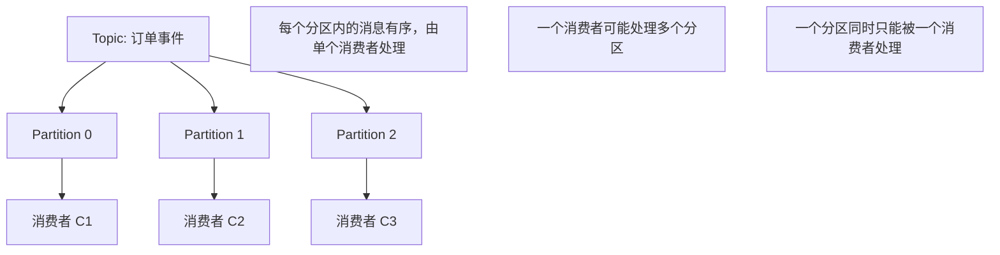

+ **"Topic （主题）"**：
    - "逻辑消息分类，生产者发送消息到 Topic，消费者从 Topic 消费消息。"
    - "示例：'订单事件'、'用户行为日志'、'系统监控指标'。"
+ **"Partition （分区）"**：
    - "每个 Topic 物理上由多个 Partition 组成。"
    - "是 Kafka 消息存储的最小单元，每个 Partition 是一个独立的有序日志。"
    - "决定了消费端的最大并行度：一个 Consumer Group 中最多可以有与 Partition 数相同的消费者。"
+ **"Consumer Group （消费者组）"**：
    - "一组消费者实例，共同消费一个或多个 Topic 的所有消息。"
    - "组内消费者可以根据需要增加或减少，Kafka 会自动调整 Partition 分配。"
    - "不同的 Consumer Group 独立消费同一 Topic，互不影响。"

---

## 2) "为什么需要消费者组？"
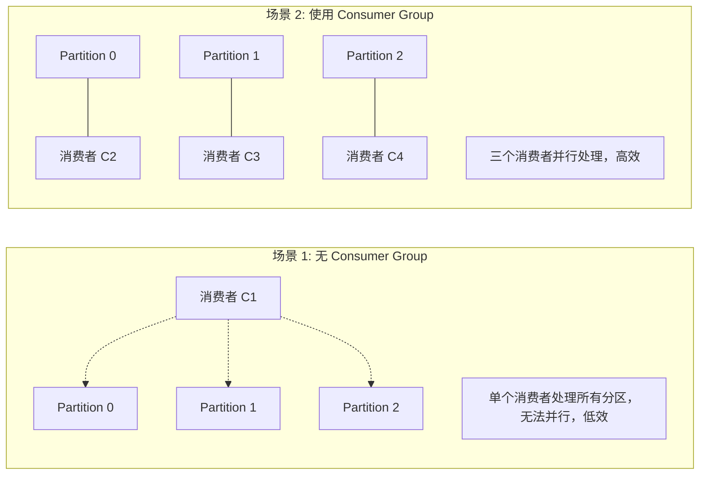

+ **"负载均衡"**："多个消费者并行处理消息，充分利用计算资源。"
+ **"容错能力"**："某个消费者宕机，其他消费者能自动接管其分区，不中断服务。"
+ **"灵活扩展"**："根据处理能力添加或移除消费者，动态调整吞吐量。"
+ **"多场景支持"**："不同的应用可以独立消费同一 Topic，无需互相干扰。"

---

## 3) "Consumer Group 内部分配机制"
### 3.1 "一个关键约束"
**"一个 Partition 同一时刻只能被一个消费者消费"**

这是 Kafka 设计中的重要原则，确保了：

+ "消息的顺序性：同一分区内的消息顺序被严格保证。"
+ "状态管理简化：无需处理并发访问同一分区的问题。"
+ "偏移量管理明确：每个分区的消费进度由单一消费者管理。"

### 3.2 "分配关系示意"
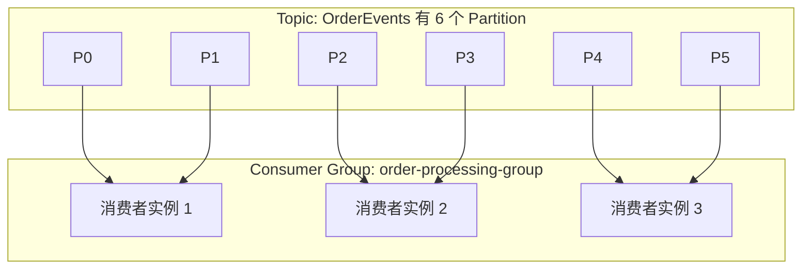

**"观察"**：

+ "6 个 Partition 分配给 3 个消费者，每个消费者分 2 个。"
+ "分配不是严格均匀的（可能是 2-2-2 或 3-2-1 等），取决于分配策略。"
+ "如果消费者数增加到 4 个，会触发 Rebalance，重新分配。"

---

## 4) "Partition 分配的触发机制：Rebalance"
### 4.1 "什么是 Rebalance？"
**"Rebalance 是指当 Consumer Group 发生变化时，Kafka 自动重新分配 Partition 给各消费者的过程。"**

### 4.2 "Rebalance 的触发场景"
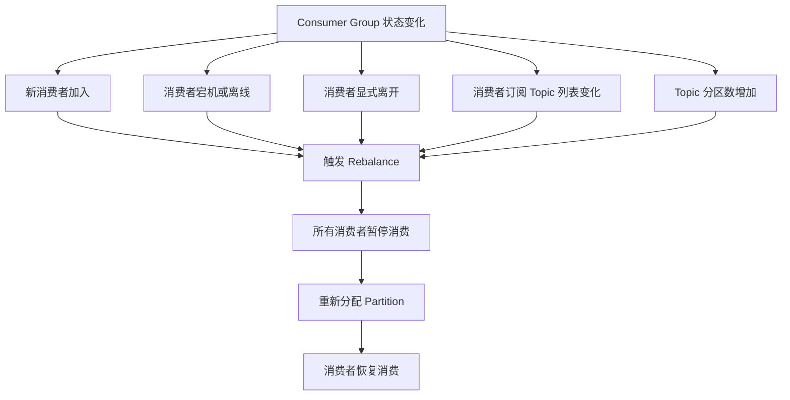

---

## 5) "Rebalance 详细流程"
### 5.1 "参与者角色"
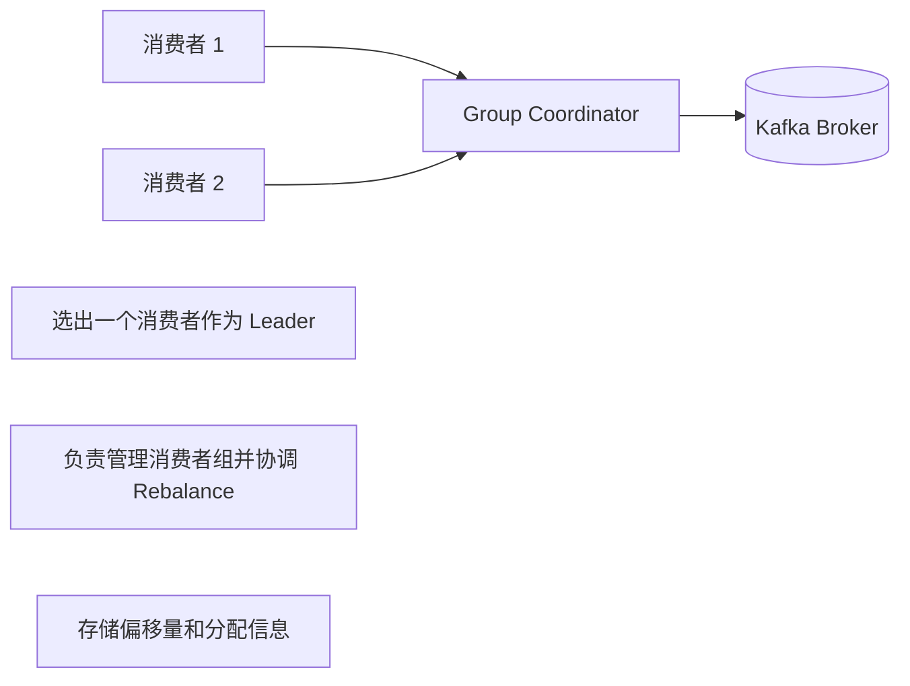

+ **"消费者"**："实际处理消息的应用实例。"
+ **"Group Coordinator"**："某个 Kafka Broker 上的组协调程序，负责 Rebalance 的整体协调。"
+ **"Group Leader"**："从消费者中选出的领导者，制定分配方案（不是固定的，每次 Rebalance 都可能变化）。"

### 5.2 "Rebalance 核心步骤"
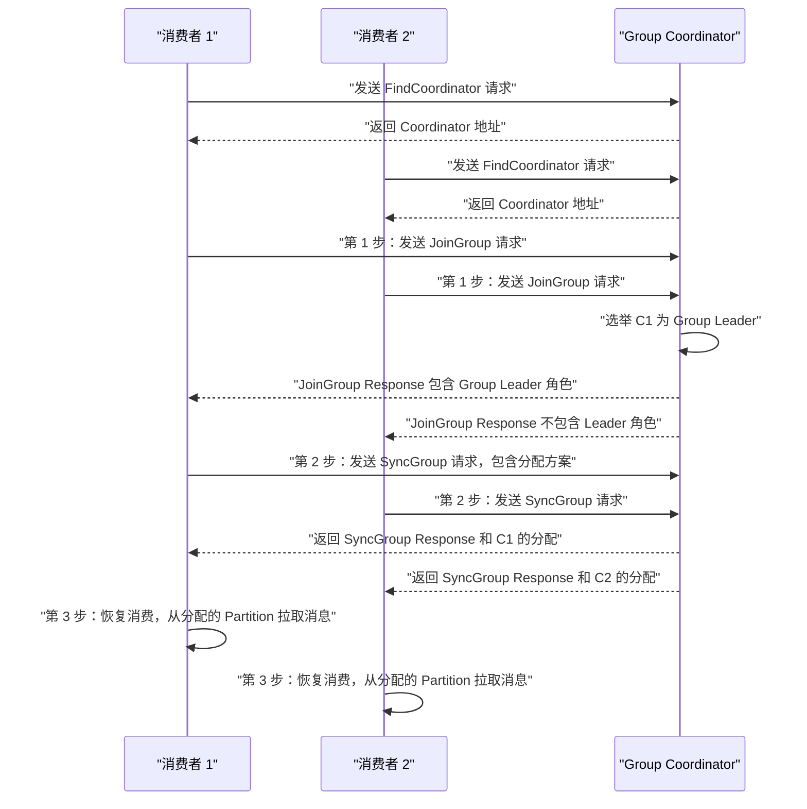

### 5.3 "分步骤详解"
**"第 1 步：JoinGroup"**

+ "消费者主动向 Group Coordinator 发送 JoinGroup 请求。"
+ "请求包含：消费者 ID、消费者组 ID、订阅的 Topic 列表。"
+ "Group Coordinator 等待所有消费者的 JoinGroup 请求（有超时限制）。"
+ "从收到的请求中选出一个消费者作为 Group Leader。"
+ "响应给消费者 Leader 标记和成员列表。"

**"第 2 步：制定分配方案与 SyncGroup"**

+ "只有 Group Leader 需要制定分配方案，其他消费者等待。"
+ "Group Leader 会获取所有消费者的订阅信息和当前状态。"
+ "根据分配策略（RangeAssignor、RoundRobinAssignor、StickyAssignor）计算分配方案。"
+ "Group Leader 通过 SyncGroup 请求将方案发送给 Group Coordinator。"
+ "Group Coordinator 将分配结果发送给所有消费者。"

**"第 3 步：恢复消费"**

+ "消费者收到分配结果后，提交已处理消息的偏移量。"
+ "然后根据分配的 Partition 和已保存的偏移量恢复消费。"

---

## 6) "三种内置分配策略对比"
### 6.1 "RangeAssignor"（范围分配）
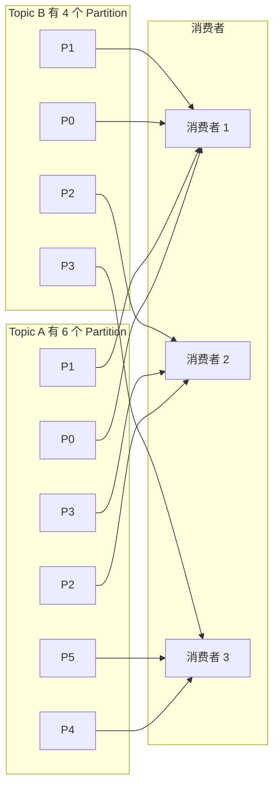

**"特点"**：

+ "按 Topic 逐个分配。对于每个 Topic，将其 Partition 按顺序分段分配给消费者。"
+ "对于 Topic A："P0-P1 给 C1，P2-P3 给 C2，P4-P5 给 C3"。"
+ "对于 Topic B："P0-P1 给 C1，P2 给 C2，P3 给 C3"。"
+ **"优点"**："实现简单，易于理解。"
+ **"缺点"**："可能导致消费者分配不均，特别是多个 Topic 情况下。"

### 6.2 "RoundRobinAssignor"（轮询分配）
```mermaid
graph LR
    subgraph "所有 Partition（Topic A + Topic B）"
        PA0["A-P0"] PA1["A-P1"] PA2["A-P2"] PA3["A-P3"] PA4["A-P4"] PA5["A-P5"]
        PB0["B-P0"] PB1["B-P1"] PB2["B-P2"] PB3["B-P3"]
    end
    
    subgraph "消费者"
        C1["消费者 1"]
        C2["消费者 2"]
        C3["消费者 3"]
    end
    
    PA0 --> C1
    PA1 --> C2
    PA2 --> C3
    PA3 --> C1
    PA4 --> C2
    PA5 --> C3
    PB0 --> C1
    PB1 --> C2
    PB2 --> C3
    PB3 --> C1
```

**"特点"**：

+ "将所有 Topic 的所有 Partition 作为一个整体，轮询地分配给消费者。"
+ "按 1、2、3、1、2、3... 的顺序分配。"
+ **"优点"**："分配通常更均匀，避免了 RangeAssignor 的不均衡问题。"
+ **"缺点"**："可能导致频繁的 Rebalance（如果消费者宕机）。"

### 6.3 "StickyAssignor"（粘性分配，默认）
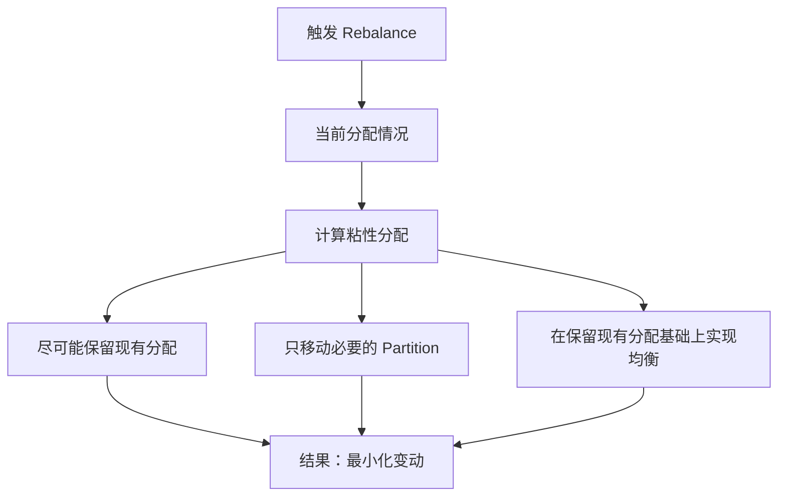

**"特点"**：

+ "在 Rebalance 时，尽可能地保持现有分配不变，同时努力实现均衡。"
+ "这减少了 Partition 移动，降低了消费者重新建立连接和 Follower 同步的开销。"
+ "是 Kafka 0.11.0.0 之后的默认策略。"
+ **"优点"**："平衡性能和稳定性，减少不必要的变动。"
+ **"缺点"**："逻辑复杂，某些极端情况下可能不是最优分配。"

### 6.4 "三种策略对比表"
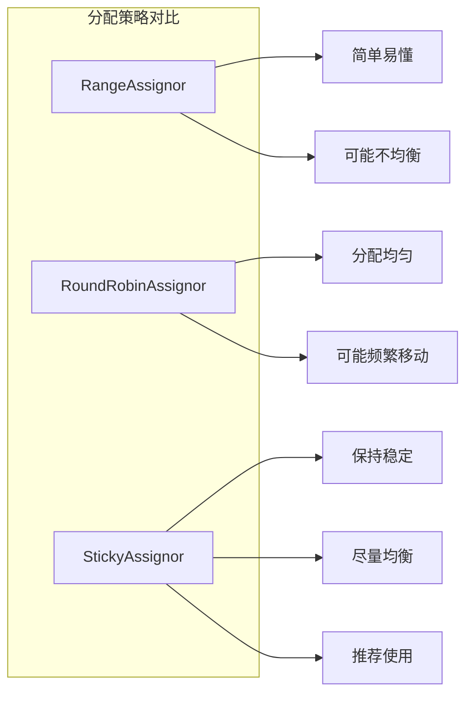

---

## 7) "完整 Java 代码示例"
### 7.1 "基础消费者示例"
```java
import org.apache.kafka.clients.consumer.*;
import org.apache.kafka.common.serialization.StringDeserializer;
import org.apache.kafka.common.TopicPartition;
import java.time.Duration;
import java.util.Arrays;
import java.util.Collection;
import java.util.Collections;
import java.util.Properties;

public class KafkaConsumerWithRebalanceListener {

    private static final String BOOTSTRAP_SERVERS = "localhost:9092"; 
    private static final String GROUP_ID = "my-consumer-group";
    private static final String TOPIC_NAME = "my-kafka-topic";

    public static void main(String[] args) {
        Properties props = new Properties();
        props.put(ConsumerConfig.BOOTSTRAP_SERVERS_CONFIG, BOOTSTRAP_SERVERS);
        props.put(ConsumerConfig.GROUP_ID_CONFIG, GROUP_ID);
        props.put(ConsumerConfig.KEY_DESERIALIZER_CLASS_CONFIG, StringDeserializer.class.getName());
        props.put(ConsumerConfig.VALUE_DESERIALIZER_CLASS_CONFIG, StringDeserializer.class.getName());
        props.put(ConsumerConfig.AUTO_OFFSET_RESET_CONFIG, "earliest");
        props.put(ConsumerConfig.ENABLE_AUTO_COMMIT_CONFIG, "false");
        
        // "配置分配策略（默认是 StickyAssignor）"
        // props.put(ConsumerConfig.PARTITION_ASSIGNMENT_STRATEGY_CONFIG, 
        //     "org.apache.kafka.clients.consumer.RangeAssignor");

        KafkaConsumer<String, String> consumer = new KafkaConsumer<>(props);

        try {
            // "订阅 Topic"
            consumer.subscribe(Collections.singletonList(TOPIC_NAME), 
                new ConsumerRebalanceListener() {
                    @Override
                    public void onPartitionsRevoked(Collection<TopicPartition> partitions) {
                        System.out.println("【Rebalance 事件】分区被撤销");
                        for (TopicPartition partition : partitions) {
                            System.out.println("  撤销分区: " + partition);
                        }
                        // "在失去分区前，提交已处理消息的偏移量"
                        consumer.commitSync();
                    }

                    @Override
                    public void onPartitionsAssigned(Collection<TopicPartition> partitions) {
                        System.out.println("【Rebalance 事件】分区被分配");
                        for (TopicPartition partition : partitions) {
                            System.out.println("  新分配分区: " + partition);
                        }
                    }
                });

            System.out.println("消费者已启动，加入消费者组: " + GROUP_ID);

            while (true) {
                ConsumerRecords<String, String> records = consumer.poll(Duration.ofMillis(100));
                
                for (ConsumerRecord<String, String> record : records) {
                    System.out.printf("【消息】分区: %d, 偏移量: %d, Key: %s, Value: %s%n",
                            record.partition(), record.offset(), record.key(), record.value());
                    
                    // "处理消息业务逻辑..."
                }
                
                // "批量处理完成后提交偏移量"
                if (!records.isEmpty()) {
                    consumer.commitSync();
                }
            }
        } catch (Exception e) {
            e.printStackTrace();
        } finally {
            consumer.close();
            System.out.println("消费者已关闭");
        }
    }
}
```

### 7.2 "多消费者实例模拟"
```java
import org.apache.kafka.clients.consumer.*;
import org.apache.kafka.common.serialization.StringDeserializer;
import java.time.Duration;
import java.util.Collections;
import java.util.Properties;
import java.util.concurrent.ExecutorService;
import java.util.concurrent.Executors;

public class MultiConsumerSimulation {

    private static final String BOOTSTRAP_SERVERS = "localhost:9092";
    private static final String GROUP_ID = "multi-consumer-group";
    private static final String TOPIC_NAME = "my-kafka-topic";
    private static final int NUM_CONSUMERS = 3; // "启动 3 个消费者"

    public static void main(String[] args) {
        ExecutorService executor = Executors.newFixedThreadPool(NUM_CONSUMERS);

        // "启动多个消费者线程"
        for (int i = 0; i < NUM_CONSUMERS; i++) {
            final int consumerId = i;
            executor.submit(() -> runConsumer(consumerId));
        }

        // "保持应用运行"
        try {
            Thread.sleep(Long.MAX_VALUE);
        } catch (InterruptedException e) {
            e.printStackTrace();
        }
    }

    private static void runConsumer(int consumerId) {
        Properties props = new Properties();
        props.put(ConsumerConfig.BOOTSTRAP_SERVERS_CONFIG, BOOTSTRAP_SERVERS);
        props.put(ConsumerConfig.GROUP_ID_CONFIG, GROUP_ID);
        props.put(ConsumerConfig.KEY_DESERIALIZER_CLASS_CONFIG, StringDeserializer.class.getName());
        props.put(ConsumerConfig.VALUE_DESERIALIZER_CLASS_CONFIG, StringDeserializer.class.getName());
        props.put(ConsumerConfig.AUTO_OFFSET_RESET_CONFIG, "earliest");
        props.put(ConsumerConfig.ENABLE_AUTO_COMMIT_CONFIG, "true");
        props.put(ConsumerConfig.AUTO_COMMIT_INTERVAL_MS_CONFIG, "1000");

        KafkaConsumer<String, String> consumer = new KafkaConsumer<>(props);

        try {
            consumer.subscribe(Collections.singletonList(TOPIC_NAME));
            System.out.println("消费者 " + consumerId + " 已启动");

            while (true) {
                ConsumerRecords<String, String> records = consumer.poll(Duration.ofMillis(100));
                
                for (ConsumerRecord<String, String> record : records) {
                    System.out.printf("【消费者 %d】分区: %d, 偏移量: %d, 消息: %s%n",
                            consumerId, record.partition(), record.offset(), record.value());
                    
                    // "模拟处理延迟"
                    Thread.sleep(100);
                }
            }
        } catch (Exception e) {
            e.printStackTrace();
        } finally {
            consumer.close();
            System.out.println("消费者 " + consumerId + " 已关闭");
        }
    }
}
```

### 7.3 "运行与观察"
**"Step 1: 创建 Topic"**

```bash
# "创建一个 6 个分区的 Topic"
kafka-topics.sh --bootstrap-server localhost:9092 --create --topic my-kafka-topic --partitions 6 --replication-factor 1
```

**"Step 2: 启动消费者"**

```bash
# "运行 MultiConsumerSimulation，会启动 3 个消费者"
# "观察控制台输出，会看到 Rebalance 过程"
```

**"Step 3: 启动生产者发送消息"**

```bash
# "使用生产者发送消息到 Topic"
kafka-console-producer.sh --bootstrap-server localhost:9092 --topic my-kafka-topic
# "输入消息后按 Enter 发送"
```

**"预期观察结果"**：

+ "消费者启动时会经历 Rebalance，分配 6 个分区给 3 个消费者。"
+ "每个消费者分配 2 个分区，如 C0 分配 P0、P3，C1 分配 P1、P4，C2 分配 P2、P5。"
+ "发送消息时，根据消息 Key 的哈希值分配到不同的分区，由对应的消费者处理。"

---

## 8) "分配过程中的关键配置"
### 8.1 "消费者关键配置"
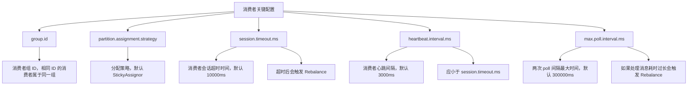

### 8.2 "配置最佳实践"
```java
Properties props = new Properties();

// "关键配置"
props.put(ConsumerConfig.GROUP_ID_CONFIG, "my-group");

// "分配策略（选择其中一个）"
props.put(ConsumerConfig.PARTITION_ASSIGNMENT_STRATEGY_CONFIG, 
    "org.apache.kafka.clients.consumer.StickyAssignor"); // "推荐"

// "心跳和会话配置"
props.put(ConsumerConfig.HEARTBEAT_INTERVAL_MS_CONFIG, 3000); // "3 秒发送一次心跳"
props.put(ConsumerConfig.SESSION_TIMEOUT_MS_CONFIG, 10000); // "10 秒超时"
props.put(ConsumerConfig.MAX_POLL_INTERVAL_MS_CONFIG, 300000); // "5 分钟内必须 poll 一次"

// "偏移量和提交配置"
props.put(ConsumerConfig.AUTO_OFFSET_RESET_CONFIG, "earliest");
props.put(ConsumerConfig.ENABLE_AUTO_COMMIT_CONFIG, false); // "建议手动提交"

// "性能配置"
props.put(ConsumerConfig.FETCH_MIN_BYTES_CONFIG, 1024); // "最小 1KB"
props.put(ConsumerConfig.FETCH_MAX_WAIT_MS_CONFIG, 500); // "最多等待 500ms"
props.put(ConsumerConfig.MAX_POLL_RECORDS_CONFIG, 500); // "一次 poll 最多 500 条消息"
```

---

## 9) "Rebalance 问题与解决方案"
### 9.1 "常见 Rebalance 问题"
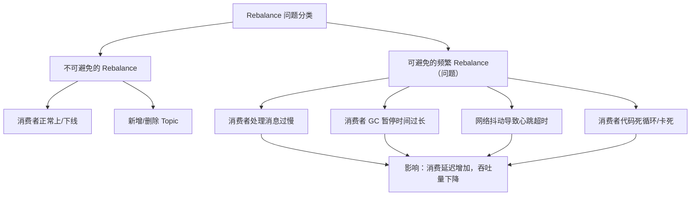

### 9.2 "解决方案"
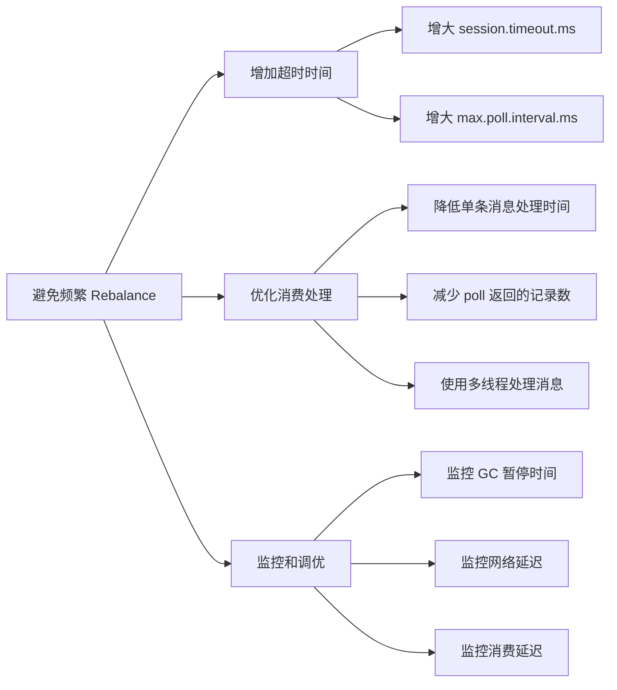

---

## 10) "消息分配完整流程图"
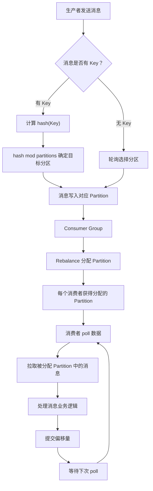

---

## 11) "总结与最佳实践"
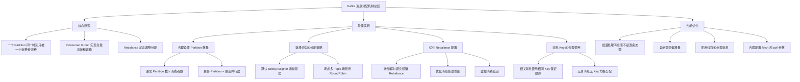

---

## 12) "实际案例：电商订单处理系统"
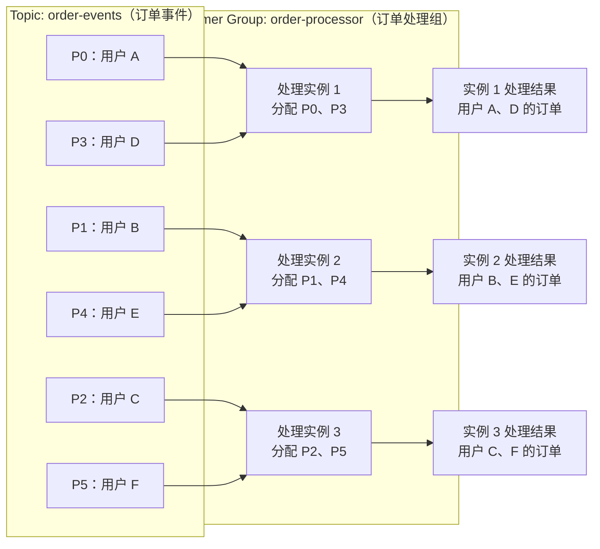

**"场景说明"**：

+ "订单事件 Topic 使用用户 ID 作为 Key。"
+ "相同用户的订单消息 hash 到同一 Partition，确保订单处理顺序。"
+ "3 个处理实例并行处理，每个处理 2 个 Partition，实现负载均衡。"
+ "某个实例宕机时，其他实例自动接管其 Partition。"

---

## 总结
Kafka 的消息分配机制是一套精妙的设计，通过 **"Consumer Group"**、**"Partition"** 和 **"Rebalance"** 三个核心概念，实现了：

1. **"负载均衡"**："多个消费者并行处理消息。"
2. **"高可用性"**："消费者故障自动转移。"
3. **"弹性扩展"**："根据需要动态调整消费能力。"
4. **"消息有序性"**："同 Key 消息顺序保证。"

理解这一机制是构建高效、可靠 Kafka 应用的基础。


> 更新: 2026-01-22 15:00:11  
> 原文: <https://www.yuque.com/tulingzhouyu/db22bv/ffqhls0w8y09ym97>