# Kafka中的消息是如何存储的？

Kafka 被称为"分布式消息系统的王者"，其高性能的秘诀之一就是其独特的消息存储设计。本篇将深入分析 Kafka 如何在磁盘上高效地存储和管理消息。

***

## 1) "Kafka 存储架构的整体视图"

### 1.1 "三层存储结构"

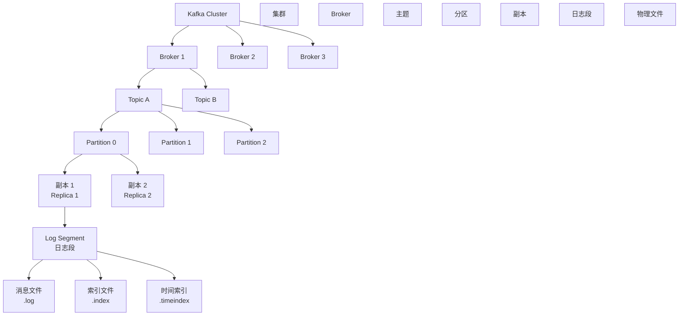

**"分层说明"**：

* **"Cluster 层"**："多个 Broker 组成集群。"
* **"Topic 层"**："每个 Broker 存储多个 Topic。"
* **"Partition 层"**："每个 Topic 有多个 Partition。"
* **"Replica 层"**："每个 Partition 有多个副本。"
* **"Segment 层"**："每个副本的数据分段存储。"
* **"File 层"**："每个 Segment 包含多个物理文件。"

***

## 2) "分区和日志文件的对应关系"

### 2.1 "文件系统中的物理结构"

```plain
Kafka 数据目录结构：
/kafka-data/
├── topic-name-0/              "Partition 0"
│   ├── 00000000000000000000.log       "日志文件 Segment 1"
│   ├── 00000000000000000000.index     "偏移量索引"
│   ├── 00000000000000000000.timeindex "时间索引"
│   ├── 00000000000000100000.log       "日志文件 Segment 2"
│   ├── 00000000000000100000.index
│   ├── 00000000000000100000.timeindex
│   └── leader-epoch-checkpoint        "Leader Epoch 记录"
├── topic-name-1/              "Partition 1"
│   └── ...
└── topic-name-2/              "Partition 2"
    └── ...
```

**"文件命名规则"**：

* "文件名 = 该 Segment 中第一条消息的偏移量（Offset）。"
* "例如 `00000000000000100000.log` 表示从 Offset 100000 开始的日志段。"
* "文件名是 20 位数字，左边补零。"

### 2.2 "Segment 的概念"

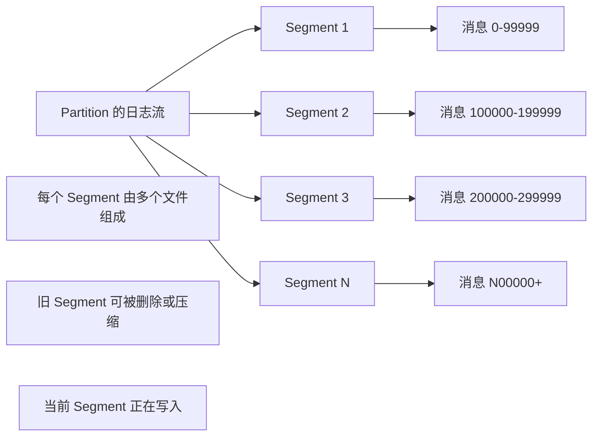

**"Segment 的作用"**：

* "Kafka 不会在一个无限增长的日志文件中写入消息。"
* "而是将日志分成多个 Segment，每个 Segment 有大小限制。"
* "当 Segment 大小达到阈值时，创建新的 Segment。"
* "这样便于删除旧数据、查询和管理。"

***

## 3) "消息的存储格式"

### 3.1 "消息 Record 的结构"

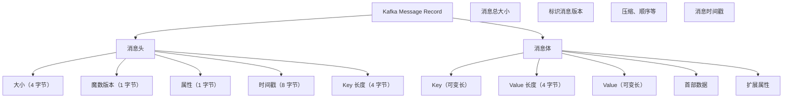

### 3.2 "消息二进制格式详细说明"

```plain
消息格式（Kafka 0.10+）：

┌─────────────────────────────────────────────┐
│ Offset（8 字节）                             │  "偏移量"
├─────────────────────────────────────────────┤
│ Size（4 字节）                               │  "消息大小"
├─────────────────────────────────────────────┤
│ CRC（4 字节）                                │  "校验和"
├─────────────────────────────────────────────┤
│ Magic（1 字节）                              │  "版本号"
├─────────────────────────────────────────────┤
│ Attributes（1 字节）                         │  "属性"
│ [7] 未使用  [6] 未使用  [5] 未使用          │
│ [4] 未使用  [3] 未使用  [2] 未使用          │
│ [1:0] 压缩类型：00=无压缩，01=Gzip，       │
│       10=Snappy，11=LZ4                    │
├─────────────────────────────────────────────┤
│ Timestamp（8 字节）                          │  "消息时间戳"
├─────────────────────────────────────────────┤
│ Key Length（4 字节）                         │  "Key 长度"
├─────────────────────────────────────────────┤
│ Key（Variable Length）                       │  "消息键"
├─────────────────────────────────────────────┤
│ Value Length（4 字节）                       │  "Value 长度"
├─────────────────────────────────────────────┤
│ Value（Variable Length）                     │  "消息内容"
└─────────────────────────────────────────────┘

总大小：26 字节 + Key + Value
```

### 3.3 "消息压缩"

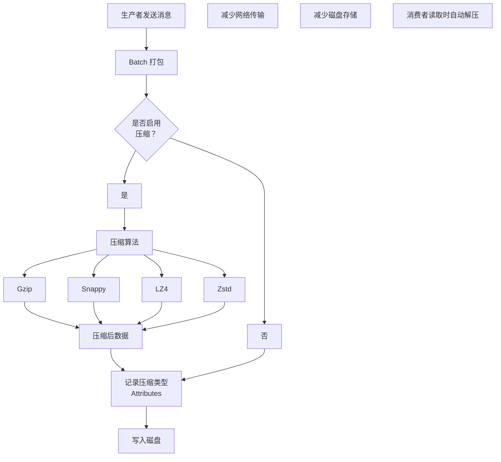

***

## 4) "日志文件的读写机制"

### 4.1 "消息写入流程"

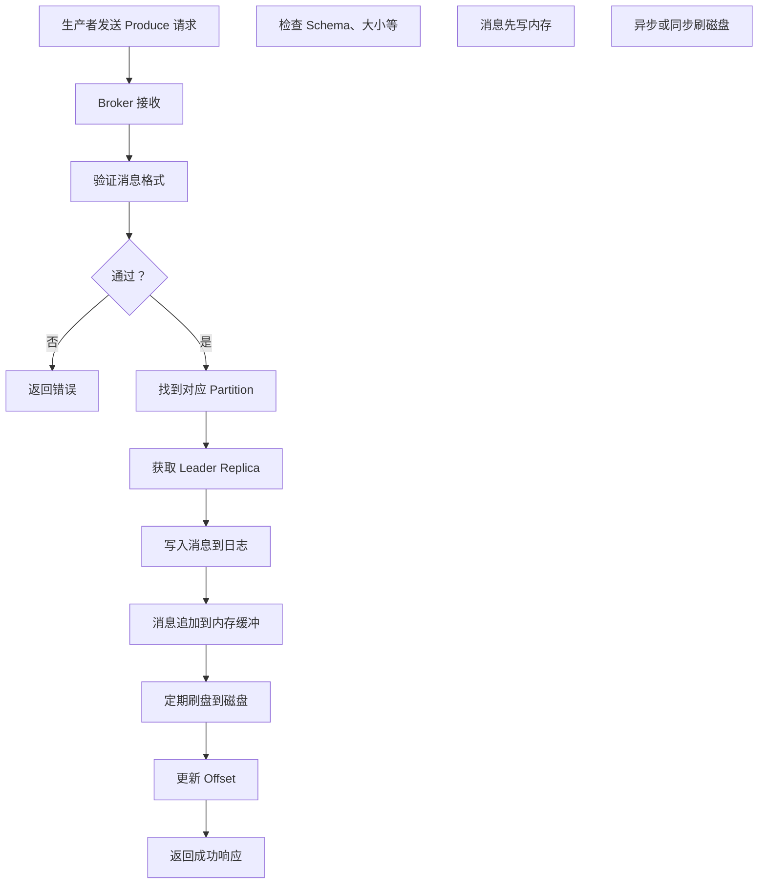

### 4.2 "消息读取流程"

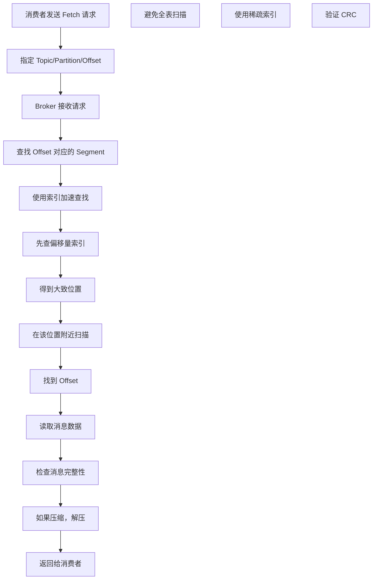

***

## 5) "索引机制详解"

### 5.1 "偏移量索引（Offset Index）"

```plain
文件名: 00000000000000000000.index

每条索引项占 8 字节：
┌──────────────────────────────────────┐
│ Relative Offset（相对偏移量）        │ 4 字节
├──────────────────────────────────────┤
│ Physical Position（物理位置）        │ 4 字节
└──────────────────────────────────────┘

示例：
Relative Offset: 0  → Physical Position: 0
Relative Offset: 5  → Physical Position: 528
Relative Offset: 10 → Physical Position: 1256
Relative Offset: 15 → Physical Position: 2000

"稀疏索引"："不是每条消息都有索引项"
"间隔写入"："每隔 N 条消息写入一条索引"
"快速定位"："使用二分查找快速定位"
```

### 5.2 "时间戳索引（Timestamp Index）"

```plain
文件名: 00000000000000000000.timeindex

每条索引项占 12 字节：
┌──────────────────────────────────────┐
│ Timestamp（消息时间戳）              │ 8 字节
├──────────────────────────────────────┤
│ Relative Offset（相对偏移量）        │ 4 字节
└──────────────────────────────────────┘

用途：
1. "根据时间戳快速查找消息"
2. "支持 offsets.for.times() API"
3. "便于构建时间范围查询"
```

### 5.3 "索引查询过程"

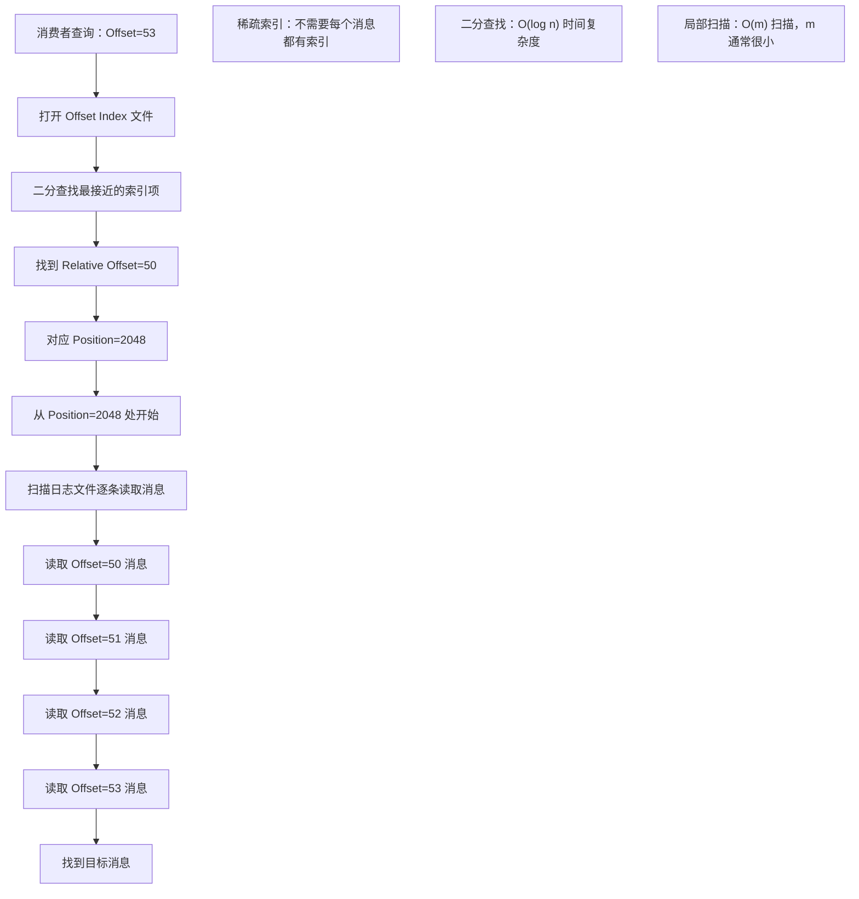

***

## 6) "Page Cache 和存储优化"

### 6.1 "Kafka 使用 Page Cache 的原理"

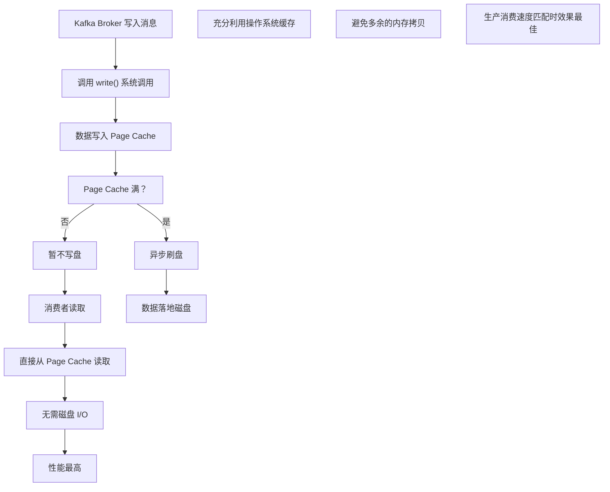

**"Kafka 的存储优化策略"**：

1. **"顺序写磁盘"**："Kafka 总是顺序追加消息，不随机写。"
2. **"充分利用 Page Cache"**："依赖 OS 的缓存而非应用缓存。"
3. **"零拷贝"**："使用 sendfile() 避免内存拷贝。"
4. **"异步刷盘"**："刷盘是异步的，不阻塞写操作。"

### 6.2 "刷盘策略"

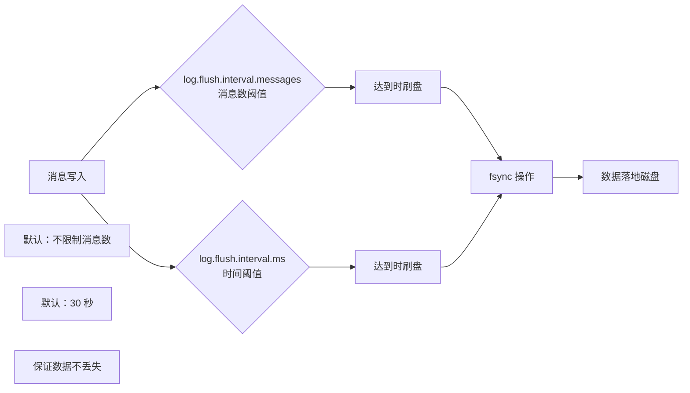

***

## 7) "Java 代码示例：消息存储的读写"

### 7.1 "生产者：消息写入"

```java
import org.apache.kafka.clients.producer.*;
import org.apache.kafka.common.serialization.StringSerializer;
import java.util.Properties;

public class KafkaProducerStorageExample {
    
    public static void main(String[] args) throws Exception {
        Properties props = new Properties();
        props.put(ProducerConfig.BOOTSTRAP_SERVERS_CONFIG, "localhost:9092");
        props.put(ProducerConfig.KEY_SERIALIZER_CLASS_CONFIG, StringSerializer.class);
        props.put(ProducerConfig.VALUE_SERIALIZER_CLASS_CONFIG, StringSerializer.class);
        
        // "压缩配置：降低存储和网络开销"
        props.put(ProducerConfig.COMPRESSION_TYPE_CONFIG, "snappy"); // "Gzip, Snappy, LZ4, Zstd"
        
        // "批处理配置：提高吞吐量"
        props.put(ProducerConfig.BATCH_SIZE_CONFIG, 16384); // "16KB"
        props.put(ProducerConfig.LINGER_MS_CONFIG, 10); // "等待 10ms 再发送"
        
        // "缓冲区大小：影响最大未确认消息数"
        props.put(ProducerConfig.BUFFER_MEMORY_CONFIG, 33554432); // "32MB"
        
        // "确认级别：影响数据持久化"
        props.put(ProducerConfig.ACKS_CONFIG, "all"); // "0=不确认, 1=Leader确认, all=ISR确认"
        
        KafkaProducer<String, String> producer = new KafkaProducer<>(props);
        
        try {
            for (int i = 0; i < 100; i++) {
                String key = "user_" + (i % 10); // "相同 Key 的消息写入同一 Partition"
                String value = "订单数据_" + i;
                
                // "指定消息的 Key，决定了消息落入哪个 Partition"
                ProducerRecord<String, String> record = 
                    new ProducerRecord<>("order-topic", key, value);
                
                // "异步发送，提供回调处理"
                producer.send(record, (metadata, exception) -> {
                    if (exception != null) {
                        System.err.println("发送失败: " + exception.getMessage());
                    } else {
                        System.out.printf("消息已写入 - Topic: %s, Partition: %d, Offset: %d, Timestamp: %d%n",
                            metadata.topic(), 
                            metadata.partition(), 
                            metadata.offset(),
                            metadata.timestamp());
                        // "这些信息都来自消息存储的元数据"
                    }
                });
            }
            
            // "等待所有消息发送完成"
            producer.flush();
            System.out.println("所有消息已发送");
            
        } finally {
            producer.close();
        }
    }
}
```

**"代码说明"**：

* **"COMPRESSION\_TYPE"**："压缩类型影响磁盘存储大小。"
* **"BATCH\_SIZE 和 LINGER\_MS"**："批处理配置影响消息写入的频率。"
* **"ACKS"**："确认级别影响消息持久化程度。"
* **"Key"**："相同 Key 的消息写入同一 Partition，便于顺序处理。"

### 7.2 "消费者：消息读取"

```java
import org.apache.kafka.clients.consumer.*;
import org.apache.kafka.common.serialization.StringDeserializer;
import org.apache.kafka.common.TopicPartition;
import java.time.Duration;
import java.util.*;

public class KafkaConsumerStorageExample {
    
    public static void main(String[] args) throws Exception {
        Properties props = new Properties();
        props.put(ConsumerConfig.BOOTSTRAP_SERVERS_CONFIG, "localhost:9092");
        props.put(ConsumerConfig.GROUP_ID_CONFIG, "storage-example-group");
        props.put(ConsumerConfig.KEY_DESERIALIZER_CLASS_CONFIG, StringDeserializer.class);
        props.put(ConsumerConfig.VALUE_DESERIALIZER_CLASS_CONFIG, StringDeserializer.class);
        
        // "自动提交偏移量的间隔"
        props.put(ConsumerConfig.AUTO_COMMIT_INTERVAL_MS_CONFIG, 1000);
        
        // "单次 fetch 最大字节数"
        props.put(ConsumerConfig.FETCH_MAX_BYTES_CONFIG, 52428800); // "50MB"
        
        // "单次 fetch 最小字节数（等待至少 1KB 再返回）"
        props.put(ConsumerConfig.FETCH_MIN_BYTES_CONFIG, 1024);
        
        // "最多等待 500ms"
        props.put(ConsumerConfig.FETCH_MAX_WAIT_MS_CONFIG, 500);
        
        KafkaConsumer<String, String> consumer = new KafkaConsumer<>(props);
        
        try {
            consumer.subscribe(Collections.singletonList("order-topic"));
            
            // "方式 1：从最新的消息开始消费"
            // consumer.seekToEnd(consumer.assignment());
            
            // "方式 2：从特定 Offset 开始消费"
            // TopicPartition tp = new TopicPartition("order-topic", 0);
            // consumer.assign(Collections.singletonList(tp));
            // consumer.seek(tp, 100); // "从 Offset 100 开始"
            
            // "方式 3：根据时间戳查找消息"
            // long targetTime = System.currentTimeMillis() - 3600 * 1000; // "一小时前"
            // Map<TopicPartition, Long> timestampsToSearch = new HashMap<>();
            // for (TopicPartition tp : consumer.assignment()) {
            //     timestampsToSearch.put(tp, targetTime);
            // }
            // Map<TopicPartition, OffsetAndTimestamp> offsets = 
            //     consumer.offsetsForTimes(timestampsToSearch);
            
            while (true) {
                // "拉取消息，查询索引加速定位"
                ConsumerRecords<String, String> records = consumer.poll(Duration.ofSeconds(1));
                
                for (ConsumerRecord<String, String> record : records) {
                    System.out.printf(
                        "消息内容 - Topic: %s, Partition: %d, Offset: %d, " +
                        "Timestamp: %d, TimestampType: %s, Key: %s, Value: %s%n",
                        record.topic(),
                        record.partition(),
                        record.offset(),           // "这是消息在日志中的位置"
                        record.timestamp(),        // "来自消息的时间戳字段"
                        record.timestampType(),
                        record.key(),
                        record.value()
                    );
                    
                    // "消息存储位置信息"
                    System.out.printf("  Serialized Key Size: %d bytes%n", 
                                    record.serializedKeySize());
                    System.out.printf("  Serialized Value Size: %d bytes%n", 
                                    record.serializedValueSize());
                    System.out.printf("  LeaderEpoch: %d%n", 
                                    record.leaderEpoch().orElse(-1));
                }
            }
            
        } finally {
            consumer.close();
        }
    }
    
    /**
     * "根据时间戳查找消息"
     */
    public static Map<TopicPartition, Long> findOffsetsByTimestamp(
            KafkaConsumer<String, String> consumer,
            String topic,
            long targetTimestamp) {
        
        // "获取所有分区"
        List<PartitionInfo> partitions = consumer.partitionsFor(topic);
        Map<TopicPartition, Long> timestampsToSearch = new HashMap<>();
        
        for (PartitionInfo partition : partitions) {
            TopicPartition tp = new TopicPartition(topic, partition.partition());
            timestampsToSearch.put(tp, targetTimestamp);
        }
        
        // "根据时间戳查询偏移量，利用时间戳索引"
        Map<TopicPartition, OffsetAndTimestamp> offsets = 
            consumer.offsetsForTimes(timestampsToSearch);
        
        Map<TopicPartition, Long> result = new HashMap<>();
        for (Map.Entry<TopicPartition, OffsetAndTimestamp> entry : offsets.entrySet()) {
            if (entry.getValue() != null) {
                result.put(entry.getKey(), entry.getValue().offset());
            }
        }
        
        return result;
    }
}
```

**"代码说明"**：

* **"Offset"**："消息在日志中的唯一位置标识。"
* **"Timestamp"**："消息存储时的时间戳，支持时间戳查询。"
* **"Partition"**："消息所在的分区编号。"
* **"offsetsForTimes()"**："利用时间戳索引快速查找消息。"

***

## 8) "消息存储的完整工作流程"

### 8.1 "消息从生产到消费的存储路径"

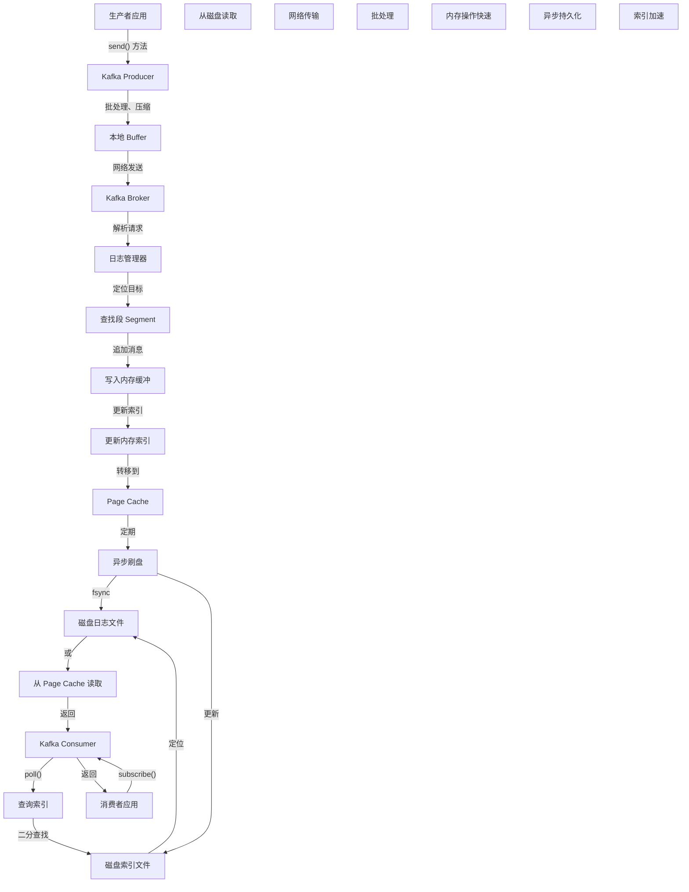

***

## 9) "Segment 生命周期管理"

### 9.1 "Segment 的创建、滚动、删除"

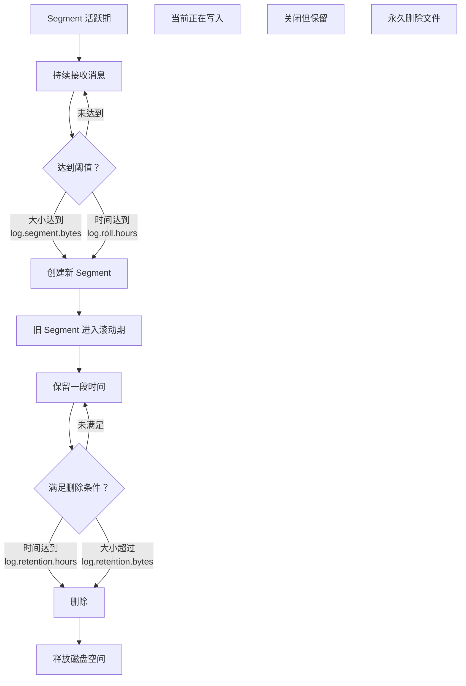

### 9.2 "Segment 配置参数"

```java
// "Broker 端配置文件：server.properties"

// "单个 Segment 最大大小，默认 1GB"
log.segment.bytes=1073741824

// "Segment 文件在关闭前保持打开的时间，默认 1 小时"
log.segment.delete.delay.ms=60000

// "启用 Segment 定期滚动（小时级别）"
log.roll.hours=168

// "日志保留时间，默认 7 天"
log.retention.hours=168

// "日志保留大小（字节），-1 表示无限制"
log.retention.bytes=1073741824

// "日志压缩相关"
log.cleanup.policy=delete     // "或 compact 进行日志压缩"
log.cleanup.delete.retention.ms=86400000
```

***

## 10) "日志压缩（Log Compaction）"

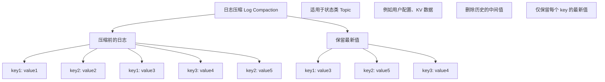

***

## 11) "存储配置优化最佳实践"

### 11.1 "配置决策树"

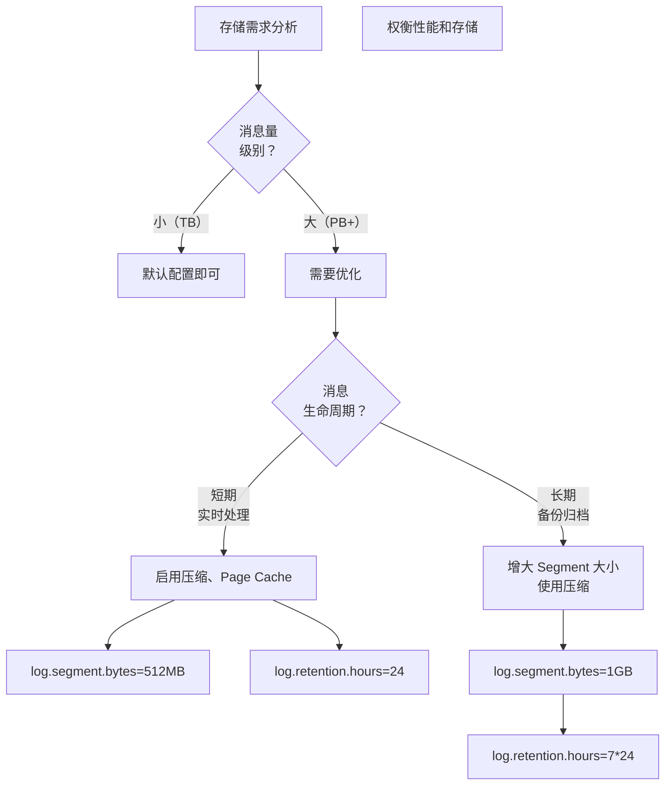

### 11.2 "性能优化配置示例"

```properties
# "高吞吐量场景"
log.segment.bytes=1073741824        "每个 Segment 1GB，减少文件数"
log.retention.hours=168             "保留 7 天"
log.cleanup.policy=delete           "删除旧日志"
log.index.interval.bytes=4096       "每 4KB 数据记录一个索引"
log.preallocate=true                "预分配文件，提高写入速度"
compression.type=snappy             "使用 Snappy 压缩"

# "低延迟场景"
log.segment.bytes=104857600         "每个 Segment 100MB，更频繁滚动"
log.retention.hours=24              "保留 1 天"
log.index.interval.bytes=2048       "索引更密集"

# "归档场景"
log.retention.bytes=1099511627776   "保留 1TB 数据"
log.cleanup.policy=compact          "使用日志压缩而非删除"
compression.type=gzip               "使用 Gzip 压缩，压缩率更高"
```

***

## 12) "消息存储的故障排查"

### 12.1 "常见问题和解决方案"

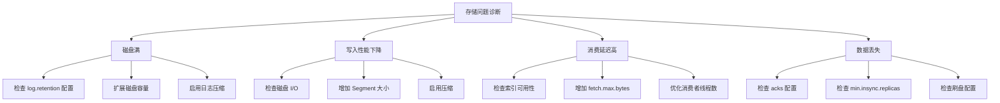

### 12.2 "监控和诊断命令"

```bash
# "查看分区详细信息"
kafka-topics.sh --bootstrap-server localhost:9092 \
  --topic order-topic --describe

# "查看消费进度"
kafka-consumer-groups.sh --bootstrap-server localhost:9092 \
  --group my-group --describe

# "查看 Broker 日志目录"
ls -lh /data/kafka-logs/

# "查看 Segment 文件大小"
du -sh /data/kafka-logs/order-topic-0/

# "查看索引文件"
ls -lh /data/kafka-logs/order-topic-0/*.index

# "使用 Java 程序检查 Offset"
# 参见后续代码示例
```

***

## 13) "实战案例：消息存储监控工具"

```java
import org.apache.kafka.clients.admin.*;
import org.apache.kafka.common.TopicPartition;
import java.util.*;
import java.util.concurrent.ExecutionException;

public class KafkaStorageMonitor {
    
    private AdminClient adminClient;
    
    public KafkaStorageMonitor(String bootstrapServers) {
        Properties props = new Properties();
        props.put(AdminClientConfig.BOOTSTRAP_SERVERS_CONFIG, bootstrapServers);
        this.adminClient = AdminClient.create(props);
    }
    
    /**
     * "获取某个 Topic 的存储统计信息"
     */
    public void analyzeTopicStorage(String topicName) 
            throws ExecutionException, InterruptedException {
        
        // "获取所有分区"
        DescribeTopicsResult topicInfo = adminClient.describeTopics(
            Collections.singletonList(topicName));
        
        TopicDescription description = topicInfo.all().get()
            .get(topicName);
        
        System.out.println("======== Topic: " + topicName + " ========");
        System.out.println("分区数: " + description.partitions().size());
        System.out.println("副本数: " + description.partitions()
            .get(0).replicas().size());
        
        // "分别统计每个分区"
        for (TopicPartition tp : getTopicPartitions(topicName)) {
            analyzePartitionStorage(tp);
        }
    }
    
    /**
     * "获取分区的存储详情"
     */
    private void analyzePartitionStorage(TopicPartition tp) 
            throws ExecutionException, InterruptedException {
        
        // "获取分区的起始偏移量（最早）"
        ListOffsetsResult earliestResult = adminClient.listOffsets(
            Collections.singletonMap(tp, OffsetSpec.earliest()));
        long earliestOffset = earliestResult.all().get()
            .get(tp).offset();
        
        // "获取分区的最后偏移量（最新）"
        ListOffsetsResult latestResult = adminClient.listOffsets(
            Collections.singletonMap(tp, OffsetSpec.latest()));
        long latestOffset = latestResult.all().get()
            .get(tp).offset();
        
        System.out.printf(
            "  分区 %d: 最早 Offset=%d, 最新 Offset=%d, " +
            "消息数=%d%n",
            tp.partition(), earliestOffset, latestOffset,
            latestOffset - earliestOffset
        );
    }
    
    /**
     * "获取某个 Topic 的所有分区"
     */
    private List<TopicPartition> getTopicPartitions(String topic) 
            throws ExecutionException, InterruptedException {
        
        DescribeTopicsResult result = adminClient.describeTopics(
            Collections.singletonList(topic));
        
        TopicDescription description = result.all().get().get(topic);
        List<TopicPartition> partitions = new ArrayList<>();
        
        for (TopicPartitionInfo partition : description.partitions()) {
            partitions.add(new TopicPartition(topic, partition.partition()));
        }
        
        return partitions;
    }
    
    /**
     * "计算存储容量需求"
     */
    public void calculateStorageRequirement(String topic, 
                                           long messagesPerSecond,
                                           int avgMessageSize,
                                           int retentionDays) {
        
        long messagesPerDay = messagesPerSecond * 86400;
        long messagesTotal = messagesPerDay * retentionDays;
        long storageBytes = messagesTotal * avgMessageSize;
        double storageMB = storageBytes / (1024.0 * 1024);
        double storageGB = storageMB / 1024;
        
        System.out.println("\n======== 存储容量预估 ========");
        System.out.printf("Topic: %s%n", topic);
        System.out.printf("吞吐量: %d msg/s%n", messagesPerSecond);
        System.out.printf("平均消息大小: %d bytes%n", avgMessageSize);
        System.out.printf("保留周期: %d 天%n", retentionDays);
        System.out.printf("日总消息数: %d%n", messagesPerDay);
        System.out.printf("总消息数: %d%n", messagesTotal);
        System.out.printf("所需存储容量: %.2f GB%n", storageGB);
        System.out.printf("建议磁盘空间: %.2f GB（预留 20%% 安全余地）%n", 
                         storageGB * 1.2);
    }
    
    public static void main(String[] args) throws Exception {
        KafkaStorageMonitor monitor = new KafkaStorageMonitor("localhost:9092");
        
        // "分析存储情况"
        monitor.analyzeTopicStorage("order-topic");
        
        // "计算存储需求"
        // "假设：每秒 10000 条消息，平均 1KB，保留 7 天"
        monitor.calculateStorageRequirement("order-topic", 10000, 1024, 7);
    }
}
```

***

## 14) "消息存储的完整架构图"

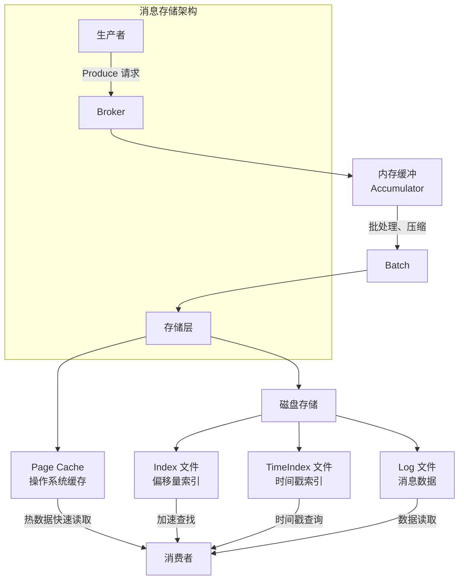

***

## 15) "存储优化总结"

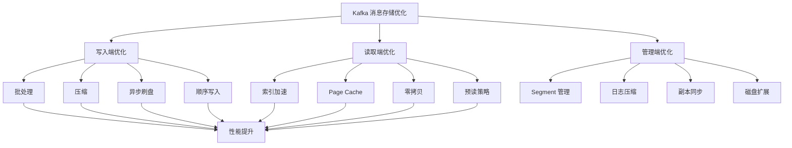

***

## 16) "存储配置检查清单"

| "检查项" | "推荐值" | "说明" |
| --- | --- | --- |
| "log.segment.bytes" | "512MB-1GB" | "根据消息量调整" |
| "log.retention.hours" | "168（7 天）" | "根据业务需求调整" |
| "log.retention.bytes" | "-1（无限）" | "或根据磁盘容量设置" |
| "log.cleanup.policy" | "delete" | "或 compact 日志压缩" |
| "compression.type" | "snappy" | "平衡压缩率和 CPU" |
| "log.index.interval.bytes" | "4096（4KB）" | "索引密度，影响查询速度" |
| "log.preallocate" | "true" | "预分配文件，提高性能" |
| "log.flush.interval.messages" | "-1" | "异步刷盘，不阻塞写入" |
| "log.flush.interval.ms" | "30000（30s）" | "定期刷盘保证持久化" |

***

## 总结

Kafka 的消息存储机制是其高性能的关键所在：

1. **"分层存储结构"**："从 Cluster、Topic、Partition、Replica 到 Segment，每层都精心设计。"
2. **"高效的索引机制"**："稀疏索引 + 二分查找，快速定位消息。"
3. **"充分利用 Page Cache"**："避免不必要的内存拷贝，依赖 OS 缓存。"
4. **"顺序写入"**："充分利用磁盘顺序写的高性能。"
5. **"零拷贝技术"**："使用 sendfile() 直接在内核传输数据。"
6. **"智能 Segment 管理"**："自动滚动、删除、压缩。"

通过理解这些机制，您可以更好地优化 Kafka 部署、配置和调优。


> 更新: 2026-01-22 15:10:48  
> 原文: <https://www.yuque.com/tulingzhouyu/db22bv/xwrsftnpg347umko>