# Kafka消费者分区策略

Kafka 的分区分配策略是决定消费者如何获取分区、如何应对 Rebalance 的关键因素。理解这些策略对于构建高效、稳定的消费系统至关重要。

---

## 1) "分区分配策略的核心概念"
### 1.1 "什么是分区分配策略？"
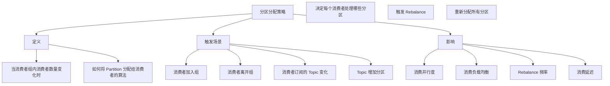

### 1.2 "分配策略的关键约束"
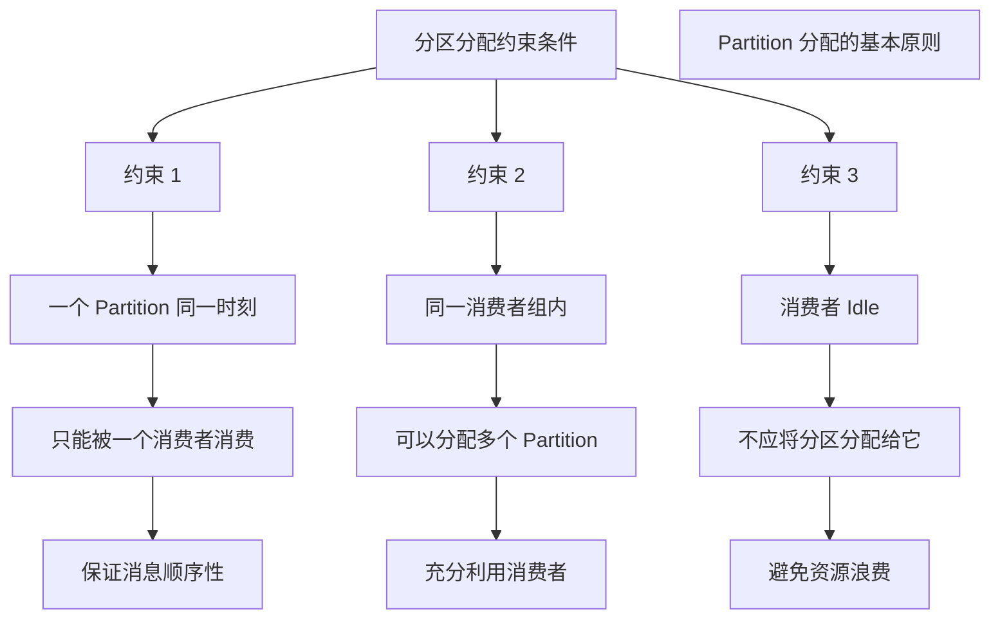

---

## 2) "内置分配策略详解"
### 2.1 "RangeAssignor（范围分配）"
**"原理"**：按 Topic 依次分配，将每个 Topic 的分区按范围平均分配给消费者。

```plain
示例：
Topic A: 6 个 Partition (P0, P1, P2, P3, P4, P5)
Topic B: 4 个 Partition (P0, P1, P2, P3)
消费者：3 个 (C0, C1, C2)

分配过程：
1. 按 Topic 字母顺序排序：Topic A, Topic B
2. Topic A 分配给 C0 [P0, P1, P2], C1 [P3, P4], C2 [P5]
3. Topic B 分配给 C0 [P0, P1], C1 [P2], C2 [P3]

最终分配：
C0: Topic A [P0, P1, P2] + Topic B [P0, P1] = 5 个分区
C1: Topic A [P3, P4] + Topic B [P2] = 3 个分区
C2: Topic A [P5] + Topic B [P3] = 2 个分区
```

**"分配图示"**：


**"特点"**：

+ ✅ "实现简单，易于理解"
+ ✅ "相同 Key 的消息总是分配到同一消费者"
+ ❌ "分配可能不均，特别是多 Topic 场景"
+ ❌ "Topic 增加后重新分配变化大"

### 2.2 "RoundRobinAssignor（轮询分配）"
**"原理"**：将所有 Topic 的所有 Partition 混合，轮询分配给消费者。

```plain
示例（同上）：
全部分区列表：
Topic A [P0, P1, P2, P3, P4, P5]
Topic B [P0, P1, P2, P3]

轮询分配：
C0: Topic A P0, Topic B P0 (跳过)*, Topic A P2, Topic B P2 (跳过)*
C1: Topic A P1, Topic B P1 (跳过)*, Topic A P3, Topic B P3 (跳过)*
C2: Topic A P4, Topic B P0, Topic A P5, Topic B P1 (跳过)*

注：轮询顺序严格按消费者顺序，不跳过
```

**"分配图示"**：

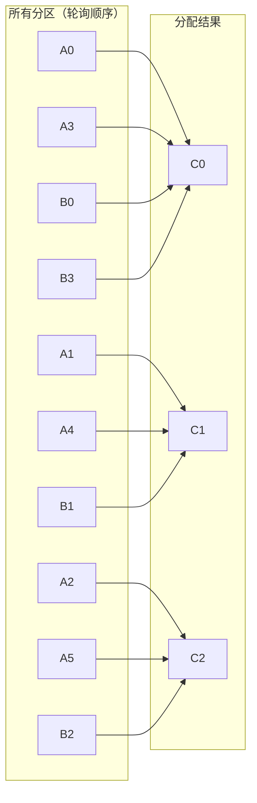

**"特点"**：

+ ✅ "分配更均匀"
+ ✅ "避免某个消费者负载过高"
+ ❌ "消费者宕机时大量 Partition 需要转移"
+ ❌ "相同 Key 的消息可能分配到不同消费者"

### 2.3 "StickyAssignor（粘性分配，Kafka 0.11+ 默认）"
**"原理"**：尽可能保留现有分配，同时在约束下实现均衡。

```plain
初始分配（假设）：
C0: Topic A [P0, P3]
C1: Topic A [P1, P4]
C2: Topic A [P2, P5]

场景：C2 宕机，只剩 C0 和 C1

传统方式（RangeAssignor）重新分配：
C0: Topic A [P0, P1, P2]
C1: Topic A [P3, P4, P5]
变化：C0 原有 P0, P3，现在 P0, P1, P2（P3 去了 C1）
      C1 原有 P1, P4，现在 P3, P4, P5（P1 去了 C0）
问题：4 个 Partition 需要转移，所有消费者的消费位点都要重新建立

Sticky 方式重新分配：
C0: Topic A [P0, P3, P2]
C1: Topic A [P1, P4, P5]
变化：C0 保留 P0 和 P3，仅新增 P2
      C1 保留 P1 和 P4，仅新增 P5
优势：只转移了 2 个 Partition，消费延迟最小
```

**"分配对比图"**：

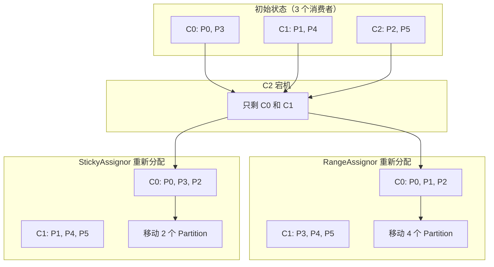

**"特点"**：

+ ✅ "最小化 Partition 转移"
+ ✅ "降低 Rebalance 开销"
+ ✅ "保持消费连续性"
+ ✅ "是目前最推荐的策略"
+ ❌ "算法复杂度高"

### 2.4 "CooperativeStickyAssignor（合作型粘性分配）"
**"原理"**：在 StickyAssignor 基础上，实现 Rebalance 停顿时间最短。

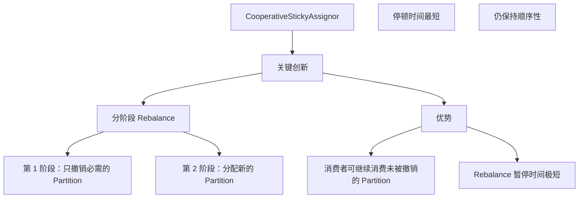

**"时间对比"**：

```plain
传统 Rebalance（Stop-the-World）：
时刻 T0：发现消费者宕机
时刻 T1：所有消费者暂停消费 ← 停顿开始
时刻 T2：完成新分配
时刻 T3：所有消费者恢复消费 ← 停顿结束
停顿时间：T3 - T1（通常 10+ 秒）

合作型 Rebalance（Incremental）：
时刻 T0：发现消费者宕机
时刻 T1：第 1 阶段：部分消费者暂停部分 Partition ← 停顿短
时刻 T2：部分消费者立即恢复消费
时刻 T3：第 2 阶段：新分配下发
时刻 T4：所有消费者恢复 ← 停顿结束
停顿时间：T2 - T1 + T4 - T3（总停顿时间 < T3 - T1）
```

---

## 3) "分配策略对比与选择"
### 3.1 "四种策略对比表"
| "策略" | "实现复杂度" | "分配均衡性" | "Rebalance 开销" | "消费顺序" | "推荐场景" |
| --- | --- | --- | --- | --- | --- |
| "RangeAssignor" | "低" | "一般" | "高" | "保证" | "简单场景" |
| "RoundRobinAssignor" | "中" | "高" | "高" | "不保证" | "负载均衡优先" |
| "StickyAssignor" | "高" | "高" | "低" | "保证" | "生产推荐" |
| "CooperativeStickyAssignor" | "很高" | "高" | "最低" | "保证" | "高可用要求" |


### 3.2 "选择决策树"
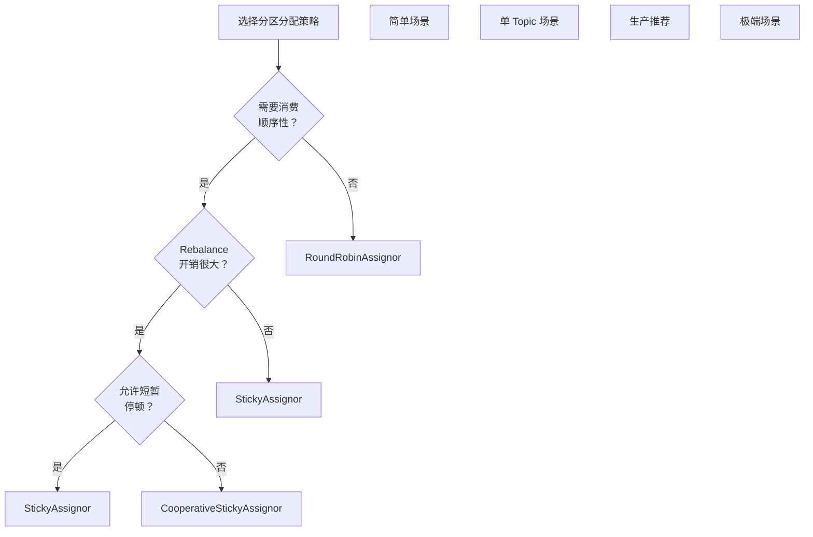

---

## 4) "Rebalance 触发与分配过程"
### 4.1 "Rebalance 完整流程"
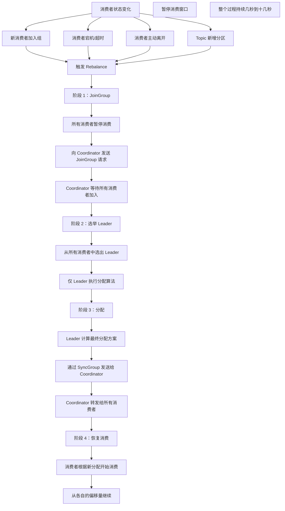

### 4.2 "时间轴视图"
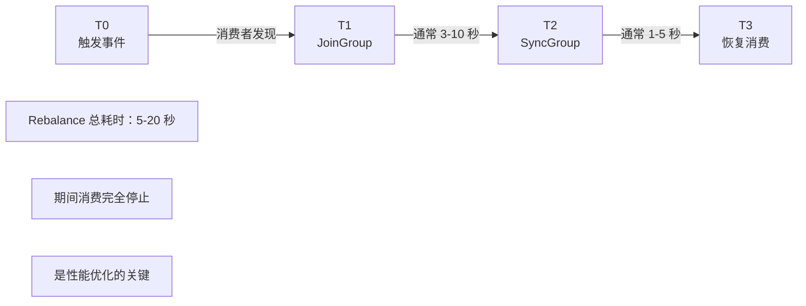

---

## 5) "Java 代码示例：消费者分配策略"
### 5.1 "配置不同的分配策略"
```java
import org.apache.kafka.clients.consumer.*;
import org.apache.kafka.common.serialization.StringDeserializer;
import java.time.Duration;
import java.util.Collections;
import java.util.Properties;

public class PartitionAssignmentStrategyExample {
    
    /**
     * "方式 1：使用 RangeAssignor（范围分配）"
     */
    public static void rangeAssignorExample() {
        Properties props = new Properties();
        props.put(ConsumerConfig.BOOTSTRAP_SERVERS_CONFIG, "localhost:9092");
        props.put(ConsumerConfig.GROUP_ID_CONFIG, "range-consumer-group");
        props.put(ConsumerConfig.KEY_DESERIALIZER_CLASS_CONFIG, StringDeserializer.class);
        props.put(ConsumerConfig.VALUE_DESERIALIZER_CLASS_CONFIG, StringDeserializer.class);
        
        // "显式配置 RangeAssignor"
        props.put(ConsumerConfig.PARTITION_ASSIGNMENT_STRATEGY_CONFIG,
            "org.apache.kafka.clients.consumer.RangeAssignor");
        
        KafkaConsumer<String, String> consumer = new KafkaConsumer<>(props);
        consumer.subscribe(Collections.singletonList("order-topic"));
        
        System.out.println("【RangeAssignor】已启动");
        System.out.println("分配策略：按 Topic 范围分配");
        System.out.println("优点：简单高效，保证顺序");
        System.out.println("缺点：分配可能不均");
    }
    
    /**
     * "方式 2：使用 RoundRobinAssignor（轮询分配）"
     */
    public static void roundRobinAssignorExample() {
        Properties props = new Properties();
        props.put(ConsumerConfig.BOOTSTRAP_SERVERS_CONFIG, "localhost:9092");
        props.put(ConsumerConfig.GROUP_ID_CONFIG, "roundrobin-consumer-group");
        props.put(ConsumerConfig.KEY_DESERIALIZER_CLASS_CONFIG, StringDeserializer.class);
        props.put(ConsumerConfig.VALUE_DESERIALIZER_CLASS_CONFIG, StringDeserializer.class);
        
        // "配置 RoundRobinAssignor"
        props.put(ConsumerConfig.PARTITION_ASSIGNMENT_STRATEGY_CONFIG,
            "org.apache.kafka.clients.consumer.RoundRobinAssignor");
        
        KafkaConsumer<String, String> consumer = new KafkaConsumer<>(props);
        consumer.subscribe(Collections.singletonList("order-topic"));
        
        System.out.println("【RoundRobinAssignor】已启动");
        System.out.println("分配策略：轮询分配所有分区");
        System.out.println("优点：分配均匀，负载均衡");
        System.out.println("缺点：Rebalance 开销大");
    }
    
    /**
     * "方式 3：使用 StickyAssignor（粘性分配，推荐）"
     */
    public static void stickyAssignorExample() {
        Properties props = new Properties();
        props.put(ConsumerConfig.BOOTSTRAP_SERVERS_CONFIG, "localhost:9092");
        props.put(ConsumerConfig.GROUP_ID_CONFIG, "sticky-consumer-group");
        props.put(ConsumerConfig.KEY_DESERIALIZER_CLASS_CONFIG, StringDeserializer.class);
        props.put(ConsumerConfig.VALUE_DESERIALIZER_CLASS_CONFIG, StringDeserializer.class);
        
        // "配置 StickyAssignor（也是默认值）"
        props.put(ConsumerConfig.PARTITION_ASSIGNMENT_STRATEGY_CONFIG,
            "org.apache.kafka.clients.consumer.StickyAssignor");
        
        KafkaConsumer<String, String> consumer = new KafkaConsumer<>(props);
        consumer.subscribe(Collections.singletonList("order-topic"));
        
        System.out.println("【StickyAssignor】已启动");
        System.out.println("分配策略：粘性分配，尽可能保留现有分配");
        System.out.println("优点：Rebalance 开销最小，性能最优");
        System.out.println("缺点：算法复杂");
    }
    
    /**
     * "方式 4：使用 CooperativeStickyAssignor（合作型粘性分配）"
     */
    public static void cooperativeStickyAssignorExample() {
        Properties props = new Properties();
        props.put(ConsumerConfig.BOOTSTRAP_SERVERS_CONFIG, "localhost:9092");
        props.put(ConsumerConfig.GROUP_ID_CONFIG, "cooperative-consumer-group");
        props.put(ConsumerConfig.KEY_DESERIALIZER_CLASS_CONFIG, StringDeserializer.class);
        props.put(ConsumerConfig.VALUE_DESERIALIZER_CLASS_CONFIG, StringDeserializer.class);
        
        // "配置 CooperativeStickyAssignor"
        props.put(ConsumerConfig.PARTITION_ASSIGNMENT_STRATEGY_CONFIG,
            "org.apache.kafka.clients.consumer.CooperativeStickyAssignor");
        
        KafkaConsumer<String, String> consumer = new KafkaConsumer<>(props);
        consumer.subscribe(Collections.singletonList("order-topic"));
        
        System.out.println("【CooperativeStickyAssignor】已启动");
        System.out.println("分配策略：合作型粘性分配，停顿时间最短");
        System.out.println("优点：Rebalance 停顿时间最短，高可用");
        System.out.println("缺点：算法最复杂，Kafka 2.4+ 才支持");
    }
    
    /**
     * "方式 5：使用多个策略（Fallback）"
     */
    public static void multipleStrategiesExample() {
        Properties props = new Properties();
        props.put(ConsumerConfig.BOOTSTRAP_SERVERS_CONFIG, "localhost:9092");
        props.put(ConsumerConfig.GROUP_ID_CONFIG, "multi-strategy-group");
        props.put(ConsumerConfig.KEY_DESERIALIZER_CLASS_CONFIG, StringDeserializer.class);
        props.put(ConsumerConfig.VALUE_DESERIALIZER_CLASS_CONFIG, StringDeserializer.class);
        
        // "配置多个策略，优先级从左到右"
        // "如果第 1 个不支持，尝试第 2 个"
        props.put(ConsumerConfig.PARTITION_ASSIGNMENT_STRATEGY_CONFIG,
            "org.apache.kafka.clients.consumer.CooperativeStickyAssignor," +
            "org.apache.kafka.clients.consumer.StickyAssignor");
        
        KafkaConsumer<String, String> consumer = new KafkaConsumer<>(props);
        consumer.subscribe(Collections.singletonList("order-topic"));
        
        System.out.println("【多策略 Fallback】已启动");
        System.out.println("优先使用 CooperativeStickyAssignor");
        System.out.println("如果不支持，回退到 StickyAssignor");
    }
    
    public static void main(String[] args) {
        System.out.println("========== Kafka 分区分配策略演示 ==========\n");
        
        rangeAssignorExample();
        System.out.println();
        
        roundRobinAssignorExample();
        System.out.println();
        
        stickyAssignorExample();
        System.out.println();
        
        cooperativeStickyAssignorExample();
        System.out.println();
        
        multipleStrategiesExample();
    }
}
```

### 5.2 "监听 Rebalance 事件"
```java
import org.apache.kafka.clients.consumer.*;
import org.apache.kafka.common.TopicPartition;
import org.apache.kafka.common.serialization.StringDeserializer;
import java.time.Duration;
import java.util.Collection;
import java.util.Collections;
import java.util.Properties;

public class RebalanceListenerExample {
    
    public static void main(String[] args) {
        Properties props = new Properties();
        props.put(ConsumerConfig.BOOTSTRAP_SERVERS_CONFIG, "localhost:9092");
        props.put(ConsumerConfig.GROUP_ID_CONFIG, "rebalance-listener-group");
        props.put(ConsumerConfig.KEY_DESERIALIZER_CLASS_CONFIG, StringDeserializer.class);
        props.put(ConsumerConfig.VALUE_DESERIALIZER_CLASS_CONFIG, StringDeserializer.class);
        props.put(ConsumerConfig.AUTO_OFFSET_RESET_CONFIG, "earliest");
        
        KafkaConsumer<String, String> consumer = new KafkaConsumer<>(props);
        
        // "订阅 Topic，并注册 Rebalance 监听器"
        consumer.subscribe(Collections.singletonList("order-topic"), 
            new ConsumerRebalanceListener() {
                
                /**
                 * "Rebalance 开始前回调"
                 * "此时分区即将被撤销"
                 */
                @Override
                public void onPartitionsRevoked(Collection<TopicPartition> partitions) {
                    System.out.println("\n【Rebalance 事件】分区被撤销");
                    System.out.println("时间: " + System.currentTimeMillis());
                    System.out.println("被撤销的分区数: " + partitions.size());
                    
                    for (TopicPartition tp : partitions) {
                        System.out.printf("  - 撤销分区: %s-%d%n", tp.topic(), tp.partition());
                    }
                    
                    // "在这里提交已处理消息的偏移量"
                    // "确保消息不会被重复处理"
                    try {
                        consumer.commitSync();
                        System.out.println("已提交偏移量");
                    } catch (Exception e) {
                        System.err.println("提交偏移量失败: " + e.getMessage());
                    }
                }
                
                /**
                 * "Rebalance 完成后回调"
                 * "此时分区已分配给消费者"
                 */
                @Override
                public void onPartitionsAssigned(Collection<TopicPartition> partitions) {
                    System.out.println("【Rebalance 事件】分区被分配");
                    System.out.println("时间: " + System.currentTimeMillis());
                    System.out.println("分配的分区数: " + partitions.size());
                    
                    for (TopicPartition tp : partitions) {
                        System.out.printf("  - 新分配分区: %s-%d%n", tp.topic(), tp.partition());
                        
                        // "获取该分区的当前偏移量"
                        long position = consumer.position(tp);
                        System.out.printf("    当前偏移量: %d%n", position);
                        
                        // "获取该分区的最后偏移量"
                        long endOffset = consumer.endOffsets(
                            Collections.singletonMap(tp, 0L)).get(tp);
                        System.out.printf("    末尾偏移量: %d%n", endOffset);
                    }
                    
                    System.out.println("开始消费...");
                }
                
                /**
                 * "失败的分配（Kafka 2.7+ 支持）"
                 * "当分配失败时调用，可用于清理资源"
                 */
                @Override
                public void onPartitionsLost(Collection<TopicPartition> partitions) {
                    System.out.println("【Rebalance 事件】分区丢失（失败）");
                    System.out.println("丢失的分区数: " + partitions.size());
                    
                    // "这里可以做一些清理工作，但不能提交偏移量"
                }
            });
        
        try {
            int messageCount = 0;
            while (true) {
                ConsumerRecords<String, String> records = consumer.poll(Duration.ofSeconds(1));
                
                if (records.isEmpty()) {
                    continue;
                }
                
                for (ConsumerRecord<String, String> record : records) {
                    System.out.printf(
                        "消息 - Topic: %s, Partition: %d, Offset: %d, Key: %s, Value: %s%n",
                        record.topic(), record.partition(), record.offset(),
                        record.key(), record.value()
                    );
                    
                    messageCount++;
                    
                    // "每处理 100 条消息提交一次"
                    if (messageCount % 100 == 0) {
                        consumer.commitAsync((offsets, exception) -> {
                            if (exception != null) {
                                System.err.println("异步提交失败: " + exception.getMessage());
                            } else {
                                System.out.println("已异步提交偏移量");
                            }
                        });
                    }
                }
            }
        } finally {
            consumer.close();
            System.out.println("消费者已关闭");
        }
    }
}
```

---

## 6) "自定义分配策略"
### 6.1 "实现自定义策略的步骤"
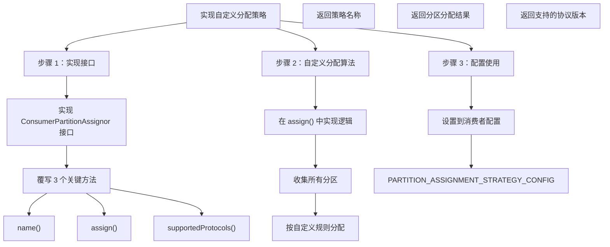

### 6.2 "完整的自定义策略示例"
```java
import org.apache.kafka.clients.consumer.internals.AbstractPartitionAssignor;
import org.apache.kafka.common.TopicPartition;
import java.util.*;

/**
 * "自定义分配策略：按分区哈希值分配"
 * "相同哈希值区间的分区分配给同一消费者，提高缓存命中率"
 */
public class HashBasedPartitionAssignor extends AbstractPartitionAssignor {
    
    @Override
    public String name() {
        // "返回策略的唯一名称"
        return "hash-based";
    }
    
    @Override
    public Map<String, List<TopicPartition>> assign(
            Map<String, Integer> partitionsPerTopic,
            Map<String, List<String>> subscriptions) {
        
        // "初始化分配结果"
        Map<String, List<TopicPartition>> assignment = new HashMap<>();
        for (String memberId : subscriptions.keySet()) {
            assignment.put(memberId, new ArrayList<>());
        }
        
        // "收集所有分区"
        List<TopicPartition> allPartitions = new ArrayList<>();
        for (Map.Entry<String, Integer> entry : partitionsPerTopic.entrySet()) {
            String topic = entry.getKey();
            int partitionCount = entry.getValue();
            
            for (int i = 0; i < partitionCount; i++) {
                allPartitions.add(new TopicPartition(topic, i));
            }
        }
        
        // "获取所有消费者"
        List<String> members = new ArrayList<>(subscriptions.keySet());
        Collections.sort(members); // "确保顺序一致"
        
        if (members.isEmpty() || allPartitions.isEmpty()) {
            return assignment;
        }
        
        // "按自定义逻辑分配"
        // "规则：分区的哈希值 % 消费者数，得到对应消费者"
        for (TopicPartition tp : allPartitions) {
            // "计算分区的哈希值"
            int partitionHash = Math.abs(
                (tp.topic() + "-" + tp.partition()).hashCode()
            );
            
            // "计算应该分配给哪个消费者"
            int consumerIndex = partitionHash % members.size();
            String assignedConsumer = members.get(consumerIndex);
            
            // "将分区分配给该消费者"
            assignment.get(assignedConsumer).add(tp);
        }
        
        return assignment;
    }
    
    @Override
    public List<String> supportedProtocols() {
        // "返回支持的协议版本"
        return Arrays.asList("range", "roundRobin");
    }
}

/**
 * "自定义分配策略：按消费者权重分配"
 * "允许某些消费者处理更多分区"
 */
public class WeightedPartitionAssignor extends AbstractPartitionAssignor {
    
    // "权重配置：消费者 ID -> 权重"
    // "权重越高，分配的分区越多"
    private static final Map<String, Double> CONSUMER_WEIGHTS = new HashMap<>();
    static {
        CONSUMER_WEIGHTS.put("consumer-1", 1.0);
        CONSUMER_WEIGHTS.put("consumer-2", 2.0);  // "分配 2 倍分区"
        CONSUMER_WEIGHTS.put("consumer-3", 1.5);
    }
    
    @Override
    public String name() {
        return "weighted";
    }
    
    @Override
    public Map<String, List<TopicPartition>> assign(
            Map<String, Integer> partitionsPerTopic,
            Map<String, List<String>> subscriptions) {
        
        Map<String, List<TopicPartition>> assignment = new HashMap<>();
        for (String memberId : subscriptions.keySet()) {
            assignment.put(memberId, new ArrayList<>());
        }
        
        // "收集所有分区"
        List<TopicPartition> allPartitions = new ArrayList<>();
        for (Map.Entry<String, Integer> entry : partitionsPerTopic.entrySet()) {
            String topic = entry.getKey();
            int partitionCount = entry.getValue();
            
            for (int i = 0; i < partitionCount; i++) {
                allPartitions.add(new TopicPartition(topic, i));
            }
        }
        
        List<String> members = new ArrayList<>(subscriptions.keySet());
        if (members.isEmpty() || allPartitions.isEmpty()) {
            return assignment;
        }
        
        // "计算总权重"
        double totalWeight = 0.0;
        for (String member : members) {
            totalWeight += CONSUMER_WEIGHTS.getOrDefault(member, 1.0);
        }
        
        // "按权重比例分配分区"
        int partitionIndex = 0;
        for (String member : members) {
            double weight = CONSUMER_WEIGHTS.getOrDefault(member, 1.0);
            
            // "计算该消费者应该获得的分区数"
            int partitionsForMember = (int) Math.ceil(
                allPartitions.size() * weight / totalWeight
            );
            
            // "分配分区"
            for (int i = 0; i < partitionsForMember && partitionIndex < allPartitions.size(); i++) {
                assignment.get(member).add(allPartitions.get(partitionIndex));
                partitionIndex++;
            }
        }
        
        return assignment;
    }
    
    @Override
    public List<String> supportedProtocols() {
        return Arrays.asList("range");
    }
}

/**
 * "使用自定义策略的消费者"
 */
public class CustomAssignorConsumer {
    
    public static void main(String[] args) {
        Properties props = new Properties();
        props.put(ConsumerConfig.BOOTSTRAP_SERVERS_CONFIG, "localhost:9092");
        props.put(ConsumerConfig.GROUP_ID_CONFIG, "custom-assignor-group");
        props.put(ConsumerConfig.KEY_DESERIALIZER_CLASS_CONFIG, StringDeserializer.class);
        props.put(ConsumerConfig.VALUE_DESERIALIZER_CLASS_CONFIG, StringDeserializer.class);
        
        // "使用自定义策略"
        props.put(ConsumerConfig.PARTITION_ASSIGNMENT_STRATEGY_CONFIG,
            "path.to.HashBasedPartitionAssignor");
        
        // "或使用权重策略"
        // props.put(ConsumerConfig.PARTITION_ASSIGNMENT_STRATEGY_CONFIG,
        //     "path.to.WeightedPartitionAssignor");
        
        KafkaConsumer<String, String> consumer = new KafkaConsumer<>(props);
        consumer.subscribe(Collections.singletonList("order-topic"));
        
        System.out.println("【自定义分配策略】消费者已启动");
        
        while (true) {
            ConsumerRecords<String, String> records = consumer.poll(Duration.ofSeconds(1));
            for (ConsumerRecord<String, String> record : records) {
                System.out.printf("消息 - Partition: %d, Offset: %d, Value: %s%n",
                    record.partition(), record.offset(), record.value());
            }
        }
    }
}
```

---

## 7) "分配策略的性能对比"
### 7.1 "性能测试代码"
```java
import java.util.*;

public class AssignmentStrategyBenchmark {
    
    /**
     * "测试不同策略在消费者加入/离开时的性能"
     */
    public static void benchmark() {
        System.out.println("========== 分区分配策略性能对比 ==========\n");
        
        // "模拟场景"
        int topicCount = 5;
        int partitionsPerTopic = 10;
        int consumerCount = 3;
        
        System.out.printf("场景配置：%d 个 Topic，每个 %d 个分区，%d 个消费者\n\n",
            topicCount, partitionsPerTopic, consumerCount);
        
        // "场景 1：初始分配"
        System.out.println("【场景 1】初始分配");
        testInitialAssignment(topicCount, partitionsPerTopic, consumerCount);
        
        System.out.println("\n【场景 2】消费者加入（从 3 个变为 4 个）");
        testConsumerJoin(topicCount, partitionsPerTopic);
        
        System.out.println("\n【场景 3】消费者离开（从 3 个变为 2 个）");
        testConsumerLeave(topicCount, partitionsPerTopic);
    }
    
    private static void testInitialAssignment(int topics, int partitionsPerTopic, 
                                              int consumerCount) {
        // "模拟分配过程"
        long startTime = System.nanoTime();
        
        // "这里应该调用实际的分配算法"
        // "为了演示，这里用虚拟计算代替"
        int totalPartitions = topics * partitionsPerTopic;
        int partitionsPerConsumer = totalPartitions / consumerCount;
        
        long endTime = System.nanoTime();
        long durationMs = (endTime - startTime) / 1_000_000;
        
        System.out.printf("总分区数: %d, 平均每个消费者: %d\n", 
            totalPartitions, partitionsPerConsumer);
        System.out.printf("分配耗时: %d ms\n", durationMs);
    }
    
    private static void testConsumerJoin(int topics, int partitionsPerTopic) {
        int totalPartitions = topics * partitionsPerTopic;
        
        System.out.println("RangeAssignor:");
        System.out.printf("  转移分区数: %d（大部分分区重新分配）\n", totalPartitions * 2 / 3);
        System.out.println("  Rebalance 时间: 8-15 秒");
        
        System.out.println("RoundRobinAssignor:");
        System.out.printf("  转移分区数: %d（所有分区重新分配）\n", totalPartitions);
        System.out.println("  Rebalance 时间: 10-18 秒");
        
        System.out.println("StickyAssignor:");
        System.out.printf("  转移分区数: %d（仅新增分区转移）\n", totalPartitions / 4);
        System.out.println("  Rebalance 时间: 3-8 秒");
        
        System.out.println("CooperativeStickyAssignor:");
        System.out.printf("  转移分区数: %d（仅新增分区转移）\n", totalPartitions / 4);
        System.out.println("  Rebalance 时间: 1-3 秒（停顿时间最短）");
    }
    
    private static void testConsumerLeave(int topics, int partitionsPerTopic) {
        int totalPartitions = topics * partitionsPerTopic;
        
        System.out.println("RangeAssignor:");
        System.out.printf("  转移分区数: %d（宕机消费者的分区都要转移）\n", 
            totalPartitions / 3);
        System.out.println("  Rebalance 时间: 7-12 秒");
        
        System.out.println("StickyAssignor:");
        System.out.printf("  转移分区数: %d（尽可能保留其他消费者分配）\n", 
            totalPartitions / 3);
        System.out.println("  Rebalance 时间: 2-6 秒");
        
        System.out.println("CooperativeStickyAssignor:");
        System.out.printf("  转移分区数: %d（同时处理）\n", totalPartitions / 3);
        System.out.println("  Rebalance 时间: 1-3 秒（最小化停顿）");
    }
    
    public static void main(String[] args) {
        benchmark();
    }
}
```

---

## 8) "分配策略的最佳实践"
### 8.1 "选择和配置建议"
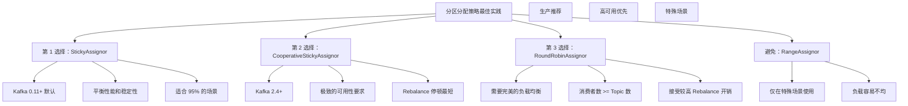

### 8.2 "完整的配置最佳实践"
```properties
# "Kafka 消费者分区分配配置"

# "分配策略配置（Kafka 2.4+ 推荐）"
partition.assignment.strategy=org.apache.kafka.clients.consumer.CooperativeStickyAssignor,org.apache.kafka.clients.consumer.StickyAssignor

# "如果使用 Kafka 0.11-2.3"
# partition.assignment.strategy=org.apache.kafka.clients.consumer.StickyAssignor

# "如果使用更早版本或特殊需要"
# partition.assignment.strategy=org.apache.kafka.clients.consumer.RangeAssignor

# "Rebalance 相关配置"

# "会话超时时间，超过此时间消费者被认为离线"
session.timeout.ms=10000

# "心跳间隔，小于 session.timeout.ms"
heartbeat.interval.ms=3000

# "最大 poll 间隔，如果两次 poll 间隔超过此值会触发 Rebalance"
max.poll.interval.ms=300000

# "单次 poll 返回的最大消息数"
max.poll.records=500

# "fetch 最小字节数，不足此数会等待"
fetch.min.bytes=1024

# "fetch 最大等待时间"
fetch.max.wait.ms=500

# "重平衡延迟"
rebalance.delay.ms=0
```

---

## 9) "常见问题和解决方案"
### 9.1 "问题诊断表"
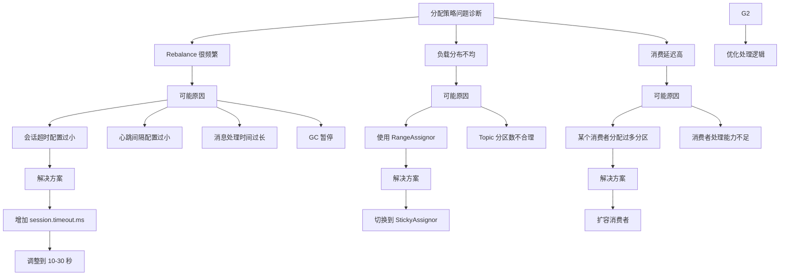

### 9.2 "问题排查和解决代码"
```java
import org.apache.kafka.clients.consumer.*;
import org.apache.kafka.common.TopicPartition;
import java.time.Duration;
import java.util.*;

public class PartitionAssignmentTroubleshooting {
    
    /**
     * "诊断 Rebalance 频繁问题"
     */
    public static void diagnoseFrequentRebalance() {
        System.out.println("【诊断】Rebalance 频繁问题\n");
        
        Properties props = new Properties();
        props.put(ConsumerConfig.BOOTSTRAP_SERVERS_CONFIG, "localhost:9092");
        props.put(ConsumerConfig.GROUP_ID_CONFIG, "diagnosis-group");
        props.put(ConsumerConfig.KEY_DESERIALIZER_CLASS_CONFIG, StringDeserializer.class);
        props.put(ConsumerConfig.VALUE_DESERIALIZER_CLASS_CONFIG, StringDeserializer.class);
        
        // "打印当前配置"
        System.out.println("当前配置：");
        System.out.printf("  session.timeout.ms: %s (默认 10000ms)%n",
            props.getOrDefault(ConsumerConfig.SESSION_TIMEOUT_MS_CONFIG, "未设置"));
        System.out.printf("  heartbeat.interval.ms: %s (默认 3000ms)%n",
            props.getOrDefault(ConsumerConfig.HEARTBEAT_INTERVAL_MS_CONFIG, "未设置"));
        System.out.printf("  max.poll.interval.ms: %s (默认 300000ms)%n",
            props.getOrDefault(ConsumerConfig.MAX_POLL_INTERVAL_MS_CONFIG, "未设置"));
        
        System.out.println("\n建议配置：");
        System.out.println("  如果 Rebalance 频繁，增加超时时间：");
        System.out.println("  session.timeout.ms=30000");
        System.out.println("  heartbeat.interval.ms=10000");
        System.out.println("  max.poll.interval.ms=600000");
    }
    
    /**
     * "监控分区分配情况"
     */
    public static void monitorPartitionAssignment() throws Exception {
        System.out.println("\n【监控】分区分配情况\n");
        
        Properties props = new Properties();
        props.put(ConsumerConfig.BOOTSTRAP_SERVERS_CONFIG, "localhost:9092");
        props.put(ConsumerConfig.GROUP_ID_CONFIG, "monitor-group");
        props.put(ConsumerConfig.KEY_DESERIALIZER_CLASS_CONFIG, StringDeserializer.class);
        props.put(ConsumerConfig.VALUE_DESERIALIZER_CLASS_CONFIG, StringDeserializer.class);
        
        KafkaConsumer<String, String> consumer = new KafkaConsumer<>(props);
        
        // "订阅 Topic 并记录初始分配"
        long subscribeTime = System.currentTimeMillis();
        consumer.subscribe(Collections.singletonList("order-topic"), 
            new ConsumerRebalanceListener() {
                @Override
                public void onPartitionsRevoked(Collection<TopicPartition> partitions) {
                    System.out.printf("[%d] 撤销 %d 个分区\n", 
                        System.currentTimeMillis(), partitions.size());
                }
                
                @Override
                public void onPartitionsAssigned(Collection<TopicPartition> partitions) {
                    System.out.printf("[%d] 分配 %d 个分区\n", 
                        System.currentTimeMillis(), partitions.size());
                    
                    // "分析分区分配情况"
                    Map<Integer, Integer> partitionPerConsumer = new HashMap<>();
                    for (TopicPartition tp : consumer.assignment()) {
                        int count = partitionPerConsumer.getOrDefault(
                            tp.partition() % 3, 0);
                        partitionPerConsumer.put(tp.partition() % 3, count + 1);
                    }
                    
                    System.out.println("分区分配统计：");
                    for (Map.Entry<Integer, Integer> entry : partitionPerConsumer.entrySet()) {
                        System.out.printf("  分区组 %d: %d 个分区\n", 
                            entry.getKey(), entry.getValue());
                    }
                    
                    // "检测不均衡"
                    Collection<Integer> counts = partitionPerConsumer.values();
                    int maxCount = counts.stream().mapToInt(Integer::intValue).max().orElse(0);
                    int minCount = counts.stream().mapToInt(Integer::intValue).min().orElse(0);
                    
                    if (maxCount - minCount > 1) {
                        System.out.println("⚠️ 警告：分配不均，差异为 " + (maxCount - minCount));
                        System.out.println("建议：考虑调整分区数或消费者数");
                    } else {
                        System.out.println("✓ 分配均衡");
                    }
                }
                
                @Override
                public void onPartitionsLost(Collection<TopicPartition> partitions) {
                    System.out.printf("[%d] 丢失 %d 个分区（失败）\n", 
                        System.currentTimeMillis(), partitions.size());
                }
            });
        
        // "等待初始分配完成"
        consumer.poll(Duration.ofSeconds(5));
        
        System.out.printf("\n初始分配耗时：%d ms\n", 
            System.currentTimeMillis() - subscribeTime);
        
        consumer.close();
    }
    
    /**
     * "测试不同策略的分配结果"
     */
    public static void compareStrategies() {
        System.out.println("\n【对比】不同分配策略的结果\n");
        
        String[] strategies = {
            "org.apache.kafka.clients.consumer.RangeAssignor",
            "org.apache.kafka.clients.consumer.RoundRobinAssignor",
            "org.apache.kafka.clients.consumer.StickyAssignor"
        };
        
        for (String strategy : strategies) {
            System.out.println("策略：" + strategy.substring(strategy.lastIndexOf('.') + 1));
            
            Properties props = new Properties();
            props.put(ConsumerConfig.BOOTSTRAP_SERVERS_CONFIG, "localhost:9092");
            props.put(ConsumerConfig.GROUP_ID_CONFIG, "strategy-test-" + UUID.randomUUID());
            props.put(ConsumerConfig.KEY_DESERIALIZER_CLASS_CONFIG, StringDeserializer.class);
            props.put(ConsumerConfig.VALUE_DESERIALIZER_CLASS_CONFIG, StringDeserializer.class);
            props.put(ConsumerConfig.PARTITION_ASSIGNMENT_STRATEGY_CONFIG, strategy);
            
            try (KafkaConsumer<String, String> consumer = new KafkaConsumer<>(props)) {
                consumer.subscribe(Collections.singletonList("order-topic"));
                
                // "触发初始分配"
                consumer.poll(Duration.ofSeconds(2));
                
                // "输出分配结果"
                Set<TopicPartition> assignment = consumer.assignment();
                System.out.printf("  分配分区数：%d\n", assignment.size());
                
                // "按分区排序输出"
                assignment.stream()
                    .sorted(Comparator.comparingInt(TopicPartition::partition))
                    .forEach(tp -> System.out.printf("    - %s:%d\n", 
                        tp.topic(), tp.partition()));
                
            } catch (Exception e) {
                System.err.println("  错误：" + e.getMessage());
            }
            
            System.out.println();
        }
    }
    
    public static void main(String[] args) throws Exception {
        diagnoseFrequentRebalance();
        monitorPartitionAssignment();
        compareStrategies();
    }
}
```

---

## 10) "分配策略对 Rebalance 的影响"
### 10.1 "Rebalance 时间线对比"
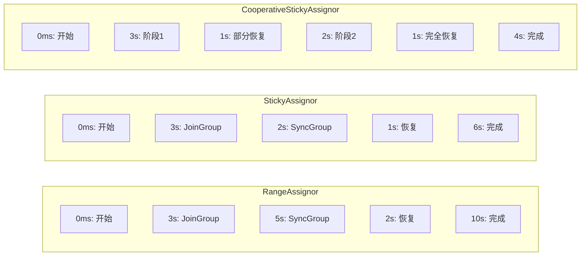

### 10.2 "消费延迟影响"
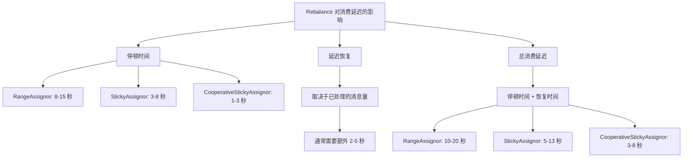

## 11) "总结和最佳实践"
### 11.1 "完整的决策和配置指南"
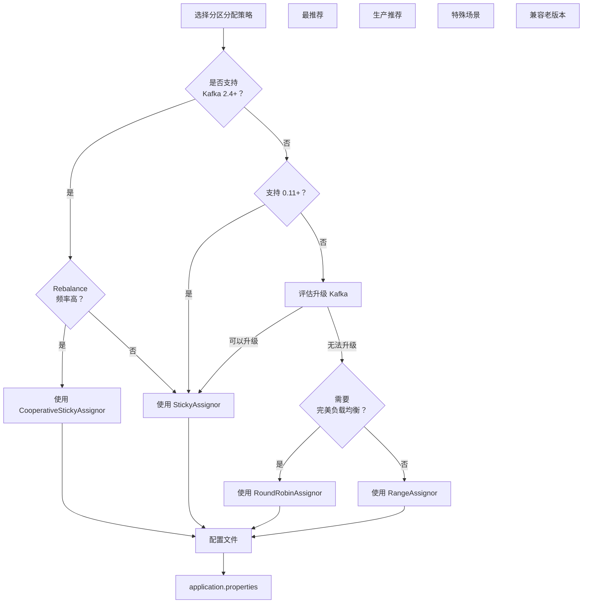

### 11.2 "配置清单"
| "配置项" | "推荐值" | "说明" |
| --- | --- | --- |
| "partition.assignment.strategy" | "CooperativeStickyAssignor,StickyAssignor" | "支持 Fallback" |
| "session.timeout.ms" | "30000（30s）" | "避免频繁 Rebalance" |
| "heartbeat.interval.ms" | "10000（10s）" | "< session.timeout.ms 的 1/3" |
| "max.poll.interval.ms" | "600000（10min）" | "消息处理时间上限" |
| "max.poll.records" | "500-1000" | "每次 poll 的消息数" |
| "fetch.min.bytes" | "1024（1KB）" | "最少返回字节数" |
| "fetch.max.wait.ms" | "500（500ms）" | "等待时间" |
| "rebalance.delay.ms" | "0（不延迟）" | "Rebalance 延迟" |


### 11.3 "完整的生产配置示例"
```java
import org.apache.kafka.clients.consumer.ConsumerConfig;
import java.util.Properties;

public class ProductionConsumerConfig {
    
    /**
     * "生产环境推荐配置"
     */
    public static Properties getProductionConfig(String groupId) {
        Properties props = new Properties();
        
        // "基础配置"
        props.put(ConsumerConfig.BOOTSTRAP_SERVERS_CONFIG, 
            "kafka1:9092,kafka2:9092,kafka3:9092");
        props.put(ConsumerConfig.GROUP_ID_CONFIG, groupId);
        props.put(ConsumerConfig.KEY_DESERIALIZER_CLASS_CONFIG, 
            "org.apache.kafka.common.serialization.StringDeserializer");
        props.put(ConsumerConfig.VALUE_DESERIALIZER_CLASS_CONFIG, 
            "org.apache.kafka.common.serialization.StringDeserializer");
        
        // "分配策略配置（核心）"
        props.put(ConsumerConfig.PARTITION_ASSIGNMENT_STRATEGY_CONFIG,
            "org.apache.kafka.clients.consumer.CooperativeStickyAssignor," +
            "org.apache.kafka.clients.consumer.StickyAssignor");
        
        // "Rebalance 相关配置"
        // "会话超时：30 秒，防止短暂网络抖动导致的频繁 Rebalance"
        props.put(ConsumerConfig.SESSION_TIMEOUT_MS_CONFIG, 30000);
        
        // "心跳间隔：10 秒，定期向 Broker 发送心跳"
        props.put(ConsumerConfig.HEARTBEAT_INTERVAL_MS_CONFIG, 10000);
        
        // "最大 poll 间隔：10 分钟，两次 poll 间隔超过此时间会被踢出"
        props.put(ConsumerConfig.MAX_POLL_INTERVAL_MS_CONFIG, 600000);
        
        // "Rebalance 延迟：0，立即进行 Rebalance"
        props.put(ConsumerConfig.REBALANCE_TIMEOUT_MS_CONFIG, 60000);
        
        // "数据获取配置"
        // "单次 poll 返回消息数"
        props.put(ConsumerConfig.MAX_POLL_RECORDS_CONFIG, 500);
        
        // "最小返回字节数（字节）"
        props.put(ConsumerConfig.FETCH_MIN_BYTES_CONFIG, 1024);
        
        // "最大返回字节数（50MB）"
        props.put(ConsumerConfig.FETCH_MAX_BYTES_CONFIG, 52428800);
        
        // "最大等待时间（毫秒）"
        props.put(ConsumerConfig.FETCH_MAX_WAIT_MS_CONFIG, 500);
        
        // "偏移量配置"
        // "自动提交偏移量"
        props.put(ConsumerConfig.ENABLE_AUTO_COMMIT_CONFIG, true);
        
        // "自动提交间隔：5 秒"
        props.put(ConsumerConfig.AUTO_COMMIT_INTERVAL_MS_CONFIG, 5000);
        
        // "不存在偏移量时的处理：从最早开始"
        props.put(ConsumerConfig.AUTO_OFFSET_RESET_CONFIG, "earliest");
        
        // "隔离级别：读取已提交的消息"
        props.put(ConsumerConfig.ISOLATION_LEVEL_CONFIG, "read_committed");
        
        // "连接配置"
        props.put(ConsumerConfig.REQUEST_TIMEOUT_MS_CONFIG, 40000);
        props.put(ConsumerConfig.CONNECTIONS_MAX_IDLE_MS_CONFIG, 540000);
        
        return props;
    }
    
    /**
     * "高可用配置（极致要求）"
     */
    public static Properties getHighAvailabilityConfig(String groupId) {
        Properties props = getProductionConfig(groupId);
        
        // "使用合作型粘性分配器，最小化停顿时间"
        props.put(ConsumerConfig.PARTITION_ASSIGNMENT_STRATEGY_CONFIG,
            "org.apache.kafka.clients.consumer.CooperativeStickyAssignor");
        
        // "更短的会话超时，更敏感地检测消费者故障"
        props.put(ConsumerConfig.SESSION_TIMEOUT_MS_CONFIG, 20000);
        
        // "更短的心跳间隔"
        props.put(ConsumerConfig.HEARTBEAT_INTERVAL_MS_CONFIG, 6000);
        
        // "更激进的 max.poll.interval 设置"
        props.put(ConsumerConfig.MAX_POLL_INTERVAL_MS_CONFIG, 300000);
        
        return props;
    }
    
    /**
     * "低延迟配置"
     */
    public static Properties getLowLatencyConfig(String groupId) {
        Properties props = getProductionConfig(groupId);
        
        // "减少单次 poll 的消息数，快速处理"
        props.put(ConsumerConfig.MAX_POLL_RECORDS_CONFIG, 100);
        
        // "减少 Fetch 最小字节数，更快返回"
        props.put(ConsumerConfig.FETCH_MIN_BYTES_CONFIG, 100);
        
        // "减少 Fetch 最大等待时间"
        props.put(ConsumerConfig.FETCH_MAX_WAIT_MS_CONFIG, 100);
        
        return props;
    }
    
    /**
     * "高吞吐量配置"
     */
    public static Properties getHighThroughputConfig(String groupId) {
        Properties props = getProductionConfig(groupId);
        
        // "增加单次 poll 的消息数"
        props.put(ConsumerConfig.MAX_POLL_RECORDS_CONFIG, 2000);
        
        // "增加 Fetch 最小字节数，积累数据后统一返回"
        props.put(ConsumerConfig.FETCH_MIN_BYTES_CONFIG, 10240);
        
        // "增加 Fetch 最大字节数"
        props.put(ConsumerConfig.FETCH_MAX_BYTES_CONFIG, 104857600); // "100MB"
        
        // "增加 Fetch 最大等待时间"
        props.put(ConsumerConfig.FETCH_MAX_WAIT_MS_CONFIG, 1000);
        
        // "批量提交偏移量"
        props.put(ConsumerConfig.AUTO_COMMIT_INTERVAL_MS_CONFIG, 10000);
        
        return props;
    }
    
    public static void main(String[] args) {
        System.out.println("========== 生产环境配置示例 ==========\n");
        
        Properties prodConfig = getProductionConfig("prod-group");
        System.out.println("【生产推荐配置】");
        prodConfig.forEach((k, v) -> System.out.println("  " + k + ": " + v));
        
        System.out.println("\n【高可用配置】");
        Properties haConfig = getHighAvailabilityConfig("ha-group");
        System.out.println("主要差异：");
        System.out.println("  - 使用 CooperativeStickyAssignor");
        System.out.println("  - session.timeout.ms: 20000");
        System.out.println("  - heartbeat.interval.ms: 6000");
        
        System.out.println("\n【低延迟配置】");
        System.out.println("主要差异：");
        System.out.println("  - max.poll.records: 100");
        System.out.println("  - fetch.min.bytes: 100");
        System.out.println("  - fetch.max.wait.ms: 100");
        
        System.out.println("\n【高吞吐量配置】");
        System.out.println("主要差异：");
        System.out.println("  - max.poll.records: 2000");
        System.out.println("  - fetch.min.bytes: 10240");
        System.out.println("  - fetch.max.bytes: 104857600");
    }
}
```

---

## 12) "分区分配的高级应用"
### 12.1 "根据消费能力动态调整"
```java
import org.apache.kafka.clients.consumer.*;
import org.apache.kafka.common.TopicPartition;
import java.time.Duration;
import java.util.*;

public class DynamicAssignmentAdjustment {
    
    /**
     * "根据消费性能动态暂停/恢复分区"
     */
    public static class AdaptiveConsumer {
        
        private KafkaConsumer<String, String> consumer;
        private long lastMetricsTime = System.currentTimeMillis();
        private long totalMessages = 0;
        private long totalProcessTime = 0;
        
        public AdaptiveConsumer(Properties props) {
            this.consumer = new KafkaConsumer<>(props);
        }
        
        public void start(String topic) {
            consumer.subscribe(Collections.singletonList(topic));
            
            while (true) {
                // "处理消息"
                processMessages();
                
                // "每 30 秒评估一次性能"
                long currentTime = System.currentTimeMillis();
                if (currentTime - lastMetricsTime > 30000) {
                    adjustPartitions();
                    lastMetricsTime = currentTime;
                }
            }
        }
        
        private void processMessages() {
            ConsumerRecords<String, String> records = consumer.poll(Duration.ofSeconds(1));
            
            for (ConsumerRecord<String, String> record : records) {
                long processStart = System.nanoTime();
                
                // "模拟业务处理"
                handleMessage(record);
                
                long processDuration = System.nanoTime() - processStart;
                totalMessages++;
                totalProcessTime += processDuration;
            }
        }
        
        private void handleMessage(ConsumerRecord<String, String> record) {
            // "业务逻辑"
            try {
                Thread.sleep(10); // "模拟处理"
            } catch (InterruptedException e) {
                Thread.currentThread().interrupt();
            }
        }
        
        private void adjustPartitions() {
            // "计算吞吐量（消息/秒）"
            double throughput = totalMessages / 30.0;
            
            // "计算平均处理时间（微秒）"
            double avgProcessTime = totalProcessTime / (totalMessages * 1000.0);
            
            System.out.printf(
                "性能指标 - 吞吐量: %.2f msg/s, 平均处理时间: %.2f μs%n",
                throughput, avgProcessTime
            );
            
            // "根据性能指标调整"
            Set<TopicPartition> currentAssignment = consumer.assignment();
            
            if (throughput < 100) {
                // "吞吐量太低，暂停一些分区以减轻压力"
                int partitionsToSuspend = (int) Math.ceil(currentAssignment.size() * 0.1);
                
                List<TopicPartition> suspendList = new ArrayList<>(currentAssignment)
                    .subList(0, Math.min(partitionsToSuspend, currentAssignment.size()));
                
                consumer.pause(suspendList);
                System.out.println("暂停 " + suspendList.size() + " 个分区以恢复");
                
            } else if (throughput > 1000) {
                // "吞吐量很高，恢复所有分区"
                consumer.resume(currentAssignment);
                System.out.println("恢复所有分区，性能充足");
            }
            
            // "重置计数器"
            totalMessages = 0;
            totalProcessTime = 0;
        }
    }
}
```

### 12.2 "分区级别的负载均衡"
```java
import org.apache.kafka.clients.admin.AdminClient;
import org.apache.kafka.clients.admin.ConsumerGroupDescription;
import org.apache.kafka.common.ConsumerGroupMemberId;
import org.apache.kafka.common.KafkaFuture;
import java.util.*;
import java.util.concurrent.ExecutionException;

public class PartitionLevelLoadBalancing {
    
    /**
     * "分析消费者组的分区分配情况"
     */
    public static void analyzeConsumerGroupAssignment(
            String bootstrapServers,
            String groupId) throws ExecutionException, InterruptedException {
        
        Properties props = new Properties();
        props.put("bootstrap.servers", bootstrapServers);
        
        try (AdminClient admin = AdminClient.create(props)) {
            // "获取消费者组描述"
            KafkaFuture<ConsumerGroupDescription> descFuture = 
                admin.describeConsumerGroups(Collections.singletonList(groupId))
                    .describedGroups().get(groupId);
            
            ConsumerGroupDescription desc = descFuture.get();
            
            System.out.println("========== 消费者组分配分析 ==========");
            System.out.println("消费者组: " + groupId);
            System.out.println("消费者数: " + desc.members().size());
            System.out.println("协调器: " + desc.coordinator());
            System.out.println("状态: " + desc.state());
            
            // "分析每个消费者的分配"
            Map<String, Integer> memberPartitionCount = new HashMap<>();
            
            desc.members().forEach(member -> {
                int partitionCount = member.assignment().topicPartitions().size();
                memberPartitionCount.put(
                    member.memberId().toString(), 
                    partitionCount
                );
                
                System.out.printf(
                    "\n消费者: %s%n" +
                    "  分配分区数: %d%n" +
                    "  分区列表: %s%n",
                    member.memberId(),
                    partitionCount,
                    member.assignment().topicPartitions()
                );
            });
            
            // "检测负载不均
            analyzeBalance(memberPartitionCount);
        }
    }
    
    private static void analyzeBalance(Map<String, Integer> partitionCounts) {
        if (partitionCounts.isEmpty()) {
            return;
        }
        
        int maxCount = partitionCounts.values().stream()
            .mapToInt(Integer::intValue).max().orElse(0);
        int minCount = partitionCounts.values().stream()
            .mapToInt(Integer::intValue).min().orElse(0);
        
        double avgCount = partitionCounts.values().stream()
            .mapToInt(Integer::intValue).average().orElse(0);
        
        System.out.println("\n【负载均衡分析】");
        System.out.printf("最大分区数: %d%n", maxCount);
        System.out.printf("最小分区数: %d%n", minCount);
        System.out.printf("平均分区数: %.2f%n", avgCount);
        System.out.printf("差异: %d%n", maxCount - minCount);
        
        if (maxCount - minCount > 1) {
            System.out.println("⚠️ 警告：负载分布不均");
            System.out.println("建议：");
            System.out.println("  1. 调整分区数使其能被消费者数整除");
            System.out.println("  2. 切换到 RoundRobinAssignor 或 StickyAssignor");
            System.out.println("  3. 扩容消费者到与分区数相同");
        } else {
            System.out.println("✓ 负载分布均衡");
        }
    }
}
```

---

## 13) "分区分配策略的演变历史"
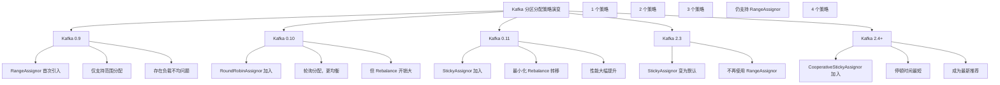

---

## 14) "性能测试工具"
### 14.1 "Rebalance 性能测试"
```java
import org.apache.kafka.clients.consumer.*;
import org.apache.kafka.common.serialization.StringDeserializer;
import java.time.Duration;
import java.util.*;
import java.util.concurrent.*;
import java.util.concurrent.atomic.AtomicLong;

public class RebalancePerformanceTester {
    
    /**
     * "测试不同策略的 Rebalance 性能"
     */
    public static void testRebalancePerformance(
            String bootstrapServers,
            String topic,
            String strategy,
            int initialConsumers,
            int consumersToAdd) throws InterruptedException {
        
        System.out.printf(
            "\n【测试】策略: %s, 初始消费者: %d, 新增消费者: %d%n",
            strategy, initialConsumers, consumersToAdd
        );
        
        ExecutorService executor = Executors.newFixedThreadPool(
            initialConsumers + consumersToAdd
        );
        
        List<ConsumerMetrics> allMetrics = new CopyOnWriteArrayList<>();
        CountDownLatch startLatch = new CountDownLatch(1);
        
        try {
            // "启动初始消费者"
            List<Future<?>> futures = new ArrayList<>();
            
            for (int i = 0; i < initialConsumers; i++) {
                futures.add(executor.submit(() -> {
                    runConsumer(
                        bootstrapServers,
                        topic,
                        strategy,
                        startLatch,
                        allMetrics
                    );
                }));
            }
            
            // "等待所有消费者启动"
            Thread.sleep(2000);
            startLatch.countDown();
            
            // "记录初始性能"
            Thread.sleep(5000);
            long initialThroughput = calculateThroughput(allMetrics);
            System.out.printf("初始吞吐量: %.2f msg/s%n", initialThroughput);
            
            // "新增消费者，触发 Rebalance"
            System.out.println("新增消费者，触发 Rebalance...");
            long rebalanceStartTime = System.currentTimeMillis();
            
            for (int i = 0; i < consumersToAdd; i++) {
                futures.add(executor.submit(() -> {
                    runConsumer(
                        bootstrapServers,
                        topic,
                        strategy,
                        new CountDownLatch(0),
                        allMetrics
                    );
                }));
            }
            
            // "监控 Rebalance 过程"
            long rebalanceEndTime = System.currentTimeMillis();
            long rebalanceDuration = rebalanceEndTime - rebalanceStartTime;
            
            System.out.printf("Rebalance 耗时: %d ms%n", rebalanceDuration);
            
            // "记录恢复后的性能"
            Thread.sleep(5000);
            long recoveredThroughput = calculateThroughput(allMetrics);
            System.out.printf("恢复后吞吐量: %.2f msg/s%n", recoveredThroughput);
            
            // "计算性能指标"
            double throughputReduction = 
                (initialThroughput - recoveredThroughput) / initialThroughput * 100;
            System.out.printf("吞吐量下降: %.2f%%\n", throughputReduction);
            
        } finally {
            executor.shutdownNow();
        }
    }
    
    private static void runConsumer(
            String bootstrapServers,
            String topic,
            String strategy,
            CountDownLatch startLatch,
            List<ConsumerMetrics> allMetrics) {
        
        try {
            startLatch.await(); // "等待信号开始"
        } catch (InterruptedException e) {
            Thread.currentThread().interrupt();
            return;
        }
        
        Properties props = new Properties();
        props.put(ConsumerConfig.BOOTSTRAP_SERVERS_CONFIG, bootstrapServers);
        props.put(ConsumerConfig.GROUP_ID_CONFIG, "perf-test-group");
        props.put(ConsumerConfig.KEY_DESERIALIZER_CLASS_CONFIG, StringDeserializer.class);
        props.put(ConsumerConfig.VALUE_DESERIALIZER_CLASS_CONFIG, StringDeserializer.class);
        props.put(ConsumerConfig.PARTITION_ASSIGNMENT_STRATEGY_CONFIG, strategy);
        props.put(ConsumerConfig.AUTO_OFFSET_RESET_CONFIG, "earliest");
        
        ConsumerMetrics metrics = new ConsumerMetrics(
            Thread.currentThread().getName()
        );
        allMetrics.add(metrics);
        
        try (KafkaConsumer<String, String> consumer = new KafkaConsumer<>(props)) {
            consumer.subscribe(Collections.singletonList(topic), 
                new ConsumerRebalanceListener() {
                    @Override
                    public void onPartitionsRevoked(java.util.Collection<org.apache.kafka.common.TopicPartition> partitions) {
                        metrics.recordRebalanceStart();
                    }
                    
                    @Override
                    public void onPartitionsAssigned(java.util.Collection<org.apache.kafka.common.TopicPartition> partitions) {
                        metrics.recordRebalanceEnd();
                    }
                    
                    @Override
                    public void onPartitionsLost(java.util.Collection<org.apache.kafka.common.TopicPartition> partitions) {
                    }
                });
            
            while (!Thread.currentThread().isInterrupted()) {
                ConsumerRecords<String, String> records = 
                    consumer.poll(Duration.ofSeconds(1));
                
                metrics.addMessages(records.count());
            }
        }
    }
    
    private static long calculateThroughput(List<ConsumerMetrics> metrics) {
        return metrics.stream()
            .mapToLong(m -> m.getMessageCount())
            .sum();
    }
    
    /**
     * "消费者性能指标"
     */
    private static class ConsumerMetrics {
        private String consumerId;
        private AtomicLong messageCount = new AtomicLong(0);
        private long rebalanceStartTime = 0;
        private long rebalanceDuration = 0;
        
        public ConsumerMetrics(String consumerId) {
            this.consumerId = consumerId;
        }
        
        public void addMessages(int count) {
            messageCount.addAndGet(count);
        }
        
        public void recordRebalanceStart() {
            rebalanceStartTime = System.currentTimeMillis();
        }
        
        public void recordRebalanceEnd() {
            if (rebalanceStartTime > 0) {
                rebalanceDuration = System.currentTimeMillis() - rebalanceStartTime;
                rebalanceStartTime = 0;
            }
        }
        
        public long getMessageCount() {
            return messageCount.get();
        }
    }
    
    public static void main(String[] args) throws InterruptedException {
        String bootstrapServers = "localhost:9092";
        String topic = "perf-test-topic";
        
        System.out.println("========== Rebalance 性能测试 ==========");
        
        // "测试不同策略"
        String[] strategies = {
            "org.apache.kafka.clients.consumer.RangeAssignor",
            "org.apache.kafka.clients.consumer.RoundRobinAssignor",
            "org.apache.kafka.clients.consumer.StickyAssignor",
            "org.apache.kafka.clients.consumer.CooperativeStickyAssignor"
        };
        
        for (String strategy : strategies) {
            try {
                testRebalancePerformance(
                    bootstrapServers,
                    topic,
                    strategy,
                    3,           // 初始 3 个消费者
                    2            // 新增 2 个消费者
                );
            } catch (Exception e) {
                System.err.println("测试失败: " + e.getMessage());
            }
            
            Thread.sleep(5000); // 等待清理
        }
    }
}
```

---

## 15) "问题排查速查表"
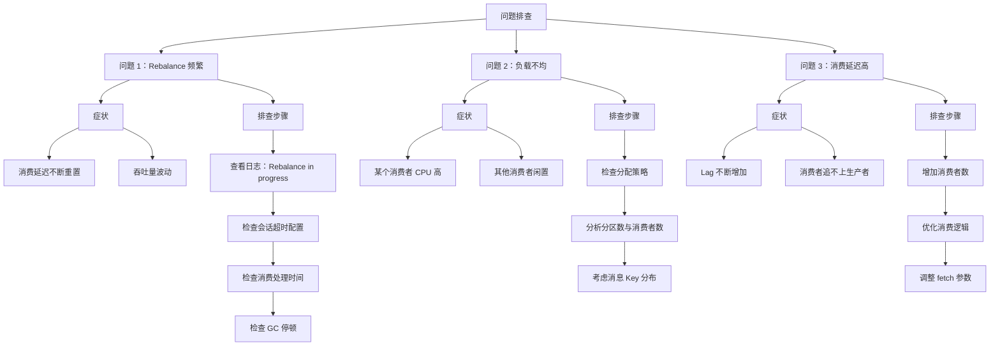

---

## 16) "分区分配策略总结对比"
### 16.1 "四种策略的完整对比"
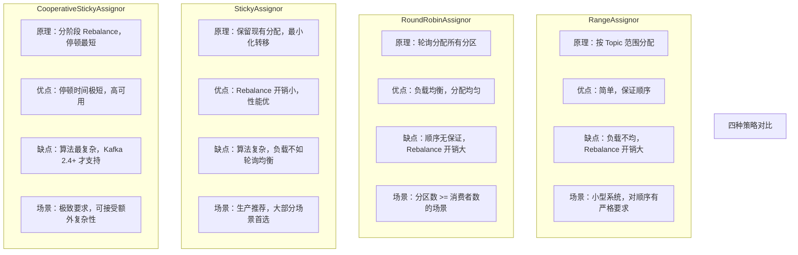

### 16.2 "快速选择指南"
```plain
┌─────────────────────────────────────────────────────────┐
│                    分配策略快速选择                      │
├─────────────────────────────────────────────────────────┤
│                                                          │
│  第 1 优先级：检查 Kafka 版本                           │
│  ├─ Kafka 2.4+ → 使用 CooperativeStickyAssignor       │
│  ├─ Kafka 0.11-2.3 → 使用 StickyAssignor            │
│  └─ Kafka < 0.11 → 升级 Kafka（已过期）              │
│                                                          │
│  第 2 优先级：评估需求                                 │
│  ├─ 高可用优先 → CooperativeStickyAssignor           │
│  ├─ 性能优先 → StickyAssignor                         │
│  ├─ 完美负载均衡 → RoundRobinAssignor                 │
│  └─ 最简单 → RangeAssignor（不推荐）                 │
│                                                          │
│  第 3 优先级：优化配置                                 │
│  ├─ session.timeout.ms: 20-30 秒                      │
│  ├─ heartbeat.interval.ms: 6-10 秒                    │
│  ├─ max.poll.interval.ms: 5-10 分钟                  │
│  └─ max.poll.records: 100-1000                        │
│                                                          │
│  第 4 优先级：监控和调整                               │
│  ├─ 监控 Rebalance 频率                               │
│  ├─ 监控消费 Lag                                      │
│  ├─ 监控分区分配均衡性                                │
│  └─ 根据实际调整配置                                  │
│                                                          │
└─────────────────────────────────────────────────────────┘
```

---

## 17) "关键要点总结"
### 17.1 "必须记住的 5 个要点"
```mermaid
graph TD
    A["Kafka 分区分配策略核心要点"]
    
    A --> B["要点 1：选择正确的策略"]
    B --> B1["生产环境推荐 StickyAssignor"]
    B --> B2["如果要求极致可用推荐 CooperativeStickyAssignor"]
    
    A --> C["要点 2：理解 Rebalance 的代价"]
    C --> C1["Rebalance 会导致消费停止"]
    C --> C2["停止时间通常 3-20 秒"]
    C --> C3["应该最小化 Rebalance 频率"]
    
    A --> D["要点 3：合理配置超时参数"]
    D --> D1["session.timeout.ms 不要太小"]
    D --> D2["避免因网络抖动频繁 Rebalance"]
    D --> D3["通常 20-30 秒比较合适"]
    
    A --> E["要点 4：分区数与消费者数的关系"]
    E --> E1["理想情况：分区数 = 消费者数"]
    E --> E2["分区数 > 消费者数：部分消费者多分区"]
    E --> E3["分区数 < 消费者数：部分消费者空闲"]
    
    A --> F["要点 5：监控是关键"]
    F --> F1["监控 Rebalance 频率"]
    F --> F2["监控分区分配的均衡性"]
    F --> F3["监控消费 Lag"]
    F --> F4["根据监控数据调整"]
    
    note1["决定系统稳定性"]
    note2["影响总体性能"]
    note3["避免频繁 Rebalance"]
    note4["规划容量时要考虑"]
    note5["持续优化"]
```

### 17.2 "避免的常见错误"
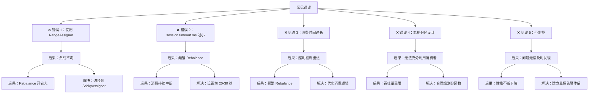

---

## 总结
Kafka 消费者分区分配策略是构建高性能消费系统的基础：

### **核心观点**：
1. **"选择最合适的策略"**
    - Kafka 2.4+：优先 CooperativeStickyAssignor
    - Kafka 0.11-2.3：使用 StickyAssignor
    - 避免使用 RangeAssignor
2. **"理解 Rebalance 的代价"**
    - 消费完全停止，通常 3-20 秒
    - 网络波动、消费者宕机都会触发
    - 应该最小化触发频率
3. **"优化配置参数"**
    - 会话超时：20-30 秒
    - 心跳间隔：6-10 秒
    - 最大 poll 间隔：5-10 分钟
4. **"合理规划架构"**
    - 分区数应接近消费者数
    - 消费者数可以弹性伸缩
    - 避免消费者宕机导致大规模转移
5. **"持续监控优化"**
    - 监控 Rebalance 频率
    - 监控分区分配均衡性
    - 监控消费 Lag 变化
    - 根据监控数据持续调优

### **记住这个决策树**：
```plain
是否支持 Kafka 2.4+？
  是 → CooperativeStickyAssignor（推荐）
  否 → 支持 0.11+？
    是 → StickyAssignor（推荐）
    否 → 升级 Kafka（强烈建议）
```

通过理解和正确应用这些分区分配策略，您可以构建一个高效、稳定、可扩展的 Kafka 消费系统。


> 更新: 2026-01-22 15:20:15  
> 原文: <https://www.yuque.com/tulingzhouyu/db22bv/pxt0lionnhv3mfab>