# 什么是“零拷贝”？有什么作用？

# 零拷贝（Zero-Copy）深度解析：从原理到实战

在高性能系统中，"零拷贝"是一个频繁出现的关键词。它不仅出现在 Kafka、Netty 等开源项目中，也是提升 I/O 密集型应用性能的重要优化手段。本篇将从底层原理出发，逐步带您理解这一概念。

***

## 1) "什么是零拷贝？"

首先，让我们明确一下"零拷贝"的定义：

**"零拷贝是指在数据传输过程中，避免数据在内存中的多次拷贝，尤其是避免在内核态和用户态之间的数据拷贝。"**

* **"不是指真正的零次拷贝"**："数据最终还是会被物理设备读写，但减少了不必要的内存拷贝操作。"
* **"主要目标"**："降低 CPU 消耗，提升 I/O 性能，减少上下文切换。"

***

## 2) "传统数据传输的问题"

为了理解零拷贝的价值，我们先看看传统方式是如何工作的。

### 2.1 "场景：文件上传到网络"

**"传统方式：用户缓冲区读取 → 传输"**

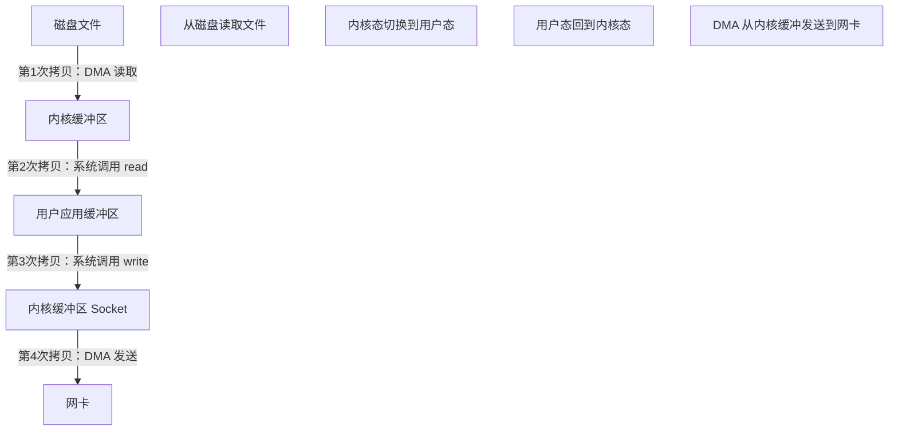

**"分析这个过程"**：

1. **"第 1 次拷贝：磁盘 → 内核缓冲区"**
   * "操作系统使用 DMA（Direct Memory Access）直接从磁盘读取数据到内核缓冲区。"
   * "这是必需的，因为磁盘 I/O 没有更好的选择。"
2. **"第 2 次拷贝：内核缓冲区 → 用户缓冲区"**
   * "应用程序调用 `read()` 系统调用。"
   * "数据从内核缓冲区被拷贝到用户应用的内存缓冲区。"
   * **"这是不必要的！如果我们直接使用内核缓冲区的数据呢？"**
3. **"第 3 次拷贝：用户缓冲区 → 内核缓冲区（Socket）"**
   * "应用程序处理完数据后，调用 `write()` 系统调用将数据发送到网络。"
   * "数据被拷贝到 Socket 对应的内核缓冲区。"
   * **"这也是不必要的！如果能直接从第 2 步的内核缓冲区发送呢？"**
4. **"第 4 次拷贝：内核缓冲区 → 网卡"**
   * "操作系统再次使用 DMA 将数据从内核缓冲区发送到网卡。"
   * "这是必需的。"

**"问题总结"**：

* "总共 4 次拷贝，其中 2 次不必要。"
* "频繁的上下文切换（用户态 ↔ 内核态）。"
* "浪费 CPU 资源执行数据拷贝，而不是有意义的业务逻辑。"

***

## 3) "零拷贝的实现方式"

### 3.1 "方式 1：Memory Mapped File（内存映射文件）"

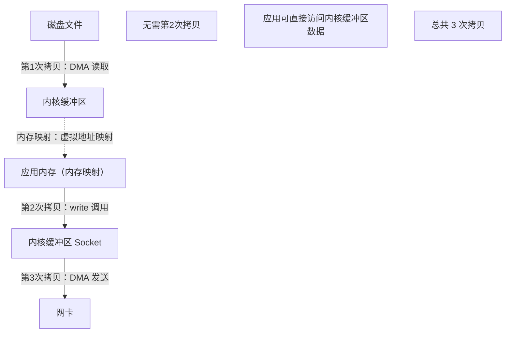

**"原理"**：

* "使用 `mmap()` 系统调用将磁盘文件映射到用户进程的虚拟地址空间。"
* "应用程序通过内存映射可以直接访问磁盘文件数据，无需 `read()` 拷贝。"

**"优点"**："减少一次内存拷贝，比较适合大文件处理。"

**"缺点"**："仍然需要一次拷贝来传输数据到网络，且 mmap 本身有开销。"

### 3.2 "方式 2：sendfile（最高效的零拷贝）"

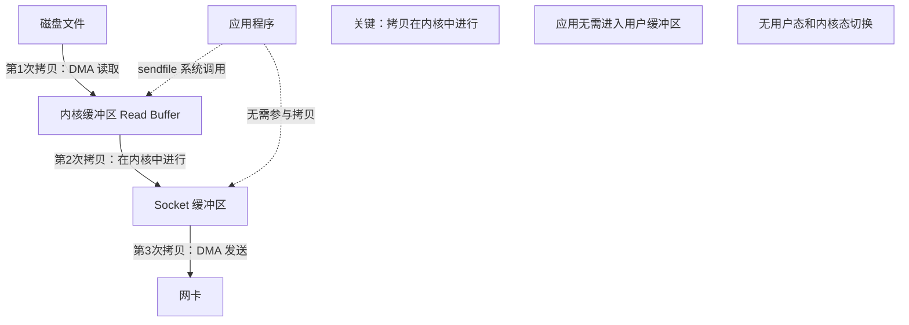

**"原理"**：

* "Linux 2.4+ 内核提供的 `sendfile()` 系统调用可以直接在内核缓冲区之间转移数据。"
* "应用程序只需调用一次 `sendfile()`，内核负责所有的数据传输。"
* "数据始终在内核空间流动，避免了用户态复制。"

**"流程"**：

1. "应用程序调用 `sendfile(socketfd, filefd, position, size)`。"
2. "内核从文件描述符 `filefd` 读取数据到内核缓冲区。"
3. "内核直接将数据从读缓冲区拷贝到 Socket 缓冲区。"
4. "内核通过 DMA 将 Socket 缓冲区的数据发送到网卡。"

**"优点"**：

* "最少的上下文切换。"
* "最少的内存拷贝（只有内核内部拷贝）。"
* "最高的性能。"

**"缺点"**："只能用于从文件到网络的传输，不适用于应用需要处理数据的场景。"

### 3.3 "方式 3：Splice（仅适用于 Linux）"

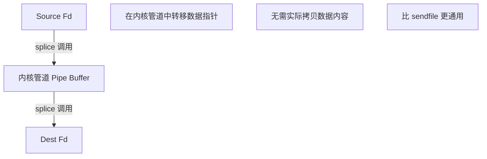

**"原理"**：

* "`splice()` 使用内核管道（pipe）作为中介。"
* "第一个 `splice()` 将数据从源文件移动到管道（只转移指针）。"
* "第二个 `splice()` 将数据从管道移动到目标文件（只转移指针）。"

**"优点"**："比 sendfile 更通用，可以用于任意两个文件描述符之间。"

**"缺点"**："仅在 Linux 上支持，实现复杂。"

***

## 4) "零拷贝与 Java NIO"

Java 本身无法直接调用 Linux 的 `sendfile()`，但 Java NIO 提供了相关接口供我们使用。

### 4.1 "Java NIO 中的零拷贝接口"

```java
// "FileChannel 和 SocketChannel 提供的零拷贝方法"

// "方法 1：transferFrom - 从另一个通道读取数据"
public abstract long transferFrom(ReadableByteChannel src, 
                                  long position, 
                                  long count) throws IOException;

// "方法 2：transferTo - 将数据发送到另一个通道"
public abstract long transferTo(long position, 
                                long count, 
                                WritableByteChannel target) throws IOException;
```

**"这两个方法内部使用 sendfile() 系统调用。"**

### 4.2 "传统方式 vs 零拷贝方式的代码对比"

**"方式 A：传统读写方式（多次拷贝）"**

```java
import java.io.*;

public class TraditionalFileCopy {
    
    public static void main(String[] args) throws IOException {
        String sourceFile = "source.dat";
        String destFile = "dest.dat";
        
        // "使用传统的缓冲区读写"
        try (InputStream in = new FileInputStream(sourceFile);
             OutputStream out = new FileOutputStream(destFile)) {
            
            byte[] buffer = new byte[4096]; // "4KB 缓冲区"
            int bytesRead;
            
            while ((bytesRead = in.read(buffer)) != -1) {
                // "第 1 次拷贝：内核缓冲区 → 用户缓冲区"
                
                // "这里可以处理数据"
                out.write(buffer, 0, bytesRead);
                // "第 2 次拷贝：用户缓冲区 → 内核缓冲区"
            }
        }
    }
}
```

**"分析"**：

* "每次读操作：内核缓冲区 → 用户缓冲区。"
* "每次写操作：用户缓冲区 → 内核缓冲区。"
* "如果处理 1GB 文件，可能有数百万次拷贝操作。"

**"方式 B：零拷贝方式（使用 FileChannel）"**

```java
import java.io.*;
import java.nio.channels.FileChannel;

public class ZeroCopyFileCopy {
    
    public static void main(String[] args) throws IOException {
        String sourceFile = "source.dat";
        String destFile = "dest.dat";
        
        long startTime = System.currentTimeMillis();
        
        try (RandomAccessFile sourceRAF = new RandomAccessFile(sourceFile, "r");
             RandomAccessFile destRAF = new RandomAccessFile(destFile, "rw");
             FileChannel sourceChannel = sourceRAF.getChannel();
             FileChannel destChannel = destRAF.getChannel()) {
            
            long fileSize = sourceChannel.size();
            
            // "使用 transferTo 实现零拷贝"
            // "内部使用 sendfile 系统调用"
            long transferred = 0;
            while (transferred < fileSize) {
                // "一次调用可能不会转移全部数据，需要循环"
                long count = sourceChannel.transferTo(transferred, fileSize - transferred, destChannel);
                transferred += count;
            }
            
            System.out.println("转移字节数: " + transferred);
        }
        
        long endTime = System.currentTimeMillis();
        System.out.println("耗时: " + (endTime - startTime) + " ms");
    }
}
```

**"优势"**：

* "使用 `transferTo()` 直接在内核中完成数据转移。"
* "无需将数据加载到用户缓冲区。"
* "大幅降低 CPU 消耗。"

***

## 5) "零拷贝在网络传输中的应用"

### 5.1 "场景：构建 HTTP 文件服务器"

**"传统方式：应用需要处理文件内容"**

```java
import java.io.*;
import java.nio.channels.*;
import com.sun.net.httpserver.*;

public class TraditionalFileServer {
    
    public static void main(String[] args) throws IOException {
        HttpServer server = HttpServer.create(new java.net.InetSocketAddress(8080), 0);
        
        server.createContext("/file", exchange -> {
            try {
                String fileName = "largefile.dat";
                File file = new File(fileName);
                
                // "读取文件到内存缓冲区（第 1 次拷贝）"
                byte[] fileContent = new byte[(int) file.length()];
                try (FileInputStream fis = new FileInputStream(file)) {
                    fis.read(fileContent);
                }
                
                // "设置响应"
                exchange.getResponseHeaders().set("Content-Type", "application/octet-stream");
                exchange.sendResponseHeaders(200, fileContent.length);
                
                // "写入到输出流（第 2 次拷贝）"
                try (OutputStream os = exchange.getResponseBody()) {
                    os.write(fileContent);
                }
            } catch (IOException e) {
                e.printStackTrace();
            }
        });
        
        server.start();
        System.out.println("传统方式 HTTP 服务器启动，监听 8080 端口");
    }
}
```

**"问题"**：

* "文件内容被完全加载到内存。"
* "大文件会导致 OOM。"
* "多次内存拷贝浪费 CPU。"

**"零拷贝方式：直接转移 FileChannel"**

```java
import java.io.*;
import java.nio.channels.*;
import com.sun.net.httpserver.*;

public class ZeroCopyFileServer {
    
    public static void main(String[] args) throws IOException {
        HttpServer server = HttpServer.create(new java.net.InetSocketAddress(8080), 0);
        
        server.createContext("/file", exchange -> {
            try {
                String fileName = "largefile.dat";
                File file = new File(fileName);
                
                // "直接获取文件的 FileChannel"
                try (RandomAccessFile raf = new RandomAccessFile(file, "r");
                     FileChannel fileChannel = raf.getChannel()) {
                    
                    // "设置响应"
                    exchange.getResponseHeaders().set("Content-Type", "application/octet-stream");
                    exchange.sendResponseHeaders(200, file.length());
                    
                    // "获取响应 OutputStream 对应的 Channel（如果支持）"
                    // "直接将 FileChannel 的数据转移到 SocketChannel"
                    // "这需要一个能接收 FileChannel 的输出通道"
                    
                    try (OutputStream os = exchange.getResponseBody()) {
                        // "将 FileChannel 中的数据直接发送出去"
                        // "如果使用 NIO，可以这样做："
                        // "java.nio.channels.Channels.newChannel(os)"
                        WritableByteChannel outChannel = Channels.newChannel(os);
                        long transferred = 0;
                        long fileSize = fileChannel.size();
                        
                        while (transferred < fileSize) {
                            long count = fileChannel.transferTo(transferred, 
                                                                 fileSize - transferred, 
                                                                 outChannel);
                            transferred += count;
                        }
                    }
                }
            } catch (IOException e) {
                e.printStackTrace();
            }
        });
        
        server.start();
        System.out.println("零拷贝 HTTP 服务器启动，监听 8080 端口");
    }
}
```

**"优势"**：

* "文件数据不加载到应用内存。"
* "可以处理远大于可用内存的文件。"
* "内核直接转移数据，性能最优。"

***

## 6) "零拷贝的性能对比实验"

```java
import java.io.*;
import java.nio.channels.FileChannel;
import java.nio.file.Files;
import java.nio.file.Paths;

public class ZeroCopyPerformanceComparison {
    
    private static final int FILE_SIZE = 1024 * 1024 * 100; // "100 MB 文件"
    private static final String SOURCE_FILE = "source_large.dat";
    private static final String DEST_FILE1 = "dest_traditional.dat";
    private static final String DEST_FILE2 = "dest_zerocopy.dat";
    
    public static void main(String[] args) throws IOException {
        // "创建测试文件"
        createTestFile(SOURCE_FILE, FILE_SIZE);
        
        System.out.println("开始性能测试，文件大小: " + FILE_SIZE / (1024 * 1024) + " MB");
        System.out.println("================================================");
        
        // "测试 1：传统方式"
        System.out.println("测试 1：传统读写方式");
        long time1 = testTraditionalCopy(SOURCE_FILE, DEST_FILE1);
        System.out.println("耗时: " + time1 + " ms");
        
        System.out.println("================================================");
        
        // "测试 2：零拷贝方式"
        System.out.println("测试 2：零拷贝方式（transferTo）");
        long time2 = testZeroCopyCopy(SOURCE_FILE, DEST_FILE2);
        System.out.println("耗时: " + time2 + " ms");
        
        System.out.println("================================================");
        System.out.println("性能提升: " + ((double) time1 / time2) + " 倍");
        
        // "清理文件"
        Files.deleteIfExists(Paths.get(SOURCE_FILE));
        Files.deleteIfExists(Paths.get(DEST_FILE1));
        Files.deleteIfExists(Paths.get(DEST_FILE2));
    }
    
    // "创建指定大小的测试文件"
    private static void createTestFile(String fileName, int size) throws IOException {
        try (RandomAccessFile raf = new RandomAccessFile(fileName, "rw")) {
            raf.setLength(size);
        }
        System.out.println("已创建测试文件: " + fileName);
    }
    
    // "传统方式：循环读写"
    private static long testTraditionalCopy(String source, String dest) throws IOException {
        long startTime = System.currentTimeMillis();
        
        try (FileInputStream fis = new FileInputStream(source);
             FileOutputStream fos = new FileOutputStream(dest)) {
            
            byte[] buffer = new byte[4096];
            int bytesRead;
            
            while ((bytesRead = fis.read(buffer)) != -1) {
                fos.write(buffer, 0, bytesRead);
            }
        }
        
        long endTime = System.currentTimeMillis();
        return endTime - startTime;
    }
    
    // "零拷贝方式：使用 transferTo"
    private static long testZeroCopyCopy(String source, String dest) throws IOException {
        long startTime = System.currentTimeMillis();
        
        try (RandomAccessFile sourceRAF = new RandomAccessFile(source, "r");
             RandomAccessFile destRAF = new RandomAccessFile(dest, "rw");
             FileChannel sourceChannel = sourceRAF.getChannel();
             FileChannel destChannel = destRAF.getChannel()) {
            
            long fileSize = sourceChannel.size();
            long transferred = 0;
            
            while (transferred < fileSize) {
                long count = sourceChannel.transferTo(transferred, 
                                                       fileSize - transferred, 
                                                       destChannel);
                transferred += count;
            }
        }
        
        long endTime = System.currentTimeMillis();
        return endTime - startTime;
    }
}
```

**"预期结果"**：

* "在 Linux 系统上，零拷贝方式通常快 5-10 倍。"
* "文件越大，性能提升越明显。"
* "CPU 使用率显著降低。"

***

## 7) "零拷贝在 Kafka 中的应用"

Kafka 是零拷贝技术的重度使用者。

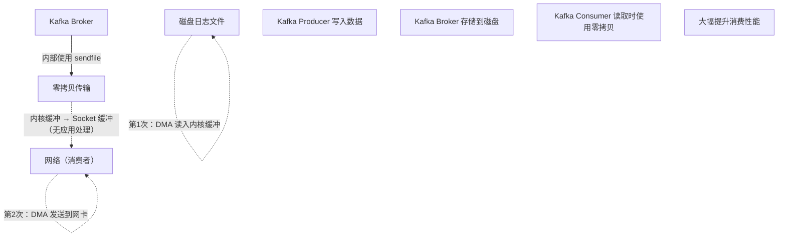

**"Kafka 的优化策略"**：

1. "使用 `log.flush.interval.bytes` 进行 Page Cache 管理。"
2. "Consumer 拉取消息时使用 `FileChannel.transferTo()`。"
3. "Page Cache 加速磁盘读取。"

```java
// "Kafka 使用零拷贝的伪代码"
public class KafkaZeroCopyExample {
    
    public static void handleConsumerFetch(FileChannel fileChannel, 
                                          WritableByteChannel outChannel,
                                          long startPosition,
                                          long length) throws IOException {
        // "直接使用 transferTo，不经过用户缓冲区"
        long transferred = 0;
        while (transferred < length) {
            long count = fileChannel.transferTo(startPosition + transferred,
                                               length - transferred,
                                               outChannel);
            transferred += count;
        }
    }
}
```

***

## 8) "零拷贝的局限性"

### 8.1 "零拷贝无法在以下场景使用"

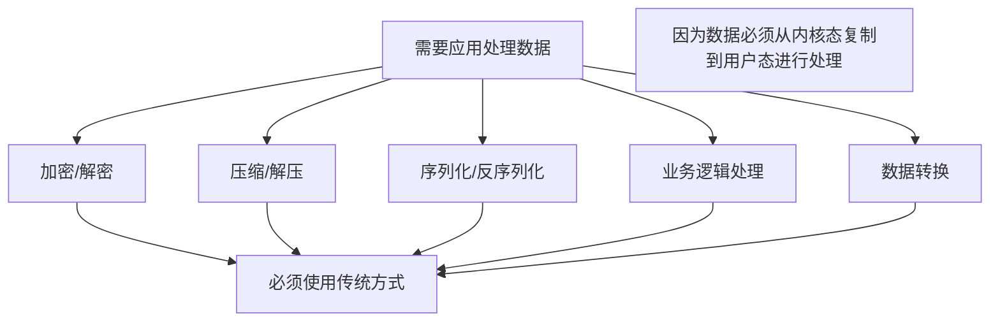

### 8.2 "平台差异"

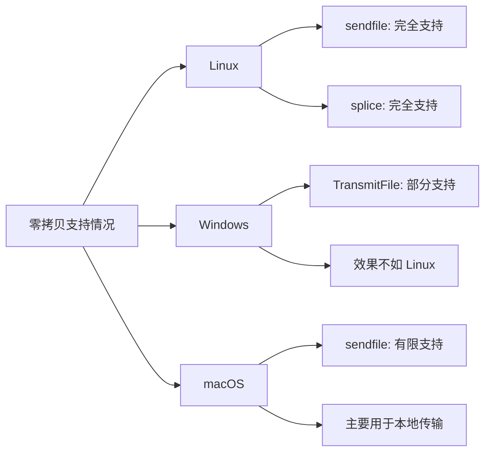

***

## 9) "零拷贝最佳实践"

### 9.1 "使用决策树"

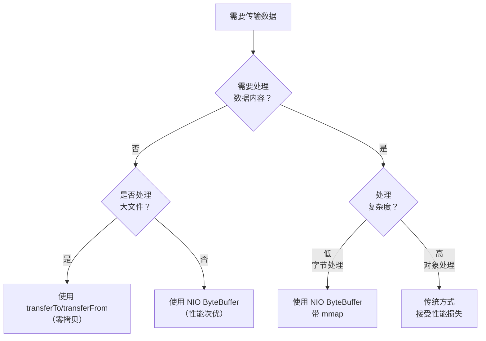

### 9.2 "代码模板：零拷贝传输"

```java
public class ZeroCopyTransferTemplate {
    
    /**
     * "高效的文件传输模板"
     * "使用零拷贝方式传输文件到网络或其他文件"
     */
    public static void efficientTransfer(String sourcePath, 
                                         String destPath,
                                         long startPosition,
                                         long transferSize) throws IOException {
        try (RandomAccessFile sourceFile = new RandomAccessFile(sourcePath, "r");
             RandomAccessFile destFile = new RandomAccessFile(destPath, "rw");
             FileChannel sourceChannel = sourceFile.getChannel();
             FileChannel destChannel = destFile.getChannel()) {
            
            // "验证参数"
            long fileSize = sourceChannel.size();
            if (startPosition < 0 || startPosition >= fileSize) {
                throw new IllegalArgumentException("起始位置无效");
            }
            
            long actualTransferSize = Math.min(transferSize, fileSize - startPosition);
            
            // "执行零拷贝转移"
            long transferred = 0;
            long maxTransferPerCall = 1024 * 1024 * 64; // "一次转移最多 64MB"
            
            while (transferred < actualTransferSize) {
                long count = sourceChannel.transferTo(
                    startPosition + transferred,
                    Math.min(maxTransferPerCall, actualTransferSize - transferred),
                    destChannel
                );
                
                if (count == 0) {
                    // "如果没有数据被转移，可能到了文件末尾"
                    break;
                }
                
                transferred += count;
            }
            
            System.out.println("转移完成，总计: " + transferred + " 字节");
        }
    }
    
    public static void main(String[] args) throws IOException {
        efficientTransfer("source.txt", "destination.txt", 0, Long.MAX_VALUE);
    }
}
```

***

## 10) "零拷贝与内存映射文件（mmap）的对比"

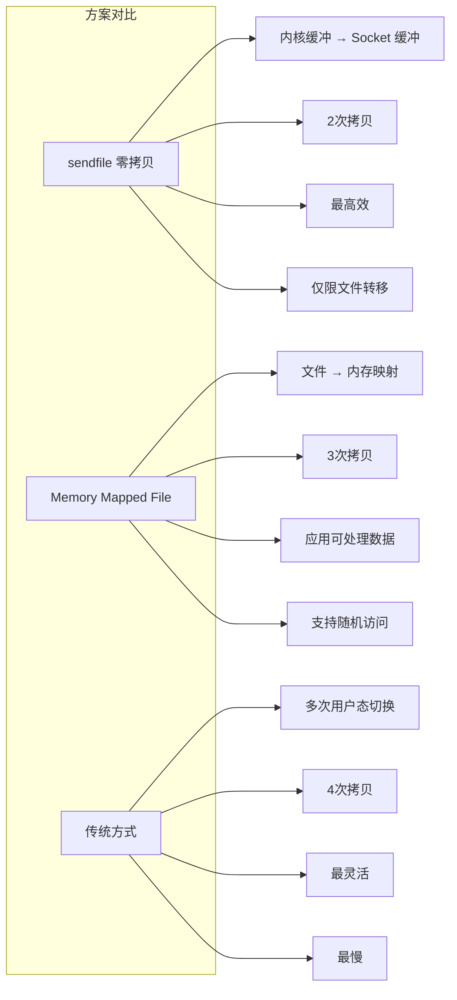

**"选择建议"**：

* **"纯数据转移，追求最高性能"**："使用 sendfile 零拷贝。"
* **"需要应用处理数据，但频繁访问"**："使用内存映射文件。"
* **"处理逻辑复杂"**："使用传统方式，接受性能损失。"

***

## 11) "零拷贝实战：高性能文件同步工具"

```java
import java.io.*;
import java.nio.channels.*;
import java.nio.file.*;
import java.util.concurrent.*;

public class HighPerformanceFileSync {
    
    private static final int THREAD_COUNT = 4;
    private static final long CHUNK_SIZE = 10 * 1024 * 1024; // "10 MB 每个任务"
    
    /**
     * "使用多线程和零拷贝实现高性能文件同步"
     */
    public static void syncFilesWithZeroCopy(String sourceDir, String destDir) 
            throws IOException, InterruptedException {
        
        File sourceDirFile = new File(sourceDir);
        File destDirFile = new File(destDir);
        
        if (!destDirFile.exists()) {
            destDirFile.mkdirs();
        }
        
        ExecutorService executor = Executors.newFixedThreadPool(THREAD_COUNT);
        
        try {
            // "遍历源目录中的所有文件"
            File[] files = sourceDirFile.listFiles(File::isFile);
            if (files == null) return;
            
            for (File sourceFile : files) {
                executor.submit(() -> {
                    try {
                        File destFile = new File(destDirFile, sourceFile.getName());
                        syncSingleFile(sourceFile.getAbsolutePath(), destFile.getAbsolutePath());
                        System.out.println("已同步: " + sourceFile.getName());
                    } catch (IOException e) {
                        System.err.println("同步失败: " + e.getMessage());
                    }
                });
            }
            
            executor.shutdown();
            executor.awaitTermination(1, TimeUnit.HOURS);
            System.out.println("所有文件同步完成");
            
        } finally {
            executor.shutdownNow();
        }
    }
    
    private static void syncSingleFile(String source, String dest) throws IOException {
        try (RandomAccessFile sourceRAF = new RandomAccessFile(source, "r");
             RandomAccessFile destRAF = new RandomAccessFile(dest, "rw");
             FileChannel sourceChannel = sourceRAF.getChannel();
             FileChannel destChannel = destRAF.getChannel()) {
            
            long fileSize = sourceChannel.size();
            long transferred = 0;
            
            // "分块转移，避免单次转移过大"
            while (transferred < fileSize) {
                long count = sourceChannel.transferTo(
                    transferred,
                    Math.min(CHUNK_SIZE, fileSize - transferred),
                    destChannel
                );
                transferred += count;
            }
        }
    }
    
    public static void main(String[] args) throws IOException, InterruptedException {
        long startTime = System.currentTimeMillis();
        syncFilesWithZeroCopy("/source/directory", "/dest/directory");
        long endTime = System.currentTimeMillis();
        
        System.out.println("总耗时: " + (endTime - startTime) + " ms");
    }
}
```

***

## 12) "零拷贝原理图总结"

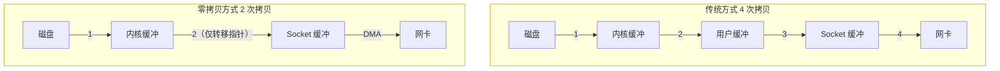

***

## 13) "总结与关键要点"

```mermaid
graph TD
    A["零拷贝 Zero-Copy"]
    
    A --> B["核心原理"]
    B --> B1["避免应用处理数据时的多次内存拷贝"]
    B --> B2["数据在内核空间流动"]
    B --> B3["减少上下文切换"]
    B --> B4["降低 CPU 消耗"]
    
    A --> C["主要实现方式"]
    C --> C1["mmap 内存映射"]
    C --> C2["sendfile 系统调用"]
    C --> C3["splice 管道转移"]
    C --> C4["Java NIO transferTo/transferFrom"]
    
    A --> D["适用场景"]
    D --> D1["大文件传输"]
    D --> D2["网络数据转发"]
    D --> D3["日志系统"]
    D --> D4["消息队列"]
    D --> D5["文件服务器"]
    
    A --> E["不适用场景"]
    E --> E1["需要加密解密"]
    E --> E2["需要压缩解压"]
    E --> E3["需要业务处理"]
    E --> E4["需要序列化转换"]
    
    A --> F["性能提升"]
    F --> F1["降低 CPU 使用率 50-70%"]
    F --> F2["吞吐量提升 5-10 倍"]
    F --> F3["延迟显著降低"]
```

***

## 14) "零拷贝检查清单"

| "检查项" | "说明" |
| --- | --- |
| "是否是文件到网络的传输？" | "是 → 优先使用 sendfile 零拷贝" |
| "文件大小是否很大（>100MB）？" | "是 → 零拷贝效果明显" |
| "是否需要应用处理数据？" | "否 → 可以使用零拷贝；是 → 使用 mmap 或传统方式" |
| "是否运行在 Linux？" | "是 → 最佳支持；否 → 考虑跨平台兼容性" |
| "吞吐量或 CPU 是否是瓶颈？" | "是 → 使用零拷贝优化" |
| "代码复杂度可以接受吗？" | "是 → 使用零拷贝；否 → 传统方式" |

***

## 总结

**"零拷贝不是真正的零次拷贝，而是避免了不必要的内存拷贝操作。"** 它通过以下方式实现性能优化：

1. **"减少数据拷贝次数"**："从 4 次减少到 2 次。"
2. **"减少上下文切换"**："应用无需参与数据转移。"
3. **"充分利用 DMA"**："让硬件完成数据转移。"
4. **"降低 CPU 消耗"**："CPU 可处理更多业务逻辑。"

在构建高性能 I/O 密集型应用时，零拷贝技术是必不可少的优化手段。掌握它的原理和使用方式，将大幅提升系统性能。


> 更新: 2026-01-22 15:04:23  
> 原文: <https://www.yuque.com/tulingzhouyu/db22bv/nryqlgvo87xlxayi>