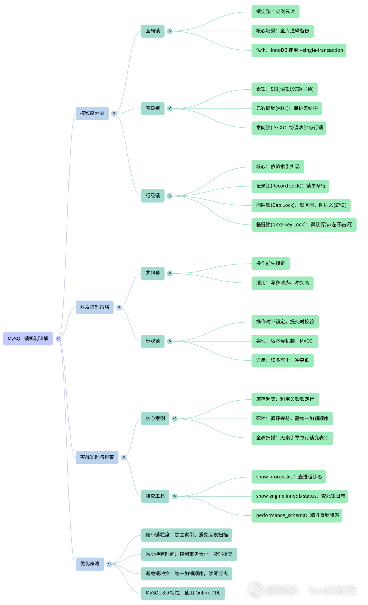

# 史上最全MySQL各种锁详解（含实战案例+排查优化）

# **<font style="color:black;">一、前言：为什么需要锁？</font>**

<font style="color:black;">在并发访问数据库时，多个事务同时读写数据会引发一系列问题（脏读、不可重复读、幻读、超卖等）。锁的核心作用是</font>**<font style="color:rgb(14, 136, 235);">协调并发事务对共享资源的访问</font>**<font style="color:black;">，通过控制资源的访问顺序，保证数据的一致性、完整性，是数据库并发控制的核心机制。</font>

<font style="color:black;">本笔记基于MySQL 8.0版本，全面拆解锁的分类、实现原理、实战案例、排查工具及优化策略，兼顾理论深度与生产实操，适配面试与工作需求。</font>



# **<font style="color:black;">二、按锁的粒度分类（核心分类方式）</font>**

<font style="color:black;">锁的粒度指锁定资源的范围，粒度越小，并发度越高（锁冲突概率低），但锁管理开销越大；反之则并发度低，开销小。MySQL支持三种粒度的锁：全局锁、表级锁、行级锁。</font>

## **<font style="color:rgb(14, 136, 235);">2.1 全局锁：锁定整个MySQL实例</font>**

### <font style="color:rgb(14, 136, 235);">核心定义</font>

<font style="color:black;">全局锁是粒度最大的锁，锁定整个MySQL实例（所有数据库、所有表）。锁定期间，整个实例只读（SELECT除外，DML、DDL、创建/删除数据库等写操作全部阻塞）。</font>

### <font style="color:rgb(14, 136, 235);">常用命令</font>

```plain
-- 加全局锁（Flush tables with read lock）
FLUSH TABLES WITH READ LOCK;

-- 释放全局锁（两种方式）
UNLOCK TABLES; -- 主动释放
quit; -- 断开会话，自动释放
```

### <font style="color:rgb(14, 136, 235);">核心使用场景：全库逻辑备份</font>

<font style="color:black;">场景：运维需要对全库进行逻辑备份（如mysqldump），加全局锁确保备份期间数据一致（避免备份过程中数据被修改）。</font>

<font style="color:black;">注意：InnoDB引擎支持事务的一致性快照（--single-transaction参数），备份时无需加全局锁（利用MVCC实现无锁备份），全局锁更适用于</font>MyISAM<font style="color:black;">等不支持事务的引擎。</font>

### <font style="color:rgb(14, 136, 235);">坑点：阻塞所有写操作，影响业务</font>

<font style="color:black;">生产环境中，全局锁会导致所有写操作（下单、更新数据等）阻塞，仅适合低峰期或只读实例使用。InnoDB备份优先用：</font><code><font style="color:rgb(30, 107, 184);background-color:rgba(27, 31, 35, 0.05);">mysqldump -u root -p --single-transaction 数据库名 > 备份文件.sql</font></code>

## **<font style="color:rgb(14, 136, 235);">2.2 表级锁：锁定整张表</font>**

<font style="color:black;">表级锁是粒度中等的锁，锁定整张表。特点：</font>**<font style="color:rgb(14, 136, 235);">锁管理开销小、加锁快</font>**<font style="color:black;">，但并发度低（同一时间仅一个事务能写表）。MySQL中所有引擎都支持表级锁。</font>

<font style="color:black;">常见表级锁：表锁（读锁/写锁）、元数据锁（MDL锁）、意向锁（IS/IX，表级锁，协调表锁与行锁）。</font>

### <font style="color:rgb(14, 136, 235);">2.2.1 表锁（Table Lock）：读锁/写锁</font>

#### <font style="color:black;">核心特性</font>

* **<font style="color:black;">表级读锁（Shared Lock，S锁）：多个事务可同时加读锁，读锁之间兼容；读锁阻塞写锁（加读锁后，其他事务无法加写锁）。</font>**
* **<font style="color:black;">表级写锁（Exclusive Lock，X锁）：仅一个事务可加写锁，写锁之间互斥、写锁阻塞读锁（加写锁后，其他事务无法加读/写锁）。</font>**

#### <font style="color:black;">常用命令</font>

```plain
-- 加表级读锁
LOCK TABLES 表名 READ;

-- 加表级写锁
LOCK TABLES 表名 WRITE;

-- 释放表锁（两种方式）
UNLOCK TABLES; -- 主动释放
quit; -- 断开会话，自动释放
```

#### <font style="color:black;">使用场景</font>

<font style="color:black;">适合读多写少、写操作耗时短的场景（如统计报表生成、批量更新小表）。InnoDB引擎中，表锁并发度低，优先用行级锁；MyISAM引擎默认用表锁。</font>

### <font style="color:rgb(14, 136, 235);">2.2.2 元数据锁（MDL锁）：保护表结构</font>

#### <font style="color:black;">核心定义</font>

<font style="color:black;">MDL锁（Metadata Lock）是MySQL 5.5+引入的表级锁，自动添加、自动释放，无需手动操作。核心作用：</font>**<font style="color:rgb(14, 136, 235);">保护表结构（元数据）的一致性</font>**<font style="color:black;">，避免“查询过程中表结构被修改”（如查询时删字段）。</font>

#### <font style="color:black;">MDL锁的自动添加规则</font>

* **<font style="color:black;">执行SELECT、INSERT、UPDATE、DELETE时，自动加</font>****<font style="color:rgb(14, 136, 235);">MDL读锁</font>****<font style="color:black;">（多个事务可同时加，互不阻塞）；</font>**
* **<font style="color:black;">执行</font>****ALTER TABLE****<font style="color:black;">、DROP TABLE、RENAME TABLE等DDL操作时，自动加</font>****<font style="color:rgb(14, 136, 235);">MDL写锁</font>****<font style="color:black;">（仅一个事务可加，写锁与读锁、写锁与写锁互斥）。</font>**

#### <font style="color:black;">核心坑点：长事务导致MDL写锁阻塞（完整闭环：复现→排查→解决→预防）</font>

##### <font style="color:black;">步骤1：复现MDL阻塞</font>

<font style="color:black;">场景：生产库中t\_user表有一个长事务（执行了SELECT，持有MDL读锁），持续10分钟未提交。此时运维执行</font><code><font style="color:rgb(30, 107, 184);background-color:rgba(27, 31, 35, 0.05);">ALTER TABLE t_user ADD COLUMN phone VARCHAR(20)</font></code><font style="color:black;">（需加MDL写锁），会被长事务的MDL读锁阻塞。后续所有对t\_user表的查询/更新（需加MDL读锁）都会排队阻塞，导致业务雪崩。</font>

<font style="color:black;">复现步骤：</font>

```plain
-- 会话1（长事务，持有MDL读锁）
START TRANSACTION;
SELECT * FROM t_user; -- 执行后不提交，持有MDL读锁

-- 会话2（运维，执行DDL）
ALTER TABLE t_user ADD COLUMN phone VARCHAR(20); -- 被阻塞

-- 会话3（业务查询，被阻塞）
SELECT * FROM t_user; -- 排队等待MDL读锁，阻塞
```

##### <font style="color:black;">步骤2：排查MDL阻塞</font>

<font style="color:black;">执行</font><code><font style="color:rgb(30, 107, 184);background-color:rgba(27, 31, 35, 0.05);">show processlist;</font></code><font style="color:black;">，查看进程状态：</font>

```plain
Id | User | Host       | db   | Command | Time | State                                   | Info
---|------|------------|------|---------|------|----------------------------------------|----------------------------------------
10 | root | localhost  | test | Sleep   | 600  |                                        | NULL（会话1的长事务，Sleep状态但持有锁）
11 | root | localhost  | test | Query   | 300  | Waiting for table metadata lock         | ALTER TABLE t_user ADD COLUMN phone...（会话2）
12 | root | localhost  | test | Query   | 200  | Waiting for table metadata lock         | SELECT * FROM t_user（会话3）
```

<font style="color:black;">排查结论：进程10是长事务，持有t\_user表的MDL读锁，阻塞了进程11（DDL）和进程12（查询）。</font>

##### <font style="color:black;">步骤3：解决方案</font>

1. **<font style="color:black;">优先沟通：找到业务方，确认进程10的长事务用途，督促其提交/回滚；</font>**
2. **<font style="color:black;">紧急处理：若无法终止长事务，执行</font>**<code>**<font style="color:rgb(30, 107, 184);background-color:rgba(27, 31, 35, 0.05);">kill 10;</font>**</code>**<font style="color:black;">（终止进程10，事务回滚，释放MDL读锁）；</font>**
3. **<font style="color:black;">后续优化：用</font>**<code>**<font style="color:rgb(30, 107, 184);background-color:rgba(27, 31, 35, 0.05);">pt-online-schema-change</font>**</code>**<font style="color:black;">工具（无锁改表）替代ALTER TABLE，避免MDL锁阻塞。</font>**

##### <font style="color:black;">步骤4：预防措施</font>

* **<font style="color:black;">生产环境禁止长事务，设置</font>**<code>**<font style="color:rgb(30, 107, 184);background-color:rgba(27, 31, 35, 0.05);">innodb_transaction_timeout=300</font>**</code>**<font style="color:black;">（5分钟超时）；</font>**
* **<font style="color:black;">DDL操作优先在低峰期执行；</font>**
* **<font style="color:black;">MySQL 8.0+版本补充特性：引入更多ONLINE DDL特性，部分DDL操作（如快速加列）仅在开始和结束瞬间持有MDL写锁，中间会降级为MDL读锁，大幅降低阻塞影响。</font>**

## **<font style="color:rgb(14, 136, 235);">2.3 行级锁：InnoDB的核心锁（并发之王）</font>**

<font style="color:black;">表级锁虽然开销小，但并发度低，无法满足电商订单、秒杀等高并发场景的需求。而InnoDB引擎独有的行级锁，通过最小化锁定粒度（仅锁定单条数据行），能大幅提升并发性能，成为高并发场景的核心选择。接下来详细拆解行级锁的实现与实战。</font>

<font style="color:black;">行级锁是InnoDB引擎独有的锁，粒度最小（锁定单条数据行），特点是：</font>**<font style="color:rgb(14, 136, 235);">并发度高、锁冲突概率低</font>**<font style="color:black;">，但锁管理开销大、可能产生死锁。仅在事务中生效（BEGIN/COMMIT之间），事务结束后自动释放。</font>

<font style="color:black;">生产核心坑点：行级锁的实现依赖索引！无索引或索引失效时，InnoDB无法利用索引过滤数据，会被迫进行全表扫描，访问每条记录时都会加锁（含所有间隙），其效果等同于表锁，但开销甚至比直接加表锁更大，必须重点规避。</font>

<font style="color:black;">关键补充：从源码角度看，InnoDB并没有像SQL Server那样显式的“锁升级（Lock Escalation）”机制（即达到一定阈值自动转为表锁）。上述“行锁变表锁”的本质是无索引导致全表扫描加锁，而非显式锁升级。</font>

### <font style="color:rgb(14, 136, 235);">2.3.1 行级锁的类型（基于锁属性）</font>

<font style="color:black;">行级锁按属性分为共享锁（S锁/读锁）和排他锁（X锁/写锁），与表级锁的S/X锁逻辑一致，但锁定粒度为行：</font>

* **<font style="color:rgb(14, 136, 235);">共享锁（S锁）</font>\*\*\*\*<font style="color:black;">：允许事务读取数据，多个事务可同时持有同一行的S锁（读-读兼容）；S锁阻塞X锁（读-写互斥）。 用法：</font>**<code>**<font style="color:rgb(30, 107, 184);background-color:rgba(27, 31, 35, 0.05);">SELECT ... LOCK IN SHARE MODE;</font>**</code>**<font style="color:black;">（事务内执行，提交/回滚后释放）</font>**
* **<font style="color:rgb(14, 136, 235);">排他锁（X锁）</font>\*\*\*\*<font style="color:black;">：允许事务修改/删除数据，仅一个事务可持有同一行的X锁（写-写互斥）；X锁阻塞S锁和其他X锁（写-读、写-写均互斥）。 用法：</font>**<code>**<font style="color:rgb(30, 107, 184);background-color:rgba(27, 31, 35, 0.05);">SELECT ... FOR UPDATE;</font>**</code>**<font style="color:black;"> 或</font>\*\*\*\*<font style="color:black;"> </font>****DML****<font style="color:black;">（INSERT/UPDATE/DELETE）自动加X锁（事务内生效）</font>**

### <font style="color:rgb(14, 136, 235);">2.3.2 行锁算法（基于锁定范围）</font>

<font style="color:black;">InnoDB通过三种锁算法实现行级锁，核心目的是平衡“数据一致性”和“并发性能”，解决幻读等并发问题：</font>

#### <font style="color:black;">1. 记录锁（</font>Record Lock<font style="color:black;">）：锁定单条记录</font>

* **<font style="color:black;">定义：锁定表中</font>****<font style="color:rgb(14, 136, 235);">具体的一条行记录</font>****<font style="color:black;">，仅对存在的记录生效。</font>**
* **<font style="color:black;">适用场景：唯一索引（主键、唯一键）的等值查询（如</font>**<code>**<font style="color:rgb(30, 107, 184);background-color:rgba(27, 31, 35, 0.05);">WHERE id=1</font>**</code>**<font style="color:black;">）。</font>**
* **<font style="color:black;">实战案例：t\_user表id为主键，事务A执行</font>**<code>**<font style="color:rgb(30, 107, 184);background-color:rgba(27, 31, 35, 0.05);">SELECT * FROM t_user WHERE id=1 FOR UPDATE</font>**</code>**<font style="color:black;">，仅锁定id=1的行，其他行不受影响。</font>**

#### <font style="color:black;">2. 间隙锁（</font>Gap Lock<font style="color:black;">）：锁定索引间隙（防止插入）</font>

<font style="color:black;">核心价值：解决幻读问题！幻读是指同一事务内多次查询同一范围，其他事务插入新行导致查询结果行数变化，间隙锁通过锁定间隙阻止插入，从而避免幻读。</font>

* **<font style="color:black;">定义：锁定“两个索引之间的间隙”（或首行之前、末行之后的间隙），不锁定具体行记录，核心作用是</font>****<font style="color:rgb(14, 136, 235);">防止其他事务插入新行</font>****<font style="color:black;">；补充：当事务A持有间隙锁时，事务B插入数据会被阻塞，此时事务B会在内存中生成“插入意向锁（Insert Intention Lock）”并进入等待状态。理解插入意向锁对排查SHOW ENGINE INNODB STATUS中的死锁日志至关重要。</font>**
* **<font style="color:black;">适用场景：非唯一索引的等值查询、范围查询；</font>**
* **<font style="color:black;">关键补充（Supremum pseudo-record）：当查询范围超过当前表中最大值时，InnoDB会锁定（max\_id, +∞）的间隙（最大伪记录区间），防止其他事务插入更大ID的记录，彻底避免幻读。</font>**
* **<font style="color:black;">实战案例：t\_user表age为普通索引（值：10,24,32,45），事务A执行</font>**<code>**<font style="color:rgb(30, 107, 184);background-color:rgba(27, 31, 35, 0.05);">SELECT * FROM t_user WHERE age BETWEEN 20 AND 30 FOR UPDATE</font>**</code>**<font style="color:black;">，会锁定间隙（10,24）；若执行</font>**<code>**<font style="color:rgb(30, 107, 184);background-color:rgba(27, 31, 35, 0.05);">SELECT * FROM t_user WHERE age > 45 FOR UPDATE</font>**</code>**<font style="color:black;">，会锁定（45, +∞）的最大伪记录间隙，此时无法插入age=50的行。</font>**

#### <font style="color:black;">3. 临键锁（Next-Key Lock）：记录锁+间隙锁</font>

<font style="color:black;">定义：临键锁=记录锁+间隙锁，锁定“左开右闭”的区间（如(10,24]），是InnoDB的默认行锁算法（REPEATABLE READ隔离级别下）。</font>

<font style="color:black;">核心规则（关键修正，必记）：</font>

* **<font style="color:rgb(14, 136, 235);">唯一索引的等值查询</font>****<font style="color:black;">：临键锁</font>****<font style="color:rgb(14, 136, 235);">降级为记录锁</font>\*\*\*\*<font style="color:black;">（仅锁定匹配行，不锁间隙）；</font>**
* **<font style="color:rgb(14, 136, 235);">唯一索引的范围查询</font>\*\*\*\*<font style="color:black;">：仍为临键锁（锁定范围+间隙）；</font>**
* **<font style="color:rgb(14, 136, 235);">非唯一索引的等值/范围查询</font>\*\*\*\*<font style="color:black;">：均为临键锁。</font>**

<font style="color:black;">记忆口诀：唯一等值降记录，唯一范围仍临键，非唯一全是临键锁。</font>

### <font style="color:rgb(14, 136, 235);">行级锁实战案例（完整闭环）</font>

#### <font style="color:black;">实战案例1：用行锁解决库存超卖问题（复现→分析→解决→验证）</font>

<font style="color:black;">场景：电商秒杀场景，t\_stock表存储商品库存（id主键，goods\_id商品ID，stock库存数量），需避免多个用户同时下单导致库存为负。</font>

##### <font style="color:black;">步骤1：复现超卖问题</font>

<font style="color:black;">准备数据：</font>

```plain
CREATE TABLE t_stock (
idINT PRIMARY KEY AUTO_INCREMENT,
  goods_id INTNOTNULLUNIQUE,
  stock INTNOTNULLDEFAULT0
);
INSERTINTO t_stock (goods_id, stock) VALUES (1001, 1); -- 初始库存1
```

<font style="color:black;">用两个会话同时执行无锁代码：</font>

<font style="color:black;">问题代码（无锁，会超卖）：</font>

```plain
-- 会话1（用户A下单）
STARTTRANSACTION;
SELECT stock FROM t_stock WHERE goods_id=1001;  -- 查到stock=1
UPDATE t_stock SET stock=stock-1WHERE goods_id=1001;  -- 执行后stock=0
-- 暂不提交

-- 会话2（用户B下单，同时执行）
STARTTRANSACTION;
SELECT stock FROM t_stock WHERE goods_id=1001;  -- 未提交读隔离级别下也查到stock=1
UPDATE t_stock SET stock=stock-1WHERE goods_id=1001;  -- 执行后stock=-1
COMMIT;
```

<font style="color:black;">复现结果：两个会话都执行成功，stock变为-1，超卖问题产生。</font>

##### <font style="color:black;">步骤2：问题分析</font>

<font style="color:black;">无锁情况下，多个事务可同时读取并修改同一行数据，缺乏并发控制，导致库存计数错误。需通过排他锁（X锁）锁定目标行，确保同一时间仅一个事务能修改。</font>

##### <font style="color:black;">步骤3：解决方案（加X锁，避免并发修改）</font>

```plain
-- 会话1（用户A下单）
STARTTRANSACTION;
-- 加X锁锁定该商品行，其他事务需等待锁释放
SELECT stock FROM t_stock WHERE goods_id=1001FORUPDATE;  
IF stock > 0 THEN
UPDATE t_stock SET stock=stock-1WHERE goods_id=1001;
-- 生成订单...
COMMIT;
ELSE
-- 库存不足，提示用户
ROLLBACK;
ENDIF;

-- 会话2（用户B下单，同时执行）
STARTTRANSACTION;
SELECT stock FROM t_stock WHERE goods_id=1001FORUPDATE;  -- 被会话1的X锁阻塞
-- 会话1提交后，会话2查询到stock=0，执行ELSE逻辑，回滚
ROLLBACK;
```

##### <font style="color:black;">步骤4：验证结果</font>

<font style="color:black;">执行后查询t\_stock：</font><code><font style="color:rgb(30, 107, 184);background-color:rgba(27, 31, 35, 0.05);">SELECT stock FROM t_stock WHERE goods_id=1001;</font></code><font style="color:black;">，stock=0，无超卖；会话2被阻塞直到会话1提交，确保了数据一致性。</font>

<font style="color:black;">关键：goods\_id需建立索引（如唯一索引），否则无索引导致全表扫描加锁，效果等同于表锁，所有商品秒杀都会阻塞。</font>

#### <font style="color:black;">实战案例2：无索引导致全表扫描加锁（复现→分析→解决→验证）</font>

<font style="color:black;">场景：t\_user表（id主键，age无索引），事务A执行更新操作未指定索引，导致全表扫描加锁（效果等同于表锁），阻塞其他事务。</font>

##### <font style="color:black;">步骤1：复现问题</font>

<font style="color:black;">准备数据：</font>

```plain
CREATE TABLE t_user (
idINT PRIMARY KEY AUTO_INCREMENT,
nameVARCHAR(20) NOTNULL,
  age INTNOTNULL
);
INSERTINTO t_user (name, age) VALUES ('张三',25), ('李四',30);
```

<font style="color:black;">会话1（事务A，无索引更新）：</font>

```plain
-- 事务A（无索引，全表扫描加锁）
START TRANSACTION;
UPDATE t_user SET name='李四' WHERE age=25;  -- age无索引，全表扫描，所有行加X锁
-- 未提交...
```

<font style="color:black;">会话2（事务B，更新其他行）：</font>

```plain
-- 事务B（被阻塞）
START TRANSACTION;
UPDATE t_user SET name='王五' WHERE id=10;  -- 即使按主键更新，也被全表锁阻塞
COMMIT;
```

<font style="color:black;">复现结果：事务B长时间阻塞，无法执行。</font>

##### <font style="color:black;">步骤2：问题分析</font>

<font style="color:black;">age字段无索引，事务A执行UPDATE时触发全表扫描，InnoDB会对表中所有行加X锁（含所有间隙），其效果等同于表锁，但开销更大，导致所有对t\_user表的更新都被阻塞。注意：这并非显式锁升级，而是无索引导致的全表扫描加锁。</font>

##### <font style="color:black;">步骤3：解决方案</font>

<font style="color:black;">为age字段建立索引，确保行锁仅锁定匹配行：</font><code><font style="color:rgb(30, 107, 184);background-color:rgba(27, 31, 35, 0.05);">ALTER TABLE t_user ADD INDEX idx_age(age);</font></code>

##### <font style="color:black;">步骤4：验证结果</font>

<font style="color:black;">重新执行事务A和事务B：</font>

```plain
-- 事务A（有索引，仅锁age=25的行）
STARTTRANSACTION;
UPDATE t_user SETname='李四'WHERE age=25;
-- 未提交

-- 事务B（正常执行，不阻塞）
STARTTRANSACTION;
UPDATE t_user SETname='王五'WHEREid=10;
COMMIT;
```

<font style="color:black;">验证结果：事务B正常执行，无阻塞，仅匹配行被锁定。</font>

#### <font style="color:black;">实战案例3：转账场景死锁（复现→排查→解决→验证）</font>

##### <font style="color:black;">步骤1：复现死锁</font>

<font style="color:black;">准备数据：t\_account表（id主键，user\_id用户ID，balance余额）</font>

```plain
CREATE TABLE t_account (
idINT PRIMARY KEY AUTO_INCREMENT,
  user_id INTNOTNULLUNIQUE,
  balance INTNOTNULLDEFAULT0
);
INSERTINTO t_account (user_id, balance) VALUES (1, 1000), (2, 1000);
```

<font style="color:black;">同时执行两个会话的转账SQL：</font>

```plain
-- 会话1（事务A：用户1给用户2转账100元）
STARTTRANSACTION;
UPDATE t_account SET balance=balance-100WHERE user_id=1;  -- 持有user_id=1的X锁
UPDATE t_account SET balance=balance+100WHERE user_id=2;  -- 等待user_id=2的X锁
COMMIT;

-- 会话2（事务B：用户2给用户1转账50元）
STARTTRANSACTION;
UPDATE t_account SET balance=balance-50WHERE user_id=2;  -- 持有user_id=2的X锁
UPDATE t_account SET balance=balance+50WHERE user_id=1;  -- 等待user_id=1的X锁
COMMIT;
```

<font style="color:black;">复现结果：MySQL检测到死锁，终止其中一个事务（如事务B），提示“Deadlock found when trying to get lock; try restarting transaction”。</font>

##### <font style="color:black;">步骤2：死锁排查（解读死锁日志）</font>

<font style="color:black;">执行</font><code><font style="color:rgb(30, 107, 184);background-color:rgba(27, 31, 35, 0.05);">SHOW ENGINE INNODB STATUS;</font></code><font style="color:black;">，查看死锁日志核心部分：</font>

```plain
------------------------
LATEST DETECTED DEADLOCK
------------------------
2025-12-29 10:00:00 0x7f8b12345678
TRANSACTION 12345, ACTIVE 2 sec starting index read
mysql tables in use 1, locked 1
LOCK WAIT 2 lock struct(s), heap size 1136, 1 row lock(s)
MySQL thread id 8, OS thread handle 140245678901234, query id 123 localhost root updating
UPDATE t_account SET balance=balance+100 WHERE user_id=2
TRANSACTION 67890, ACTIVE 1 sec starting index read
mysql tables in use 1, locked 1
LOCK WAIT 2 lock struct(s), heap size 1136, 1 row lock(s)
MySQL thread id 9, OS thread handle 140245678901235, query id 124 localhost root updating
UPDATE t_account SET balance=balance+50 WHERE user_id=1
WE ROLL BACK TRANSACTION 67890; -- 回滚事务B
```

<font style="color:black;">日志解读：</font>

* **<font style="color:black;">事务12345（线程8）：持有user\_id=1的X锁，等待user\_id=2的X锁；</font>**
* **<font style="color:black;">事务67890（线程9）：持有user\_id=2的X锁，等待user\_id=1的X锁；</font>**
* **<font style="color:black;">形成循环等待，MySQL回滚其中一个事务（通常是执行时间短的）。</font>**

##### <font style="color:black;">步骤3：死锁解决方案</font>

1. **<font style="color:rgb(14, 136, 235);">统一锁顺序</font>\*\*\*\*<font style="color:rgb(1, 1, 1);">：所有事务按相同顺序锁定行（如按user\_id升序），避免循环等待。修改后代码： \`-- 事务A、B均先锁user\_id小的行 -- 事务A（用户1→用户2转账） START TRANSACTION; UPDATE t\_account SET balance=balance-100 WHERE user\_id=1;  -- 1<2，先锁1 UPDATE t\_account SET balance=balance+100 WHERE user\_id=2; COMMIT;</font>**

<font style="color:black;">-- 事务B（用户2→用户1转账） START TRANSACTION; UPDATE t\_account SET balance=balance-50 WHERE user\_id=1;  -- 先锁1（等待事务A释放） UPDATE t\_account SET balance=balance+50 WHERE user\_id=2; COMMIT;\`</font>

1. **<font style="color:rgb(14, 136, 235);">减少锁持有时间</font>\*\*\*\*<font style="color:black;">：事务中仅保留核心操作（锁相关），非核心操作（如日志记录、通知推送）移到事务外；</font>**
2. **<font style="color:rgb(14, 136, 235);">设置锁超时</font>\*\*\*\*<font style="color:black;">：通过</font>**<code>**<font style="color:rgb(30, 107, 184);background-color:rgba(27, 31, 35, 0.05);">innodb_lock_wait_timeout</font>**</code>**<font style="color:black;">（默认50秒）设置锁等待超时时间，避免永久阻塞；</font>**
3. **<font style="color:rgb(14, 136, 235);">死锁排查</font>\*\*\*\*<font style="color:black;">：用</font>**<code>**<font style="color:rgb(30, 107, 184);background-color:rgba(27, 31, 35, 0.05);">SHOW ENGINE INNODB STATUS</font>**</code>**<font style="color:black;">查看死锁日志，分析事务持有/等待的锁资源。</font>**

##### <font style="color:black;">步骤4：验证结果</font>

<font style="color:black;">修改后重新执行两个事务：事务B会先等待事务A释放user\_id=1的X锁，事务A提交后，事务B获取锁继续执行，无死锁产生。</font>

# **<font style="color:black;">三、按并发控制策略分类：悲观锁 vs 乐观锁</font>**

<font style="color:black;">悲观锁和乐观锁是两种核心的并发控制思想，并非MySQL提供的具体锁类型，而是基于锁机制或无锁机制实现的策略。悲观锁基于“冲突大概率发生”的假设，乐观锁基于“冲突小概率发生”的假设。</font>

## **<font style="color:rgb(14, 136, 235);">3.1 悲观锁（Pessimistic Locking）</font>**

### <font style="color:rgb(14, 136, 235);">核心思想</font>

<font style="color:black;">认为并发事务之间的冲突是大概率事件，因此在</font>**<font style="color:rgb(14, 136, 235);">操作数据前先锁定资源</font>**<font style="color:black;">，确保整个操作过程中资源独占，避免冲突。</font>

### <font style="color:rgb(14, 136, 235);">实现方式</font>

<font style="color:black;">依赖MySQL的锁机制：行级锁（S锁/X锁）、表级锁。例如：</font>

* **<font style="color:black;">行级悲观锁：</font>**<code>**<font style="color:rgb(30, 107, 184);background-color:rgba(27, 31, 35, 0.05);">SELECT ... FOR UPDATE</font>**</code>**<font style="color:black;">（X锁）、</font>**<code>**<font style="color:rgb(30, 107, 184);background-color:rgba(27, 31, 35, 0.05);">SELECT ... LOCK IN SHARE MODE</font>**</code>**<font style="color:black;">（S锁）；</font>**
* **<font style="color:black;">表级悲观锁：</font>**<code>**<font style="color:rgb(30, 107, 184);background-color:rgba(27, 31, 35, 0.05);">LOCK TABLES 表名 WRITE</font>**</code>**<font style="color:black;">（表级X锁）。</font>**

### <font style="color:rgb(14, 136, 235);">适用场景</font>

<font style="color:black;">写多读少、冲突概率高的场景（如银行转账、订单状态修改、高并发秒杀的库存更新）。</font>

## **<font style="color:rgb(14, 136, 235);">3.2 乐观锁（Optimistic Locking）</font>**

<font style="color:black;">悲观锁虽然能保证强一致性，但锁等待会降低并发度；而乐观锁基于“低冲突”假设，通过无锁操作提升并发，两者无绝对优劣，需结合业务场景选择。接下来详细拆解乐观锁的实现与实战。</font>

### <font style="color:rgb(14, 136, 235);">核心思想</font>

<font style="color:black;">认为并发事务之间的冲突是小概率事件，因此</font>**<font style="color:rgb(14, 136, 235);">操作数据前不锁定资源</font>**<font style="color:black;">，直接执行操作，仅在提交事务时校验数据是否被其他事务修改（若修改则重试，未修改则提交）。</font>

### <font style="color:rgb(14, 136, 235);">实现方式（无锁机制，应用层实现）</font>

<font style="color:black;">乐观锁不依赖MySQL的锁机制，由应用层通过逻辑实现，常见三种方式：</font>

#### <font style="color:black;">1. 版本号机制（最常用）</font>

<font style="color:black;">在表中新增</font><code><font style="color:rgb(30, 107, 184);background-color:rgba(27, 31, 35, 0.05);">version</font></code><font style="color:black;">字段（版本号，初始为0），每次更新数据时版本号+1，提交时校验版本号是否与查询时一致（一致则更新，不一致则重试）。</font>

```plain
-- 1. 表结构设计（新增version字段）
CREATETABLE t_product (
idINT PRIMARY KEY AUTO_INCREMENT,
nameVARCHAR(50) NOTNULL,
  price DECIMAL(10,2) NOTNULL,
versionINTNOTNULLDEFAULT0-- 版本号
);

-- 2. 乐观锁更新逻辑（查询→更新→校验版本号）
STARTTRANSACTION;
-- 步骤1：查询数据，获取当前版本号
SELECT price, versionFROM t_product WHEREid=1; -- 假设查询到price=100, version=0

-- 步骤2：更新数据，仅当版本号匹配时才更新
UPDATE t_product 
SET price=90, version=version+1
WHEREid=1ANDversion=0; -- 校验版本号，一致则更新

-- 步骤3：判断更新结果，无记录更新则说明数据被修改，重试
IF ROW_COUNT() = 0 THEN
ROLLBACK; -- 回滚，重试逻辑（应用层实现）
ELSE
COMMIT; -- 提交成功
ENDIF;
```

#### <font style="color:black;">2. 时间戳机制</font>

<font style="color:black;">与版本号机制类似，新增</font><code><font style="color:rgb(30, 107, 184);background-color:rgba(27, 31, 35, 0.05);">update_time</font></code><font style="color:black;">字段（时间戳），提交时校验时间戳是否与查询时一致。缺点：高并发下可能因时间戳精度问题导致校验失效（如同一毫秒更新），优先用版本号。</font>

#### <font style="color:black;">3. MVCC（广义乐观锁）</font>

<font style="color:black;">InnoDB的MVCC（多版本并发控制）机制，通过保存数据的多个版本，实现“无锁读”（普通SELECT无需加锁），本质是广义的乐观锁（读操作不阻塞写，写操作不阻塞读）。</font>

### <font style="color:rgb(14, 136, 235);">适用场景</font>

<font style="color:black;">读多写少、冲突概率低的场景（如商品浏览量统计、用户点赞、低并发的库存查询）。</font>

## **<font style="color:rgb(14, 136, 235);">3.3 乐观锁 vs 悲观锁 对比表</font>**

<font style="color:black;">图例：</font><font style="color:black;">✅</font><font style="color:black;"> 优势 | </font><font style="color:black;">❌</font><font style="color:black;"> 劣势</font>

| **<font style="color:black;">对比维度</font>** | **<font style="color:black;">乐观锁 (Optimistic)</font>** | **<font style="color:black;">悲观锁 (Pessimistic)</font>** |
| :--- | :--- | :--- |
| <font style="color:black;">核心思想</font> | <font style="color:black;">"冲突是小概率事件"，先操作，提交时校验</font> | <font style="color:black;">"冲突大概率发生"，操作前先独占资源</font> |
| <font style="color:black;">实现机制</font> | <font style="color:black;">CAS 算法、版本号机制 (Version)、时间戳、MVCC (广义)</font> | <font style="color:black;">数据库锁机制 (S锁/X锁)、SELECT...FOR UPDATE</font> |
| <font style="color:black;">优点</font> | <font style="color:black;">吞吐量高，无锁等待，无死锁风险 </font><font style="color:black;">✅</font> | <font style="color:black;">强一致性保证，逻辑简单，避免脏数据 </font><font style="color:black;">✅</font> |
| <font style="color:black;">缺点</font> | <font style="color:black;">高冲突下重试导致 CPU 飙升，存在 ABA 问题 </font><font style="color:black;">❌</font> | <font style="color:black;">并发度低，锁开销大，可能产生死锁 </font><font style="color:black;">❌</font> |
| <font style="color:black;">适用场景</font> | <font style="color:black;">读多写少 (如：浏览量、点赞、低并发库存)</font> | <font style="color:black;">写多读少 (如：银行转账、强一致性订单状态)</font> |

# **<font style="color:black;">四、按锁属性/状态分类：意向锁（IS/IX锁）</font>**

<font style="color:black;">共享锁（S锁）、排他锁（X锁）已在“行级锁”章节详细讲解，而意向锁是协调表级锁与行级锁的核心机制——表级锁与行级锁并存时，若需判断表中是否存在行锁，无意向锁则需全表遍历，效率极低。接下来补充意向锁的完整知识体系。</font>

## **<font style="color:rgb(14, 136, 235);">4.1 意向共享锁（IS锁）与意向排他锁（IX锁）</font>**

### <font style="color:rgb(14, 136, 235);">核心定义与设计初衷</font>

<font style="color:black;">意向锁是InnoDB引擎自动添加的</font>**<font style="color:rgb(14, 136, 235);">表级锁</font>**<font style="color:black;">，用于协调表级锁与行级锁的关系，解决“表锁与行锁冲突检查时全表遍历”的性能问题。其设计初衷是：当事务需要对表中某行加S锁或X锁时，先向表中添加对应的意向锁，后续其他事务请求表级锁时，只需判断表中是否存在对应的意向锁，即可快速确定是否存在行锁冲突，无需遍历表中所有行。</font>

<font style="color:black;">意向锁的两种核心类型（均由InnoDB自动管理，无需手动添加或释放）：</font>

* **<font style="color:rgb(14, 136, 235);">意向共享锁（Intention Shared Lock，IS锁）</font>\*\*\*\*<font style="color:black;">：事务准备对表中某行加S锁时，InnoDB会自动先为该表加IS锁。例如，事务执行</font>**<code>**<font style="color:rgb(30, 107, 184);background-color:rgba(27, 31, 35, 0.05);">SELECT * FROM t_user WHERE id=1 LOCK IN SHARE MODE</font>**</code>**<font style="color:black;">前，会先给t\_user表加IS锁。</font>**
* **<font style="color:rgb(14, 136, 235);">意向排他锁（Intention Exclusive Lock，IX锁）</font>\*\*\*\*<font style="color:black;">：事务准备对表中某行加X锁时，InnoDB会自动先为该表加IX锁。例如，事务执行</font>**<code>**<font style="color:rgb(30, 107, 184);background-color:rgba(27, 31, 35, 0.05);">UPDATE t_user SET name='张三' WHERE id=1</font>**</code>**<font style="color:black;">前，会先给t\_user表加IX锁。</font>**

### <font style="color:rgb(14, 136, 235);">关键特性：为何意向锁是表级锁？</font>

<font style="color:black;">意向锁的核心价值是“快速判断表中是否存在行锁”，若将其设计为行级锁，当其他事务请求表级锁时，仍需遍历表中所有行检查是否存在行锁，无法解决“全表遍历”的性能问题。而表级锁的设计，能让锁冲突检查仅通过一次表级状态判断完成，大幅提升效率。</font>

<font style="color:black;">对比示例：假设事务A已对t\_user表id=1的行加X锁（自动关联IX锁），此时事务B请求表级写锁（LOCK TABLES t\_user WRITE）：</font>

* **<font style="color:black;">无意向锁场景：MySQL需遍历t\_user全表的每一行，检查是否存在行锁（数据量越大效率越低，百万级表可能耗时数秒）；</font>**
* **<font style="color:black;">有意向锁场景：MySQL直接检查t\_user表的IX锁状态（存在），立即判定冲突，拒绝事务B的表级写锁请求（耗时微秒级）。</font>**

### <font style="color:rgb(14, 136, 235);">核心兼容规则（含IS/IX与行级锁、表级锁交互）</font>

<font style="color:black;">图例：</font><font style="color:black;">✅</font><font style="color:black;"> 兼容 | </font><font style="color:black;">❌</font><font style="color:black;"> 互斥 核心口诀：意向锁之间全兼容；意向锁只与表级锁互斥（意向排他互斥表级读/写，意向共享互斥表级写）。</font>

| **<font style="color:black;">当前锁 \ 请求锁</font>** | **<font style="color:black;">IS 锁 (意向共享)</font>** | **<font style="color:black;">IX 锁 (意向排他)</font>** | **<font style="color:black;">S 锁 (表级读)</font>** | **<font style="color:black;">X 锁 (表级写)</font>** | **<font style="color:black;">S 锁 (行级读)</font>** | **<font style="color:black;">X 锁 (行级写)</font>** |
| :--- | :--- | :--- | :--- | :--- | :--- | :--- |
| <font style="color:black;">IS 锁</font> | <font style="color:black;">✅</font><font style="color:black;"> 兼容</font> | <font style="color:black;">✅</font><font style="color:black;"> 兼容</font> | <font style="color:black;">✅</font><font style="color:black;"> 兼容</font> | <font style="color:black;">❌</font><font style="color:black;"> 互斥</font> | <font style="color:black;">✅</font><font style="color:black;"> 兼容</font> | <font style="color:black;">❌</font><font style="color:black;"> 互斥</font> |
| <font style="color:black;">IX 锁</font> | <font style="color:black;">✅</font><font style="color:black;"> 兼容</font> | <font style="color:black;">✅</font><font style="color:black;"> 兼容</font> | <font style="color:black;">❌</font><font style="color:black;"> 互斥</font> | <font style="color:black;">❌</font><font style="color:black;"> 互斥</font> | <font style="color:black;">✅</font><font style="color:black;"> 兼容</font> | <font style="color:black;">❌</font><font style="color:black;"> 互斥</font> |
| <font style="color:black;">S 锁 (表级)</font> | <font style="color:black;">✅</font><font style="color:black;"> 兼容</font> | <font style="color:black;">❌</font><font style="color:black;"> 互斥</font> | <font style="color:black;">✅</font><font style="color:black;"> 兼容</font> | <font style="color:black;">❌</font><font style="color:black;"> 互斥</font> | <font style="color:black;">✅</font><font style="color:black;"> 兼容</font> | <font style="color:black;">❌</font><font style="color:black;"> 互斥</font> |
| <font style="color:black;">X 锁 (表级)</font> | <font style="color:black;">❌</font><font style="color:black;"> 互斥</font> | <font style="color:black;">❌</font><font style="color:black;"> 互斥</font> | <font style="color:black;">❌</font><font style="color:black;"> 互斥</font> | <font style="color:black;">❌</font><font style="color:black;"> 互斥</font> | <font style="color:black;">❌</font><font style="color:black;"> 互斥</font> | <font style="color:black;">❌</font><font style="color:black;"> 互斥</font> |

<font style="color:black;">关键补充：意向锁不直接阻塞行级锁，行级锁之间的冲突由行锁本身决定（如行级S锁与X锁互斥）；意向锁仅用于快速判断表级锁与行级锁的冲突。</font>

### <font style="color:rgb(14, 136, 235);">实战场景：IS/IX锁的核心作用体现</font>

#### <font style="color:black;">场景1：长事务行锁与表级备份锁的协调</font>

<font style="color:black;">生产环境中，事务A（长事务）执行</font><code><font style="color:rgb(30, 107, 184);background-color:rgba(27, 31, 35, 0.05);">SELECT * FROM t_order WHERE order_id=1001 FOR UPDATE</font></code><font style="color:black;">（对行加X锁，自动加IX锁），持续10分钟未提交。此时运维需执行全表备份，执行</font><code><font style="color:rgb(30, 107, 184);background-color:rgba(27, 31, 35, 0.05);">LOCK TABLES t_order READ</font></code><font style="color:black;">（表级S锁）。</font>

<font style="color:black;">执行逻辑：</font>

1. **<font style="color:black;">备份请求检查t\_order表的意向锁状态，发现存在IX锁；</font>**
2. **<font style="color:black;">根据兼容规则，表级S锁与IX锁互斥，备份请求被阻塞；</font>**
3. **<font style="color:black;">运维通过</font>**<code>**<font style="color:rgb(30, 107, 184);background-color:rgba(27, 31, 35, 0.05);">show processlist</font>**</code>**<font style="color:black;">定位到长事务A，督促业务方提交事务；</font>**
4. **<font style="color:black;">事务A提交后，IX锁自动释放，备份请求成功获取表级S锁，执行备份。</font>**

#### <font style="color:black;">场景2：多事务行锁与DDL锁的冲突协调</font>

<font style="color:black;">事务B执行</font><code><font style="color:rgb(30, 107, 184);background-color:rgba(27, 31, 35, 0.05);">SELECT * FROM t_user WHERE id=5 LOCK IN SHARE MODE</font></code><font style="color:black;">（加行级S锁，自动加IS锁），事务C执行</font><code><font style="color:rgb(30, 107, 184);background-color:rgba(27, 31, 35, 0.05);">SELECT * FROM t_user WHERE id=8 LOCK IN SHARE MODE</font></code><font style="color:black;">（加行级S锁，自动加IS锁）。此时开发执行</font><code><font style="color:rgb(30, 107, 184);background-color:rgba(27, 31, 35, 0.05);">ALTER TABLE t_user ADD COLUMN email VARCHAR(50)</font></code><font style="color:black;">（需加MDL写锁，本质是表级排他锁）。</font>

<font style="color:black;">执行逻辑：</font>

1. **<font style="color:black;">DDL请求检查t\_user表意向锁，发现存在IS锁；</font>**
2. **<font style="color:black;">MDL写锁与IS锁互斥，DDL请求被阻塞；</font>**
3. **<font style="color:black;">事务B、C提交后，IS锁释放；</font>**
4. **<font style="color:black;">DDL请求获取MDL写锁，完成表结构修改并释放锁。</font>**

### <font style="color:rgb(14, 136, 235);">核心注意事项</font>

* **<font style="color:rgb(14, 136, 235);">自动管理，无需手动操作</font>\*\*\*\*<font style="color:rgb(1, 1, 1);">：IS/IX锁由InnoDB自动添加和释放，事务结束（提交/回滚）后，意向锁随同行级锁一同释放，用户无需执行</font>**<code>**<font style="color:rgb(30, 107, 184);background-color:rgba(27, 31, 35, 0.05);">LOCK</font>**</code>**<font style="color:rgb(1, 1, 1);">或</font>**<code>**<font style="color:rgb(30, 107, 184);background-color:rgba(27, 31, 35, 0.05);">UNLOCK</font>**</code>**<font style="color:rgb(1, 1, 1);">命令。</font>**

**<font style="color:rgb(14, 136, 235);">不直接阻塞数据读写</font>**<font style="color:black;">：意向锁仅用于锁冲突的“预判断”，不直接锁定数据。例如，表中存在IS锁时，其他事务仍可正常执行SELECT、UPDATE、DELETE等数据操作（只要不涉及表级锁冲突）；即使表中有IX锁，不同事务也能对表中不同行加行级锁并正常操作，仅当请求表级锁时才会触发冲突检查。</font>

# **<font style="color:black;">五、锁相关排查工具与命令（实战必备）</font>**

<font style="color:black;">生产环境中，锁阻塞、死锁是常见问题，掌握以下排查工具能快速定位问题根源。所有命令基于MySQL 8.0版本，可直接在客户端执行。</font>

## **<font style="color:rgb(14, 136, 235);">5.1 查看当前数据库进程与锁等待状态</font>**

### <font style="color:rgb(14, 136, 235);">核心命令：show processlist;</font>

<font style="color:black;">作用：查看当前MySQL所有连接进程的状态，包括进程ID、执行命令、等待状态、执行SQL等，快速定位阻塞进程。</font>

```plain
-- 查看所有进程（精简版）
show processlist;

-- 查看完整进程信息（含完整SQL）
show full processlist;
```

<font style="color:black;">关键状态解读（锁相关）：</font>

* **<font style="color:rgb(14, 136, 235);">Waiting for table metadata lock</font>\*\*\*\*<font style="color:black;">：MDL锁等待（通常由长事务持有MDL读锁，阻塞DDL操作）；</font>**
* **<font style="color:rgb(14, 136, 235);">Waiting for row lock</font>\*\*\*\*<font style="color:black;">：行级锁等待（如事务A持有X锁，事务B请求同一行X锁）；</font>**
* **<font style="color:rgb(14, 136, 235);">Sleep</font>\*\*\*\*<font style="color:black;">：进程处于空闲状态，但可能持有锁（长事务常见状态）。</font>**

<font style="color:black;">排查示例：通过State字段筛选出“Waiting for table metadata lock”的进程，记录其Id（阻塞源进程），再查看对应的Info字段（执行的SQL），定位长事务所属业务。</font>

## **<font style="color:rgb(14, 136, 235);">5.2 查看InnoDB引擎锁详细信息</font>**

### <font style="color:rgb(14, 136, 235);">核心命令：show engine innodb status;</font>

<font style="color:black;">作用：输出InnoDB引擎的详细状态，包括死锁日志、锁结构、事务信息等，是排查死锁的核心工具。</font>

```plain
show engine innodb status;
```

<font style="color:black;">关键信息模块（重点关注）：</font>

#### <font style="color:black;">1. LATEST DETECTED DEADLOCK（最新死锁日志）</font>

<font style="color:black;">包含死锁发生时间、参与死锁的事务、持有/等待的锁资源、被回滚的事务等信息。示例解读：</font>

```plain
LATEST DETECTED DEADLOCK
------------------------
2025-12-29 14:30:00 0x7f8b12345678
TRANSACTION 12345, ACTIVE 2 sec starting index read
mysql tables in use 1, locked 1
LOCK WAIT 2 lock struct(s), heap size 1136, 1 row lock(s)
MySQL thread id 8, OS thread handle 140245678901234, query id 123 localhost root updating
UPDATE t_account SET balance=balance+100 WHERE user_id=2  -- 事务1等待的操作
TRANSACTION 67890, ACTIVE 1 sec starting index read
mysql tables in use 1, locked 1
LOCK WAIT 2 lock struct(s), heap size 1136, 1 row lock(s)
MySQL thread id 9, OS thread handle 140245678901235, query id 124 localhost root updating
UPDATE t_account SET balance=balance+50 WHERE user_id=1  -- 事务2等待的操作
WE ROLL BACK TRANSACTION 67890; -- 被回滚的事务
```

<font style="color:black;">解读要点：确定两个事务的“持有锁”和“等待锁”，判断是否存在循环等待，进而优化锁顺序。</font>

#### <font style="color:black;">2. TRANSACTIONS（当前活跃事务）</font>

<font style="color:black;">查看当前未提交的活跃事务，包括事务持有锁数量、执行时间等，可定位长事务（执行时间过长的事务）。</font>

## **<font style="color:rgb(14, 136, 235);">5.3 查询锁相关系统表（精准定位锁资源）</font>**

<font style="color:black;">MySQL 8.0提供多个系统表用于精准查询锁信息，需注意：</font>**<font style="color:rgb(14, 136, 235);">MySQL 8.0已移除information\_schema库下的innodb\_locks和innodb\_lock\_waits表</font>**<font style="color:black;">，取而代之的是performance\_schema库下的data\_locks和data\_lock\_waits表（8.0新特性），新表提供更详细的锁关联信息，可精准查询锁的类型、持有/等待进程、关联表和索引等内容。</font>

```plain
-- 重要提示：MySQL 8.0 新特性（旧表innodb_locks已移除）
-- 1. 查看当前所有锁信息（替代原innodb_locks）
SELECT * FROM performance_schema.data_locks;

-- 2. 查看锁等待关系（替代原innodb_lock_waits）
-- 核心字段：blocking_engine_transaction_id（阻塞事务ID）、requesting_engine_transaction_id（请求事务ID）
SELECT 
  blocking_engine_transaction_id AS blocking_trx_id,  -- 阻塞方事务ID
  requesting_engine_transaction_id AS requesting_trx_id, -- 请求方事务ID
  blocking_lock_id,  -- 阻塞方锁ID
  requesting_lock_id -- 请求方锁ID
FROM performance_schema.data_lock_waits;

-- 3. 结合进程表，定位阻塞源对应的SQL（适配8.0新表）
SELECT 
  p.id,  -- 进程ID
  p.user,
  p.host,
  p.db,
  p.info,  -- 执行的SQL
  l.lock_type,  -- 锁类型（TABLE/ROW）
  l.lock_mode,  -- 锁模式（X/S/IS/IX等）
  l.lock_table  -- 锁定的表
FROM 
  information_schema.processlist p
JOIN 
  performance_schema.data_locks l ON p.id = SUBSTRING_INDEX(l.lock_id, ':', 1)
WHERE 
  p.state LIKE 'Waiting for%'; -- 筛选等待锁的进程
```

<font style="color:black;">使用场景：当show processlist无法精准定位锁资源时，通过系统表可获取更详细的锁关联信息，快速找到阻塞根源。</font>

# **<font style="color:black;">六、生产环境锁优化策略（避坑指南）</font>**

<font style="color:black;">锁问题的核心优化思路：</font>**<font style="color:rgb(14, 136, 235);">减少锁持有时间、缩小锁粒度、避免锁冲突、合理选择锁策略</font>**<font style="color:black;">。结合前文案例，总结以下实战优化方案：</font>

## **<font style="color:rgb(14, 136, 235);">6.1 核心优化原则：缩小锁粒度</font>**

* **<font style="color:rgb(14, 136, 235);">必须为查询条件字段建索引</font>\*\*\*\*<font style="color:black;">：行级锁依赖索引，无索引或索引失效会导致全表扫描加锁（效果等同于表锁）。例如，更新/删除操作的WHERE条件字段（如goods\_id、user\_id）必须建立索引（主键/唯一索引/普通索引）。</font>**
* **<font style="color:rgb(14, 136, 235);">避免全表扫描和全表更新</font>\*\*\*\*<font style="color:black;">：禁止执行无WHERE条件的UPDATE/DELETE（如UPDATE t\_user SET status=1），此类操作会对表中所有行加X锁，导致并发阻塞。</font>**
* **<font style="color:rgb(14, 136, 235);">使用精准查询条件</font>\*\*\*\*<font style="color:black;">：尽量用唯一索引的等值查询（如WHERE id=100），使临键锁降级为记录锁，减少锁定范围；避免非唯一索引的范围查询（如WHERE age>30），此类查询会产生间隙锁/临键锁，扩大锁定范围。</font>**

## **<font style="color:rgb(14, 136, 235);">6.2 关键优化：减少锁持有时间</font>**

* **<font style="color:rgb(14, 136, 235);">控制事务大小，避免长事务</font>\*\*\*\*<font style="color:black;">：事务中仅包含核心操作（如锁定数据、更新数据），非核心操作（如日志记录、通知推送、调用外部接口）移到事务外。例如，订单创建事务仅包含“扣减库存+生成订单”，后续的短信通知单独执行。</font>**
* **<font style="color:rgb(14, 136, 235);">及时提交/回滚事务</font>\*\*\*\*<font style="color:black;">：禁止事务长时间处于未提交状态（如事务开启后等待用户输入），设置innodb\_transaction\_timeout=300（5分钟超时），自动回滚超时未提交的事务。</font>**
* **<font style="color:rgb(14, 136, 235);">避免在事务中执行慢查询</font>\*\*\*\*<font style="color:black;">：慢查询会延长事务执行时间，导致锁持有时间增加。优化慢查询（如添加索引、优化SQL结构），避免事务内执行耗时超过1秒的查询。</font>**

## **<font style="color:rgb(14, 136, 235);">6.3 避免锁冲突：统一锁顺序+合理设计业务</font>**

* **<font style="color:rgb(14, 136, 235);">统一事务的锁顺序</font>\*\*\*\*<font style="color:black;">：多个事务操作同一组表/行时，按固定顺序锁定资源，避免循环等待导致死锁。例如，转账场景中，所有事务均按user\_id升序锁定账户（先锁user\_id小的账户）。</font>**
* **<font style="color:rgb(14, 136, 235);">避免并发更新同一行数据</font>\*\*\*\*<font style="color:black;">：高并发场景（如秒杀、点赞），避免多个事务同时更新同一行（如库存表的同一条记录）。可通过“分库分表”（如库存按商品ID哈希分表）或“乐观锁”（版本号机制）替代悲观锁，减少冲突。</font>**
* **<font style="color:rgb(14, 136, 235);">读写分离，降低读锁冲突</font>\*\*\*\*<font style="color:black;">：高读并发场景，采用“主从复制+读写分离”架构，读请求路由到从库，写请求路由到主库。从库通过MVCC实现无锁读，避免读请求对主库写锁的阻塞。</font>**

## **<font style="color:rgb(14, 136, 235);">6.4 合理选择锁策略与MySQL特性</font>**

* **<font style="color:rgb(14, 136, 235);">按业务场景选择悲观/乐观锁</font>\*\*\*\*<font style="color:black;">：读多写少、低冲突场景（如商品浏览量）用乐观锁（版本号）；写多读少、高冲突场景（如银行转账）用悲观锁（行级X锁）。</font>**
* **<font style="color:rgb(14, 136, 235);">利用MySQL 8.0 ONLINE DDL特性</font>\*\*\*\*<font style="color:black;">：执行表结构修改（如加列、改字段类型）时，优先使用MySQL 8.0的ONLINE DDL特性，部分操作（如快速加列）仅在开始和结束瞬间持有MDL写锁，中间降级为读锁，大幅降低阻塞影响。</font>**
* **<font style="color:rgb(14, 136, 235);">避免使用表级锁</font>\*\*\*\*<font style="color:black;">：InnoDB引擎优先使用行级锁，避免手动执行LOCK TABLES（表级锁）。若需批量更新小表，可在低峰期执行，或用行级锁分批更新（如按ID分段更新）。</font>**
* **<font style="color:rgb(14, 136, 235);">合理设置隔离级别</font>\*\*\*\*<font style="color:black;">：默认隔离级别为REPEATABLE READ（支持间隙锁/临键锁，避免幻读）；若业务无需避免幻读，可降低隔离级别为READ COMMITTED，此时InnoDB会禁用间隙锁（仅保留记录锁），减少锁冲突（注意：需接受不可重复读）。</font>**

## **<font style="color:rgb(14, 136, 235);">6.5 运维监控：提前预警锁问题</font>**

* **<font style="color:rgb(14, 136, 235);">监控锁等待指标</font>\*\*\*\*<font style="color:black;">：通过Prometheus+Grafana等监控工具，监控MySQL的锁相关指标，如锁等待次数、锁等待时间、长事务数量等，设置阈值预警（如锁等待时间超过5秒报警）。</font>**
* **<font style="color:rgb(14, 136, 235);">定期审计慢查询和长事务</font>\*\*\*\*<font style="color:black;">：开启MySQL慢查询日志（slow\_query\_log=1），定期分析慢查询；通过information\_schema.innodb\_trx表定期排查长事务，及时优化业务代码。</font>**

# **<font style="color:black;">七、总结</font>**

<font style="color:black;">MySQL锁是并发控制的核心，掌握锁的类型、实现原理和实战排查优化，是保障高并发业务稳定运行的关键。本笔记核心要点总结：</font>

* **<font style="color:rgb(14, 136, 235);">锁粒度选择</font>\*\*\*\*<font style="color:black;">：高并发优先用行级锁（InnoDB独有），低并发/小表可用表级锁，全库备份可用全局锁（InnoDB优先用--single-transaction无锁备份）。</font>**
* **<font style="color:rgb(14, 136, 235);">行锁关键规则</font>\*\*\*\*<font style="color:black;">：行锁依赖索引，无索引导致全表扫描加锁；唯一等值降记录锁，唯一范围仍临键锁，非唯一全是临键锁；间隙锁（含最大伪记录区间）解决幻读。</font>**
* **<font style="color:rgb(14, 136, 235);">锁问题排查</font>\*\*\*\*<font style="color:black;">：show processlist定位阻塞进程，show engine innodb status查看死锁日志，information\_schema系统表精准查询锁资源。</font>**
* **<font style="color:rgb(14, 136, 235);">优化核心</font>\*\*\*\*<font style="color:black;">：缩小锁粒度、减少锁持有时间、统一锁顺序、按场景选锁策略，结合MySQL 8.0特性（ONLINE DDL、读写分离）提升并发性能。</font>**

<font style="color:black;">锁的使用没有绝对最优方案，需结合业务场景（并发量、冲突概率、一致性要求）灵活选择，最终实现“数据一致性”与“并发性能”的平衡。</font>

**<font style="color:black;">觉得有用的兄弟，</font>****<font style="color:black;">点个赞，收藏起来</font>****<font style="color:black;">，万一下次面试就用上了呢！</font>**


<font style="color:black;">  
</font>
