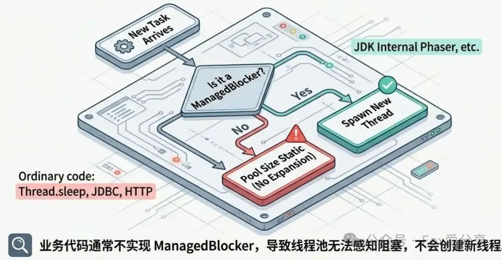
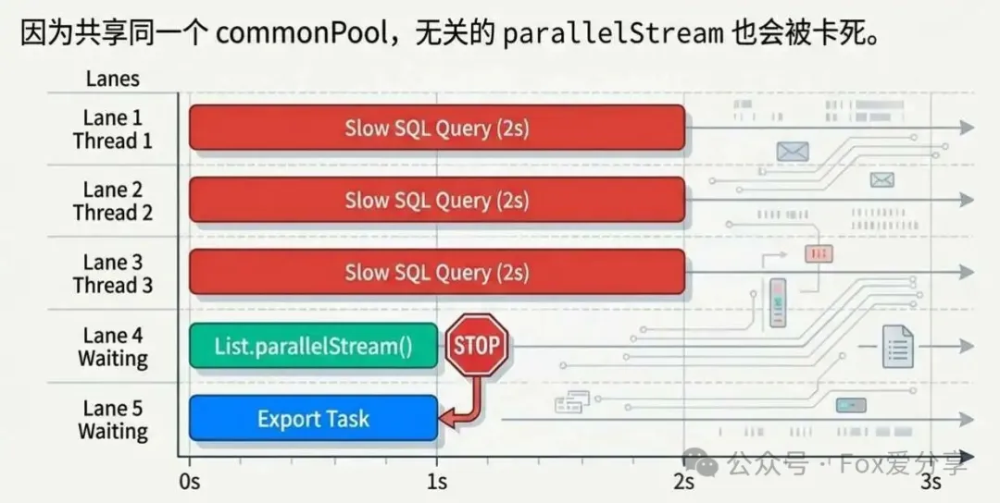
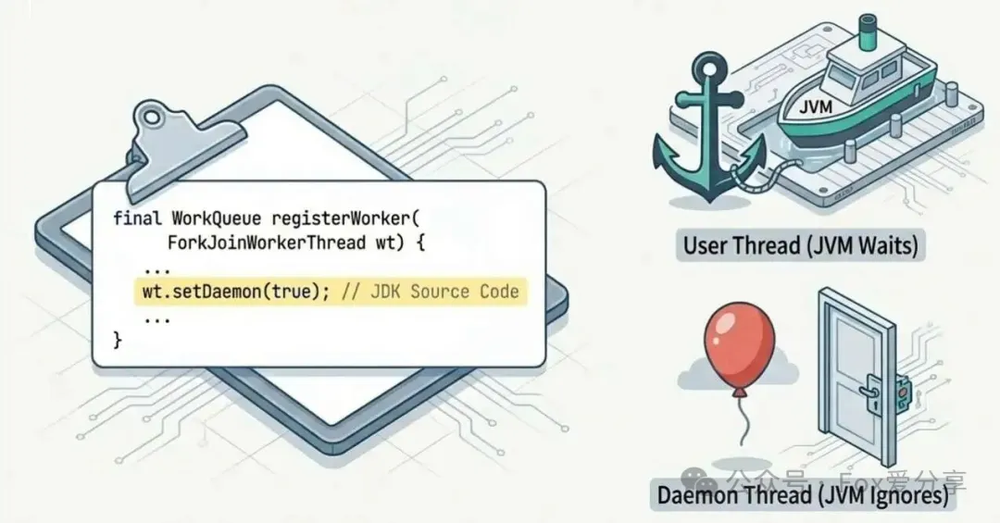
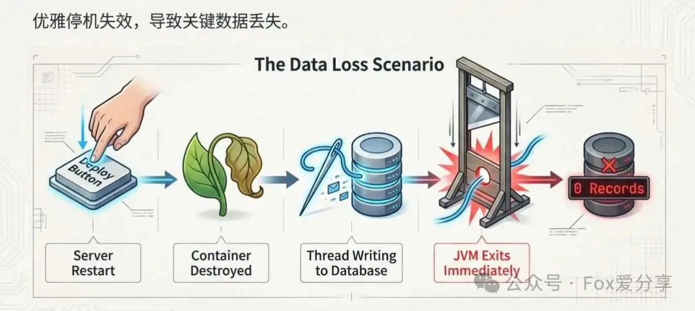
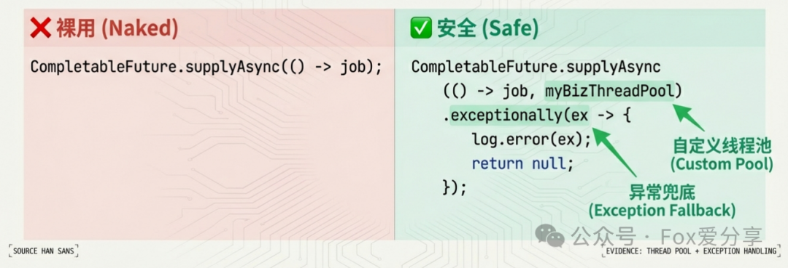

# 阿里一面直接挂！我用 CompletableFuture 优化代码，面试官：你这是在生产环境埋雷！

## \*\*<font style="color:rgb(130, 127, 196);">

写在开头</font>\*\* <font style="color:rgb(0, 0, 0);">上周有个粉丝阿强哭丧着脸来找我，说阿里一面被“秒杀”了。</font>

<font style="color:rgb(0, 0, 0);">起因很简单，面试官问他：“</font>**<font style="color:rgb(130, 127, 196);">有一个核心接口响应很慢，里面串行调用了用户信息、积分查询、优惠券三个服务，你会怎么优化？</font>**<font style="color:rgb(0, 0, 0);">”</font>


<font style="color:rgb(0, 0, 0);">阿强自信满满：“这题熟！用 JDK8 的神器 </font><code><font style="color:rgb(130, 127, 196);">CompletableFuture</font></code><font style="color:rgb(0, 0, 0);"> 啊！把三个串行调用改成 </font><code><font style="color:rgb(130, 127, 196);">CompletableFuture.supplyAsync()</font></code><font style="color:rgb(0, 0, 0);"> 并行处理，最后用 </font><code><font style="color:rgb(130, 127, 196);">allOf</font></code><font style="color:rgb(0, 0, 0);"> 等待结果。代码优雅又高效！”</font>

<font style="color:rgb(0, 0, 0);">面试官听完，推了推眼镜，冷冷地问了一句： </font>**<font style="color:rgb(130, 127, 196);">“你传自定义线程池了吗？还是用的默认方法？”</font>**

<font style="color:rgb(0, 0, 0);">阿强愣了一下：“这就三个小任务，用默认的 </font><code><font style="color:rgb(130, 127, 196);">supplyAsync(Runnable)</font></code><font style="color:rgb(0, 0, 0);"> 就行了吧，没必要单独配个线程池吧？”</font>

<font style="color:rgb(0, 0, 0);">面试官当场合上简历：“</font>**<font style="color:rgb(130, 127, 196);">你敢在生产环境‘裸用’ CompletableFuture，就是给系统埋雷。一旦某个第三方服务卡顿，你的整个应用可能都会被拖垮。回去等通知吧。</font>**<font style="color:rgb(0, 0, 0);">”</font>

<font style="color:rgb(0, 0, 0);">阿强觉得面试官在危言耸听。</font>

<font style="color:rgb(0, 0, 0);">兄弟们，这真不是危言耸听。</font>**<font style="color:rgb(130, 127, 196);">“裸用” CompletableFuture 是并发编程里最大的骗局之一。</font>**

<font style="color:rgb(0, 0, 0);">今天 Fox 带你拆解这背后的 3 个“核弹级”大坑，并附上源码铁证。</font>

# **<font style="color:rgb(255, 255, 255);background-color:#585A5A;">地雷一：共用线程池 = 级联雪崩</font>**

<font style="color:rgb(0, 0, 0);">很多兄弟觉得 </font><code><font style="color:rgb(130, 127, 196);">supplyAsync</font></code><font style="color:rgb(0, 0, 0);"> 是魔法，只要调用了，Java 就会自动给你分配一个“VIP 线程”去跑任务。</font>

**<font style="color:rgb(130, 127, 196);">错！大错特错！</font>**

<font style="color:rgb(0, 0, 0);">如果你不传线程池，JDK 默认使用的是 </font><code><font style="color:rgb(130, 127, 196);">ForkJoinPool.commonPool()</font></code><font style="color:rgb(0, 0, 0);">。</font>

## **<font style="color:rgb(130, 127, 196);">【源码铁证】所有任务挤在一个“黑网吧”里</font>**


<font style="color:rgb(0, 0, 0);">请看 </font><code><font style="color:rgb(130, 127, 196);">CompletableFuture</font></code><font style="color:rgb(0, 0, 0);"> 的源码：</font>

```plain
// 如果你不传 Executor，这个 asyncPool 就是默认的线程池
private static final Executor asyncPool = useCommonPool ?
    ForkJoinPool.commonPool() : new ThreadPerTaskExecutor();

// 这是一个全局共享的静态常量！
// 整个 JVM 里的所有 CompletableFuture，甚至所有 parallelStream，都共用这一个池子！
```

**<font style="color:rgb(130, 127, 196);">这意味着什么？</font>**

<code><font style="color:rgb(130, 127, 196);">ForkJoinPool.commonPool()</font></code><font style="color:rgb(0, 0, 0);"> 的默认核心线程数仅为 </font>**<font style="color:rgb(130, 127, 196);">CPU 核数 - 1</font>**<font style="color:rgb(0, 0, 0);">。 假设你的服务器是 4 核的，那个这个池子只有 </font>**<font style="color:rgb(130, 127, 196);">3</font>**<font style="color:rgb(0, 0, 0);"> 个线程。</font>

**<font style="color:rgb(130, 127, 196);">你要问了：“ForkJoinPool 不是能自动扩容吗？”</font>**

<font style="color:rgb(0, 0, 0);">这里有个极大的误区！</font><code><font style="color:rgb(130, 127, 196);">ForkJoinPool</font></code><font style="color:rgb(0, 0, 0);"> 只有在检测到任务实现了 </font><code><font style="color:rgb(130, 127, 196);">ManagedBlocker</font></code><font style="color:rgb(0, 0, 0);"> 接口时（比如 JDK 内部的 Phaser 等并发工具），才会为了避免饥饿而扩容。</font>

**<font style="color:rgb(130, 127, 196);">但是！</font>**<font style="color:rgb(0, 0, 0);"> 你在业务代码里写的 </font><code><font style="color:rgb(130, 127, 196);">Thread.sleep</font></code><font style="color:rgb(0, 0, 0);">、</font><code><font style="color:rgb(130, 127, 196);">JdbcTemplate</font></code><font style="color:rgb(0, 0, 0);"> 查库、</font><code><font style="color:rgb(130, 127, 196);">RestTemplate</font></code><font style="color:rgb(0, 0, 0);"> 调接口，统统</font>**<font style="color:rgb(130, 127, 196);">没有</font>**<font style="color:rgb(0, 0, 0);">实现这个接口。</font>



**<font style="color:rgb(130, 127, 196);">生产惨案还原：</font>**

1. <font style="color:rgb(1, 1, 1);">你在这个“公共池子”里扔了一个耗时 2 秒的 SQL 查询任务。</font>
2. <font style="color:rgb(1, 1, 1);">隔壁组的同事，在同一个 JVM 里写了个 </font><code><font style="color:rgb(1, 1, 1);">List.parallelStream()</font></code><font style="color:rgb(1, 1, 1);"> 做数据计算。</font>
3. **<font style="color:rgb(130, 127, 196);">注意！</font>**<code><font style="color:rgb(1, 1, 1);">**parallelStream**</font></code><font style="color:rgb(1, 1, 1);">\*\* 也是共用这个 </font><code>**<font style="color:rgb(130, 127, 196);">**commonPool**</font>**</code><font style="color:rgb(1, 1, 1);"> 的！\*\*</font>
4. <font style="color:rgb(1, 1, 1);">结果就是：</font>**<font style="color:rgb(130, 127, 196);">这 3 个可怜的线程瞬间被你的慢 SQL 占满，池子也不会扩容。</font>**



<font style="color:rgb(0, 0, 0);">结局？隔壁的并行流计算全部卡死，甚至连系统里其他完全不相关的异步导出功能也一起“陪葬”。大家抢的是同一个“黑网吧”里的 3 台机器！这就是典型的</font>**<font style="color:rgb(130, 127, 196);">级联雪崩</font>**<font style="color:rgb(0, 0, 0);">。</font>

# **<font style="color:rgb(255, 255, 255);background-color:#585A5A;">地雷二：发版重启时，你的任务直接“暴毙”</font>**

<font style="color:rgb(0, 0, 0);">面试官问：“</font>**<font style="color:rgb(130, 127, 196);">你知道守护线程（Daemon Thread）在生产发布时会有什么问题吗？</font>**<font style="color:rgb(0, 0, 0);">”</font>

<font style="color:rgb(0, 0, 0);">很多同学只知道守护线程会随主线程结束，但在 Spring Boot/Tomcat 环境下，这事儿没那么简单。</font>

## **<font style="color:rgb(130, 127, 196);">【源码铁证】它是“守护线程”</font>**



<code><font style="color:rgb(130, 127, 196);">ForkJoinPool.commonPool()</font></code><font style="color:rgb(0, 0, 0);"> 里的线程，默认都是 </font>**<font style="color:rgb(130, 127, 196);">Daemon Thread</font>**<font style="color:rgb(0, 0, 0);">。</font>

```plain
// ForkJoinWorkerThread 默认被 JVM 视为守护线程管理
protected ForkJoinWorkerThread(ForkJoinPool pool) {
    super("aForkJoinWorkerThread");
    this.pool = pool;
    this.workQueue = pool.registerWorker(this);
}
#java.util.concurrent.ForkJoinPool#registerWorker    
final WorkQueue registerWorker(ForkJoinWorkerThread wt) {
    ...
    wt.setDaemon(true); 
    ...
}
```

**<font style="color:rgb(130, 127, 196);">这在生产环境有个巨大的隐患：优雅停机失效。</font>**<font style="color:rgb(0, 0, 0);"> 我们在生产环境发版部署，或者重启服务时，都会触发 JVM 的关闭流程。</font>



**<font style="color:rgb(130, 127, 196);">JVM 的规矩是：</font>**<font style="color:rgb(0, 0, 0);"> 当所有“非守护线程”结束时，JVM 就会退出，它</font>**<font style="color:rgb(130, 127, 196);">绝对不会</font>**<font style="color:rgb(0, 0, 0);">等待守护线程执行完毕。</font>

**<font style="color:rgb(130, 127, 196);">场景复现：</font>**<font style="color:rgb(0, 0, 0);"> 你正开心地点了 Jenkins 上的“部署”按钮，服务开始重启。 此时，Spring 容器正在销毁 Bean，Tomcat 停止接收请求。 但是！你的 </font><code><font style="color:rgb(130, 127, 196);">CompletableFuture</font></code><font style="color:rgb(0, 0, 0);"> 还在 </font><code><font style="color:rgb(130, 127, 196);">commonPool</font></code><font style="color:rgb(0, 0, 0);"> 里跑一个关键的数据落库任务。 因为它是守护线程，JVM 关门的那一刻，直接把它“咔嚓”了！</font>

**<font style="color:rgb(130, 127, 196);">结果：</font>**<font style="color:rgb(0, 0, 0);"> 任务执行了一半被强杀，数据没存进去，也没有任何报错日志（因为日志系统可能也被关了）。等你第二天发现数据对不上，对着空荡荡的日志文件，哭都找不到调。</font>

# **<font style="color:rgb(255, 255, 255);background-color:#585A5A;">地雷三：异常被“吃”得骨头都不剩</font>**

<font style="color:rgb(0, 0, 0);">在传统的 </font><code><font style="color:rgb(130, 127, 196);">try-catch</font></code><font style="color:rgb(0, 0, 0);"> 里，出错了你能看到日志。 但在 </font><code><font style="color:rgb(130, 127, 196);">CompletableFuture</font></code><font style="color:rgb(0, 0, 0);"> 里，如果你不调用 </font><code><font style="color:rgb(130, 127, 196);">get()</font></code><font style="color:rgb(0, 0, 0);"> 或 </font><code><font style="color:rgb(130, 127, 196);">join()</font></code><font style="color:rgb(0, 0, 0);">，也不用 </font><code><font style="color:rgb(130, 127, 196);">exceptionally</font></code><font style="color:rgb(0, 0, 0);"> 处理异常，</font>**<font style="color:rgb(130, 127, 196);">任务里的异常会被直接吞掉</font>**<font style="color:rgb(0, 0, 0);">。</font>


## **<font style="color:rgb(130, 127, 196);">【实战隐患】</font>**

<font style="color:rgb(0, 0, 0);">你的异步任务是“发送短信”。结果短信服务挂了，抛出了异常。 由于是异步执行，主线程继续往下走，告诉用户“操作成功”。 结果用户死活收不到短信，你查日志还查不到任何报错信息！因为异常被封装在 </font><code><font style="color:rgb(130, 127, 196);">Future</font></code><font style="color:rgb(0, 0, 0);"> 对象里，你不去“拆开”看，它就永远烂在肚子里。</font>

# **<font style="color:rgb(255, 255, 255);background-color:#585A5A;">✅</font>\*\*\*\*<font style="color:rgb(255, 255, 255);background-color:#585A5A;"> 大厂王者级解法：自定义 + 兜底</font>**

<font style="color:rgb(0, 0, 0);">别再“裸用”了！任何生产级的异步代码，必须遵循这两条铁律：</font>

## **<font style="color:rgb(130, 127, 196);">1. 必须依附于独立的业务线程池</font>**


<font style="color:rgb(0, 0, 0);">不要跟别人抢 </font><code><font style="color:rgb(130, 127, 196);">commonPool</font></code><font style="color:rgb(0, 0, 0);">，那是找死。</font>

```plain
// ❌ 错误写法（自杀式袭击）
CompletableFuture.supplyAsync(() -> { ... });

// ✅ 正确写法（舱壁模式）
// 不同的业务，用不同的池子。查询业务崩了，别把支付业务拖死。
// 使用自定义 ThreadPoolExecutor，完全由你掌控核心线程数和队列
CompletableFuture.supplyAsync(() -> {
    return queryUserInfo();
}, myBizThreadPool); // <--- 必须传入自定义的 executor
```

## **<font style="color:rgb(130, 127, 196);">2. 必须要有异常兜底</font>**



```plain
CompletableFuture.supplyAsync(..., executor)
    .exceptionally(ex -> {
        log.error("异步任务执行失败，报警！", ex);
        return null; // 或者返回默认值
    });
```

# **<font style="color:rgb(255, 255, 255);background-color:#585A5A;">王者级回答模板（直接背）</font>**

<font style="color:rgb(0, 0, 0);">下次面试官问你怎么用 </font><code><font style="color:rgb(130, 127, 196);">CompletableFuture</font></code><font style="color:rgb(0, 0, 0);">，别背 API，直接把这段话拍在他桌子上：</font>

<font style="color:rgb(0, 0, 0);">“我从不在生产环境直接使用无参的 </font><code><font style="color:rgb(130, 127, 196);">supplyAsync</font></code><font style="color:rgb(0, 0, 0);">。</font>

**<font style="color:rgb(130, 127, 196);">第一，资源隔离与防雪崩</font>**<font style="color:rgb(0, 0, 0);">：JDK 默认的 </font><code><font style="color:rgb(130, 127, 196);">ForkJoinPool.commonPool</font></code><font style="color:rgb(0, 0, 0);"> 是全 JVM 所有 </font><code><font style="color:rgb(130, 127, 196);">CompletableFuture</font></code><font style="color:rgb(0, 0, 0);"> 和 </font><code><font style="color:rgb(130, 127, 196);">parallelStream</font></code><font style="color:rgb(0, 0, 0);"> 共享的。且普通的 JDBC/HTTP 请求无法触发其 </font><code><font style="color:rgb(130, 127, 196);">ManagedBlocker</font></code><font style="color:rgb(0, 0, 0);"> 扩容机制，核心线程数通常只有 CPU-1。一旦出现慢 IO，就会导致整个系统的异步任务集体卡死。所以我一定会传入自定义的 </font><code><font style="color:rgb(130, 127, 196);">ThreadPoolExecutor</font></code><font style="color:rgb(0, 0, 0);"> 做业务隔离。</font>

**<font style="color:rgb(130, 127, 196);">第二，优雅停机保障</font>**<font style="color:rgb(0, 0, 0);">：默认池使用的是守护线程（Daemon）。在服务发布重启或关闭时，JVM 不会等待守护线程完成，极易导致关键任务执行中断、数据丢失。使用自定义线程池配合 Spring 的 </font><code><font style="color:rgb(130, 127, 196);">DisposableBean</font></code><font style="color:rgb(0, 0, 0);"> 或 JVM ShutdownHook，才能保证任务安全落地。</font>

**<font style="color:rgb(130, 127, 196);">第三，异常风暴</font>**<font style="color:rgb(0, 0, 0);">：异步任务的异常极易被吞没，我的代码规范要求必须配合 </font><code><font style="color:rgb(130, 127, 196);">exceptionally</font></code><font style="color:rgb(0, 0, 0);"> 或 </font><code><font style="color:rgb(130, 127, 196);">handle</font></code><font style="color:rgb(0, 0, 0);"> 进行异常记录和监控。”</font>

## **<font style="color:rgb(130, 127, 196);">最后再唠两句</font>**

<font style="color:rgb(0, 0, 0);">兄弟们，</font>**<font style="color:rgb(130, 127, 196);">异步是为了提升性能，不是为了制造 Bug</font>**<font style="color:rgb(0, 0, 0);">。</font>

<font style="color:rgb(0, 0, 0);">能看懂 </font><code><font style="color:rgb(130, 127, 196);">ForkJoinPool</font></code><font style="color:rgb(0, 0, 0);"> 的 </font><code><font style="color:rgb(130, 127, 196);">ManagedBlocker</font></code><font style="color:rgb(0, 0, 0);"> 机制，能指出 </font><code><font style="color:rgb(130, 127, 196);">parallelStream</font></code><font style="color:rgb(0, 0, 0);"> 共享池的风险，能考虑到</font>**<font style="color:rgb(130, 127, 196);">服务重启时的数据安全</font>**<font style="color:rgb(0, 0, 0);">，你就是 Team Leader 眼里的“靠谱架构师”。</font>

**<font style="color:rgb(130, 127, 196);">觉得这篇真的能帮你避坑的，点个赞，收藏起来。</font>**<font style="color:rgb(0, 0, 0);"> 别等生产环境炸了，才想起来回来翻这篇救命文。</font>


