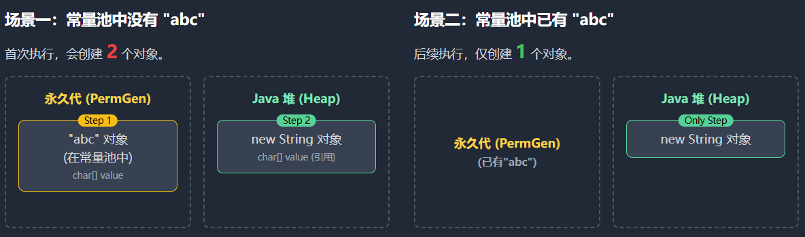
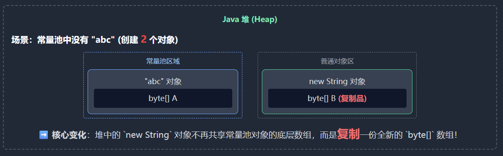
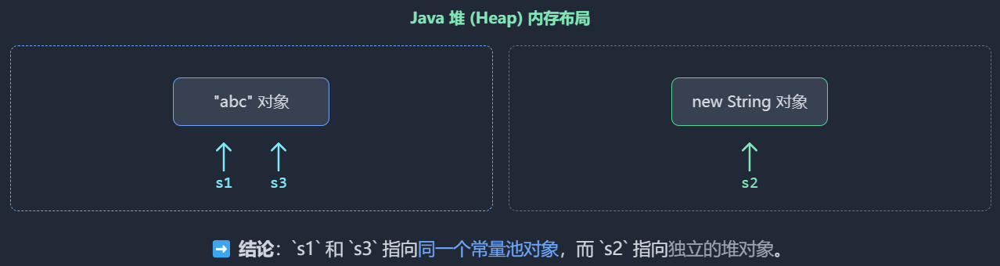
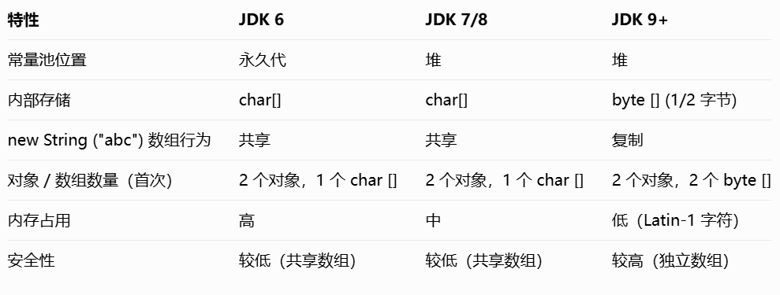

# String s = new String ("abc") 创建了几个对象？存储在哪里？

<font style="color:rgba(0, 0, 0, 0.85);background-color:rgba(0, 0, 0, 0.04);">这是 Java 面试中非常经典的一个问题，关于 String s = new String("abc") 创建了几个对象以及对象存储位置。这个问题的答案要分 </font>**<font style="color:rgba(0, 0, 0, 0.85);background-color:rgba(0, 0, 0, 0.04);">JDK 版本</font>**<font style="color:rgba(0, 0, 0, 0.85);background-color:rgba(0, 0, 0, 0.04);"> 和 </font>**<font style="color:rgba(0, 0, 0, 0.85);background-color:rgba(0, 0, 0, 0.04);">字符串常量池是否已有 "abc"</font>**<font style="color:rgba(0, 0, 0, 0.85);background-color:rgba(0, 0, 0, 0.04);"> 来讨论。</font>

## **<font style="color:rgb(0, 0, 0);background-color:rgb(252, 252, 252);">1. JDK 6 及之前</font>**

* **<font style="color:rgb(0, 0, 0);background-color:rgb(252, 252, 252);">字符串常量池</font>**<font style="color:rgb(0, 0, 0);background-color:rgb(252, 252, 252);">位于</font><font style="color:rgb(0, 0, 0);background-color:rgb(252, 252, 252);"> </font>**<font style="color:rgb(0, 0, 0);background-color:rgb(252, 252, 252);">永久代（PermGen）</font>**<font style="color:rgb(0, 0, 0);background-color:rgb(252, 252, 252);">。</font>
* <code><font style="color:rgb(0, 0, 0);background-color:rgb(252, 252, 252);">new String("abc")</font></code><font style="color:rgb(0, 0, 0);background-color:rgb(252, 252, 252);"> </font><font style="color:rgb(0, 0, 0);background-color:rgb(252, 252, 252);">执行流程：</font>
  1. **<font style="color:rgb(0, 0, 0);background-color:rgb(252, 252, 252);">首次使用字面量</font>\*\*\*\*<font style="color:rgb(0, 0, 0);background-color:rgb(252, 252, 252);"> </font>**<code>**<font style="color:rgb(0, 0, 0);background-color:rgb(252, 252, 252);">"abc"</font>**</code><font style="color:rgb(0, 0, 0);background-color:rgb(252, 252, 252);"> </font><font style="color:rgb(0, 0, 0);background-color:rgb(252, 252, 252);">时，JVM 在</font><font style="color:rgb(0, 0, 0);background-color:rgb(252, 252, 252);"> </font>**<font style="color:rgb(0, 0, 0);background-color:rgb(252, 252, 252);">永久代的字符串常量池</font>**<font style="color:rgb(0, 0, 0);background-color:rgb(252, 252, 252);"> </font><font style="color:rgb(0, 0, 0);background-color:rgb(252, 252, 252);">创建一个</font><font style="color:rgb(0, 0, 0);background-color:rgb(252, 252, 252);"> </font><code><font style="color:rgb(0, 0, 0);background-color:rgb(252, 252, 252);">String</font></code><font style="color:rgb(0, 0, 0);background-color:rgb(252, 252, 252);"> </font><font style="color:rgb(0, 0, 0);background-color:rgb(252, 252, 252);">对象（内容为 "abc"）。</font>
  2. <font style="color:rgb(0, 0, 0);background-color:rgb(252, 252, 252);">执行</font><font style="color:rgb(0, 0, 0);background-color:rgb(252, 252, 252);"> </font><code><font style="color:rgb(0, 0, 0);background-color:rgb(252, 252, 252);">new String("abc")</font></code><font style="color:rgb(0, 0, 0);background-color:rgb(252, 252, 252);"> </font><font style="color:rgb(0, 0, 0);background-color:rgb(252, 252, 252);">时，在</font><font style="color:rgb(0, 0, 0);background-color:rgb(252, 252, 252);"> </font>**<font style="color:rgb(0, 0, 0);background-color:rgb(252, 252, 252);">Java 堆</font>**<font style="color:rgb(0, 0, 0);background-color:rgb(252, 252, 252);"> </font><font style="color:rgb(0, 0, 0);background-color:rgb(252, 252, 252);">创建一个新的</font><font style="color:rgb(0, 0, 0);background-color:rgb(252, 252, 252);"> </font><code><font style="color:rgb(0, 0, 0);background-color:rgb(252, 252, 252);">String</font></code><font style="color:rgb(0, 0, 0);background-color:rgb(252, 252, 252);"> </font><font style="color:rgb(0, 0, 0);background-color:rgb(252, 252, 252);">对象。</font>
  3. <font style="color:rgb(0, 0, 0);background-color:rgb(252, 252, 252);">新对象的</font><font style="color:rgb(0, 0, 0);background-color:rgb(252, 252, 252);"> </font><code><font style="color:rgb(0, 0, 0);background-color:rgb(252, 252, 252);">value</font></code><font style="color:rgb(0, 0, 0);background-color:rgb(252, 252, 252);"> </font><font style="color:rgb(0, 0, 0);background-color:rgb(252, 252, 252);">数组引用常量池对象的</font><font style="color:rgb(0, 0, 0);background-color:rgb(252, 252, 252);"> </font><code><font style="color:rgb(0, 0, 0);background-color:rgb(252, 252, 252);">value</font></code><font style="color:rgb(0, 0, 0);background-color:rgb(252, 252, 252);"> </font><font style="color:rgb(0, 0, 0);background-color:rgb(252, 252, 252);">数组（</font>**<font style="color:rgb(0, 0, 0);background-color:rgb(252, 252, 252);">共享字符数组</font>**<font style="color:rgb(0, 0, 0);background-color:rgb(252, 252, 252);">）。</font>



**<font style="color:rgb(0, 0, 0);background-color:rgb(252, 252, 252);">结论：</font>**

* <font style="color:rgb(0, 0, 0);background-color:rgb(252, 252, 252);">如果</font><font style="color:rgb(0, 0, 0);background-color:rgb(252, 252, 252);"> </font><code><font style="color:rgb(0, 0, 0);background-color:rgb(252, 252, 252);">"abc"</font></code><font style="color:rgb(0, 0, 0);background-color:rgb(252, 252, 252);"> </font><font style="color:rgb(0, 0, 0);background-color:rgb(252, 252, 252);">不在常量池：</font>**<font style="color:rgb(0, 0, 0);background-color:rgb(252, 252, 252);">2 个对象</font>**
  * <font style="color:rgb(0, 0, 0);background-color:rgb(252, 252, 252);">1 个在永久代的常量池</font>
  * <font style="color:rgb(0, 0, 0);background-color:rgb(252, 252, 252);">1 个在 Java 堆</font>
* <font style="color:rgb(0, 0, 0);background-color:rgb(252, 252, 252);">如果 </font><code><font style="color:rgb(0, 0, 0);background-color:rgb(252, 252, 252);">"abc"</font></code><font style="color:rgb(0, 0, 0);background-color:rgb(252, 252, 252);"> 已在常量池：</font>**<font style="color:rgb(0, 0, 0);background-color:rgb(252, 252, 252);">1 个对象</font>**<font style="color:rgb(0, 0, 0);background-color:rgb(252, 252, 252);">（仅 Java 堆）</font>

<font style="color:rgb(0, 0, 0);background-color:rgb(252, 252, 252);"></font>

## **<font style="color:rgb(0, 0, 0);background-color:rgb(252, 252, 252);">2. JDK 7 及之后（包括 JDK 8）</font>**

* **<font style="color:rgb(0, 0, 0);background-color:rgb(252, 252, 252);">字符串常量池</font>**<font style="color:rgb(0, 0, 0);background-color:rgb(252, 252, 252);">移到</font><font style="color:rgb(0, 0, 0);background-color:rgb(252, 252, 252);"> </font>**<font style="color:rgb(0, 0, 0);background-color:rgb(252, 252, 252);">Java 堆</font>**<font style="color:rgb(0, 0, 0);background-color:rgb(252, 252, 252);"> </font><font style="color:rgb(0, 0, 0);background-color:rgb(252, 252, 252);">中。</font>
* <code><font style="color:rgb(0, 0, 0);background-color:rgb(252, 252, 252);">new String("abc")</font></code><font style="color:rgb(0, 0, 0);background-color:rgb(252, 252, 252);"> </font><font style="color:rgb(0, 0, 0);background-color:rgb(252, 252, 252);">执行流程：</font>
  1. **<font style="color:rgb(0, 0, 0);background-color:rgb(252, 252, 252);">首次使用</font>\*\*\*\*<font style="color:rgb(0, 0, 0);background-color:rgb(252, 252, 252);"> </font>**<code>**<font style="color:rgb(0, 0, 0);background-color:rgb(252, 252, 252);">"abc"</font>**</code><font style="color:rgb(0, 0, 0);background-color:rgb(252, 252, 252);"> </font><font style="color:rgb(0, 0, 0);background-color:rgb(252, 252, 252);">时，在</font><font style="color:rgb(0, 0, 0);background-color:rgb(252, 252, 252);"> </font>**<font style="color:rgb(0, 0, 0);background-color:rgb(252, 252, 252);">堆中的字符串常量池</font>**<font style="color:rgb(0, 0, 0);background-color:rgb(252, 252, 252);"> </font><font style="color:rgb(0, 0, 0);background-color:rgb(252, 252, 252);">创建一个</font><font style="color:rgb(0, 0, 0);background-color:rgb(252, 252, 252);"> </font><code><font style="color:rgb(0, 0, 0);background-color:rgb(252, 252, 252);">String</font></code><font style="color:rgb(0, 0, 0);background-color:rgb(252, 252, 252);"> </font><font style="color:rgb(0, 0, 0);background-color:rgb(252, 252, 252);">对象。</font>
  2. <font style="color:rgb(0, 0, 0);background-color:rgb(252, 252, 252);">执行</font><font style="color:rgb(0, 0, 0);background-color:rgb(252, 252, 252);"> </font><code><font style="color:rgb(0, 0, 0);background-color:rgb(252, 252, 252);">new String("abc")</font></code><font style="color:rgb(0, 0, 0);background-color:rgb(252, 252, 252);"> </font><font style="color:rgb(0, 0, 0);background-color:rgb(252, 252, 252);">时，在</font><font style="color:rgb(0, 0, 0);background-color:rgb(252, 252, 252);"> </font>**<font style="color:rgb(0, 0, 0);background-color:rgb(252, 252, 252);">Java 堆的普通对象区</font>**<font style="color:rgb(0, 0, 0);background-color:rgb(252, 252, 252);"> </font><font style="color:rgb(0, 0, 0);background-color:rgb(252, 252, 252);">创建一个新的</font><font style="color:rgb(0, 0, 0);background-color:rgb(252, 252, 252);"> </font><code><font style="color:rgb(0, 0, 0);background-color:rgb(252, 252, 252);">String</font></code><font style="color:rgb(0, 0, 0);background-color:rgb(252, 252, 252);"> </font><font style="color:rgb(0, 0, 0);background-color:rgb(252, 252, 252);">对象。</font>
  3. <font style="color:rgb(0, 0, 0);background-color:rgb(252, 252, 252);">新对象的</font><font style="color:rgb(0, 0, 0);background-color:rgb(252, 252, 252);"> </font><code><font style="color:rgb(0, 0, 0);background-color:rgb(252, 252, 252);">value</font></code><font style="color:rgb(0, 0, 0);background-color:rgb(252, 252, 252);"> </font><font style="color:rgb(0, 0, 0);background-color:rgb(252, 252, 252);">数组引用常量池对象的</font><font style="color:rgb(0, 0, 0);background-color:rgb(252, 252, 252);"> </font><code><font style="color:rgb(0, 0, 0);background-color:rgb(252, 252, 252);">value</font></code><font style="color:rgb(0, 0, 0);background-color:rgb(252, 252, 252);"> </font><font style="color:rgb(0, 0, 0);background-color:rgb(252, 252, 252);">数组（</font>**<font style="color:rgb(0, 0, 0);background-color:rgb(252, 252, 252);">仍然共享</font>**<font style="color:rgb(0, 0, 0);background-color:rgb(252, 252, 252);">）。</font>


**<font style="color:rgb(0, 0, 0);background-color:rgb(252, 252, 252);">结论：</font>**

* <font style="color:rgb(0, 0, 0);background-color:rgb(252, 252, 252);">如果</font><font style="color:rgb(0, 0, 0);background-color:rgb(252, 252, 252);"> </font><code><font style="color:rgb(0, 0, 0);background-color:rgb(252, 252, 252);">"abc"</font></code><font style="color:rgb(0, 0, 0);background-color:rgb(252, 252, 252);"> </font><font style="color:rgb(0, 0, 0);background-color:rgb(252, 252, 252);">不在常量池：</font>**<font style="color:rgb(0, 0, 0);background-color:rgb(252, 252, 252);">2 个对象</font>**<font style="color:rgb(0, 0, 0);background-color:rgb(252, 252, 252);">（都在堆，一个在常量池区域，一个在普通对象区）</font>
* <font style="color:rgb(0, 0, 0);background-color:rgb(252, 252, 252);">如果 </font><code><font style="color:rgb(0, 0, 0);background-color:rgb(252, 252, 252);">"abc"</font></code><font style="color:rgb(0, 0, 0);background-color:rgb(252, 252, 252);"> 已在常量池：</font>**<font style="color:rgb(0, 0, 0);background-color:rgb(252, 252, 252);">1 个对象</font>**<font style="color:rgb(0, 0, 0);background-color:rgb(252, 252, 252);">（仅普通对象区）</font>

<font style="color:rgb(0, 0, 0);background-color:rgb(252, 252, 252);"></font>

## **<font style="color:rgb(0, 0, 0);background-color:rgb(252, 252, 252);">3. JDK 9+ 的变化</font>**

<font style="color:rgb(0, 0, 0);background-color:rgb(252, 252, 252);">从</font><font style="color:rgb(0, 0, 0);background-color:rgb(252, 252, 252);"> </font>**<font style="color:rgb(0, 0, 0);background-color:rgb(252, 252, 252);">JDK 9</font>**<font style="color:rgb(0, 0, 0);background-color:rgb(252, 252, 252);"> </font><font style="color:rgb(0, 0, 0);background-color:rgb(252, 252, 252);">开始，Java 引入</font><font style="color:rgb(0, 0, 0);background-color:rgb(252, 252, 252);"> </font>**<font style="color:rgb(0, 0, 0);background-color:rgb(252, 252, 252);">Compact Strings（紧凑字符串）</font>**<font style="color:rgb(0, 0, 0);background-color:rgb(252, 252, 252);"> </font><font style="color:rgb(0, 0, 0);background-color:rgb(252, 252, 252);">优化：</font>

* **<font style="color:rgb(0, 0, 0);background-color:rgb(252, 252, 252);">内部存储变更</font>**<font style="color:rgb(0, 0, 0);background-color:rgb(252, 252, 252);">：</font><font style="color:rgb(0, 0, 0);background-color:rgb(252, 252, 252);">由</font><font style="color:rgb(0, 0, 0);background-color:rgb(252, 252, 252);"> </font><code><font style="color:rgb(0, 0, 0);background-color:rgb(252, 252, 252);">char[]</font></code><font style="color:rgb(0, 0, 0);background-color:rgb(252, 252, 252);">（每个字符 2 字节）改为</font><font style="color:rgb(0, 0, 0);background-color:rgb(252, 252, 252);"> </font><code><font style="color:rgb(0, 0, 0);background-color:rgb(252, 252, 252);">byte[]</font></code><font style="color:rgb(0, 0, 0);background-color:rgb(252, 252, 252);">（每个字符 1 字节或 2 字节，Latin-1 字符用 1 字节存储）。</font>
* <code>**<font style="color:rgb(0, 0, 0);background-color:rgb(252, 252, 252);">new String("abc")</font>**</code>**<font style="color:rgb(0, 0, 0);background-color:rgb(252, 252, 252);"> </font>\*\*\*\*<font style="color:rgb(0, 0, 0);background-color:rgb(252, 252, 252);">行为变化</font>**<font style="color:rgb(0, 0, 0);background-color:rgb(252, 252, 252);">：</font><font style="color:rgb(0, 0, 0);background-color:rgb(252, 252, 252);">新对象不再共享常量池中的字符数组，而是</font>**<font style="color:rgb(0, 0, 0);background-color:rgb(252, 252, 252);">复制一份内容到新的 byte \[] 数组</font>**<font style="color:rgb(0, 0, 0);background-color:rgb(252, 252, 252);">。</font>

**<font style="color:rgb(0, 0, 0);background-color:rgb(252, 252, 252);">JDK 9+ 流程：</font>**

1. <font style="color:rgb(0, 0, 0);background-color:rgb(252, 252, 252);">首次使用</font><font style="color:rgb(0, 0, 0);background-color:rgb(252, 252, 252);"> </font><code><font style="color:rgb(0, 0, 0);background-color:rgb(252, 252, 252);">"abc"</font></code><font style="color:rgb(0, 0, 0);background-color:rgb(252, 252, 252);"> </font><font style="color:rgb(0, 0, 0);background-color:rgb(252, 252, 252);">→ 在字符串常量池创建</font><font style="color:rgb(0, 0, 0);background-color:rgb(252, 252, 252);"> </font><code><font style="color:rgb(0, 0, 0);background-color:rgb(252, 252, 252);">String</font></code><font style="color:rgb(0, 0, 0);background-color:rgb(252, 252, 252);"> </font><font style="color:rgb(0, 0, 0);background-color:rgb(252, 252, 252);">对象，内部是</font><font style="color:rgb(0, 0, 0);background-color:rgb(252, 252, 252);"> </font><code><font style="color:rgb(0, 0, 0);background-color:rgb(252, 252, 252);">byte[]</font></code><font style="color:rgb(0, 0, 0);background-color:rgb(252, 252, 252);">（数组 A）。</font>
2. <code><font style="color:rgb(0, 0, 0);background-color:rgb(252, 252, 252);">new String("abc")</font></code><font style="color:rgb(0, 0, 0);background-color:rgb(252, 252, 252);"> </font><font style="color:rgb(0, 0, 0);background-color:rgb(252, 252, 252);">→ 在堆普通区创建新</font><font style="color:rgb(0, 0, 0);background-color:rgb(252, 252, 252);"> </font><code><font style="color:rgb(0, 0, 0);background-color:rgb(252, 252, 252);">String</font></code><font style="color:rgb(0, 0, 0);background-color:rgb(252, 252, 252);"> </font><font style="color:rgb(0, 0, 0);background-color:rgb(252, 252, 252);">对象，并</font>**<font style="color:rgb(0, 0, 0);background-color:rgb(252, 252, 252);">复制</font>**<font style="color:rgb(0, 0, 0);background-color:rgb(252, 252, 252);">数组 A 内容到新的</font><font style="color:rgb(0, 0, 0);background-color:rgb(252, 252, 252);"> </font><code><font style="color:rgb(0, 0, 0);background-color:rgb(252, 252, 252);">byte[]</font></code><font style="color:rgb(0, 0, 0);background-color:rgb(252, 252, 252);">（数组 B）。</font>



**<font style="color:rgb(0, 0, 0);background-color:rgb(252, 252, 252);">结论：</font>**

* <font style="color:rgb(0, 0, 0);background-color:rgb(252, 252, 252);">如果</font><font style="color:rgb(0, 0, 0);background-color:rgb(252, 252, 252);"> </font><code><font style="color:rgb(0, 0, 0);background-color:rgb(252, 252, 252);">"abc"</font></code><font style="color:rgb(0, 0, 0);background-color:rgb(252, 252, 252);"> </font><font style="color:rgb(0, 0, 0);background-color:rgb(252, 252, 252);">不在常量池：</font>**<font style="color:rgb(0, 0, 0);background-color:rgb(252, 252, 252);">2 个 String 对象 + 2 个 byte \[] 数组</font>**<font style="color:rgb(0, 0, 0);background-color:rgb(252, 252, 252);">（都在堆）</font>
* <font style="color:rgb(0, 0, 0);background-color:rgb(252, 252, 252);">如果 </font><code><font style="color:rgb(0, 0, 0);background-color:rgb(252, 252, 252);">"abc"</font></code><font style="color:rgb(0, 0, 0);background-color:rgb(252, 252, 252);"> 已在常量池：</font>**<font style="color:rgb(0, 0, 0);background-color:rgb(252, 252, 252);">1 个 String 对象 + 1 个新的 byte \[] 数组</font>**<font style="color:rgb(0, 0, 0);background-color:rgb(252, 252, 252);">（都在堆普通区）</font>

<font style="color:rgb(0, 0, 0);background-color:rgb(252, 252, 252);"></font>

## **<font style="color:rgb(0, 0, 0);background-color:rgb(252, 252, 252);">4. 为什么会有这些设计变化？</font>**

* **<font style="color:rgb(0, 0, 0);background-color:rgb(252, 252, 252);">字符串常量池</font>**<font style="color:rgb(0, 0, 0);background-color:rgb(252, 252, 252);">：缓存字符串字面量，减少重复对象。</font>
* **<font style="color:rgb(0, 0, 0);background-color:rgb(252, 252, 252);">JDK 7 常量池移到堆</font>**<font style="color:rgb(0, 0, 0);background-color:rgb(252, 252, 252);">：</font>
  * <font style="color:rgb(0, 0, 0);background-color:rgb(252, 252, 252);">减少永久代内存压力</font>
  * <font style="color:rgb(0, 0, 0);background-color:rgb(252, 252, 252);">方便 GC 回收不再使用的字符串</font>
* **<font style="color:rgb(0, 0, 0);background-color:rgb(252, 252, 252);">JDK 9 Compact Strings</font>**<font style="color:rgb(0, 0, 0);background-color:rgb(252, 252, 252);">：</font>
  * <font style="color:rgb(0, 0, 0);background-color:rgb(252, 252, 252);">节省内存（Latin-1 字符从 2 字节降为 1 字节）</font>
  * <font style="color:rgb(0, 0, 0);background-color:rgb(252, 252, 252);">避免共享数组带来的潜在安全隐患（如 </font><code><font style="color:rgb(0, 0, 0);background-color:rgb(252, 252, 252);">substring</font></code><font style="color:rgb(0, 0, 0);background-color:rgb(252, 252, 252);"> 内存泄漏问题）</font>

<font style="color:rgb(0, 0, 0);background-color:rgb(252, 252, 252);"></font>

## **<font style="color:rgb(0, 0, 0);background-color:rgb(252, 252, 252);">5. intern () 方法扩展</font>**

<code><font style="color:rgb(0, 0, 0);background-color:rgb(252, 252, 252);">intern()</font></code><font style="color:rgb(0, 0, 0);background-color:rgb(252, 252, 252);"> </font><font style="color:rgb(0, 0, 0);background-color:rgb(252, 252, 252);">用来确保字符串在常量池中存在，并返回常量池中的引用。</font>

### **<font style="color:rgb(0, 0, 0);background-color:rgb(252, 252, 252);">JDK 6</font>**

* <font style="color:rgb(0, 0, 0);background-color:rgb(252, 252, 252);">常量池在永久代</font>
* <font style="color:rgb(0, 0, 0);background-color:rgb(252, 252, 252);">调用</font><font style="color:rgb(0, 0, 0);background-color:rgb(252, 252, 252);"> </font><code><font style="color:rgb(0, 0, 0);background-color:rgb(252, 252, 252);">intern()</font></code><font style="color:rgb(0, 0, 0);background-color:rgb(252, 252, 252);"> </font><font style="color:rgb(0, 0, 0);background-color:rgb(252, 252, 252);">时，如果字符串不在常量池，会</font>**<font style="color:rgb(0, 0, 0);background-color:rgb(252, 252, 252);">复制一份字符串到永久代</font>**<font style="color:rgb(0, 0, 0);background-color:rgb(252, 252, 252);">并返回引用。</font>

### **<font style="color:rgb(0, 0, 0);background-color:rgb(252, 252, 252);">JDK 7+</font>**

* <font style="color:rgb(0, 0, 0);background-color:rgb(252, 252, 252);">常量池在堆中</font>
* <font style="color:rgb(0, 0, 0);background-color:rgb(252, 252, 252);">调用 </font><code><font style="color:rgb(0, 0, 0);background-color:rgb(252, 252, 252);">intern()</font></code><font style="color:rgb(0, 0, 0);background-color:rgb(252, 252, 252);"> 时，如果字符串不在常量池，会</font>**<font style="color:rgb(0, 0, 0);background-color:rgb(252, 252, 252);">直接在常量池中存储堆对象的引用</font>**<font style="color:rgb(0, 0, 0);background-color:rgb(252, 252, 252);">，而不会复制字符串内容。</font>

**<font style="color:rgb(0, 0, 0);background-color:rgb(252, 252, 252);">示例：</font>**

```java
// 1. 在常量池中创建 "abc" 对象
String s1 = "abc";
// 2. 在堆中创建新对象，此时常量池中 "abc" 已存在
String s2 = new String("abc");
// 3. s2.intern() 发现常量池已有 "abc"，返回其引用
String s3 = s2.intern();

System.out.println(s1 == s2); // false (一个在常量池，一个在堆)
System.out.println(s1 == s3); // true (都指向常量池)
```



**<font style="color:rgb(0, 0, 0);background-color:rgb(252, 252, 252);">JDK 9+ 优化：</font>**

* <font style="color:rgb(0, 0, 0);background-color:rgb(252, 252, 252);">结合 Compact Strings，intern () 同样不再复制内容，而是存储引用，节省内存。</font>

## **<font style="color:rgb(0, 0, 0);background-color:rgb(252, 252, 252);">6. 总结对比</font>**



## **<font style="color:rgb(0, 0, 0);background-color:rgb(252, 252, 252);">7. 面试标准答案</font>**

**<font style="color:rgb(0, 0, 0);background-color:rgb(252, 252, 252);">分情况讨论：</font>**

1. **<font style="color:rgb(0, 0, 0);background-color:rgb(252, 252, 252);">JDK 6</font>**
   * <code><font style="color:rgb(0, 0, 0);background-color:rgb(252, 252, 252);">"abc"</font></code><font style="color:rgb(0, 0, 0);background-color:rgb(252, 252, 252);"> </font><font style="color:rgb(0, 0, 0);background-color:rgb(252, 252, 252);">不在常量池：2 个对象（永久代 1 个，堆 1 个）</font>
   * <code><font style="color:rgb(0, 0, 0);background-color:rgb(252, 252, 252);">"abc"</font></code><font style="color:rgb(0, 0, 0);background-color:rgb(252, 252, 252);"> </font><font style="color:rgb(0, 0, 0);background-color:rgb(252, 252, 252);">已在常量池：1 个对象（堆）</font>
2. **<font style="color:rgb(0, 0, 0);background-color:rgb(252, 252, 252);">JDK 7/8</font>**
   * <code><font style="color:rgb(0, 0, 0);background-color:rgb(252, 252, 252);">"abc"</font></code><font style="color:rgb(0, 0, 0);background-color:rgb(252, 252, 252);"> </font><font style="color:rgb(0, 0, 0);background-color:rgb(252, 252, 252);">不在常量池：2 个对象（堆中常量池 1 个，普通对象区 1 个）</font>
   * <code><font style="color:rgb(0, 0, 0);background-color:rgb(252, 252, 252);">"abc"</font></code><font style="color:rgb(0, 0, 0);background-color:rgb(252, 252, 252);"> </font><font style="color:rgb(0, 0, 0);background-color:rgb(252, 252, 252);">已在常量池：1 个对象（普通对象区）</font>
3. **<font style="color:rgb(0, 0, 0);background-color:rgb(252, 252, 252);">JDK 9+</font>**
   * <code><font style="color:rgb(0, 0, 0);background-color:rgb(252, 252, 252);">"abc"</font></code><font style="color:rgb(0, 0, 0);background-color:rgb(252, 252, 252);"> </font><font style="color:rgb(0, 0, 0);background-color:rgb(252, 252, 252);">不在常量池：2 个 String 对象 + 2 个 byte \[] 数组</font>
   * <code><font style="color:rgb(0, 0, 0);background-color:rgb(252, 252, 252);">"abc"</font></code><font style="color:rgb(0, 0, 0);background-color:rgb(252, 252, 252);"> 已在常量池：1 个 String 对象 + 1 个新 byte \[] 数组</font>

<font style="color:rgb(0, 0, 0);background-color:rgb(252, 252, 252);"></font>

> <font style="color:rgb(0, 0, 0);background-color:rgb(252, 252, 252);">💡</font><font style="color:rgb(0, 0, 0);background-color:rgb(252, 252, 252);"> </font>**<font style="color:rgb(0, 0, 0);background-color:rgb(252, 252, 252);">记忆口诀</font>**<font style="color:rgb(0, 0, 0);background-color:rgb(252, 252, 252);">：</font>
>
> <font style="color:rgb(0, 0, 0);background-color:rgb(252, 252, 252);">常量池看有无，JDK 分版本；6 在永久代，7+ 到堆来；9 后不共享，复制更安全。</font>
