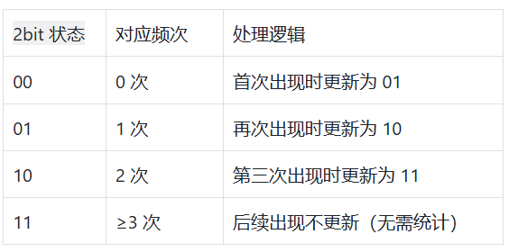
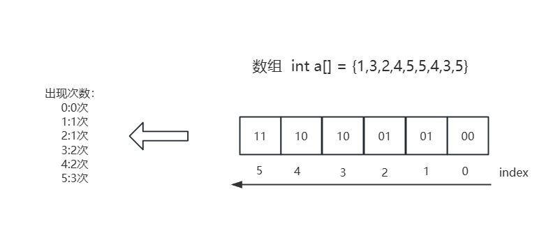

# 给定100亿个int整数，给你1G内存，设计算法快速找出出现次数不超过2次的整数？

有小伙伴去字节面试，遇到了这么一道算法题。

面试官：**给定100亿个int整数，给你1G内存，设计算法快速找出出现次数不超过2次的整数？**\*\* \*\*

小伙伴支支吾吾说了半天，面试官不太满意，面试挂了。

<font style="color:rgba(6, 8, 31, 0.88);">这是一个非常经典的面试题，它看似是在考察算法，但实际上背后在考察你处理</font>**<font style="color:rgba(6, 8, 31, 0.88);">海量数据（Big Data）</font>**<font style="color:rgba(6, 8, 31, 0.88);">的系统设计思维和工程能力，特别是当数据无法一次性装入内存时的处理策略。</font>

<font style="color:rgba(6, 8, 31, 0.88);">面试官问这个问题，想听到的绝对不是一个简单的循环或者一个普通的哈希表。他想考察你以下几点：</font>

1. **<font style="color:rgba(6, 8, 31, 0.88);">约束意识</font>**<font style="color:rgba(6, 8, 31, 0.88);">：你是否立刻意识到“100亿个整数”和“1G内存”是核心矛盾？</font>
2. **<font style="color:rgba(6, 8, 31, 0.88);">估算能力</font>**<font style="color:rgba(6, 8, 31, 0.88);">：你能否快速计算出100亿个整数需要多大存储，1G内存能存下多少数据？</font>
3. **<font style="color:rgba(6, 8, 31, 0.88);">工程方法</font>**<font style="color:rgba(6, 8, 31, 0.88);">：当内存不足时，你是否知道业界通用的处理方法（如分治、哈希分桶、外部排序等）？</font>
4. **<font style="color:rgba(6, 8, 31, 0.88);">算法权衡</font>**<font style="color:rgba(6, 8, 31, 0.88);">：你是否能想到并比较不同方案的优劣（例如 I/O 次数、空间复杂度、实现复杂度）？</font>

<font style="color:rgba(6, 8, 31, 0.88);">下面我将提供两种核心解法，从“通用工程解法”到“极致空间优化解法”，你可以像剥洋葱一样层层深入地回答。</font>

### <font style="color:rgba(6, 8, 31, 0.88);">解法一：哈希分桶 (Hash Partitioning) - 通用大数据解法</font>

<font style="color:rgba(6, 8, 31, 0.88);">这是最经典、最通用的处理方式，可以应对各种类似的海量数据问题。</font>适合所有 “**海量数据 + 小内存**” 场景，是面试中 “保底且通用” 的思路，核心逻辑是 “**分而治之**”。

**<font style="color:rgba(6, 8, 31, 0.88);">第一步：数据估算与分桶策略</font>**

1. **<font style="color:rgba(6, 8, 31, 0.88);">计算总数据量</font>**<font style="color:rgba(6, 8, 31, 0.88);">：一个</font><code><font style="color:rgba(6, 8, 31, 0.88);background-color:rgba(175, 184, 193, 0.2);">int</font></code><font style="color:rgba(6, 8, 31, 0.88);">整数通常是4字节。100亿个整数的总大小为：\ </font><code><font style="color:rgba(6, 8, 31, 0.88);background-color:rgba(175, 184, 193, 0.2);">100 * 10^8 * 4 bytes = 40 * 10^9 bytes = 40 GB</font></code>
2. **<font style="color:rgba(6, 8, 31, 0.88);">计算内存限制</font>**<font style="color:rgba(6, 8, 31, 0.88);">：我们有1GB内存。为了安全起见（需要留出空间给哈希表结构本身、操作系统开销等），我们设定每个小文件的处理规模为500MB。</font>
3. **<font style="color:rgba(6, 8, 31, 0.88);">确定分桶数量</font>**<font style="color:rgba(6, 8, 31, 0.88);">：需要的桶（临时小文件）数量为：\ </font><code><font style="color:rgba(6, 8, 31, 0.88);background-color:rgba(175, 184, 193, 0.2);">40 GB / 500 MB = 40 * 1024 MB / 500 MB ≈ 82</font></code><font style="color:rgba(6, 8, 31, 0.88);">\ </font><font style="color:rgba(6, 8, 31, 0.88);">为了方便哈希取模，我们可以选择一个比82大的2的幂次方，比如 128个桶。</font>

**<font style="color:rgba(6, 8, 31, 0.88);">第二步：算法流程</font>**

<font style="color:rgba(6, 8, 31, 0.88);">整个过程分为两个主要阶段：</font>**<font style="color:rgba(6, 8, 31, 0.88);">分桶 (Map)</font>**<font style="color:rgba(6, 8, 31, 0.88);"> 和 </font>**<font style="color:rgba(6, 8, 31, 0.88);">独立统计 (Reduce)</font>**<font style="color:rgba(6, 8, 31, 0.88);">。</font>

1. **<font style="color:rgba(6, 8, 31, 0.88);">【分桶阶段 - Map】</font>**

* <font style="color:rgba(6, 8, 31, 0.88);">在磁盘上创建128个临时文件，命名为 </font><code><font style="color:rgba(6, 8, 31, 0.88);background-color:rgba(175, 184, 193, 0.2);">bucket_0.tmp</font></code><font style="color:rgba(6, 8, 31, 0.88);"> 到 </font><code><font style="color:rgba(6, 8, 31, 0.88);background-color:rgba(175, 184, 193, 0.2);">bucket_127.tmp</font></code><font style="color:rgba(6, 8, 31, 0.88);">。</font>
* <font style="color:rgba(6, 8, 31, 0.88);">顺序读取40GB的源文件（一次只读一小块到内存缓冲区）。</font>
* <font style="color:rgba(6, 8, 31, 0.88);">对每一个读到的整数</font><font style="color:rgba(6, 8, 31, 0.88);"> </font><code><font style="color:rgba(6, 8, 31, 0.88);background-color:rgba(175, 184, 193, 0.2);">num</font></code><font style="color:rgba(6, 8, 31, 0.88);">，计算其哈希值并取模：</font><code><font style="color:rgba(6, 8, 31, 0.88);background-color:rgba(175, 184, 193, 0.2);">index = hash(num) % 128</font></code><font style="color:rgba(6, 8, 31, 0.88);">。</font>
* <font style="color:rgba(6, 8, 31, 0.88);">将该整数 </font><code><font style="color:rgba(6, 8, 31, 0.88);background-color:rgba(175, 184, 193, 0.2);">num</font></code><font style="color:rgba(6, 8, 31, 0.88);"> 追加写入到对应的 </font><code><font style="color:rgba(6, 8, 31, 0.88);background-color:rgba(175, 184, 193, 0.2);">bucket_{index}.tmp</font></code><font style="color:rgba(6, 8, 31, 0.88);"> 文件中。</font>
* **<font style="color:rgba(6, 8, 31, 0.88);">核心保障</font>**<font style="color:rgba(6, 8, 31, 0.88);">：通过哈希分桶，我们保证了</font>**<font style="color:rgba(6, 8, 31, 0.88);">所有相同的整数必然会进入到同一个临时文件中</font>**<font style="color:rgba(6, 8, 31, 0.88);">。</font>

2. **<font style="color:rgba(6, 8, 31, 0.88);">【统计阶段 - Reduce】</font>**

* **<font style="color:rgba(6, 8, 31, 0.88);">独立处理</font>**<font style="color:rgba(6, 8, 31, 0.88);">：现在我们有了128个大小约500MB的小文件。我们可以依次对每个文件进行处理。</font>
* **<font style="color:rgba(6, 8, 31, 0.88);">内存计数</font>**<font style="color:rgba(6, 8, 31, 0.88);">：对于每一个文件 </font><code><font style="color:rgba(6, 8, 31, 0.88);background-color:rgba(175, 184, 193, 0.2);">bucket_i.tmp</font></code><font style="color:rgba(6, 8, 31, 0.88);">：</font>
  * <font style="color:rgba(6, 8, 31, 0.88);">在内存中创建一个</font><code><font style="color:rgba(6, 8, 31, 0.88);background-color:rgba(175, 184, 193, 0.2);">HashMap<Integer, Integer></font></code><font style="color:rgba(6, 8, 31, 0.88);">。</font>
  * <font style="color:rgba(6, 8, 31, 0.88);">遍历该文件中的所有整数，用HashMap统计每个整数的出现频次。</font>
  * <font style="color:rgba(6, 8, 31, 0.88);">遍历完成后，再次扫描HashMap，将所有频次</font><font style="color:rgba(6, 8, 31, 0.88);"> </font><code><font style="color:rgba(6, 8, 31, 0.88);background-color:rgba(175, 184, 193, 0.2);">count <= 2</font></code><font style="color:rgba(6, 8, 31, 0.88);"> </font><font style="color:rgba(6, 8, 31, 0.88);">的整数输出到最终的结果文件中。</font>
  * <font style="color:rgba(6, 8, 31, 0.88);">清空HashMap，释放内存，继续处理下一个临时文件。</font>

3. **<font style="color:rgba(6, 8, 31, 0.88);">【清理】</font>**

* <font style="color:rgba(6, 8, 31, 0.88);">所有临时文件处理完毕后，将它们删除。</font>

***

**示例代码**

```java
/**
 * 演示“哈希分桶”算法，解决海量数据无法一次性加载入内存的频次统计问题。
 */
public class HashPartitioner {

    /**
     * 阶段一：分区（分桶）
     * 读取源文件，根据哈希值将数据分散到多个临时桶文件中。
     *
     * @param sourceFilePath 源文件路径
     * @param outputDir      桶文件存放目录
     * @param numBuckets     桶的数量
     * @throws IOException I/O异常
     */
    public void partitionData(Path sourceFilePath, Path outputDir, int numBuckets) throws IOException {
        System.out.println("--- 阶段一：开始分区 ---");
        // 创建一个写入器列表，每个写入器对应一个桶文件
        List<BufferedWriter> bucketWriters = new ArrayList<>();

        // 确保输出目录存在
        Files.createDirectories(outputDir);

        // 使用 try-finally 确保所有文件流最终都能被关闭
        try {
            // 初始化所有桶文件的写入器
            for (int i = 0; i < numBuckets; i++) {
                Path bucketPath = outputDir.resolve("bucket_" + i + ".tmp");
                bucketWriters.add(Files.newBufferedWriter(bucketPath));
            }

            // 使用 try-with-resources 自动管理源文件的读取器
            try (BufferedReader reader = Files.newBufferedReader(sourceFilePath)) {
                String line;
                long lineCount = 0;
                while ((line = reader.readLine()) != null) {
                    line = line.trim();
                    if (line.isEmpty()) continue;

                    int num = Integer.parseInt(line);

                    // 计算哈希值以确定桶的索引
                    // 使用 Math.floorMod 确保结果为非负数，比 a % n 更安全
                    int bucketIndex = Math.floorMod(Integer.hashCode(num), numBuckets);

                    // 将数字写入对应的桶文件
                    bucketWriters.get(bucketIndex).write(line + "\n");
                    lineCount++;
                }
                System.out.println("分区完成，共处理 " + lineCount + " 行数据。");
            }

        } finally {
            // 在 finally 块中，确保关闭所有写入器
            System.out.println("正在关闭所有桶文件写入器...");
            for (BufferedWriter writer : bucketWriters) {
                if (writer != null) {
                    try {
                        writer.close();
                    } catch (IOException e) {
                        // 记录或打印错误，但继续关闭其他流
                        e.printStackTrace();
                    }
                }
            }
        }
    }

    /**
     * 阶段二：处理桶数据
     * 逐个读取桶文件，在内存中统计频次，并将符合条件的结果写入最终文件。
     *
     * @param sourceDir       桶文件所在目录
     * @param resultFilePath  最终结果文件路径
     * @param numBuckets      桶的数量
     * @throws IOException I/O异常
     */
    public void processBuckets(Path sourceDir, Path resultFilePath, int numBuckets) throws IOException {
        System.out.println("\n--- 阶段二：开始处理分桶数据 ---");

        // 使用 try-with-resources 自动管理最终结果文件的写入器
        try (BufferedWriter resultWriter = Files.newBufferedWriter(resultFilePath)) {
            long totalResultCount = 0;

            // 循环处理每一个桶文件
            for (int i = 0; i < numBuckets; i++) {
                Path bucketPath = sourceDir.resolve("bucket_" + i + ".tmp");

                if (!Files.exists(bucketPath)) {
                    continue; // 如果某个桶为空，则跳过
                }
                System.out.println("正在处理桶: " + bucketPath.getFileName());

                // 创建一个内存中的HashMap来统计当前桶的频次
                Map<Integer, Integer> counts = new HashMap<>();

                // 读取当前桶文件并统计
                try (BufferedReader reader = Files.newBufferedReader(bucketPath)) {
                    String line;
                    while ((line = reader.readLine()) != null) {
                        line = line.trim();
                        if (line.isEmpty()) continue;
                        int num = Integer.parseInt(line);
                        counts.put(num, counts.getOrDefault(num, 0) + 1);
                    }
                }

                // 筛选当前桶中频次<=2的数字，并写入结果文件
                for (Map.Entry<Integer, Integer> entry : counts.entrySet()) {
                    if (entry.getValue() <= 2) {
                        resultWriter.write(entry.getKey().toString() + "\n");
                        totalResultCount++;
                    }
                }
            } // 所有桶处理完毕
            System.out.println("所有桶处理完成，共找到 " + totalResultCount + " 个符合条件的整数。");
        }
    }


    /**
     * 主方法，用于演示和测试
     */
    public static void main(String[] args) {
        Path tempDir = Paths.get(System.getProperty("java.io.tmpdir"), "hash_partition_demo");
        Path sourceFile = tempDir.resolve("source_data.txt");
        Path bucketsDir = tempDir.resolve("buckets");
        Path resultFile = tempDir.resolve("result.txt");
        int numBuckets = 16; // 演示方便，使用16个桶

        try {
            // 1. 准备环境：创建目录和模拟数据文件
            System.out.println("临时文件目录: " + tempDir);
            Files.createDirectories(bucketsDir);
            createDummyFile(sourceFile, 1_000_000); // 生成100万条模拟数据

            HashPartitioner partitioner = new HashPartitioner();

            // 2. 执行分区
            partitioner.partitionData(sourceFile, bucketsDir, numBuckets);

            // 3. 执行统计
            partitioner.processBuckets(bucketsDir, resultFile, numBuckets);

            System.out.println("\n处理成功！最终结果已保存至: " + resultFile);

        } catch (IOException e) {
            e.printStackTrace();
        } finally {
            // 清理临时文件（可选）
            // try {
            //     Files.walk(tempDir)
            //          .sorted((p1, p2) -> -p1.compareTo(p2)) // 逆序删除，先删除文件再删除目录
            //          .forEach(p -> {
            //              try { Files.delete(p); } catch (IOException e) { e.printStackTrace(); }
            //          });
            //     System.out.println("临时文件已清理。");
            // } catch (IOException e) {
            //     e.printStackTrace();
            // }
        }
    }

    /**
     * 辅助方法：生成一个包含特定频次数据的模拟文件
     * @param filePath 文件路径
     * @param totalLines 数据总行数
     * @throws IOException I/O异常
     */
    private static void createDummyFile(Path filePath, int totalLines) throws IOException {
        System.out.println("正在生成模拟数据文件: " + filePath);
        try (BufferedWriter writer = Files.newBufferedWriter(filePath)) {
            Random random = new Random();
            // 设计一些特定频次的数字
            writer.write("100\n"); // 100出现1次
            writer.write("200\n"); writer.write("200\n"); // 200出现2次
            writer.write("300\n"); writer.write("300\n"); writer.write("300\n"); // 300出现3次
            writer.write("-1\n"); // -1出现1次

            // 生成大量随机数据
            for (int i = 5; i < totalLines; i++) {
                writer.write(String.valueOf(random.nextInt()) + "\n");
            }
        }
        System.out.println("模拟数据文件生成完毕。");
    }
}

```

***

**<font style="color:rgba(6, 8, 31, 0.88);">该方案的优缺点：</font>**

* **<font style="color:rgba(6, 8, 31, 0.88);">优点</font>**<font style="color:rgba(6, 8, 31, 0.88);">：</font>
  * **<font style="color:rgba(6, 8, 31, 0.88);">通用性强</font>**<font style="color:rgba(6, 8, 31, 0.88);">：是解决一切“大数据 vs 小内存”问题的标准模板，面试官一听就知道你很懂行。</font>
  * **<font style="color:rgba(6, 8, 31, 0.88);">扩展性好</font>**<font style="color:rgba(6, 8, 31, 0.88);">：如果数据量变成1万亿，只需增加桶的数量即可，算法模型不变。</font>
* **<font style="color:rgba(6, 8, 31, 0.88);">缺点</font>**<font style="color:rgba(6, 8, 31, 0.88);">：</font>
  * **<font style="color:rgba(6, 8, 31, 0.88);">I/O开销大</font>**<font style="color:rgba(6, 8, 31, 0.88);">：需要对数据进行一次完整的写（分桶）和一次完整的读（统计），磁盘性能会是瓶颈。</font>

<font style="color:rgba(6, 8, 31, 0.88);"></font>

### <font style="color:rgba(6, 8, 31, 0.88);">解法二：two-Bit 位图 (two-Bit Bitmap) - 极致空间优化解法</font>

<font style="color:rgba(6, 8, 31, 0.88);">如果面试官追问：“有没有更优的办法？I/O还是太多了。” 这时你就可以抛出这个“炫技”方案，它利用了题目中“整数”和“不超过2次”这两个关键信息。</font>

**<font style="color:rgba(6, 8, 31, 0.88);">第一步：思路转换</font>**

<font style="color:rgba(6, 8, 31, 0.88);">我们真的需要存储整数本身吗？我们只关心每个整数的</font>**<font style="color:rgba(6, 8, 31, 0.88);">出现次数状态</font>**<font style="color:rgba(6, 8, 31, 0.88);">：</font><code><font style="color:rgba(6, 8, 31, 0.88);background-color:rgba(175, 184, 193, 0.2);">0次</font></code><font style="color:rgba(6, 8, 31, 0.88);">、</font><code><font style="color:rgba(6, 8, 31, 0.88);background-color:rgba(175, 184, 193, 0.2);">1次</font></code><font style="color:rgba(6, 8, 31, 0.88);">、</font><code><font style="color:rgba(6, 8, 31, 0.88);background-color:rgba(175, 184, 193, 0.2);">2次</font></code><font style="color:rgba(6, 8, 31, 0.88);">、</font><code><font style="color:rgba(6, 8, 31, 0.88);background-color:rgba(175, 184, 193, 0.2);">超过2次</font></code><font style="color:rgba(6, 8, 31, 0.88);">。这四种状态正好可以用</font><font style="color:rgba(6, 8, 31, 0.88);"> </font>**<font style="color:rgba(6, 8, 31, 0.88);">2个bit</font>**<font style="color:rgba(6, 8, 31, 0.88);"> </font><font style="color:rgba(6, 8, 31, 0.88);">来表示：</font>



**<font style="color:rgba(6, 8, 31, 0.88);">示例</font>**



**<font style="color:rgba(6, 8, 31, 0.88);">第二步：空间估算</font>**

* <font style="color:rgba(6, 8, 31, 0.88);">标准的</font><code><font style="color:rgba(6, 8, 31, 0.88);background-color:rgba(175, 184, 193, 0.2);">int</font></code><font style="color:rgba(6, 8, 31, 0.88);">类型范围约为</font><font style="color:rgba(6, 8, 31, 0.88);"> </font><code><font style="color:rgba(6, 8, 31, 0.88);background-color:rgba(175, 184, 193, 0.2);">-21亿</font></code><font style="color:rgba(6, 8, 31, 0.88);"> </font><font style="color:rgba(6, 8, 31, 0.88);">到</font><font style="color:rgba(6, 8, 31, 0.88);"> </font><code><font style="color:rgba(6, 8, 31, 0.88);background-color:rgba(175, 184, 193, 0.2);">+21亿</font></code><font style="color:rgba(6, 8, 31, 0.88);">，总共有</font><font style="color:rgba(6, 8, 31, 0.88);"> </font><code><font style="color:rgba(6, 8, 31, 0.88);background-color:rgba(175, 184, 193, 0.2);">2^32</font></code><font style="color:rgba(6, 8, 31, 0.88);"> </font><font style="color:rgba(6, 8, 31, 0.88);">(约43亿) 种可能。</font>
* <font style="color:rgba(6, 8, 31, 0.88);">我们需要为每一个可能的</font><code><font style="color:rgba(6, 8, 31, 0.88);background-color:rgba(175, 184, 193, 0.2);">int</font></code><font style="color:rgba(6, 8, 31, 0.88);">值都预留2个bit的存储空间。</font>
* <font style="color:rgba(6, 8, 31, 0.88);">所需总内存 =</font><font style="color:rgba(6, 8, 31, 0.88);"> </font><code><font style="color:rgba(6, 8, 31, 0.88);background-color:rgba(175, 184, 193, 0.2);">2^32 (个不同的整数) * 2 bits/整数</font></code><font style="color:rgba(6, 8, 31, 0.88);">\ </font><code><font style="color:rgba(6, 8, 31, 0.88);background-color:rgba(175, 184, 193, 0.2);">= 2^33 bits</font></code><font style="color:rgba(6, 8, 31, 0.88);">\ </font><code><font style="color:rgba(6, 8, 31, 0.88);background-color:rgba(175, 184, 193, 0.2);">= (2^33 / 8) bytes</font></code><font style="color:rgba(6, 8, 31, 0.88);">\ </font><code><font style="color:rgba(6, 8, 31, 0.88);background-color:rgba(175, 184, 193, 0.2);">= 2^30 bytes</font></code><font style="color:rgba(6, 8, 31, 0.88);">\ </font><code><font style="color:rgba(6, 8, 31, 0.88);background-color:rgba(175, 184, 193, 0.2);">= 1,073,741,824 bytes</font></code><font style="color:rgba(6, 8, 31, 0.88);">\ </font><code><font style="color:rgba(6, 8, 31, 0.88);background-color:rgba(175, 184, 193, 0.2);">= 1 GB</font></code>
* **<font style="color:rgba(6, 8, 31, 0.88);">结论</font>**<font style="color:rgba(6, 8, 31, 0.88);">：天啊！我们需要的内存不多不少，正好是1GB！这强烈暗示了这是面试官期望听到的“完美解法”。</font>

**<font style="color:rgba(6, 8, 31, 0.88);">第三步：算法流程</font>**

1. **<font style="color:rgba(6, 8, 31, 0.88);">【初始化】</font>**
   * <font style="color:rgba(6, 8, 31, 0.88);">在内存中申请一个1GB大小的</font>**<font style="color:rgba(6, 8, 31, 0.88);">字节数组（byte array）</font>**<font style="color:rgba(6, 8, 31, 0.88);">，逻辑上把它看作是一个</font><font style="color:rgba(6, 8, 31, 0.88);"> </font><code><font style="color:rgba(6, 8, 31, 0.88);background-color:rgba(175, 184, 193, 0.2);">2^32 * 2</font></code><font style="color:rgba(6, 8, 31, 0.88);"> </font><font style="color:rgba(6, 8, 31, 0.88);">bit的位图。</font>
2. **<font style="color:rgba(6, 8, 31, 0.88);">【计数】</font>**
   * <font style="color:rgba(6, 8, 31, 0.88);">遍历100亿个整数的源文件，一次只读一个整数</font><font style="color:rgba(6, 8, 31, 0.88);"> </font><code><font style="color:rgba(6, 8, 31, 0.88);background-color:rgba(175, 184, 193, 0.2);">num</font></code><font style="color:rgba(6, 8, 31, 0.88);">。</font>
   * <font style="color:rgba(6, 8, 31, 0.88);">将</font><font style="color:rgba(6, 8, 31, 0.88);"> </font><code><font style="color:rgba(6, 8, 31, 0.88);background-color:rgba(175, 184, 193, 0.2);">num</font></code><font style="color:rgba(6, 8, 31, 0.88);"> </font><font style="color:rgba(6, 8, 31, 0.88);">映射到位图的地址上。为了处理负数，可以做一个偏移，比如</font><font style="color:rgba(6, 8, 31, 0.88);"> </font><code><font style="color:rgba(6, 8, 31, 0.88);background-color:rgba(175, 184, 193, 0.2);">address = num - INT_MIN</font></code><font style="color:rgba(6, 8, 31, 0.88);">。这样地址范围就是</font><font style="color:rgba(6, 8, 31, 0.88);"> </font><code><font style="color:rgba(6, 8, 31, 0.88);background-color:rgba(175, 184, 193, 0.2);">0</font></code><font style="color:rgba(6, 8, 31, 0.88);"> </font><font style="color:rgba(6, 8, 31, 0.88);">到</font><font style="color:rgba(6, 8, 31, 0.88);"> </font><code><font style="color:rgba(6, 8, 31, 0.88);background-color:rgba(175, 184, 193, 0.2);">2^32 - 1</font></code><font style="color:rgba(6, 8, 31, 0.88);">。</font>
   * <font style="color:rgba(6, 8, 31, 0.88);">定位到</font><font style="color:rgba(6, 8, 31, 0.88);"> </font><code><font style="color:rgba(6, 8, 31, 0.88);background-color:rgba(175, 184, 193, 0.2);">address</font></code><font style="color:rgba(6, 8, 31, 0.88);"> </font><font style="color:rgba(6, 8, 31, 0.88);">对应的2个bit。这需要一些位运算：</font>
     * <font style="color:rgba(6, 8, 31, 0.88);">字节位置：</font><code><font style="color:rgba(6, 8, 31, 0.88);background-color:rgba(175, 184, 193, 0.2);">byte_index = address / 4</font></code><font style="color:rgba(6, 8, 31, 0.88);"> </font><font style="color:rgba(6, 8, 31, 0.88);">(因为1个byte有8bit，可以存4个2-bit计数器)</font>
     * <font style="color:rgba(6, 8, 31, 0.88);">位偏移量：</font><code><font style="color:rgba(6, 8, 31, 0.88);background-color:rgba(175, 184, 193, 0.2);">bit_offset = (address % 4) * 2</font></code>
   * <font style="color:rgba(6, 8, 31, 0.88);">读取这两个bit的当前值，根据值进行更新：</font>
     * <font style="color:rgba(6, 8, 31, 0.88);">如果当前是</font><font style="color:rgba(6, 8, 31, 0.88);"> </font><code><font style="color:rgba(6, 8, 31, 0.88);background-color:rgba(175, 184, 193, 0.2);">00</font></code><font style="color:rgba(6, 8, 31, 0.88);">，更新为</font><font style="color:rgba(6, 8, 31, 0.88);"> </font><code><font style="color:rgba(6, 8, 31, 0.88);background-color:rgba(175, 184, 193, 0.2);">01</font></code><font style="color:rgba(6, 8, 31, 0.88);">。</font>
     * <font style="color:rgba(6, 8, 31, 0.88);">如果当前是</font><font style="color:rgba(6, 8, 31, 0.88);"> </font><code><font style="color:rgba(6, 8, 31, 0.88);background-color:rgba(175, 184, 193, 0.2);">01</font></code><font style="color:rgba(6, 8, 31, 0.88);">，更新为</font><font style="color:rgba(6, 8, 31, 0.88);"> </font><code><font style="color:rgba(6, 8, 31, 0.88);background-color:rgba(175, 184, 193, 0.2);">10</font></code><font style="color:rgba(6, 8, 31, 0.88);">。</font>
     * <font style="color:rgba(6, 8, 31, 0.88);">如果当前是</font><font style="color:rgba(6, 8, 31, 0.88);"> </font><code><font style="color:rgba(6, 8, 31, 0.88);background-color:rgba(175, 184, 193, 0.2);">10</font></code><font style="color:rgba(6, 8, 31, 0.88);">，更新为</font><font style="color:rgba(6, 8, 31, 0.88);"> </font><code><font style="color:rgba(6, 8, 31, 0.88);background-color:rgba(175, 184, 193, 0.2);">11</font></code><font style="color:rgba(6, 8, 31, 0.88);">。</font>
     * <font style="color:rgba(6, 8, 31, 0.88);">如果当前是</font><font style="color:rgba(6, 8, 31, 0.88);"> </font><code><font style="color:rgba(6, 8, 31, 0.88);background-color:rgba(175, 184, 193, 0.2);">11</font></code><font style="color:rgba(6, 8, 31, 0.88);">，保持不变。</font>
   * <font style="color:rgba(6, 8, 31, 0.88);">将更新后的2个bit写回内存中的原位。</font>
3. **<font style="color:rgba(6, 8, 31, 0.88);">【结果输出】</font>**
   * <font style="color:rgba(6, 8, 31, 0.88);">当遍历完所有100亿个整数后，我们的1GB内存位图就记录了所有整数的出现次数状态。</font>
   * <font style="color:rgba(6, 8, 31, 0.88);">现在，我们再遍历一遍这个1GB的位图（从地址0到</font><code><font style="color:rgba(6, 8, 31, 0.88);background-color:rgba(175, 184, 193, 0.2);">2^32-1</font></code><font style="color:rgba(6, 8, 31, 0.88);">）。</font>
   * <font style="color:rgba(6, 8, 31, 0.88);">对于每一个地址</font><font style="color:rgba(6, 8, 31, 0.88);"> </font><code><font style="color:rgba(6, 8, 31, 0.88);background-color:rgba(175, 184, 193, 0.2);">i</font></code><font style="color:rgba(6, 8, 31, 0.88);">，读取它的2-bit状态：</font>
     * <font style="color:rgba(6, 8, 31, 0.88);">如果状态是</font><font style="color:rgba(6, 8, 31, 0.88);"> </font><code><font style="color:rgba(6, 8, 31, 0.88);background-color:rgba(175, 184, 193, 0.2);">01</font></code><font style="color:rgba(6, 8, 31, 0.88);"> </font><font style="color:rgba(6, 8, 31, 0.88);">或</font><font style="color:rgba(6, 8, 31, 0.88);"> </font><code><font style="color:rgba(6, 8, 31, 0.88);background-color:rgba(175, 184, 193, 0.2);">10</font></code><font style="color:rgba(6, 8, 31, 0.88);">，说明它对应的整数</font><font style="color:rgba(6, 8, 31, 0.88);"> </font><code><font style="color:rgba(6, 8, 31, 0.88);background-color:rgba(175, 184, 193, 0.2);">num = i + INT_MIN</font></code><font style="color:rgba(6, 8, 31, 0.88);"> </font><font style="color:rgba(6, 8, 31, 0.88);">出现了1次或2次。</font>
     * <font style="color:rgba(6, 8, 31, 0.88);">将这个 </font><code><font style="color:rgba(6, 8, 31, 0.88);background-color:rgba(175, 184, 193, 0.2);">num</font></code><font style="color:rgba(6, 8, 31, 0.88);"> 输出到结果文件。</font>

**<font style="color:rgba(6, 8, 31, 0.88);">示例代码</font>**

```yaml
/**
 * 基于Two-Bit Map的int频次统计工具类
 * 功能：统计海量int的频次，筛选出现次数≤2次的整数
 * 内存占用：1GB（正好存储所有int可能值的频次状态）
 */
public class TwoBitMapIntCounter {
    // 核心存储：Two-Bit Map（1<<30 = 2^30字节 = 1GB）
    private final byte[] twoBitMap;
    // int的最大可能值数量（2^32），用于遍历筛选结果
    private static final long TOTAL_INT_RANGE = 1L << 32;
    // int的正数最大值（2^31 - 1），用于索引转原int的判断
    private static final long POSITIVE_INT_MAX = 1L << 31;

    /**
     * 初始化1GB的Two-Bit Map
     */
    public TwoBitMapIntCounter() {
        // 验证内存大小：1<<30字节 = 1073741824字节 = 1GB
        this.twoBitMap = new byte[1 << 30];
        System.out.println("Two-Bit Map初始化完成，内存占用：" + (twoBitMap.length / (1024 * 1024 * 1024)) + "GB");
    }

    /**
     * 统计单个int的频次（核心方法）
     * @param x 待统计的int值
     */
    public void countInt(int x) {
        // 1. 有符号int转无符号索引（解决负数索引问题：将-2^31~2^31-1转为0~2^32-1）
        long idx = x & 0xFFFFFFFFL;

        // 2. 计算当前int在字节数组中的位置和位偏移
        // 每个字节存储4个int的频次（2bit/个），所以字节索引 = 索引 / 4
        int bytePos = (int) (idx / 4);
        // 每个int占2bit，所以位偏移 = (索引 % 4) * 2（偏移0/2/4/6位）
        int bitOffset = (int) (idx % 4) * 2;

        // 3. 读取当前int的频次状态（仅保留低2bit）
        byte currByte = twoBitMap[bytePos];
        int currentCount = (currByte >> bitOffset) & 0x03; // 0x03 = 二进制11，屏蔽高位干扰

        // 4. 确定新频次（仅更新0→1、1→2，≥2次不更新）
        int newCount = currentCount;
        if (currentCount == 0) {
            newCount = 1;
        } else if (currentCount == 1) {
            newCount = 2;
        }

        // 5. 更新频次状态（先清除旧状态，再写入新状态）
        if (newCount != currentCount) {
            // 清除对应2bit的旧状态（用~(0x03 << bitOffset)生成掩码）
            currByte &= ~(0x03 << bitOffset);
            // 写入新状态（将新频次左移对应偏移后合并）
            currByte |= (newCount << bitOffset);
            // 保存回字节数组
            twoBitMap[bytePos] = currByte;
        }
    }

    /**
     * 批量统计int数组（用于处理海量数据）
     * @param intArray 待统计的int数组
     */
    public void batchCountInts(int[] intArray) {
        if (intArray == null || intArray.length == 0) {
            return;
        }
        System.out.println("开始批量统计，共" + intArray.length + "个int值");
        for (int x : intArray) {
            countInt(x);
        }
        System.out.println("批量统计完成");
    }

    /**
     * 筛选出现次数≤2次的int（核心结果提取方法）
     * @return 符合条件的int列表
     */
    public List<Integer> filterIntsWithCountLe2() {
        List<Integer> result = new ArrayList<>();
        System.out.println("开始筛选出现次数≤2次的int...");

        // 遍历所有可能的int索引（0~2^32-1）
        for (long idx = 0; idx < TOTAL_INT_RANGE; idx++) {
            // 计算字节位置和位偏移（同countInt方法）
            int bytePos = (int) (idx / 4);
            int bitOffset = (int) (idx % 4) * 2;

            // 读取当前频次
            byte currByte = twoBitMap[bytePos];
            int count = (currByte >> bitOffset) & 0x03;

            // 筛选频次≤2次的int（count=1或2）
            if (count == 1 || count == 2) {
                // 无符号索引转原int值（处理正负）
                int originalInt = convertIdxToInt(idx);
                result.add(originalInt);
            }

            // 进度提示（每10亿个索引打印一次，避免频繁输出）
            if (idx % 1000000000 == 0 && idx != 0) {
                System.out.println("筛选进度：已处理" + idx / 1000000000 + "0亿个索引");
            }
        }

        System.out.println("筛选完成，共找到" + result.size() + "个出现次数≤2次的int");
        return result;
    }

    /**
     * 辅助方法：将无符号索引转为原int值
     * @param idx 无符号索引（0~2^32-1）
     * @return 原int值（-2^31~2^31-1）
     */
    private int convertIdxToInt(long idx) {
        if (idx < POSITIVE_INT_MAX) {
            // 索引≤2^31-1：直接转为正数int
            return (int) idx;
        } else {
            // 索引>2^31-1：转为负数int（idx = 2^32 + 原负数，所以原负数 = idx - 2^32）
            return (int) (idx - TOTAL_INT_RANGE);
        }
    }

    /**
     * 测试用例：生成模拟数据并验证算法
     */
    public static void main(String[] args) {
        // 1. 初始化计数器（1GB内存）
        TwoBitMapIntCounter counter = new TwoBitMapIntCounter();

        // 2. 生成模拟数据（100万个int，包含不同频次：0次、1次、2次、≥3次）
        int testDataSize = 1_000_000;
        int[] testData = generateTestIntData(testDataSize);

        // 3. 批量统计
        counter.batchCountInts(testData);

        // 4. 筛选结果
        List<Integer> result = counter.filterIntsWithCountLe2();

        // 5. 打印部分结果（验证正确性）
        System.out.println("\n=== 部分筛选结果（前20个符合条件的int）===");
        int printLimit = Math.min(result.size(), 20);
        for (int i = 0; i < printLimit; i++) {
            System.out.println("int值：" + result.get(i) + "，出现次数：" + getCountByInt(counter, result.get(i)));
        }
    }

    /**
     * 辅助方法：生成模拟int数据（含不同频次）
     * @param size 数据大小
     * @return 模拟int数组
     */
    private static int[] generateTestIntData(int size) {
        int[] data = new int[size];
        Random random = new Random();

        // 设计不同频次：
        // - 数字100：出现5次（≥3次，应被排除）
        // - 数字200：出现2次（应被保留）
        // - 数字300：出现1次（应被保留）
        // - 其他数字：随机生成，确保覆盖正负int

        // 先填充固定频次的数字
        for (int i = 0; i < 5; i++) data[i] = 100; // 100出现5次
        data[5] = 200; data[6] = 200; // 200出现2次
        data[7] = 300; // 300出现1次

        // 剩余位置填充随机int（覆盖正负）
        for (int i = 8; i < size; i++) {
            data[i] = random.nextInt(); // 生成-2^31~2^31-1的随机int
        }

        System.out.println("模拟数据生成完成，共" + size + "个int值");
        return data;
    }

    /**
     * 辅助方法：获取某个int的具体频次（用于测试验证）
     * @param counter 计数器实例
     * @param x 待查询的int
     * @return 频次（0/1/2/≥3）
     */
    private static int getCountByInt(TwoBitMapIntCounter counter, int x) {
        long idx = x & 0xFFFFFFFFL;
        int bytePos = (int) (idx / 4);
        int bitOffset = (int) (idx % 4) * 2;
        byte currByte = counter.twoBitMap[bytePos];
        return (currByte >> bitOffset) & 0x03;
    }
}
```

**<font style="color:rgba(6, 8, 31, 0.88);">该方案的优缺点：</font>**

* **<font style="color:rgba(6, 8, 31, 0.88);">优点</font>**<font style="color:rgba(6, 8, 31, 0.88);">：</font>
  * **<font style="color:rgba(6, 8, 31, 0.88);">I/O极少</font>**<font style="color:rgba(6, 8, 31, 0.88);">：只需要对源数据进行</font>**<font style="color:rgba(6, 8, 31, 0.88);">一次顺序读取</font>**<font style="color:rgba(6, 8, 31, 0.88);">，没有中间文件的写入和读取。效率极高。</font>
  * **<font style="color:rgba(6, 8, 31, 0.88);">空间极致</font>**<font style="color:rgba(6, 8, 31, 0.88);">：利用位运算，将内存使用压缩到了理论下限。</font>
  * **<font style="color:rgba(6, 8, 31, 0.88);">无额外磁盘空间</font>**<font style="color:rgba(6, 8, 31, 0.88);">：不需要临时文件。</font>
* **<font style="color:rgba(6, 8, 31, 0.88);">缺点</font>**<font style="color:rgba(6, 8, 31, 0.88);">：</font>
  * **<font style="color:rgba(6, 8, 31, 0.88);">通用性差</font>**<font style="color:rgba(6, 8, 31, 0.88);">：强依赖于数据类型（必须是范围确定的整数）和问题本身（计数状态少）。如果题目换成字符串，或者要精确统计次数，此法就失效了。</font>
  * **<font style="color:rgba(6, 8, 31, 0.88);">实现复杂</font>**<font style="color:rgba(6, 8, 31, 0.88);">：需要精确的位运算，容易出错。</font>

### <font style="color:rgba(6, 8, 31, 0.88);">方案对比</font>

| **<font style="color:rgba(6, 8, 31, 0.88);">特性</font>** | **<font style="color:rgba(6, 8, 31, 0.88);">解法一 (哈希分桶)</font>** | **<font style="color:rgba(6, 8, 31, 0.88);">解法二 (2-Bit位图)</font>** |
| :--- | :--- | :--- |
| **<font style="color:rgba(6, 8, 31, 0.88);">I/O 操作</font>** | <font style="color:rgba(6, 8, 31, 0.88);">多次（1次写，N次读）</font> | **<font style="color:rgba(6, 8, 31, 0.88);">极少（仅1次顺序读）</font>** |
| **<font style="color:rgba(6, 8, 31, 0.88);">内存占用</font>** | <font style="color:rgba(6, 8, 31, 0.88);">灵活，可配置</font> | **<font style="color:rgba(6, 8, 31, 0.88);">固定，1GB</font>** |
| **<font style="color:rgba(6, 8, 31, 0.88);">磁盘空间</font>** | <font style="color:rgba(6, 8, 31, 0.88);">需要额外约40GB临时空间</font> | **<font style="color:rgba(6, 8, 31, 0.88);">无需额外空间</font>** |
| **<font style="color:rgba(6, 8, 31, 0.88);">通用性</font>** | **<font style="color:rgba(6, 8, 31, 0.88);">非常高</font>** | <font style="color:rgba(6, 8, 31, 0.88);">非常低</font> |
| **<font style="color:rgba(6, 8, 31, 0.88);">实现复杂度</font>** | <font style="color:rgba(6, 8, 31, 0.88);">较低</font> | <font style="color:rgba(6, 8, 31, 0.88);">较高（涉及位运算）</font> |

### <font style="color:rgba(6, 8, 31, 0.88);">如何向面试官展示</font>

<font style="color:rgba(6, 8, 31, 0.88);">我建议你先详细地讲解</font>**<font style="color:rgba(6, 8, 31, 0.88);">解法一（哈希分桶）</font>**<font style="color:rgba(6, 8, 31, 0.88);">，因为它展示了你解决这类问题的通用架构能力。讲完之后，可以补充一句：“这个方法虽然通用，但I/O开销比较大。针对这道题的特殊性，其实还有一种空间利用率更高的技巧性解法。” 然后再抛出</font>**<font style="color:rgba(6, 8, 31, 0.88);">解法二（2-Bit位图）</font>**<font style="color:rgba(6, 8, 31, 0.88);">，这样既展示了你的工程素养，又秀出了你的算法巧思，效果拉满。</font>

<font style="color:rgba(6, 8, 31, 0.88);"></font>

###
