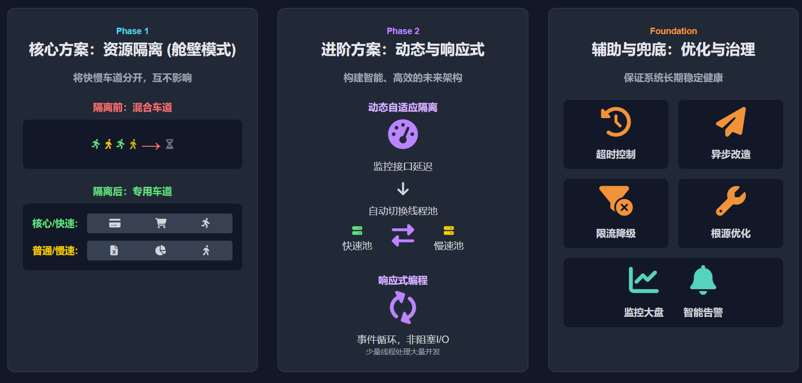

# 快慢接口占用同一线程池导致资源竞争，怎么解决？

场景题：**商家的接口有快有慢，慢的接口会一直占用线程池导致快接口无法被执行，怎么解决？**

针对“快慢接口占用同一线程池导致资源竞争”这个问题，我的解决方案是一个分层、系统化的组合策略，不仅要解决眼前的资源隔离问题，更要从系统设计和长远治理的角度出发，构建一个健壮、高可用的服务体系。

我的整体思路可以概括为：**“隔离为核，优化为本，监控为盾”**。

***

### **第一层：核心解决方案 —— 资源隔离 (舱壁模式)**

这是解决问题的最直接、最有效的手段。其本质是应用分布式系统设计中的 **“舱壁模式” (Bulkhead Pattern)**。就像轮船用密封舱来防止因局部破损而导致整船沉没一样，我们通过隔离线程池，来防止慢接口拖垮整个应用。

**1. 隔离策略：**

* **按“业务优先级”隔离 (推荐)**：
  * **实现**：创建至少两个线程池，例如 <code>core-business-pool</code> 和 <code>general-business-pool</code>。
  * **划分**：将支付、下单等核心、高频且必须快速响应的接口绑定到 <code>core-business-pool</code>；将报表生成、数据导出、调用外部非核心依赖等耗时较长或不那么重要的接口绑定到 <code>general-business-pool</code>。
  * **配置**：为核心线程池配置更高的资源优先级，例如更多的核心线程数、更短的队列等待时间，并采用更激进的拒绝策略（如 <code>AbortPolicy</code>），实现快速失败，避免核心业务长时间等待。
* **按“响应速度”隔离**：
  * **实现**：创建 <code>fast-api-pool</code> 和 <code>slow-api-pool</code>。
  * **划分**：根据历史性能数据（如P99响应时间）对接口进行静态或动态的划分。
  * **挑战**：这种方式的维护成本较高，因为接口的快慢属性可能会变化。

**2. 隔离的成本与权衡：** 线程池隔离并非没有成本，它会增加应用的内存占用和管理的复杂性。因此，需要根据业务的实际情况来决定隔离的粒度，避免过度拆分。

***

### **第二层：进阶方案 —— 从静态到动态，从阻塞到非阻塞**

在实现了基础隔离后，我们可以引入更智能、更高效的架构来进一步提升系统的弹性和吞吐量。

**1. 动态自适应隔离：** 静态划分的痛点在于，一个“快接口”可能因为下游依赖抖动或数据量突增而临时“变慢”。

* **实现**：结合服务监控（如 Prometheus）和动态配置中心（如 Nacos/Apollo）。
* **机制**：
  1. 实时监控每个接口的P99响应时间。
  2. 当某个接口的延迟连续N次超过设定的阈值（例如 500ms），系统通过配置中心自动下发指令。
  3. 应用层的流量分发逻辑（如自定义注解或AOP）根据新配置，将该接口的后续请求动态切换到“慢接口线程池”或“降级线程池”。
  4. 当接口恢复正常后，再自动切回来。
* **价值**：构建了一个具备“自愈”能力的弹性系统。

**2. 架构范式演进：响应式编程 (Reactive Programming)** 以上方案都是在传统的“一个请求一个线程 (Thread-Per-Request)”阻塞模型下的优化。要从根本上解决线程因I/O等待而被“无效占用”的问题，可以引入响应式编程模型。

* **核心思想**：采用**事件循环 (Event Loop)** 和 **非阻塞I/O**。当一个任务（如调用慢接口）需要等待时，执行线程不会被阻塞，而是会被立即释放去处理其他请求。当慢接口返回结果后，通过回调或事件通知，由某个空闲线程继续完成后续处理。
* **技术栈**：Spring WebFlux / Project Reactor, Vert.x, Akka 等。
* **价值**：可以用极少数的线程（如CPU核心数）来支撑极高的并发量。慢接口的“慢”，仅仅影响它自身的响应延迟，而不会“霸占”线程资源，从而天然地隔离了对快接口的影响。这是解决此类问题的**终极演进方向**。

***

### **第三层：辅助与兜底 —— 主动优化与全面治理**

在做好隔离的同时，我们必须主动管理和优化慢接口本身，并建立完善的监控体系。

**1. 主动优化慢接口：**

* **强制超时控制**：为所有可能慢的调用（DB查询、RPC）设置明确的、合理的超时时间（例如通过 <code>Future.get(timeout)</code> 或框架配置），超时后立即中断并释放线程，返回友好提示。这是防止雪崩的必要手段。
* **异步化改造**：对于不需要实时返回结果的业务，如日志上报、发短信/邮件、数据统计等，应彻底异步化。
  * **方案**：引入消息队列（如 RabbitMQ, Kafka），业务线程仅负责将任务投递到MQ，然后立即返回，由下游的消费者服务去慢慢处理，完全不占用线上业务线程池。
* **限流与降级**：当慢接口负载过高时，必须有保护措施。
  * **限流**：使用 <code>Guava RateLimiter</code> 或 <code>Sentinel</code> 等工具，限制其并发量，超出部分直接拒绝或排队。
  * **降级**：在接口超时或不可用时，返回缓存数据、默认值或兜底逻辑，保证核心流程不中断。
* **根源性能优化**：这是最根本的办法。通过SQL加索引、优化大查询、为第三方调用增加缓存（Redis）等方式，将“慢接口”变成“快接口”。

**2. 兜底方案：监控告警与容量规划**

* **精细化监控**：使用 Prometheus + Grafana 等工具，对**每个线程池**进行独立的监控。
  * **核心指标**：活跃线程数、峰值线程数、队列中等待的任务数、任务平均执行时间、任务拒绝数。
* **智能化告警**：设置精准的告警规则。例如：当“慢接口线程池”的 <code>活跃线程数 == 核心线程数</code> 且 <code>队列等待数 > 阈值</code> 持续超过1分钟，立即触发告警，通知工程师介入排查。
* **容量规划**：监控数据是未来容量规划和优化的基础。通过分析线程池的运行状况，我们可以科学地决策是应该扩容线程池，还是必须对某些慢接口进行专项优化。

***

### **总结**

面对这个问题，我会采用一套组合拳：

1. **立即执行**：通过**舱壁模式**进行线程池隔离，快速止损，保证核心业务的稳定性。
2. **中期规划**：引入**动态隔离**和**响应式编程**，提升系统架构的先进性和弹性。
3. **长期坚持**：对慢接口进行**主动优化、限流、异步化改造**，并建立完善的**监控告警**体系，实现长效治理。

通过这套“隔离+优化+监控”的立体化方案，我们可以从根本上解决快慢接口的资源冲突问题，打造一个高性能、高可用的健壮服务。
