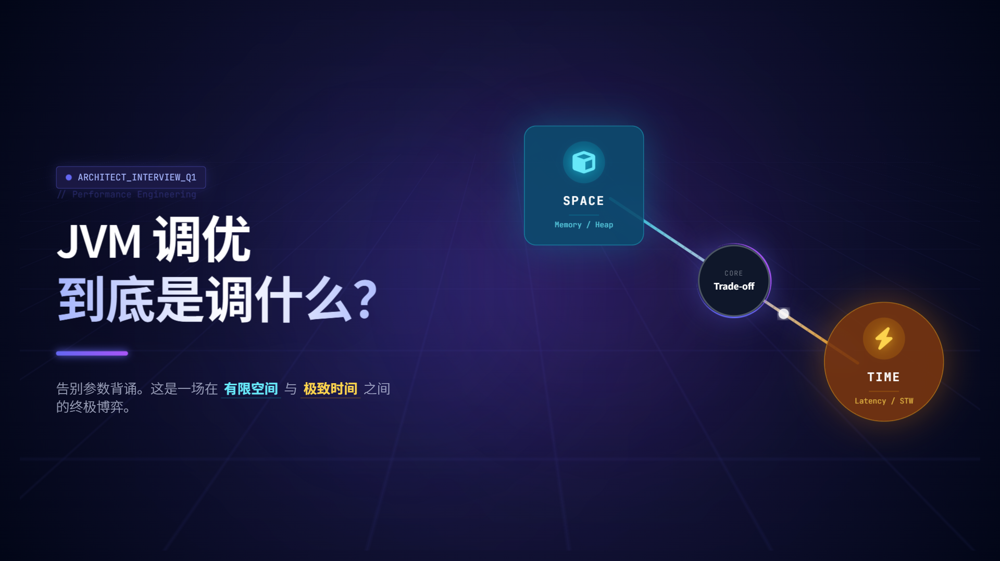
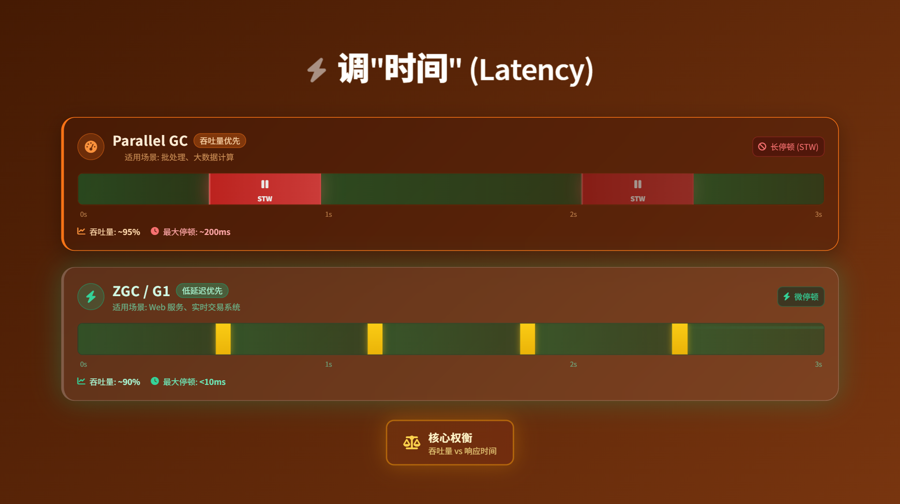
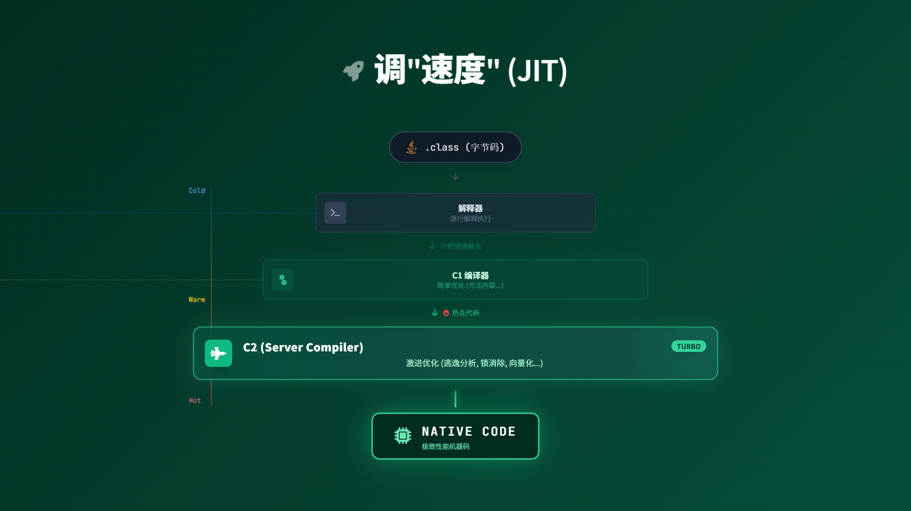
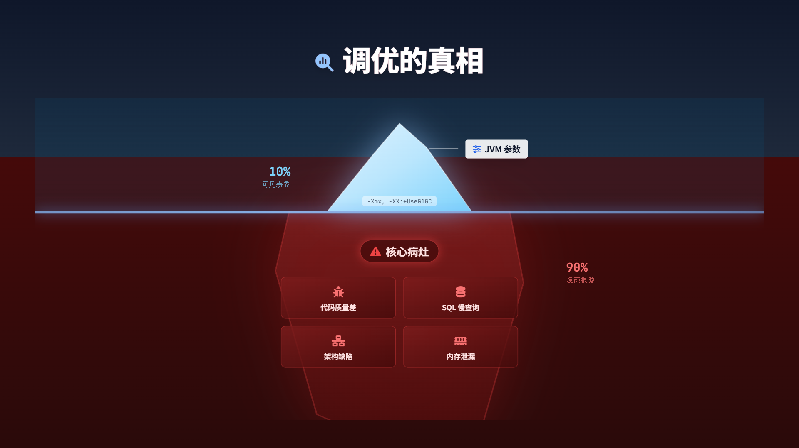

# JVM 调优，到底是调什么？

Java 虚拟机（JVM）是一个高度复杂的运行时环境，其性能表现取决于内存管理、垃圾回收算法以及即时编译器的协同工作。对于资深开发者而言，调优不应止步于对启动参数的试错，而应建立对底层机制的深刻理解。

本文将结合可视化模型，深入剖析影响 Java 性能的四大核心维度。

***

## 1. The Memory

在并发编程中，理解 JVM 的内存模型（JMM）是性能优化的基石。如上图所示，我们可以将内存区域划分为**线程私有（Stack）与线程共享（Heap）**两大部分。

* **栈内存（Stack）：无锁的高速通道** 对应图中左侧的独立工作区。每个线程在创建时都会分配私有的虚拟机栈，用于存储局部变量、操作数栈和方法出口信息。
  *  **技术特性：** 栈内存的分配与回收严格遵循方法调用的生命周期（LIFO），不存在线程安全问题，因此**不需要加锁**，访问速度极快。 
  * **优化启示：** 应当充分利用**栈上分配（Stack Allocation）与标量替换**技术。如果一个对象经过逃逸分析（Escape Analysis）被判定未逃逸出当前方法，JVM 会直接在栈上分配该对象，从而完全避免堆内存的分配开销和 GC 压力。
* **堆内存（Heap）：高并发的竞争热点** 对应图中右侧的共享区域。所有的对象实例均在此分配。 
  * **技术特性：** 由于堆是所有线程共享的，当多线程并发分配内存或修改共享对象时，必须引入**锁（Lock）**或 CAS（Compare-And-Swap）机制来保证数据一致性。这正是系统吞吐量下降的主要诱因。

***

## 2. The Cleanup

Java 的自动内存管理依赖于垃圾回收器（GC），但这一便利机制伴随着不可忽视的运行时开销——**Stop-The-World (STW)**。

* **分代收集理论（Generational Hypothesis）** JVM 堆内存的设计基于一个经验法则：绝大多数对象都是"朝生夕死"的。因此，堆被划分为**年轻代（Young Gen）****和****老年代（Old Gen）**。
  * **Minor GC**：发生于年轻代，频率高，速度快，主要清理临时对象。
  * **Major/Full GC**：涉及老年代，通常采用标记-整理（Mark-Compact）算法，耗时较长，会导致显著的系统停顿。
* **吞吐量 vs 延迟** 如图所示，GC 线程（清洁工）介入时，业务线程往往需要暂停。调优的本质是在**吞吐量**（业务运行时间 / 总时间）和**低延迟**（单次 STW 的最大停顿）之间寻找平衡点。 
  * **优化启示：** 理想的 GC 模式是让对象在年轻代即被回收。如果大量短期对象因 Survivor 区过小而过早晋升（Promotion）到老年代，将触发频繁的 Full GC，这是性能急剧下降的典型特征。

***

## 3. The Speed

Java 常被误解为"解释执行"的语言，实际上，现代 JVM 采用的是**解释器与编译器并存**的混合模式。代码的执行效率是一个动态"进化"的过程。

* **Interpreter（解释器）** 程序启动初期，JVM 使用解释器逐行执行字节码。这种方式启动快，但执行效率较低。
* **JIT（即时编译）分层架构** 随着代码运行，JVM 会通过热点探测（Hot Spot Detection）识别高频调用的方法：
  1. **C1 编译器**：进行简单、快速的优化（如方法内联、冗余消除），生成本地代码。
  2. **C2 编译器（Server Compiler）**：当热度达到阈值，C2 介入进行激进的**全盘优化**。它会基于运行时采集的 Profile 信息，执行逃逸分析、锁消除、向量化等高级优化。

**优化启示：** 这解释了 Java 应用的**预热（Warm-up）**现象。在进行性能压测时，必须给予系统足够的运行时间，等待核心代码完成从 Interpreter 到 C2 Native Code 的编译转换，才能获得真实的性能数据。

***

## 4. The Truth

在实际的生产环境调优中，我们往往容易陷入"参数调优"的误区。

* **可见表象（10%）：JVM 参数**<code>-Xmx</code>、<code>-XX:NewRatio</code>、<code>-XX:+UseG1GC</code> 等参数确实能影响 JVM 的行为，但它们的作用是有限的。参数调整通常只能解决配置不合理导致的资源限制问题，无法修复代码层面的逻辑缺陷。
* **隐蔽根源（90%）：代码与架构** 如图中冰山的水下部分所示，真正的性能杀手通常隐藏在业务逻辑和架构设计中：
  * **内存泄漏**：静态集合类（Static Collections）只增不减，导致堆内存逐渐耗尽。
  * **I/O 阻塞**：在循环中进行数据库查询或网络调用。
  * **锁竞争**：过大的锁粒度导致线程串行化。
  * **架构缺陷**：缺乏缓存层导致数据库击穿。

**总结** JVM 调优不应本末倒置。在调整任何 JVM 参数之前，首先应利用 Profiler 工具（如 JProfiler, Async-profiler）排查代码层面的热点和瓶颈。只有当代码逻辑和架构设计均已优化，且问题依然存在时，JVM 参数调优才具有真正的价值。
