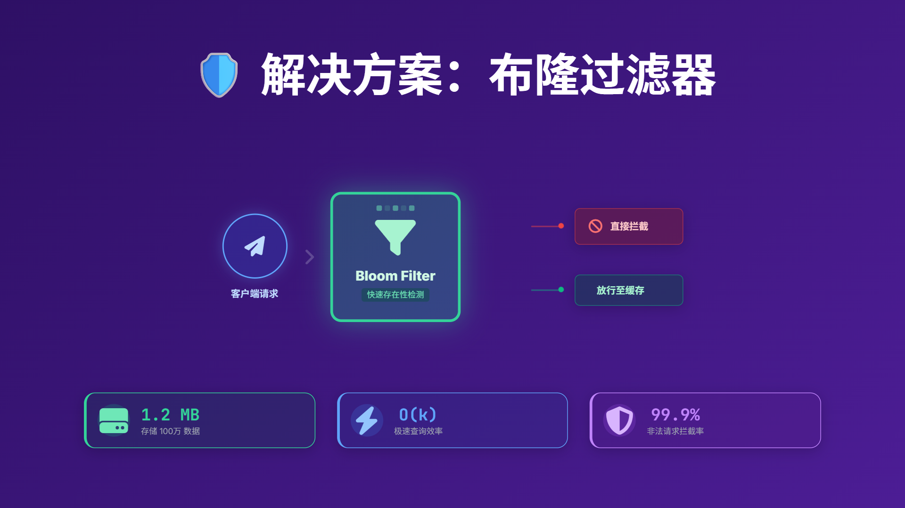
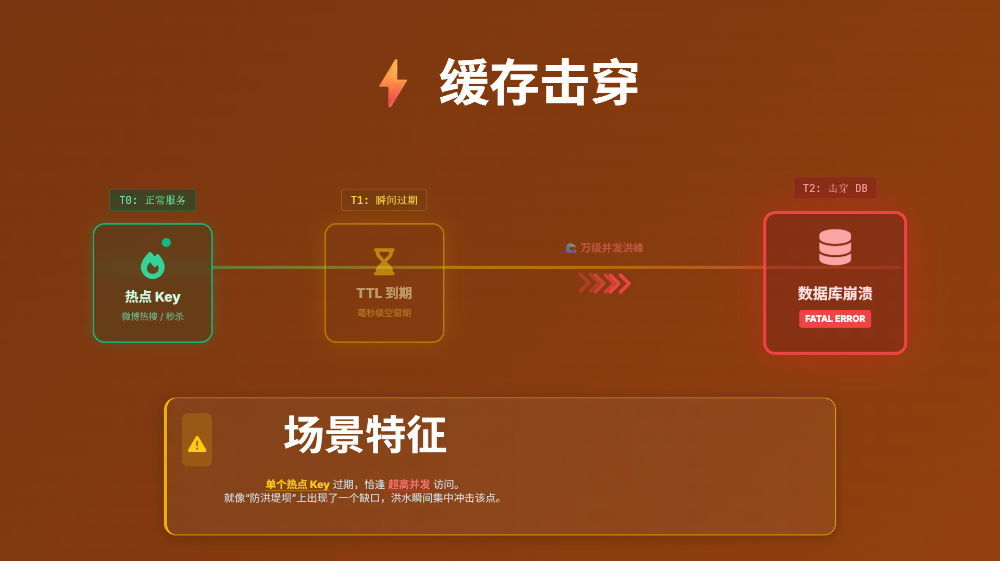
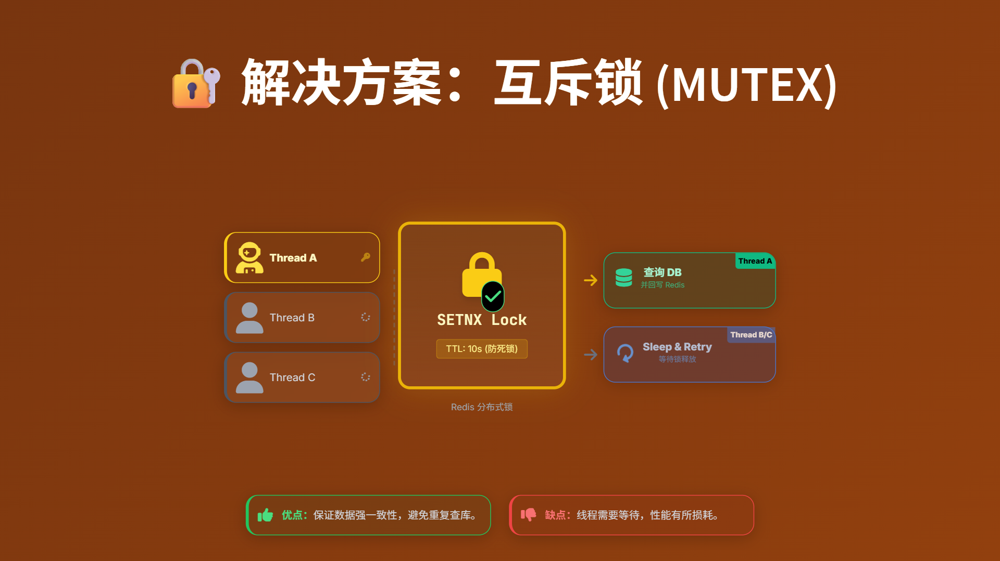
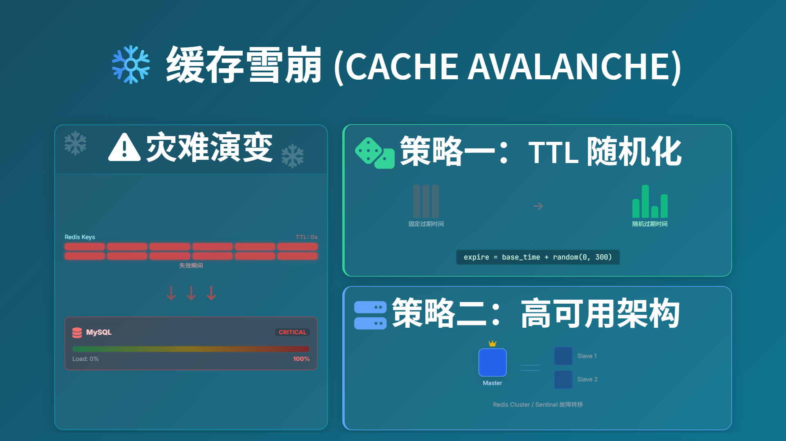

# Redis 缓存失效三大经典场景

<font style="color:rgb(38, 38, 38);">在分布式高并发系统的设计中，Redis 无疑是提升性能的银弹。它通过内存的高速读写，为脆弱的数据库挡下了成千上万的 QPS。然而，引入缓存层也引入了新的复杂性。当缓存因为某些原因“失效”或“被绕过”时，流量会瞬间像洪水一样冲击数据库，导致系统雪崩。</font>


<font style="color:rgb(38, 38, 38);">本文将结合可视化架构图，深入剖析 Redis 缓存最经典的三大失效场景——</font>**<font style="color:rgb(38, 38, 38);">穿透、击穿、雪崩</font>**<font style="color:rgb(38, 38, 38);">，并提供生产级的防御策略。</font>

***

## <font style="color:rgb(38, 38, 38);">一、 缓存穿透 (Cache Penetration)</font>

### <font style="color:rgb(38, 38, 38);">1. 场景复现：流量的“隐形杀手”</font>


**<font style="color:rgb(38, 38, 38);">技术剖析：</font>**<font style="color:rgb(38, 38, 38);"> 缓存穿透是指查询一个</font>**<font style="color:rgb(38, 38, 38);">根本不存在的数据</font>**<font style="color:rgb(38, 38, 38);">。 在正常的缓存策略中（Cache Aside Pattern），我们通常遵循“先查缓存，没有则查库，查到后回写缓存”的逻辑。但如果查询的 Key 在数据库中也不存在，那么这个 Key 永远不会被写入缓存。</font>

<font style="color:rgb(38, 38, 38);">这就导致了一个致命漏洞：如果恶意用户（或爬虫）构造海量不存在的 ID（如 </font><code><font style="color:rgb(38, 38, 38);background-color:rgba(175, 184, 193, 0.2);">id=-1</font></code><font style="color:rgb(38, 38, 38);"> 或随机 UUID）发起请求，这些请求将全部</font>**<font style="color:rgb(38, 38, 38);">绕过 Redis，直接打在数据库上</font>**<font style="color:rgb(38, 38, 38);">。此时，Redis 失去了防御作用，数据库连接池会瞬间被占满，导致正常的业务请求无法处理。</font>

### <font style="color:rgb(38, 38, 38);">2. 硬核防御：布隆过滤器 (Bloom Filter)</font>



**<font style="color:rgb(38, 38, 38);">原理深度：</font>**<font style="color:rgb(38, 38, 38);"> 为了解决穿透问题，我们需要在请求到达后端存储之前，就快速判断“这个 Key 是否可能存在”。布隆过滤器（Bloom Filter）是解决此类问题的最佳数据结构。</font>

* **<font style="color:rgb(38, 38, 38);">核心机制</font>**<font style="color:rgb(38, 38, 38);">：它由一个很长的二进制向量（Bit Array）和一系列随机映射函数（Hash Functions）组成。当一个元素被加入集合时，通过 K 个 Hash 函数将这个元素映射成位数组中的 K 个点，并将它们置为 1。</font>
* **<font style="color:rgb(38, 38, 38);">空间效率</font>**<font style="color:rgb(38, 38, 38);">：它极度节省空间。相比于 HashMap 存储完整的 Key，布隆过滤器仅需存储几个 Bit。如架构图所示，仅需 1.2MB 的内存即可映射 100 万条数据。</font>
* **<font style="color:rgb(38, 38, 38);">概率权衡</font>**<font style="color:rgb(38, 38, 38);">：</font>
  * <font style="color:rgb(38, 38, 38);">如果布隆过滤器说</font>**<font style="color:rgb(38, 38, 38);">不存在</font>**<font style="color:rgb(38, 38, 38);">，则</font>**<font style="color:rgb(38, 38, 38);">一定不存在</font>**<font style="color:rgb(38, 38, 38);">（100% 拦截）。</font>
  * <font style="color:rgb(38, 38, 38);">如果布隆过滤器说</font>**<font style="color:rgb(38, 38, 38);">存在</font>**<font style="color:rgb(38, 38, 38);">，则</font>**<font style="color:rgb(38, 38, 38);">可能存在</font>**<font style="color:rgb(38, 38, 38);">（存在极低的误判率）。</font>

**<font style="color:rgb(38, 38, 38);">架构落地：</font>**<font style="color:rgb(38, 38, 38);"> 在生产环境中，我们通常在 Redis 前置一层布隆过滤器。</font>

1. <font style="color:rgb(38, 38, 38);">请求进来，先问布隆过滤器：Key 存在吗？</font>
2. <font style="color:rgb(38, 38, 38);">若不存在，直接返回空，</font>**<font style="color:rgb(38, 38, 38);">完全不访问 Redis 和 DB</font>**<font style="color:rgb(38, 38, 38);">。</font>
3. <font style="color:rgb(38, 38, 38);">若存在（可能误判），再走正常的“查缓存 -> 查库”流程。</font>

***

## <font style="color:rgb(38, 38, 38);">二、 缓存击穿 (Cache Breakdown)</font>

### <font style="color:rgb(38, 38, 38);">1. 场景复现：热点 Key 的“单点爆破”</font>



**<font style="color:rgb(38, 38, 38);">技术剖析：</font>**<font style="color:rgb(38, 38, 38);"> 缓存击穿不同于穿透，它针对的是</font>**<font style="color:rgb(38, 38, 38);">真实存在</font>**<font style="color:rgb(38, 38, 38);">的数据。 问题的核心在于</font>**<font style="color:rgb(38, 38, 38);">“热点”与“并发”</font>**<font style="color:rgb(38, 38, 38);">。当一个被高频访问的 Key（例如微博热搜、秒杀活动的商品详情）在缓存中设置了过期时间（TTL）。</font>

<font style="color:rgb(38, 38, 38);">当 TTL 到期的那一瞬间（Time T1），缓存失效。紧接着，在缓存被重新构建之前的这几百毫秒“空窗期”内，成千上万的并发请求（Time T2）同时涌入。因为缓存未命中，这些请求会不约而同地去访问数据库。这被称为</font>**<font style="color:rgb(38, 38, 38);">“惊群效应”</font>**<font style="color:rgb(38, 38, 38);">，数据库瞬间承受的压力是普通时刻的数万倍，极易导致宕机。</font>

### <font style="color:rgb(38, 38, 38);">2. 硬核防御：互斥锁 (Mutex Lock)</font>



**<font style="color:rgb(38, 38, 38);">原理深度：</font>**<font style="color:rgb(38, 38, 38);"> 解决击穿的核心思路是</font>**<font style="color:rgb(38, 38, 38);">“串行化”</font>**<font style="color:rgb(38, 38, 38);">。既然是并发导致的问题，我们就强制让重建缓存的操作变成单线程。</font>

**<font style="color:rgb(38, 38, 38);">实现逻辑（伪代码）：</font>**

```java
public Object getData(String key) {
    // 1. 查询缓存
    Object value = redis.get(key);
    if (value != null) return value;
    
    // 2. 缓存未命中，尝试获取互斥锁
    // SETNX key "1" EX 10 (设置过期时间防止死锁)
    if (redis.tryLock(lockKey)) {
        try {
            // Double Check: 再次查询缓存，防止重复查库
            value = redis.get(key);
            if (value != null) return value;
    
            // 3. 查询数据库
            value = db.query(key);
            // 4. 回写缓存
            redis.set(key, value);
        } finally {
            // 5. 释放锁
            redis.unlock(lockKey);
        }
    } else {
        // 6. 获取锁失败，休眠后重试
        Thread.sleep(50);
        return getData(key);
    }
    return value;
}
```

**<font style="color:rgb(38, 38, 38);">方案权衡：</font>**

* **<font style="color:rgb(38, 38, 38);">CP 模型（强一致性）</font>**<font style="color:rgb(38, 38, 38);">：互斥锁保证了只有一个线程去查库，避免了数据库压力，且保证了数据的一致性。</font>
* **<font style="color:rgb(38, 38, 38);">性能损耗</font>**<font style="color:rgb(38, 38, 38);">：如架构图所示，Thread B 和 Thread C 需要等待，这会降低系统的吞吐量。如果业务追求极致的高可用（AP），可以考虑</font>**<font style="color:rgb(38, 38, 38);">“逻辑过期”</font>**<font style="color:rgb(38, 38, 38);">方案（即 Key 永不过期，但在 Value 中包含过期时间戳，由后台线程异步重建）。</font>

***

## <font style="color:rgb(38, 38, 38);">三、 缓存雪崩 (Cache Avalanche)</font>

### <font style="color:rgb(38, 38, 38);">1. 场景复现：灾难性的“多米诺骨牌”</font>



**<font style="color:rgb(38, 38, 38);">技术剖析：</font>**<font style="color:rgb(38, 38, 38);"> 缓存雪崩是击穿的“集群版”。它不再局限于单个 Key，而是指</font>**<font style="color:rgb(38, 38, 38);">海量的 Key 在同一时刻大面积失效</font>**<font style="color:rgb(38, 38, 38);">。 这种情况通常发生在：</font>

1. **<font style="color:rgb(38, 38, 38);">Redis 宕机</font>**<font style="color:rgb(38, 38, 38);">：整个缓存层不可用，所有流量直接冲向数据库。</font>
2. **<font style="color:rgb(38, 38, 38);">TTL 同步</font>**<font style="color:rgb(38, 38, 38);">：在代码中批量加载数据时，设置了相同的过期时间（例如都是 1 小时）。</font>

<font style="color:rgb(38, 38, 38);">当时间一到，原本由 Redis 支撑的流量像雪崩一样全部转移到数据库，数据库根本无法承受这种量级的 QPS，导致直接宕机，甚至引发整个微服务链路的连锁崩溃。</font>

### <font style="color:rgb(38, 38, 38);">2. 硬核防御：随机化与高可用</font>

**<font style="color:rgb(89, 89, 89);">\[建议插入位置：PPT 场景3 - 右侧防御策略部分]</font>***<font style="color:rgb(89, 89, 89);">（图注：TTL 随机化示意图与 Redis 高可用架构）</font>*

**<font style="color:rgb(38, 38, 38);">策略一：TTL 随机化 (Randomize TTL)</font>**<font style="color:rgb(38, 38, 38);"> 既然问题出在“同时过期”，解法就是让过期时间分散开来。 在设置过期时间时，不要使用固定的数值，而是在基础时间上增加一个随机值。</font>

* **<font style="color:rgb(38, 38, 38);">公式</font>**<font style="color:rgb(38, 38, 38);">：</font><code><font style="color:rgb(38, 38, 38);background-color:rgba(175, 184, 193, 0.2);">Final_TTL = Base_Time + Random(0, 300)</font></code>
* **<font style="color:rgb(38, 38, 38);">效果</font>**<font style="color:rgb(38, 38, 38);">：如架构图所示，原本集中的失效点被均匀地“打散”在时间轴上，数据库的压力曲线会变得平滑，避免了尖峰冲击。</font>

**<font style="color:rgb(38, 38, 38);">策略二：架构高可用 (High Availability)</font>**<font style="color:rgb(38, 38, 38);"> 针对 Redis 宕机导致的雪崩，必须在架构层面保证高可用。</font>

* **<font style="color:rgb(38, 38, 38);">Redis Sentinel（哨兵）</font>**<font style="color:rgb(38, 38, 38);">：监控主节点状态，自动完成故障转移。</font>
* **<font style="color:rgb(38, 38, 38);">Redis Cluster（集群）</font>**<font style="color:rgb(38, 38, 38);">：通过分片存储数据，即使某个分片宕机，也不会导致全盘崩溃。</font>

***

## <font style="color:rgb(38, 38, 38);">四、 总结</font>


<font style="color:rgb(38, 38, 38);">缓存系统设计的本质，是在</font>**<font style="color:rgb(38, 38, 38);">一致性（Consistency）、可用性（Availability）和分区容错性（Partition Tolerance）</font>**<font style="color:rgb(38, 38, 38);">之间做权衡。</font>

* **<font style="color:rgb(38, 38, 38);">穿透</font>**<font style="color:rgb(38, 38, 38);">是“无中生有”，防线要设在最外层（布隆过滤器）。</font>
* **<font style="color:rgb(38, 38, 38);">击穿</font>**<font style="color:rgb(38, 38, 38);">是“以点破面”，关键在于控制并发（互斥锁）。</font>
* **<font style="color:rgb(38, 38, 38);">雪崩</font>**<font style="color:rgb(38, 38, 38);">是“全线崩塌”，重点在于分散压力（随机 TTL）和架构容灾。</font>

<font style="color:rgb(38, 38, 38);">理解这三大场景背后的原理，并根据业务量级选择合适的防御方案，是每一位后端架构师的必修课。</font>
