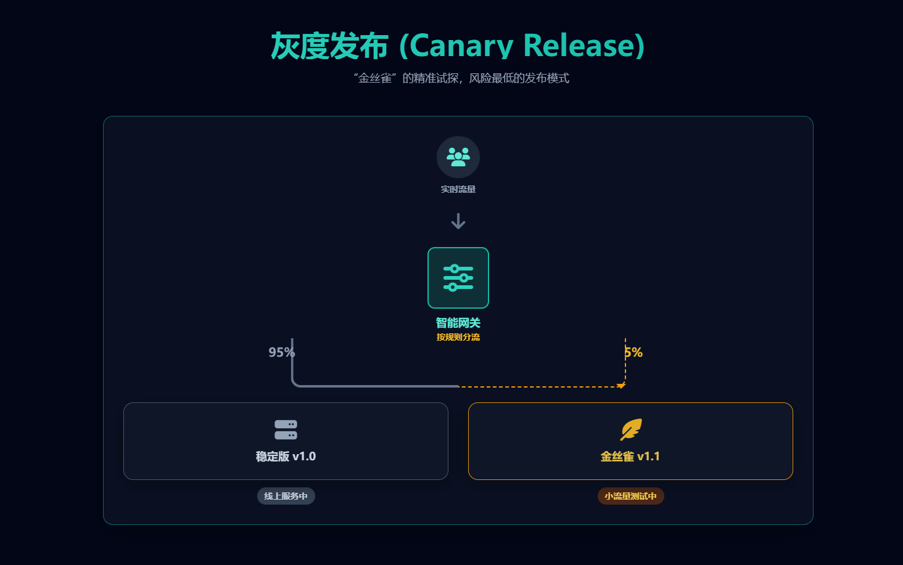
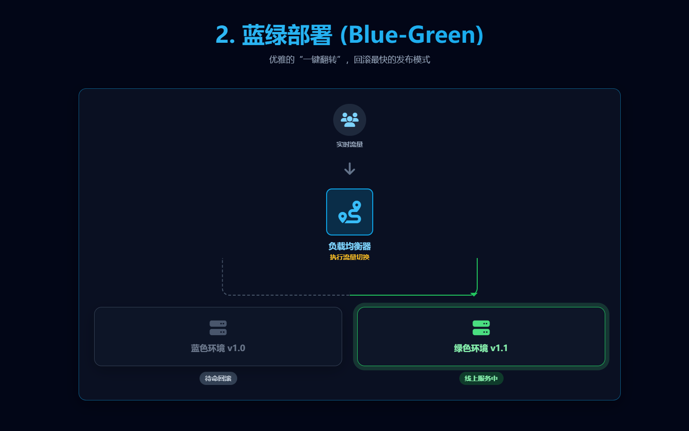
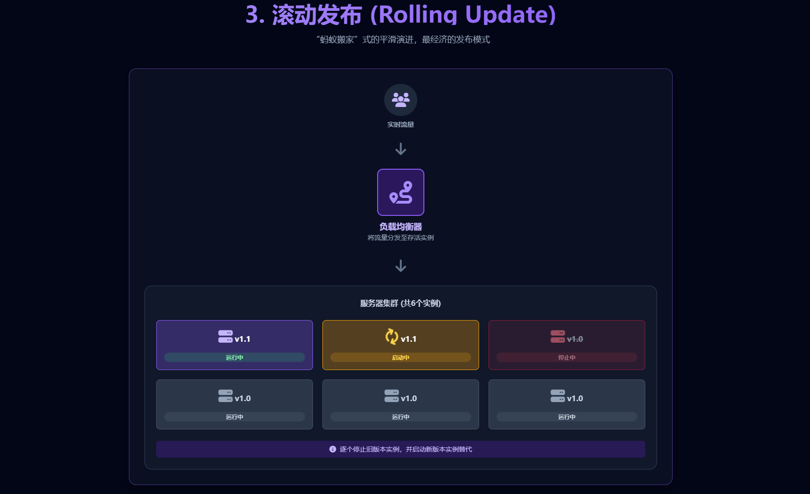
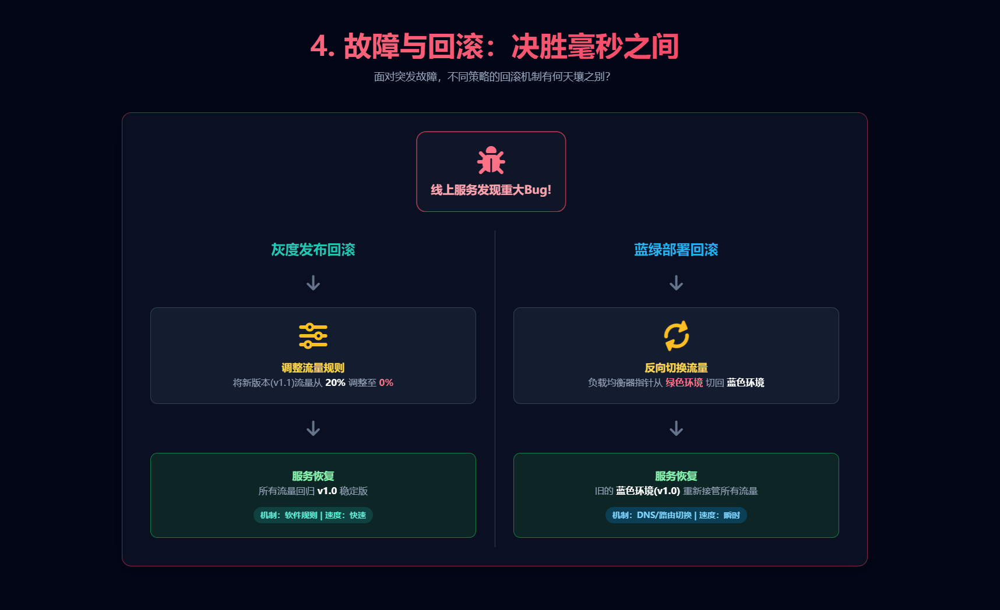
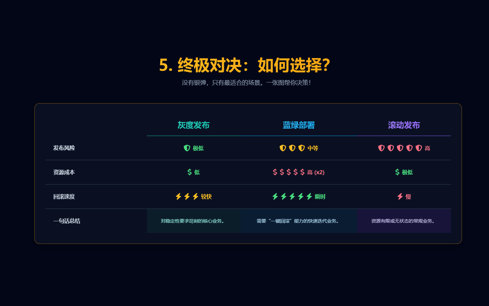

# 【上线避坑】新版本 5 分钟崩服？灰度 + 蓝绿 + 滚动发布实战

在现代软件开发中，“发布”是连接代码与价值的最后一公里，却也常常是开发者最心惊胆战的一环。一次失败的发布，轻则引发用户抱怨，重则可能导致服务中断和经济损失。为了确保发布的稳定性和可控性，业界探索出了多种发布策略，其中，灰度发布、蓝绿部署和滚动发布无疑是应用最广、最高效的三种模式。

本文将通过深入浅出的方式，带你彻底理解这三种策略的核心思想、工作流程、关键差异以及它们各自的最佳适用场景。

### 1. 灰度发布 (Canary Release)：小步快跑的风险控制艺术
灰度发布，又称金丝雀发布，其名源于矿工用金丝雀来探测矿井中有害气体的典故。在软件发布中，“金丝雀”就是我们的新版本，我们先让一小部分用户（比如内部员工、特定地区或特征的用户）去“试用”这个新版本，以此来“探测”它是否存在问题。

**工作流程：**

1. **部署金丝雀**：在保留现有稳定版（v1.0）集群的同时，部署一个或数个新版本（v1.1）的实例，我们称之为“金丝雀”环境。
2. **智能流量分发**：如图所示，通过配置流量网关（如 Nginx, Istio），将一小部分（例如 5%）的实时流量导入到金丝雀环境中，其余 95% 的流量依然由稳定版处理。
3. **持续监控与验证**：密切监控金丝雀环境的各项指标，包括错误率、延迟、CPU/内存使用率以及核心业务指标（如订单成功率）。
4. **逐步放量或回滚**：如果金丝雀表现稳定，则逐步增大导入新版本的流量比例（如 20% -> 50% -> 100%）。如果发现问题，立即将流量切回 0%，完成“回滚”，从而将风险影响降至最低。

**核心优势**：风险极低，能够基于真实流量进行验证，非常适合对稳定性要求苛刻的核心业务。

### 2. 蓝绿部署 (Blue-Green Deployment)：优雅转身的“一键切换”魔术
蓝绿部署的核心在于通过“空间换时间”的策略，实现零停机和近乎瞬时的回滚。它要求准备两套完全相同且独立隔离的生产环境，分别称为“蓝色”环境和“绿色”环境。

**工作流程：**

1. **双环境并存**：在任何时候，只有一套环境对外提供服务（例如，图中展示的绿色环境 v1.0）。另一套蓝色环境则处于待命状态。
2. **后台部署与测试**：将新版本（v1.1）部署到待命的蓝色环境中。由于蓝色环境没有线上流量，我们可以在上面进行充分的集成测试和验证，而不必担心影响用户。
3. **瞬时流量切换**：当蓝色环境准备就绪后，通过修改负载均衡器或 DNS 配置，将所有线上流量从绿色环境瞬间切换到蓝色环境。此时，蓝色环境 v1.1 正式成为新的线上环境。
4. **旧环境转为待命**：绿色环境 v1.0 不再接收流量，成为下一次发布的待命环境。

**核心优势**：发布和回滚速度极快（接近瞬时），发布过程中无停机时间。非常适合需要快速迭代、对回滚时效性要求高的业务。

### 3. 滚动发布 (Rolling Update)：稳扎稳打的渐进式演进
滚动发布是三种策略中最常见、最易于理解的一种。它通过逐个或分批次地用新版本实例替换旧版本实例，来实现系统的平滑升级，就像“蚂蚁搬家”一样。

**工作流程：**

1. **分批次更新**：在一个由多个实例组成的集群中，先取出一部分（例如一个）旧版本（v1.0）的实例，停止服务并进行升级。
2. **启动新实例**：将该实例升级到新版本（v1.1）后，重新启动并将其加入到服务集群中。
3. **循环迭代**：重复以上步骤，直到集群中所有的旧版本实例都被新版本替代。

**核心优势**：资源成本极低，不需要额外的服务器；实现简单，是许多容器编排系统（如 Kubernetes）的默认发布方式。

### 4. 决胜时刻：故障与回滚机制对比
发布策略的优劣，不仅体现在上线过程的平顺，更体现在出现问题时的“补救”能力。回滚机制是衡量一个发布策略成熟度的关键。

+ **蓝绿部署的回滚**：堪称“王者”。如图所示，只需再次操作负载均衡器，将流量指回仍然在待命的旧版本环境即可。这个过程是**瞬时**的，对用户几乎无感知。
+ **灰度发布的回滚**：非常**快速**。只需在流量网关层面修改规则，将新版本的流量权重降为 0%，所有用户流量就会立刻回归到稳定的旧版本。
+ **滚动发布的回滚**：相对**缓慢和复杂**。它本质上需要执行一次“反向”的滚动发布，即用旧版本实例去逐个替换已经升级的新版本实例。在紧急情况下，这个过程可能会显得漫长。

### 5. 终极对决：如何为你的业务选择最佳策略？
没有放之四海而皆准的“银弹”，只有最适合当前业务场景的选择。下面这张决策矩阵可以帮助你做出判断。

**一句话总结：**

+ **追求极致稳定，不容闪失的核心业务（如支付、交易）**：选择**灰度发布**，用真实流量验证一切。
+ **追求快速迭代，需要“一键后悔药”的敏捷业务（如电商前台、内容社区）**：选择**蓝绿部署**，享受瞬时回滚的从容。
+ **资源有限，或对发布过程中短暂的版本不一致不敏感的常规业务（如后台管理、无状态服务）**：选择**滚动发布**，经济实惠。

### 总结
掌握并灵活运用灰度发布、蓝绿部署和滚动发布这三大策略，是每一位架构师和开发者的必备技能。理解它们之间的核心权衡——**风险、成本与速度**——将帮助你的团队构建更具韧性、更高可用的系统，最终自信从容地面对每一次上线，彻底告别发布恐惧。
