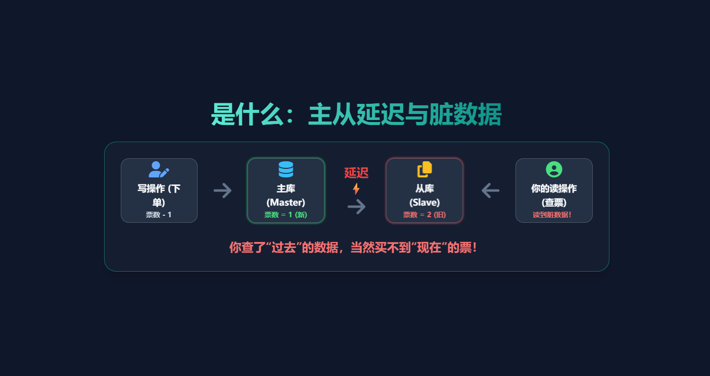
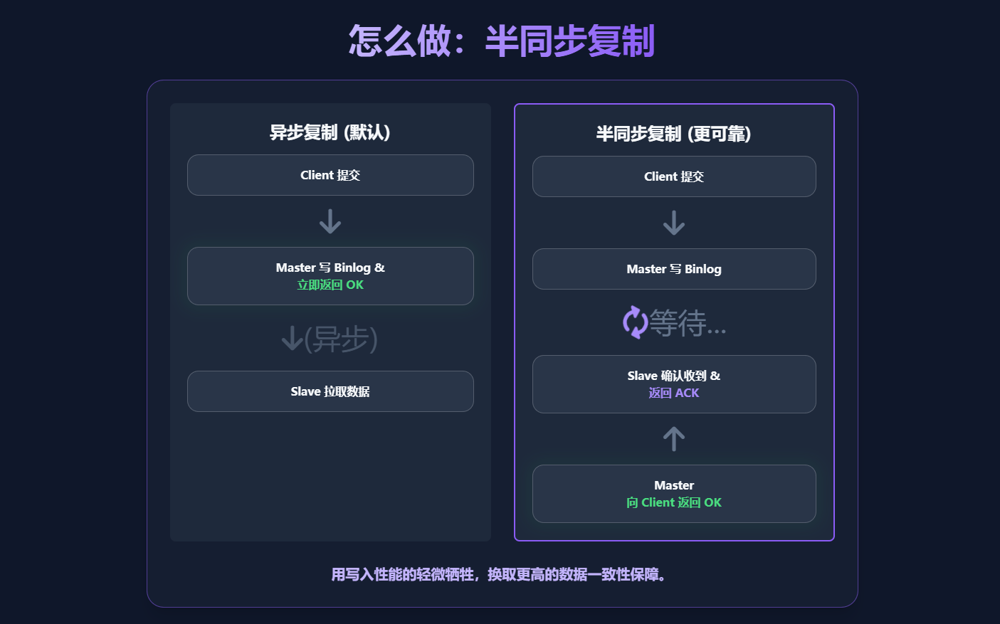
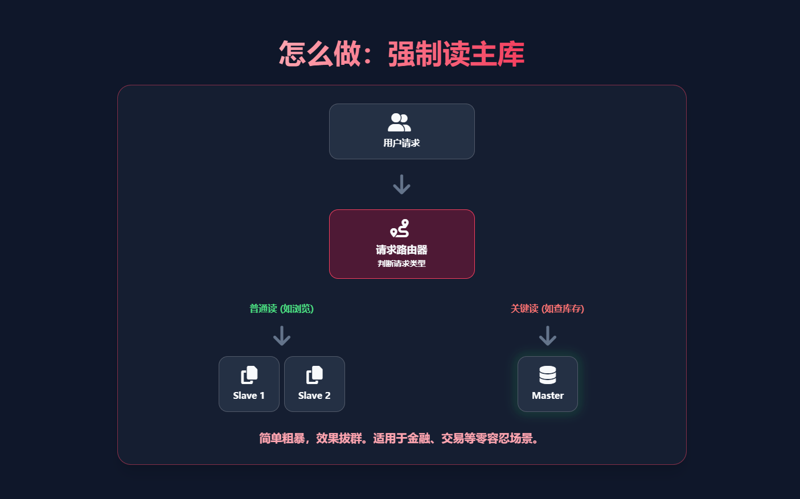
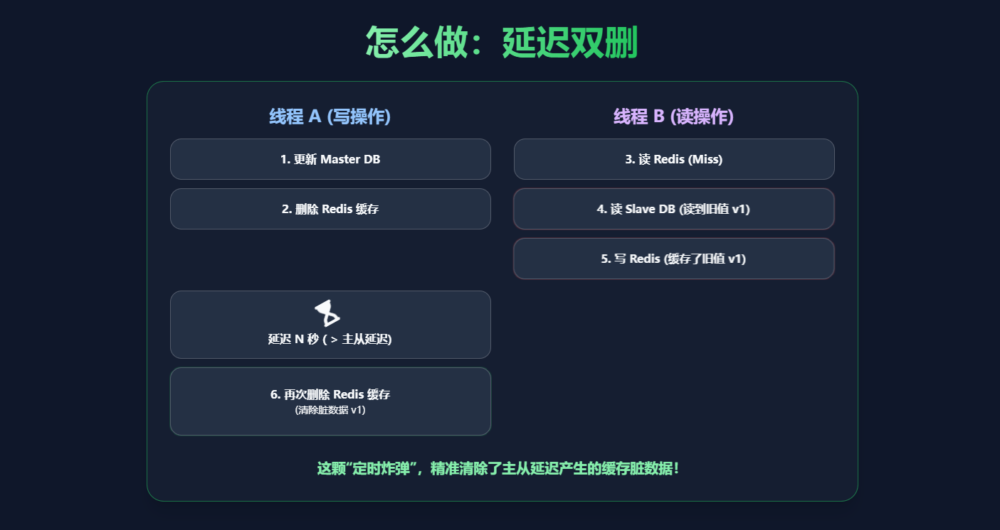

# 为什么12306总显示“有票”，点进去却“已售罄”？

## 

相信很多朋友都经历过这样的场景：在12306或各大抢票软件上，你死死盯着屏幕，看到“余票 2 张”的瞬间，心跳加速，光速点击进入，结果页面却无情地告诉你“已售罄”或“没有足够的票”。你捶胸顿足，以为是自己手速不够快，但事实果真如此吗？不，这个“锅”，很可能不该你来背，其背后的技术元凶，就是我们今天要硬核拆解的主题——**数据库主从同步延迟 (Master-Slave Replication Lag)**。

## 一、是什么：主从延迟与脏数据

为了应对高并发的读取请求（比如成千上万的人同时查票），现代互联网应用普遍采用**数据库读写分离**的架构。

* **写操作**：所有的数据写入、更新（如下单、支付），都发生在\*\*主数据库（Master）\*\*上。
* **读操作**：绝大部分的查询（如查余票、看商品详情），都分发到多个\*\*从数据库（Slave）\*\*上，以分担主库的压力。

主库的数据需要通过一个名为“主从复制”的机制，同步到各个从库。这个复制过程并非瞬时完成，它存在一个时间差，这个时间差，就是**主从延迟**。

当延迟发生时，一个致命的问题就出现了：**脏数据（Dirty Data）**。

简单来说，就是主库的数据已经更新了（比如，票被别人买走，库存变为1），但这个更新还没来得及同步到从库，你此刻的查询请求恰好打在了这个从库上，读到的自然是过期的、不准确的旧数据（库存仍然是2）。这就是“脏读”现象。

## 二、为什么：探究主从复制的“作案现场”

MySQL默认的主从复制是**异步**的。让我们深入其内部，看看延迟是如何产生的：

1. **主库（Master）**上的事务提交，数据变更被写入其<code>二进制日志（Binary Log, binlog）</code>。
2. **从库（Slave）**上的<code>I/O线程</code>连接到主库，请求并拉取<code>binlog</code>中的事件，将其写入到自己的<code>中继日志（Relay Log）</code>。
3. **从库（Slave）**上的<code>SQL线程</code>读取<code>Relay Log</code>中的事件，并在从库上重放（执行）这些SQL操作，实现数据同步。

整个链条中，从步骤1到步骤3的完成，中间任何一个环节出现网络波动、从库负载过高、或是有个大事务处理缓慢，都会导致主从数据的“时间差”，即主从延迟。

## 三、怎么做：应对主从延迟的“三板斧”

既然问题已经明确，我们该如何应对？业界沉淀出了多种成熟的方案，堪称“三板斧”，各有千秋。

### 方案一：半同步复制 (Semi-Synchronous Replication)

这是一种折中方案。在纯异步复制中，主库“不管不顾”，写完<code>binlog</code>就直接向客户端返回成功。而半同步复制则要求，主库在执行完写操作后，必须等待**至少一个从库**确认已经接收到<code>binlog</code>并写入自己的<code>Relay Log</code>后，才能向客户端返回成功。

* **优点**：极大地提高了数据一致性的保障，减少了主库宕机时数据丢失的风险。
* **缺点**：增加了写操作的延迟，因为需要等待从库的确认。

### 方案二：强制读主库 (Force Read from Master)

这是最简单粗暴，也最有效的方法。对于那些对数据一致性要求极高的操作，我们可以牺牲一部分读写分离带来的性能优势，直接将读请求路由到主库上。

* **适用场景**：金融级的账户余额查询、电商下单前的库存校验等。
* **实现方式**：在代码层面，通过数据库中间件或封装的路由逻辑，对特定类型的读请求打上“读主库”的标签。

### 方案三：缓存组合拳 (Cache-Based Solutions)

> **‘延迟双删’并不是用来解决‘数据库主从延迟’的直接方案，而是解决‘缓存与数据库之间数据一致性’的经典方案。**
>
> * **解决‘数据库主从脏读’：** 用 **强制读主库 **或 **半同步复制**。
> * **解决‘缓存与数据库不一致’：** 才考虑用**延迟双删**等策略。

在很多场景下，我们会引入缓存（如Redis）来加速读取。但主从延迟同样会污染缓存。如下图：

想象一下这个过程：

1. 线程A：更新主库MySQL。
2. 线程A：删除Redis缓存。
3. 线程B：发起读请求，缓存未命中。
4. 线程B：**读从库**（此时从库有延迟，读到旧数据）。
5. 线程B：将读到的**旧数据**写回Redis缓存。

至此，缓存中产生了致命的脏数据。解决方案就是大名鼎鼎的\*\*“延迟双删”\*\*策略。

1. 更新主库。
2. 删除缓存。
3. **延迟一段时间**（这个时间要大于主从延迟的平均时间）。
4. **再次删除缓存**。

这第二次的删除，就像一颗“定时炸弹”，精准地清除了在延迟窗口期内可能被写入缓存的脏数据。

## 四、优缺点与场景分析

没有银弹，只有取舍。让我们来总结一下这三大方案的特点。

| 方案 | 一致性级别 | 性能影响 | 实现复杂度 | 适用场景 |
| :--- | :--- | :--- | :--- | :--- |
| **半同步复制** | 较高 | 写性能下降 | 中（DBA配置） | 对写延迟不敏感，但要求高可靠性的场景 |
| **强制读主库** | 强一致性 | 主库压力增大 | 低（业务代码改造） | 金融级、交易型等不容出错的读操作 |
| **延迟双删** | 最终一致性 | 性能好 | 高（需要评估延迟时间） | 读多写少，能容忍短暂不一致的场景 |

## 五、总结：面试“高分回答”

回到最初的问题，当面试官问你如何解决主从延迟导致的脏数据问题时，一个漂亮的回答应该体现出你的系统化思维：

1. **首先，分场景讨论**：不存在一招鲜吃遍天的方案，我会根据业务对一致性的容忍度来选择。
2. **对于需要强一致性的场景**（如交易、金融），我会采用**强制读主库**的策略，确保数据的绝对准确。
3. **对于大部分读多写少的场景**（如商品详情、新闻列表），我会采用**读写分离+缓存**的经典架构。为了解决主从延迟可能带来的缓存污染问题，我会引入**延迟双删**策略作为兜底，保证最终一致性。
4. **在数据库层面**，可以开启**半同步复制**来提高整个集群的数据可靠性，作为基础设施层面的保障。

记住，技术选型的本质，就是在各种约束条件下找到最合适的平衡点。
