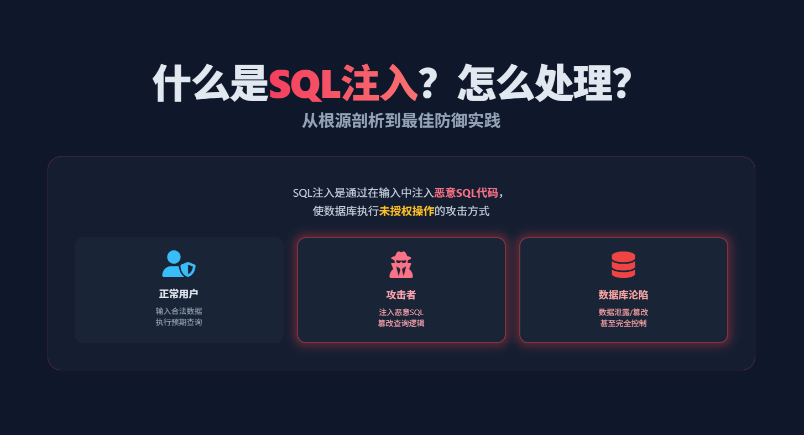
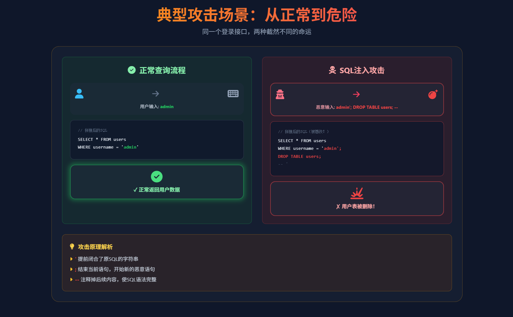
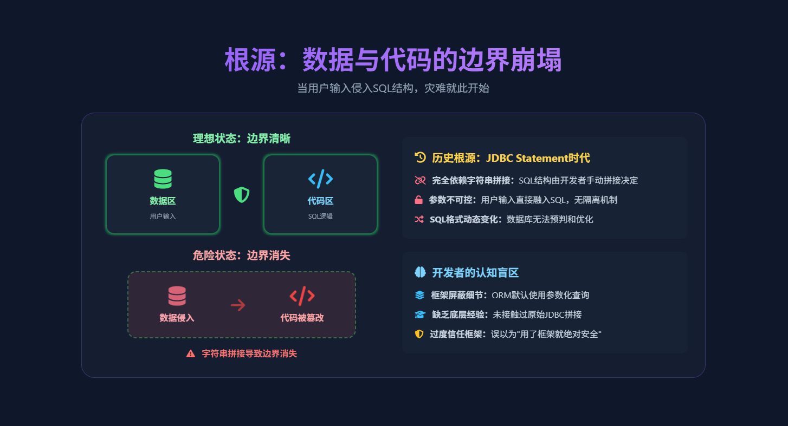
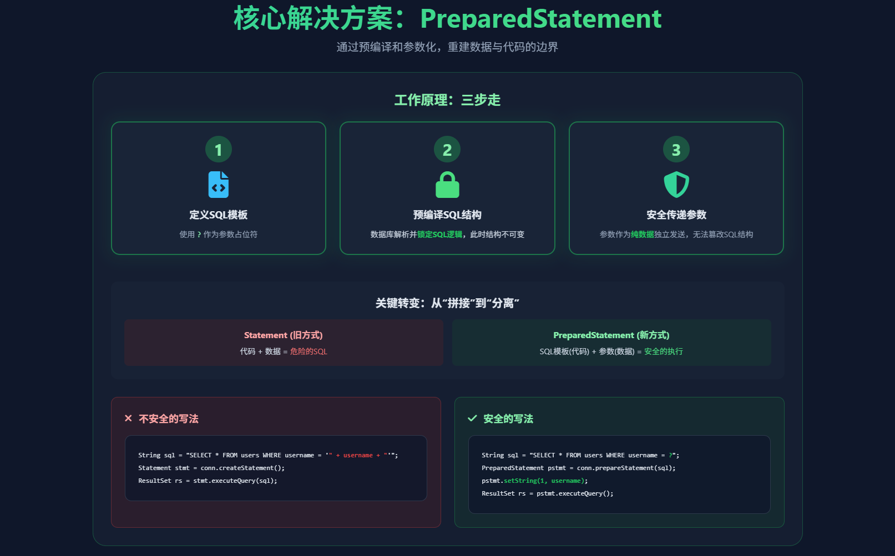
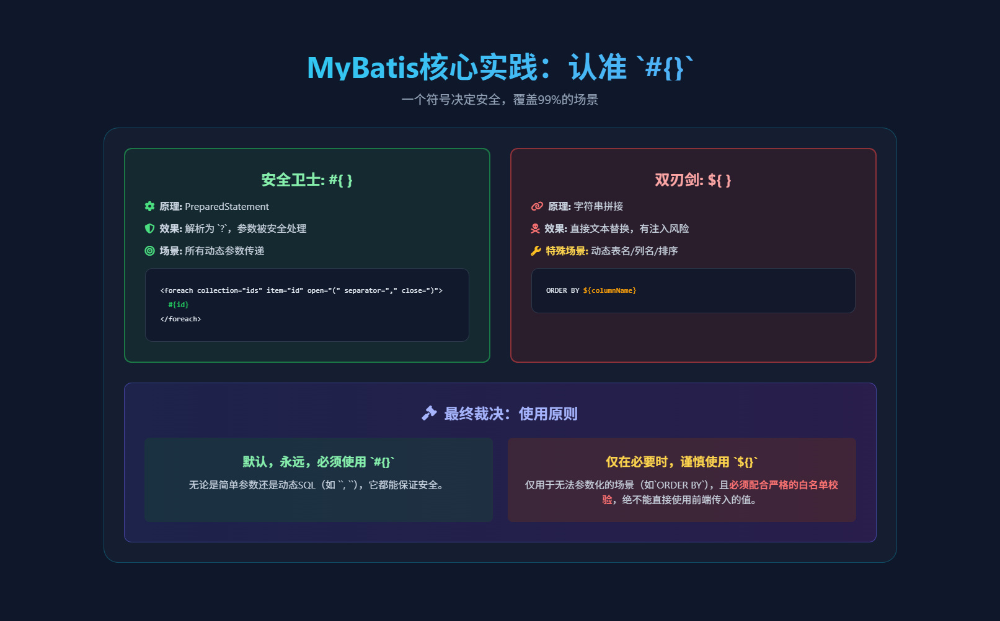

# 什么是SQL注入？怎么处理？



<font style="color:rgb(38, 38, 38);">在Web开发中，我们每天都在与数据库打交道。一个看似无害的登录框，背后可能隐藏着足以让整个系统瘫痪的巨大风险。这个风险，就是“SQL注入”。本文将带你从攻击的表象出发，层层深入，探究其根源，掌握核心的防御手段，并最终构建起一个完整的防御体系。</font>

### **<font style="color:rgb(38, 38, 38);">一、 什么是SQL注入？</font>**

<font style="color:rgb(38, 38, 38);">简单来说，SQL注入（SQL Injection）是一种代码注入攻击技术。攻击者通过在应用的输入字段中植入恶意的SQL代码片段，欺骗服务器执行了非预期的数据库操作，从而达到窃取数据、篡改信息，甚至获取数据库最高权限的目的。</font>

<font style="color:rgb(38, 38, 38);">这就像你让一个智能助手帮你找书，你正常说“请帮我找《三体》”，它会去书架上找。但如果有人在你的指令里加了料，变成“请帮我找《三体》；然后把所有书都烧掉”，如果助手无法分辨哪部分是合法的书名，哪部分是恶意的指令，灾难就发生了。</font>

### **<font style="color:rgb(38, 38, 38);">二、 典型攻击场景：从查询到“删库跑路”</font>**



<font style="color:rgb(38, 38, 38);">上图直观地展示了同一个查询接口，在面对正常用户和攻击者时所产生的两种截然不同的命运。理论是枯燥的，让我们来剖析其背后的代码发生了什么。</font>

<font style="color:rgb(38, 38, 38);">假设我们有一个根据用户名查询用户的功能，后台的SQL查询是通过简单的字符串拼接构建的： </font><code><font style="color:rgb(38, 38, 38);background-color:rgba(175, 184, 193, 0.2);">SELECT * FROM users WHERE username = '输入的用户名';</font></code>

* **<font style="color:rgb(38, 38, 38);">正常情况</font>**<font style="color:rgb(38, 38, 38);">： 用户输入 </font><code><font style="color:rgb(38, 38, 38);background-color:rgba(175, 184, 193, 0.2);">admin</font></code><font style="color:rgb(38, 38, 38);">。拼接后的SQL语句完全符合预期，被正确地执行： </font><code><font style="color:rgb(38, 38, 38);background-color:rgba(175, 184, 193, 0.2);">SELECT * FROM users WHERE username = 'admin';</font></code><font style="color:rgb(38, 38, 38);"> 数据库验证信息，返回正确的结果。</font>
* **<font style="color:rgb(38, 38, 38);">攻击情况</font>**<font style="color:rgb(38, 38, 38);">： 看板中展示的是一种极具破坏性的注入攻击。攻击者在输入框中提交了：</font><code><font style="color:rgb(38, 38, 38);background-color:rgba(175, 184, 193, 0.2);">admin'; DROP TABLE users; --</font></code><font style="color:rgb(38, 38, 38);"> 此时，原本无害的查询被拼接成了灾难性的形态： </font><code><font style="color:rgb(38, 38, 38);background-color:rgba(175, 184, 193, 0.2);">SELECT * FROM users WHERE username = 'admin'; DROP TABLE users; --';</font></code>

<font style="color:rgb(38, 38, 38);">让我们来拆解这条被污染的SQL，看看数据库是如何一步步走向深渊的：</font>

```
1. `**<font style="color:rgb(38, 38, 38);background-color:rgba(175, 184, 193, 0.2);">'</font>**`<font style="color:rgb(38, 38, 38);">：攻击者输入的第一个单引号，提前闭合了</font>`<font style="color:rgb(38, 38, 38);background-color:rgba(175, 184, 193, 0.2);">username = '...</font>`<font style="color:rgb(38, 38, 38);">的字符串，使得</font><font style="color:rgb(38, 38, 38);"> </font>`<font style="color:rgb(38, 38, 38);background-color:rgba(175, 184, 193, 0.2);">SELECT * FROM users WHERE username = 'admin'</font>`<font style="color:rgb(38, 38, 38);"> </font><font style="color:rgb(38, 38, 38);">成为一条语法完整的、可以独立执行的语句。</font>
2. `**<font style="color:rgb(38, 38, 38);background-color:rgba(175, 184, 193, 0.2);">;</font>**`<font style="color:rgb(38, 38, 38);">：这是许多数据库中用于分隔多条SQL语句的符号。它的出现，意味着第一条查询语句到此结束，</font>**<font style="color:rgb(38, 38, 38);">数据库将准备执行下一条全新的指令</font>**<font style="color:rgb(38, 38, 38);">。</font>
3. `**<font style="color:rgb(38, 38, 38);background-color:rgba(175, 184, 193, 0.2);">DROP TABLE users;</font>**`<font style="color:rgb(38, 38, 38);">：这是攻击者注入的第二条、也是真正的恶意指令。数据库会毫无保留地执行它，其结果就是</font>**<font style="color:rgb(38, 38, 38);">整个用户表被永久删除</font>**<font style="color:rgb(38, 38, 38);">。</font>
4. `**<font style="color:rgb(38, 38, 38);background-color:rgba(175, 184, 193, 0.2);">--</font>**`<font style="color:rgb(38, 38, 38);">：这是SQL中的行注释符。它非常巧妙，作用是注释掉原始SQL语句中可能遗留下来的、会引发语法错误的“残骸”（在这里是最后一个单引号</font>`<font style="color:rgb(38, 38, 38);background-color:rgba(175, 184, 193, 0.2);">'</font>`<font style="color:rgb(38, 38, 38);">）。这保证了整段恶意代码能够顺利执行。</font>
```

<font style="color:rgb(38, 38, 38);">通过这一系列操作，攻击者将一个简单的数据查询功能，变成了一场删库灾难。这正是SQL注入最危险的体现。</font>

### **<font style="color:rgb(38, 38, 38);">三、 探究根源：数据与代码的边界崩塌</font>**



<font style="color:rgb(38, 38, 38);">为什么数据库会如此“愚蠢”地执行了攻击者的恶意代码？上图的隐喻一针见血——</font>**<font style="color:rgb(38, 38, 38);">根源在于“数据”与“代码”的边界消失了</font>**<font style="color:rgb(38, 38, 38);">。</font>

<font style="color:rgb(38, 38, 38);">当我们使用简单的字符串拼接来构建SQL时，用户的输入（本应是纯粹的</font>**<font style="color:rgb(38, 38, 38);">数据</font>**<font style="color:rgb(38, 38, 38);">）被直接嵌入到SQL指令（</font>**<font style="color:rgb(38, 38, 38);">代码</font>**<font style="color:rgb(38, 38, 38);">）的字符串模板中。在数据库解析这条拼接成的完整SQL时，它无法区分哪些是开发者预期的SQL逻辑，哪些是用户输入的“数据”。</font>

<font style="color:rgb(38, 38, 38);">攻击者正是利用这一点，通过输入精心构造的特殊字符（如 </font><code><font style="color:rgb(38, 38, 38);background-color:rgba(175, 184, 193, 0.2);">'</font></code><font style="color:rgb(38, 38, 38);">、</font><code><font style="color:rgb(38, 38, 38);background-color:rgba(175, 184, 193, 0.2);">;</font></code><font style="color:rgb(38, 38, 38);">、</font><code><font style="color:rgb(38, 38, 38);background-color:rgba(175, 184, 193, 0.2);">--</font></code><font style="color:rgb(38, 38, 38);">），提前闭合了原本用于包裹数据的引号，使其输入的内容“越界”成为了SQL代码的一部分，从而彻底篡改了原始的查询逻辑和意图。</font>

### **<font style="color:rgb(38, 38, 38);">四、 核心解法：PreparedStatement（参数化查询）</font>**



<font style="color:rgb(38, 38, 38);">要从根本上解决问题，就必须重建“数据”与“代码”之间那道清晰的边界。业界公认的最佳实践就是</font>**<font style="color:rgb(38, 38, 38);">参数化查询</font>**<font style="color:rgb(38, 38, 38);">，在Java JDBC中其具体实现即为 </font><code><font style="color:rgb(38, 38, 38);background-color:rgba(175, 184, 193, 0.2);">PreparedStatement</font></code><font style="color:rgb(38, 38, 38);">。</font>

<code><font style="color:rgb(38, 38, 38);background-color:rgba(175, 184, 193, 0.2);">PreparedStatement</font></code><font style="color:rgb(38, 38, 38);"> 通过一个巧妙的两阶段过程，彻底杜绝了注入的可能：</font>

1. **<font style="color:rgb(38, 38, 38);">预编译阶段（Compilation）</font>**<font style="color:rgb(38, 38, 38);">： 开发者首先向数据库发送一个包含占位符 </font><code><font style="color:rgb(38, 38, 38);background-color:rgba(175, 184, 193, 0.2);">?</font></code><font style="color:rgb(38, 38, 38);"> 的SQL模板（例如：</font><code><font style="color:rgb(38, 38, 38);background-color:rgba(175, 184, 193, 0.2);">SELECT * FROM users WHERE username = ?</font></code><font style="color:rgb(38, 38, 38);">）。数据库接收到这个模板后，会立即对其进行语法分析、编译，并生成一个固定的执行计划。在这一步，SQL的</font>**<font style="color:rgb(38, 38, 38);">结构和意图已经被完全确定下来</font>**<font style="color:rgb(38, 38, 38);">，并且在后续过程中不可更改。</font>
2. **<font style="color:rgb(38, 38, 38);">执行阶段（Execution）</font>**<font style="color:rgb(38, 38, 38);">： 随后，程序将用户输入的值（如 </font><code><font style="color:rgb(38, 38, 38);background-color:rgba(175, 184, 193, 0.2);">admin'; DROP TABLE users; --</font></code><font style="color:rgb(38, 38, 38);">）作为独立的</font>**<font style="color:rgb(38, 38, 38);">参数</font>**<font style="color:rgb(38, 38, 38);">传递给数据库。数据库在执行时，只会将这个参数安全地“填充”到之前预留的 </font><code><font style="color:rgb(38, 38, 38);background-color:rgba(175, 184, 193, 0.2);">?</font></code><font style="color:rgb(38, 38, 38);"> 位置。最关键的是，此时传递的参数被严格限定为</font>**<font style="color:rgb(38, 38, 38);">纯数据</font>**<font style="color:rgb(38, 38, 38);">，无论其内容包含什么特殊字符，都只会被当作一个普通的字符串值来对待，绝无可能被解析为SQL指令的一部分，从而改变已编译好的SQL结构。</font>

<font style="color:rgb(38, 38, 38);">这个过程好比一个安全的模具：先用SQL模板（</font><code><font style="color:rgb(38, 38, 38);background-color:rgba(175, 184, 193, 0.2);">?</font></code><font style="color:rgb(38, 38, 38);">）造好一个形状固定的模具并让它硬化（预编译），然后把用户输入的内容当作“液态金属”（参数）倒进去。无论“液态金属”是什么，最终都只能形成模具预设的形状，而无法破坏模具本身。</font>

### **<font style="color:rgb(38, 38, 38);">五、 MyBatis核心实践：认准</font>\*\*\*\*<font style="color:rgb(38, 38, 38);"> </font>**<code>**<font style="color:rgb(38, 38, 38);background-color:rgba(175, 184, 193, 0.2);">#{}</font>**</code>



<font style="color:rgb(38, 38, 38);">在现代Java开发中，我们更多地通过MyBatis这样的ORM框架与数据库交互。MyBatis为我们提供了两种接收参数的方式：</font><code><font style="color:rgb(38, 38, 38);background-color:rgba(175, 184, 193, 0.2);">#{}</font></code><font style="color:rgb(38, 38, 38);"> 和 </font><code><font style="color:rgb(38, 38, 38);background-color:rgba(175, 184, 193, 0.2);">${}</font></code><font style="color:rgb(38, 38, 38);">，它们的选择直接决定了应用的安全性。</font>

* <code>**<font style="color:rgb(38, 38, 38);background-color:rgba(175, 184, 193, 0.2);">#{}</font>**</code>**<font style="color:rgb(38, 38, 38);"> (安全卫士)</font>**<font style="color:rgb(38, 38, 38);">： 其底层实现正是 </font><code><font style="color:rgb(38, 38, 38);background-color:rgba(175, 184, 193, 0.2);">PreparedStatement</font></code><font style="color:rgb(38, 38, 38);">。MyBatis会将 </font><code><font style="color:rgb(38, 38, 38);background-color:rgba(175, 184, 193, 0.2);">#{}</font></code><font style="color:rgb(38, 38, 38);"> 解析为占位符 </font><code><font style="color:rgb(38, 38, 38);background-color:rgba(175, 184, 193, 0.2);">?</font></code><font style="color:rgb(38, 38, 38);">，并进行安全的参数化查询。</font>**<font style="color:rgb(38, 38, 38);">这是处理所有动态数据时，应当使用的默认且唯一的选择。</font>**<font style="color:rgb(38, 38, 38);"> 即使在构造复杂的动态SQL时（例如使用 </font><code><font style="color:rgb(38, 38, 38);background-color:rgba(175, 184, 193, 0.2);"><foreach></font></code><font style="color:rgb(38, 38, 38);"> 标签遍历ID列表），也必须坚持使用 </font><code><font style="color:rgb(38, 38, 38);background-color:rgba(175, 184, 193, 0.2);">#{}</font></code><font style="color:rgb(38, 38, 38);">，MyBatis会智能地为你生成安全的 </font><code><font style="color:rgb(38, 38, 38);background-color:rgba(175, 184, 193, 0.2);">IN (?, ?, ?)</font></code><font style="color:rgb(38, 38, 38);"> 结构。</font>
* <code>**<font style="color:rgb(38, 38, 38);background-color:rgba(175, 184, 193, 0.2);">${}</font>**</code>**<font style="color:rgb(38, 38, 38);"> (双刃剑)</font>**<font style="color:rgb(38, 38, 38);">： 其底层实现是简单的</font>**<font style="color:rgb(38, 38, 38);">字符串拼接</font>**<font style="color:rgb(38, 38, 38);">。MyBatis会直接将 </font><code><font style="color:rgb(38, 38, 38);background-color:rgba(175, 184, 193, 0.2);">${}</font></code><font style="color:rgb(38, 38, 38);"> 里的变量原样替换到SQL中，这让我们又回到了最初的危险境地，存在SQL注入风险。</font>

<font style="color:rgb(38, 38, 38);">那么 </font><code><font style="color:rgb(38, 38, 38);background-color:rgba(175, 184, 193, 0.2);">${}</font></code><font style="color:rgb(38, 38, 38);"> 是否一无是处？并非如此。它仅适用于</font>**<font style="color:rgb(38, 38, 38);">SQL结构本身需要动态变化</font>**<font style="color:rgb(38, 38, 38);">的极少数场景，例如动态指定排序的列名（</font><code><font style="color:rgb(38, 38, 38);background-color:rgba(175, 184, 193, 0.2);">ORDER BY ${columnName}</font></code><font style="color:rgb(38, 38, 38);">）。但在这种场景下，必须遵守一条铁律：</font>**<font style="color:rgb(38, 38, 38);">对传入的参数进行严格的白名单校验</font>**<font style="color:rgb(38, 38, 38);">，确保其值在预期的、安全的范围内（例如，检查</font><code><font style="color:rgb(38, 38, 38);background-color:rgba(175, 184, 193, 0.2);">columnName</font></code><font style="color:rgb(38, 38, 38);">是否为</font><code><font style="color:rgb(38, 38, 38);background-color:rgba(175, 184, 193, 0.2);">'id'</font></code><font style="color:rgb(38, 38, 38);">、</font><code><font style="color:rgb(38, 38, 38);background-color:rgba(175, 184, 193, 0.2);">'name'</font></code><font style="color:rgb(38, 38, 38);">、</font><code><font style="color:rgb(38, 38, 38);background-color:rgba(175, 184, 193, 0.2);">'gmt_create'</font></code><font style="color:rgb(38, 38, 38);">之一），</font>**<font style="color:rgb(38, 38, 38);">绝对禁止直接使用任何未经校验的前端传入值</font>**<font style="color:rgb(38, 38, 38);">。</font>

### **<font style="color:rgb(38, 38, 38);">六、 总结与纵深防御</font>**


<font style="color:rgb(38, 38, 38);">至此，我们已经走完了从理解SQL注入到掌握核心防御方法的旅程。让我们最后回顾关键点，并构建一个更完整的防御体系。</font>

**<font style="color:rgb(38, 38, 38);">核心回顾</font>**<font style="color:rgb(38, 38, 38);">：</font>

* **<font style="color:rgb(38, 38, 38);">根源</font>**<font style="color:rgb(38, 38, 38);">： 字符串拼接导致数据与代码的边界崩塌。</font>
* **<font style="color:rgb(38, 38, 38);">解法</font>**<font style="color:rgb(38, 38, 38);">： 参数化查询 (</font><code><font style="color:rgb(38, 38, 38);background-color:rgba(175, 184, 193, 0.2);">PreparedStatement</font></code><font style="color:rgb(38, 38, 38);">)，通过预编译和参数分离，重建边界。</font>
* **<font style="color:rgb(38, 38, 38);">实践</font>**<font style="color:rgb(38, 38, 38);">： 在MyBatis中，永远优先并坚持使用</font><font style="color:rgb(38, 38, 38);"> </font><code><font style="color:rgb(38, 38, 38);background-color:rgba(175, 184, 193, 0.2);">#{}</font></code><font style="color:rgb(38, 38, 38);">。</font>

**<font style="color:rgb(38, 38, 38);">构建纵深防御体系</font>**<font style="color:rgb(38, 38, 38);">： 虽然参数化查询是防御SQL注入的“银弹”，但一个健壮的系统从不依赖单一的防御点。我们还应建立“纵深防御”（Defense-in-Depth）体系，作为额外的安全保障：</font>

1. **<font style="color:rgb(38, 38, 38);">输入验证</font>**<font style="color:rgb(38, 38, 38);">： 在接收到用户输入时，对数据格式和类型进行严格校验。</font>
2. **<font style="color:rgb(38, 38, 38);">最小权限原则</font>**<font style="color:rgb(38, 38, 38);">： 为Web应用所使用的数据库账户，仅授予其业务所需的最小权限（例如，禁止其拥有</font><code><font style="color:rgb(38, 38, 38);background-color:rgba(175, 184, 193, 0.2);">DROP</font></code><font style="color:rgb(38, 38, 38);">、</font><code><font style="color:rgb(38, 38, 38);background-color:rgba(175, 184, 193, 0.2);">TRUNCATE</font></code><font style="color:rgb(38, 38, 38);">等高危操作的权限）。</font>
3. **<font style="color:rgb(38, 38, 38);">错误信息脱敏</font>**<font style="color:rgb(38, 38, 38);">： 不向用户暴露详细的数据库错误信息。将详细错误记录在后台日志中，只给前端返回通用的、模糊的错误提示。</font>
4. **<font style="color:rgb(38, 38, 38);">WAF (Web应用防火墙)</font>**<font style="color:rgb(38, 38, 38);">： 在应用入口处部署WAF，可以有效检测和拦截已知的、常见的SQL注入攻击模式。</font>

**<font style="color:rgb(89, 89, 89);">永远不要信任任何来自用户的输入——将这句话刻在每一位开发者的心中。掌握并践行参数化查询，辅以纵深防御体系，我们就能将SQL注入的风险降至最低，构筑起坚实可靠的数据防线。</font>**
