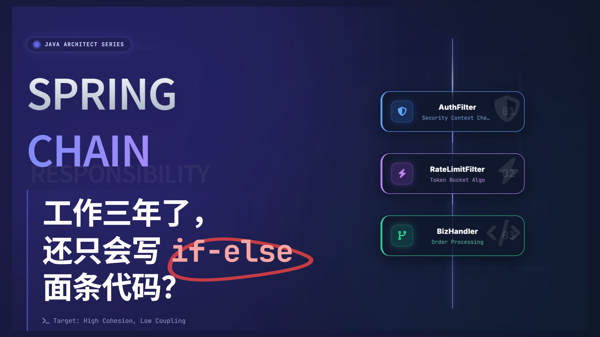
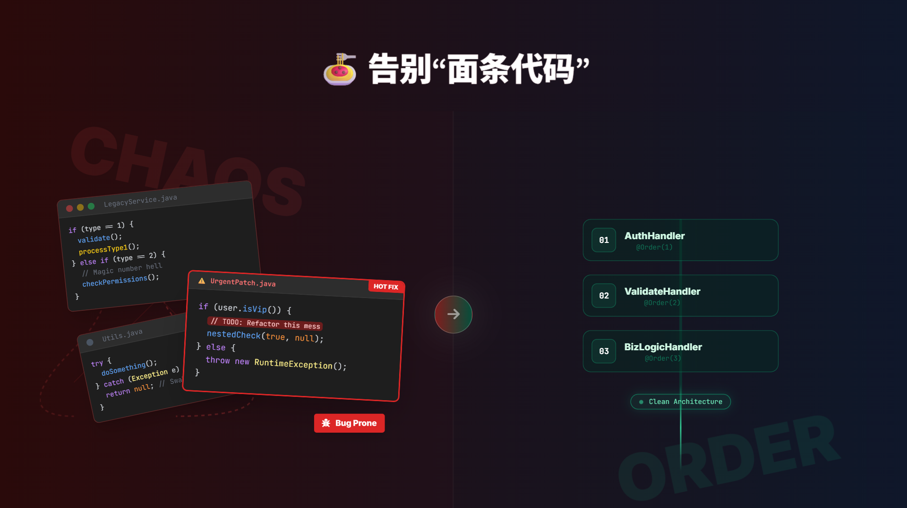
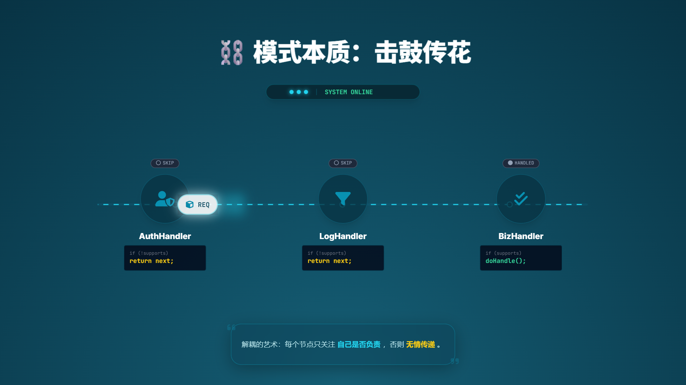
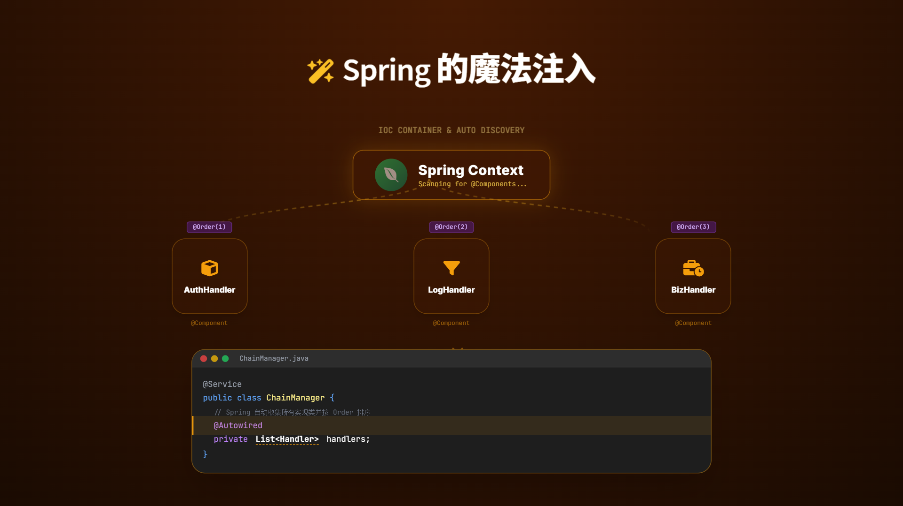
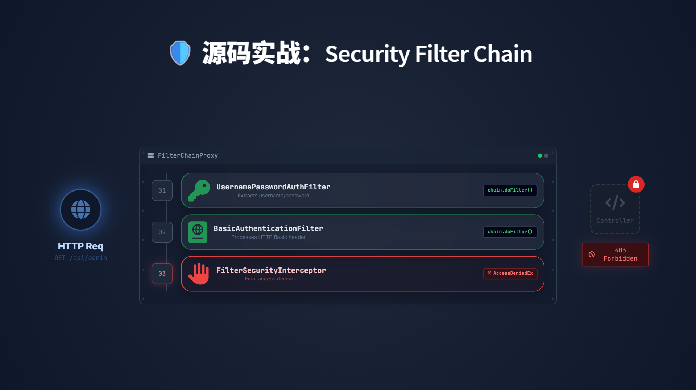
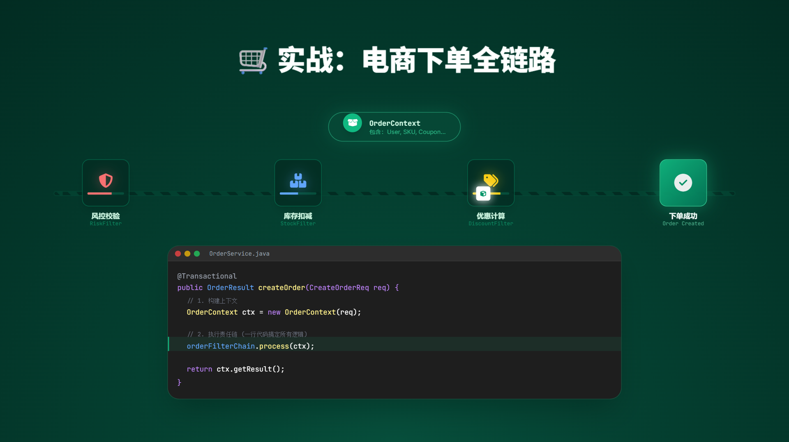
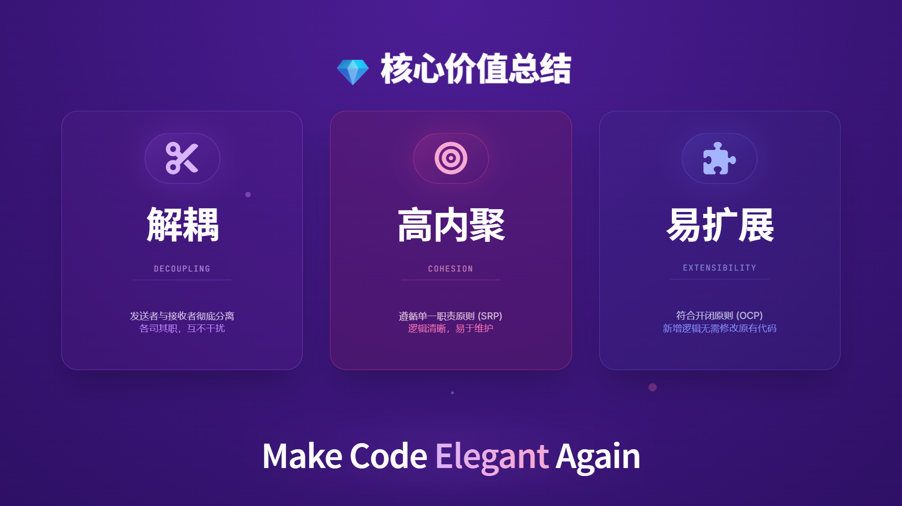

# 什么？工作三年了，还不知道什么是 Spring 责任链？



<font style="color:rgb(38, 38, 38);">你是否在维护老项目时，见过这种让人窒息的代码？一个 </font><code><font style="color:rgb(38, 38, 38);background-color:rgba(175, 184, 193, 0.2);">OrderService</font></code><font style="color:rgb(38, 38, 38);"> 的 </font><code><font style="color:rgb(38, 38, 38);background-color:rgba(175, 184, 193, 0.2);">createOrder</font></code><font style="color:rgb(38, 38, 38);"> 方法里塞满了 800 行代码。从参数校验、库存锁定、优惠券计算到积分扣减，所有的逻辑都堆砌在一个巨大的 </font><code><font style="color:rgb(38, 38, 38);background-color:rgba(175, 184, 193, 0.2);">if-else</font></code><font style="color:rgb(38, 38, 38);"> 迷宫里。</font>

<font style="color:rgb(38, 38, 38);">每当产品经理跑来说：“给 VIP 用户加一个专属的校验逻辑”，你都得在第 300 行和第 500 行之间小心翼翼地插入代码，生怕一个不小心，把后面的库存逻辑搞崩了。</font>



<font style="color:rgb(38, 38, 38);">这就是典型的“面条代码”（Spaghetti Code）。它高耦合、低内聚，违反了“单一职责原则”和“开闭原则”。随着业务迭代，这个方法会变成系统的“禁区”，谁都不敢动。</font>

<font style="color:rgb(38, 38, 38);">而</font>**<font style="color:rgb(38, 38, 38);">责任链模式（Chain of Responsibility）</font>**<font style="color:rgb(38, 38, 38);">，正是解决这一痛点的最佳解药。</font>

***

### <font style="color:rgb(38, 38, 38);">2. 本质：什么是责任链？</font>



<font style="color:rgb(38, 38, 38);">责任链模式的定义很简单：</font>**<font style="color:rgb(38, 38, 38);">为请求创建了一个接收者对象的链</font>**<font style="color:rgb(38, 38, 38);">。这种模式给予请求的类型，对请求的发送者和接收者进行解耦。</font>

<font style="color:rgb(38, 38, 38);">通俗点说，它就像是</font>**<font style="color:rgb(38, 38, 38);">“击鼓传花”或者“工厂流水线</font>**<font style="color:rgb(38, 38, 38);">”。</font>

<font style="color:rgb(38, 38, 38);">一个请求（Context）进入系统，需要经历一系列的处理步骤。在责任链模式下，我们将每个步骤封装成一个独立的</font>**<font style="color:rgb(38, 38, 38);">处理器（Handler）</font>**<font style="color:rgb(38, 38, 38);">。</font>

* **<font style="color:rgb(38, 38, 38);">解耦</font>**<font style="color:rgb(38, 38, 38);">：请求的发起者不需要知道具体是谁在处理，也不需要知道链条的结构。</font>
* **<font style="color:rgb(38, 38, 38);">动态性</font>**<font style="color:rgb(38, 38, 38);">：我们可以随时调整链条中处理器的顺序，或者动态增加/删除某个处理器，而无需修改核心流程代码。</font>

<font style="color:rgb(38, 38, 38);">在业务开发中，责任链通常有两种形态：</font>

1. **<font style="color:rgb(38, 38, 38);">中断式（过滤器模式）</font>**<font style="color:rgb(38, 38, 38);">：只要有一个处理器拦截（如校验失败），后续流程直接终止。</font>
2. **<font style="color:rgb(38, 38, 38);">流水线式</font>**<font style="color:rgb(38, 38, 38);">：所有处理器依次执行，共同完成一个复杂的业务对象构建。</font>

***

### <font style="color:rgb(38, 38, 38);">3. Spring 中的“魔法”实现</font>



* **<font style="color:rgb(89, 89, 89);">设计意图</font>**<font style="color:rgb(89, 89, 89);">：揭示 Spring 如何利用依赖注入（DI）自动收集和排序 Bean，省去了传统模式中手动</font><font style="color:rgb(89, 89, 89);"> </font><code><font style="color:rgb(89, 89, 89);background-color:rgba(175, 184, 193, 0.2);">setNext()</font></code><font style="color:rgb(89, 89, 89);"> </font><font style="color:rgb(89, 89, 89);">的繁琐。</font>

<font style="color:rgb(38, 38, 38);">在传统的 GoF 设计模式实现中，我们需要手动维护 </font><code><font style="color:rgb(38, 38, 38);background-color:rgba(175, 184, 193, 0.2);">next</font></code><font style="color:rgb(38, 38, 38);"> 指针，构建链表非常繁琐：</font>

```java
handlerA.setNext(handlerB);
handlerB.setNext(handlerC); // 容易出错，且难以维护
```

<font style="color:rgb(38, 38, 38);">但在 Spring 生态中，利用 </font>**<font style="color:rgb(38, 38, 38);">IOC（控制反转）</font>**<font style="color:rgb(38, 38, 38);"> 和 </font>**<font style="color:rgb(38, 38, 38);">自动装配</font>**<font style="color:rgb(38, 38, 38);">，实现责任链变得异常优雅。我们甚至不需要显式地定义“链”的结构，Spring 容器会帮我们完成一切。</font>

**<font style="color:rgb(38, 38, 38);">核心实现三步曲：</font>**

**<font style="color:rgb(38, 38, 38);">第一步：定义统一接口</font>**

```java
public interface OrderHandler {
    // 返回 true 继续，false 拦截
    boolean handle(OrderContext context);
}
```

**<font style="color:rgb(38, 38, 38);">第二步：实现具体的业务逻辑</font>**<font style="color:rgb(38, 38, 38);"> 利用 </font><code><font style="color:rgb(38, 38, 38);background-color:rgba(175, 184, 193, 0.2);">@Order</font></code><font style="color:rgb(38, 38, 38);"> 注解来控制执行顺序，数字越小优先级越高。</font>

```java
@Component
@Order(1)
public class CheckStockHandler implements OrderHandler {
    public boolean handle(OrderContext context) {
        // 扣减库存逻辑...
        return true;
    }
}

@Component
@Order(2)
public class CalcPriceHandler implements OrderHandler { ... }
```

**<font style="color:rgb(38, 38, 38);">第三步：利用 List 自动注入（Magic Happens Here!）</font>**<font style="color:rgb(38, 38, 38);"> 这是 Spring 的杀手锏。你只需要在管理类中注入 </font><code><font style="color:rgb(38, 38, 38);background-color:rgba(175, 184, 193, 0.2);">List<OrderHandler></font></code><font style="color:rgb(38, 38, 38);">，Spring 会自动查找所有实现类，并</font>**<font style="color:rgb(38, 38, 38);">按照 </font>**<code>**<font style="color:rgb(38, 38, 38);background-color:rgba(175, 184, 193, 0.2);">@Order</font>**</code>**<font style="color:rgb(38, 38, 38);"> 的顺序</font>**<font style="color:rgb(38, 38, 38);">装配到 List 中。</font>

```java
@Service
public class OrderService {

    // Spring 自动注入并排序！
    @Autowired
    private List<OrderHandler> handlers; 

    public void createOrder(OrderContext context) {
        for (OrderHandler handler : handlers) {
            if (!handler.handle(context)) {
                throw new RuntimeException("下单流程被拦截");
            }
        }
        // 保存订单...
    }
}
```

<font style="color:rgb(38, 38, 38);">没有复杂的 </font><code><font style="color:rgb(38, 38, 38);background-color:rgba(175, 184, 193, 0.2);">setNext</font></code><font style="color:rgb(38, 38, 38);">，没有冗余的配置，一切都是自动化的。</font>

***

### <font style="color:rgb(38, 38, 38);">4. 源码级应用：Spring Security</font>



<font style="color:rgb(38, 38, 38);">Spring 框架本身就是责任链模式的集大成者。如果你读过 Spring Security 的源码，你会发现它本质上就是一条巨大的</font>**<font style="color:rgb(38, 38, 38);">过滤器链（Security Filter Chain）</font>**<font style="color:rgb(38, 38, 38);">。</font>

<font style="color:rgb(38, 38, 38);">当一个 HTTP 请求到达应用时，它必须像过关斩将一样，穿过层层关卡：</font>

1. **<font style="color:rgb(38, 38, 38);">UsernamePasswordAuthenticationFilter</font>**<font style="color:rgb(38, 38, 38);">：检查请求中是否包含账号密码。</font>
2. **<font style="color:rgb(38, 38, 38);">BasicAuthenticationFilter</font>**<font style="color:rgb(38, 38, 38);">：检查 Header 中是否有 Basic Auth 信息。</font>
3. **<font style="color:rgb(38, 38, 38);">AnonymousAuthenticationFilter</font>**<font style="color:rgb(38, 38, 38);">：如果前面都没通过，给你一个匿名身份。</font>
4. **<font style="color:rgb(38, 38, 38);">FilterSecurityInterceptor</font>**<font style="color:rgb(38, 38, 38);">：这是最后一环，检查当前身份是否有权限访问目标 URL。</font>

<font style="color:rgb(38, 38, 38);">这种设计使得 Spring Security 具有极高的扩展性。如果你想支持“短信验证码登录”，只需要写一个自定义 Filter，通过配置把它插到链条的中间即可，完全不需要修改框架源码。</font>

***

### <font style="color:rgb(38, 38, 38);">5. 实战落地：电商下单流程</font>



<font style="color:rgb(38, 38, 38);">在复杂的业务系统中，责任链是处理</font>**<font style="color:rgb(38, 38, 38);">长流程</font>**<font style="color:rgb(38, 38, 38);">的神器。我们以电商下单为例，看看如何用责任链重构业务。</font>

<font style="color:rgb(38, 38, 38);">关键在于定义一个 </font>**<font style="color:rgb(38, 38, 38);">上下文对象（Context）</font>**<font style="color:rgb(38, 38, 38);">。所有的 Handler 都不直接交互，而是通过 Context 交换数据。</font>

```java
// 上下文对象：贯穿整个生命周期
@Data
public class OrderContext {
    private String userId;
    private List<String> skuIds;
    private BigDecimal finalPrice; // 由价格处理器计算填入
    private boolean isRiskUser;    // 由风控处理器填入
}
```

<font style="color:rgb(38, 38, 38);">通过这种方式，我们将复杂的逻辑拆解成了原子化的积木：</font>

* **<font style="color:rgb(38, 38, 38);">黑名单校验器</font>**<font style="color:rgb(38, 38, 38);">：只负责查库看用户状态，不通过直接抛异常。</font>
* **<font style="color:rgb(38, 38, 38);">库存扣减器</font>**<font style="color:rgb(38, 38, 38);">：只负责操作 Redis 或数据库扣减库存。</font>
* **<font style="color:rgb(38, 38, 38);">优惠券计算器</font>**<font style="color:rgb(38, 38, 38);">：读取 Context 中的商品信息，计算价格并回写到 Context 中。</font>

<font style="color:rgb(38, 38, 38);">如果明天大促，运营说要加一个“整点秒杀资格校验”，你只需要新增一个 </font><code><font style="color:rgb(38, 38, 38);background-color:rgba(175, 184, 193, 0.2);">SeckillHandler</font></code><font style="color:rgb(38, 38, 38);"> 类，标记 </font><code><font style="color:rgb(38, 38, 38);background-color:rgba(175, 184, 193, 0.2);">@Order</font></code><font style="color:rgb(38, 38, 38);"> 插在库存扣减之前，</font>**<font style="color:rgb(38, 38, 38);">原有的代码一行都不用改</font>**<font style="color:rgb(38, 38, 38);">。这就是“开闭原则”的完美体现。</font>

***

### <font style="color:rgb(38, 38, 38);">6. 总结</font>



<font style="color:rgb(38, 38, 38);">Spring 责任链不仅仅是一个设计模式的套用，它是一种</font>**<font style="color:rgb(38, 38, 38);">“各司其职”</font>**<font style="color:rgb(38, 38, 38);">的架构哲学。</font>

* <font style="color:rgb(38, 38, 38);">它让代码从“一团乱麻”变成了“积木组合”。</font>
* <font style="color:rgb(38, 38, 38);">它让团队协作变得更简单——你写库存逻辑，我写优惠逻辑，互不冲突。</font>
* <font style="color:rgb(38, 38, 38);">它让系统具备了极强的弹性，能够从容应对多变的业务需求。</font>

<font style="color:rgb(38, 38, 38);">工作三年，我们不应该再满足于写出“能跑”的代码，而应追求写出</font>**<font style="color:rgb(38, 38, 38);">易维护、易扩展、优雅</font>**<font style="color:rgb(38, 38, 38);">的代码。下一次遇到复杂的长流程业务，不妨试试 Spring 责任链，你会爱上这种清爽的感觉。</font>
