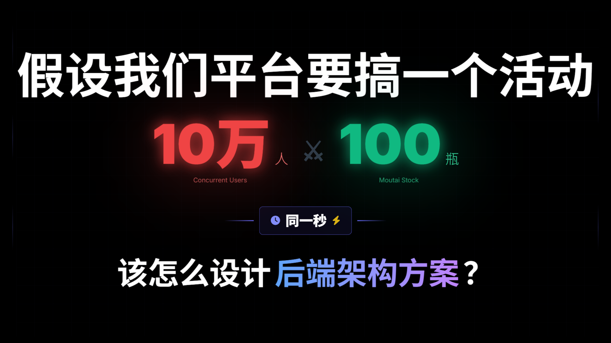
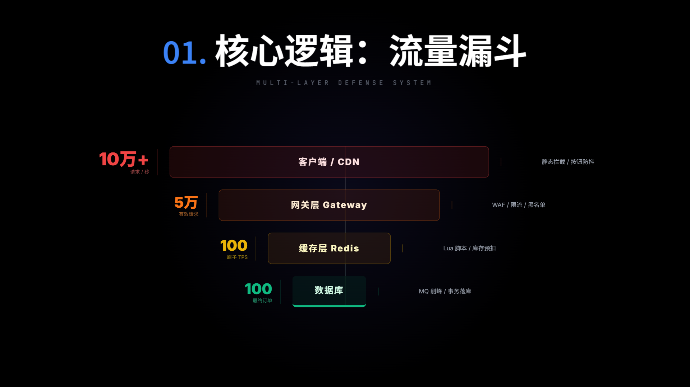
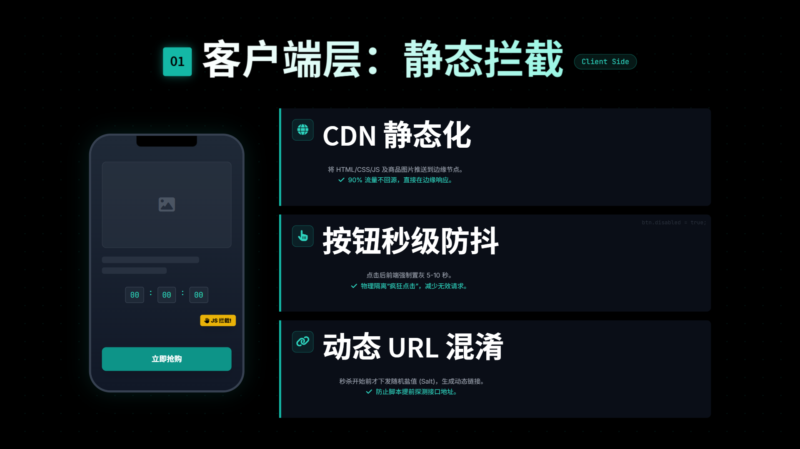
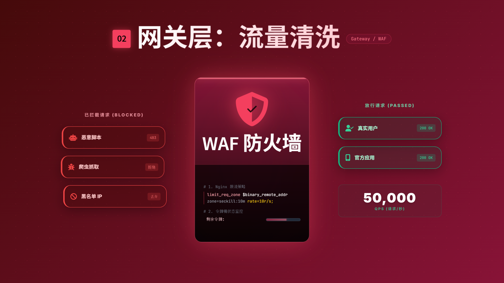
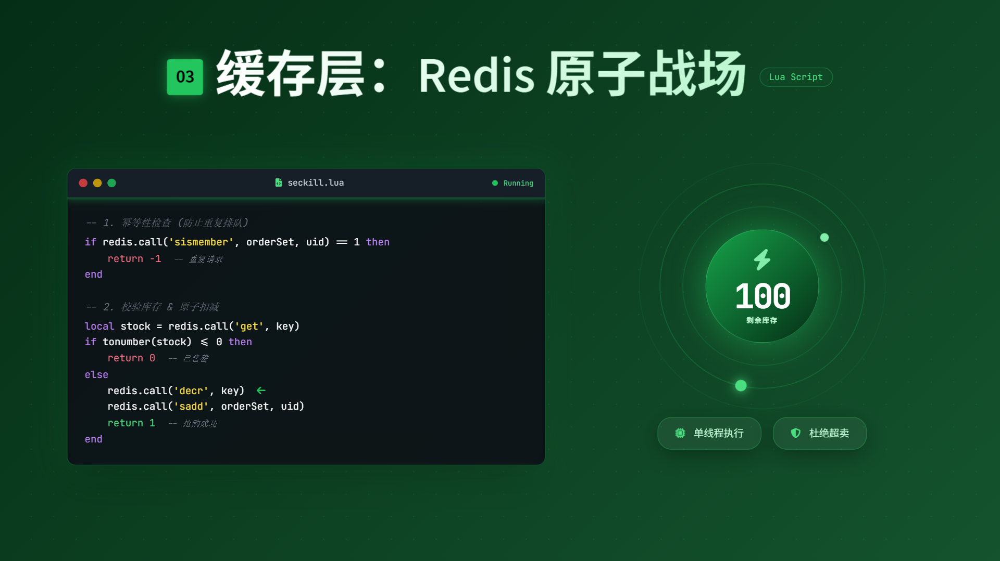
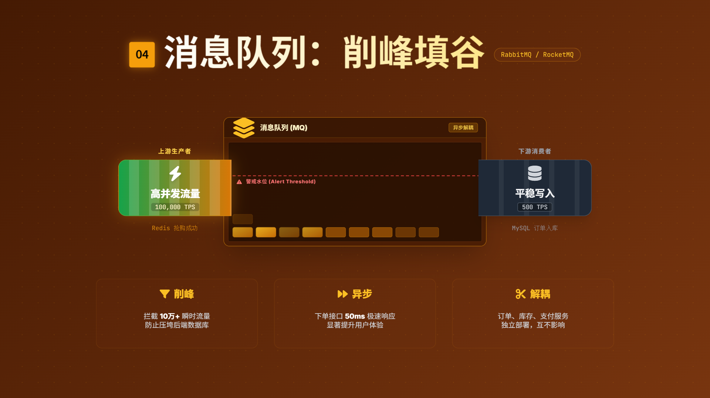
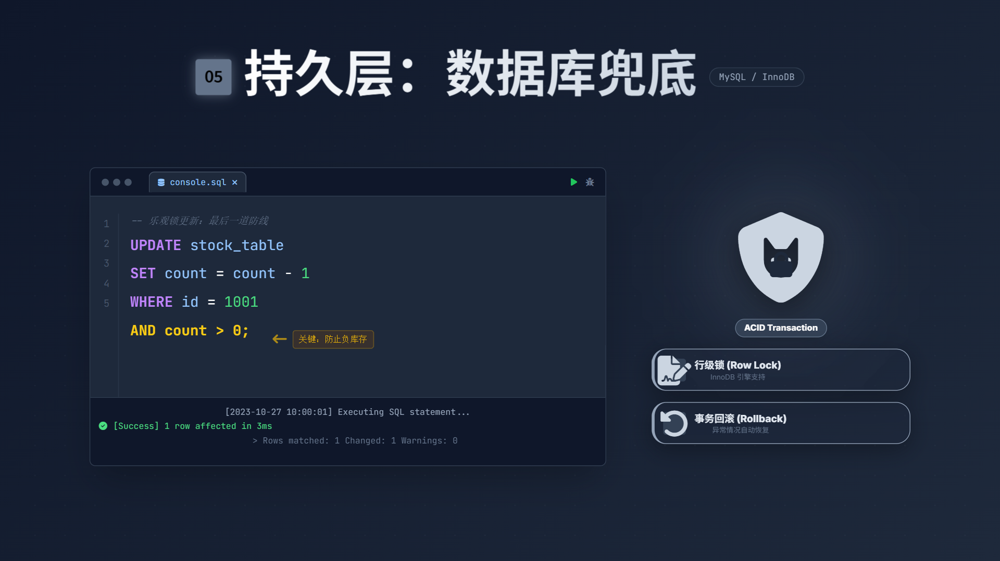
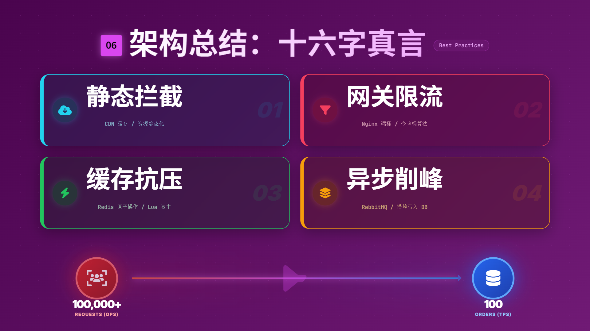

# 假设平台要搞一个活动，10万人在同一秒抢100瓶茅台。该怎么设计后端架构方案

**<font style="color:rgb(38, 38, 38);">摘要</font>**<font style="color:rgb(38, 38, 38);">：秒杀系统是高并发架构的试金石。本文将透过现象看本质，结合流量漏斗模型，深入拆解从客户端到数据库的五层防御体系，探讨如何通过静态拦截、网关限流、Redis 原子性及 MQ 削峰，构建一个高可用、高并发的秒杀系统。</font>

***

### <font style="color:rgb(38, 38, 38);">引言：一场关于“流量”的战争</font>



<font style="color:rgb(38, 38, 38);">假设业务方突然甩来一个需求：“双十一我们要搞个茅台秒杀活动，预计 10 万人在线抢 100 瓶，绝对不能超卖，系统也不能崩。”</font>

<font style="color:rgb(38, 38, 38);">面对 100,000 QPS（每秒查询率）的瞬时流量，如果我们直接让数据库去抗，结果只有一个：</font>**<font style="color:rgb(38, 38, 38);">数据库瞬间死锁，服务全线雪崩</font>**<font style="color:rgb(38, 38, 38);">。因为 MySQL 单机的 TPS（每秒事务数）通常只有几千量级。</font>

<font style="color:rgb(38, 38, 38);">秒杀系统的核心难点，不在于“快”，而在于</font>**<font style="color:rgb(38, 38, 38);">“稳”。</font>**<font style="color:rgb(38, 38, 38);">这本质上是一场</font>**<font style="color:rgb(38, 38, 38);">流量筛选</font>**<font style="color:rgb(38, 38, 38);">的过程：我们需要设计一个架构，将 99.9% 的请求在到达数据库之前“杀掉”，只让那 0.1% 的幸运儿走到最后。</font>

***

### <font style="color:rgb(38, 38, 38);">一、 核心设计思想：漏斗模型</font>



<font style="color:rgb(38, 38, 38);">如上图所示，高并发系统的通用设计模式就是</font>**<font style="color:rgb(38, 38, 38);">“漏斗模型”</font>**<font style="color:rgb(38, 38, 38);">。</font>

<font style="color:rgb(38, 38, 38);">每一层网络架构都是一个过滤器，职责非常明确：</font>

1. **<font style="color:rgb(38, 38, 38);">客户端/CDN 层</font>**<font style="color:rgb(38, 38, 38);">：拦截无效流量，做静态资源缓存。</font>
2. **<font style="color:rgb(38, 38, 38);">网关层</font>**<font style="color:rgb(38, 38, 38);">：识别恶意流量，进行全局限流。</font>
3. **<font style="color:rgb(38, 38, 38);">缓存层</font>**<font style="color:rgb(38, 38, 38);">：抗住核心并发，做库存预扣。</font>
4. **<font style="color:rgb(38, 38, 38);">数据库层</font>**<font style="color:rgb(38, 38, 38);">：只负责最终的数据持久化，不再承担计算压力。</font>

<font style="color:rgb(38, 38, 38);">通过这种层层递减的机制，我们将 10 万 QPS 的洪水猛兽，驯化成最后 100 TPS 的涓涓细流，从而保护脆弱的底层存储。</font>

***

### <font style="color:rgb(38, 38, 38);">二、 客户端层：把压力留在用户手机里</font>



<font style="color:rgb(38, 38, 38);">在流量发起的第一公里，我们就必须开始拦截。</font>

**<font style="color:rgb(38, 38, 38);">1. 资源静态化与 CDN 加速</font>**<font style="color:rgb(38, 38, 38);"> 秒杀页面往往包含大量的图片、CSS 和 JS 文件。如果这些请求都打回源站服务器，带宽瞬间就会被占满。</font>

* <font style="color:rgb(38, 38, 38);"> </font>**<font style="color:rgb(38, 38, 38);">技术实现</font>**<font style="color:rgb(38, 38, 38);">：我们将秒杀页面的所有静态资源推送到阿里云/腾讯云的 </font>**<font style="color:rgb(38, 38, 38);">CDN（内容分发网络）</font>**<font style="color:rgb(38, 38, 38);"> 边缘节点。用户访问时，直接从距离最近的 CDN 节点获取数据。这不仅极大提升了加载速度，更重要的是，</font>**<font style="color:rgb(38, 38, 38);">90% 的网络流量根本不会触达我们的机房</font>**<font style="color:rgb(38, 38, 38);">。</font>

**<font style="color:rgb(38, 38, 38);">2. 按钮防抖与 URL 动态化</font>**

* **<font style="color:rgb(38, 38, 38);">物理防抖</font>**<font style="color:rgb(38, 38, 38);">：用户在紧张时会疯狂点击屏幕。前端必须通过 JS 控制，点击“立即抢购”后，按钮强制置灰 5-10 秒。这看似简单的交互优化，能物理隔离掉 50% 以上的无效重复请求。</font>
* **<font style="color:rgb(38, 38, 38);">动态 URL</font>**<font style="color:rgb(38, 38, 38);">：为了防止黑客通过脚本提前探测接口，秒杀接口的 URL 不能写死。通常的做法是，秒杀开始前由服务器下发一个随机的</font><font style="color:rgb(38, 38, 38);"> </font><code><font style="color:rgb(38, 38, 38);background-color:rgba(175, 184, 193, 0.2);">Salt</font></code><font style="color:rgb(38, 38, 38);">（盐值），前端通过算法生成动态 URL（如</font><font style="color:rgb(38, 38, 38);"> </font><code><font style="color:rgb(38, 38, 38);background-color:rgba(175, 184, 193, 0.2);">/seckill/verify_hash_x9z2</font></code><font style="color:rgb(38, 38, 38);">），服务器校验通过才放行。</font>

***

### <font style="color:rgb(38, 38, 38);">三、 网关层：识别敌我，精准限流</font>



<font style="color:rgb(38, 38, 38);">当流量突破客户端进入机房，</font>**<font style="color:rgb(38, 38, 38);">网关（Gateway）</font>**<font style="color:rgb(38, 38, 38);"> 是我们的第一道防线。通常使用 Nginx 或 OpenResty 配合 Lua 脚本实现。</font>

**<font style="color:rgb(38, 38, 38);">1. WAF 流量清洗</font>**<font style="color:rgb(38, 38, 38);"> 在秒杀场景下，会有大量的“羊毛党”使用脚本进行机器刷单。 </font>**<font style="color:rgb(38, 38, 38);">技术实现</font>**<font style="color:rgb(38, 38, 38);">：网关层接入 </font>**<font style="color:rgb(38, 38, 38);">WAF（Web应用防火墙）</font>**<font style="color:rgb(38, 38, 38);">，基于 IP 频率、User-Agent 特征甚至机器学习模型进行识别。例如，一个 IP 在 1 秒内发起了 500 次请求，或者 HTTP 头缺失关键字段，直接返回 </font><code><font style="color:rgb(38, 38, 38);background-color:rgba(175, 184, 193, 0.2);">403 Forbidden</font></code><font style="color:rgb(38, 38, 38);">，将这些非人类流量拒之门外。</font>

**<font style="color:rgb(38, 38, 38);">2. 全局限流算法</font>**<font style="color:rgb(38, 38, 38);"> 即使是正常用户，系统容量也是有限的。我们必须配置限流策略，常用的有</font>**<font style="color:rgb(38, 38, 38);">令牌桶（Token Bucket）</font>**<font style="color:rgb(38, 38, 38);">和</font>**<font style="color:rgb(38, 38, 38);">漏桶（Leaky Bucket）</font>**<font style="color:rgb(38, 38, 38);">算法。</font>

* **<font style="color:rgb(38, 38, 38);">Nginx 配置示例</font>**<font style="color:rgb(38, 38, 38);">：使用</font><font style="color:rgb(38, 38, 38);"> </font><code><font style="color:rgb(38, 38, 38);background-color:rgba(175, 184, 193, 0.2);">limit_req_zone</font></code><font style="color:rgb(38, 38, 38);"> </font><font style="color:rgb(38, 38, 38);">模块，限制同一 IP 的访问频率，或者限制整个接口的总 QPS。</font>
* **<font style="color:rgb(38, 38, 38);">效果</font>**<font style="color:rgb(38, 38, 38);">：假设后端只能抗 5 万 QPS，那么多余的请求会直接在网关层被丢弃或排队，保证后端服务始终运行在安全水位之下。</font>

***

### <font style="color:rgb(38, 38, 38);">四、 缓存层：Redis 原子性战场的生死时速</font>



<font style="color:rgb(38, 38, 38);">这是整个架构中最核心、最惊心动魄的环节。100 个库存的扣减，必须精确到毫秒级，且绝对不能出现“超卖”（即卖出了 101 瓶）。</font>

**<font style="color:rgb(38, 38, 38);">为什么不用数据库？</font>**<font style="color:rgb(38, 38, 38);"> 传统数据库的事务锁（行锁）太重了，处理一个请求可能需要几十毫秒，根本无法支撑 10 万级的并发。</font>

**<font style="color:rgb(38, 38, 38);">Redis + Lua 的原子性魔法</font>**<font style="color:rgb(38, 38, 38);"> 我们利用 Redis 的单线程特性，结合 </font>**<font style="color:rgb(38, 38, 38);">Lua 脚本</font>**<font style="color:rgb(38, 38, 38);">来实现库存扣减。 </font>**<font style="color:rgb(38, 38, 38);">技术原理</font>**<font style="color:rgb(38, 38, 38);">： Redis 执行 Lua 脚本时，具有</font>**<font style="color:rgb(38, 38, 38);">原子性</font>**<font style="color:rgb(38, 38, 38);">，即脚本在执行过程中，不会被其他客户端的命令插入。我们将“检查库存”和“扣减库存”这两个动作封装在一个 Lua 脚本中：</font>

```lua
-- 伪代码逻辑
local stock = redis.call('get', 'stock_id')
if tonumber(stock) <= 0 then
  return 0 -- 库存不足
else
  redis.call('decr', 'stock_id') -- 扣减库存
  return 1 -- 抢购成功
end
```

<font style="color:rgb(38, 38, 38);">这种方式完全避免了并发下的“竞态条件”（Race Condition），且基于内存操作，性能极高，单机即可支撑 10 万+ QPS。</font>

***

### <font style="color:rgb(38, 38, 38);">五、 削峰层：MQ 蓄水池的艺术</font>



<font style="color:rgb(38, 38, 38);">在 Redis 中抢到库存，并不代表订单真正创建成功。如果此时直接调用数据库写订单，脆弱的 MySQL 依然会被瞬间击垮。</font>

**<font style="color:rgb(38, 38, 38);">异步解耦与削峰填谷</font>**<font style="color:rgb(38, 38, 38);"> 我们引入 </font>**<font style="color:rgb(38, 38, 38);">消息队列（RabbitMQ / RocketMQ / Kafka）</font>**<font style="color:rgb(38, 38, 38);"> 作为中间件：</font>

1. **<font style="color:rgb(38, 38, 38);">异步处理</font>**<font style="color:rgb(38, 38, 38);">：Redis 扣减库存成功后，立即向 MQ 发送一条“创建订单”的消息，并直接给前端返回“排队中”的状态。用户不需要等待订单真正落库，体验极佳。</font>
2. **<font style="color:rgb(38, 38, 38);">削峰</font>**<font style="color:rgb(38, 38, 38);">：MQ 就像一个巨大的蓄水池，它能暂存上游 Redis 涌入的成千上万条消息。</font>
3. **<font style="color:rgb(38, 38, 38);">填谷</font>**<font style="color:rgb(38, 38, 38);">：下游的订单服务（Consumer）根据自己的处理能力（比如每秒处理 500 单），匀速地从 MQ 中拉取消息并写入数据库。</font>

<font style="color:rgb(38, 38, 38);">通过这种方式，我们将“脉冲式”的流量冲击，转化为了“流式”的平稳处理。</font>

***

### <font style="color:rgb(38, 38, 38);">六、 数据库层：最后的兜底防线</font>



<font style="color:rgb(38, 38, 38);">虽然前面已经做了层层防护，但在涉及金钱和货物的最终落库环节，我们依然要保持对数据的敬畏。</font>

**<font style="color:rgb(38, 38, 38);">乐观锁（Optimistic Locking）机制</font>**<font style="color:rgb(38, 38, 38);"> 在 Consumer 消费消息并更新数据库库存时，我们采用乐观锁策略作为最后一道保险。不要使用 </font><code><font style="color:rgb(38, 38, 38);background-color:rgba(175, 184, 193, 0.2);">SELECT FOR UPDATE</font></code><font style="color:rgb(38, 38, 38);"> 这种悲观锁，因为它会阻塞数据行。</font>

<font style="color:rgb(38, 38, 38);">建议使用如下 SQL 模式：</font>

```plsql
UPDATE stock_table 
SET count = count - 1 
WHERE id = 1001 AND count > 0;
```

<font style="color:rgb(38, 38, 38);">这句 SQL 中的 </font><code><font style="color:rgb(38, 38, 38);background-color:rgba(175, 184, 193, 0.2);">AND count > 0</font></code><font style="color:rgb(38, 38, 38);"> 至关重要。即使 Redis 缓存数据不一致，或者 MQ 消息重复消费，数据库层面的这一条件也能保证库存永远不会被扣减为负数。这是数据一致性的最后一道长城。</font>

***

### <font style="color:rgb(38, 38, 38);">总结</font>



<font style="color:rgb(38, 38, 38);">回顾整个秒杀系统的架构设计，我们并没有使用什么黑科技，而是将复杂的并发问题拆解，利用不同组件的特性分而治之。</font>

**<font style="color:rgb(38, 38, 38);">十六字心法</font>**<font style="color:rgb(38, 38, 38);">：</font>

1. **<font style="color:rgb(38, 38, 38);">静态拦截</font>**<font style="color:rgb(38, 38, 38);">：让流量在离用户最近的地方停下。</font>
2. **<font style="color:rgb(38, 38, 38);">网关限流</font>**<font style="color:rgb(38, 38, 38);">：把非核心和恶意流量拒之门外。</font>
3. **<font style="color:rgb(38, 38, 38);">缓存抗压</font>**<font style="color:rgb(38, 38, 38);">：利用内存速度解决高并发读写。</font>
4. **<font style="color:rgb(38, 38, 38);">异步削峰</font>**<font style="color:rgb(38, 38, 38);">：用时间换空间，保护底层存储。</font>

<font style="color:rgb(38, 38, 38);">这套架构不仅适用于秒杀，也适用于抢票、红包雨等绝大多数高并发写场景。掌握了这套漏斗模型，你就掌握了高并发架构的钥匙。</font>
