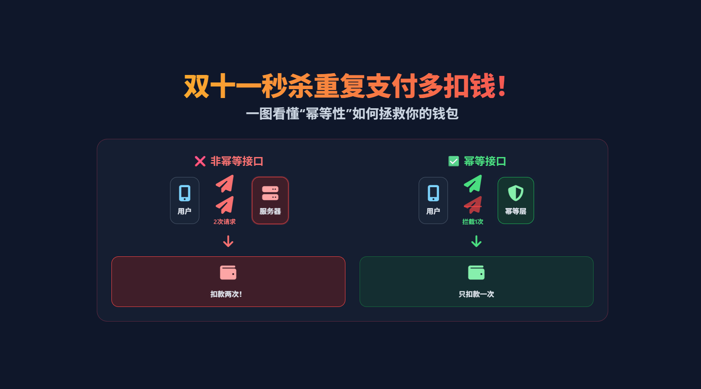
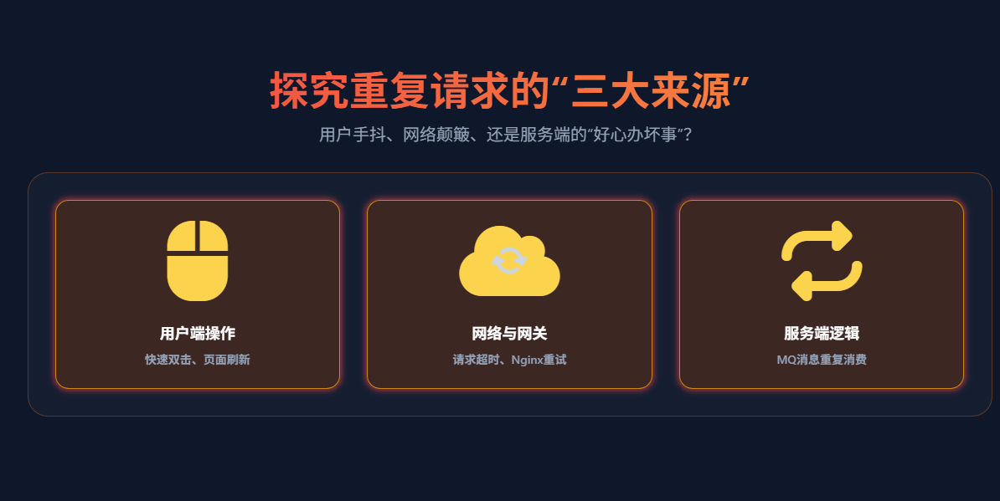
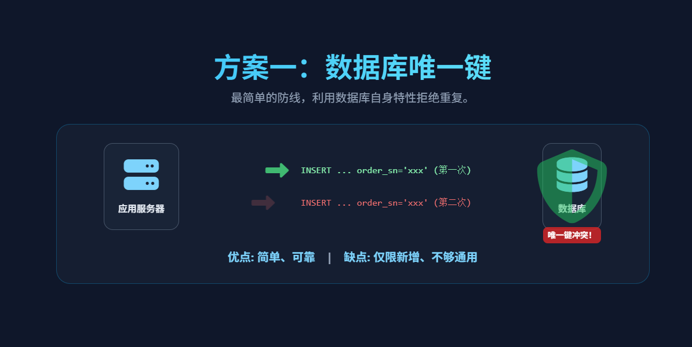
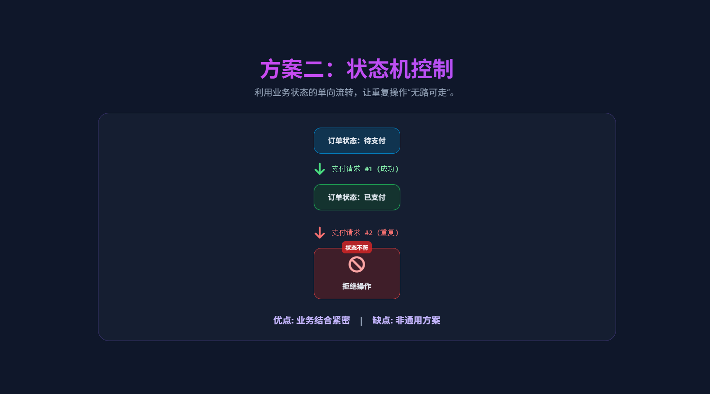
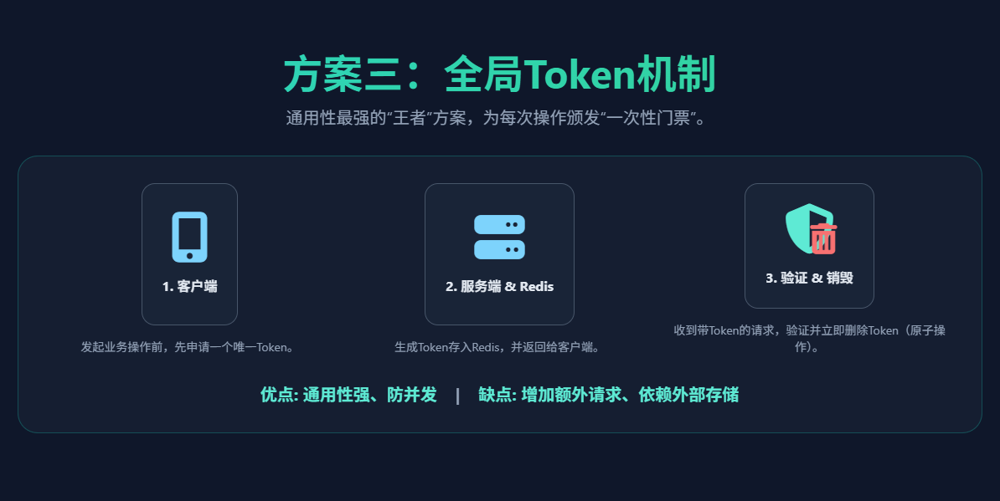

# 双十一 秒杀重复支付多扣钱，怎么避免才不被用户骂？

“王工，线上出事故了！有用户反馈，刚才秒杀抢购一个商品，结果被连扣了两次钱！”

如果你是负责支付接口的工程师，听到这句话，是不是瞬间冷汗直流？在分布式系统中，网络抖动、用户误操作、服务超时重试等因素，都可能导致同一个请求被发送多次。如果我们的接口没有做好防护，就可能造成灾难性的后果：一次下单，创建了两个订单；一次支付，扣了两次款。

而终结这一切混乱的“银弹”，就是我们今天要深入探讨的核心概念——**接口幂等性 (Idempotence)**。

## 一、是什么：幂等性的“一次有效”原则

幂等性（Idempotence）本是数学概念，指一个操作无论执行多少次，其产生的影响和结果都与执行一次相同。

应用在后端接口上，我们可以通俗地理解为：**客户端对同一个接口，发起一次或多次完全相同的请求，服务器最终的状态都应该是一致的，且只能产生一次业务影响。**

举个例子：

* **查询订单接口**：天然幂等。查询一次和查询一百次，对系统状态都没有任何改变。
* **支付订单接口**：**必须保证幂等**。无论用户因为网络问题点击了多少次“支付”按钮，最终都应该只扣款一次。

## 二、为什么：探究重复请求的“三大来源”

在复杂的分布式环境中，重复请求几乎是不可避免的。其来源主要有三类：

1. **用户侧的“手抖”**：
   * **快速双击**：用户在按钮可点击状态下，无意识地快速点击了两次提交按钮。
   * **刷新/回退**：提交表单后，用户点击浏览器刷新按钮，或通过后退按钮回到表单页再次提交。
2. **网络传输的“颠簸”**：
   * **请求超时重试**：客户端（App/浏览器）向服务端发起请求，但因为网络拥堵，迟迟未收到响应。此时，客户端可能会触发重试机制，再次发送同一个请求。但实际上，第一个请求可能已经成功抵达并被服务端处理了。
   * **网关/代理重试**：为了保证高可用，像 Nginx 这样的反向代理或微服务网关，在调用下游服务失败或超时后，也可能自动重试。
3. **服务端的“善意”**：
   * **异步消息重复消费**：在使用MQ时，如果消费者处理完消息后，在<code>ACK</code>确认之前宕机，MQ服务为了保证消息不丢失，会重新将该消息投递给其他消费者，造成重复消费。

## 三、怎么做：从“青铜”到“王者”的幂等性解决方案

保证幂等性的核心思想是：**为每一次业务操作生成一个全局唯一的凭证，并在执行前检查该凭证是否已被使用。**

### 方案一：数据库唯一键 (The Gatekeeper)

这是最简单、最底层的保证。利用数据库主键或唯一索引（Unique Index）的特性，来防止重复数据的插入。

* **实现**：在订单表中，为订单号<code>order_sn</code>创建一个唯一索引。当创建订单的请求重复到来时，第二次<code>INSERT</code>操作会因为违反了唯一键约束而失败。
* **场景**：非常适合“新增”类场景，如创建订单、创建商品等。

### 方案二：状态机控制 (The Guard)

在许多业务场景中，资源的状态是有限且单向流转的，我们可以利用状态的变更来做幂等。

* **实现**：以支付为例，订单有“待支付(UNPAID)”、“支付中(PAYING)”、“已支付(PAID)”、“关闭(CLOSED)”等状态。支付接口在执行扣款前，必须先检查订单状态是否为“待支付”。如果不是，则直接拒绝后续操作。
* **场景**：非常适合“更新”类场景，特别是涉及状态流转的业务，如支付订单、更新订单状态等。

### 方案三：全局Token机制 (The Ticket)

这是一种通用性极强的“王者”方案。其核心是让客户端在发起业务请求前，先向服务端申请一个“一次性门票”（Token）。

* **流程**：
  1. **申请Token**：客户端访问一个专门的“获取Token”接口，服务端生成一个全局唯一的Token（如UUID）存入Redis，并返回给客户端。
  2. **携带Token请求**：客户端在发起支付等业务请求时，必须在请求头或参数中携带此Token。
  3. **验证并销毁Token**：服务端接收到请求后，会去Redis中检查该Token是否存在。
     * 如果存在，则证明是第一次请求。服务端会立即**删除该Token**（保证原子性），然后执行业务逻辑。
     * 如果不存在，则证明是重复请求，直接拒绝。
* **场景**：几乎适用于所有场景，尤其适合解决因网络重试、用户重复点击等导致的并发重复请求问题。

## 四、方案对比与总结

| 方案 | 优点 | 缺点 | 适用场景 | 复杂度 |
| :--- | :--- | :--- | :--- | :--- |
| **数据库唯一键** | 实现简单、成本低、天然可靠 | 只能用于防止新增重复数据、对分库分表不友好 | 新增订单、创建用户等 | **低** |
| **状态机控制** | 实现简单、与业务结合紧密 | 状态流转设计需严谨、非通用方案 | 订单支付、状态更新等 | **中** |
| **全局Token机制** | 通用性强、逻辑与业务解耦、防并发能力好 | 增加了一次额外请求、需要依赖外部存储（如Redis） | 几乎所有写操作，特别是支付、下单等关键接口 | **高** |
| **分布式锁** | 思路直接、实现相对容易 | 性能开销大、锁的粒度难控制、可能出现死锁 | 并发不高、对性能要求不极致的场景 | **中** |

**结论：**

没有一招鲜吃遍天的方案。一个健壮的系统，往往是多种策略的组合：

* 对于**核心创建类**接口，**数据库唯一键**是必须的最后防线。
* 对于**状态变更类**接口，严谨的**状态机**是业务逻辑的最佳保障。
* 对于**防止客户端重复提交、网络重试**等前端或网络层引发的问题，**全局Token机制**是最优雅、最通用的解决方案。

面试时，能够清晰地阐述这套从底层到应用层的立体化幂等性保障方案，才能真正体现出你对高可用架构的深度理解。
