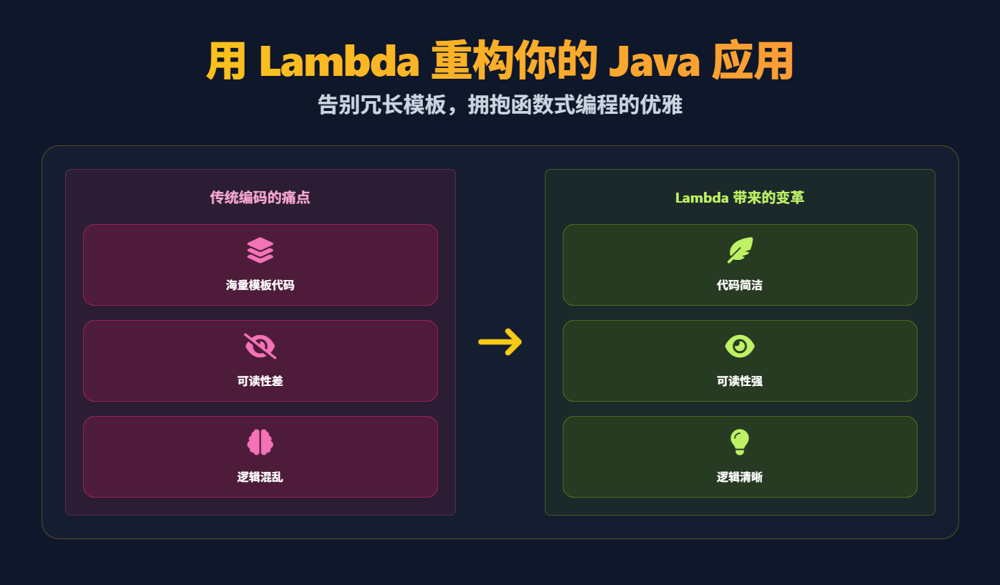
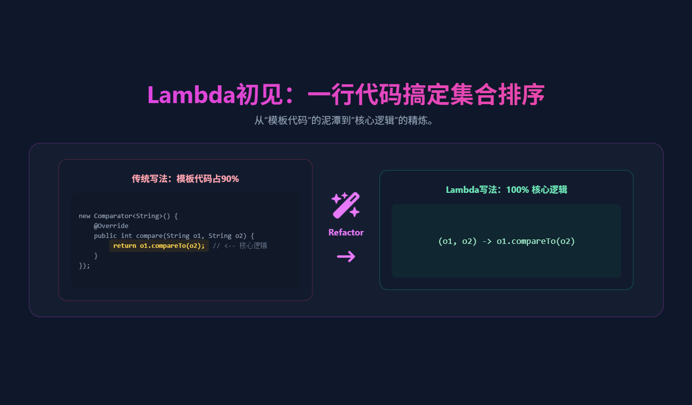
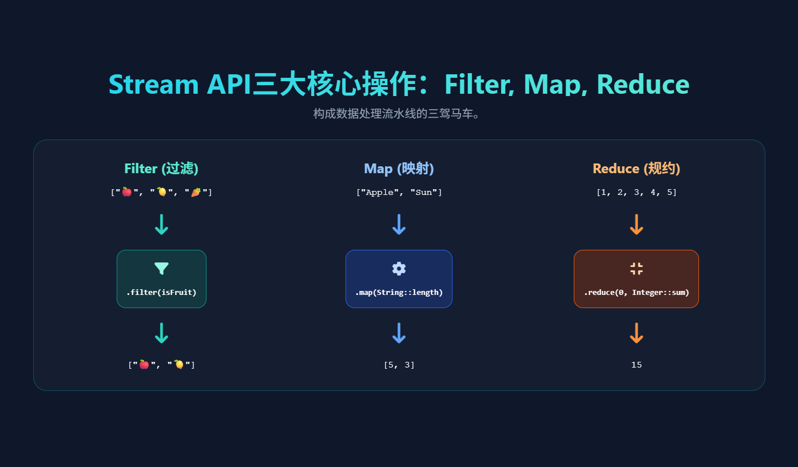
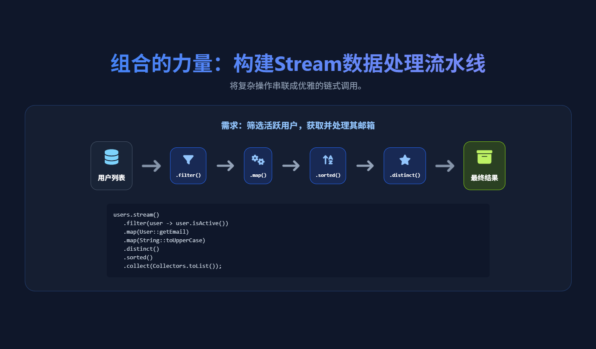
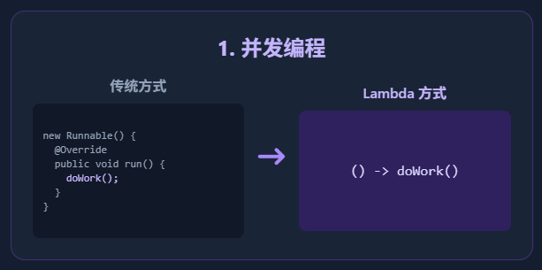
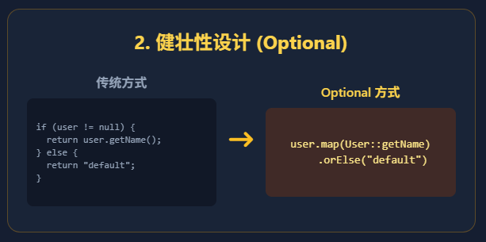
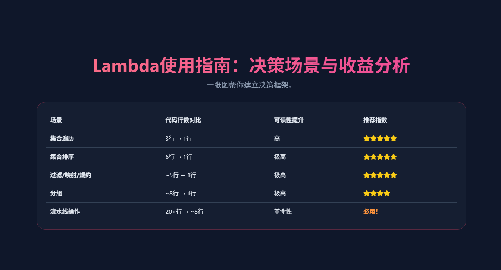

# 告别冗长，拥抱优雅——用 Lambda 重构你的 Java 应用

**<font style="color:rgb(38, 38, 38);">前言</font>**

<font style="color:rgb(38, 38, 38);">Java 作为一门常青的编程语言，其强大的生态和稳定性毋庸置疑。但长久以来，它也因繁琐的“模板代码”（Boilerplate Code）而受到一些诟病，尤其是在处理匿名内部类时。幸运的是，自 Java 8 引入 Lambda 表达式和 Stream API 以来，我们拥有了彻底改变这一现状的强大武器。本文将结合生动的图示，带你一步步掌握 Lambda，让你写出的 Java 代码也能如诗一般简洁、优雅。</font>

***

#### **<font style="color:rgb(38, 38, 38);">一、核心痛点与变革方向</font>**



<font style="color:rgb(38, 38, 38);">上图直观地揭示了我们即将踏上的重构之旅：从混乱走向清晰，从冗长走向简洁。在传统开发模式中，我们常常为了实现一个简单的功能而被迫编写大量结构性代码，它们掩盖了真正的业务逻辑，降低了代码的可读性和可维护性。Lambda 表达式正是解决这一问题的利器，它将我们从“如何做”的细节中解放出来，让我们能专注于“做什么”的核心逻辑。</font>

***

#### **<font style="color:rgb(38, 38, 38);">二、初识 Lambda：一行代码搞定集合排序</font>**



<font style="color:rgb(38, 38, 38);">排序是日常开发中最常见的任务之一。上图展示了使用 Lambda 前后的巨大差异。</font>

* **<font style="color:rgb(38, 38, 38);">传统方式</font>**<font style="color:rgb(38, 38, 38);">：我们必须创建一个完整的</font><font style="color:rgb(38, 38, 38);"> </font><code><font style="color:rgb(38, 38, 38);background-color:rgba(175, 184, 193, 0.2);">Comparator</font></code><font style="color:rgb(38, 38, 38);"> </font><font style="color:rgb(38, 38, 38);">匿名内部类的实例，重写其</font><font style="color:rgb(38, 38, 38);"> </font><code><font style="color:rgb(38, 38, 38);background-color:rgba(175, 184, 193, 0.2);">compare</font></code><font style="color:rgb(38, 38, 38);"> </font><font style="color:rgb(38, 38, 38);">方法。其中，只有</font><font style="color:rgb(38, 38, 38);"> </font><code><font style="color:rgb(38, 38, 38);background-color:rgba(175, 184, 193, 0.2);">return o1.compareTo(o2);</font></code><font style="color:rgb(38, 38, 38);"> </font><font style="color:rgb(38, 38, 38);">这一行是真正的核心逻辑，其余都是语法噪音。</font>
* **<font style="color:rgb(38, 38, 38);">Lambda 方式</font>**<font style="color:rgb(38, 38, 38);">：</font><code><font style="color:rgb(38, 38, 38);background-color:rgba(175, 184, 193, 0.2);">(o1, o2) -> o1.compareTo(o2)</font></code><font style="color:rgb(38, 38, 38);"> </font><font style="color:rgb(38, 38, 38);">完美地诠释了“代码即逻辑”。它省略了方法名（因为</font><font style="color:rgb(38, 38, 38);"> </font><code><font style="color:rgb(38, 38, 38);background-color:rgba(175, 184, 193, 0.2);">Comparator</font></code><font style="color:rgb(38, 38, 38);"> </font><font style="color:rgb(38, 38, 38);">只有一个抽象方法，编译器能自动推断）、返回类型和类定义。</font><code><font style="color:rgb(38, 38, 38);background-color:rgba(175, 184, 193, 0.2);">-></font></code><font style="color:rgb(38, 38, 38);"> </font><font style="color:rgb(38, 38, 38);">左边是参数列表，右边是方法体，一切都如此自然和精炼。</font>

***

#### **<font style="color:rgb(38, 38, 38);">三、Stream API 的三驾马车：Filter, Map, Reduce</font>**



<font style="color:rgb(38, 38, 38);">如果说 Lambda 是新时代的利剑，那么 Stream API 就是挥舞这把剑的强大剑法。上图展示了其最核心的三个中间操作：</font>

1. **<font style="color:rgb(38, 38, 38);">Filter (过滤)</font>**<font style="color:rgb(38, 38, 38);">：它接收一个返回布尔值的 Lambda（即“谓词”，Predicate），并只保留流中所有满足该条件的元素。这就像一个筛子，帮你滤掉不想要的数据。</font>
2. **<font style="color:rgb(38, 38, 38);">Map (映射)</font>**<font style="color:rgb(38, 38, 38);">：它接收一个 Lambda，将流中的每个元素转换为另一个元素。这就像一个加工厂，对每个原材料进行处理，产出新的产品。例如，从 </font><code><font style="color:rgb(38, 38, 38);background-color:rgba(175, 184, 193, 0.2);">User</font></code><font style="color:rgb(38, 38, 38);"> 对象中提取出 </font><code><font style="color:rgb(38, 38, 38);background-color:rgba(175, 184, 193, 0.2);">String</font></code><font style="color:rgb(38, 38, 38);"> 类型的姓名。</font>
3. **<font style="color:rgb(38, 38, 38);">Reduce (规约)</font>**<font style="color:rgb(38, 38, 38);">：它将流中的所有元素反复结合起来，最终得到一个单一的值。例如，计算总和、求最大值或将所有字符串连接起来。它是一系列操作的终点，负责汇总结果。</font>

***

#### **<font style="color:rgb(38, 38, 38);">四、组合的力量：构建声明式数据处理流水线</font>**



<font style="color:rgb(38, 38, 38);">Stream API 最强大的地方在于其链式调用的能力。上图所展示的“流水线”（Pipeline）是现代数据处理的核心思想。相比于使用 </font><code><font style="color:rgb(38, 38, 38);background-color:rgba(175, 184, 193, 0.2);">for</font></code><font style="color:rgb(38, 38, 38);"> 循环和 </font><code><font style="color:rgb(38, 38, 38);background-color:rgba(175, 184, 193, 0.2);">if</font></code><font style="color:rgb(38, 38, 38);"> 判断的命令式编程，这种声明式的方式优势巨大。</font>

```java
// 需求：筛选活跃用户，获取其大写邮箱，并去重排序
List<String> emails = users.stream()             // 1. 获取流
    .filter(user -> user.isActive())            // 2. 过滤：只保留活跃用户
    .map(User::getEmail)                        // 3. 映射：提取邮箱
    .map(String::toUpperCase)                   // 4. 映射：转为大写
    .distinct()                                 // 5. 去重
    .sorted()                                   // 6. 排序
    .collect(Collectors.toList());              // 7. 收集结果
```

<font style="color:rgb(38, 38, 38);">这段代码清晰地描述了数据转换的每一步，就像一个配方，任何人都能读懂它的意图。每个操作都是独立的、可组合的，极大地提升了代码的可读性和灵活性。</font>

***

#### **<font style="color:rgb(38, 38, 38);">五、进阶应用：简化并发与告别空指针</font>**

##### **<font style="color:rgb(89, 89, 89);">1. 简化并发编程</font>**



<code><font style="color:rgb(38, 38, 38);background-color:rgba(175, 184, 193, 0.2);">Runnable</font></code><font style="color:rgb(38, 38, 38);">、</font><code><font style="color:rgb(38, 38, 38);background-color:rgba(175, 184, 193, 0.2);">Callable</font></code><font style="color:rgb(38, 38, 38);"> 等函数式接口（只有一个抽象方法的接口）是 Lambda 的天然盟友。上图展示了在创建线程时，Lambda 如何将原本需要5行代码的匿名内部类简化为一行清晰的表达式，让我们能专注于线程需要执行的任务本身。</font>

##### **<font style="color:rgb(89, 89, 89);">2. 使用 Optional 告别空指针</font>**



<code><font style="color:rgb(38, 38, 38);background-color:rgba(175, 184, 193, 0.2);">NullPointerException</font></code><font style="color:rgb(38, 38, 38);"> 是 Java 开发者的噩梦。</font><code><font style="color:rgb(38, 38, 38);background-color:rgba(175, 184, 193, 0.2);">Optional</font></code><font style="color:rgb(38, 38, 38);"> 类结合 Lambda，提供了一种优雅的解决方案。它将一个可能为 </font><code><font style="color:rgb(38, 38, 38);background-color:rgba(175, 184, 193, 0.2);">null</font></code><font style="color:rgb(38, 38, 38);"> 的对象包装起来，并提供了一系列函数式方法来处理“有值”或“无值”的场景，从而避免了繁琐的 </font><code><font style="color:rgb(38, 38, 38);background-color:rgba(175, 184, 193, 0.2);">if-else</font></code><font style="color:rgb(38, 38, 38);"> 判空逻辑，让代码的健壮性提升到一个新高度。</font>

***

#### **<font style="color:rgb(38, 38, 38);">六、何时使用 Lambda？决策指南与收益分析</font>**



<font style="color:rgb(38, 38, 38);">上图的表格为您提供了一个清晰的决策框架。总而言之：</font>

* **<font style="color:rgb(38, 38, 38);">简单场景</font>**<font style="color:rgb(38, 38, 38);">：对于集合的遍历 (</font><code><font style="color:rgb(38, 38, 38);background-color:rgba(175, 184, 193, 0.2);">forEach</font></code><font style="color:rgb(38, 38, 38);">)、排序 (</font><code><font style="color:rgb(38, 38, 38);background-color:rgba(175, 184, 193, 0.2);">sort</font></code><font style="color:rgb(38, 38, 38);">)，使用 Lambda 可以立即获得代码行数和可读性的双重收益，是入门的最佳实践。</font>
* **<font style="color:rgb(38, 38, 38);">核心场景</font>**<font style="color:rgb(38, 38, 38);">：在进行数据过滤、转换、分组等操作时，Stream API 配合 Lambda 是不二之选。</font>
* **<font style="color:rgb(38, 38, 38);">复杂场景</font>**<font style="color:rgb(38, 38, 38);">：当需要将多个操作串联成一个复杂的数据处理流水线时，Stream API 的优势被发挥到极致，是“必用”场景。</font>

**<font style="color:rgb(38, 38, 38);">结论</font>**

<font style="color:rgb(38, 38, 38);">Lambda 表达式和 Stream API 不仅仅是语法糖，它们是 Java 语言向函数式编程范式迈出的重要一步。掌握它们，意味着你能够编写出更简洁、更具表现力、更不容易出错的现代化 Java 代码。希望本文能成为你重构之旅的起点，开始享受函数式编程带来的优雅与高效吧！</font>
