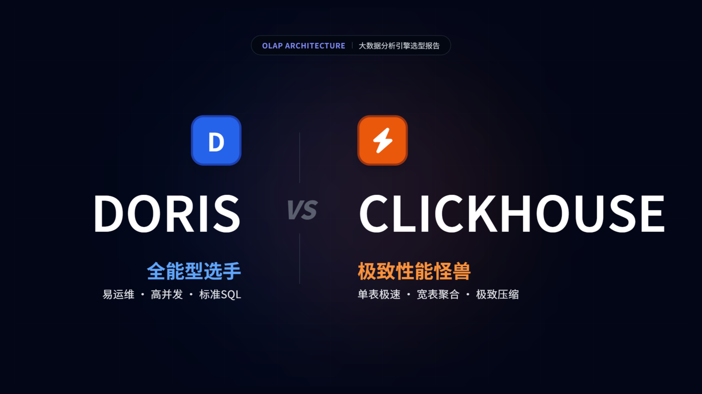
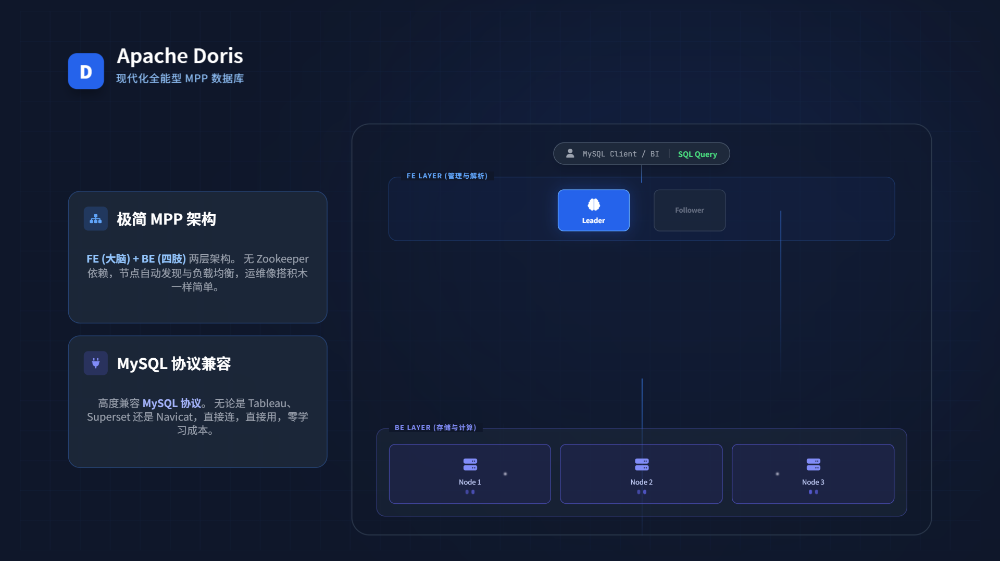
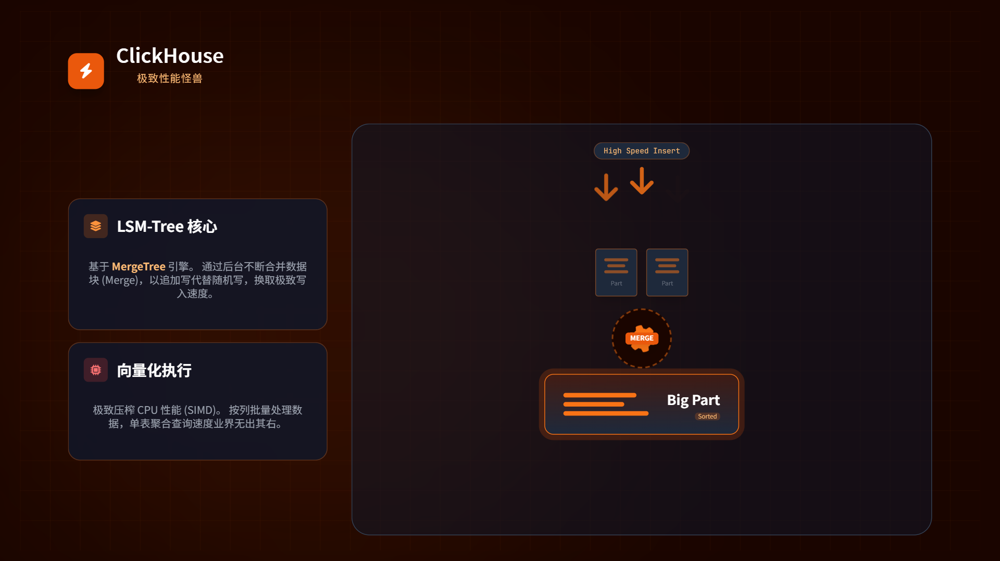
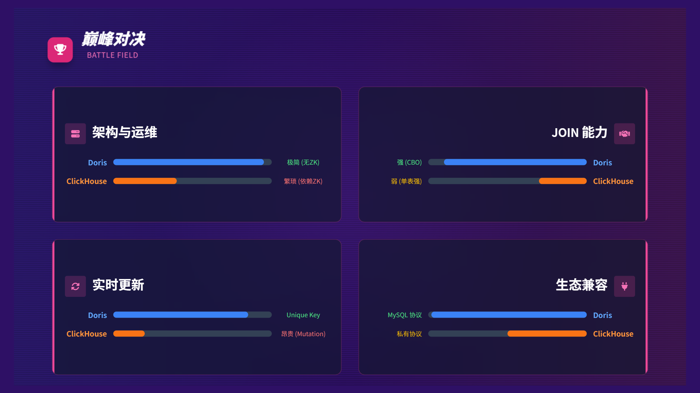
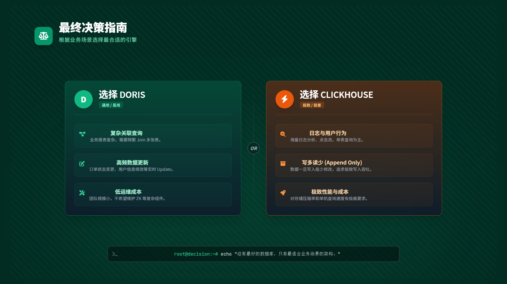

# 大厂弃用 ClickHouse？Doris 凭什么成新宠？

在实时 OLAP 领域，ClickHouse 曾是当之无愧的“流量之王”。它快，快得不讲道理，单机性能足以让很多大数据组件汗颜。

但这两年，你一定发现了一个现象：越来越多的互联网大厂（美团、字节、京东）和金融机构，开始大规模迁移到 Apache Doris。

**为什么？是 ClickHouse 不香了吗？还是 Doris 有什么杀手锏？**

抛开官方的跑分数据，今天我们从架构原理、运维成本和业务场景三个维度，把这两个引擎扒开了看一看。

---

### 一、 两个世界的“物种”

虽然它们都叫 OLAP 引擎，但骨子里的基因完全不同。

**ClickHouse** 的出身是做 Web 流量分析的（Yandex Metrica）。它的设计初衷非常纯粹：**为了处理海量日志数据的宽表聚合**。为了极致的快，它在早期甚至牺牲了标准 SQL 的支持和分布式管理的便利性。它像一辆改装过的 F1 赛车，只有在特定的直道（宽表、日志）上才能飙出极限速度。

**Apache Doris**（原百度 Palo）则诞生于复杂的广告报表业务。它从一开始就是为了解决**高并发、多表关联、易运维**这些“脏活累活”而生的。它更像是一辆全地形越野车，也许极速不如 F1，但在复杂的路况（关联查询、实时更新）下，它能跑得更稳。

---

### 二、 架构之争：运维是最大的隐形成本

很多团队在引入 ClickHouse 初期非常爽，但随着集群规模扩大，痛苦就开始了。

ClickHouse 的分布式协同强依赖 **Zookeeper**。在大数据量下，ZK 的瓶颈往往会导致集群元数据不一致，DDL 卡死，甚至副本丢失。而且，ClickHouse 的扩容极其痛苦，往往需要手动重新平衡数据（Rebalance），这对运维人员来说简直是噩梦。

反观上图展示的 **Doris 架构**，它做了一个极简的设计：

1. **去 Zookeeper**：FE（前端）和 BE（后端）两层架构，节点之间自动选举和通信，不依赖任何第三方组件。
2. **自动负载均衡**：扩容节点？一行 SQL 搞定。系统会自动在后台悄悄把数据分片（Tablet）搬运均匀，业务层完全无感。

此外，Doris 实现了**MySQL 协议兼容**。这意味着什么？意味着你的数据分析师不需要学奇怪的 ClickHouse 语法，直接用 Navicat、Tableau 连上去就能跑 SQL。这种“零门槛”的体验，对于推广数据平台至关重要。

---

### 三、 速度的代价：LSM-Tree 的双刃剑

ClickHouse 为什么快？上图揭示了它的底牌：**MergeTree 引擎**。

它采用极致的 **LSM-Tree（Log-Structured Merge-Tree）** 思想，配合**向量化执行（SIMD）**。数据写入时，它是 Append Only 的，就像写日志一样追加，绝不回头修改。这让它的写入吞吐量高得吓人。

**但代价是什么？**

代价就是**更新（Update）和删除（Delete）极其昂贵**。在 ClickHouse 里，改一条数据可能需要重写整个分区（Mutation）。

如果你的业务场景是“订单状态变更”、“用户画像实时刷新”，需要频繁修改历史数据，ClickHouse 会让你痛不欲生。而 Doris 通过 **Unique Key 模型** 和 **Merge-on-Write** 技术，完美解决了“实时更新”和“查询性能”兼得的难题。

---

### 四、 决胜点：Join 能力与生态

这张对比图，道出了很多架构师最终倒戈 Doris 的真实原因：**Join 能力**。

ClickHouse 是典型的“大宽表”思维。它不擅长 Join，尤其是多张大表的 Join。一旦涉及复杂关联，它往往需要把右表全量加载到内存，极易 OOM（内存溢出）。所以用 ClickHouse，你必须在 ETL 阶段就把数据打平成一张宽表。

而 Doris 拥有现代 MPP 数据库标配的 **CBO（基于代价的优化器）**。它能智能调整 Join 顺序，配合 Runtime Filter 技术，在查询运行时动态过滤数据。

**简单说：**

+ 用 ClickHouse，你需要为了数据库去改造业务模型（打宽表）。
+ 用 Doris，你可以直接沿用业务的星型/雪花型模型（直接 Join）。

---

### 五、 最终结论：谁更适合你？

没有最好的架构，只有最合适的场景。最后，我们用一张图来终结选择困难症。

**请毫不犹豫选择 ClickHouse，如果：**

+ 你的数据主要是**日志、流水、埋点**（Write-Once）。
+ 你能接受把所有数据都打平成**大宽表**。
+ 你的团队有**极客精神**，愿意投入精力去调优参数、维护 ZK。

**请坚定选择 Apache Doris，如果：**

+ 你的业务是**复杂的报表系统**，需要频繁关联多张表。
+ 数据需要**高频更新**（如订单状态、用户信息）。
+ 你需要直接对接 BI 工具，或者给非技术人员提供 SQL 查询。
+ 你希望**运维省心**，不想半夜起来修集群。

选型不是看谁跑分高，而是看谁能让你的团队少加班，让业务跑得更顺畅。
