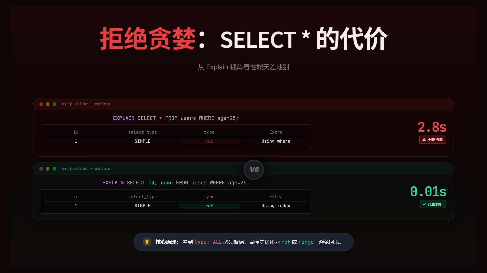
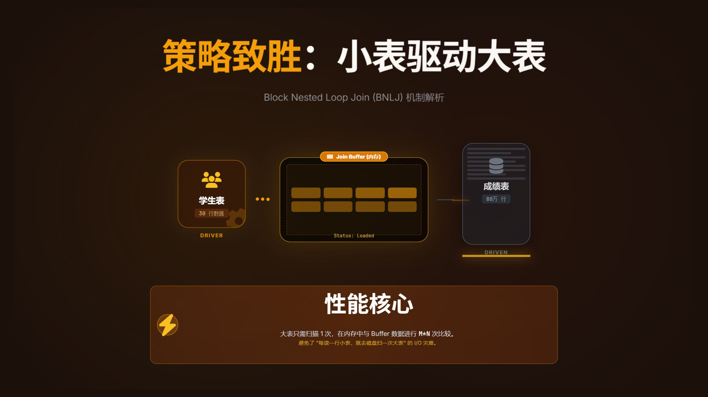

# 拒绝慢查询：MySQL 8.0 高性能优化实战指南

<font style="color:rgb(38, 38, 38);">在现代高并发架构中，数据库往往是系统最脆弱的瓶颈。很多开发者习惯于“先实现功能，再考虑性能”，导致上线后一条烂 SQL 就能引发 CPU 飙升、连接池耗尽甚至服务雪崩。</font>


<font style="color:rgb(38, 38, 38);">本文将跳出枯燥的理论定义，结合 </font>**<font style="color:rgb(38, 38, 38);">Explain 执行计划</font>**<font style="color:rgb(38, 38, 38);"> 的诊断视角，从底层执行机制出发，深度剖析 MySQL 优化的五个核心实战场景。</font>

## <font style="color:rgb(38, 38, 38);">一、 拒绝贪婪：覆盖索引与回表的博弈</font>



### <font style="color:rgb(38, 38, 38);">1. 诊断先行：警惕 </font><code><font style="color:rgb(38, 38, 38);background-color:rgba(175, 184, 193, 0.2);">type: ALL</font></code>

<font style="color:rgb(38, 38, 38);">在代码审查中，</font><code><font style="color:rgb(38, 38, 38);background-color:rgba(175, 184, 193, 0.2);">SELECT *</font></code><font style="color:rgb(38, 38, 38);"> 是最常见的“偷懒”写法。当我们使用 </font><code><font style="color:rgb(38, 38, 38);background-color:rgba(175, 184, 193, 0.2);">EXPLAIN</font></code><font style="color:rgb(38, 38, 38);"> 命令分析这类 SQL 时，通常会看到一个刺眼的标签：</font><code>**<font style="color:rgb(38, 38, 38);background-color:rgba(175, 184, 193, 0.2);">type: ALL</font>**</code><font style="color:rgb(38, 38, 38);">。 这意味着数据库正在进行</font>**<font style="color:rgb(38, 38, 38);">全表扫描</font>**<font style="color:rgb(38, 38, 38);">。许多开发者认为多查几个字段无伤大雅，但在高频查询下，这往往是性能恶化的开端。</font>

### <font style="color:rgb(38, 38, 38);">2. 底层原理：回表 (Table Lookup)</font>

<font style="color:rgb(38, 38, 38);">为什么 </font><code><font style="color:rgb(38, 38, 38);background-color:rgba(175, 184, 193, 0.2);">SELECT *</font></code><font style="color:rgb(38, 38, 38);"> 会慢？核心在于 InnoDB 的索引结构：</font>

* **<font style="color:rgb(38, 38, 38);">聚簇索引 (Clustered Index)</font>**<font style="color:rgb(38, 38, 38);">：叶子节点存储完整的行数据（物理文件）。</font>
* **<font style="color:rgb(38, 38, 38);">二级索引 (Secondary Index)</font>**<font style="color:rgb(38, 38, 38);">：叶子节点仅存储索引列的值和主键 ID。</font>

<font style="color:rgb(38, 38, 38);">当你执行 </font><code><font style="color:rgb(38, 38, 38);background-color:rgba(175, 184, 193, 0.2);">SELECT *</font></code><font style="color:rgb(38, 38, 38);"> 时，如果 WHERE 条件命中了二级索引，数据库首先在二级索引树上找到对应的主键 ID。由于你需要获取所有列（包含未被索引的列），引擎必须拿着这些 ID，</font>**<font style="color:rgb(38, 38, 38);">二次跳转</font>**<font style="color:rgb(38, 38, 38);">到聚簇索引树上去读取完整的行数据。 这个过程就是</font>**<font style="color:rgb(38, 38, 38);">回表</font>**<font style="color:rgb(38, 38, 38);">。它会将原本顺序的索引扫描变成了大量的随机 I/O，导致查询耗时成倍增加。</font>

### <font style="color:rgb(38, 38, 38);">3. 优化方案：覆盖索引 (Covering Index)</font>

<font style="color:rgb(38, 38, 38);">如何将 </font><code><font style="color:rgb(38, 38, 38);background-color:rgba(175, 184, 193, 0.2);">type: ALL</font></code><font style="color:rgb(38, 38, 38);"> 优化为 </font><code>**<font style="color:rgb(38, 38, 38);background-color:rgba(175, 184, 193, 0.2);">type: INDEX</font>**</code><font style="color:rgb(38, 38, 38);"> 或 </font><code>**<font style="color:rgb(38, 38, 38);background-color:rgba(175, 184, 193, 0.2);">ref</font>**</code><font style="color:rgb(38, 38, 38);">？ 答案是</font>**<font style="color:rgb(38, 38, 38);">覆盖索引</font>**<font style="color:rgb(38, 38, 38);">。当 SQL 语句中查询的所有列（例如 </font><code><font style="color:rgb(38, 38, 38);background-color:rgba(175, 184, 193, 0.2);">SELECT id, name</font></code><font style="color:rgb(38, 38, 38);">）都包含在同一个索引中时，MySQL 直接从索引树返回结果，</font>**<font style="color:rgb(38, 38, 38);">完全不需要读取物理数据行</font>**<font style="color:rgb(38, 38, 38);">。</font>

**<font style="color:rgb(38, 38, 38);">代码对比：</font>**

```plsql
-- ❌ 慢查询 (type: ALL / ref 但回表)
-- 需要二次跳转读取物理行，产生随机 I/O
SELECT * FROM users WHERE age = 25;

-- ✅ 高性能 (type: INDEX / ref)
-- 命中覆盖索引 (idx_age_name)，实现“零回表”
-- 即使有几百万行数据，也能毫秒级返回
SELECT id, name FROM users WHERE age = 25;
```

## <font style="color:rgb(38, 38, 38);">二、 策略致胜：Join 的内存机制解析</font>



### <font style="color:rgb(38, 38, 38);">1. 现象分析</font>

<font style="color:rgb(38, 38, 38);">多表关联 (Join) 是业务开发中无法避免的操作。但当涉及百万级大表关联时，很多系统会直接卡死，甚至拖垮整个实例。</font>

### <font style="color:rgb(38, 38, 38);">2. 底层原理：Block Nested Loop Join (BNLJ)</font>

<font style="color:rgb(38, 38, 38);">MySQL 的核心 Join 算法（特别是 8.0 之前或未命中 Hash Join 时）是 BNLJ。其核心逻辑是将</font>**<font style="color:rgb(38, 38, 38);">驱动表 (Driver Table)</font>**<font style="color:rgb(38, 38, 38);"> 的数据加载到内存中的 </font>**<font style="color:rgb(38, 38, 38);">Join Buffer</font>**<font style="color:rgb(38, 38, 38);"> 区域。</font>

* **<font style="color:rgb(38, 38, 38);">内存比较</font>**<font style="color:rgb(38, 38, 38);">：每一行被驱动表的数据，都会与 Buffer 中的所有记录进行比较（速度极快，纳秒级）。</font>
* **<font style="color:rgb(38, 38, 38);">磁盘扫描</font>**<font style="color:rgb(38, 38, 38);">：如果 Join Buffer 设置过小，装不下驱动表，MySQL 就必须</font>**<font style="color:rgb(38, 38, 38);">分段加载</font>**<font style="color:rgb(38, 38, 38);">。这意味着被驱动表（大表）要被重复扫描多次，造成巨大的 I/O 浪费。</font>

### <font style="color:rgb(38, 38, 38);">3. 优化方案：小表驱动大表</font>

<font style="color:rgb(38, 38, 38);">核心策略是确保驱动表能被 Join Buffer 一口吃下。</font>

* **<font style="color:rgb(38, 38, 38);">选对驱动表</font>**<font style="color:rgb(38, 38, 38);">：总是让结果集较小的表作为驱动表（LEFT JOIN 左边是驱动表，INNER JOIN 优化器通常会自动选择）。</font>
* **<font style="color:rgb(38, 38, 38);">扩容 Buffer</font>**<font style="color:rgb(38, 38, 38);">：适当调大</font><font style="color:rgb(38, 38, 38);"> </font><code><font style="color:rgb(38, 38, 38);background-color:rgba(175, 184, 193, 0.2);">join_buffer_size</font></code><font style="color:rgb(38, 38, 38);">，避免因内存不足导致的大表重复扫描。</font>

## <font style="color:rgb(38, 38, 38);">三、 拒绝无效劳动：深度分页的性能黑洞</font>


### <font style="color:rgb(38, 38, 38);">1. 现象分析</font>

<font style="color:rgb(38, 38, 38);">“翻页越往后越慢”是经典的数据库问题。当用户翻到第 1000 页时，接口响应时间可能从 20ms 变成 2s。</font>

### <font style="color:rgb(38, 38, 38);">2. 底层原理：Offset 的线性扫描</font>

<font style="color:rgb(38, 38, 38);">执行 </font><code><font style="color:rgb(38, 38, 38);background-color:rgba(175, 184, 193, 0.2);">LIMIT 1000000, 10</font></code><font style="color:rgb(38, 38, 38);"> 时，MySQL 并不是直接跳到第 100 万行。 它必须从头开始，扫描并读取前 1,000,010 行数据。读取后，它会</font>**<font style="color:rgb(38, 38, 38);">抛弃 (Discard)</font>**<font style="color:rgb(38, 38, 38);"> 前 100 万行，只保留最后 10 行返回给用户。 这意味着，99.99% 的 CPU 算力和 I/O 资源都被浪费在了“读完即扔”的无用功上。这种模式的时间复杂度是 </font>**<font style="color:rgb(38, 38, 38);">O(N)</font>**<font style="color:rgb(38, 38, 38);">。</font>

### <font style="color:rgb(38, 38, 38);">3. 优化方案：游标法 (Seek Method)</font>

<font style="color:rgb(38, 38, 38);">利用 B+ 树的有序特性，我们可以将 O(N) 优化为 </font>**<font style="color:rgb(38, 38, 38);">O(1)</font>**<font style="color:rgb(38, 38, 38);">。通过记录上一页最后一条数据的 ID（游标），在查询下一页时直接通过 WHERE 条件定位。</font>

**<font style="color:rgb(38, 38, 38);">代码对比：</font>**

```plsql
-- ❌ 传统分页：越深越慢
-- 数据库先读后丢，资源浪费严重
SELECT * FROM orders ORDER BY id LIMIT 1000000, 10;

-- ✅ 游标分页：恒定极速
-- 直接利用主键索引跳转 (Seek)，跳过前 100 万行
SELECT * FROM orders WHERE id > 1000000 ORDER BY id LIMIT 10;
```

## <font style="color:rgb(38, 38, 38);">四、 极速管道：UNION ALL 的隐形优势</font>


### <font style="color:rgb(38, 38, 38);">1. 现象分析</font>

<font style="color:rgb(38, 38, 38);">在分库分表或数据聚合场景下，我们经常需要合并多个结果集。很多开发者习惯性使用 </font><code><font style="color:rgb(38, 38, 38);background-color:rgba(175, 184, 193, 0.2);">UNION</font></code><font style="color:rgb(38, 38, 38);">，却不知道它背后的代价。</font>

### <font style="color:rgb(38, 38, 38);">2. 底层原理：隐式排序与去重</font>

<code><font style="color:rgb(38, 38, 38);background-color:rgba(175, 184, 193, 0.2);">UNION</font></code><font style="color:rgb(38, 38, 38);"> 操作符不仅仅是合并数据，它隐含了一个 </font>**<font style="color:rgb(38, 38, 38);">DISTINCT</font>**<font style="color:rgb(38, 38, 38);"> 操作。 为了保证结果集中没有重复行，MySQL 必须创建一个</font>**<font style="color:rgb(38, 38, 38);">临时表 (Temporary Table)</font>**<font style="color:rgb(38, 38, 38);">，将所有数据导入后，进行全量</font>**<font style="color:rgb(38, 38, 38);">排序 (Sorting)</font>**<font style="color:rgb(38, 38, 38);"> 或哈希运算来剔除重复数据。 这不仅消耗大量的 CPU 资源，当数据量大时，临时表还会落盘（写入磁盘），导致性能急剧下降。</font>

### <font style="color:rgb(38, 38, 38);">3. 优化方案：无脑 UNION ALL</font>

<code><font style="color:rgb(38, 38, 38);background-color:rgba(175, 184, 193, 0.2);">UNION ALL</font></code><font style="color:rgb(38, 38, 38);"> 是纯粹的追加操作，它不做任何去重判断，直接将结果集拼接返回，就像一条畅通无阻的管道。 </font>**<font style="color:rgb(38, 38, 38);">实战建议：</font>**<font style="color:rgb(38, 38, 38);"> 除非业务逻辑严格要求“绝对不能有重复数据”，否则请始终使用 </font><code><font style="color:rgb(38, 38, 38);background-color:rgba(175, 184, 193, 0.2);">UNION ALL</font></code><font style="color:rgb(38, 38, 38);">。</font>

## <font style="color:rgb(38, 38, 38);">五、 总结：构建高性能系统的三大基石</font>


<font style="color:rgb(38, 38, 38);">SQL 优化千变万化，但万变不离其宗。我们可以将其归纳为三大铁律，这也是我们 Review 代码时的核心标准：</font>

1. **<font style="color:rgb(38, 38, 38);">Scan Less（少扫描）</font>**
   * <font style="color:rgb(38, 38, 38);">利用好</font>**<font style="color:rgb(38, 38, 38);">覆盖索引</font>**<font style="color:rgb(38, 38, 38);">，将 Explain 结果从</font><font style="color:rgb(38, 38, 38);"> </font><code><font style="color:rgb(38, 38, 38);background-color:rgba(175, 184, 193, 0.2);">ALL</font></code><font style="color:rgb(38, 38, 38);"> </font><font style="color:rgb(38, 38, 38);">优化为</font><font style="color:rgb(38, 38, 38);"> </font><code><font style="color:rgb(38, 38, 38);background-color:rgba(175, 184, 193, 0.2);">ref</font></code><font style="color:rgb(38, 38, 38);">。</font>
   * <font style="color:rgb(38, 38, 38);">核心目标：</font>**<font style="color:rgb(38, 38, 38);">拒绝回表 (No Table Lookup)</font>**<font style="color:rgb(38, 38, 38);">。能从索引树拿到的数据，绝不碰物理磁盘。</font>
2. **<font style="color:rgb(38, 38, 38);">Return Less（少返回）</font>**
   * <font style="color:rgb(38, 38, 38);">网络传输和应用层内存也是瓶颈。</font>
   * <font style="color:rgb(38, 38, 38);">拒绝</font><font style="color:rgb(38, 38, 38);"> </font><code><font style="color:rgb(38, 38, 38);background-color:rgba(175, 184, 193, 0.2);">SELECT *</font></code><font style="color:rgb(38, 38, 38);">，拒绝无效的深度分页，只拿走你真正需要的字节。</font>
3. **<font style="color:rgb(38, 38, 38);">Interact Less（少交互）</font>**
   * <font style="color:rgb(38, 38, 38);">数据库连接建立是昂贵的。</font>
   * <font style="color:rgb(38, 38, 38);">能用批量插入 (Batch Insert) 代替循环插入，能用一条复杂 SQL 代替应用层的多次查询循环，就能显著减少网络往返耗时 (RTT)。</font>

<font style="color:rgb(38, 38, 38);">掌握这三大基石，你就能在面对复杂的慢查询日志时，迅速定位病灶，开出精准的“药方”。</font>
