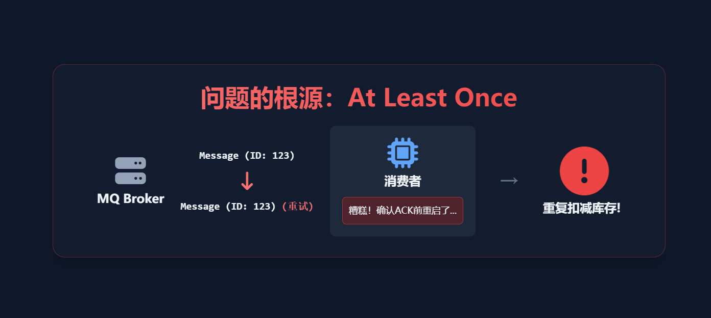
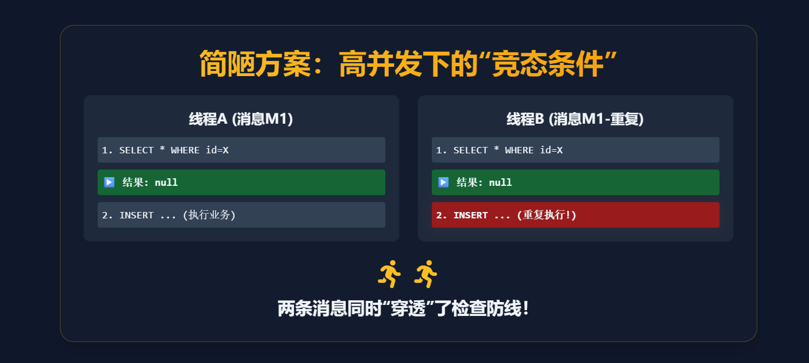
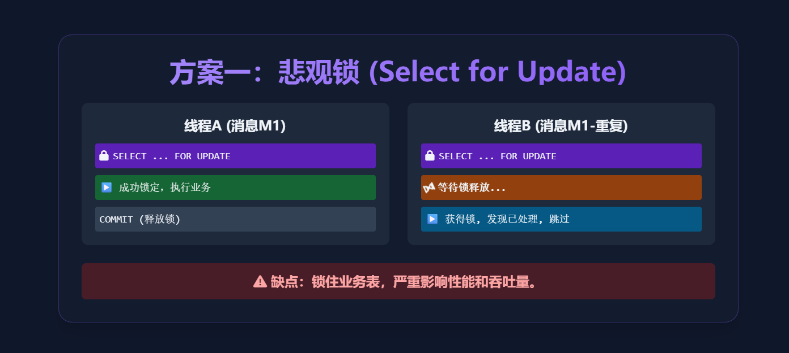
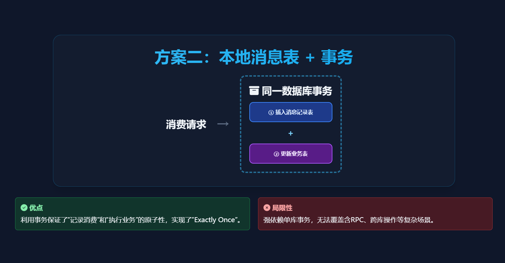
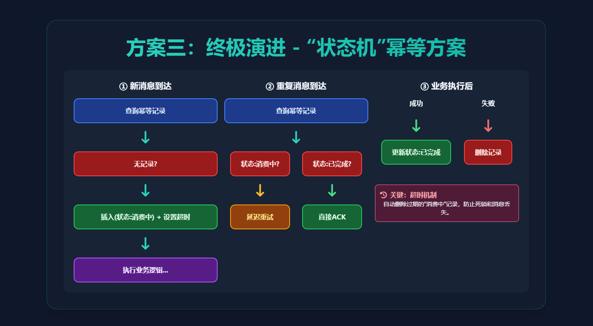
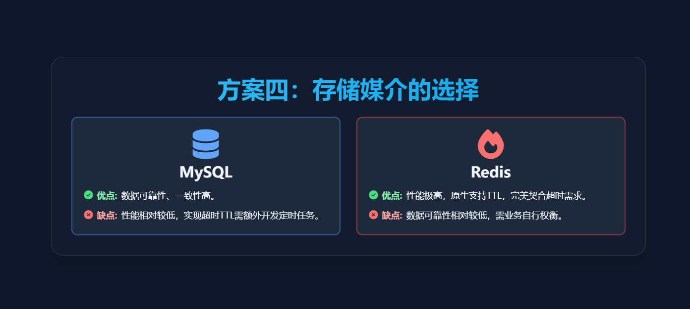

# 消息幂等（去重）如何解决？来看看这个方案！

## <font style="color:rgb(38, 38, 38);">一、是什么：消息幂等性的“前世今生”</font>

<font style="color:rgb(38, 38, 38);">在分布式系统中，消息中间件（MQ）扮演着举足轻重的角色，它负责着系统间的异步通信、应用解耦和流量削峰。其核心承诺之一是“消息可靠投递”，即“At Least Once”——消息至少会被成功消费一次。</font>

<font style="color:rgb(38, 38, 38);">这意味着，当消费方应用A成功接收消息M并开始处理，但若在向MQ确认“消费成功”之前发生任何意外（如程序重启、网络抖动），MQ会认为消息没有被成功处理，从而进行重试投递。这种机制保证了消息不丢失，但也带来了新的挑战：</font>**<font style="color:rgb(38, 38, 38);">消息重复消费</font>**<font style="color:rgb(38, 38, 38);">。</font>

<font style="color:rgb(38, 38, 38);">对于非幂等操作，如“插入订单数据”或“扣减库存”，重复消费将导致灾难性后果：数据库主键冲突、库存重复扣减等。因此，保证消费逻辑的</font>**<font style="color:rgb(38, 38, 38);">幂等性</font>**<font style="color:rgb(38, 38, 38);">（Idempotency）——即无论一个操作执行多少次，其结果都和执行一次完全相同——就成了消费者必须解决的课题。</font>



## <font style="color:rgb(38, 38, 38);">二、为什么：简单的去重方案为何“不堪一击”</font>

<font style="color:rgb(38, 38, 38);">面对重复消费，最直观的解决方案是在执行业务逻辑前，先检查该业务是否已被执行过。以订单处理为例，代码可能如下：</font>

```plsql
-- 1. 检查订单是否已存在
select * from t_order where order_no = 'THIS_ORDER_NO';

-- 2. 如果不存在，则执行业务逻辑
if(order == null) {
    insert into t_order values .....
    update t_inv set count = count-1 where good_id = 'good123';
}
```

<font style="color:rgb(38, 38, 38);">这个方案在低并发下或许有效。但在高并发场景下，它存在明显的“竞态条件”（Race Condition）。假设两条重复的消息在毫秒级间隔内同时到达，它们可能都执行了第一步的</font><code><font style="color:rgb(38, 38, 38);background-color:rgba(175, 184, 193, 0.2);">select</font></code><font style="color:rgb(38, 38, 38);">，并且都得到了</font><code><font style="color:rgb(38, 38, 38);background-color:rgba(175, 184, 193, 0.2);">null</font></code><font style="color:rgb(38, 38, 38);">的结果。随后，它们会双双“穿透”这层简陋的防线，导致业务逻辑被重复执行。</font>



## <font style="color:rgb(38, 38, 38);">三、怎么做：从“堵漏”到“架构”的四重演进</font>

<font style="color:rgb(38, 38, 38);">为了解决上述问题，我们需要更健壮的幂等方案。</font>

### <font style="color:rgb(38, 38, 38);">方案一：数据库悲观锁 (Select for Update)</font>

<font style="color:rgb(38, 38, 38);">一个直接的改进是为</font><code><font style="color:rgb(38, 38, 38);background-color:rgba(175, 184, 193, 0.2);">select</font></code><font style="color:rgb(38, 38, 38);">语句加上</font><code><font style="color:rgb(38, 38, 38);background-color:rgba(175, 184, 193, 0.2);">for update</font></code><font style="color:rgb(38, 38, 38);">，将其包裹在数据库事务中。</font>

```plsql
-- 1. 开启事务
-- 2. 锁定记录
select * from t_order where order_no = 'THIS_ORDER_NO' for update;

-- 3. 判断状态并执行
if(order.status == null) {
    // ... 业务逻辑 ...
}
-- 4. 提交事务
```

<font style="color:rgb(38, 38, 38);">这样，第一条消息的事务会锁定相关记录，后续的重复消息在执行</font><code><font style="color:rgb(38, 38, 38);background-color:rgba(175, 184, 193, 0.2);">select for update</font></code><font style="color:rgb(38, 38, 38);">时会被阻塞，直到第一个事务提交。这确实解决了并发问题，但引入了新的代价：事务的粒度变大，锁定了业务表，导致整个消费链路性能下降，吞吐量降低。</font>



### <font style="color:rgb(38, 38, 38);">方案二：消息表与业务事务绑定 (本地消息表)</font>

<font style="color:rgb(38, 38, 38);">此方案旨在实现“Exactly Once”的消费语义。核心思想是增加一张</font><code><font style="color:rgb(38, 38, 38);background-color:rgba(175, 184, 193, 0.2);">msg_consumed</font></code><font style="color:rgb(38, 38, 38);">（消息消费记录）表，并将“记录消费”和“执行业务”这两个动作绑定在同一个数据库事务中。</font>

1. **<font style="color:rgb(38, 38, 38);">开启事务</font>**
2. **<font style="color:rgb(38, 38, 38);">插入消息记录</font>**<font style="color:rgb(38, 38, 38);"> </font><font style="color:rgb(38, 38, 38);">到</font><code><font style="color:rgb(38, 38, 38);background-color:rgba(175, 184, 193, 0.2);">msg_consumed</font></code><font style="color:rgb(38, 38, 38);">表（以业务ID或消息ID为主键）。</font>
3. **<font style="color:rgb(38, 38, 38);">执行核心业务逻辑</font>**<font style="color:rgb(38, 38, 38);">（如更新订单表）。</font>
4. **<font style="color:rgb(38, 38, 38);">提交事务</font>**

<font style="color:rgb(38, 38, 38);">如果事务成功，消息记录和业务数据一同落库。后续重复消息会因主键冲突而插入失败，从而实现幂等。如果中途失败，整个事务回滚，消息会重新投递，保证了不丢消息。</font>

**<font style="color:rgb(38, 38, 38);">局限性</font>**<font style="color:rgb(38, 38, 38);">:</font>

* **<font style="color:rgb(38, 38, 38);">强依赖关系型数据库事务</font>**<font style="color:rgb(38, 38, 38);">：消费逻辑中若包含RPC调用、操作Redis等不支持事务的环节，则无法保证原子性。</font>
* **<font style="color:rgb(38, 38, 38);">单库限制</font>**<font style="color:rgb(38, 38, 38);">：无法解决跨数据库的事务问题。</font>



### <font style="color:rgb(38, 38, 38);">方案三：终极演进 - “状态机”幂等方案（非事务性）</font>

<font style="color:rgb(38, 38, 38);">为了打破事务的枷锁，实现更通用的幂等组件，我们可以设计一个基于“状态”的非事务性方案。这需要一个独立的幂等检查媒介（如MySQL表或Redis），我们称之为“幂等表”。</font>

**<font style="color:rgb(38, 38, 38);">核心流程</font>**<font style="color:rgb(38, 38, 38);">:</font>

1. **<font style="color:rgb(38, 38, 38);">查询幂等记录</font>**<font style="color:rgb(38, 38, 38);">: 根据唯一业务键（如订单号）查询幂等表。</font>
2. **<font style="color:rgb(38, 38, 38);">状态判断</font>**<font style="color:rgb(38, 38, 38);">:</font>
   * **<font style="color:rgb(38, 38, 38);">无记录</font>**<font style="color:rgb(38, 38, 38);">: 表明是新消息。立即插入一条状态为</font><font style="color:rgb(38, 38, 38);"> </font><code><font style="color:rgb(38, 38, 38);background-color:rgba(175, 184, 193, 0.2);">CONSUMING</font></code><font style="color:rgb(38, 38, 38);">（消费中）的记录，并设置一个合理的</font>**<font style="color:rgb(38, 38, 38);">超时时间</font>**<font style="color:rgb(38, 38, 38);">（如10分钟）。然后执行业务逻辑。</font>
   * **<font style="color:rgb(38, 38, 38);">记录状态为</font>\*\*\*\*<font style="color:rgb(38, 38, 38);"> </font>**<code>**<font style="color:rgb(38, 38, 38);background-color:rgba(175, 184, 193, 0.2);">CONSUMING</font>**</code><font style="color:rgb(38, 38, 38);">: 表明有“前序”消息正在处理。为避免并发冲突，当前消息应被拒绝并触发</font>**<font style="color:rgb(38, 38, 38);">延迟重试</font>**<font style="color:rgb(38, 38, 38);">（例如，在RocketMQ中，这会使其进入RETRY TOPIC）。</font>
   * **<font style="color:rgb(38, 38, 38);">记录状态为</font>\*\*\*\*<font style="color:rgb(38, 38, 38);"> </font>**<code>**<font style="color:rgb(38, 38, 38);background-color:rgba(175, 184, 193, 0.2);">COMPLETED</font>**</code><font style="color:rgb(38, 38, 38);">: 表明业务已成功处理。直接确认消息，实现幂等。</font>
3. **<font style="color:rgb(38, 38, 38);">业务执行后</font>**<font style="color:rgb(38, 38, 38);">:</font>
   * **<font style="color:rgb(38, 38, 38);">成功</font>**<font style="color:rgb(38, 38, 38);">: 更新幂等表记录状态为</font><font style="color:rgb(38, 38, 38);"> </font><code><font style="color:rgb(38, 38, 38);background-color:rgba(175, 184, 193, 0.2);">COMPLETED</font></code><font style="color:rgb(38, 38, 38);">。</font>
   * **<font style="color:rgb(38, 38, 38);">失败</font>**<font style="color:rgb(38, 38, 38);">: 删除幂等表中的记录。这样，后续的重试消息才能重新进入消费流程。</font>

**<font style="color:rgb(38, 38, 38);">超时机制的重要性</font>**<font style="color:rgb(38, 38, 38);">: 如果一条消息将状态置为</font><code><font style="color:rgb(38, 38, 38);background-color:rgba(175, 184, 193, 0.2);">CONSUMING</font></code><font style="color:rgb(38, 38, 38);">后，消费者进程意外崩溃，该记录将永远“卡住”。超时机制（通过定时任务扫描或利用Redis的TTL）能自动删除这些过期的“消费中”记录，确保消息有机会被重新消费，防止消息丢失。</font>



### <font style="color:rgb(38, 38, 38);">方案四：存储媒介的选择 (Redis vs. MySQL)</font>

<font style="color:rgb(38, 38, 38);">该状态机方案不依赖事务，因此存储媒介可以更加灵活。</font>

* **<font style="color:rgb(38, 38, 38);">MySQL</font>**<font style="color:rgb(38, 38, 38);">: 可靠性高，数据持久。但性能相对较低，实现超时机制需要额外的定时任务。</font>
* **<font style="color:rgb(38, 38, 38);">Redis</font>**<font style="color:rgb(38, 38, 38);">: 性能极高，且天然支持TTL，完美契合我们的超时需求。但数据可靠性相对MySQL较低。</font>

<font style="color:rgb(38, 38, 38);">选择哪种媒介取决于业务对性能和数据一致性的具体取舍。</font>



## <font style="color:rgb(38, 38, 38);">四、优缺点：这套方案是“银弹”吗？</font>


**<font style="color:rgb(38, 38, 38);">不是银弹，但价值巨大。</font>**

<font style="color:rgb(38, 38, 38);">这套“状态机”方案解决了绝大部分消息重复问题，包括：</font>

1. <font style="color:rgb(38, 38, 38);">由Broker、网络等原因引发的消息重投。</font>
2. <font style="color:rgb(38, 38, 38);">上游生产者业务逻辑导致的重复发送。</font>
3. <font style="color:rgb(38, 38, 38);">高并发下的重复消费“窗口问题”。</font>

<font style="color:rgb(38, 38, 38);">它将幂等逻辑与业务代码完全解耦，变成一个可插拔的通用组件。</font>

**<font style="color:rgb(38, 38, 38);">但它无法解决什么？</font>**<font style="color:rgb(38, 38, 38);"> 它无法保证包含多个步骤（特别是外部RPC调用）的业务逻辑在</font>**<font style="color:rgb(38, 38, 38);">执行中途失败</font>**<font style="color:rgb(38, 38, 38);">后的幂等性。例如，业务流程是“步骤1:锁库存(RPC) -> 步骤2:插订单(DB)”。如果在步骤1成功后、步骤2执行前，服务崩溃，消息会重试。由于幂等记录已被删除，重试消息会重新执行整个流程，导致库存被锁定两次。</font>

## <font style="color:rgb(38, 38, 38);">五、总结：构建完整的幂等性“防御体系”</font>

<font style="color:rgb(38, 38, 38);">要实现接近100%的幂等，不能仅靠一个通用组件，而需要一套“组合拳”：</font>

1. **<font style="color:rgb(38, 38, 38);">核心采用“状态机”方案</font>**<font style="color:rgb(38, 38, 38);">：解决99%的常规重复问题。</font>
2. **<font style="color:rgb(38, 38, 38);">业务接口自身幂等</font>**<font style="color:rgb(38, 38, 38);">：关键的下游服务（如锁库存）本身应支持幂等调用。</font>
3. **<font style="color:rgb(38, 38, 38);">消费失败的回滚机制</font>**<font style="color:rgb(38, 38, 38);">：为消费逻辑配备补偿或回滚操作，减少重试带来的副作用。</font>
4. **<font style="color:rgb(38, 38, 38);">优雅停机与消费监控</font>**<font style="color:rgb(38, 38, 38);">：尽量避免进程在消费中途被强制杀死，并对进入死信队列的消息进行重点监控和人工干预。</font>

<font style="color:rgb(38, 38, 38);">通过这套分层防御体系，我们才能在复杂的分布式世界中，真正驯服“消息重复”这头猛兽。</font>
