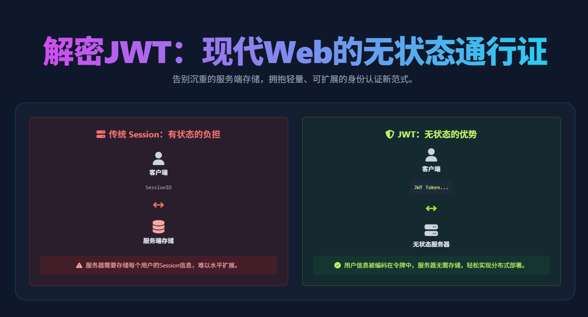
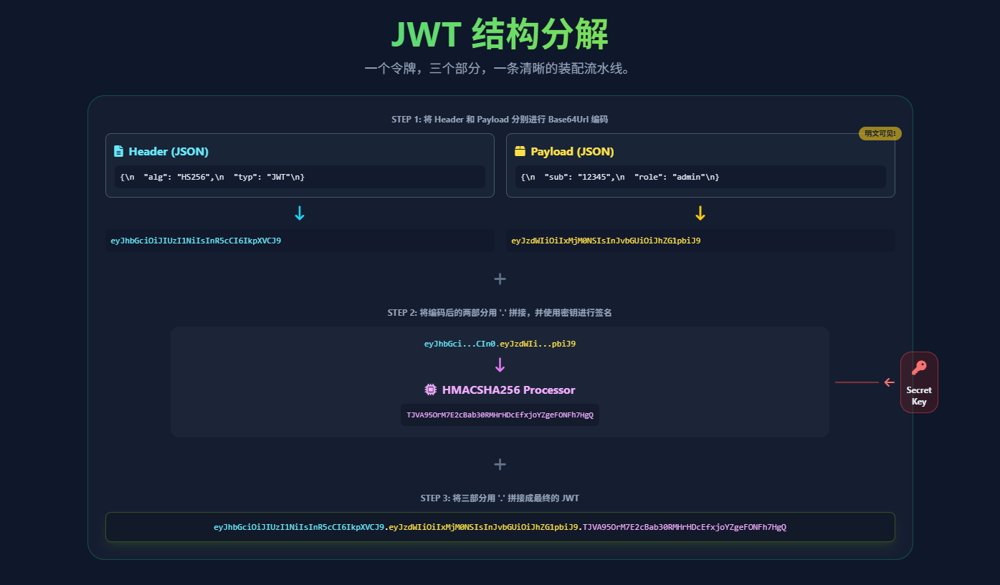
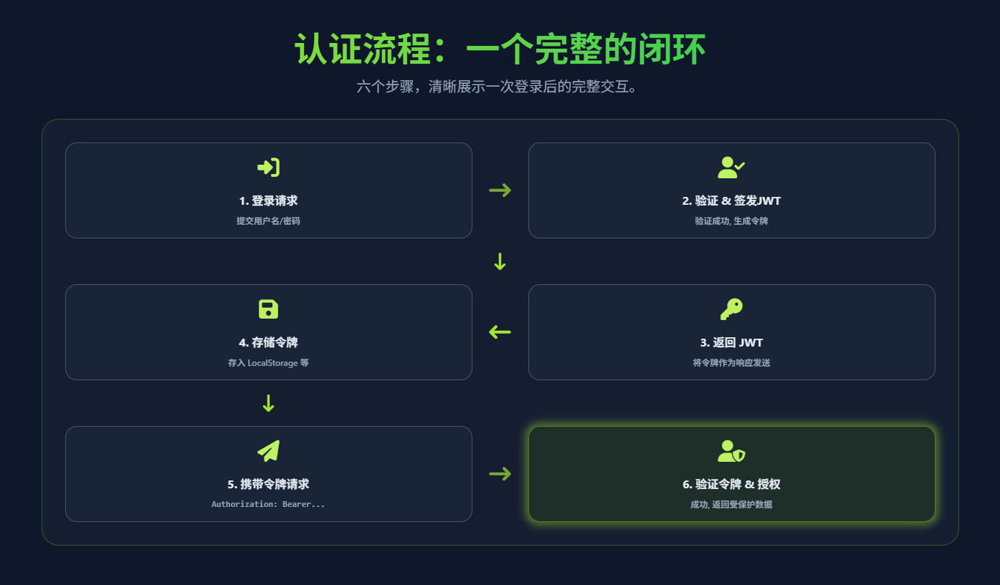
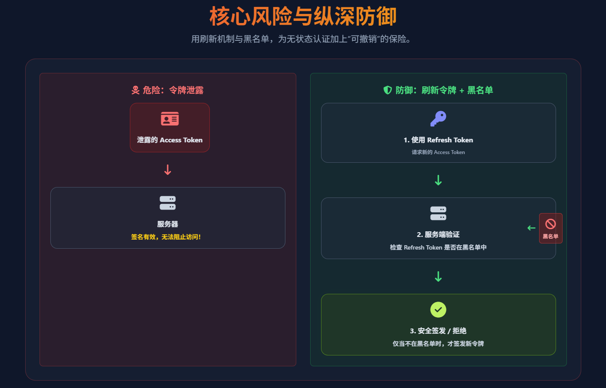
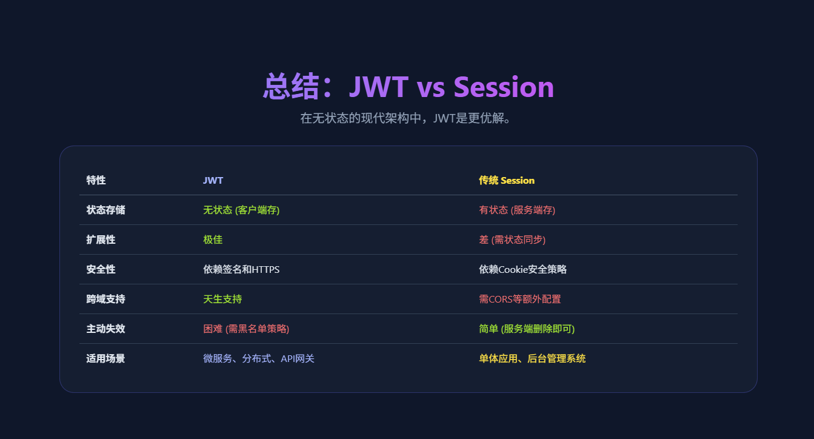

# 解密JWT：现代Web的无状态通行证

**摘要：** 随着微服务、前后端分离架构的盛行，传统的Session认证模式在可扩展性上遇到了瓶颈。JWT (JSON Web Token) 作为一种轻量、自包含的认证规范，正成为现代应用身份认证的更优解。本文将从其核心优势出发，深入剖析其内部构造、认证流程、核心风险与防御策略，最终为您提供一个清晰的选型指南。

***

### **一、 时代的抉择：为何我们需要JWT？**

在探讨JWT之前，我们必须先理解它所要解决的问题。传统的身份认证依赖于服务端Session。当用户登录时，服务器会创建一个Session记录（通常存储在内存或数据库中）并返回一个Session ID给客户端（通常存在Cookie中）。此后，客户端的每次请求都需携带此ID，服务器则通过查询该ID来验证用户身份。

这种模式在单体应用中运行良好，但在分布式系统中却显得力不从心。试想，如果您的服务部署在多台服务器上，负载均衡将请求随机分配。一台服务器创建的Session，在另一台服务器上并不存在，这将导致认证失败。为了解决这个问题，我们需要引入Session同步机制或“粘性会话”，但这都增加了系统的复杂性和维护成本。

**这便是“有状态”的负担。**

上图清晰地揭示了两种模式的根本差异。JWT通过将用户信息和权限等数据直接编码在令牌自身之中，实现了“无状态认证”。服务器不再需要存储任何会话信息，只需验证令牌的合法性即可。这使得系统可以轻松地进行水平扩展，完美契合了云原生和微服务架构的需求。它就像一本自带所有信息的护照，任何一个边检站（服务器）都能独立完成验证，无需查询中央数据库。

***

### **二、 JWT剖析：一张通行证的诞生**

理解了JWT的优势后，我们来拆解它的内部构造。一个完整的JWT由三个部分组成，它们之间用点（<code>.</code>）分隔，共同构成一个紧凑的字符串。这三部分分别是：Header（头部）、Payload（载荷）和Signature（签名）。

这张“装配流水线”图精确地展示了JWT的生成过程，现在我们来解读每个部件的含义：

1. **Header (头部):** 这是令牌的“说明书”，通常包含两部分信息：<code>typ</code>（Type），即令牌类型，固定为"JWT"；以及<code>alg</code>（Algorithm），即签名算法，如<code>HS256</code>（HMAC-SHA256）或<code>RS256</code>（RSA-SHA256）。它告诉服务器应该如何解析和验证这个令牌。
2. **Payload (载荷):** 这是令牌的“货物区”，存放着需要传递的核心信息，也称为“声明 (Claims)”。声明分为三种：
   * **Registered Claims:** 官方预定义的一组声明，如<code>iss</code> (签发者), <code>sub</code> (主题), <code>exp</code> (过期时间)等，建议使用。
   * **Public Claims:** 用户自定义的公开信息，为避免冲突，应在[IANA JSON Web Token Registry](https://www.iana.org/assignments/json-web-token/json-web-token.xhtml)注册或使用包含命名空间的URL。
   * **Private Claims:** 用户自定义的私有信息，用于在通信双方间共享，例如用户角色<code>role</code>、用户ID等。 **一个至关重要的警告：** Payload部分仅仅是经过Base64Url编码，它并非加密。任何能接触到令牌的人都可以解码并读取其内容。因此，**绝对不要在Payload中存放任何敏感信息**，如密码。
3. **Signature (签名):** 这是令牌的“防伪封条”。它通过将编码后的Header、编码后的Payload、以及一个只有服务器知道的**密钥 (Secret)**，使用Header中指定的签名算法（<code>alg</code>）进行加密生成。签名的核心作用是**验证令牌的完整性和来源**。当服务器收到令牌时，会用相同的密钥和算法重新计算签名，并与令牌中的签名进行比对。若一致，则说明令牌未被篡改且确实是由该服务器签发的。

***

### **三、 认证闭环：JWT在实践中的六步舞**

了解了JWT的构造，我们来看看它在一次完整的认证流程中是如何工作的。从用户登录到访问受保护资源，大致可以分为六个步骤。

这个流程图清晰地勾勒出一次完整的交互，我们可以将其解读为：

1. **用户登录：** 用户提交用户名和密码。
2. **服务器验证与签发：** 服务器验证凭据。成功后，基于用户信息生成一个JWT并返回给客户端。
3. **客户端存储：** 客户端收到JWT后，通常会将其存储在本地，常见的位置有<code>LocalStorage</code>、<code>SessionStorage</code>或<code>HttpOnly Cookie</code>。
4. **携带令牌请求：** 在后续的每次API请求中，客户端都需要在HTTP请求的<code>Authorization</code>头中，以<code>Bearer</code>方案携带JWT，格式为：<code>Authorization: Bearer <token></code>。
5. **服务器验证令牌：** 服务器接收到请求后，提取JWT，首先验证其签名是否有效，然后检查其是否过期等声明。
6. **授权与响应：** 验证通过后，服务器确认用户身份和权限，执行请求的操作，并返回相应的数据。如果验证失败，则返回<code>401 Unauthorized</code>错误。

***

### **四、 核心风险与纵深防御**

JWT的无状态特性是一把双刃剑。它带来了极佳的扩展性，但也引入了一个核心风险：**令牌一旦签发，在过期之前默认有效**。如果一个Access Token在有效期内被泄露，攻击者就可以利用它来冒充用户身份。我们无法像在服务端销毁Session那样，轻易地让一个已签发的JWT失效。

为了解决这个问题，业界普遍采用“**Access Token + Refresh Token + 黑名单**”的纵深防御策略。

上图展示了如何为无状态的JWT加上“可撤销”的保险：

* **双令牌机制：**
  * **Access Token:** 生命周期**极短**（如15分钟），用于访问受保护资源。即使泄露，其危害窗口期也有限。
  * **Refresh Token:** 生命周期**较长**（如7天），**仅用于**获取新的Access Token。它被安全地存储（通常是<code>HttpOnly Cookie</code>以防XSS攻击），并且在整个生命周期中只在请求新令牌时才发送给服务器。
* **主动失效与黑名单：**
  * 当用户登出，或需要强制某个用户下线时，我们不能销毁其手中的Access Token，但我们可以让其持有的Refresh Token失效。
  * 服务器端会维护一个“**黑名单**”（通常使用Redis等高速缓存实现）。当需要让令牌失效时，只需将该Refresh Token的唯一标识（如<code>jti</code>声明）加入黑名单。
  * 当客户端使用Refresh Token请求新的Access Token时，服务器除了验证其本身，还会检查它是否位于黑名单中。如果在，则拒绝签发新的Access Token，从而实现“主动下线”的效果。

***

### **五、 终局对比：JWT vs. Session，如何抉择？**

经过前面的分析，我们已经可以对JWT和传统Session进行一个全面的总结和对比。

这张表格一目了然地总结了二者的核心差异。总而言之：

* **JWT** 是为**无状态、分布式、跨域**的现代应用架构而生。它在**微服务、单页应用(SPA)、移动App API认证**等场景下表现出无与伦比的优势。其主要挑战在于需要妥善处理令牌的撤销问题。
* **传统Session** 更适用于**单体应用、有状态的服务**，尤其是一些后台管理系统。它的状态管理集中在服务端，使得主动失效等操作变得非常简单，但牺牲了水平扩展的能力。

**结论：** 技术选型没有绝对的银弹，但在构建面向未来的、可扩展的Web服务时，JWT无疑提供了更符合趋势的解决方案。它不仅仅是一种技术，更是一种面向无状态架构的设计哲学。
