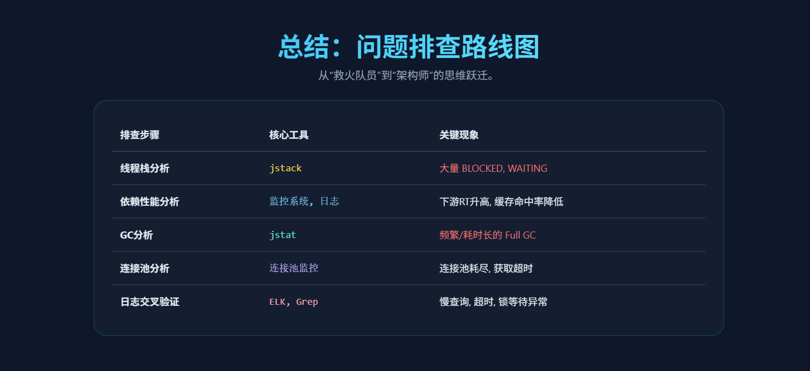

# 订单服务调用时间从200ms飙升至1.5s，如何排查？

### 一、事故背景：风平浪静下的告警风暴

一个平静的工作日下午，监控系统突然告警齐发，指向我们的核心服务 ——“订单服务”。监控仪表盘呈现出三个诡异的现象：

1. **接口响应时间 (RT) 飙升**：核心接口的 P99 响应时间从日常的 <code>~150ms</code> 飙升至 <code>1.5s</code>，性能下降了近 900%。
2. **业务错误率激增**：API 网关出现大量 <code>HTTP 429 (Too Many Requests)</code> 错误，意味着下游服务因无法处理请求而拒绝了流量。
3. **基础资源指标“正常”**：出乎意料的是，服务器的 **CPU 使用率**、**内存**、**网络 I/O** 等关键指标均处于低位，没有任何异常。

这就构成了本次排查的核心矛盾：**计算资源明明很空闲，为什么应用却无法处理请求，表现得如此缓慢？** 这感觉就像一条高速公路，明明不堵车，但所有汽车都在以10公里的时速爬行。

### 二、排查之旅：抽丝剥茧，四步定位根源

面对这个谜团，我们展开了一场从应用到数据库的深度排查。

#### 第一步：深入线程栈，探寻等待的根源

**思考逻辑 (Why):** CPU 不忙但请求慢，首要怀疑方向就是：**线程并非在执行计算，而是在“等待”**。CPU 是执行计算的单元，它空闲就证明计算任务不多。请求慢则证明任务从开始到结束耗时很长。这两者结合，强烈指向了线程的等待状态（如 I/O 等待、锁等待等）。

**排查动作 (How):** 我们立即登陆到目标服务器，对应用的 Java 进程执行了 <code>jstack</code> 命令，以获取一份实时的线程快照 (Thread Dump)，并统计了所有线程的状态。

**核心发现 (What & So What?):** 分析结果非常明确：**海量线程（超过80%）都处于 **<code>**BLOCKED**</code>** 状态**。

这是本次排查的**第一个关键突破口**。它有力地证明了应用正陷于严重的内部等待瓶颈，而不是CPU资源不足。这个发现让我们**排除了代码死循环、计算量过大等消耗CPU的场景**，并将调查焦点缩小到两个主要可能性：

1. 应用内部的锁竞争。
2. 缓慢的外部 I/O 调用（如数据库、缓存、下游服务）。

#### 第二步：排查外部依赖，收窄怀疑范围

**思考逻辑 (Why):** 为了判断线程是在等待“内部锁”还是“外部I/O”，我们首先需要检查所有外部依赖的健康状况。如果下游服务变慢，自然会导致我们的应用线程在等待响应时被阻塞。

**排查动作 (How):** 我们打开了全链路监控系统（如 SkyWalking / Prometheus），查看订单服务的服务依赖拓扑图以及所有下游服务的响应时间。

**核心发现 (What & So What?):** 监控显示，所有外部依赖（数据库、Redis缓存、其他微服务）的**响应时间均在正常范围内**。

这个发现意义重大，它帮助我们**排除了所有外部因素**。问题根源不在别处，就在订单服务应用本身或它直连的数据库上。调查范围被进一步缩小。

#### 第三步：审视JVM内部，发现关键暂停

**思考逻辑 (Why):** 既然排除了外部依赖，那么会不会是JVM自身在“拖后腿”？最常见的元凶就是 **垃圾回收 (Garbage Collection)**，尤其是会造成“Stop-The-World” (STW) 的 **Full GC**。一次长时间的 Full GC 会冻结所有应用线程，完全可以解释RT的突然飙升。

**排查动作 (How):** 我们使用 <code>jstat -gcutil <PID> 1000</code> 命令实时监控GC活动，并检查了GC日志。

**核心发现 (What & So What?):** 我们捕捉到了一个惊人的现象：**一次耗时高达 **<code>**1.2秒**</code>** 的 Full GC**！

这个发现是**第二个关键突破口**。<code>1.2秒</code>的全局暂停，与我们观察到的 <code>1.5秒</code> RT 高度吻合。它直接解释了请求为何会突然卡住。

然而，这还不是根源。健康的JVM不应如此频繁或长时间地进行Full GC。**一定有其他原因导致了内存的异常**，进而触发了这次代价高昂的GC。同时，它也还未解释 <code>HTTP 429</code> 错误。我们需要继续深挖。

#### 第四步：关联现象，发现最终瓶颈

**思考逻辑 (Why):**<code>HTTP 429</code> 错误通常意味着资源耗尽。线程在 <code>BLOCKED</code>，外部依赖正常，我们还剩下最后一个关键资源没有检查：**数据库连接池**。如果大量线程因为拿不到数据库连接而被阻塞，这完全符合我们观察到的所有现象。

**排查动作 (How):** 我们打开了应用内嵌的 Druid 连接池监控页面。

**核心发现 (What & So What?):** 监控页面惨不忍睹：**连接池中的80个连接全部被占用，还有数百个线程正在排队等待获取连接**。

至此，所有线索都汇集到了一起。这解释了为何线程会 <code>BLOCKED</code>，也解释了为何新来的请求因拿不到任何资源而被拒绝（<code>HTTP 429</code>）。

### 三、真相大白：一条SQL引发的“血案”

我们已经知道，是数据库连接池耗尽导致了系统雪崩。那么，为什么连接会全部被占用且不释放呢？唯一的解释是：**有非常慢的SQL事务长时间占用了连接**。

我们立即开启了数据库的慢查询日志（Slow Query Log），并检查了当前正在执行的查询列表。

**最终原因 (The Root Cause):** 一条 <code>UPDATE</code> 语句浮出水面。它正在更新一个拥有数百万行数据的大表，但其 <code>WHERE</code> 子句中的 <code>status</code> 字段**竟然没有索引**！

在数据库中，对没有索引的字段进行更新，会导致**行锁升级为表锁**，锁住了整张表。

现在，我们可以完整地串联起整个事故的因果链了：

1. **触发点**：一个没有索引的 <code>UPDATE</code> SQL被执行。
2. **锁升级**：该SQL导致数据库发生**表锁**，所有其他针对该表的 <code>SELECT</code>、<code>INSERT</code>、<code>UPDATE</code> 操作全部被阻塞。
3. **连接占用**：执行这些被阻塞操作的线程，其持有的数据库连接无法释放。
4. **连接池耗尽**：短时间内，连接池中的所有连接都被这些等待表锁的事务所占用。
5. **应用线程阻塞**：新的业务请求涌入，在尝试获取数据库连接时，因连接池已空而全部进入 <code>BLOCKED</code> 状态，等待连接释放。
6. **Full GC 触发**：大量线程被阻塞，导致其栈上引用的对象（如请求上下文、业务数据）长时间存活，无法在Young GC中被回收，最终被晋升到老年代。老年代空间被迅速填满，触发了耗时极长的 **Full GC**。
7. **最终表现**：Full GC 的长暂停（<code>1.2s</code>）和获取连接的漫长等待，共同导致了接口RT飙升至 <code>1.5s</code>。而后续不断涌入的请求，因线程池和连接池均已饱和，被服务直接拒绝，返回 <code>HTTP 429</code>。

### 四、总结与反思

这次事故是一次典型的由“一个点的疏忽”引发“整个面崩溃”的案例。我们将其排查路径和核心发现总结如下：

为了防止此类问题再次发生，我们制定了以下改进措施：

1. **SQL上线规范**：所有非 <code>SELECT</code> 语句，尤其是对大表的 <code>UPDATE</code> 和 <code>DELETE</code>，必须强制进行 <code>EXPLAIN</code> 评审，确保 <code>WHERE</code> 条件和 <code>JOIN</code> 字段都命中了索引。
2. **核心表索引巡检**：建立自动化脚本，定期巡检核心业务表的索引覆盖情况，防止遗漏。
3. **超时配置优化**：为数据库连接池设置合理的获取连接超时时间 (<code>maxWait</code>)，并为核心业务的数据库事务设置更短的执行超时。这可以在问题发生时快速失败，避免整个应用被拖垮，实现“熔断”。
4. **监控告警增强**：除了CPU、内存等基础指标，将**数据库连接池的等待线程数**和**JVM老年代使用率的增长速率**也纳入核心告警指标。

通过这次深刻的教训，我们不仅修复了一个隐蔽的Bug，更重要的是完善了我们的技术流程和监控体系，让系统变得更加健壮。
