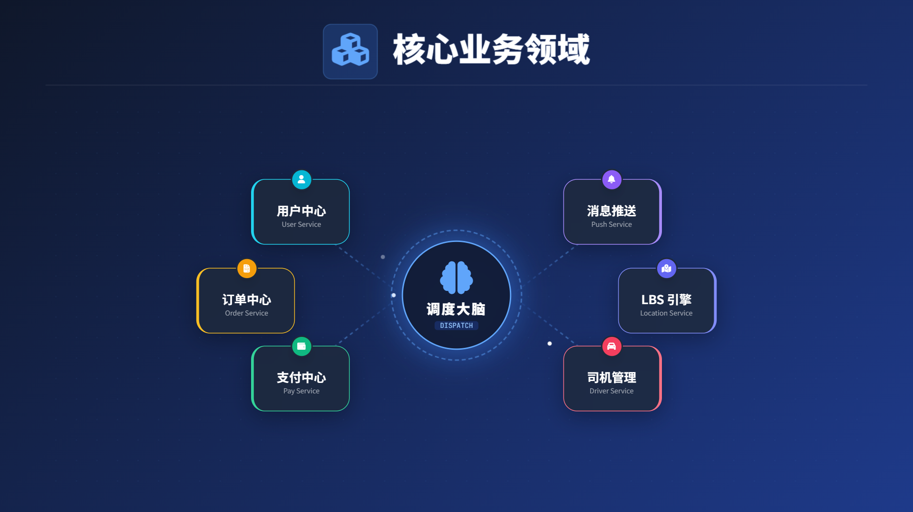
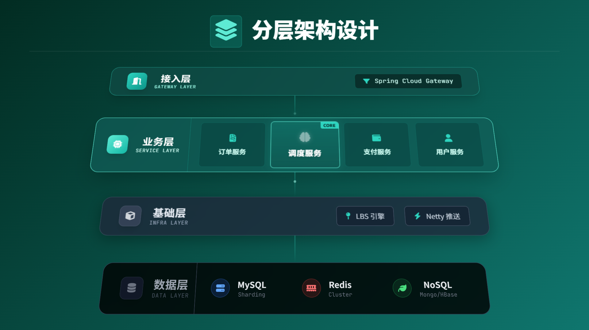
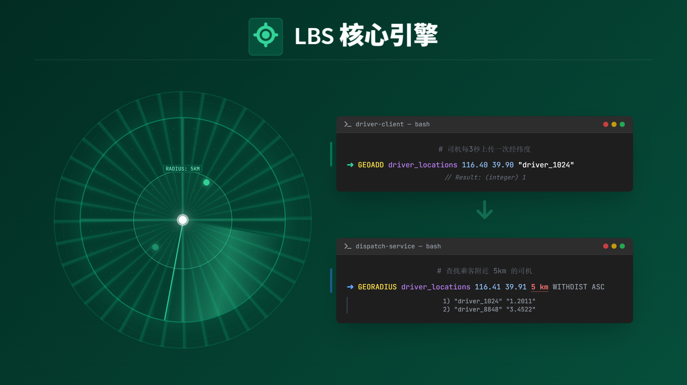
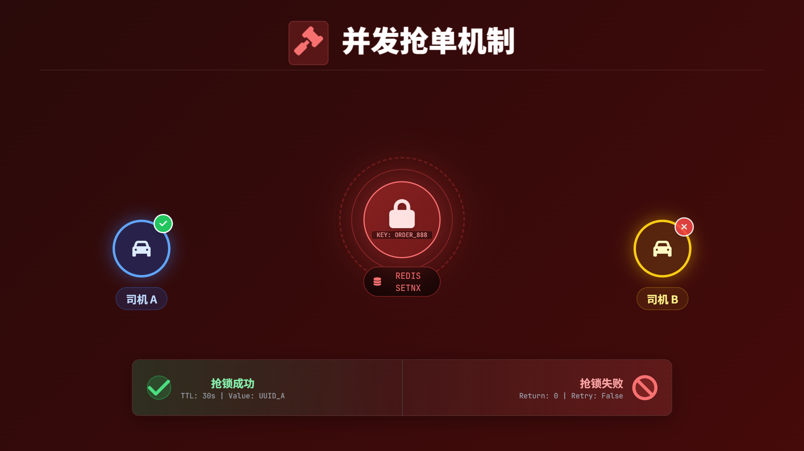
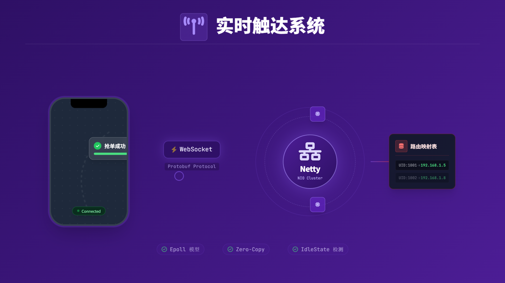
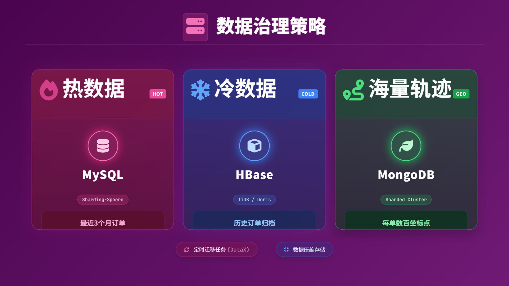
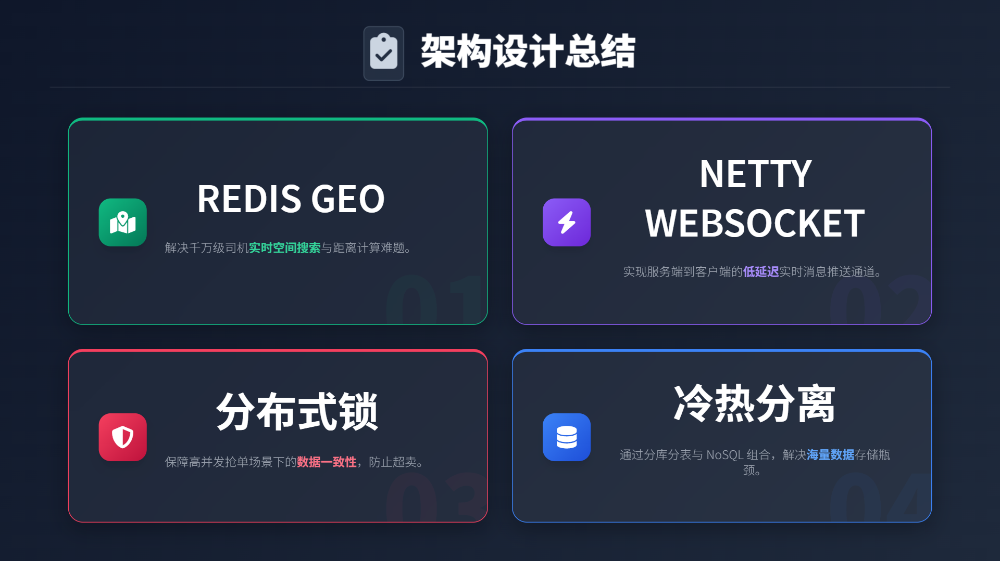

# 让你设计一个“迷你滴滴”，你会怎么做？

在系统设计（System Design）面试中，“设计一个打车软件”是出现频率极高的题目。它不仅考察候选人对高并发的理解，还涉及地理位置服务（LBS）、实时消息推送、分布式锁等多个硬核技术点。

本文将剥离细枝末节，从上帝视角带你拆解一个“迷你滴滴”的核心架构演进。

***

### 1. 宏观视角：领域驱动设计

在动手写代码前，首先要进行业务领域的拆解。

不同于传统的电商系统，打车业务的核心在于\*\*“动态调度”**。如上图所示，我们将系统拆分为六边形架构，其中**“调度大脑”\*\*处于绝对的核心位置。

* **解耦设计的必要性**：我们将“订单”、“支付”、“消息”拆分为独立微服务。这样做的好处是，即使“支付服务”短暂宕机，用户依然可以下单、司机依然可以接单，实现了故障隔离。
* **核心链路**：用户发单 -> 调度大脑计算 -> 锁定司机 -> 消息触达。这个链路必须保证极高的可用性。

***

### 2. 流量漏斗：分层架构落地

为了承载千万级的日活流量，我们需要一个清晰的分层架构来作为骨架。

* **接入层（Gateway）**：这是系统的“防盗门”。除了基本的路由转发，更重要的是在此处做**限流**和**鉴权**。在早晚高峰期，通过网关层的令牌桶算法，可以有效拦截恶意流量，保护后端服务不被压垮。
* **基础层与业务层分离**：我们将通用的能力（如 LBS 计算、Netty 推送）下沉为基础服务（Infra Layer）。上层的业务逻辑（如拼车、专车、快车）只需调用基础层的接口，无需关心底层的复杂实现，极大地提升了研发效率。

***

### 3. LBS 引擎：如何从百万司机中秒级圈人？

这是整个系统最硬核的技术难点：**如何高效地存储和查询地理位置？**

如果在 MySQL 中使用 <code>WHERE latitude > ? AND longitude < ?</code> 进行范围查询，在数据量达到百万级时，索引效率会急剧下降，导致数据库崩溃。

**解决方案：Redis GEO** 我们利用 Redis 的 GEO 模块（底层基于 GeoHash 算法）：

1. **降维打击**：GeoHash 将二维的经纬度映射为一维的 52 位整数。
2. **高效检索**：利用 ZSET（有序集合）存储，通过 <code>GEORADIUS</code> 命令，系统可以在 $O(\log N)$ 的时间复杂度内，瞬间计算出乘客附近 3km 内的所有司机，并按距离排序。

***

### 4. 并发挑战：防止订单超卖与撞单

在“派单模式”或“抢单模式”下，同一个订单可能会被推给多个司机。如果两个司机在同一毫秒点击“抢单”，如何保证数据一致性？

这里必须引入**分布式锁**机制。

* **互斥性**：利用 Redis 的 <code>SETNX</code>（Set if Not Exists）特性。只有第一个成功写入 Key 的请求才算抢锁成功，后续请求直接驳回。
* **死锁兜底**：必须为锁设置 TTL（过期时间）。防止某个服务节点在持有锁的状态下宕机，导致锁永远无法释放，后续业务卡死。

***

### 5. 实时触达：Netty 长连接通道

抢单成功后，系统需要立刻通知司机。传统的 HTTP 轮询（Polling）方式延迟高且浪费服务器资源，无法满足打车场景对“实时性”的苛刻要求。

**解决方案：WebSocket + Netty** 我们需要在司机端 App 与服务端之间建立一条全双工的**长连接**。

* **IO模型**：采用 Netty 的 NIO（非阻塞 IO）模型，配合 Epoll 机，单机即可轻松支撑 10w+ 的在线连接。
* **协议优化**：在传输层使用 Protobuf 替代 JSON，大幅减少数据包体积，降低网络带宽消耗，提升弱网环境下的送达率。

***

### 6. 数据治理：冷热分离策略

随着业务发展，订单表和轨迹表的数据量会呈指数级增长。单表超过 2000 万行后，MySQL 的性能会显著下降。

我们采用**冷热分离**的存储策略：

* **热数据（MySQL）**：最近 3 个月的订单，用户查询频率高，需要事务支持，继续留在 MySQL 中，并配合 ShardingSphere 进行分库分表。
* **冷数据（HBase/TiDB）**：3 个月前的历史订单，查询频率极低。通过 DataX 定时任务迁移至成本更低、扩展性更强的 NoSQL 数据库中归档。
* **轨迹数据（MongoDB）**：一次行程包含数百个坐标点，写多读少，且无强事务需求，MongoDB 的 Sharded Cluster 是最佳归宿。

***

### 7. 总结

设计一个迷你滴滴，本质上是在做**空间换时间**与**分层治理**的权衡。

1. **Redis GEO** 解决了空间搜索的效率问题。
2. **Netty 长连接** 解决了实时通信的延迟问题。
3. **分布式锁** 解决了高并发下的资源竞争问题。
4. **冷热分离** 解决了海量数据的存储成本问题。

掌握这套架构组合拳，足以应对大多数 LBS 类应用的系统设计挑战。
