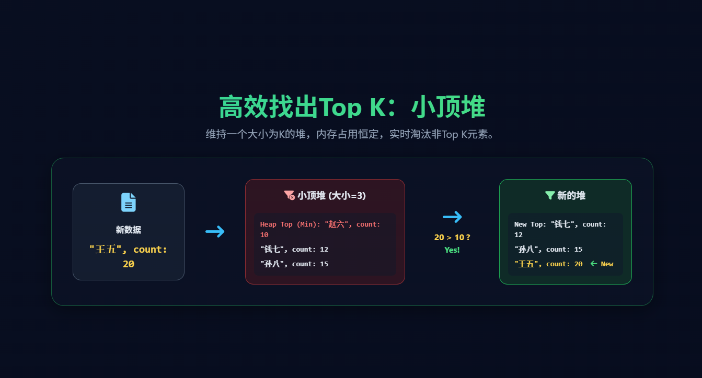

# 阿里面试：全国14亿人，统计出重名最多的前100个姓名

本文将探讨一个经典的海量数据处理问题：如何在有限的硬件资源下，从一个包含14亿条记录的姓名文件中，高效地统计出出现频率最高的100个姓名（Top 100）。我们将深入分析两种主流方案：一种是基于内存的理想化方案，另一种是基于分治思想的现实方案。本文旨在提供一个清晰的解决问题的框架，并提炼出可应用于其他大规模数据场景的通用范式。

***

#### **一、 核心矛盾：有限内存 vs 海量数据**

在着手解决任何技术问题前，首先需要进行量化分析（Estimation）。

* **数据规模：** 14亿条姓名记录。
* **内存限制：** 假设运行环境为一台主流服务器，可用内存为8GB。
* **初步估算：** 一个中文姓名通常占6-8字节（UTF-8编码），加上换行符和辅助数据结构，我们保守估计每条姓名记录平均占用15字节。那么总数据大小约为：<code>14亿 * 15字节 ≈ 210亿字节 ≈ 19.5GB</code>。

结论显而易见：**19.5GB的数据量远超8GB的内存限制**。任何试图将全部数据一次性读入内存进行处理的“朴素”方法，都将导致内存溢出（Out-of-Memory, OOM），使程序或服务器直接崩溃。这便是我们面临的核心矛盾，也是问题求解的起点。

***

#### **二、 方案一：内存充足的理想化方案**

尽管在当前约束下不可行，但我们仍有必要探讨在内存充足（例如，拥有64GB内存的服务器）的情况下，最高效的单机处理方法。这为我们提供了理论上的最优性能基准。

##### **2.1 内存优化利器：Trie树 (前缀树)**

要进行频率统计，最简单的工具是哈希表（HashMap）。但对于有大量公共前缀的字符串（如中文姓名，“张”、“王”、“李”姓非常普遍），Trie树是更节省内存的选择。

如上图所示，Trie树将字符串的公共前缀路径进行合并，从而极大减少了冗余存储。我们只需沿着姓名路径遍历树，并在路径的终点节点上更新一个计数器（<code>count</code>），即可完成一次频率更新。

##### **2.2 高效找出Top K：小顶堆**

在通过Trie树得到所有唯一姓名及其频率后，我们需要从数百万的唯一姓名中找出Top 100。全局排序开销巨大，更优的做法是使用一个大小为K（此处K=100）的小顶堆，它就像一个“守门员”。

小顶堆的工作机制如下：

1. 初始化一个大小为100的空堆。
2. 遍历所有姓名及其频率：若堆未满，直接推入；若堆已满，则将当前元素频率与堆顶（当前Top 100中频率最小的）比较。
3. 若当前元素频率更高，则弹出堆顶，将当前元素推入。 遍历结束后，堆中剩下的100个元素即为全局Top 100。此方法的时间复杂度仅为<code>O(N log K)</code>。

***

### **方案二：应对内存瓶颈的分治策略 (最终修订版)**

回到现实，我们必须在8GB内存内解决问题。此时，\*\*分治（Divide and Conquer）\*\*思想是打破僵局的唯一出路。其核心在于，将无法一次性处理的大问题，拆解成多个可以在内存中单独处理的小问题。

整个流程可以由下面这一张图完整地概括：

现在，让我们跟随这张图的指引，一步步解析这个优雅的解决方案：

1. **第一阶段：哈希分片 (Map)** 如图中所示，流程的起点是遍历那个巨大的（19.5GB）原始姓名文件。我们不对其做任何复杂的计算，只执行一个简单的“分发”任务。具体来说，就是对每一行姓名应用一个哈希函数（例如MD5或MurmurHash），然后用哈希结果对一个预设的数字（例如1000）取模，即 <code>index = hash(name) % 1000</code>。 根据计算出的索引值 <code>index</code>，我们将该姓名原封不动地追加写入到第 <code>index</code> 个小文件中。这个过程结束后，我们就拥有了1000个独立的小文件。最关键的特性是：**所有相同的姓名，都必然位于同一个小文件内**。
2. **第二阶段：分片内统计 (Reduce)** 接下来，我们进入中间阶段。由于每个小文件的预期大小仅为 <code>19.5GB / 1000 ≈ 20MB</code>，我们可以轻松地将任何一个小文件完全加载到内存中进行处理。我们依次（或在多核环境下并行地）对这1000个小文件进行独立的词频统计。在这个阶段，一个简单的\*\*哈希表（HashMap）\*\*就是最高效的工具。我们遍历小文件中的所有姓名，并用HashMap来累加它们的出现次数。
3. **第三阶段：结果聚合 (Aggregate)** 当所有小文件都统计完毕后，我们得到了1000份“局部”的姓名频率列表。流程的最后一步，就是要从这些局部结果中找出“全局”的Top 100。 如图的最后部分所示，我们再次请出我们的高效工具——**小顶堆**。我们创建一个大小固定为100的小顶堆，然后遍历这1000份局部统计结果中的每一条记录。使用与方案一中完全相同的“淘汰赛”机制，不断更新堆中的元素。当遍历完所有局部结果后，这个大小为100的小顶堆里所包含的，就是我们梦寐以求的全局Top 100姓名。

通过这样“化整为零，各个击破，最后汇总”的策略，我们巧妙地绕过了单机内存的限制，用一种可水平扩展的优雅方式解决了这个海量数据难题。

#### **四、 方案选型：性能、资源与复杂度的权衡**

| 方案 | 核心技术 | 内存需求 | I/O操作 | 适用场景 |
| :--- | :--- | :--- | :--- | :--- |
| **方案一** | Trie树 / HashMap + 小顶堆 | 极高 ( > 数据总量) | 少 (一次读) | 内存远大于数据量的单机环境 |
| **方案二** | 哈希分片 + HashMap + 小顶堆 | 低 (可控) | 多 (一次读，多次写，多次读) | 内存受限、数据海量的分布式或单机环境 |

***

#### **五、 核心思想提炼：解决海量数据问题的通用范式**

通过本案例，我们不仅解决了“姓名统计”这一个具体问题，更重要的是掌握了一套处理海量数据的通用思维范式：

1. **估算 (Estimate):** 永远先分析问题规模和资源限制，这是选择正确路径的前提。
2. **分治 (Divide and Conquer):** 当单机资源成为瓶颈时，通过哈希、分段、或按时间切分等手段将大问题分解为小问题，是打破僵局的核心策略。
3. **抽象 (Abstract):** 在子问题的求解中，熟练运用最高效的数据结构（如HashMap, Trie, Heap, Bloom Filter等）来解决具体的计算任务。

***
