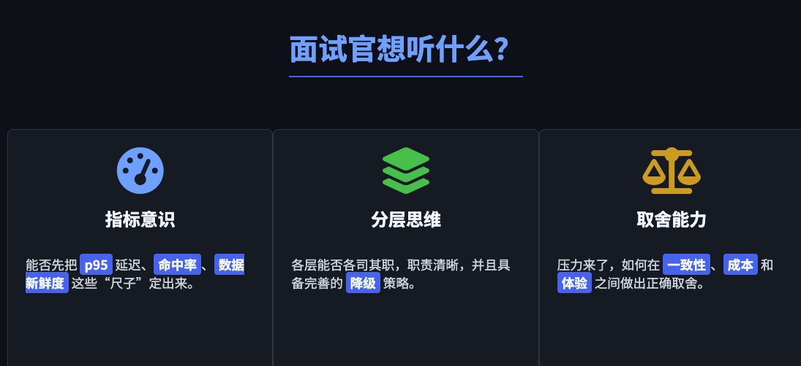
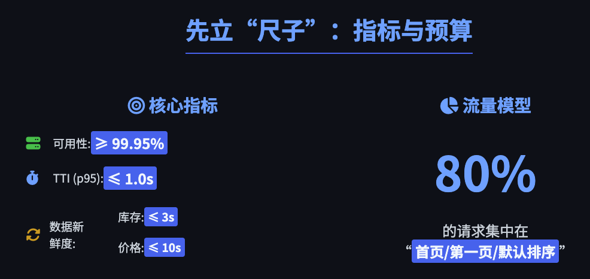
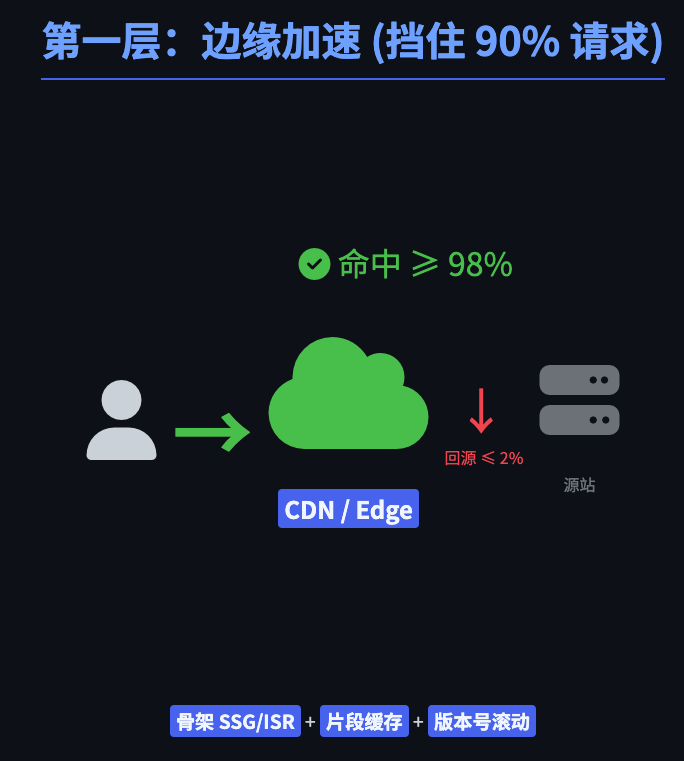
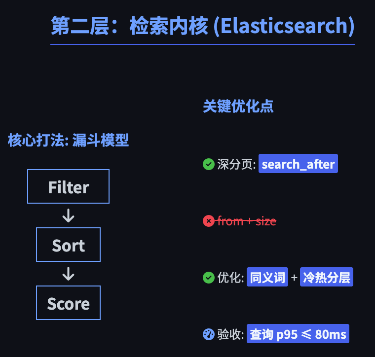
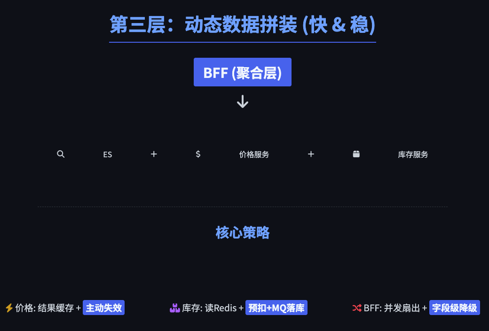
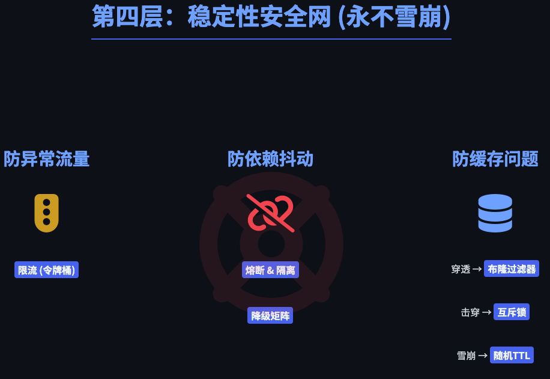
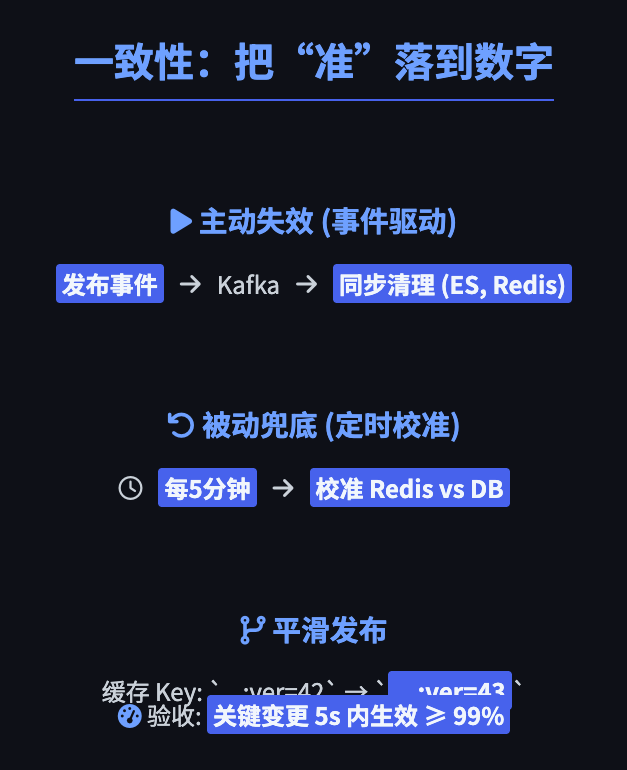
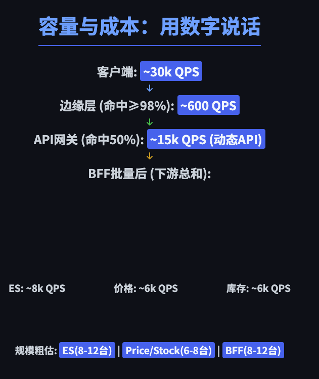
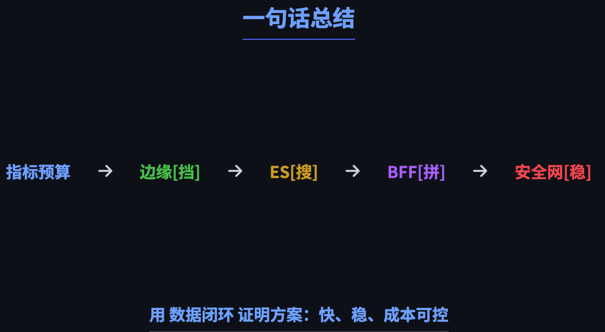

# 3、10 万并发的商品列表页怎么扛？用“4 层防线 + 指标预算”的组合拳打服面试官

## <font style="color:rgba(6, 8, 31, 0.88);">面试官的核心考核意图</font>

* **<font style="color:rgba(6, 8, 31, 0.88);">场景拆解与指标意识</font>**<font style="color:rgba(6, 8, 31, 0.88);">：围绕 PLP（商品列表页）给出 p95/p99 延迟、命中率、可用性、数据新鲜度等 SLO，并据此做容量预算与取舍。</font>
* **<font style="color:rgba(6, 8, 31, 0.88);">分层设计与取舍</font>**<font style="color:rgba(6, 8, 31, 0.88);">：边缘加速、检索、动态拼装、稳定性安全网各司其职，有明确降级策略。</font>
* **<font style="color:rgba(6, 8, 31, 0.88);">极限压力下的稳态</font>**<font style="color:rgba(6, 8, 31, 0.88);">：热点、穿透、抖动、雪崩的预防与处置；一致性边界与成本/体验平衡。</font>



***

## <font style="color:rgba(6, 8, 31, 0.88);">目标与假设（指标先行）</font>

* <font style="color:rgba(6, 8, 31, 0.88);">可用性：≥ 99.95%</font>
* <font style="color:rgba(6, 8, 31, 0.88);">首屏可交互（TTI）：p95 ≤ 1.0s（冷启 ≤ 1.5s）</font>
* <font style="color:rgba(6, 8, 31, 0.88);">数据新鲜度预算：库存 ≤ 3s、价格 ≤ 10s、评论与销量 ≤ 5min</font>
* <font style="color:rgba(6, 8, 31, 0.88);">峰值并发：100k；总体 QPS 峰值约 30k（静态 + API）</font>
* <font style="color:rgba(6, 8, 31, 0.88);">移动端占比 80%，首屏页码与热门组合占 80% 请求、</font>



***

## <font style="color:rgba(6, 8, 31, 0.88);">架构总览（文字拓扑）</font>

<font style="color:rgba(6, 8, 31, 0.88);">客户端/浏览器 → CDN/边缘（HTML 骨架、静态资源、热门片段、边缘函数） → API 网关（限流/鉴权/灰度） → BFF 聚合层（并发汇聚/容错/降级） →\ </font><font style="color:rgba(6, 8, 31, 0.88);">检索（Elasticsearch）｜价格中心（Price+Redis）｜库存中心（Stock+Redis）｜推荐/广告 →\ </font><font style="color:rgba(6, 8, 31, 0.88);">持久层（MySQL/ClickHouse）与 CDC 管道（Canal → Kafka → ES/Redis） → 可观测/熔断/开关平台</font>

***

## <font style="color:rgba(6, 8, 31, 0.88);">第一层：动静分离与边缘加速（让 90%+ 请求在边缘终结）</font>

### <font style="color:rgba(6, 8, 31, 0.88);">场景 A：大促“类目首页 + 默认排序 + 第 1 页”流量洪峰</font>

* <font style="color:rgba(6, 8, 31, 0.88);">问题：80% 流量集中在少量组合，回源打爆源站。</font>
* <font style="color:rgba(6, 8, 31, 0.88);">方案：</font>
  * <font style="color:rgba(6, 8, 31, 0.88);">骨架 SSG/ISR 发布到 CDN，首包就近返回。</font>
  * <font style="color:rgba(6, 8, 31, 0.88);">热门组合在边缘或网关缓存“列表片段”10–60s，页面数据异步填充。</font>
  * <code><font style="color:rgba(6, 8, 31, 0.88);background-color:rgba(175, 184, 193, 0.2);">stale-while-revalidate</font></code><font style="color:rgba(6, 8, 31, 0.88);"> </font><font style="color:rgba(6, 8, 31, 0.88);">允许旧内容短期服役，后台异步刷新。</font>
* <font style="color:rgba(6, 8, 31, 0.88);">关键实现：</font>
  * <font style="color:rgba(6, 8, 31, 0.88);">缓存键：</font><code><font style="color:rgba(6, 8, 31, 0.88);background-color:rgba(175, 184, 193, 0.2);">plp:cat=123:p=1:sort=default:ver=42</font></code>
  * <font style="color:rgba(6, 8, 31, 0.88);">响应头：</font><code><font style="color:rgba(6, 8, 31, 0.88);background-color:rgba(175, 184, 193, 0.2);">Cache-Control: public, s-maxage=60, stale-while-revalidate=30</font></code>
* <font style="color:rgba(6, 8, 31, 0.88);">指标与回归：</font>
  * <font style="color:rgba(6, 8, 31, 0.88);">CDN 命中 ≥ 98%，首屏 p95 ≤ 1s；边缘回源占比 ≤ 2%</font>

### <font style="color:rgba(6, 8, 31, 0.88);">场景 B：属性筛选组合爆炸（长尾）</font>

* <font style="color:rgba(6, 8, 31, 0.88);">问题：属性组合过多，CDN 命中差，后端容易抖动。</font>
* <font style="color:rgba(6, 8, 31, 0.88);">方案：</font>
  * <font style="color:rgba(6, 8, 31, 0.88);">热门 TopN 属性组合（自动热榜）边缘缓存；其余组合后端 Redis 短 TTL（5–15s）+ SingleFlight 请求合并。</font>
  * <font style="color:rgba(6, 8, 31, 0.88);">属性集合参与缓存键前做哈希压缩（排序后</font><font style="color:rgba(6, 8, 31, 0.88);"> </font><code><font style="color:rgba(6, 8, 31, 0.88);background-color:rgba(175, 184, 193, 0.2);">hash(attrs)</font></code><font style="color:rgba(6, 8, 31, 0.88);">）。</font>
* <font style="color:rgba(6, 8, 31, 0.88);">关键实现：</font>
  * <font style="color:rgba(6, 8, 31, 0.88);">Key：</font><code><font style="color:rgba(6, 8, 31, 0.88);background-color:rgba(175, 184, 193, 0.2);">api:plp:cat=123:p=1:sort=price_asc:attr=7f9a:ver=42</font></code>
  * <font style="color:rgba(6, 8, 31, 0.88);">Nginx 网关缓存 15s 补位，命中返回</font><font style="color:rgba(6, 8, 31, 0.88);"> </font><code><font style="color:rgba(6, 8, 31, 0.88);background-color:rgba(175, 184, 193, 0.2);">X-Cache: HIT</font></code>
* <font style="color:rgba(6, 8, 31, 0.88);">指标与回归：</font>
  * <font style="color:rgba(6, 8, 31, 0.88);">热门组合命中 ≥ 85%，长尾后端缓存命中 ≥ 60%；ES QPS 平稳不抖</font>

### <font style="color:rgba(6, 8, 31, 0.88);">场景 C：上下架、强运营改版需要“精准失效”</font>

* <font style="color:rgba(6, 8, 31, 0.88);">问题：不想全站清缓存，影响面太大。</font>
* <font style="color:rgba(6, 8, 31, 0.88);">方案：</font>
  * <font style="color:rgba(6, 8, 31, 0.88);">事件驱动失效：上下架 → Kafka → 计算受影响的类目/页码 → 精准失效对应 Key。</font>
  * <font style="color:rgba(6, 8, 31, 0.88);">版本号滚动：大改版直接切</font><font style="color:rgba(6, 8, 31, 0.88);"> </font><code><font style="color:rgba(6, 8, 31, 0.88);background-color:rgba(175, 184, 193, 0.2);">ver</font></code><font style="color:rgba(6, 8, 31, 0.88);">，旧 Key 慢慢自然过期。</font>
* <font style="color:rgba(6, 8, 31, 0.88);">关键实现：</font>
  * <font style="color:rgba(6, 8, 31, 0.88);">只追加不删除：先写新 Key（</font><code><font style="color:rgba(6, 8, 31, 0.88);background-color:rgba(175, 184, 193, 0.2);">ver=43</font></code><font style="color:rgba(6, 8, 31, 0.88);">），切流，再异步清理</font><font style="color:rgba(6, 8, 31, 0.88);"> </font><code><font style="color:rgba(6, 8, 31, 0.88);background-color:rgba(175, 184, 193, 0.2);">ver=42</font></code>
* <font style="color:rgba(6, 8, 31, 0.88);">指标与回归：</font>
  * <font style="color:rgba(6, 8, 31, 0.88);">失效延迟 ≤ 5s；命中率波动 ≤ 3% 且 2 分钟内恢复</font>

***

## <font style="color:rgba(6, 8, 31, 0.88);">第二层：检索与筛选引擎（毫秒级完成复杂筛选排序）</font>



### <font style="color:rgba(6, 8, 31, 0.88);">场景 D：关键词 + 属性过滤 + 价格排序</font>

* <font style="color:rgba(6, 8, 31, 0.88);">问题：组合复杂，RDBMS 难以支撑。</font>
* <font style="color:rgba(6, 8, 31, 0.88);">方案：ES 作为列表检索内核，倒排索引 + 并行切片 + NRT。</font>
* <font style="color:rgba(6, 8, 31, 0.88);">关键实现：</font>
  * <font style="color:rgba(6, 8, 31, 0.88);">文档：SKU 粒度，SPU 字段冗余；属性用</font><font style="color:rgba(6, 8, 31, 0.88);"> </font><code><font style="color:rgba(6, 8, 31, 0.88);background-color:rgba(175, 184, 193, 0.2);">keyword/numeric</font></code><font style="color:rgba(6, 8, 31, 0.88);">，需要精确匹配的用</font><font style="color:rgba(6, 8, 31, 0.88);"> </font><code><font style="color:rgba(6, 8, 31, 0.88);background-color:rgba(175, 184, 193, 0.2);">nested</font></code>
  * <font style="color:rgba(6, 8, 31, 0.88);">查询路径：</font><code><font style="color:rgba(6, 8, 31, 0.88);background-color:rgba(175, 184, 193, 0.2);">filter</font></code><font style="color:rgba(6, 8, 31, 0.88);">（类目/属性/价格区间）→</font><font style="color:rgba(6, 8, 31, 0.88);"> </font><code><font style="color:rgba(6, 8, 31, 0.88);background-color:rgba(175, 184, 193, 0.2);">sort</font></code><font style="color:rgba(6, 8, 31, 0.88);">（价格/综合）→ 少量</font><font style="color:rgba(6, 8, 31, 0.88);"> </font><code><font style="color:rgba(6, 8, 31, 0.88);background-color:rgba(175, 184, 193, 0.2);">should</font></code><font style="color:rgba(6, 8, 31, 0.88);"> </font><font style="color:rgba(6, 8, 31, 0.88);">打分</font>
  * <font style="color:rgba(6, 8, 31, 0.88);">深分页：</font><code><font style="color:rgba(6, 8, 31, 0.88);background-color:rgba(175, 184, 193, 0.2);">search_after</font></code><font style="color:rgba(6, 8, 31, 0.88);"> </font><font style="color:rgba(6, 8, 31, 0.88);">替代</font><font style="color:rgba(6, 8, 31, 0.88);"> </font><code><font style="color:rgba(6, 8, 31, 0.88);background-color:rgba(175, 184, 193, 0.2);">from+size</font></code>
* <font style="color:rgba(6, 8, 31, 0.88);">ES 请求 DSL（示例）：</font>

```plain
json


{
  "size": 50,
  "search_after": ["1695627731", "sku-9001"],
  "sort": [{"price": "asc"}, {"_id": "asc"}],
  "query": {
    "bool": {
      "filter": [
        {"term": {"cat_id": 123}},
        {"range": {"price": {"gte": 100, "lte": 1000}}},
        {"nested": {
          "path": "attrs",
          "query": {"bool": {"must": [
            {"term": {"attrs.k": "color"}},
            {"terms": {"attrs.v": ["black", "gray"]}}
          ]}}
        }}
      ],
      "must": [{"match": {"title": {"query": "iphone 14", "operator": "and"}}}]
    }
  },
  "aggs": {
    "brand": {"terms": {"field": "brand_id", "size": 20}}
  }
}
```

* <font style="color:rgba(6, 8, 31, 0.88);">指标与回归：</font>
  * <font style="color:rgba(6, 8, 31, 0.88);">ES 查询 p95 ≤ 80ms；facet 聚合 p95 ≤ 120ms；错误率 ≤ 0.1%</font>

### <font style="color:rgba(6, 8, 31, 0.88);">场景 E：拼写错误、同义词与品牌别名</font>

* <font style="color:rgba(6, 8, 31, 0.88);">问题：用户输入“苹果14/iphon14/苹果手机14”，召回不稳定。</font>
* <font style="color:rgba(6, 8, 31, 0.88);">方案：</font>
  * <font style="color:rgba(6, 8, 31, 0.88);">同义词词典 + 拼写纠错（DidYouMean）+ 品牌别名词库（商家侧维护）。</font>
* <font style="color:rgba(6, 8, 31, 0.88);">指标与回归：</font>
  * <font style="color:rgba(6, 8, 31, 0.88);">Query 改写覆盖率 ≥ 95%；点击率提升 ≥ 3–5%</font>

### <font style="color:rgba(6, 8, 31, 0.88);">场景 F：冷热分层 + 热索引秒级刷新</font>

* <font style="color:rgba(6, 8, 31, 0.88);">问题：全量 1s 刷新开销大。</font>
* <font style="color:rgba(6, 8, 31, 0.88);">方案：</font>
  * <font style="color:rgba(6, 8, 31, 0.88);">类目/店铺划分热、冷索引；Hot 索引</font><font style="color:rgba(6, 8, 31, 0.88);"> </font><code><font style="color:rgba(6, 8, 31, 0.88);background-color:rgba(175, 184, 193, 0.2);">refresh_interval=1s</font></code><font style="color:rgba(6, 8, 31, 0.88);">，Cold</font><font style="color:rgba(6, 8, 31, 0.88);"> </font><code><font style="color:rgba(6, 8, 31, 0.88);background-color:rgba(175, 184, 193, 0.2);">10–30s</font></code><font style="color:rgba(6, 8, 31, 0.88);">；活动期把活动商品临时迁入 Hot。</font>
* <font style="color:rgba(6, 8, 31, 0.88);">指标与回归：</font>
  * <font style="color:rgba(6, 8, 31, 0.88);">刷新开销下降 ≥ 40%；活动商品新鲜度 ≤ 2s</font>

***

## <font style="color:rgba(6, 8, 31, 0.88);">第三层：动态数据拼装（价格、库存既快又稳）</font>



### <font style="color:rgba(6, 8, 31, 0.88);">场景 G：限时活动价 + 会员价 + 优惠券叠加</font>

* <font style="color:rgba(6, 8, 31, 0.88);">问题：计算复杂且个性化，强缓存困难。</font>
* <font style="color:rgba(6, 8, 31, 0.88);">方案：</font>
  * <font style="color:rgba(6, 8, 31, 0.88);">Price Service 统一计价，结果缓存 Redis，Key 含</font><font style="color:rgba(6, 8, 31, 0.88);"> </font><code><font style="color:rgba(6, 8, 31, 0.88);background-color:rgba(175, 184, 193, 0.2);">user_id/sku/act_id</font></code><font style="color:rgba(6, 8, 31, 0.88);">，TTL 10–60s + 抖动；活动发布通过 Pub/Sub 主动失效。</font>
  * <font style="color:rgba(6, 8, 31, 0.88);">热门活动价在边缘函数预计算缓存 10–20s。</font>
* <font style="color:rgba(6, 8, 31, 0.88);">指标与回归：</font>
  * <font style="color:rgba(6, 8, 31, 0.88);">计价接口 p95 ≤ 100ms；缓存命中 ≥ 70%；活动发布后 5s 内生效 ≥ 99%</font>

### <font style="color:rgba(6, 8, 31, 0.88);">场景 H：库存频繁变动，列表页“有货状态”要准</font>

* <font style="color:rgba(6, 8, 31, 0.88);">问题：直接查库慢且易打爆；超卖风险高。</font>
* <font style="color:rgba(6, 8, 31, 0.88);">方案：</font>
  * <font style="color:rgba(6, 8, 31, 0.88);">列表页仅展示“是否有货/阈值”抽象；读 Redis（</font><code><font style="color:rgba(6, 8, 31, 0.88);background-color:rgba(175, 184, 193, 0.2);">MGET/HMGET</font></code><font style="color:rgba(6, 8, 31, 0.88);"> </font><font style="color:rgba(6, 8, 31, 0.88);">管道化）。</font>
  * <font style="color:rgba(6, 8, 31, 0.88);">下单链路做“Redis 预扣 + MQ 异步落库”，失败即回滚回补；DB 用乐观锁/唯一约束防超卖。</font>
* <font style="color:rgba(6, 8, 31, 0.88);">指标与回归：</font>
  * <font style="color:rgba(6, 8, 31, 0.88);">列表页库存查询 p95 ≤ 30ms；超卖率 ≈ 0；库存新鲜度 ≤ 3s</font>

### <font style="color:rgba(6, 8, 31, 0.88);">场景 I：BFF 并发聚合 + 字段级降级</font>

* <font style="color:rgba(6, 8, 31, 0.88);">问题：单接口依赖多服务，局部变慢拖累整体。</font>
* <font style="color:rgba(6, 8, 31, 0.88);">方案：</font>
  * <font style="color:rgba(6, 8, 31, 0.88);">BFF 使用并发扇出（</font><code><font style="color:rgba(6, 8, 31, 0.88);background-color:rgba(175, 184, 193, 0.2);">CompletableFuture</font></code><font style="color:rgba(6, 8, 31, 0.88);">/</font><code><font style="color:rgba(6, 8, 31, 0.88);background-color:rgba(175, 184, 193, 0.2);">WebClient</font></code><font style="color:rgba(6, 8, 31, 0.88);">），超时/熔断后字段级兜底（价格返回基础价、库存显示“预计有货”）。</font>
* <font style="color:rgba(6, 8, 31, 0.88);">Java 并发聚合示例（BFF）：</font>

```plain
java


CompletableFuture<SearchRes> esF = CompletableFuture.supplyAsync(() -> esClient.search(q), pool);
CompletableFuture<Map<String, PriceRes>> priceF = CompletableFuture.supplyAsync(() -> priceClient.batch(skus, userId), pool)
    .orTimeout(120, TimeUnit.MILLISECONDS)
    .exceptionally(e -> Collections.emptyMap());
CompletableFuture<Map<String, StockRes>> stockF = CompletableFuture.supplyAsync(() -> stockClient.batch(skus), pool)
    .orTimeout(80, TimeUnit.MILLISECONDS)
    .exceptionally(e -> Collections.emptyMap());

PlpResponse resp = esF.thenCombine(priceF, (es, price) -> assemble(es, price))
                      .thenCombine(stockF, (r, stock) -> fillStock(r, stock))
                      .get(250, TimeUnit.MILLISECONDS); // 全链路超时
```

* <font style="color:rgba(6, 8, 31, 0.88);">指标与回归：</font>
  * <font style="color:rgba(6, 8, 31, 0.88);">BFF p95 ≤ 180ms；单依赖熔断不致整体超时；降级覆盖率 100%</font>

***

## <font style="color:rgba(6, 8, 31, 0.88);">第四层：稳定性与抗压（优雅退化，永不雪崩）</font>



### <font style="color:rgba(6, 8, 31, 0.88);">场景 J：爬虫/异常流量导致 facet 和深分页放大</font>

* <font style="color:rgba(6, 8, 31, 0.88);">方案：</font>
  * <font style="color:rgba(6, 8, 31, 0.88);">网关限流（IP/设备/登录态/接口级令牌桶），深分页阈值后改为</font><font style="color:rgba(6, 8, 31, 0.88);"> </font><code><font style="color:rgba(6, 8, 31, 0.88);background-color:rgba(175, 184, 193, 0.2);">search_after</font></code><font style="color:rgba(6, 8, 31, 0.88);"> </font><font style="color:rgba(6, 8, 31, 0.88);">或返回轻量提示。</font>
  * <font style="color:rgba(6, 8, 31, 0.88);">Facet 熔断：ES 压力升高时仅返回 TopN 常用维度，隐藏长尾。</font>
* <font style="color:rgba(6, 8, 31, 0.88);">Nginx 限流示例：</font>

```plain
nginx


limit_req_zone $binary_remote_addr zone=plp_qps:10m rate=10r/s;
location /api/plp/search {
  limit_req zone=plp_qps burst=20 nodelay;
  proxy_pass http://bff;
}
```

* <font style="color:rgba(6, 8, 31, 0.88);">指标与回归：</font>
  * <font style="color:rgba(6, 8, 31, 0.88);">异常期错误率 ≤ 1%；ES 线程队列不爆表；p95 波动可控</font>

### <font style="color:rgba(6, 8, 31, 0.88);">场景 K：价格/库存依赖不稳定</font>

* <font style="color:rgba(6, 8, 31, 0.88);">方案：</font>
  * <font style="color:rgba(6, 8, 31, 0.88);">熔断 + 半开；线程池/信号量隔离；一键降级开关（平台化）。</font>
  * <font style="color:rgba(6, 8, 31, 0.88);">降级矩阵（触发 → 手段 → 用户影响）：</font><font style="color:rgba(10, 13, 51, 0.6);">表格</font>

| **<font style="color:rgba(6, 8, 31, 0.88);">模块</font>** | **<font style="color:rgba(6, 8, 31, 0.88);">触发</font>** | **<font style="color:rgba(6, 8, 31, 0.88);">降级</font>** | **<font style="color:rgba(6, 8, 31, 0.88);">影响</font>** |
| --- | --- | --- | --- |
| <font style="color:rgba(6, 8, 31, 0.88);">价格</font> | <font style="color:rgba(6, 8, 31, 0.88);">p95 > 200ms 或错误率 > 2%</font> | <font style="color:rgba(6, 8, 31, 0.88);">显示基础价/平均折扣</font> | <font style="color:rgba(6, 8, 31, 0.88);">轻微</font> |
| <font style="color:rgba(6, 8, 31, 0.88);">库存</font> | <font style="color:rgba(6, 8, 31, 0.88);">超时/熔断</font> | <font style="color:rgba(6, 8, 31, 0.88);">显示“预计有货”，下单校验</font> | <font style="color:rgba(6, 8, 31, 0.88);">中等</font> |
| <font style="color:rgba(6, 8, 31, 0.88);">Facet</font> | <font style="color:rgba(6, 8, 31, 0.88);">ES load 高</font> | <font style="color:rgba(6, 8, 31, 0.88);">限制多选/隐藏长尾</font> | <font style="color:rgba(6, 8, 31, 0.88);">可接受</font> |
| <font style="color:rgba(6, 8, 31, 0.88);">推荐</font> | <font style="color:rgba(6, 8, 31, 0.88);">超时</font> | <font style="color:rgba(6, 8, 31, 0.88);">隐藏模块/回退热门</font> | <font style="color:rgba(6, 8, 31, 0.88);">可接受</font> |

* <font style="color:rgba(6, 8, 31, 0.88);">指标与回归：</font>
  * <font style="color:rgba(6, 8, 31, 0.88);">触发后 1 分钟内系统恢复可用；关键链路可用性 ≥ 99.9%</font>

### <font style="color:rgba(6, 8, 31, 0.88);">场景 L：热点 Key、穿透、击穿、雪崩</font>

* <font style="color:rgba(6, 8, 31, 0.88);">方案：</font>
  * <font style="color:rgba(6, 8, 31, 0.88);">热点：SingleFlight 请求合并、本地 LRU、热点页片段缓存 10–30s。</font>
  * <font style="color:rgba(6, 8, 31, 0.88);">穿透：Bloom Filter；击穿：互斥锁回源；雪崩：TTL 抖动。</font>
* <font style="color:rgba(6, 8, 31, 0.88);">Java 版 Cache-Aside（带互斥锁、防穿透）：</font>

```plain
java


// 见下方完整类：CacheService（Jedis + Bloom + 分布式锁 + TTL 抖动）
```

<font style="color:rgba(6, 8, 31, 0.88);">完整示例类：</font>

```plain
java


import redis.clients.jedis.Jedis;
import redis.clients.jedis.JedisPool;
import redis.clients.jedis.params.SetParams;

import java.util.Collections;
import java.util.Objects;
import java.util.Optional;
import java.util.UUID;
import java.util.concurrent.ThreadLocalRandom;

public class CacheService {
    private final JedisPool jedisPool;
    private final BloomFilter bloom;

    private static final String EMPTY = "";
    private static final String STUB  = "{}";

    public interface BloomFilter { boolean mightContain(String key); }

    public CacheService(JedisPool jedisPool, BloomFilter bloom) {
        this.jedisPool = jedisPool; this.bloom = bloom;
    }

    public String getListPage(String key) {
        try (Jedis jedis = jedisPool.getResource()) {
            String data = jedis.get(key);
            if (data != null) return data;

            if (!bloom.mightContain(key)) return EMPTY;

            String lockKey = "lock:" + key;
            String lockVal = UUID.randomUUID().toString();
            String ok = jedis.set(lockKey, lockVal, SetParams.setParams().nx().ex(3));
            if (ok == null) {
                sleep(20);
                return Optional.ofNullable(jedis.get(key)).orElse(STUB);
            }
            try {
                data = queryEsAndAssemble(key);
                int ttl = ThreadLocalRandom.current().nextInt(10, 21);
                jedis.setex(key, ttl, Objects.requireNonNullElse(data, STUB));
                return data;
            } finally {
                String unlock =
                    "if redis.call('get', KEYS[1]) == ARGV[1] then " +
                    "  return redis.call('del', KEYS[1]) else return 0 end";
                jedis.eval(unlock, Collections.singletonList(lockKey), Collections.singletonList(lockVal));
            }
        }
    }

    private void sleep(long ms){ try { Thread.sleep(ms);} catch (InterruptedException e){ Thread.currentThread().interrupt(); } }

    private String queryEsAndAssemble(String key) { return "{\"items\":[],\"key\":\""+key+"\"}"; }
}
```

* <font style="color:rgba(6, 8, 31, 0.88);">指标与回归：</font>
  * <font style="color:rgba(6, 8, 31, 0.88);">热点命中率 ≥ 95%；击穿事件 0；回源风暴被互斥锁有效抑制</font>

***

## <font style="color:rgba(6, 8, 31, 0.88);">一致性与刷新（把“准”和“稳”落到数字）</font>



### <font style="color:rgba(6, 8, 31, 0.88);">场景 M：活动发布/批量改价/跨仓调拨</font>

* <font style="color:rgba(6, 8, 31, 0.88);">方案：</font>
  * <font style="color:rgba(6, 8, 31, 0.88);">发布事件 → Kafka → 价格/库存/ES/缓存统一失效；Redis Pub/Sub 推动边缘清理。</font>
  * <font style="color:rgba(6, 8, 31, 0.88);">漏斗兜底：每 5 分钟校准 Redis 与 DB；ES 校验任务比对数量与采样字段。</font>
* <font style="color:rgba(6, 8, 31, 0.88);">指标与回归：</font>
  * <font style="color:rgba(6, 8, 31, 0.88);">关键变更 5s 内生效 ≥ 99%；校准差异率 ≤ 0.1%</font>

### <font style="color:rgba(6, 8, 31, 0.88);">版本化 Key 的切流</font>

* <font style="color:rgba(6, 8, 31, 0.88);">方案：</font>
  * <code><font style="color:rgba(6, 8, 31, 0.88);background-color:rgba(175, 184, 193, 0.2);">plp:{cat}:{sort}:{page}:{ver}</font></code><font style="color:rgba(6, 8, 31, 0.88);">，业务大变更只提升</font><font style="color:rgba(6, 8, 31, 0.88);"> </font><code><font style="color:rgba(6, 8, 31, 0.88);background-color:rgba(175, 184, 193, 0.2);">ver</font></code><font style="color:rgba(6, 8, 31, 0.88);">；新旧版本并行，平滑无抖动。</font>
* <font style="color:rgba(6, 8, 31, 0.88);">指标与回归：</font>
  * <font style="color:rgba(6, 8, 31, 0.88);">切流期间错误率无显著上升；命中率 2 分钟内恢复</font>

***

## <font style="color:rgba(6, 8, 31, 0.88);">容量与成本推演（用数字说服人）</font>



* <font style="color:rgba(6, 8, 31, 0.88);">峰值并发 100k，总体 QPS ≈ 30k</font>
* <font style="color:rgba(6, 8, 31, 0.88);">层层削峰目标：</font>
  * <font style="color:rgba(6, 8, 31, 0.88);">CDN/边缘骨架命中 ≥ 98% → 回源 600 QPS</font>
  * <font style="color:rgba(6, 8, 31, 0.88);">热门片段命中 90%（针对热门组合）→ 进一步降回源</font>
  * <font style="color:rgba(6, 8, 31, 0.88);">网关/Nginx 缓存命中 50%（类目树/品牌墙等）→ 动态 API ≈ 15k QPS</font>
  * <font style="color:rgba(6, 8, 31, 0.88);">BFF 并发汇聚与批量：</font>
    * <font style="color:rgba(6, 8, 31, 0.88);">ES：8k QPS（首屏缓存首页 30–60s 可再降 40%）</font>
    * <font style="color:rgba(6, 8, 31, 0.88);">价格：6k QPS（批量/用户特征合并）</font>
    * <font style="color:rgba(6, 8, 31, 0.88);">库存：6k QPS（管道化批量）</font>
* <font style="color:rgba(6, 8, 31, 0.88);">成本与规模（粗估）：</font>
  * <font style="color:rgba(6, 8, 31, 0.88);">ES 热节点 8–12 台；Price/Stock 各 6–8 台；Redis Cluster 3–5 分片；BFF 8–12 实例</font>

***

## <font style="color:rgba(6, 8, 31, 0.88);">运维与可观测（不靠“玄学稳定”）</font>

* <font style="color:rgba(6, 8, 31, 0.88);">指标面板：RED + USE，p50/p95/p99，错误率，缓存命中，ES 耗时分位，网关限流命中，降级开关状态</font>
* <font style="color:rgba(6, 8, 31, 0.88);">告警阈值：价格 p95 > 200ms，库存 p95 > 100ms，ES pending tasks > 阈值，CDN 回源率骤增</font>
* <font style="color:rgba(6, 8, 31, 0.88);">演练剧本：大促流量、依赖超时、缓存穿透、活动发布风暴、ES 重建滚动升级</font>
* <font style="color:rgba(6, 8, 31, 0.88);">回滚路径：开关平台（限流/熔断/降级/版本切流），索引别名原子切换</font>

***

## <font style="color:rgba(6, 8, 31, 0.88);">交付清单（落地即用）</font>

* <font style="color:rgba(6, 8, 31, 0.88);">API：</font><code><font style="color:rgba(6, 8, 31, 0.88);background-color:rgba(175, 184, 193, 0.2);">/plp/search</font></code><font style="color:rgba(6, 8, 31, 0.88);">（cursor 分页）、</font><code><font style="color:rgba(6, 8, 31, 0.88);background-color:rgba(175, 184, 193, 0.2);">/price/batch</font></code><font style="color:rgba(6, 8, 31, 0.88);">、</font><code><font style="color:rgba(6, 8, 31, 0.88);background-color:rgba(175, 184, 193, 0.2);">/stock/batch</font></code><font style="color:rgba(6, 8, 31, 0.88);">、</font><code><font style="color:rgba(6, 8, 31, 0.88);background-color:rgba(175, 184, 193, 0.2);">/facet</font></code><font style="color:rgba(6, 8, 31, 0.88);">、</font><code><font style="color:rgba(6, 8, 31, 0.88);background-color:rgba(175, 184, 193, 0.2);">/recommend</font></code>
* <font style="color:rgba(6, 8, 31, 0.88);">ES 索引模板与词库：SKU 文档结构、同义词、品牌别名、拼写纠错词典</font>
* <font style="color:rgba(6, 8, 31, 0.88);">缓存策略文档：键设计、TTL、抖动、事件失效、版本号规则</font>
* <font style="color:rgba(6, 8, 31, 0.88);">降级矩阵与 Runbook：触发 → 动作 → 验收指标</font>
* <font style="color:rgba(6, 8, 31, 0.88);">压测报告：热点命中曲线、深分页退化、依赖熔断回归</font>

***

## <font style="color:rgba(6, 8, 31, 0.88);">总结（把“场景-指标-优化-验证”讲清）</font>



* **<font style="color:rgba(6, 8, 31, 0.88);">先立 SLO，再定动静边界与命中率目标</font>**<font style="color:rgba(6, 8, 31, 0.88);">，用边缘把 90%+ 流量挡在外面。</font>
* **<font style="color:rgba(6, 8, 31, 0.88);">ES 做检索内核</font>**<font style="color:rgba(6, 8, 31, 0.88);">，深分页</font><font style="color:rgba(6, 8, 31, 0.88);"> </font><code><font style="color:rgba(6, 8, 31, 0.88);background-color:rgba(175, 184, 193, 0.2);">search_after</font></code><font style="color:rgba(6, 8, 31, 0.88);">，冷热分层秒级刷新。</font>
* **<font style="color:rgba(6, 8, 31, 0.88);">价格/库存服务化并发拼装</font>**<font style="color:rgba(6, 8, 31, 0.88);">，字段级降级、下单强一致（预扣 + 回补）。</font>
* **<font style="color:rgba(6, 8, 31, 0.88);">稳定性体系“四件套”</font>**<font style="color:rgba(6, 8, 31, 0.88);">：限流、熔断、隔离、降级，配合热点与穿透治理。</font>
* **<font style="color:rgba(6, 8, 31, 0.88);">用数据闭环</font>**<font style="color:rgba(6, 8, 31, 0.88);">：每个优化都绑定“指标与回归”，让方案真实、可度量、可迭代。</font>

<font style="color:rgba(6, 8, 31, 0.88);">这套“4 层防线 + 指标预算”的方案，把每一个优化措施都落在具体场景和可观测指标上，既能扛住 10 万并发，也能在面试中体现你的体系化与工程化能力。</font>
