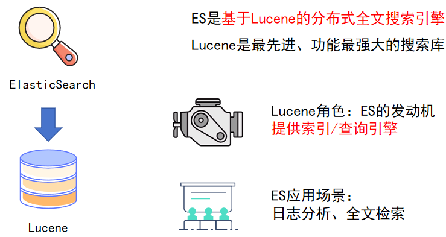
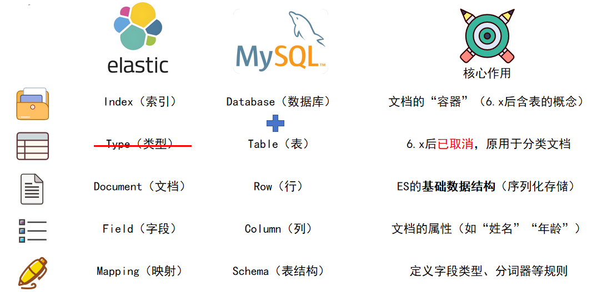
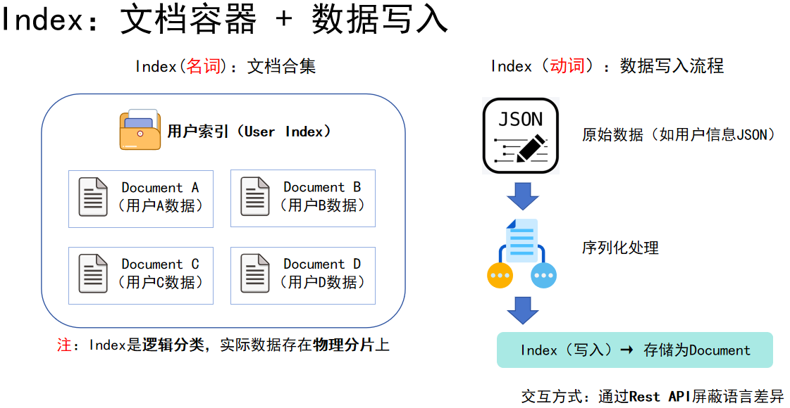
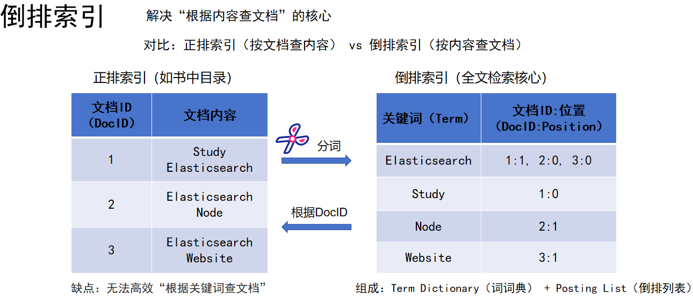
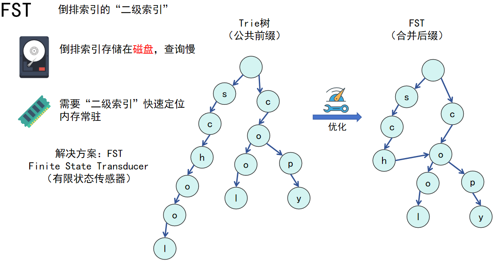
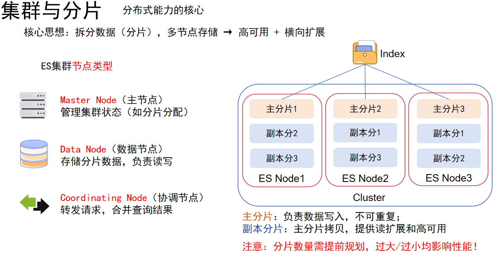

# Elasticsearch 核心概念深度解析：从基础到分布式架构

在大数据检索与存储场景中，Elasticsearch（简称 ES）凭借其分布式特性、高效全文检索能力，成为日志分析、电商搜索等领域的核心中间件。本文将结合可视化图表（对应 PPT 截图位置已标注），从 “是什么”“核心概念”“关键技术”“分布式架构” 四个维度，系统拆解 ES 的核心逻辑，适合初学者入门与开发者巩固基础。

## 1. 引言：为什么要学 Elasticsearch？

在面试与实际开发中，ES 常被问及两大问题：“ES 是什么？”“它的核心概念有哪些？”。其本质是一款**基于 Lucene 的分布式全文搜索引擎**，不仅能实现海量数据的存储，更能通过优化的索引机制快速完成全文检索与数据分析。

## 2. Elasticsearch 核心定位：基于 Lucene 的分布式引擎

### 2.1 ES 与 Lucene 的关系

ES 并非从零构建，而是以 Apache Lucene 为 “底层发动机”——Lucene 是一款开源的全文检索工具包，提供了完整的索引构建、查询执行能力，但它仅为 “工具包” 而非 “完整引擎”。ES 在 Lucene 基础上补充了**分布式能力**（如分片、集群）、**统一交互层**（Rest API），最终成为可直接部署的企业级中间件。

* **Lucene 角色**：负责底层索引创建、查询计算（ES 的 “核心动力”）；
* **ES 扩展能力**：分布式存储、跨语言交互、集群管理（让 Lucene 从 “单机工具” 升级为 “分布式系统”）。

### 2.2 ES 典型应用场景

1. **日志分析**：收集多服务器日志，通过 ES 快速检索异常日志（如排查线上报错）；
2. **全文检索**：电商平台商品搜索、音乐 / 视频平台关键词检索（如根据歌词查歌曲）；
3. **数据分析**：实时统计用户行为、业务指标（如某商品的搜索量排行）。

## 3. ES 核心概念：从 “数据结构” 到 “操作逻辑”

ES 的核心概念需围绕 “数据存储” 与 “数据操作” 展开，最易混淆的是 “Index” 的双重含义，同时可通过与 MySQL 类比快速理解基础结构。

### 3.1 与 MySQL 概念类比：快速建立认知

ES 的数据模型与关系型数据库（如 MySQL）有相似逻辑，通过类比可快速入门：

| **Elasticsearch 概念** | **MySQL 对应概念** | **核心作用** |
| :--- | :--- | :--- |
| Index（索引） | Database（数据库） | 文档的顶层容器（6.x 后取消 Type，兼具 “库” 与 “表” 的角色） |
| Type（类型） | Table（表） | 6.x 后已废除，原用于对 Index 内文档分类 |
| Document（文档） | Row（行） | ES 最小数据单元（JSON 格式，序列化存储） |
| Field（字段） | Column（列） | Document 的属性（如 “姓名”“年龄”） |
| Mapping（映射） | Schema（表结构） | 定义 Field 类型（如文本 / 数字）、分词器等规则 |

### 3.2 Index 的双重含义：名词 + 动词

“Index” 是 ES 中最核心且易混淆的概念，需区分两种语境：

#### （1）Index 作为名词：文档的集合

Index 作为名词时，是**同一类型 Document 的集合**，例如 “用户索引（User Index）” 包含所有用户的 Document（用户 A、用户 B、用户 C 等）。

* 关键特性：Index 是 “逻辑分类”，实际数据并未存储在 Index 中，而是分散在物理分片（Shard）上（后续 “分布式架构” 章节详解）。

【对应 PPT 页面：Index（名词）- 用户索引文档集合图】

#### （2）Index 作为动词：数据写入操作

Index 作为动词时，指**将 Document 写入 ES 的过程**（即 “数据写入”），流程如下：

1. 准备原始数据（JSON 格式，如 <code>{"name":"张三","age":30}</code>）；
2. 对数据进行 “序列化”（转换为 ES 可存储的二进制格式）；
3. 通过 Index 操作（动词）将数据存入指定 Index（名词），最终生成 Document。

#### （3）统一交互层：Rest API

无论 Index 是名词还是动词，所有操作均通过 **Rest API** 完成 ——ES 屏蔽了编程语言差异，Java、Python、Go 等语言均通过 HTTP 请求（GET/POST/PUT/DELETE）与 ES 交互，例如：

* 写入 Document：<code>PUT /user/_doc/1</code>（向 “user” Index 写入 ID=1 的 Document）；
* 查询 Document：<code>GET /user/_doc/1</code>（查询 “user” Index 中 ID=1 的 Document）。

## 4. ES 检索核心：倒排索引与 FST 优化

ES 全文检索快的核心是 “倒排索引”，而 “FST” 则是解决倒排索引性能瓶颈的关键优化。

### 4.1 倒排索引：解决 “按内容查文档” 的痛点

传统关系型数据库用 “正排索引”（按文档 ID 查内容），无法高效支持 “按关键词查文档”，而倒排索引通过 “关键词→文档 ID” 的映射，实现快速全文检索。

#### （1）正排索引的不足

正排索引以 “文档 ID” 为核心，存储 “文档 ID→文档内容” 的映射，例如：

| **文档 ID（DocID）** | **文档内容** |
| :--- | :--- |
| 1 | Study Elasticsearch |
| 2 | Elasticsearch Node |
| 3 | Elasticsearch Website |

若需查询 “包含 Elasticsearch 的所有文档”，正排索引需遍历所有文档，效率极低（“全表扫描”）。

#### （2）倒排索引的结构

倒排索引先对文档内容 “分词”（拆分为单个关键词），再建立 “关键词→文档 ID” 的映射，结构如下：

| **关键词（Term）** | **文档 ID: 位置（DocID:Position）** |
| :--- | :--- |
| Elasticsearch | 1:1, 2:0, 3:0（在文档 1 的第 1 位、文档 2 的第 0 位...） |
| Study | 1:0 |
| Node | 2:1 |
| Website | 3:1 |

* **核心组成**：
  1. Term Dictionary（词词典）：存储所有分词后的关键词，相当于 “目录”；
  2. Posting List（倒排列表）：存储关键词对应的文档 ID、关键词在文档中的位置、词频（用于相关性评分）等信息。

通过倒排索引查询 “Elasticsearch” 时，直接定位关键词，即可获取所有相关文档，效率大幅提升。

### 4.2 FST 优化：解决倒排索引的 “磁盘 IO 瓶颈”

倒排索引的 Term Dictionary 与 Posting List 存储在磁盘中，若每次查询都读磁盘，会因 IO 延迟影响性能。ES 引入 **FST（有限状态传感器）** 作为 “二级索引”，解决此问题。

#### （1）FST 的设计逻辑

FST 是一种 “压缩的前缀树”，核心是**合并重复前缀与后缀**，在节省内存的同时实现快速关键词定位：

* 传统 Trie 树（前缀树）：仅合并重复前缀（如 “cool” 与 “copy” 合并 “co”），但后缀重复（如 “ool”）仍会占用内存；
* FST：同时合并重复前缀与后缀（如 “cool” 与 “copy” 的 “co” 前缀合并，“ool” 与 “opy” 的重复部分也合并），内存占用仅为 Trie 树的 1/3~1/5。

#### （2）FST 的关键特性

* **常驻堆内存**：FST 构建后存储在 ES 的堆内存中，查询时直接从内存读取，无需访问磁盘，大幅降低 IO 延迟；
* **支持模糊查询**：因保留前缀关联，FST 可快速支持 “前缀匹配”“模糊匹配”（如查询 “ela\*” 可快速定位 “Elasticsearch”）。

## 5. ES 分布式架构：集群与分片

ES 能存储海量数据的核心是 “分布式分片”，通过 “拆分数据 + 多节点存储” 实现高可用与负载均衡。

### 5.1 集群节点类型：各司其职

一个 ES 集群由多个 “节点（Node）” 组成，每个节点是一个 ES 实例（Java 进程），按功能分为三类：

| **节点类型** | **核心作用** | **关键特性** |
| :--- | :--- | :--- |
| Master Node（主节点） | 管理集群状态（如分片分配、节点加入 / 退出） | 集群中仅 1 个活跃主节点，避免脑裂 |
| Data Node（数据节点） | 存储分片数据、处理读写请求 | 集群的 “数据载体”，可横向扩展 |
| Coordinating Node（协调节点） | 转发用户请求、合并查询结果 | 所有节点默认具备此功能，无需单独配置 |

### 5.2 分片机制：拆分数据，实现高可用

#### （1）分片的类型与作用

Index 会被拆分为多个 “分片（Shard）”，分为两类：

* **主分片（Primary Shard）**：负责数据写入，一个 Index 的主分片数量在创建时指定，后续不可修改（需提前规划）；
* **副本分片（Replica Shard）**：主分片的 “备份”，负责分担读请求、实现高可用（主分片故障时，副本分片可升级为主分片）。

#### （2）分片分布规则（由 Master 节点管理）

为确保高可用与负载均衡，分片分布遵循以下规则：

1. 主分片必须分布在不同 Data Node 上（避免单节点故障导致数据丢失）；
2. 一个主分片的副本分片，不能与该主分片在同一 Data Node 上（避免主副同机故障）；
3. 同一主分片的多个副本分片，尽量分布在不同 Data Node 上。

**示例**：Index 配置 “3 个主分片 + 2 个副本分片”，集群有 3 个 Data Node 时，分片分布如下：

* Node1：主分片 P1 + 副本分片 R2（P2 的副本）+ 副本分片 R3（P3 的副本）；
* Node2：主分片 P2 + 副本分片 R1（P1 的副本）+ 副本分片 R3（P3 的副本）；
* Node3：主分片 P3 + 副本分片 R1（P1 的副本）+ 副本分片 R2（P2 的副本）。

#### （3）分片规划注意事项

* 分片不宜过小：单个分片数据量过小，会导致分片数量过多，Master 节点管理压力增大，且查询时合并结果耗时；
* 分片不宜过大：单个分片数据量过大（如超过 50GB），会导致索引创建、分片迁移耗时，且查询时扫描数据慢。

## 6. 核心总结：ES 架构的 “四大支柱”

通过以上解析，ES 的核心逻辑可归纳为 “四大支柱”，也是面试高频考点：

1. **底层支撑**：Lucene 提供索引与查询引擎，是 ES 的 “核心动力”；
2. **数据结构**：以 Index（容器）→ Document（最小单元）为核心，通过 Mapping 定义数据规则；
3. **检索核心**：倒排索引实现高效全文检索，FST 优化解决磁盘 IO 瓶颈；
4. **分布式能力**：通过 “集群节点（Master/Data/Coordinating）+ 主副分片” 实现海量存储与高可用。

掌握这四大支柱，即可理解 ES 的设计逻辑，无论是日常开发还是面试应答，都能应对自如。

* 官方文档：[Elasticsearch 官方指南](https://www.elastic.co/guide/en/elasticsearch/reference/current/index.html)（最权威，更新及时）；
* 工具：Kibana（可视化）、Elasticsearch Head（浏览器插件，查看集群状态）。
