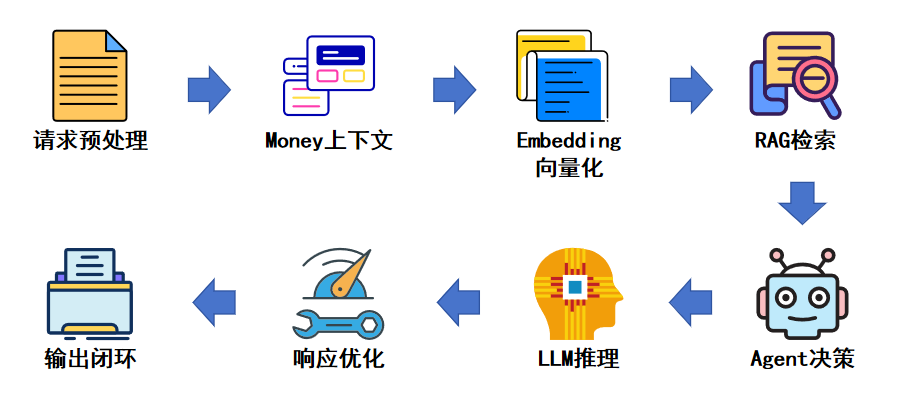
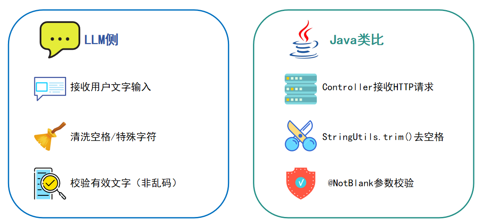
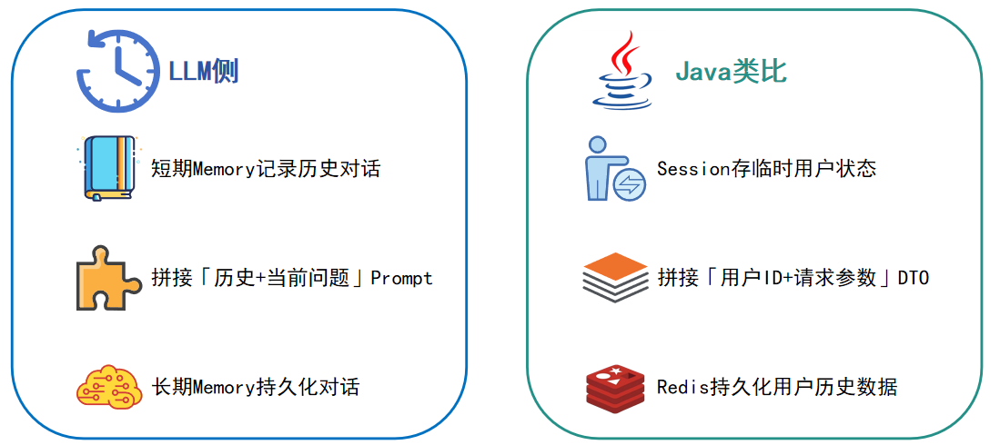
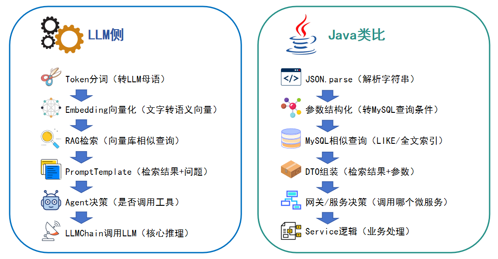
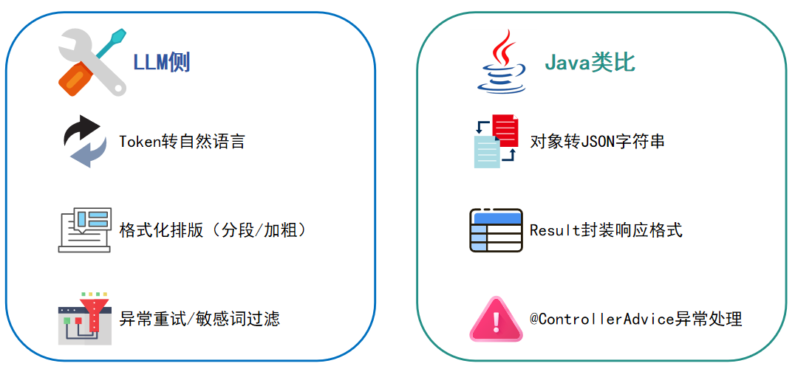
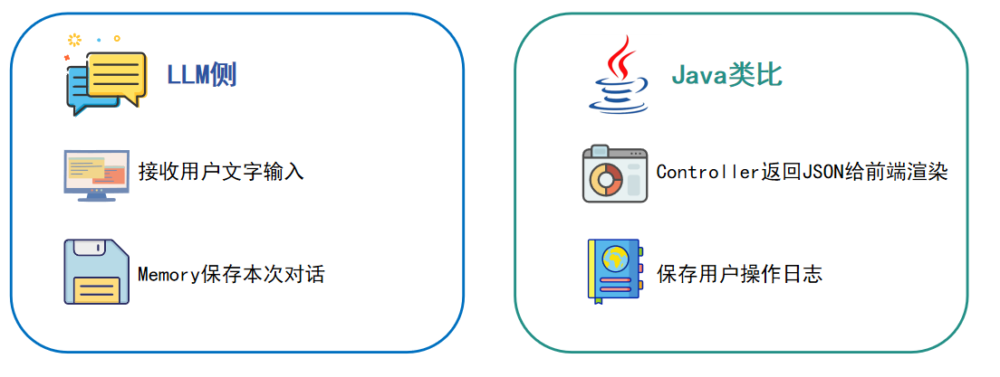
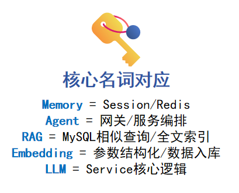
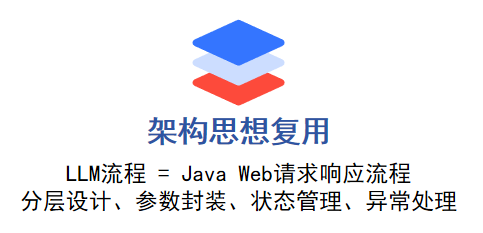

# Java 程序员秒懂 AI 核心：LLM 推理全流程与 Java 技术栈深度类比技术文档

## 前言

### 文档目标

本文面向 Java 开发工程师，通过 Java 技术栈（Spring Boot、MySQL、微服务架构等）的核心概念，深度类比 LLM（大语言模型）推理全流程及关键 AI 名词（Memory、Embedding、RAG、Agent 等），帮助 Java 程序员快速破除 AI 技术的陌生感，基于已有技术认知理解大模型应用的核心逻辑，无需额外学习 Python 或底层算法即可建立完整的 AI 流程认知。

### 核心思想

LLM 推理全流程本质是「自然语言版的 Java Web 请求 - 响应流程」—— 两者均遵循 “分层设计、参数封装、状态管理、异常处理” 的核心架构思想，仅在 “数据格式（自然语言 vs 结构化数据）” 和 “核心处理逻辑（语义推理 vs 业务计算）” 上存在差异，其余环节均可直接复用 Java 开发经验。

### 文档结构

1. 核心流程总览：建立 LLM 流程与 Java Web 流程的全局对应关系；
2. 分步详细拆解：按 “请求预处理→上下文管理→核心推理→响应优化→输出闭环” 顺序，逐环节解析 LLM 侧逻辑与 Java 技术栈类比；
3. 核心名词对照表：汇总 AI 名词与 Java 技术的精准映射；
4. 总结：提炼 Java 程序员理解 AI 的核心优势与关键复用点。

## 一、核心流程总览

### LLM 推理全流程（8 大环节）

<code>请求预处理</code> → <code>Memory上下文管理</code> → <code>Token分词</code> → <code>Embedding向量化</code> → <code>RAG检索</code> → <code>PromptTemplate构造</code> → <code>Agent决策</code> → <code>LLM核心推理</code> → <code>响应优化</code> → <code>输出闭环</code>

### 对应 Java Web 核心流程

<code>前端请求</code> → <code>Controller参数处理</code> → <code>Session/Redis状态管理</code> → <code>JSON解析（DTO封装）</code> → <code>MySQL/ES数据查询</code> → <code>Service逻辑组装</code> → <code>网关服务编排</code> → <code>核心Service计算</code> → <code>响应格式化</code> → <code>结果返回+日志持久化</code>

### 流程核心共识

两者均遵循 “输入→处理→输出” 的闭环逻辑，且每个环节的设计目标高度一致：

* 数据清洗：确保输入数据有效（LLM 侧清洗文字，Java 侧校验参数）；
* 状态管理：维持上下文关联（LLM 侧用 Memory，Java 侧用 Session/Redis）；
* 结构化转换：将 “人 / 前端可懂格式” 转为 “机器 / 模型可懂格式”（LLM 侧 Token/Embedding，Java 侧 JSON/DTO）；
* 数据检索：获取核心处理所需的外部数据（LLM 侧 RAG，Java 侧 MySQL 查询）；
* 逻辑编排：决策处理路径与依赖（LLM 侧 Agent，Java 侧网关）；
* 核心计算：执行核心业务 / 推理逻辑（LLM 侧 LLM 模型，Java 侧 Service）；
* 结果优化：确保输出格式规范、稳定（LLM 侧排版 / 重试，Java 侧 Result 封装 / 异常处理）。

## 二、分步详细拆解

### 步骤 1：请求接收与预处理

#### 步骤目标

过滤无效输入，将原始输入转换为 “下游环节可直接处理的干净数据”，避免无效数据导致流程异常。

#### LLM 侧详细逻辑

1. 输入接收：接收用户通过对话框输入的自然语言文本（如 “Java 如何理解 RAG？”），本质是字符串数据；
2. 数据清洗：自动移除文本中的多余空格、换行符、特殊符号（如乱码、表情符号），确保文本格式统一；
3. 有效性校验：校验输入是否为有效自然语言（非纯乱码、非无意义字符组合），过滤无效请求（如仅输入 “###”）。

#### Java 技术栈类比

| **LLM 侧操作** | **Java 侧对应技术** | **类比说明** |
| :--- | :--- | :--- |
| 接收自然语言输入 | Controller 接收 HTTP 请求 | 用户输入文字 = 前端通过 POST 请求传递的 JSON / 表单参数，均为 “外部输入数据” |
| 清洗空格 / 特殊字符 | StringUtils.trim ()、正则替换 | 两者目的均为 “去除无关字符，统一数据格式”，如 Java 中去除参数前后空格、过滤脚本注入字符 |
| 校验有效文字 | @NotBlank、@NotNull、自定义 Validator | 均为 “参数合法性校验”，避免无效数据进入下游流程（如 LLM 拒绝纯乱码，Java 拒绝空参数） |

#### 核心共识

该环节无技术壁垒，核心逻辑完全复用 Java 中 “Controller 层参数预处理” 的设计思想 ——“先净化数据，再传递处理”。

### 步骤 2：上下文管理（核心名词：Memory）

#### 步骤目标

记录历史交互信息，确保当前处理能关联过往上下文，避免 “失忆” 导致的响应脱节（如用户连续提问时，模型能衔接前序问题）。

#### LLM 侧详细逻辑

1. 短期 Memory：临时存储当前对话会话的历史交互记录（如用户先问 “LLM 是什么”，再问 “如何类比 Java”，短期 Memory 会保留前序问题与回答）；
2. 上下文拼接：将 “短期 Memory 中的历史对话 + 当前用户问题” 拼接为完整文本，形成 “带上下文的请求”；
3. 长期 Memory（可选）：将重要对话历史持久化到向量数据库或文件系统（如用户的长期咨询记录），支持跨会话的上下文关联（类似 Java 的 “用户历史操作日志查询”）。

#### Java 技术栈类比

| **LLM 侧操作** | **Java 侧对应技术** | **类比说明** |
| :--- | :--- | :--- |
| 短期 Memory | Session | 均为 “会话级临时存储”，生命周期与当前交互会话一致（会话结束后数据销毁），如 Session 存储用户登录状态、临时购物车数据 |
| 上下文拼接 | DTO 参数组装 | LLM 拼接 “历史 + 当前问题” = Java 拼接 “用户 ID（Session 中）+ 请求参数（前端传）”，均为 “补充关键上下文，让下游处理更精准” |
| 长期 Memory | Redis/MySQL | 均为 “持久化存储”，支持跨会话数据复用，如 Redis 存储用户长期偏好、MySQL 存储订单历史记录 |

#### 核心名词解析：Memory

* 定义：LLM 的 “状态管理组件”，负责存储、拼接、持久化对话上下文信息；
* 核心作用：解决大模型 “无状态” 问题，让模型能 “记住” 过往交互，实现连续、连贯的对话响应；
* Java 类比总结：Memory = Session（短期状态） + Redis/MySQL（长期存储），核心设计思想完全一致。

### 步骤 3：核心推理环节（Token 分词 + Embedding+RAG+PromptTemplate+Agent+LLM）

该环节是 LLM 推理的核心，涉及多个关键 AI 名词，但每个名词均可在 Java 技术栈中找到精准对应，且流程逻辑与 Java“数据解析→查询→组装→决策→计算” 的业务流程完全同源。

#### 3.1 子步骤 1：Token 分词

##### 步骤目标

将自然语言文本拆解为 LLM 模型能理解的 “最小语义单位”，类似 Java 将复杂 JSON 拆解为可处理的对象属性。

###### LLM 侧详细逻辑

* 分词逻辑：将完整的自然语言文本（如 “Java 程序员如何理解 Embedding？”）拆解为模型预定义的 “Token 序列”（如<code>[Java, 程序员, 如何, 理解, Embedding]</code>）；
* 编码转换：将每个 Token 映射为模型可计算的数字编码（如每个 Token 对应唯一 ID），因为模型仅能处理数值型数据，无法直接理解文字；
* 核心作用：降低模型处理复杂度，让模型能按 “语义单位” 解析文本含义。

###### Java 技术栈类比

| **LLM 侧操作** | **Java 侧对应技术** | **类比说明** |
| :--- | :--- | :--- |
| Token 分词 | String.split()、JSON.parseObject() | String.split 将字符串拆分为数组 = Token 分词将文本拆分为 Token 序列；JSON.parseObject 将 JSON 字符串拆分为 Java 对象属性，本质都是 “拆分复杂数据为最小可处理单位” |
| Token 编码 | 对象序列化（FastJSON/ProtoBuf） | Token 转数字编码 = Java 对象序列化（转 JSON / 二进制），均为 “将人可懂格式转为机器可处理格式” |

###### 核心名词解析：Token

* 定义：LLM 的 “最小语义单位”，可理解为模型的 “专属单词表中的单词块”；
* 类比总结：Token = Java 中的 “字符串数组元素” 或 “对象属性”，是模型处理文本的 “基础数据单元”。

#### 3.2 子步骤 2：Embedding 向量化（核心名词：Embedding）

##### 步骤目标

将 Token 序列转换为 “能表达语义含义的数值向量”，实现 “语义相似性计算”（如判断用户问题与文档内容是否相关），为后续 RAG 检索提供基础。

###### LLM 侧详细逻辑

* 向量化转换：通过 Embedding 模型（如 OpenAI Embedding、通义 Embedding）将每个 Token 或完整文本转换为固定长度的数值向量（如 1536 维的浮点数数组）；
* 语义映射：向量的数值分布与文本语义强相关 —— 语义相似的文本（如 “Java 如何对接 LLM” 与 “LLM 的 Java 集成方案”）对应的向量在数学空间中距离更近；
* 核心作用：将 “语义匹配” 问题转化为 “数学向量相似性计算” 问题，让模型能快速找到与用户问题相关的信息。

###### 离线补充环节（LLM 侧）

* 文档向量化：在 RAG 检索前，需将外部知识库（如企业手册、技术文档）拆分为小文本片段，通过 Embedding 模型转为向量，存入向量数据库（如 Chroma、Milvus），并建立索引；
* Java 类比：该环节对应 Java 项目上线前的 “数据入库 + 建索引” 操作（如将 Excel 中的商品数据导入 MySQL，并给商品名称建全文索引）。

###### Java 技术栈类比

| **LLM 侧操作** | **Java 侧对应技术** | **类比说明** |
| :--- | :--- | :--- |
| 文本→向量转换 | 参数结构化（String→QueryWrapper） | Embedding 将文字转为向量 = Java 将前端传入的模糊字符串（如 “高金额订单”）转为 MySQL 可执行的查询条件（<code>amount > 10000</code>），均为 “将非结构化请求转为结构化、可计算的格式” |
| 文档向量化 + 入库 | 数据清洗→序列化→MySQL 入库 + 建索引 | 两者均为 “离线准备工作”，核心目的是 “为在线查询提供高效、结构化的数据支持” |
| 向量相似性计算 | MySQL 全文索引匹配、ES 相关性评分 | 向量距离计算 = MySQL 全文索引的<code>MATCH() AGAINST()</code> 相关性评分，均为 “按语义 / 关键词找到最相关的数据” |

###### 核心名词解析：Embedding

* 定义：将文本（或 Token）映射为高维数值向量的技术，核心是 “语义的数值化表达”；
* 核心作用：实现语义相似性匹配，是 RAG 检索的基础；
* Java 类比总结：Embedding = 参数结构化（String→QueryWrapper） + 数据序列化（对象→JSON），核心是 “非结构化数据→结构化可计算数据” 的转换。

#### 3.3 子步骤 3：RAG 检索（核心名词：RAG）

##### 步骤目标

从外部知识库（向量数据库）中检索与用户问题 “语义最相关” 的文本片段，为 LLM 生成回答提供 “真实、准确的外部数据支持”，解决大模型 “知识过期、不懂私有数据” 的痛点。

###### LLM 侧详细逻辑

* 问题向量生成：将用户当前问题（已完成 Embedding 向量化）作为检索查询向量；
* 相似性检索：用查询向量在向量数据库中执行 “近邻检索”，找到与查询向量距离最近的 N 个文档向量（即语义最相关的 N 个文档片段）；
* 结果返回：将检索到的文档片段（原始文字）返回，作为后续生成回答的 “参考资料”。

###### Java 技术栈类比

| **LLM 侧操作** | **Java 侧对应技术** | **类比说明** |
| :--- | :--- | :--- |
| 问题向量生成 | 构造 QueryWrapper 查询条件 | 均为 “生成查询依据”，RAG 用向量作为查询条件 = Java 用 QueryWrapper 封装查询参数 |
| 向量库相似检索 | MySQL LIKE 查询、MySQL 全文索引、ES 相关性检索 | RAG 检索 “语义相似的文档” = Java 查询 “关键词匹配的数据库记录”，核心目的均为 “从外部数据源获取与请求相关的支持数据” |
| 返回文档片段 | DAO 层返回查询结果（POJO） | 均为 “下游组装环节提供原始数据支持”，RAG 返回文档片段 = DAO 返回数据库记录 |

###### 核心名词解析：RAG（Retrieval-Augmented Generation）

* 定义：检索增强生成，核心逻辑是 “先检索外部知识库→再基于检索结果生成回答”；
* 核心价值：无需重新训练大模型，即可让模型 “懂最新知识、懂私有数据”，同时避免模型 “幻觉”（编造虚假信息）；
* Java 类比总结：RAG = MySQL/ES 查询 + 结果返回，本质是 LLM 的 “DAO 层”，负责获取外部数据支持。

#### 3.4 子步骤 4：PromptTemplate 构造

##### 步骤目标

将 “用户问题 + RAG 检索结果 + 对话上下文” 组装为 LLM 模型能理解的 “结构化指令”，类似 Java 将 “查询结果 + 请求参数” 组装为 DTO，供 Service 层处理。

###### LLM 侧详细逻辑

* 模板定义：预定义 Prompt 模板（如 “基于以下参考资料，用 Java 技术栈类比解释用户问题：{参考资料}\n 用户问题：{用户问题}\n 要求：语言通俗，面向入门者”）；
* 参数填充：将 RAG 检索到的文档片段、用户当前问题、对话上下文（Memory 中）填充到模板中，生成完整的 Prompt（模型的 “最终请求”）；
* 核心作用：明确模型的回答目标、参考依据、格式要求，确保模型生成的回答贴合需求。

###### Java 技术栈类比

| **LLM 侧操作** | **Java 侧对应技术** | **类比说明** |
| :--- | :--- | :--- |
| PromptTemplate | DTO/VO 类定义 | 模板预定义格式 = DTO 预定义属性结构，均为 “规范数据组装格式” |
| 参数填充生成 Prompt | DTO 组装（new DTO ().setXxx ().setYyy ()） | 填充 “问题 + 检索结果 + 上下文” = 组装 “用户 ID + 查询结果 + 请求参数”，均为 “为下游核心处理提供完整、结构化的数据” |

#### 3.5 子步骤 5：Agent 决策（核心名词：Agent）

##### 步骤目标

作为 LLM 的 “逻辑编排组件”，判断是否需要调用额外工具（如搜索、计算器、API），并决定最终的处理路径（直接调用 LLM 生成回答，或调用工具补充数据后再生成）。

###### LLM 侧详细逻辑

* 意图解析：基于完整 Prompt，解析用户问题的核心需求（如 “当前时间是多少” 需要调用时间工具，“公司产品价格” 需要调用内部 API）；
* 工具决策：判断是否需要调用外部工具 —— 若现有 RAG 检索结果已足够回答问题，则直接进入 LLM 生成环节；若信息不足（如需要实时数据、计算结果），则调用对应的工具获取补充数据；
* 路径执行：按决策结果执行路径（调用工具→补充数据→重新构造 Prompt→传入 LLM；或直接传入 LLM）。

###### Java 技术栈类比

| **LLM 侧操作** | **Java 侧对应技术** | **类比说明** |
| :--- | :--- | :--- |
| 意图解析 | 网关路由匹配（Spring Cloud Gateway） | Agent 解析用户意图 = 网关解析请求路径（如<code>/order/*</code> 匹配订单服务），均为 “识别核心需求，确定处理方向” |
| 工具决策 | 服务编排（Spring Cloud Stream）/ 动态路由 | Agent 判断是否调用工具 = 网关判断是否需要转发至其他微服务（如查询订单需调用支付服务校验状态），均为 “基于需求动态调整处理路径” |
| 路径执行 | 微服务调用链（Feign 调用） | Agent 调用工具→补充数据 = 网关转发请求→微服务返回结果，均为 “跨组件 / 服务获取数据，支撑最终处理” |

###### 核心名词解析：Agent

* 定义：LLM 的 “网关 + 服务编排组件”，负责意图解析、工具调用决策、处理路径执行；
* 核心作用：扩展 LLM 的能力边界，让模型不仅能基于现有数据推理，还能调用外部工具获取实时数据、执行计算、操作 API；
* Java 类比总结：Agent = Spring Cloud Gateway（路由决策） + Feign（服务调用），核心是 “逻辑编排与工具调度”。

#### 3.6 子步骤 6：LLM 核心推理（核心名词：LLM）

##### 步骤目标

接收 PromptTemplate 构造的结构化指令，基于模型训练的语义知识和 RAG 检索的外部数据，生成符合需求的自然语言回答，类似 Java Service 层执行核心业务计算。

###### LLM 侧详细逻辑

* 指令解析：解析 Prompt 中的用户问题、参考资料、格式要求（如 “用 Java 类比”“面向入门者”）；
* 语义推理：结合模型训练的海量文本知识（如 Java 技术栈相关概念）和 RAG 检索的外部数据（如企业技术文档片段），推理出回答的核心逻辑；
* 生成优化：按要求的格式（通俗、类比）生成自然语言回答，确保逻辑连贯、语义准确；
* 核心输出：生成 Token 序列形式的原始回答，供后续响应优化环节处理。

###### Java 技术栈类比

| **LLM 侧操作** | **Java 侧对应技术** | **类比说明** |
| :--- | :--- | :--- |
| 指令解析 | Service 层参数解析（DTO→业务参数） | LLM 解析 Prompt 指令 = Java Service 解析 DTO 属性，均为 “理解输入数据的核心需求与约束条件” |
| 语义推理 | Service 层业务逻辑计算 | LLM 基于知识 + 外部数据推理 = Java Service 基于数据库数据 + 业务规则计算（如订单金额计算、权限校验），均为 “核心业务 / 推理逻辑执行” |
| 生成原始回答 | Service 层返回 POJO 对象 | LLM 生成 Token 序列 = Java Service 返回 POJO，均为 “核心处理的原始结果，需后续格式化” |

###### 核心名词解析：LLM（Large Language Model）

* 定义：基于海量文本数据训练的大语言模型，能理解、生成自然语言，是 AI 的 “核心业务逻辑组件”；
* 核心能力：语义理解（懂用户问题）、逻辑推理（基于数据推导答案）、自然语言生成（输出人能懂的文字）；
* Java 类比总结：LLM = Java Service 层核心逻辑，是整个流程的 “计算核心”，负责接收结构化输入、执行核心处理、输出原始结果。

### 步骤 4：响应优化

#### 步骤目标

将 LLM 生成的原始 Token 序列转换为 “人能直接阅读的自然语言格式”，并处理异常情况，确保响应稳定、规范。

#### LLM 侧详细逻辑

1. Token 解码：将模型生成的 Token 序列（数字编码）转换为自然语言文本（原始回答）；
2. 格式优化：对原始回答进行排版（分段、加粗标题、列表展示），提升可读性，类似 Java 的 JSON 格式化；
3. 异常处理：若生成的回答不完整、逻辑混乱或包含敏感信息，触发重试机制（重新调用 LLM）或敏感词过滤；
4. 最终校验：确保优化后的回答符合规范（无敏感信息、格式清晰、逻辑连贯）。

#### Java 技术栈类比

| **LLM 侧操作** | **Java 侧对应技术** | **类比说明** |
| :--- | :--- | :--- |
| Token 解码 | JSON 序列化（ObjectMapper.writeValueAsString ()） | Token→文本 = POJO→JSON 字符串，均为 “将机器可处理的原始结果转为用户 / 前端可懂的格式” |
| 格式优化 | Result 封装（统一响应格式）、JSON 格式化 | LLM 排版（分段 / 加粗） = Java 用 Result 类封装（<code>{code:200, msg:"success", data:{}}</code> ）+ JSON 格式化，均为 “提升结果可读性、规范性” |
| 异常处理 | @ControllerAdvice 全局异常处理、RetryTemplate 重试 | LLM 重试 / 敏感词过滤 = Java 捕获业务异常返回友好提示、重试失败的数据库操作，均为 “保证流程稳定性，避免无效输出” |

### 步骤 5：输出返回与闭环

#### 步骤目标

将优化后的最终回答返回给用户，并持久化关键数据，为后续交互提供支持，形成完整的 “请求 - 响应” 闭环。

#### LLM 侧详细逻辑

1. 结果输出：将优化后的自然语言回答展示在用户对话框中，完成本次请求的核心响应；
2. 上下文持久化：将本次对话的 “用户问题 + 模型回答” 存入长期 Memory（如向量数据库），支持后续对话的上下文关联；
3. 日志记录：记录本次推理的关键信息（请求时间、处理路径、是否调用工具、响应耗时），用于问题排查和性能优化。

#### Java 技术栈类比

| **LLM 侧操作** | **Java 侧对应技术** | **类比说明** |
| :--- | :--- | :--- |
| 结果输出 | Controller 返回 JSON 响应 | LLM 对话框展示回答 = Java Controller 返回 JSON 给前端，均为 “将最终结果返回给请求发起方” |
| 上下文持久化 | MySQL 存储操作日志、Redis 缓存用户数据 | LLM 存储对话历史 = Java 存储订单日志、缓存用户偏好，均为 “持久化关键数据，支持后续交互 / 查询” |
| 日志记录 | SLF4J/Logback 日志打印、SkyWalking 链路追踪 | LLM 记录推理信息 = Java 记录接口调用日志、链路耗时，均为 “用于问题排查、性能优化” |

## 三、核心名词对照表

| **AI 核心名词** | **定义** | **Java 技术栈类比** | **核心作用** |
| :--- | :--- | :--- | :--- |
| Memory | 存储、拼接、持久化对话上下文的组件 | Session（短期） + Redis/MySQL（长期） | 解决大模型 “无状态” 问题，实现连续对话 |
| Token | LLM 的最小语义单位，文本拆解后的基础单元 | String.split () 拆分的数组元素、JSON 对象属性 | 降低模型处理复杂度，便于语义解析 |
| Embedding | 将文本转为表达语义的数值向量的技术 | 参数结构化（String→QueryWrapper） + 序列化 | 实现语义相似性匹配，为 RAG 检索提供基础 |
| RAG | 检索增强生成，先从外部知识库检索相关数据，再生成回答 | MySQL/ES 查询 + DAO 层 | 让模型懂最新知识、私有数据，避免幻觉 |
| PromptTemplate | 预定义格式，用于组装 “问题 + 检索结果 + 上下文” 的结构化指令 | DTO/VO 类定义 + 数据组装 | 规范模型输入，确保回答贴合需求 |
| Agent | 逻辑编排组件，负责意图解析、工具调用决策、路径执行 | Spring Cloud Gateway（路由） + Feign（调用） | 扩展模型能力边界，支持外部工具调用 |
| LLM | 大语言模型，基于海量数据训练，能理解、生成自然语言 | Java Service 层核心逻辑 | 推理流程的 “计算核心”，执行语义推理 |

## 四、核心总结

### 1. 架构思想完全复用

LLM 推理全流程与 Java Web 流程的核心架构思想高度一致，Java 程序员可直接复用以下经验：

* 分层设计：LLM 流程的 “预处理→上下文→推理→优化→输出” = Java 的 “Controller→Service→DAO→响应” 分层；
* 状态管理：Memory 的设计逻辑 = Session+Redis 的组合使用；
* 数据结构化：Token/Embedding/PromptTemplate = 字符串拆分 / 参数结构化 / DTO 组装；
* 外部数据获取：RAG = MySQL/ES 查询；
* 逻辑编排：Agent = 网关 + 服务调用；
* 核心计算：LLM = Service 核心逻辑；
* 异常处理：响应优化 = 全局异常处理 + 响应格式化。

### 2. Java 程序员的核心优势

* 无需从零学习：所有 AI 核心名词和流程均可通过 Java 技术栈类比理解，无需记忆复杂的 AI 底层算法；
* 架构思维复用：多年积累的 “分层、封装、解耦、状态管理” 思想可直接迁移到 AI 应用理解中；
* 技术壁垒低：后续学习 LangChain4j（Java 版 LangChain）时，其组件设计（DocumentLoader、VectorStore、RagChain）与 Java 的 POI、MyBatis、Service 逻辑完全同源，上手极快。

### 3. 关键认知升级

* AI 不是 “黑魔法”，而是 “自然语言版的 Java Web 应用”，核心逻辑与 Java 开发一致；
* 大模型相关名词本质是 Java 技术栈中 “已有组件的 AI 场景命名”，无需畏惧；
* 理解 AI 的关键不是学习新架构，而是将 AI 流程与 Java 流程做 “映射关联”，复用已有认知。

通过以上类比，Java 程序员可快速建立对 LLM 推理全流程和核心 AI 名词的完整认知，为后续深入学习 AI 应用开发奠定坚实基础。
